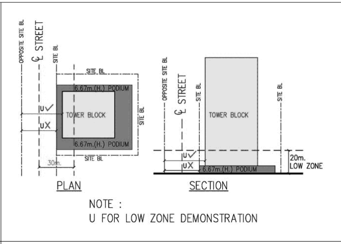
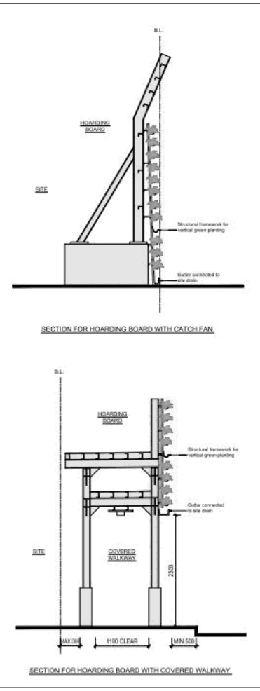
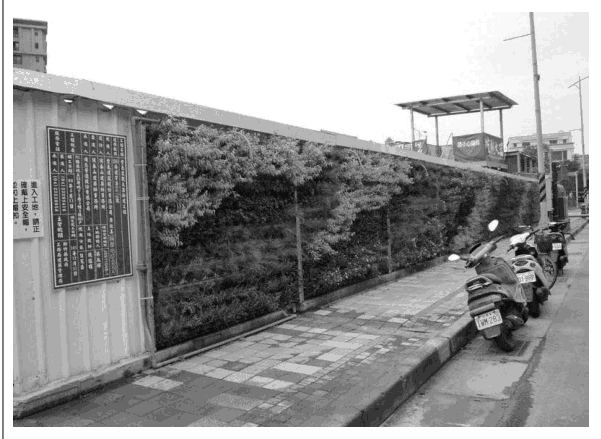
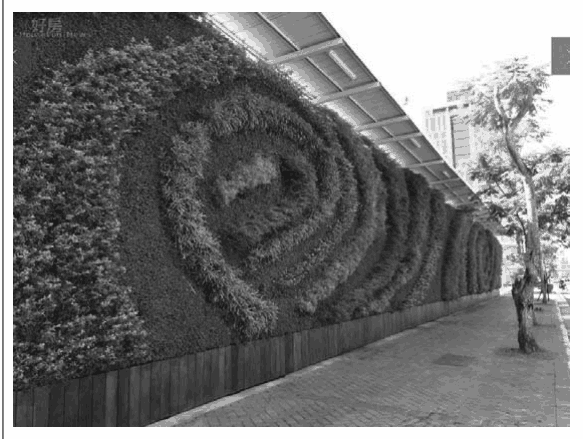

---
tags:
  - APSEC
  - Structural 結構
  - Registration 註冊
  - Plan submission & approval 呈交及審批
  - Domestic 住用
  - Staircase 樓梯
  - Fire safety 消防安全
  - Occupation permit 佔用許可證
  - Maintenance access 維修通道
  - Lighting & ventilation 照明及通風
  - Car park 停車場
  - Site safety 地盤安全
  - Drainage 排水
  - Barrier free access 無障礙
  - Sustainable building design 可持續建築設計
  - Means of escape 逃生途徑
  - Curtain wall & façade 幕牆及外牆
---

# APSEC discussion items 2017 <small>2017 年認可人士及註冊結構工程師委員會討論項目</small>

!!! info "About this page 關於本頁"
    Questions raised at the APSEC Discussion Forum (ADF) and **BD's responses**, extracted from the summaries published by the HKIE Structural Division. Text is condensed from the English source; check the PDF before relying on an item. Where a later meeting discussed the same question, the item is flagged and **the later response prevails**.
    摘錄自香港工程師學會結構分部發布的會議摘要（只有英文版本）。如其後會議再討論同一問題，以**較新的回覆為準**。

## ADF 5/2017 · 17 Nov 2017 {#adf-52017-17-nov-2017}

[Original summary (PDF) 原文](https://www.hkie-st.org/wp-content/uploads/2022/07/67_Finalised-Summary-of-Items-Discussed-in-APSEC-Discussion-Forum-on-17-November-2017.pdf) · 14 items

### 1. Sustainable Building Design Guidelines {#i201711171}

Raised by **HKIA** · Related 相關: [APP-152](../pnap/app-152.md)

**Question 問題:** Regarding Design Requirement (1) of Building Separation, the maximum permissible Lp of a building is obtained by multiplying 5 and the U on which the building abuts, where the U of such a street canyon in the assessment zone is measured perpendicular to the centre-line of the street from the external wall of the building that is within 30m from the centre-line of the street, to the site boundary of the other site on the opposite side of the street (Para.2.2, Appendix B of PNAP APP-152 refers). Para. 2.4, Appendix B of PNAP APP-152 further states that for the purpose of measuring Lp of a building along its long side, the part of the building that is within the low zone and of a height of not more than 6.67m may be disregarded. Based on the above, it is logical to deduce that the portion of the building that is within the low zone and of a height of not more than 6.67m should also be disregarded for the sake of deriving U at low zone. In other words, the U at low zone of such a street canyon is to be measured from the external wall of that portion of the building which is above 6.67m high as per the following diagrams. Please advise if our understanding is correct.
{: .apsec-q }

<figure markdown>
  { width="451" loading=lazy }
  <figcaption>Diagram 1 from the original summary (ADF 5/2017, item 1). 原文附圖。</figcaption>
</figure>

**BD's response 屋宇署回覆:** (Item withdrawn by HKIA during meeting.)
{: .apsec-a }

### 2. Lighting and Ventilation – B(P)R 30 and 31 {#i201711172}

Raised by **HKIA** · Related 相關: [B(P)R 24–37 Storey heights, open space, ](../regulations/bpr-24-37.md)

!!! warning "Later discussion 其後再討論"
    This question was discussed again on **25 Nov 2022**; use the [later response](2022.md#i2022112511) where they differ. 如有不同，以較新回覆為準。

**Question 問題:** It is our understanding that where a full height window (such as a french window or sliding door giving access to a balcony) meeting the requirement of B(P)R 31(a) [i.e. it faces into a street which is not less than 4.5m wide], the whole glazing area of such window including that portion below 1m A.F.F.L. can be counted towards the aggregate superficial area of glass in the window as required under B(P)R 30(2)(a)(i). That said, the requirement of just counting that portion of glazing at 1m A.F.F.L. and above for fulfillment of B(P)R 30(2)(a)(i) is applicable only to those prescribed windows adopting Rectangular Horizontal Plane (RHP) as per B(P)R 31(1)(b) to (d). Please advise if our understanding is correct.
{: .apsec-q }

**BD's response 屋宇署回覆:** BD advised that B(P)R 31(3)(b) regarding sill level of a prescribed window should also be applicable to B(P)R 31(1)(a). In other words, the requirement of just counting the portion of glazing area at 1m A.F.F.L. and above for fulfillment of B(P)R 30(2)(a)(i) was also applicable to prescribed window faced into a street which was not less than 4.5m wide. [Post-meeting notes: The same issue was raised again in BSC/APSEC Meeting held on 8.12.2017. After review, BD considered that the deemed level of sill as stipulated under B(P)R 31(3)(b) is for the purpose of assessing RHP mentioned in B(P)R 31(1)(b).]
{: .apsec-a }

### 3. Fire Safety Code 2011 - Clause B8.2 {#i201711173}

Raised by **HKIA** · Related 相關: [FS Code 2011 Part B: Means of Escape](../codes/fsc-part-b-means-of-escape.md)

**Question 問題:** Clause B8.2(b) reads “in case of domestic building or composite building not exceeding 15 storeys in height above the lowest ground storey”, people using one required staircase should be able to gain access to at least one other required staircase “at least every 5 storeys”. The BD is requested to clarify whether: (i) in the case of a composite building not exceeding 15 storeys in height with a required staircase for the discharge of the domestic portion of the building passing through but without access to the non-domestic podium, access to another required staircase should be provided at least every 5 storeys; and (ii) in the case of a non-domestic building not exceeding 15 storeys in height, any required staircase having no access to the floors below, requires access to another required staircase, similarly, at least every 5 storeys.
{: .apsec-q }

**BD's response 屋宇署回覆:** (i) BD advised that where a required staircase for discharge of domestic portion passing through but without access to the non-domestic podium, whether access to another required staircase should be provided at least every 5 storeys at the non-domestic podium would be considered on case merit. In principle, the risk of maneuvering long stairs before gaining access to alternate staircase has to balance with the risk of fire/smoke log of such staircase. (ii) BD advised that Clause B8.2(b) was applicable to domestic or composite building only instead of non-domestic building. B8.2(a) & (b) would be applicable to domestic, non-domestic and composite buildings.
{: .apsec-a }

### 4. Vertical Greening at Hoarding and Covered Walkway {#i201711174}

Raised by **HKIA** · Related 相關: [APP-23](../pnap/app-23.md)

<small>Related discussions 相關討論: [14 Jan 2022 item 7](2022.md#i202201147), [6 Feb 2026 item 5](2026.md#i202602065)</small>

**Question 問題:** Referring to item 5 of ADF held on 8 August 2014, we would like to enquire whether BD will re-consider accepting vertical greening (VG) at hoarding and covered walkway to enhance the environment near construction site, provided that: (i) Water supply and drainage of VG are properly designed; (ii) Structural calculation of VG is submitted; and (iii) Relevant requirements of TD/ HyD set out at Appendix A of PNAP APP-23 are complied with. (iv) For reference, overseas examples of hoardings with vertical greening are illustrated below for reference:
{: .apsec-q }

<figure markdown>
  { width="239" loading=lazy }
  <figcaption>Diagram 1 from the original summary (ADF 5/2017, item 4). 原文附圖。</figcaption>
</figure>

<figure markdown>
  { width="388" loading=lazy }
  <figcaption>Diagram 2 from the original summary (ADF 5/2017, item 4). 原文附圖。</figcaption>
</figure>

<figure markdown>
  { width="376" loading=lazy }
  <figcaption>Diagram 3 from the original summary (ADF 5/2017, item 4). 原文附圖。</figcaption>
</figure>

**BD's response 屋宇署回覆:** BD welcomed the proposal and reiterated item 5 of the said ADF that a number of factors had to be considered to ensure safety and avoidance of creating nuisance and inconvenience to the public. In particular, comments from other relevant departments and the proper maintenance of the vertical greening should be observed.
{: .apsec-a }

### 5. Heat Soak Test of Glass {#i201711175}

Raised by **HKIE** · Related 相關: [APP-37](../pnap/app-37.md)

**Question 問題:** If a client wants to buy some quality glasses from Europe for projects in HK. Due to time constraints, the Low E glass panes from Europe will be coated and delivered to a glass factory in China, before the submission of the facade design to the BD. The glass panes in particular such with Low E soft coating would have a limited shield by date (3 - 6 months). Therefore, the glass panes need to go through the heat soak test process to stabilize the low E soft coating before the shield by date. This means that the contractors need to carry out the heat soak tests and to have the Contractors’ and RSE’s TCPs to witness the tests before the approval and consent. Can we carry out the heat soak test after the submission and acknowledgement of the QA&QC proposal but before approval and consent of the window/glass works? In our opinion this is not any different from steelwork, which will have gone through all the tests before being bought and delivered to the construction site.
{: .apsec-q }

**BD's response 屋宇署回覆:** BD advised that Quality Assurance Scheme and Quality Supervision Plan on heat soak process in accordance with PNAP APP-37 could be submitted to the BD for consideration prior to obtaining approval of the relevant plans. Upon receipt of acknowledgement of the above two documents from BD, heat soak process of glass panes could be carried out before approval and consent were obtained.
{: .apsec-a }

### 6. Fire Safety Code 2011 - Clause B9.1(a) {#i201711176}

Raised by **AAP** · Related 相關: [FS Code 2011 Part B: Means of Escape](../codes/fsc-part-b-means-of-escape.md)

**Question 問題:** It is our understanding that Clause B9.1(a) can be applicable to ground storey discharge point of a required staircase which is also serving as a fire service access point. For example, a lavatory is allowed to be accessed from a G/F lift lobby serving as the access to a fireman lift and at the same time the final discharge point of a required staircase. We wish to confirm that our understanding is correct.
{: .apsec-q }

**BD's response 屋宇署回覆:** (Item withdrawn by AAP during meeting.)
{: .apsec-a }

### 7. Design for Safety {#i201711177}

Raised by **AAP** · Related 相關: [ADV-33](../pnap/adv-33.md)

**Question 問題:** It is our understanding gondola is not required to be provided when there is no curtain wall at the building, and when AC platforms can be accessed by the means as described in BD’s circular letter issued on 23.12.2016. We wish to confirm that our understanding is correct.
{: .apsec-q }

**BD's response 屋宇署回覆:** BD advised that focusing with AC platforms which were disregarded/exempted from SC/PR, if access for maintenance and repair (M&R) of AC units thereon including their replacement was through openings envisaged in the said circular letter and the AC platforms were also designed according to guidelines by CIC (on cast-in anchors and guard rails) and Labour Department, no gondola would need to be provided for M&R of the AC units. For other projections or external features which were disregarded/exempted from SC/PR, safe access and facilities for their M&R should be provided as stated in Appendix A1 of PNAP ADV-33 and other relevant PNAPs.
{: .apsec-a }

### 8. Installation of AC Units after OP {#i201711178}

Raised by **AAP**

**Question 問題:** AC units are required to be shown (usually in dotted lines) on GBP to justify the length of AC Platform. It is our understanding that these AC units need not be installed during OP inspection. We wish to confirm that our understanding is correct.
{: .apsec-q }

**BD's response 屋宇署回覆:** BD advised that for AC platforms which were disregarded/exempted from SC/PR, AC units should be installed for OP inspection for matching with the layouts as shown in the GBP. For exceptional case where AC units could not be installed at such AC platforms at the time of application for occupation permit, BD might consider to accept their installation at a later stage on case merits, like unexpected late delivery of AC units and purchase order/invoice plus undertaking from the building owner to install the AC units and report completion were adduced and found satisfactory.
{: .apsec-a }

### 9. Barrier Free Access – Level Difference between Arcade and Shop {#i201711179}

Raised by **AAP** · Related 相關: [Design Manual: Barrier Free Access 2008 ](../codes/bfa-2008.md)

**Question 問題:** During OP inspection, it is possible that a ‘level difference’ is observed between the arcade and the shop because floor finishing of the arcade is completed while that within the shop is yet to be carried out. We consider that ramp by cement sand screeding to cater for such kind level difference, which is required by some officers during OP inspections is a waste of resources, since eventually if the shops are rented, their finishing work will be carried out and their floor level will tally with that of the arcade. We suggest BD should consider accepting minor level difference between the finished landlord areas and the tenant areas during OP inspection.
{: .apsec-q }

**BD's response 屋宇署回覆:** BD advised that minor level difference not more than 50mm between the finished arcade floor and the un-finished shop floor during OP inspection could be accepted as a temporary situation, provided that the building owner undertakes that the shop would level with the adjoining arcade after completion of shop decoration works.
{: .apsec-a }

### 10. PNAP APP-2 – Appendix C – Underground Car park {#i2017111710}

Raised by **AAP** · Related 相關: [APP-2](../pnap/app-2.md)

<small>Related discussions 相關討論: [12 Aug 2022 item 8](2022.md#i202208128), [6 Feb 2026 item 7](2026.md#i202602067), [8 May 2026 item 12](2026.md#i2026050812)</small>

**Question 問題:** It is noted that the conditions by which BD may favorably consider in accepting a car park as an underground car park have been clearly stated in 3(a) to (d) in Appendix C of PNAP APP-2. We wish to know when there are site constraints of significant level difference of the streets on which the site abuts and when the topmost car park is semi-sunken and follows the slope profile of the site and adjoining land, i.e. following 3(d) literally – will such case be treated similarly as 3(a) to (c) in the approval process or must such case be considered via BC meeting?
{: .apsec-q }

**BD's response 屋宇署回覆:** BD advised that while cases under 3(a) to (c) were relatively more straight forward than cases under 3(d), the approval process was the same in that discussion at BC meetings would be arranged on need basis.
{: .apsec-a }

### 11. Acknowledgement of BA14 {#i2017111711}

Raised by **AAP**

**Question 問題:** We wish to follow up with AAP’s letter dated 16.10.2017 to BD regarding the time for BA14 acknowledgement.
{: .apsec-q }

**BD's response 屋宇署回覆:** BD was reviewing the situation and colleagues have been reminded to adhere to the 28-day timeframe. For cases with outstanding submission, BD would directly reject the BA14 rather than wait for supplementary submission. Members’ suggestion to set performance pledge was noted. [Post-meeting notes: recent sample survey on replies made beyond the 28-day period to BA14 received in 2016 and 2017 revealed that about 90% of such were due to lack of essential information such as mill certificates, test certificates, etc. in the submitted package. For the remaining 10%, many were due to completed works significantly deviated from the latest approved plans thus requiring rectifications. These cases should have been directly rejected instead. BD had reminded officers to adhere to the practice as indicated in the meeting, i.e., reply to Form BA 14 submission should be written instead of verbal and issued asap for proper record so as to avoid the seeming procrastination on BD’s side caused by waiting for the outstanding document submission or rectification of building works verbally pointed out by BD officers.]
{: .apsec-a }

### 12. Proposed Measures to Streamline Processing of Fire Engineering Report (FER) by Fire Services Department (FSD) {#i2017111712}

Raised by **AAP** · Related 相關: [Code of Practice for Fire Safety in Buil](../codes/fire-safety-code-2011.md)

**Question 問題:** (Item raised by HKIA) A meeting was convened between FSD and several AP firms recently to discuss, inter alia, measures to streamline the processing of FER submission. It was suggested that for FER concerning deviation from the Fire Safety Code only, the FER could be submitted to the Fire Safety Committee (FSC) for consideration without the need to obtaining FSD’s clearance beforehand. This could help to provide certainty to AP as to the schedule/ timing of processing the submitted FER by FSC, and hence building plan for the same. FSD also welcomed such suggestion and would further discuss/review the proposed arrangement with BD to streamline FER approval/ processing.
{: .apsec-q }

**BD's response 屋宇署回覆:** BD noted the same and would assist in streamlining the processing procedures of FER concerning deviation from the Fire Safety Code.
{: .apsec-a }

### 13. Design for Safety {#i2017111713}

Raised by **AAP**

**Question 問題:** (Item raised by HKIA) While the inaugural meeting of the Working Group on Design for Safety formed under BSC/APSEC was held on 4 October 2017 and comments/ suggestions from HKIA and other stakeholders on the "Guidelines for Design and Safety Provisions for the ACs Platforms" had been conveyed in the meeting, HKIA expressed the urgency of the matter and appreciated if the enhanced guidelines incorporating the abovementioned comments/ suggestions could be issued as soon as possible for the industry to follow.
{: .apsec-q }

**BD's response 屋宇署回覆:** BD noted the same and would follow up on the issue accordingly. [Post-meeting notes: To account for the revised “Guidelines on the Design, Installation and Maintenance of Cast-in Anchors at External Walls of New Buildings” promulgated by CIC on 9.11.2017, as well as Working Group (WG) members’ feedback on BD’s Circular Letter on “Guidelines for Designing Access and Safety Provisions for the Maintenance and Repair of External Air Conditioners at Height” dated 23.12.2016, draft revised version of the said circular letter was circulated on 12.12.2017 to WG members, their comments were pending.]
{: .apsec-a }

### 14. Arrangement of Approval for Vent Pipe Design following Design B {#i2017111714}

Raised by **AAP** · Related 相關: [APP-58](../pnap/app-58.md)

**Question 問題:** (Item raised by AAP) For projects with construction already in progress (i.e. Form BA10 submitted for superstructure works), Design B for vent pipe design is considered acceptable as an interim measure following BD’s email in June 2017. However, when submitting the drainage details showing the arrangement adopting Design B as part of drainage system, we were advised that those details could not be included in the submission plans for BD’s approval. We would therefore wish BD to clarify the following: (i) Since Design B can be acceptable, we consider that the corresponding details should form part of the approval; and (ii) We would like to reconfirm that for projects adopting Design B, the normal procedure for test of drainage works under PNAP APP-58 shall be followed without the need of extra arrangement.
{: .apsec-q }

**BD's response 屋宇署回覆:** BD would follow up on the issue accordingly. [Post-meeting notes: As subsequently clarified with Carolin of AAP, this item was withdrawn.]
{: .apsec-a }

---
<small>Source: Summary of Items Discussed in APSEC Discussion Forum, published by the HKIE Structural Division. Condensed for reference; the PDF is the authoritative record.</small>
