---
tags:
  - APSEC
  - Structural 結構
  - Plan submission & approval 呈交及審批
  - Registration 註冊
  - Domestic 住用
  - Foundation 地基
  - Fire safety 消防安全
  - Lighting & ventilation 照明及通風
  - A&A works 改動及加建工程
  - Minor works 小型工程
  - Balcony & utility platform 露台及工作平台
  - Excavation & ELS 挖掘
  - Geotechnical 岩土
  - Demolition 拆卸
  - Protective barrier 防護欄障
  - Curtain wall & façade 幕牆及外牆
  - Staircase 樓梯
  - Fire resisting construction 耐火結構
  - Sustainable building design 可持續建築設計
  - Barrier free access 無障礙
  - Signboard 招牌
  - Means of access 救援通道
  - GFA 總樓面面積
  - Statutory period 法定期限
  - Site supervision 地盤監督
  - Means of escape 逃生途徑
  - Maintenance access 維修通道
  - Concrete & materials 混凝土及物料
  - Industrial building 工業大廈
---

# APSEC discussion items 2018 <small>2018 年認可人士及註冊結構工程師委員會討論項目</small>

!!! info "About this page 關於本頁"
    Questions raised at the APSEC Discussion Forum (ADF) and **BD's responses**, extracted from the summaries published by the HKIE Structural Division. Text is condensed from the English source; check the PDF before relying on an item. Where a later meeting discussed the same question, the item is flagged and **the later response prevails**.
    摘錄自香港工程師學會結構分部發布的會議摘要（只有英文版本）。如其後會議再討論同一問題，以**較新的回覆為準**。

## ADF 4/2018 · 17 Aug 2018 {#adf-42018-17-aug-2018}

[Original summary (PDF) 原文](https://www.hkie-st.org/wp-content/uploads/2022/07/75_Summary-of-Items-Discussed-in-APSEC-Discussion-Forum-on-17-Aug-2018.pdf) · 14 items

### 1. Division 8 – Handrails, Chapter 4 of Design Manual: Barrier Free Access 2008 (DMBFA) {#i201808171}

Raised by **HKIA** · Related 相關: [Design Manual: Barrier Free Access 2008 ](../codes/bfa-2008.md)

<small>Related discussions 相關討論: [21 May 2021 item 2](2021.md#i202105212), [13 May 2022 item 13](2022.md#i2022051313), [5 May 2023 item 3](2023.md#i202305053), [17 Nov 2023 item 11](2023.md#i2023111711), [8 May 2026 item 4](2026.md#i202605084)</small>

**Question 問題:** Paragraphs 28(3) & (4) in Division 8 of Chapter 4 of DMBFA state that in addition to tubular shape, handrail in other shapes that can provide the user a grip similar to that specified in the case of tubular handrails is acceptable. Based on the above, our understanding is that shapes of handrail other than those illustrated in Figure 15 of DMBFA as extracted below, such as rectangular or oval shape providing a grip of not less than 32mm and not greater than 50mm, should also be acceptable. Would BD please advise if our understanding is correct.
{: .apsec-q }

<figure markdown>
  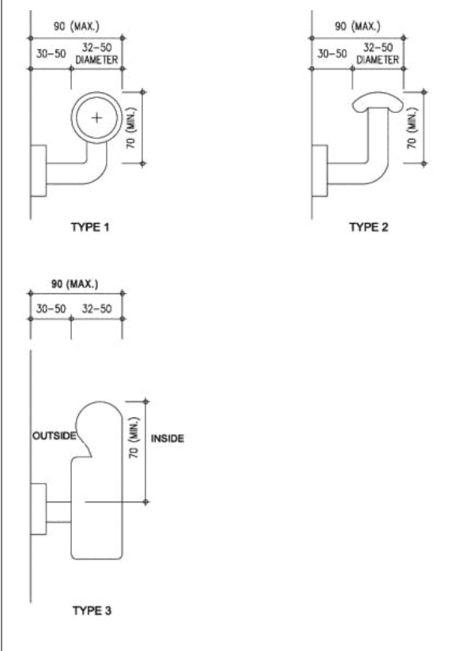{ width="375" loading=lazy }
  <figcaption>Diagram 1 from the original summary (ADF 4/2018, item 1). 原文附圖。</figcaption>
</figure>

**BD's response 屋宇署回覆:** BD advised that the design of handrail should comply with the requirements stipulated in paragraph 28 in Division 8 of the Third Schedule of Building (Planning) Regulations. For design of handrails other than those shown in Figure 15 of DMBFA, BD would consult the Technical Committee on DMBFA and would advise the result in due course.
{: .apsec-a }

### 2. Protective Barrier – Regulation 8(3) of the Building (Construction) Regulations (B(C)R) {#i201808172}

Raised by **HKIA** · Related 相關: [B(C)R Building (Construction) Regulation](../regulations/bcr-123q.md)

**Question 問題:** Regulation 8(3) of B(C)R requires the lowermost 150mm of protective barrier be built solid. For protective barrier that is constructed with prefabricated parapet such as tempered glazing or metal panels, open joint between adjoining panels is normally provided for construction tolerance as well as thermal movement. Where such glazing/metal panels are designed to rest directly on the finished floor level, would BD please consider to accept such open joint (without sealant) between adjoining panels at the lowermost 150mm of the protective barrier provided that the open joint is maintained at not more than 10mm in width.
{: .apsec-q }

**BD's response 屋宇署回覆:** (Item withdrawn by HKIA during meeting.)
{: .apsec-a }

### 3. Food Serving Opening on Kitchen Wall of Licensed Food Premises {#i201808173}

Raised by **HKIA** · Related 相關: [Code of Practice for Fire Safety in Buil](../codes/fire-safety-code-2011.md)

**Question 問題:** With reference to the standard requirements of FSD for the licensing of food premises (viz., Form PPA/101(F)-2 for Light Refreshment Restaurant with low fire potential and Form PPA/101(I)-2 for General Restaurant with low fire potential), the food serving opening between the kitchen and the seating accommodation not exceeding 0.2m² in area shall be protected by a drop hatch with not less than half-hour fire resisting period; whereas fire shutters shall be installed for opening exceeding 0.2m 2 . This is commonly established and acceptable in the licence application of food premises. …
{: .apsec-q }

**BD's response 屋宇署回覆:** BD advised that despite the use of fire damper with fusible link for protecting food serving opening with size not exceeding 0.2m2 was acceptable to FSD during the course of licence application, such arrangement was not in full compliance with the FS Code and hence would not be acceptable in new building projects or A&A works. In this regard, HKIA suggested reviewing the above at the Technical Committee on FS Code so that the differences could be reconciled.
{: .apsec-a }

### 4. Design and Disposition of AC Platform {#i201808174}

Raised by **HKIA** · Related 相關: [APP-68](../pnap/app-68.md), [APP-142](../pnap/app-142.md)

**Question 問題:** Item 11 of ADF 2/2017 held on 17 March 2017 stated that a level difference of at least 500mm between the balcony/UP and the adjoining AC platform (large platform for 2 nos. of AC units) must be provided. Coupling with the requisite 150mm level drop between balcony/UP and the interior of the habitable space, as well as the 150mm thick AC platform, the resulting soffit of the AC platform would be at least 800mm below the floor of the unit. This would adversely limit the height of windows of the unit below, thereby prejudicing the optimal extent of lighting and ventilation from reaching the said unit. …
{: .apsec-q }

**BD's response 屋宇署回覆:** BD advised that relaxation on the required level difference between balcony/UP and the adjoining AC platform would be considered on a case basis with due regard to the circumstances and difficulties of individual cases. [Post-meeting notes: Subsequent to an ad-hoc meeting held on 27.9.2018 with representatives of APSEC members, BD has reviewed the need of a 500mm level difference between the balcony/UP and the adjoining AC platform and it was concluded that a level difference would not be required if the AC platform would be at least 350mm away from the balcony/UP, adequate and proper access for maintenance of the AC unit(s) should be provided.] BD further briefed members that subsequent to the discussion in the 5 th meeting of the Working Group on Design for Safety formed under BSC & APSEC on 6 August 2018, the following amendments to the “Guidelines for Design and Safety Provisions for the AC Platforms” appended to BD’s Circular Letter on 23 December 2016 would be made with immediate effect: (i) Projection of the platform not more than 900mm may be accepted disregarding the thickness of the protective barrier/guard-rail/screen and its supporting structural members [paragraph 3(a)]; (ii) A clear working space of 400mm on one side (instead of 300mm on both sides) would be required [paragraph 3(b)]; (iii) On the side where the platform also serves as the worker’s landing through windows, the working space could be increased to a maximum of 500mm (instead of 400mm) [paragraph 3(b)]; (iv) If one layer of AC is provided, height of screen, if provided, should be not less than …
{: .apsec-a }

### 5. Protective Barrier for Greening {#i201808175}

Raised by **HKIA** · Related 相關: [ADV-35](../pnap/adv-35.md), [APP-110](../pnap/app-110.md), [B(C)R Building (Construction) Regulation](../regulations/bcr-123q.md)

**Question 問題:** PNAP ADV-35 (Greening in Buildings) stated that protective barriers, such as balustrades or railing, should be provided for safe access to the greening area and to prevent the danger of falling in accordance with regulation 8 of B(C)R. It was further recorded in item 9 of the meeting notes of Joint BSC/APSEC 2/17 Meeting that “For greening on inaccessible roofs, guard railings commonly installed at such roofs to prevent the danger of falling of maintenance personnel would suffice. …
{: .apsec-q }

**BD's response 屋宇署回覆:** BD advised that protective barrier would not be required for planter which was inaccessible. Reference should be made to the design and construction requirements of protective barriers as laid down in PNAP APP-110, in particular, paragraph 3 on the measurement of height of a barrier which should be measured from the finished floor level of the surface adjoining the barrier where people could step on. In response to HKIA’s enquiry on the need of guard rails when fall-arresting system had already been provided, BD advised that the occupational safety requirements on work at height as imposed by the relevant authority should be complied with by the AP/RSE when designing a building.
{: .apsec-a }

### 6. Submission of Documents before Certification of Completion of Works {#i201808176}

Raised by **HKIE**

!!! warning "Later discussion 其後再討論"
    This question was discussed again on **19 Mar 2021**; use the [later response](2021.md#i202103199) where they differ. 如有不同，以較新回覆為準。

**Question 問題:** Upon submission of Form BA13 or Form BA14 for certification of the completion of works in accordance with the approved plans, sometimes we are asked to provide further particulars or documents which are not clearly imposed in approval letters or shown in approved plans. Normally, technical documents such as concrete cube strength test report, steel reinforcement bar and structural steel mill certificates, cantilevers reports, structural glass reports, etc. will be submitted in batches and phases well before submission of Form BA13/14. BD will normally conduct checking upon receipt of these statutory forms and the checking time will therefore become very critical. …
{: .apsec-q }

**BD's response 屋宇署回覆:** BD responded that the required technical documents would be stated in the approval letter and its appendices. If there were any queries, the case officer should be consulted. BD had recently implemented a streamlined procedure to facilitate the processing of Form BA13/14 submission. Upon completion of the structural works, BD would issue a reminder with sample checklists to AP/RSE/RGE for timely submission of the required technical documents prior to Form BA13/14 submission. BD added that checklists for the processing of Form BA13/14 on various types of building works had been prepared for internal use. AP/RSE/RGE could liaise with individual case officers to facilitate the submission of the required documents whenever necessary.
{: .apsec-a }

### 7. Streamlined Procedures for Carrying out Minor Works before Demolition of Buildings {#i201808177}

Raised by **HKIE**

**Question 問題:** BD issued a Circulation Letter on 26 June 2017 promulgating the streamlined procedures for carrying out Minor Works (MW) before demolition of buildings. It requires the Form for Notice of Commencement of Class 1 MW (Form MW01) be submitted together with the application for approval of demolition plans (Paragraph 2 in the Appendix of Circular Letter refers). As demolition contractor is normally not appointed before the approval of demolition plans, it is suggested the Form MW01 be submitted together with consent application for demolition works.
{: .apsec-q }

**BD's response 屋宇署回覆:** BD advised that Form MW01 for minor works to be carried out before demolition of the parent building could be submitted together with the consent application for commencement of the demolition works provided that it should be submitted not less than 7 days prior to the commencement of the minor works, and the project team responsible for the demolition of the parent building should also be responsible for the minor works.
{: .apsec-a }

### 8. Inadequate Provision of Natural Lighting and Ventilation in Office Conversion {#i201808178}

Raised by **HKIS** · Related 相關: [APP-150](../pnap/app-150.md)

**Question 問題:** For wholesale conversion of industrial building where there are difficulties in providing the required natural lighting and ventilation, application for modification of Regulations 30 and 31 of the Building (Planning) Regulations will be favourably considered subject to conditions set out in paragraph 3(ii) of PNAP APP-150. Would it be possible to extend the relaxation to A&A works converting a floor/portion of a building into office use.
{: .apsec-q }

**BD's response 屋宇署回覆:** BD advised that the relaxation in PNAP APP-150 was for wholesale conversion of industrial buildings and is not applicable to other A&A works.
{: .apsec-a }

### 9. Assessment Report for Modification of Natural Lighting and Ventilation {#i201808179}

Raised by **HKIS**

**Question 問題:** For A&A submission involving modification of natural lighting and ventilation for toilet facilities, assessment report with calculation of air change and information/catalogue of exhaust fan should be submitted to BD for consideration before plan approval. Is it possible that such calculation and product catalogue be submitted at completion stage since contractors are normally not appointed at GBP submission stage.
{: .apsec-q }

**BD's response 屋宇署回覆:** BD advised that assessment report with calculation of air change should be submitted at GBP submission stage. The product catalogue could be submitted at completion stage together with the Form BA14.
{: .apsec-a }

### 10. Replacement of Display Surface (vinyl) of Signboard {#i2018081710}

Raised by **AAP** · Related 相關: [APP-126](../pnap/app-126.md)

**Question 問題:** Minor works is applicable for the replacement of vinyl display surface of signboards provided that the surface areas do not exceed certain size limits. Replacement of vinyl display surface of signboard larger than the size limit is not covered by Minor Works Control System and is considered as building works requiring approval and consent, supervision, and Form BA14 submission. Building professionals including the AP, and Registered Contractors will need to be involved, including a Registered Specialist (Demolition) Contractor for its removal, and another Registered General Building Contractor for putting up the new vinyl display surface. …
{: .apsec-q }

**BD's response 屋宇署回覆:** BD confirmed that for replacement of display surface of signboard larger than the size limit covered by the Minor Works Control System, prior approval and consent for the replacement would be required. Similar to A&A submission, the removal of the existing display surface and the installation of the new display surface could be included under the same A&A submission. Also, fast track processing under PNAP APP-126 could be applied for replacement of display surface using conventional material.
{: .apsec-a }

### 11. PNAP APP-130 {#i2018081711}

Raised by **AAP** · Related 相關: [APP-130](../pnap/app-130.md)

<small>Related discussions 相關討論: [22 Mar 2019 item 10](2019.md#i2019032210), [19 Mar 2021 item 5](2021.md#i202103195)</small>

**Question 問題:** Performance-based approach for lighting and ventilation was only applicable for habitable rooms and kitchens while office use is excluded. We would like to know the rationale behind this exclusion.
{: .apsec-q }

**BD's response 屋宇署回覆:** BD advised that the subject matter was being studied and would advise the result in due course.
{: .apsec-a }

### 12. Top Hung Windows in Non-Domestic Building {#i2018081712}

Raised by **AAP**

**Question 問題:** Item 12 of APSEC 1/2012 provided clear requirements on how wide the top hung window should be openable. It is our understanding that these windows should be openable to the extent as stated. But it is not necessary for the windows to be able to hold at that position. The windows can be designed to hold at a position with a smaller opening. We wish to know if our understanding is correct. AOB Items
{: .apsec-q }

**BD's response 屋宇署回覆:** (Item withdrawn by AAP during meeting.)
{: .apsec-a }

### 13. Subdivision of Office / Non-domestic Premises {#i2018081713}

Raised by **AAP**

<small>Follows earlier discussion: [25 May 2018](2018.md#i201805257)</small>

**Question 問題:** (Item raised by BD) Further to the discussion item 7 of ADF 3/2018, BD would like to brief members on measures in processing proposal for office/non-domestic use.
{: .apsec-q }

**BD's response 屋宇署回覆:** BD advised that whether the subdivided office/non-domestic layout resembled those for domestic use would be examined on case basis. Subdivision proposal with design and facilities such as small office/non-domestic unit having en-suite toilet not being commensurate with the office/non-domestic use would not be accepted.
{: .apsec-a }

### 14. Clause B20.9 of FS Code – Provision of Thoroughfare for Cinema or {#i2018081714}

Raised by **AAP** · Related 相關: [FS Code 2011 Part B: Means of Escape](../codes/fsc-part-b-means-of-escape.md)

<small>Related discussions 相關討論: [14 Jan 2022 item 3](2022.md#i202201143)</small>

**Question 問題:** Theatre of Capacity not more than 500 Persons (Item raised by BD) BD would like to brief members on the relaxation of Clause B20.9 of FS Code regarding the provision of thoroughfare for cinema or theatre of capacity not more than 500 persons.
{: .apsec-q }

**BD's response 屋宇署回覆:** BD would on case basis, favourably consider extending the relaxation under Clause B20.9 of FS Code to cover cinemas and theatres in a non-domestic building not having polluting industrial undertakings or the non-domestic part of a composite building, such that the site of such premises might be permitted to abut on one thoroughfare if the said thoroughfare was an acceptable EVA and Director of Fire Services had no adverse comment on the arrangement. Clause B20.9 of FS Code would be amended to reflect the above arrangement in due course.
{: .apsec-a }

## ADF 3/2018 · 25 May 2018 {#adf-32018-25-may-2018}

[Original summary (PDF) 原文](https://www.hkie-st.org/wp-content/uploads/2022/07/70_Finalised-Summary-of-Items-Discussed-in-APSEC-Discussion-Forum-on-25-May-2018.pdf) · 9 items

### 1. Flexibility for Solar Shading of Windows {#i201805251}

Raised by **HKIA** · Related 相關: [APP-156](../pnap/app-156.md)

**Question 問題:** According to item 7 of ADF 2/2015 held on 20 March 2015, BD was receptive with the proposed sliding louvres in front of prescribed windows to enhance solar protection on a case-by-case basis subject to submission of detailed information of such system as well as the circumstances of individual cases. Further to the above, we would like to enquire if these external operable shading devices could also be taken into account in the RTTV assessment for residential buildings.
{: .apsec-q }

**BD's response 屋宇署回覆:** BD advised that whether such external operable shading devices could be taken into account in RTTV assessment would be considered on a case basis with due regard to the merits and circumstances of individual cases, as well as the following: (i) External Shading Coefficient of the proposed device should be calculated with due reference to the methodology as stated in Section 2.5.3 of the “Guidelines on Design and Construction Requirements for Energy Efficiency of Residential Buildings 2014” (the Guidelines); (ii) Any possible adverse impact on natural lighting/ventilation to the habitable spaces concerned arising from such device should be carefully examined; (iii) Pursuant to Paragraph 11 of PNAP APP-156, quantitative assessment should be submitted for consideration if such device projected more than 750mm from the external walls; and In general, if the proposed external shading devices were operated manually, they should be excluded from the RTTV assessment as per principle laid under first bullet of Section 2.1.7 of the Guidelines. To facilitate the processing, BD strongly advised that pre-submission enquiry with detailed justifications should be made prior to formal submission. Whilst HKIA expressed that external operable shading devices had been widely adopted in overseas countries, HKIA requested BD to further review the Guidelines at the Technical Committee so as to streamline the acceptance of such devices, including those external manual-operable shading devices.
{: .apsec-a }

### 2. Maintenance & Repair of External Cladding & Typhoon Proof Ceiling {#i201805252}

Raised by **HKIA**

**Question 問題:** It is not uncommon that maintenance & repair (M&R) for external cladding or typhoon-proof ceiling are required during the life-time of a building. However, only erection, repair or removal of any cladding fixed to the external wall with the distance between any part of it and the adjoining ground/floor ‹= 6m would be considered as Minor Works (i.e. MW Item 3.31). We would therefore like to enquire on the following with respect to M&R works: (i) whether the requirements for structural A&A submission could be waived for dismantling, inspection, repairs and reinstatement works involving small quantities of existing cladding works (say 20 nos. …
{: .apsec-q }

**BD's response 屋宇署回覆:** BD advised the following: (i) As the works concerned were neither considered as Minor Works or Designated Exempted Works under the Building (Minor Works) Regulations nor building works exempted under Section 41(3) of the Buildings Ordinance, structural A&A submission would be required for such works regardless of the quantities of the cladding panels involved. BD supplemented that in order to facilitate M&R of cladding panels, legislative amendments to introduce new MW item for repair and removal of cladding panels located at a level › 6m from adjoining ground had already been proposed and would be put forward to LegCo for vetting in due course. (ii) Reply as per item (i) above was applicable. (iii) BD shared HKIA’s understanding that separate demolition plan for dismantling of the existing cladding/typhoon proof ceiling panels would normally not be required.
{: .apsec-a }

### 3. Clause C9.7 of the FS Code 2011 {#i201805253}

Raised by **HKIA** · Related 相關: [FS Code 2011 Part C: Fire Resisting Cons](../codes/fsc-part-c-fire-resisting-construction.md)

<small>Related discussions 相關討論: [22 Mar 2019 item 11](2019.md#i2019032211), [23 Feb 2024 item 7](2024.md#i202402237)</small>

**Question 問題:** With reference to Item 9 of ADF dated 16 March 2012, a required staircase discharging through the main entrance lobby of a tower which is recessed from the edge of open air outside a building with the arrangement as indicated in the diagram below is normally considered acceptable, providing that the covered recessed area is a common area, open in design and not encumbered with features carrying fire risks. …
{: .apsec-q }

<figure markdown>
  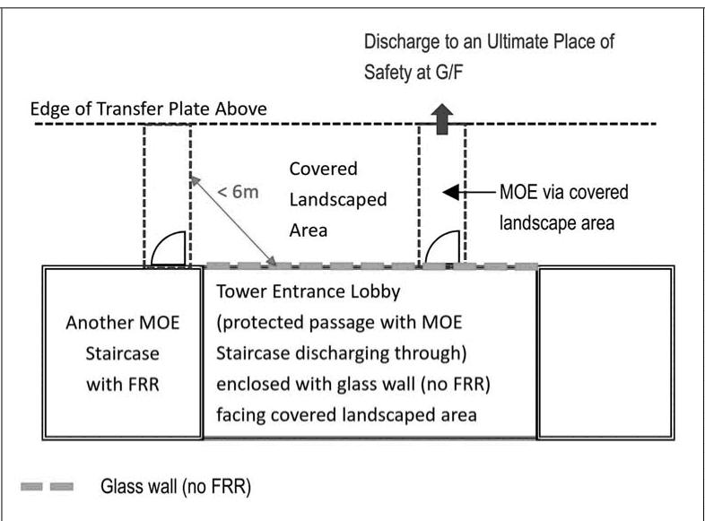{ width="508" loading=lazy }
  <figcaption>Diagram 1 from the original summary (ADF 3/2018, item 3). 原文附圖。</figcaption>
</figure>

**BD's response 屋宇署回覆:** BD advised that the concerned MOE route discharged from another required staircase across the same covered recessed area should be located at least 6m away from the said main entrance lobby with non-FRR glass wall enclosure pursuant to Clause C9.7 of the FS Code 2011. Similarly, any unprotected opening on the external wall of a required staircase should be located at least 6m away from the unprotected opening on the external wall of another required staircase. This could prevent any smoke logging or other life-threatening incident occurring in a required staircase from affecting any other required staircases to ensure safe discharge of the evacuees. BD’s reply to item 2 of ADF 2/2016 dated 18 March 2016 was also relevant.
{: .apsec-a }

### 4. Adopting Performance-based Approach in FS Code 2011 for Innovative Building Design {#i201805254}

Raised by **HKIE** · Related 相關: [FS Code 2011 Parts E, F & G: Fire Proper](../codes/fsc-parts-e-f-g.md)

**Question 問題:** For building projects that cannot meet the Deemed-to-Comply provisions of the FS Code 2011 due to genuine difficulties, a performance-based approach using fire engineering can be adopted to formulate an Alternative Solution. Clause G3.3 of FS Code 2011 refers. However, BD will normally not accept any reasons on better architectural design, more user-friendly and easier maintenance for future users/owners. This deters the building professionals from innovative building designs and poses much limitations and constraints in the development of fire engineering design for complicated composite buildings. …
{: .apsec-q }

**BD's response 屋宇署回覆:** BD advised that they would favourably consider accepting performance-based approach by fire engineering as an Alternative Solution to prescriptive approach on case merits. To streamline the approval process, pre-submission enquiry could be made to ascertain critical issues/comments from relevant government departments.
{: .apsec-a }

### 5. Clause 5.4.11 of CoP for Foundations 2017 {#i201805255}

Raised by **HKIE**

**Question 問題:** Clause 5.4.11 (5)(c) & (d) of CoP for Foundations 2017 specifies the dynamic load test requirements for steel H-piles driven to bedrock. (i) Would BD please clarify whether, unless specifically imposed in the approval letter for particular case, dynamic load tests on 10% of working piles for pile capacity and another 20% of working piles for integrity are sufficient. (ii) If hydraulic hammers are proposed for conducting the Stress Wave Dynamic Tests (SWDTs), do we need to submit Final Set Tables with hydraulic hammers for approval and construction? (iii) If only SWDTs on 10% of working piles is imposed during approval (e.g. Para. 1 (e) of App. …
{: .apsec-q }

**BD's response 屋宇署回覆:** BD confirmed that: (i) Dynamic load tests on 10% for pile capacity and another 20% for integrity as per CoP for Foundations 2017 would suffice. For the 10% verification test on pile capacity, selection of piles would accord priority to those which were driven to sloping rockhead. With regard to the difficulty in achieving 75% of yield stress when pile length is relatively long, this issue would be further discussed in the coming TC meeting. (ii) Submission of Final Set Tables by hydraulic hammer for conducting the SWDTs would not be required for BD’s approval. (iii) The % of SWDTs to be conducted should be strictly in accordance with the conditions imposed in approval letter. (iv) BD confirmed that the % of integrity test should be carried out in accordance with the imposed condition. Meanwhile, BD would amend the standard appendix to approval letter for Steel H-piles driven to bed rock to tally with the relevant clauses of CoP for Foundations 2017.
{: .apsec-a }

### 6. Site Coverage of Resident’s Clubhouse under the application of PNAP APP-132 {#i201805256}

Raised by **AAP** · Related 相關: [APP-132](../pnap/app-132.md)

<small>Related discussions 相關討論: [22 Nov 2019 item 16](2019.md#i2019112216), [21 May 2021 item 13](2021.md#i2021052113), [13 Aug 2021 item 1](2021.md#i202108131), [13 Aug 2021 item 10](2021.md#i2021081310), [13 May 2022 item 10](2022.md#i2022051310)</small>

**Question 問題:** We understand that the site coverage (SC) of resident’s clubhouse has always been considered as non-domestic. We wish to know whether the determination will be different if clubhouse is located in a building which applied PNAP APP-132 for SC concession with building set back. It is our view that the determination should depend on the function of the premises and be unrelated to other circumstances. All uses within resident’s clubhouse are non-domestic, and therefore non-domestic SC and GFA should always apply. We wish to know if our view is agreed. …
{: .apsec-q }

<figure markdown>
  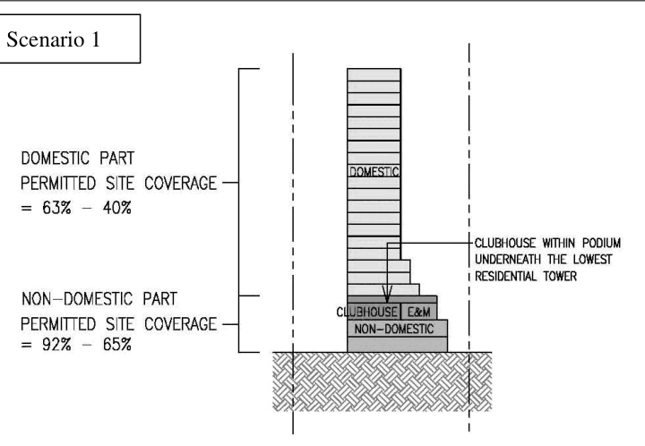{ width="465" loading=lazy }
  <figcaption>Diagram 1 from the original summary (ADF 3/2018, item 6). 原文附圖。</figcaption>
</figure>

<figure markdown>
  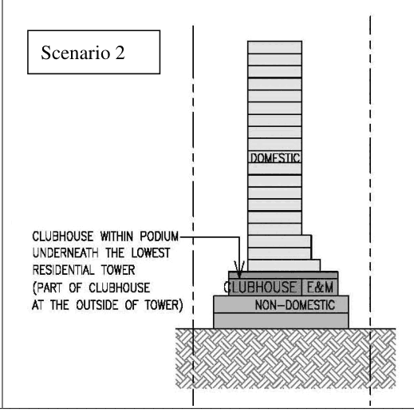{ width="336" loading=lazy }
  <figcaption>Diagram 2 from the original summary (ADF 3/2018, item 6). 原文附圖。</figcaption>
</figure>

**BD's response 屋宇署回覆:** BD confirmed that if the clubhouse was placed below the lowest domestic floor, its SC could be counted as non-domestic. However, if the clubhouse was placed within the domestic tower, its SC should be counted as domestic. The same principle should be applied in the context of PNAP APP-132.
{: .apsec-a }

### 7. PNAP APP-159 PNAP APP-159 and Circular Letter dated 6 February 2018 provided clear {#i201805257}

Raised by **AAP** · Related 相關: [APP-159](../pnap/app-159.md)

!!! warning "Later discussion 其後再討論"
    This question was discussed again on **17 Aug 2018**; use the [later response](2018.md#i2018081713) where they differ. 如有不同，以較新回覆為準。

**Question 問題:** directions for AP to follow concerning subdivision of industrial premises. Members have noticed through their submissions of proposals that BD is also concerned about the misuse of office buildings for residential use. Subdivision into small office units provided with toilets would not be approved, even though the toilets do not require modification for natural lighting and ventilation and the office’s size is larger than 80m 2 , which seems to be even more stringent than the requirements for industrial premises. We understand the need to avoid misuse of office buildings for domestic use. We hope that clear guidelines can be available such that APs can follow.
{: .apsec-q }

**BD's response 屋宇署回覆:** 3/2018 dated 19 May 2017, BD would make reference to the relevant criteria in PNAP APP-159 in bench marking whether the office layout resembled those for domestic use or not. [Post Meeting Notes: BD clarified that such practice was being reviewed in light of members’ concerns as well as the latest situation of office developments/uses and would be further discussed in the next ADF.]
{: .apsec-a }

### 8. Compliance Standard for Heat Soak Process of Tempered Glass Panes {#i201805258}

Raised by **BD** · Related 相關: [APP-37](../pnap/app-37.md), [APP-53](../pnap/app-53.md), [APP-171](../pnap/app-171.md)

**Question 問題:** The compliance standard for heat soak process of tempered glass panes specified in PNAP APP-37 and PNAP APP-53 is BS EN 14179-1:2005, whereas the updated version BS EN 14179-1:2016 is specified in Annex A1 of the CoP for Structural Use of Glass 2018 (the 2018 Code). The main difference between the two versions is that the temperature of glass pane during the holding phase of the heat soak process, in which the glass pane shall be maintained within the range 290 o C±10 o C for BS EN 14179-1:2005 and 260 o C±10 o C for BS EN 14179-1:2016. …
{: .apsec-q }

**BD's response 屋宇署回覆:** BD briefed members on the arrangement of accepting different versions of heat soak test standard under the 2018 Code during the grace period.
{: .apsec-a }

### 9. Minor Amendments for Phased Development {#i201805259}

Raised by **BD** · Related 相關: [ADM-19](../pnap/adm-19.md), [B(A)R Building (Administration) Regulati](../regulations/bar-123a.md)

<small>Related discussions 相關討論: [5 May 2023 item 12](2023.md#i2023050512), [4 Aug 2023 item 4](2023.md#i202308044), [8 Aug 2025 item 15](2025.md#i2025080815)</small>

**Question 問題:** (Item raised by HKIE) Phased development nowadays is very common, especially for large scale developments where foundation works cannot be completed within a short period. Would BD please advise whether application for modification of regulation 33(1) of the B(A)R is applicable for minor amendments of building, superstructure and drainage works in phased developments provided that first consents have been granted.
{: .apsec-q }

<figure markdown>
  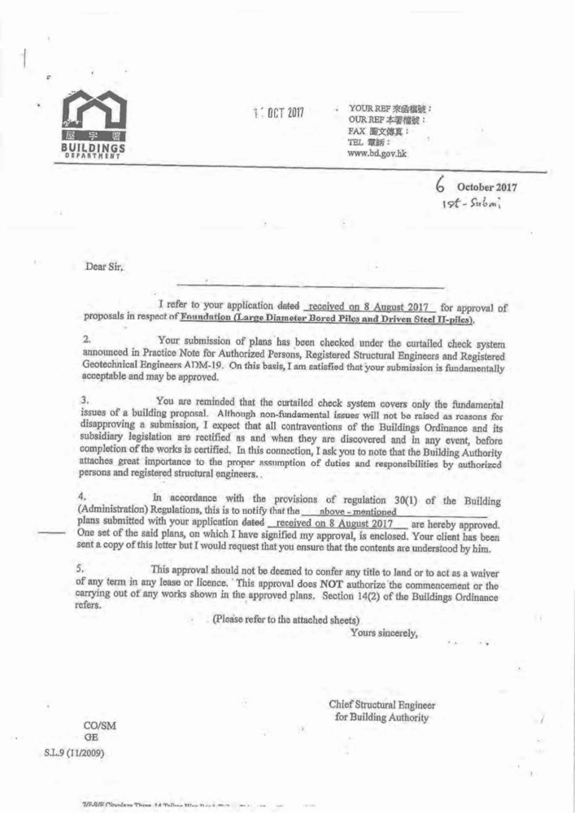{ width="680" loading=lazy }
  <figcaption>Diagram 1 from the original summary (ADF 3/2018, item 9). 原文附圖。</figcaption>
</figure>

<figure markdown>
  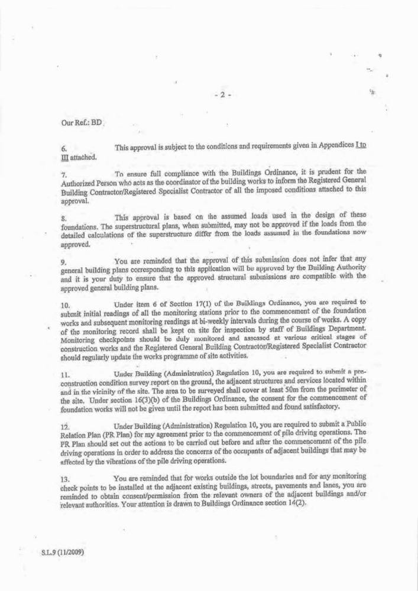{ width="680" loading=lazy }
  <figcaption>Diagram 2 from the original summary (ADF 3/2018, item 9). 原文附圖。</figcaption>
</figure>

<figure markdown>
  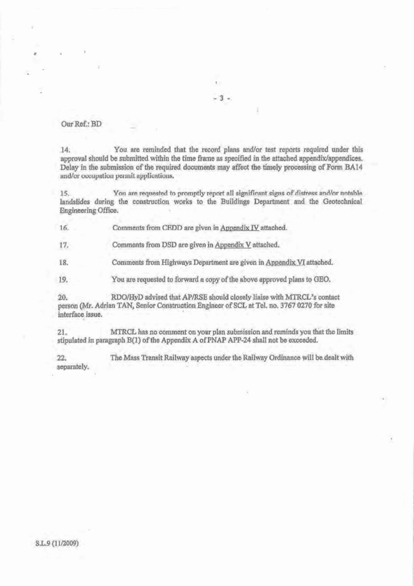{ width="680" loading=lazy }
  <figcaption>Diagram 3 from the original summary (ADF 3/2018, item 9). 原文附圖。</figcaption>
</figure>

<figure markdown>
  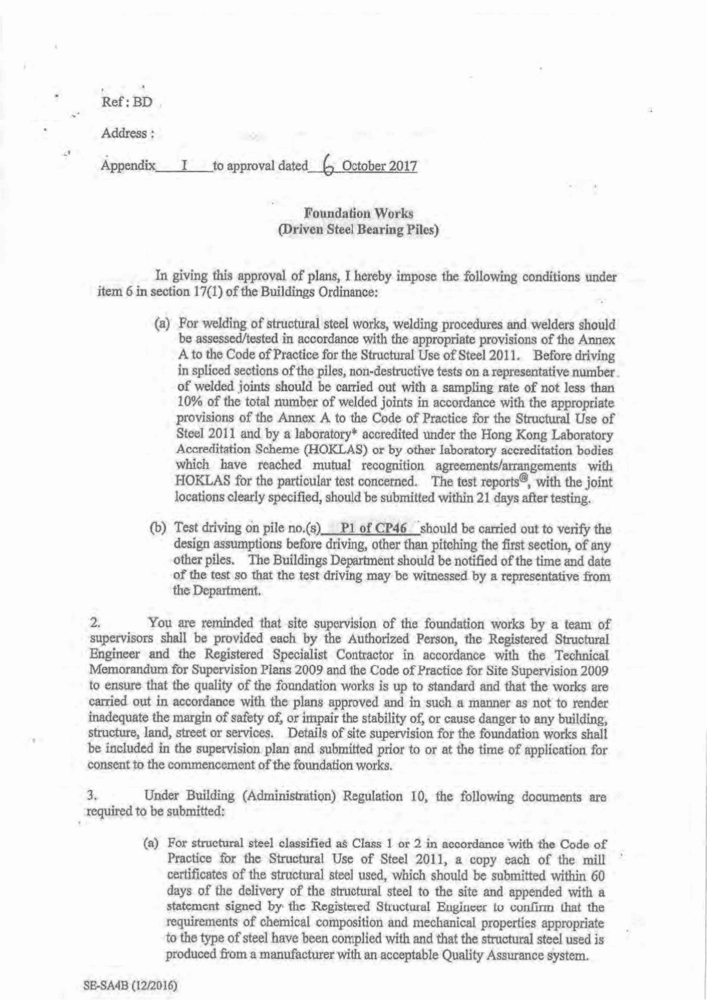{ width="680" loading=lazy }
  <figcaption>Diagram 4 from the original summary (ADF 3/2018, item 9). 原文附圖。</figcaption>
</figure>

<figure markdown>
  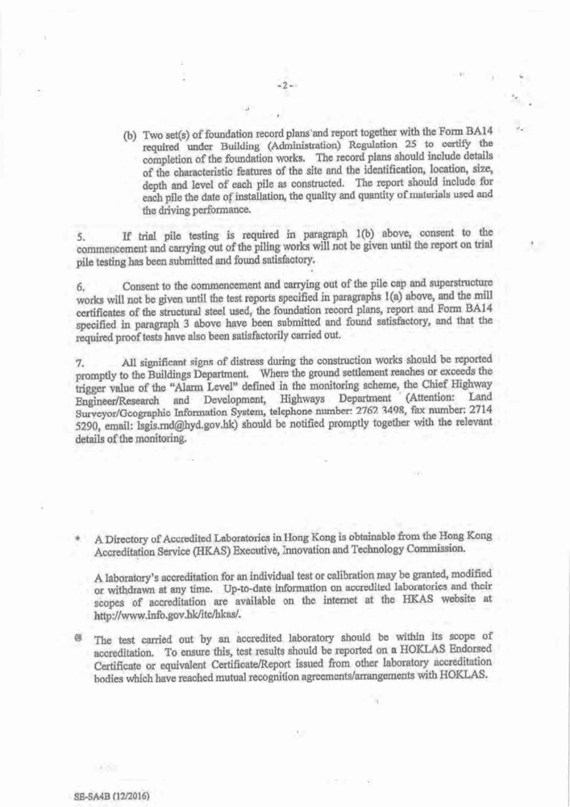{ width="680" loading=lazy }
  <figcaption>Diagram 5 from the original summary (ADF 3/2018, item 9). 原文附圖。</figcaption>
</figure>

<figure markdown>
  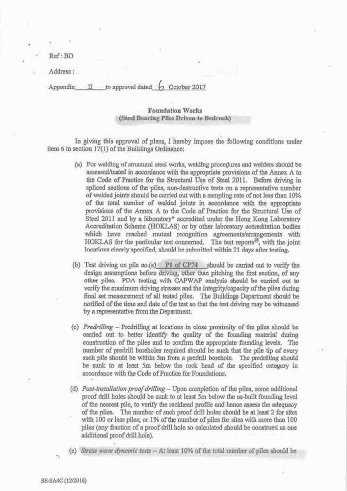{ width="680" loading=lazy }
  <figcaption>Diagram 6 from the original summary (ADF 3/2018, item 9). 原文附圖。</figcaption>
</figure>

**BD's response 屋宇署回覆:** BD advised that application for modification of regulation 33(1) of the B(A)R would be considered in accordance with PNAP ADM-19 provided that the extent of application had been clearly demarcated on plan.
{: .apsec-a }

## ADF 2/2018 · 23 Mar 2018 {#adf-22018-23-mar-2018}

[Original summary (PDF) 原文](https://www.hkie-st.org/wp-content/uploads/2022/07/69_Finalised-Summary-of-Items-Discussed-in-APSEC-Discussion-Forum-on-23-March-2018.pdf) · 6 items

### 1. Electronic Form Submission System (EFSS) {#i201803231}

Raised by **HKIA** · Related 相關: [APP-151](../pnap/app-151.md)

**Question 問題:** After the implementation of EFSS, there are some standard forms in which the original fields for certain certificate/declaration had been deleted, e.g. Appendix B to PNAP APP-151, where the original field for declaration signed by Registered Professional Engineer (RPE) had been deleted leaving only the AP to declare the correctness of information contained, although such was indeed prepared by the RPE. The BD is requested to advise whether it is the genuine intention, or else further update of the Form is necessary.
{: .apsec-q }

**BD's response 屋宇署回覆:** BD advised that as the AP should be the coordinator of the project, the declaration form referred in PNAP APP-151 should be signed by the AP accordingly.
{: .apsec-a }

### 2. Fast Track Processing of Simple A&A Submissions {#i201803232}

Raised by **HKIA** · Related 相關: [ADM-19](../pnap/adm-19.md)

!!! warning "Later discussion 其後再討論"
    This question was discussed again on **13 May 2022**; use the [later response](2022.md#i202205138) where they differ. 如有不同，以較新回覆為準。

**Question 問題:** As per Para. 24 of PNAP ADM-19, for simple A&A works which do not involve the structure of the building, concurrent applications for fast track approval and consent will be processed within 30 days. However, when checking of loading due to, say, change in use and/or addition of mass concrete fill, etc. is required, applications for fast track may usually be not accepted despite no actual structural alteration work is involved. In this regard, we would suggest BD should consider allowing fast track processing for simple A&A submissions which require structural checking only but without actual structural alteration works.
{: .apsec-q }

**BD's response 屋宇署回覆:** For simple A&A works which involved checking of loading only but without actual structural works, BD advised that structural assessment should be submitted concurrently with the A&A plans submission if fast track processing would be applied for. The BD would favourably consider allowing fast track processing provided that sufficient information had been submitted.
{: .apsec-a }

### 3. Temporary Acting during Absence of AP/RSE/RGE According to BO Section 4(2) and B(A)R 23(2), if AP/RSE/RGE is absent {#i201803233}

Raised by **HKIE** · Related 相關: [APP-143](../pnap/app-143.md), [APP-3](../pnap/app-3.md), [B(A)R Building (Administration) Regulati](../regulations/bar-123a.md)

**Question 問題:** from Hong Kong, he is required to nominate another AP/RSE/RGE and notify BA within 7 days with Form BA21. RSEs need to travel to Mainland for audit inspection of precast factory monthly for each project so as to fulfil the QA requirement in accordance with PNAP APP-143. Can we simplify this administrative procedure by waiving the submission of Form BA21 should the temporary absence is less than 24 hours and the RSE can be reached by mobile phone.
{: .apsec-q }

**BD's response 屋宇署回覆:** administration works. The AP/RSE/RGE in temporary absence of less than 24 hours would still be responsible for the supervision of their projects. BD replied that there were no provisions under the BO that the submission of Form BA21 could be waived for a short period of temporary absence from Hong Kong. The statutory requirement was to ensure that the AP/RSE/RGE responsible for the works was readily available to discharge duties under the BO, in particular when an emergency situation arose. Reference should be made to PNAP APP-3.
{: .apsec-a }

### 4. Open Kitchen {#i201803234}

Raised by **AAP** · Related 相關: [FS Code 2011 Part C: Fire Resisting Cons](../codes/fsc-part-c-fire-resisting-construction.md)

<small>Related discussions 相關討論: [23 Aug 2019 item 7](2019.md#i201908237), [4 Aug 2023 item 8](2023.md#i202308048), [23 Feb 2024 item 18](2024.md#i2024022318)</small>

**Question 問題:** The issue of open kitchen was discussed vigorously in past Forums including: • Item 13 of 3/2017 – in considering whether 600mm screen wall would be required, BD would pragmatically consider the layout of the flat; and • Item 2 of 3/2016 – the toilet door opening should be at least 1700mm from the edge of the kitchen bench from health point of view. We wish to know whether there have been any changes to the above. …
{: .apsec-q }

**BD's response 屋宇署回覆:** BD confirmed that there was no change regarding the requirements of open kitchen further to previous discussions. For instance, all the smoke detector(s), sprinkler head(s) and FRR screen wall should be provided for open kitchen in accordance with Clause C13.4 of FS Code 2011. Reference could be made to the explanation given in previous discussion under Item 7 of 1/2016 that the purpose of the wall was to “shield the evacuees from radiant heat of stove fires, allowing the necessary pause of evacuees to open the door (and gate) without being seriously charred”. Besides, if the screen wall indicated in the layout of the open kitchen could not perform effectively the intended shielding function, such layout would generally not be accepted except for cases under special circumstances.
{: .apsec-a }

### 5. Separation between 2 connecting Utility Platforms {#i201803235}

Raised by **AAP** · Related 相關: [JPN](../pnap/jpn-2.md)

<small>Related discussions 相關討論: [22 Jan 2021 item 10](2021.md#i2021012210), [21 May 2021 item 6](2021.md#i202105216)</small>

**Question 問題:** (Item raised by AAP) Para 1(b)(vii) of Appendix A of JPN 2 states one of the exemption criteria of utility platforms (UP) for residential buildings as follows: • not less than 40% of the perimeter to the UP faces into open air, OR • where the UP is attached laterally to another UP and separation between them if provided is of parapet height only, its longer side faces into the open air and is not enclosed above safe parapet height. …
{: .apsec-q }

**BD's response 屋宇署回覆:** BD confirmed that AAP’s understanding was correct. BD would take into account the likelihood of abuse after occupation in vetting the submission.
{: .apsec-a }

### 6. Submission of Foundation and Superstructure Plans by Different RSE {#i201803236}

Raised by **AAP** · Related 相關: [B(A)R Building (Administration) Regulati](../regulations/bar-123a.md)

!!! warning "Later discussion 其後再討論"
    This question was discussed again on **24 May 2019**; use the [later response](2019.md#i201905244) where they differ. 如有不同，以較新回覆為準。

**Question 問題:** (Item raised by HKIE) According to B(A)R 15, the BA may refuse to accept plans from 2 or more AP/RSE/RGE, in respect of works at the same premises. Can we have two different RSE for foundation and superstructure plans separately?
{: .apsec-q }

**BD's response 屋宇署回覆:** BD advised that different RSEs might submit foundation and superstructure plans separately on case-by-case basis provided that the two plans would be compatible and the responsibilities of the RSEs at the interface of design were clearly demarcated. BD also noted that such arrangement would be applicable to structural plan submissions only and the works would still be supervised by single RSE in each stage of the works.
{: .apsec-a }

## ADF 1/2018 · 19 Jan 2018 {#adf-12018-19-jan-2018}

[Original summary (PDF) 原文](https://www.hkie-st.org/wp-content/uploads/2022/07/68_Summary-of-Items-Discussed-in-APSEC-Discussion-Forum-on-19-January-2018.pdf) · 14 items

### 1. Follow-up on Mechanical Ventilation of Room containing Waste Fitment {#i201801191}

Raised by **HKIA** · Related 相關: [ADM-2](../pnap/adm-2.md)

**Question 問題:** As per item 3 of ADF 2/2017 held on 17.3.2017, HKIA proposed that 1.5m x 1.5m notional area per sink/basin for calculation of the air change requirement for mechanical ventilation be acceptable for institutional use projects such as health care and educational building/premises provided that exhaust outlet should be located in the vicinity of the waste fitment. While this proposal had been accepted by BD, our members advised that such acceptance criteria had not been adhered to for some recent hospital projects scrutinised by BD. …
{: .apsec-q }

**BD's response 屋宇署回覆:** BD said that HKIA’s proposal on notional area for calculating the air change as discussed in ADF 2/2017 should generally be applicable to large hospital wards provided with 10 ACH requirements as required under PNAP ADM-2. Any deviation from the above would be considered on case merits and other conditions might be imposed, citing as examples, there were cases accepted with room containing waste fitments with 6 ACH for the entire room and in compliance with international standards acceptable to the Hospital Authority.
{: .apsec-a }

### 2. Existing Partition Walls outside A&A Submission Areas {#i201801192}

Raised by **HKIA**

**Question 問題:** In A&A works, it is not uncommon to encounter situations where modified/re-located/additional partition walls are located immediately outside the A&A submission area that were exempted works and were erected before the enactment of the Building (Minor Works) Regulations. Provided that those existing partition walls do not adversely affect the structure of the building, its fire safety and that they comply with other requirements under the Buildings Ordinance, we consider that substantiation on the structural stability of those existing partition walls (which are located outside the submission extent) is not required for the A&A building plan submission. …
{: .apsec-q }

**BD's response 屋宇署回覆:** BD advised that the need for structural assessment on existing partition walls outside the A&A submission area would be considered on case basis, for the purpose of ensuring the building safety and compliance with the provisions of the BO. It depended on the site conditions and the effects of the proposed A&A works on the building elements including partition walls at the submission area and its surroundings.
{: .apsec-a }

### 3. Follow-up on Separation between Balcony and UP {#i201801193}

Raised by **HKIA**

**Question 問題:** As per item 15 of ADF 5/2015 held on 13.11.2015, BD explained that the JPN requirement of 1.5m separation between balcony & utility platform (UP) was for preventing abuses observed in projects completed under the earlier versions of the JPN. The sketch proposal as attached to the above ADF item in 2015 (where balcony & UP of adjoining units was within 1.5m) was considered acceptable, as the UP and the balcony were separated from each other and the chance of abuse should be remote. By same token, for similar arrangement of UP and balcony of the same unit as indicated in the sketch below, we reckon that it should also be acceptable as chance of abuse is remote. …
{: .apsec-q }

<figure markdown>
  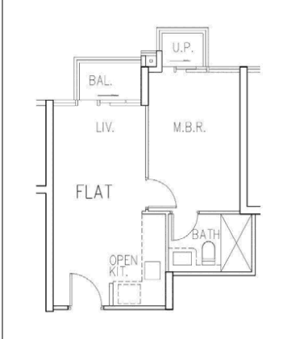{ width="246" loading=lazy }
  <figcaption>Diagram 1 from the original summary (ADF 1/2018, item 3). 原文附圖。</figcaption>
</figure>

**BD's response 屋宇署回覆:** BD advised that favorable consideration would be given on case basis taking into account the chance of abuse.
{: .apsec-a }

### 4. PNAP APP-57 {#i201801194}

Raised by **HKIE** · Related 相關: [APP-57](../pnap/app-57.md)

**Question 問題:** To facilitate a smooth and fast track processing, PNAP APP-57 allows that ELS plans could be submitted in 2 stages. 1 st stage submission demonstrates the technical feasibility of the • entire scheme showing the details of the vertical elements (i.e. steel sheet piles or pipe pile etc.) such as pile wall layout plan, member sizes, setting-out dimensions, toe level and depth of penetration to existing ground and proposed excavation levels as well as other essential information including location of boreholes, geotechnical profile, design water table, struts stiffness, preloading (if any), extent of ground treatment and construction sequences etc. …
{: .apsec-q }

**BD's response 屋宇署回覆:** BD advised that the excavation levels of each stage of ELS works were submitted as tentative levels in the 1 st Stage ELS plans and these ELS works, including subsequent amendments of the revised excavation levels if required, were approved in the 2 nd Stage ELS plans. Amendment submission to the 1 st Stage ELS plans for the revised excavation levels would not be necessary after BD’s acknowledgement of the Form BA14 and the record plan of vertical pile wall elements.
{: .apsec-a }

### 5. Fire Separation between Mail Room and Club House {#i201801195}

Raised by **HKIS** · Related 相關: [FS Code 2011 Part C: Fire Resisting Cons](../codes/fsc-part-c-fire-resisting-construction.md)

**Question 問題:** For a mail room to be located inside a residential club house as illustrated below, is it necessary to provide fire barrier to separate the mail room from the club house?
{: .apsec-q }

<figure markdown>
  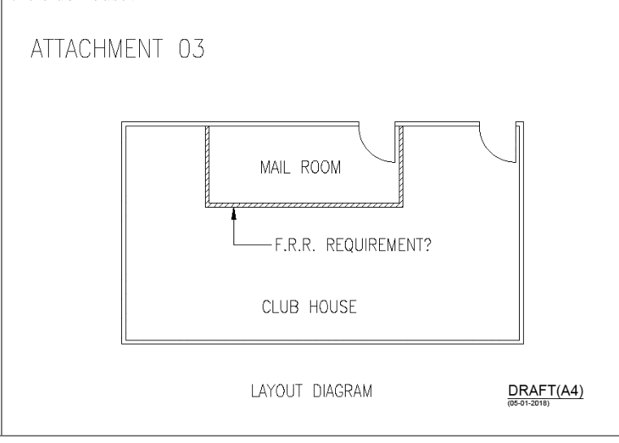{ width="492" loading=lazy }
  <figcaption>Diagram 1 from the original summary (ADF 1/2018, item 5). 原文附圖。</figcaption>
</figure>

**BD's response 屋宇署回覆:** BD advised that mail room and club house would be considered as different use and should be separated by fire barrier in accordance with Clause C7.1 and Table C1 of the FS Code.
{: .apsec-a }

### 6. Size of Utility Platform (UP) {#i201801196}

Raised by **AAP** · Related 相關: [JPN](../pnap/jpn-2.md)

<small>Related discussions 相關討論: [22 Jan 2021 item 10](2021.md#i2021012210), [21 May 2021 item 6](2021.md#i202105216)</small>

**Question 問題:** UP is encouraged in residential building as green feature under JPN 2. However, the maximum area can be exempted for such platform including portion of such platform per residential unit is 0.75m 2 only. Thus, the floor space of most UP in new residential/composite buildings would just meet the minimum 1.5m 2 as required by para. 1(b)(iv) of Appendix A of JPN 2. In practice, various features at external façade in particular AC platform would further make the UP becoming narrow in shape. In such case, the door swing of the French door would further reduce the usable space of the UP enjoyed by the occupants. …
{: .apsec-q }

**BD's response 屋宇署回覆:** BD advised that the size of UP was determined based on its designed function and should be irrespective of the unit size. The reduction of GFA concession for UP in 2011 was one of the recommendations proposed by the Council for Sustainable Development (SDC) after a public engagement exercise aiming to address the public
{: .apsec-a }

### 7. Follow-up on Setback areas under PNAP APP 132 and Building Set Back Alternative Approach {#i201801197}

Raised by **AAP** · Related 相關: [APP-132](../pnap/app-132.md), [APP-152](../pnap/app-152.md)

**Question 問題:** Item 6 of ADF 4/2017 held on 11.8.2017 confirmed that set back required under OZP could be counted towards the setback provided under PNAP APP 132. Similar to the above, it is our understanding that when the proposed building setback for building sites follows the Alternative Approaches under Appendix E of PNAP APP-152, the 15% full height set back can also be counted towards the setback under para 3 of PNAP APP 132, provided that all other conditions under both PNAP APP 132 and SBD Guidelines can be complied. We wish to know if our understanding is correct.
{: .apsec-q }

**BD's response 屋宇署回覆:** BD confirmed that the understanding was correct provided that the requirements under both PNAP APP-132 and APP-152 could be met.
{: .apsec-a }

### 8. Centralized Processing of Plans {#i201801198}

Raised by **AAP** · Related 相關: [ADM-2](../pnap/adm-2.md)

**Question 問題:** We understand that some issues of building proposals might need to be discussed in Building Committee (BC) meetings. However, the decisions on the need to go through BC meeting are usually come very late (say 1 or 2 weeks before submission due date) which rendered no sufficient time to submit the case for BC discussion. The plans thus will be disapproved without the chance of knowing the decision of the issues. We wonder if there is a mechanism to determine the necessity of BC discussion on particular issues in the building proposal at the earlier days of the processing time, say before the 30th day of submission, such that adequate time can be allowed for the BC I preparation / meeting.
{: .apsec-q }

**BD's response 屋宇署回覆:** BD encouraged AP/RSE making use of the mechanism of pre-submission enquiry and conference at an early stage to identify complicated or controversial issues so as to facilitate plan processing. In addition, AP/RSE should provide sufficient documents and supporting information by making reference to Appendices A and E of PNAP ADM-2, especially for issues involving inputs from other government departments such that timely referral could be made by BD.
{: .apsec-a }

### 9. Utility/Store Room adjacent to Domestic Kitchen {#i201801199}

Raised by **AAP**

**Question 問題:** Some members reported that the maximum dimension of utility/store room of not more than1.6m was required by BD recently. However, we understand from previous ADF discussions that there is no such requirement on the maximum dimension of utility/store room. We wish to know if BD’s practice has been changed.
{: .apsec-q }

**BD's response 屋宇署回覆:** BD advised that there had been no change in the policy towards store / utility room in domestic unit since the discussion vide ADF 5/2014. BD would consider the proposal on case basis as discussed in ADF 5/2014. In general, the size of the utility / store room should commensurate with that of the unit.
{: .apsec-a }

### 10. Provision of Surface Channel with Rainwater Outlets {#i2018011910}

Raised by **AAP** · Related 相關: [APP-125](../pnap/app-125.md), [B(C)R Building (Construction) Regulation](../regulations/bcr-123q.md)

**Question 問題:** Members reported that in some projects, case officer required provision of surface channel with 2 rainwater outlets even though a 150mm high kerb is provided at the doorway where the level difference between external and internal areas is less than 150mm. We believe such requirement does not in line with the spirit of PNAP APP-125. It is our view that when there is a 150mm kerb at a doorway leading to a roof, provision of service channel with 2 rainwater outlets right outside the door is not necessary. …
{: .apsec-q }

**BD's response 屋宇署回覆:** BD advised that according to para.4 of PNAP APP-125, the provision of a kerb having a total height of 150mm above the adjoining roof or external ground could also be considered as meeting the requirements under B(C)R 35 or 49(1) and as an alternative to the design criteria as stated in para. 3 of the PNAP. [Post-meeting notes: Members further enquired if surface channel and rainwater outlets should be required at the exterior bottom end of a ramp. BD advised that each case would depend on its own situation whether or not surface channel and rainwater outlets are required.]
{: .apsec-a }

### 11. PNAP APP-96 - Registration of General Building Contractors and Specialist Contractors {#i2018011911}

Raised by **AAP** · Related 相關: [APP-96](../pnap/app-96.md)

**Question 問題:** (Item raised by HKIE) Paragraph 10 of Appendix A of PNAP APP-96 states that “Basement works: Excavation for basements, construction of basement walls, slabs and drains, which do not form part of pile caps fall within the scope of works of the RGBC”. It is commonly understood that this is referred to basement works above the pile caps level, and the pile caps/footing could be carried out by RSC(F). It is very common that the lowest floor of basement structures (associated slabs and beams) are attaching to the pile cap/footing as so to minimize the volume of excavation for environmental friendly design and construction. …
{: .apsec-q }

**BD's response 屋宇署回覆:** BD advised that as the tie beams and individual caps/footings as shown in the attached plans formed an integral part of the foundation system, RSC(F) would be allowed to construct these beams and slabs. Other situations, such as raft and combined caps associated with basement beams and slabs, should be considered on case basis. Furthermore, such arrangement should be clearly indicated during consent application and relevant supervision requirements should be followed accordingly.
{: .apsec-a }

### 12. Provision of Reduced Size Light Well to Enhance Natural Ventilation {#i2018011912}

Raised by **AAP** · Related 相關: [APP-98](../pnap/app-98.md), [ADM-2](../pnap/adm-2.md), [B(P)R 24–37 Storey heights, open space, ](../regulations/bpr-24-37.md)

**Question 問題:** (Item raised by BD) BD shared with members on the findings of a recent study on the ventilation performance of reduced size light well.
{: .apsec-q }

**BD's response 屋宇署回覆:** BD advised that CFD analysis indicated that ventilation performance of reduced size light well (1:18) with bottom opened would be generally better than the standard size light well (1:6). In order to allow more design flexibility, BA would give favorable consideration to disregard the reduced size light well from GFA calculation if openable window facing the reduced size light well was provided as enhancement for internal toilet and the following criteria were met: (i) The light well should be vertically uncovered and unobstructed; (ii) Any horizontal dimension would be not less than 1.5m; (iii) The horizontal area of light well would be not less than 1m 2 for every 18m of the mean height of the walls enclosing the light well; (iv) An opening not less than the size of top opening and having a minimum dimension of 1.5m should be provided at the bottom of the light well for providing ventilation through draught effect; (v) Other than maximum 100mm projecting window heads/sills, no projection or unenclosed pipeworks would be installed inside the light well; (vi) The openable windows into the light well should have 1/10 of the floor area of the toilet/bathroom; (vii) There should be no exhaust outlet (other than exhaust from the relevant toilet/ bathroom) / flue aperture / other pollutant discharging into the light well. …
{: .apsec-a }

### 13. Door Locks to Fireman’s Lift Lobby {#i2018011913}

Raised by **AAP** · Related 相關: [FS Code 2011 Part B: Means of Escape](../codes/fsc-part-b-means-of-escape.md), [FS Code 2011 Part D: Means of Access](../codes/fsc-part-d-means-of-access.md)

**Question 問題:** (Item raised by HKIA) While Clause B13.2 of the FS Code specified the requirements of electrically operated locking device installed to exit door, Clause D11.4 also specified that every lobby to a fireman’s lift should have direct access, without any obstruction and lockable door, to a protected exit. In this connection, please clarify if Clause B13.2 is also applicable to fireman’s lift lobby.
{: .apsec-q }

**BD's response 屋宇署回覆:** BD would follow up on the issue with FSD accordingly. [Post-meeting notes: As subsequently clarified with Kelvin IP of HKIA, this item was withdrawn.]
{: .apsec-a }

### 14. PNAP ADM-8 {#i2018011914}

Raised by **AAP** · Related 相關: [ADM-8](../pnap/adm-8.md), [APP-96](../pnap/app-96.md), [APP-148](../pnap/app-148.md), [BO s.1–13A Interpretation; registration ](../regulations/bo-part-1-registration.md), [B(MW)R Building (Minor Works) Regulation](../regulations/bmwr-123n.md)

**Question 問題:** (Item raised by BD) Further to the promulgation of revised PNAP ADM-8 in July 2016 encouraging paperless submission of Part II structural calculations in CD/DVD format, it is estimated that more than 1,600,000 pages of paper have been saved. Statistics however indicates that the overall percentage of submissions adopting such new measure is still on low side. In this regard, BD would like to conduct a review to study the reasons/difficulties for not adopting the paperless submission. Buildings Department Registration of General Building This practice note contractors and specialist contractors. separately explained in Practice Engineers and Registered Geotechnical 2. …
{: .apsec-q }

<figure markdown>
  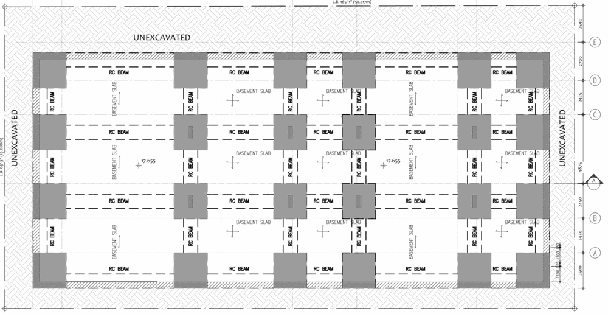{ width="680" loading=lazy }
  <figcaption>Diagram 1 from the original summary (ADF 1/2018, item 14). 原文附圖。</figcaption>
</figure>

<figure markdown>
  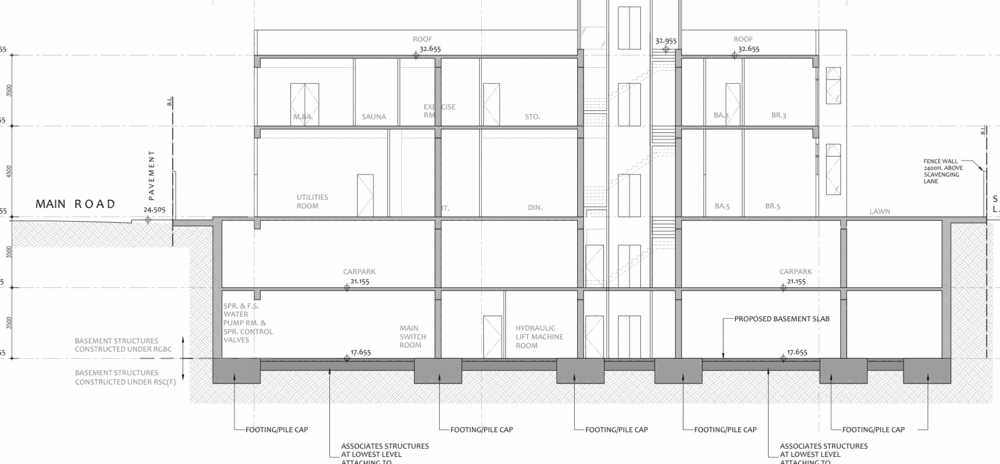{ width="680" loading=lazy }
  <figcaption>Diagram 2 from the original summary (ADF 1/2018, item 14). 原文附圖。</figcaption>
</figure>

**BD's response 屋宇署回覆:** Members noted and would assist to facilitate BD’s review. 13 Practice Note for Authorized Persons, Registered Structural Engineers and APP-96 Registered Geotechnical Engineers Contractors and Specialist Contractors covers solely the registration of general building Minor works contractors registration is Note for Authorized Persons, Registered Structural Engineers APP-148. 8C, 8D, 8E and 8F of the Buildings Ordinance (BO) system. The prime objective of the system is who are able to perform their duties and responsibilities as fully conversant with the relevant statutory control system are registered and allowed to carry the BO, there are three contractors’ registers, namely register, the specialist contractors’ register and the being kept by the Building Authority (BA). In register, sub-registers of different categories of in the registers are published annually in the of the contractors, including the name of the Signatory as referred to in paragraph 10(a) the expiry date of its registration are also posted on BO empowers the BA to designate by notice in the as specialized works that are required to be carried (RSC). Currently, there are five categories of works. They are: field works; and /Scope…... carry out general works in the works in their been entered. RGBC of Schedule 1 of the only carry out the according to their entered. from the appropriate out. The scope of ground investigation Appendix A. certain general of contractors. …
{: .apsec-a }

---
<small>Source: Summary of Items Discussed in APSEC Discussion Forum, published by the HKIE Structural Division. Condensed for reference; the PDF is the authoritative record.</small>
