---
tags:
  - APSEC
  - Plan submission & approval 呈交及審批
  - Structural 結構
  - Foundation 地基
  - Registration 註冊
  - Fire resisting construction 耐火結構
  - GFA 總樓面面積
  - Fire safety 消防安全
  - Balcony & utility platform 露台及工作平台
  - Sustainable building design 可持續建築設計
  - Curtain wall & façade 幕牆及外牆
  - Car park 停車場
  - Occupation permit 佔用許可證
  - Excavation & ELS 挖掘
  - Drainage 排水
  - Barrier free access 無障礙
  - Lift 升降機
  - GFA concession 樓面面積寬免
  - Domestic 住用
  - Concrete & materials 混凝土及物料
  - A&A works 改動及加建工程
  - Protective barrier 防護欄障
  - Means of escape 逃生途徑
  - Means of access 救援通道
  - Geotechnical 岩土
  - Staircase 樓梯
  - Green & amenity features 環保及適意設施
  - Maintenance access 維修通道
  - Lighting & ventilation 照明及通風
  - Building height 建築物高度
  - Site supervision 地盤監督
  - Plumbing & sanitary 衞生設備
  - Plant rooms 機房
  - Wind 風力
  - Site coverage 上蓋面積
  - Site area & classification 地盤面積及分類
  - Minor works 小型工程
  - Heritage 文物
  - Energy efficiency 能源效率
  - Hotel 酒店
  - Refuse 垃圾
---

# APSEC discussion items 2019 <small>2019 年認可人士及註冊結構工程師委員會討論項目</small>

!!! info "About this page 關於本頁"
    Questions raised at the APSEC Discussion Forum (ADF) and **BD's responses**, extracted from the summaries published by the HKIE Structural Division. Text is condensed from the English source; check the PDF before relying on an item. Where a later meeting discussed the same question, the item is flagged and **the later response prevails**.
    摘錄自香港工程師學會結構分部發布的會議摘要（只有英文版本）。如其後會議再討論同一問題，以**較新的回覆為準**。

## ADF 5/2019 · 22 Nov 2019 {#adf-52019-22-nov-2019}

[Original summary (PDF) 原文](https://www.hkie-st.org/wp-content/uploads/2022/07/81_Summary-of-Items-Discussed-in-APSEC-Discussion-Forum-on-22-November-2019.pdf) · 29 items

### 1. Height of Storeys {#i201911221}

Raised by **HKIA**

**Question 問題:** As per item 3 of ADF 2/2014 held on 14.3.2014, BD advised that bathrooms and toilets were considered as habitable areas and thus had to comply with the storey height requirements under regulation 24 of Building (Planning) Regulations, i.e. the clear height should be 2.5m under structural ceiling soffit and 2.3m under beam. We would like to enquire whether the clear height from underside of beam/hanger wall of the sunken slab as marked in sketch below is acceptable.
{: .apsec-q }

<figure markdown>
  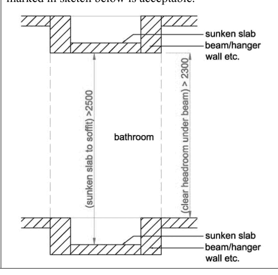{ width="361" loading=lazy }
  <figcaption>Diagram 1 from the original summary (ADF 5/2019, item 1). 原文附圖。</figcaption>
</figure>

**BD's response 屋宇署回覆:** The requirement for a minimum clear height of 2.3m should only be applicable to the underside of beam pursuant to regulation 24(1) of Building (Planning) Regulations. For the scenario illustrated in HKIA’s sketch, a clear height of not less than 2.5m from the floor to the ceiling should be provided to the underside of the hanger wall structure.
{: .apsec-a }

### 2. FRR Screen Wall and Unprotected Opening {#i201911222}

Raised by **HKIA** · Related 相關: [Code of Practice for Fire Safety in Buil](../codes/fire-safety-code-2011.md)

<small>Related discussions 相關討論: [23 Aug 2019 item 4](2019.md#i201908234)</small>

**Question 問題:** The corrigenda for FS Code 2011 issued in September 2013 refer. Example (b) was added to Diagram C2 with the addition of screen wall. Would BD please clarify whether the unprotected opening and external wall of FRR‹FRRe (i.e. line BC as shown in the sketch below) at less than 6m from the unprotected opening of the required staircase is acceptable.
{: .apsec-q }

**BD's response 屋宇署回覆:** BD advised that where AB was the external wall of any other building on the same site with d6m, the window opening of the required staircase should be protected by fixed light with an FRR≥FRRe. Where AB was any other external wall of the same building with d6m, whether the window opening of the required staircase could be unprotected would be considered on case basis, taking into account the actual configuration and distance between the unprotected opening at BC and the window opening of the required staircase, as well as the effectiveness of the FRR screen wall in protecting the staircase window opening.
{: .apsec-a }

### 3. Requirement of Thoroughfares {#i201911223}

Raised by **HKIA** · Related 相關: [FS Code 2011 Part B: Means of Escape](../codes/fsc-part-b-means-of-escape.md)

**Question 問題:** Clause B20.1 and B20.2 of FS Code 2011 require “The site of a Use Classification 5a should abut upon and have frontages to two or more thoroughfares” and “The frontage of a building having a Use Classification 5a should, subject to Clause B20.7, form at least one half of the total perimeter of the building excluding recesses and projection……direct to two or more thoroughfares.” We understand that one of the primary functions of the thoroughfares is for the purpose of MOE, as it is stated in Clause B20.3 of FS Code 2011 that “The thoroughfares in Clause B20.2 should be of such width as will enable the persons……to disperse rapidly in the event of fire.” Thus, in the case of a thoroughfare which is not designed to serve as an EVA, would BD please advise/confirm the following: (i) Area occupied by amenity features/street furniture such as on-grade planters, lawn, benches, on-street parking spaces, etc. within the thoroughfare can be fully accountable for the required width of such thoroughfare as per the below diagram; and (ii) Where the building is set back from the site boundary abutting the thoroughfares, it is acceptable to occupy the intervening spaces with planters and/or other building structures/features as per the below diagram, provided that MOE from the building leading direct to the thoroughfares are not obstructed.
{: .apsec-q }

<figure markdown>
  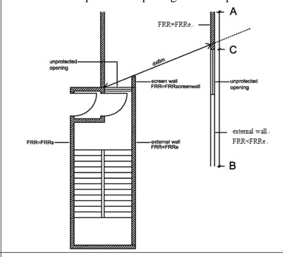{ width="360" loading=lazy }
  <figcaption>Diagram 1 from the original summary (ADF 5/2019, item 3). 原文附圖。</figcaption>
</figure>

<figure markdown>
  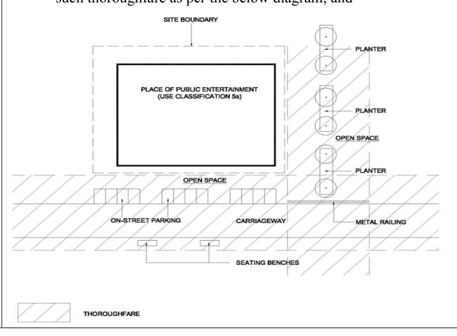{ width="485" loading=lazy }
  <figcaption>Diagram 2 from the original summary (ADF 5/2019, item 3). 原文附圖。</figcaption>
</figure>

**BD's response 屋宇署回覆:** (i) BD advised that whether any amenity features/street furniture located within the thoroughfare could be fully accountable for the required width would be considered on case basis. In general, the required width of thoroughfares should not be reduced by amenity features/street furniture which would adversely affect the occupants to disperse rapidly in the event of fire. (ii) For the proposed MOE arrangement as illustrated in HKIA’s sketch, the unobstructed MOE passage and the intervening spaces with planters should be open area and the MOE passage should be clearly defined with a width not less than 1.5m wide or the total required width of exit routes discharging into the area, whichever is greater. In addition, the frontage requirements stipulated under Clause B20.2 of FS Code 2011 should apply.
{: .apsec-a }

### 4. Temporary Transformer Room in Construction Site {#i201911224}

Raised by **HKIA** · Related 相關: [FS Code 2011 Part D: Means of Access](../codes/fsc-part-d-means-of-access.md)

**Question 問題:** Temporary transformer room in construction site requires application for temporary building permit with submission of GBP, superstructure plan and drainage plan respectively. However, it may not be practicable for provision of EVA as well as drainage connection to public drain be provided for temporary transformer room within a construction site. As temporary transformer room within a construction site, by its nature, will only be in service during the construction period, would BD give favourable consideration to waive/relax the requirement of EVA as well as drainage plan submission, similar to the case of application for erection of a contractor’s shed?
{: .apsec-q }

<figure markdown>
  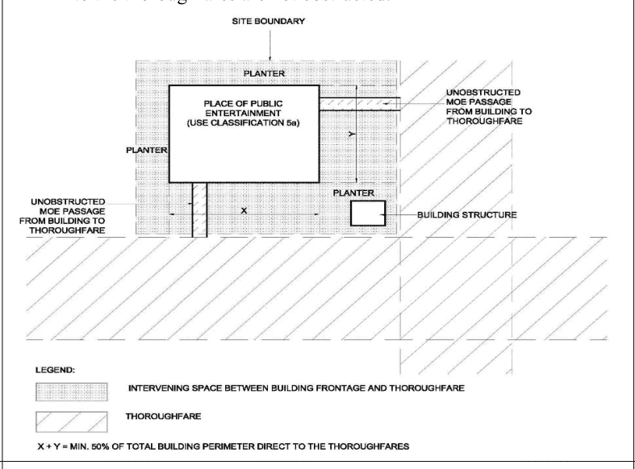{ width="509" loading=lazy }
  <figcaption>Diagram 1 from the original summary (ADF 5/2019, item 4). 原文附圖。</figcaption>
</figure>

**BD's response 屋宇署回覆:** Pursuant to regulation 41D(3) and Clause D25.1 of FS Code 2011, the BA might exempt a building from any or all design and construction requirements of EVA if the BA was satisfied that compliance with such requirements was (a) impracticable having regard to the topographical features of the area on which the building would be situated; or (b) unwarranted on the ground that the purpose for which the building would be used constituted a low fire risk. On this, BD would consult FSD on case basis regarding application for exemption of the requirements of EVA for temporary transformer room in construction site. As regards drainage proposal for temporary transformer room in construction site, BD noted that only storm water would normally be involved. As such, corresponding drainage plans for temporary collection and discharge of storm water should be submitted for consideration and approval. BD would take a pragmatic approach in considering the storm water drainage proposal for temporary transformer room in a construction site on case basis in view of the relatively small area of temporary transformer room, the temporary nature and the fact that underground storm water drainage pipes and the associated connections for the site might yet to be installed.
{: .apsec-a }

### 5. Inclusion of Structural Details in A&A Submission {#i201911225}

Raised by **HKIA** · Related 相關: [APP-37](../pnap/app-37.md)

**Question 問題:** Would BD please clarify whether the required level of details for structural works in A&A submissions would be the same or be more elaborated than that required for new building works submissions? The following are some recent examples of structural submissions which are normally not required for new buildings submission, but are required for inclusion in A&A submission: (i) Structural details for non-structural internal partition walls/ suspended partition walls. (ii) Internal glass wall/window/window wall/shopfront glass with design span of the structural elements not exceeding 6m, not serving as protective barriers, and not subject to wind load. (iii) Structural submission for supports of building services equipment at internal areas (such as AHU/stainless steel tanks/grease traps tanks etc.), other than concrete plinth and demonstration of effect to existing building structure. We opine that the above structural submissions to BD for A&A works are not necessary, as these works are under the supervision of AP/RSE in the same manner as in new building works.
{: .apsec-q }

**BD's response 屋宇署回覆:** BD advised that the requirement for inclusion of structural details in A&A submission should have no fundamental difference from that for new building works submission. For the examples quoted, BD further advised the following: (i) For internal partition walls of substantial height, submission of structural details might be required to justify the structural stability. Similar structural details should likewise be incorporated in structural submissions of new building developments as standard structural details for BD’s approval. (ii) For internal glass wall/window wall/shopfront glass with structural span not exceeding 6m, submission of structural details would not be required with reference to PNAP APP-37. However, AP/RSE should ensure that the design, fabrication and installation of such system would achieve the required safety standard. (iii) For supporting structures of building services equipment at internal area exceeding the criteria for minor works under MWCS, submission of structural details/calculations might be required. BD further advised that they were reviewing the criteria for inclusion of metal supporting structures for building services installation hung underneath the soffit of slab under the MWCS.
{: .apsec-a }

### 6. Structural Columns/Walls within GFA Exempted Areas {#i201911226}

Raised by **HKIA**

**Question 問題:** As per Item 26 of ADF 2/2016 held on 18.3.2016, BD advised that structural columns/walls within the GFA exempted areas that occupied more than 50% of the area of the floor should NOT be accountable for GFA. Based on the above, we understand that the above principle should also be applicable to the structural columns/walls within covered landscape areas underneath tower footprint, communal sky gardens, and similar features. Please advise if our understanding is correct.
{: .apsec-q }

**BD's response 屋宇署回覆:** In the case where less than 50% of the floor area was GFA accountable, the structural columns/walls within the GFA non-accountable areas could be exempted from GFA calculation. This principle should also apply to covered landscape areas underneath tower footprint and communal sky gardens.
{: .apsec-a }

### 7. Provision of Footpath/Pavement in Carpark {#i201911227}

Raised by **HKIA** · Related 相關: [APP-2](../pnap/app-2.md), [APP-111](../pnap/app-111.md)

**Question 問題:** For carparks in large sites where long horizontal transit between parking spaces and pedestrian access points is unavoidable, a designated footpath/pavement of reasonable width and extent would definitely enhance safety to both pedestrian and drivers. Subject to these footpaths/pavement are to be designated as common areas in DMC where the chance of abuse is highly unlikely, and that there is no or minimal effect to the building bulk (say where the carparks are located belowground), we would ask for BD’s favorable consideration to accept the incorporation of such designated footpath/pavement in carpark with respective GFA concession.
{: .apsec-q }

**BD's response 屋宇署回覆:** The design of carpark including the provision of circulation spaces would be considered on a case basis in accordance with PNAP APP-2 and PNAP APP-111 for GFA concession.
{: .apsec-a }

### 8. Access Panels of Typhoon-proof Ceiling {#i201911228}

Raised by **HKIA**

!!! warning "Later discussion 其後再討論"
    This question was discussed again on **10 Jan 2020**; use the [later response](2020.md#i2020011018) where they differ. 如有不同，以較新回覆為準。

**Question 問題:** External typhoon-proof ceiling requires structural plan submission to BD for approval and consent. Where demountable access panels or hinged access panels are to be provided to facilitate future maintenance of services above such ceiling, it is our understanding that the dismantling/reinstatement of these access panels without affecting the approved structural design/details/materials will not be considered as A&A or Minor Works. Please advise if our understanding is correct.
{: .apsec-q }

**BD's response 屋宇署回覆:** BD advised that a response would be provided after reviewing the issue with Minor Works Unit.
{: .apsec-a }

### 9. Exemption of GFA and SC for Covered Areas Underneath Lowest Balcony/Utility Platform {#i201911229}

Raised by **HKIA** · Related 相關: [JPN 1](../pnap/jpn-1.md), [JPN 2](../pnap/jpn-2.md)

!!! warning "Later discussion 其後再討論"
    This question was discussed again on **29 Sep 2020**; use the [later response](2020.md#i2020092918) where they differ. 如有不同，以較新回覆為準。

**Question 問題:** As stated in JPN No. 1 and No. 2, the covered areas underneath the lowest balcony and utility platform may be fully exempted from GFA and SC calculations, subject to fulfilment of certain design parameters. For situation where the upper portion of a domestic building is designed to have setback terraces/flat roofs at its upper storeys as per the below diagram (which design is not uncommon for providing, say, simplex or duplex units at the upper portion of a domestic tower), it may result in covered areas underneath balcony/utility platform over these private flat roofs at the upper portion of the building. Despite these covered areas are not located underneath the lowest balcony/utility platform of the building, we opine that they should still be fully exempted from GFA/SC calculations, as the arrangement is essentially similar to that described in the JPNs. Please advise if our understanding is correct.
{: .apsec-q }

**BD's response 屋宇署回覆:** Pursuant to JPN No. 1 and No. 2 jointly endorsed by BD, LandsD and PlanD, only the covered areas underneath the lowest balcony and utility platform might be fully exempted from GFA and SC calculations but not the covered areas at setback terraces/flat roofs at the upper domestic storeys as shown in the diagram.
{: .apsec-a }

### 10. Appendix B of the Code of Practice on Design for Safety – External Maintenance 2019 {#i2019112210}

Raised by **HKIA**

**Question 問題:** We have the following queries/suggestions to make regarding the requirements as stated in Appendix B for combining AC platform with balcony/utility platform: (i) Paragraph (h)(i) – To allow reasonable space for accommodating AC outdoor units and the associated fixtures/fittings (especially for large domestic units), we recommend that the perforated screens provided at the edges of the AC platform be disregarded from the 0.8m2 exempted platform area, similar to the case of AC platform as described in Paragraph 5 of Appendix C of the Code, where it states “such screen/guard-rail including its supporting structural members may be excluded from the measurement of the maximum projection of the AC platform”. (ii) Paragraph (g) requires that “any screens provided at the edge of the (AC) platform should not be higher than 1.1m”. We opine that such requirement is too onerous and restrictive. For practical and aesthetic reason, we believe it would be more reasonable to permit such screens to be not higher than the balustrade of the adjoining balcony/utility platform, subject to a maximum of, say, 1250mm from the finished floor level of the combined AC platform and balcony/utility platform.
{: .apsec-q }

**BD's response 屋宇署回覆:** (i) BD advised that the issue would be discussed in the Technical Committee on the Code of Practice on Design for Safety – External Maintenance in due course. (ii) While the issue would also be discussed in the Technical Committee, screens provided along the edge of the AC platform of height not higher than the balustrade of the adjoining balcony/utility platform might be acceptable provided that the height of the said balustrade should be reasonable.
{: .apsec-a }

### 11. Post-OP Rectification Works Procedures {#i2019112211}

Raised by **HKIA**

<small>Related discussions 相關討論: [22 Mar 2019 item 4](2019.md#i201903224)</small>

**Question 問題:** We would like to enquire the status of the subject item as raised by us in item 4 of ADF 2/2019 held on 22.3.2019.
{: .apsec-q }

**BD's response 屋宇署回覆:** BD advised that the issue was being reviewed and the proposed streamlining procedures would be submitted to BSC/APSEC for comments in due course.
{: .apsec-a }

### 12. Bearing Capacity of Marble Rock Mass {#i2019112212}

Raised by **HKIE** · Related 相關: [APP-18](../pnap/app-18.md)

**Question 問題:** Please clarify the presumed allowable vertical bearing capacity of sound marble rock of Marble Rock Class I and II as defined in Table 2.5 of the Clause 2.8.2.2 of Code of Practice for Foundations 2017.
{: .apsec-q }

**BD's response 屋宇署回覆:** BD advised that the issue would be reviewed in the Technical Committee on the Code of Practice for Foundations (TC). HKIE would raise the item in the TC for discussion via their representatives.
{: .apsec-a }

### 13. Piling Amendment Plan {#i2019112213}

Raised by **HKIE**

**Question 問題:** For design of pile foundation, please clarify whether piling amendment plan still needs to be submitted for approval if the variation of as-built pile length from tentative pile length is not more than 10%. Since the processing of piling amendment plan takes time, could BD process the Form BA14 submission for piling works and select piles for proof tests before the approval of such amendment plan.
{: .apsec-q }

**BD's response 屋宇署回覆:** BD advised that under the current practice, submission of piling amendment would be required if the variation was more than ±5% from the approved tentative pile length. Meanwhile, BD confirmed that piles for proof tests could be selected before the approval of piling amendment for the above variation.
{: .apsec-a }

### 14. Sensitive Buildings/Structures {#i2019112214}

Raised by **HKIE** · Related 相關: [APP-137](../pnap/app-137.md), [APP-157](../pnap/app-157.md)

<small>Follows earlier discussion: [23 Aug 2019](2019.md#i2019082312)</small>

**Question 問題:** Further to the discussion on installation of temporary pile wall along site boundary under item 12 of ADF 4/2019 held on 23.8.2019, we would like to clarify the definition of sensitive buildings/structures. Some case officers refer to Clause 7.4 of the Code of Practice for Site Supervision 2009 (extracted copy attached) in processing the ELS plans and consider major road, water mains, gas mains etc. are sensitive structures.
{: .apsec-q }

<figure markdown>
  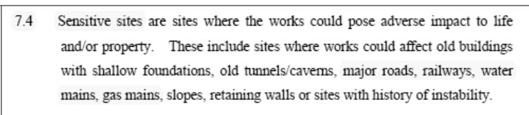{ width="496" loading=lazy }
  <figcaption>Diagram 1 from the original summary (ADF 5/2019, item 14). 原文附圖。</figcaption>
</figure>

**BD's response 屋宇署回覆:** BD advised that the definition of sensitive buildings is defined in paragraph 4 of Appendix A to PNAP APP-137. They include hospitals, academic institutes, declared monuments, old buildings with shallow foundations, old tunnels/caverns, buildings installed with sensitive equipment, masonry retaining walls or sites with history of instability, monuments or buildings with historical significance etc. For classification of non-building sensitive features, reference could be made to Clause 7.4 of the Code of Practice for Site Supervision 2009 which includes major roads, railways, water mains, gas mains, etc. BD would ensure that consistent definitions are adopted by case officers.
{: .apsec-a }

### 15. Enclosure Wall of Vertical Lifting Platform {#i2019112215}

Raised by **HKIS** · Related 相關: [FS Code 2011 Part C: Fire Resisting Cons](../codes/fsc-part-c-fire-resisting-construction.md), [Design Manual: Barrier Free Access 2008 ](../codes/bfa-2008.md)

**Question 問題:** Would BD clarify whether a vertical lifting platform, which serves within a same compartment (like in a house with single occupancy) and complies with paragraph 5.5B(a)(ix) in Chapter 5 of Design Manual: Barrier Free Access 2008, is required to comply with Clause C9.1 of FS Code 2011 regarding protection of liftwell and lift door?
{: .apsec-q }

<figure markdown>
  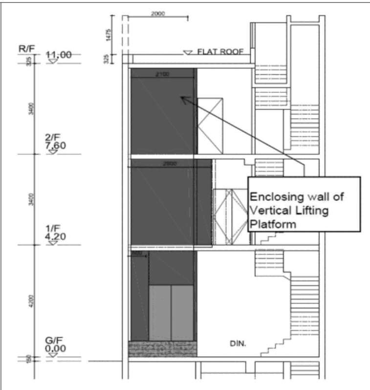{ width="490" loading=lazy }
  <figcaption>Diagram 1 from the original summary (ADF 5/2019, item 15). 原文附圖。</figcaption>
</figure>

**BD's response 屋宇署回覆:** Pursuant to Clause C9.2 of FS Code 2011, provided that the lift machine room or pulley room would be completely separated by fire barriers from the rest of the building, fire resisting construction would not be required for the lift car including landing doors and the liftwell of a bullet lift, panorama lift and the like serving a single fire compartment. Accordingly, fire protection of liftwell/lift door would not be required for vertical lifting platform serving a single fire compartment provided that the components with fire risk were completely separated by fire barriers from the rest of the building as required in Clause C9.2 of FS Code 2011. In addition, it is noted that regulation 72 of Building (Planning) Regulations and Design Manual: Barrier Free Access 2008 should not apply to single family building of 13m or less in height.
{: .apsec-a }

### 16. PNAP APP-132 - Site Coverage and Open Space Provision {#i2019112216}

Raised by **AAP** · Related 相關: [APP-132](../pnap/app-132.md)

!!! warning "Later discussion 其後再討論"
    This question was discussed again on **13 May 2022**; use the [later response](2022.md#i2022051310) where they differ. 如有不同，以較新回覆為準。

<small>Related discussions 相關討論: [25 May 2018 item 6](2018.md#i201805256), [14 Jan 2022 item 14](2022.md#i2022011414)</small>

**Question 問題:** Pursuant to paragraph 3(b) of PNAP APP-132, BA will take into account that “the building is set back at a length of not less than half of the frontage and not less than 10m long or the full frontage for site with frontage less than 10m in length” in considering applications for flexibility in determining site coverage and open space provision. Please clarify whether our interpretation of paragraph 3(b) as demonstrated in the below 4 cases is correct.
{: .apsec-q }

<figure markdown>
  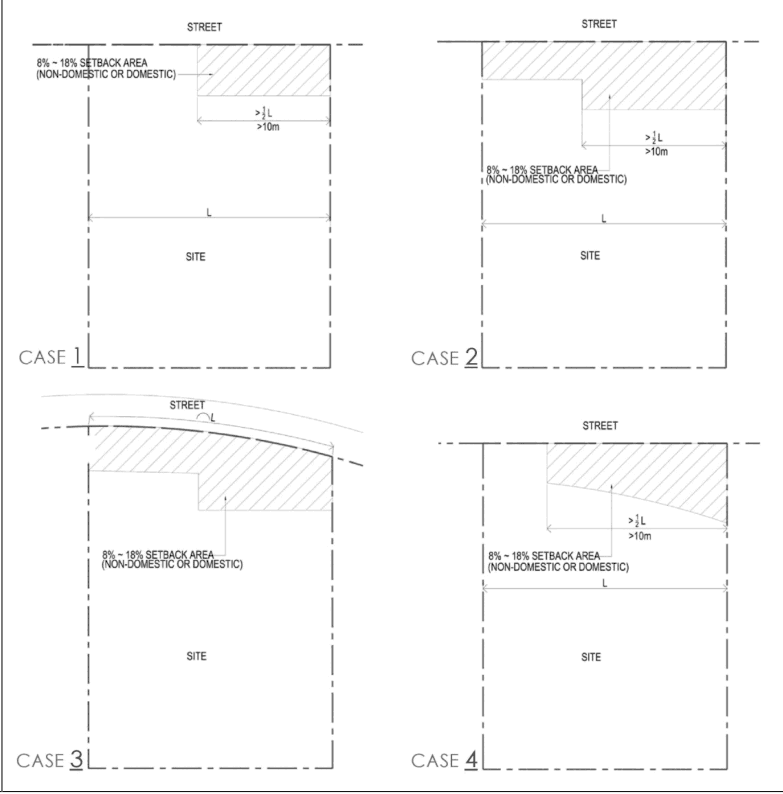{ width="506" loading=lazy }
  <figcaption>Diagram 1 from the original summary (ADF 5/2019, item 16). 原文附圖。</figcaption>
</figure>

<figure markdown>
  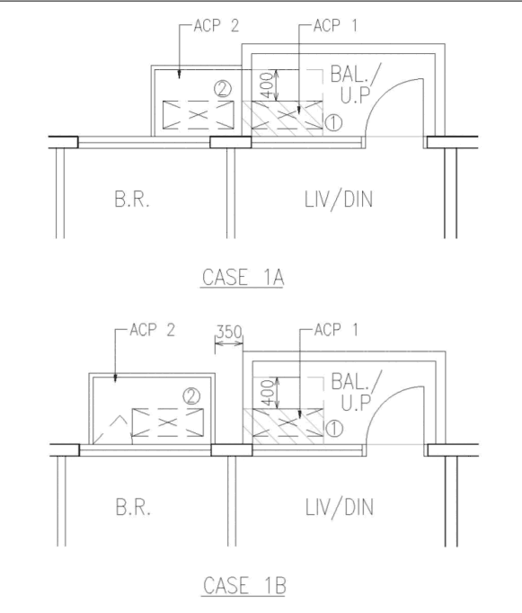{ width="375" loading=lazy }
  <figcaption>Diagram 2 from the original summary (ADF 5/2019, item 16). 原文附圖。</figcaption>
</figure>

<figure markdown>
  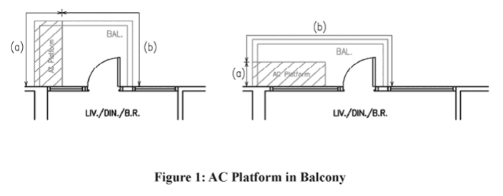{ width="455" loading=lazy }
  <figcaption>Diagram 3 from the original summary (ADF 5/2019, item 16). 原文附圖。</figcaption>
</figure>

<figure markdown>
  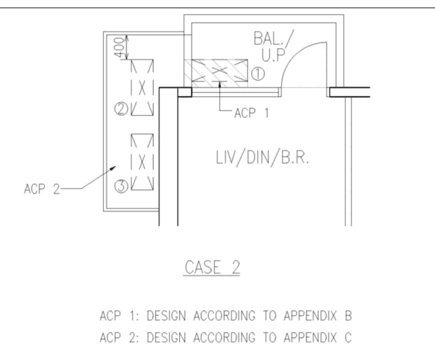{ width="400" loading=lazy }
  <figcaption>Diagram 4 from the original summary (ADF 5/2019, item 16). 原文附圖。</figcaption>
</figure>

<figure markdown>
  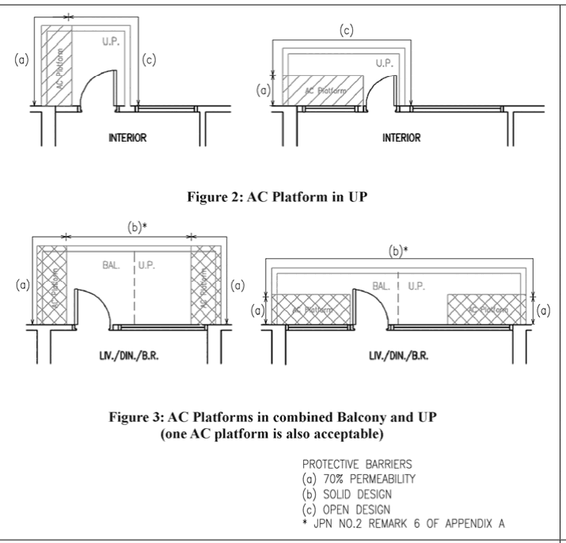{ width="462" loading=lazy }
  <figcaption>Diagram 5 from the original summary (ADF 5/2019, item 16). 原文附圖。</figcaption>
</figure>

**BD's response 屋宇署回覆:** Pursuant to paragraph 3(e) of PNAP APP-132, the setback area should contribute to improving the street environment such as enhancing air ventilation and permeability as well as promoting connectivity and walkability. In this regard, setback in uniform design with a distinguishable space excluding non-functional pocket space would be favourably considered for calculation of the required setback area.
{: .apsec-a }

### 17. Code of Practice on Design for Safety – External Maintenance 2019 {#i2019112217}

Raised by **AAP** · Related 相關: [JPN 1](../pnap/jpn-1.md), [JPN 2](../pnap/jpn-2.md)

!!! warning "Later discussion 其後再討論"
    This question was discussed again on **21 May 2021**; use the [later response](2021.md#i202105211) where they differ. 如有不同，以較新回覆為準。

**Question 問題:** (i) According to the Appendix to BD’s Circular Letter dated 19.9.2019, Maintenance and Repair Access Plans (M&R Submission) should be submitted for BD’s approval prior to application for superstructure consent. Will BD accept the M&R Submission be submitted separately for BD’s approval prior to superstructure consent application, e.g. a technical report that includes those required technical specification like length of the cradle, tie-back restraints for suspended working platforms, etc.? (ii) According to paragraph (h)(ii) of Appendix B of the Code, is it correct only either of the design: (1) AC platform combined with balcony/utility platform or (2) individual AC platform, could be adopted in a development but not both? Will BD accept the following proposals? (iii) For the Figures 1 to 3 under Appendix B of the Code, please confirm if our interpretation on the design of the protective barrier is correct.
{: .apsec-q }

<figure markdown>
  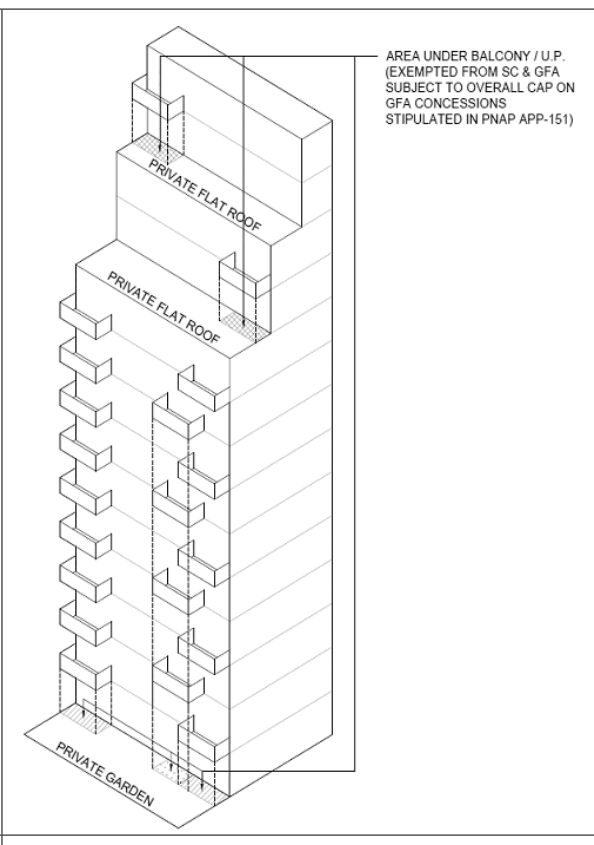{ width="383" loading=lazy }
  <figcaption>Diagram 1 from the original summary (ADF 5/2019, item 17). 原文附圖。</figcaption>
</figure>

**BD's response 屋宇署回覆:** (i) BD advised that paragraph 1(a) & (c) of the Appendix of the Circular Letter should be included in the GBP while paragraph 1(b) could be in the form of a technical report to be submitted for BD’s approval prior to superstructure consent application. (ii) If AC platform combined with balcony/utility platform had been adopted for a building, individual AC platform must not be erected at the external walls of the same building. For development with more than one building, each building of the development should be considered individually. In this regard, Case 1A, 1B and 2 provided in AAP’s sketches were not acceptable. (iii) BD confirmed that AAP’s interpretation was correct. Nevertheless, attention should be drawn to the requirements that the natural lighting and ventilation of the adjoining habitable space should not be obstructed by the AC outdoor units, and the open side requirement of balcony and utility platform under JPN No. 1 and No. 2 respectively should be complied with. A further question was raised whether the short side of the AC platform if not for the purpose of air intake/exhaust could be changed to solid design. In response, BD advised that the matter would be further reviewed in the Technical Committee on the Code of Practice on Design for Safety – External Maintenance.
{: .apsec-a }

### 18. Voids in Buildings {#i2019112218}

Raised by **AAP** · Related 相關: [APP-2](../pnap/app-2.md)

**Question 問題:** Appendix A of PNAP APP-2 specifies that for voids in duplex domestic flats, “only two levels of voids will be allowed for each residential tower block, subject to a maximum of 0.5% of the total domestic GFA of the development.” Please confirm our interpretation on “two levels of voids” as shown in the below section is correct.
{: .apsec-q }

<figure markdown>
  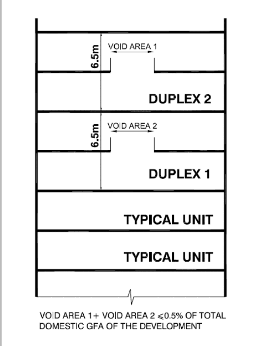{ width="341" loading=lazy }
  <figcaption>Diagram 1 from the original summary (ADF 5/2019, item 18). 原文附圖。</figcaption>
</figure>

**BD's response 屋宇署回覆:** BD confirmed that AAP’s interpretation was correct and reminded that the other exemption criteria for voids in duplex flat under Appendix A of PNAP APP-2 should also be fulfilled.
{: .apsec-a }

### 19. Filling Materials for Unusable Areas {#i2019112219}

Raised by **AAP**

**Question 問題:** Please clarify any specific requirement on concrete filling (e.g. light weight concrete fill, mass concrete fill, soils, etc.) for the following areas: (i) Undesignated common area, e.g. in Carpark. (ii) Inaccessible concealed common area without any structure below. (iii) Concealed area in private house and also the specific depth of concrete filling in such a case.
{: .apsec-q }

**BD's response 屋宇署回覆:** Filling of voids by means of compacted fill, lightweight concrete or bracing might be considered on individual case merits. For instance, void underneath a single family house with raft foundation of clear headroom not more than 1.5m might be filled with compacted fill, whilst lightweight concrete should be used for void with clear headroom more than 1.5m. BD further advised that bracing was generally not preferred since removal of the bracing after occupation might be comparatively easy unless there was structural concern.
{: .apsec-a }

### 20. Height of Stairhood {#i2019112220}

Raised by **AAP**

!!! warning "Later discussion 其後再討論"
    This question was discussed again on **12 Aug 2022**; use the [later response](2022.md#i202208125) where they differ. 如有不同，以較新回覆為準。

**Question 問題:** For private staircase linking the top floor to the roof, the stairhood on roof is normally GFA non-accountable provided that there is no excessive headroom (i.e. not greater than 5m) for such stairhood. Please confirm if our understanding is correct or not.
{: .apsec-q }

**BD's response 屋宇署回覆:** BD advised that due consideration would be given on case basis taking into account the chance of abuse.
{: .apsec-a }

### 21. JPN No. 5 - Building Height Restriction {#i2019112221}

Raised by **AAP** · Related 相關: [JPN 5](../pnap/jpn-5.md)

<small>Related discussions 相關討論: [29 May 2020 item 20](2020.md#i2020052920)</small>

**Question 問題:** Paragraph 6 of JPN No. 5 states that “mean site formation level means the average of the sum of the highest and lowest formation levels of the land on which any part of the building stands including basement floors.” Please confirm the calculation of the mean site formation level for the below case is correct.
{: .apsec-q }

<figure markdown>
  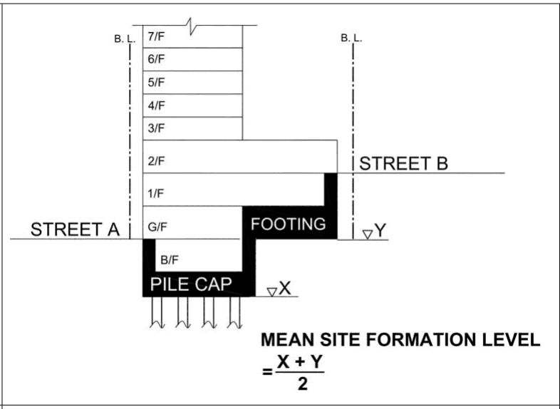{ width="508" loading=lazy }
  <figcaption>Diagram 1 from the original summary (ADF 5/2019, item 21). 原文附圖。</figcaption>
</figure>

**BD's response 屋宇署回覆:** Since PlanD was the authority for building height restriction as stipulated in JPN No. 5, the issue would be referred to PlanD for direct clarification.
{: .apsec-a }

### 22. GFA Calculation for Inclined Building Form {#i2019112222}

Raised by **AAP** · Related 相關: [APP-19](../pnap/app-19.md), [ADM-19](../pnap/adm-19.md)

**Question 問題:** It is becoming more common for AP to design innovative building form, e.g. twisted/inclined building due to advancement in building technology and better architectural expression. To facilitate AP to ascertain the basis of GFA calculation in early design stage, we would like to seek BD’s confirmation on our interpretation of GFA calculation with respect to paragraphs 6 and 7 of PNAP APP-19 for inclined building form.
{: .apsec-q }

**BD's response 屋宇署回覆:** BD advised that the GFA calculation for inclined building form and any other innovative building designs would be considered pragmatically on a case basis. AP was encouraged to make use of the pre-submission enquiry service under PNAP ADM-19 to consult BD on the principle of GFA calculation for unconventional building design at early design stage.
{: .apsec-a }

### 23. Determination of Openable Window Area {#i2019112223}

Raised by **AAP** · Related 相關: [B(C)R Building (Construction) Regulation](../regulations/bcr-123q.md)

!!! warning "Later discussion 其後再討論"
    This question was discussed again on **21 May 2021**; use the [later response](2021.md#i202105213) where they differ. 如有不同，以較新回覆為準。

**Question 問題:** For openable bottom-hung window (Case A and Case B below), if the openable extent is not less than 600mm at the top of sash to window frame, its openable window area is to be calculated based on the elevation area of such window: Please clarify if, for some other special window like cassette-type window, the openable window area is the summation of all the openable areas (i.e. the gaps) on four sides of such window:
{: .apsec-q }

<figure markdown>
  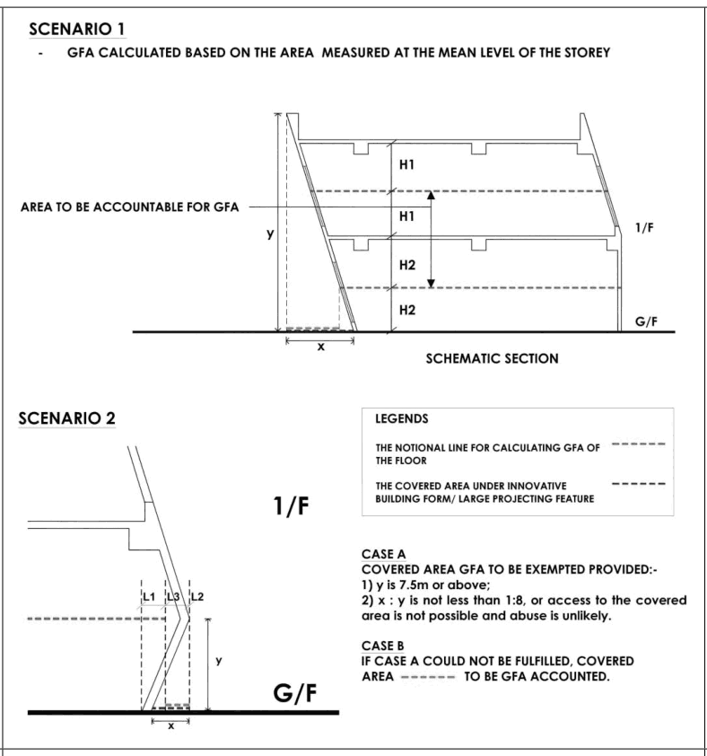{ width="510" loading=lazy }
  <figcaption>Diagram 1 from the original summary (ADF 5/2019, item 23). 原文附圖。</figcaption>
</figure>

<figure markdown>
  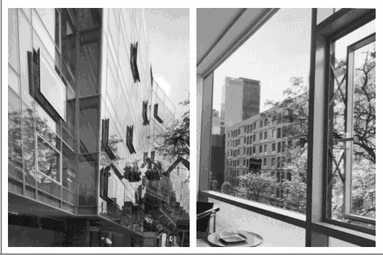{ width="403" loading=lazy }
  <figcaption>Diagram 2 from the original summary (ADF 5/2019, item 23). 原文附圖。</figcaption>
</figure>

<figure markdown>
  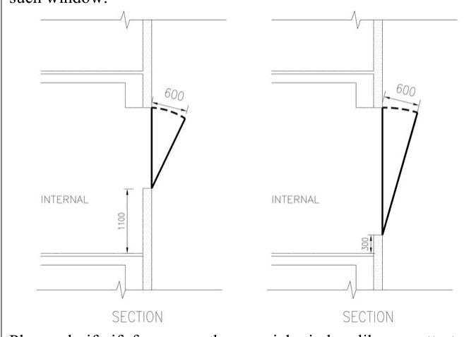{ width="436" loading=lazy }
  <figcaption>Diagram 3 from the original summary (ADF 5/2019, item 23). 原文附圖。</figcaption>
</figure>

<figure markdown>
  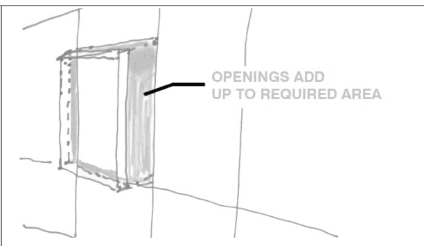{ width="396" loading=lazy }
  <figcaption>Diagram 4 from the original summary (ADF 5/2019, item 23). 原文附圖。</figcaption>
</figure>

**BD's response 屋宇署回覆:** For bottom-hung window, BD confirmed that if the openable extent of the window was not less than 600mm, its openable window area should be calculated based on the elevation area of such window. In any case, regulation 8 of Building (Construction) Regulations should also be compiled with where there was a difference in adjacent levels greater than 600mm. By the same token, for cassette type of window, if there was 600mm or more clearance provided at the gaps, the openable window area could be calculated based on the elevation area of the window.
{: .apsec-a }

### 24. Street Widening – Agreement to Surrender {#i2019112224}

Raised by **AAP** · Related 相關: [APP-20](../pnap/app-20.md)

**Question 問題:** According to paragraph 7 of PNAP APP-20, “A temporary occupation permit or an occupation permit will not be issued before the execution of an Agreement to Surrender incorporating all the relevant terms and conditions” for a development where part of its lot is to be surrendered to Government in exchange for bonus plot ratio and/or site coverage under regulation 22(2) of Building (Planning) Regulations. In our understanding, the aforesaid condition only applies to a development where the land lease does not contain any clause requiring the land owner to surrender an area for street widening, such as in an unrestricted lease, and hence a separate “agreement to surrender” needs to be signed and executed between the land owner and the Government before the TOP/OP may be issued. However, where the lease, duly signed and registered in the Land Registry, already contains a clause specifying an area to be surrendered, it is deemed to have the same effect as an “agreement to surrender” and hence the condition, as stipulated under paragraph 7 of PNAP APP-20, is fulfilled. Please confirm whether or not the above interpretation is correct.
{: .apsec-q }

**BD's response 屋宇署回覆:** If the area to be surrendered had been specified in the lease, BD would favourably consider to waive the condition requiring the execution of Agreement of Surrender provided that the interest of the Government had been secured by the lease. In this regard, BD might require AP to provide supporting information including the lease documents for consideration. LandsD would also be consulted as necessary.
{: .apsec-a }

### 25. PNAP APP-152 - Building Setback {#i2019112225}

Raised by **AAP** · Related 相關: [APP-152](../pnap/app-152.md)

!!! warning "Later discussion 其後再討論"
    This question was discussed again on **5 May 2023**; use the [later response](2023.md#i2023050522) where they differ. 如有不同，以較新回覆為準。

<small>Related discussions 相關討論: [24 May 2019 item 2](2019.md#i201905242), [22 Nov 2024 item 2](2024.md#i202411222)</small>

**Question 問題:** Pursuant to paragraph 8(c) of PNAP APP-152, “columns supporting the building above may be permitted within the setback areas subject to requirements as shown in Figure C2 of Appendix C.” (i) Is the 3m column separation refer to structural dimension and that cladding finish (90mm thick) for such column can exist within the 3m separation? (ii) Similarly, can cladding finish exist within the setback dimension “(7.5m+d)”?
{: .apsec-q }

<figure markdown>
  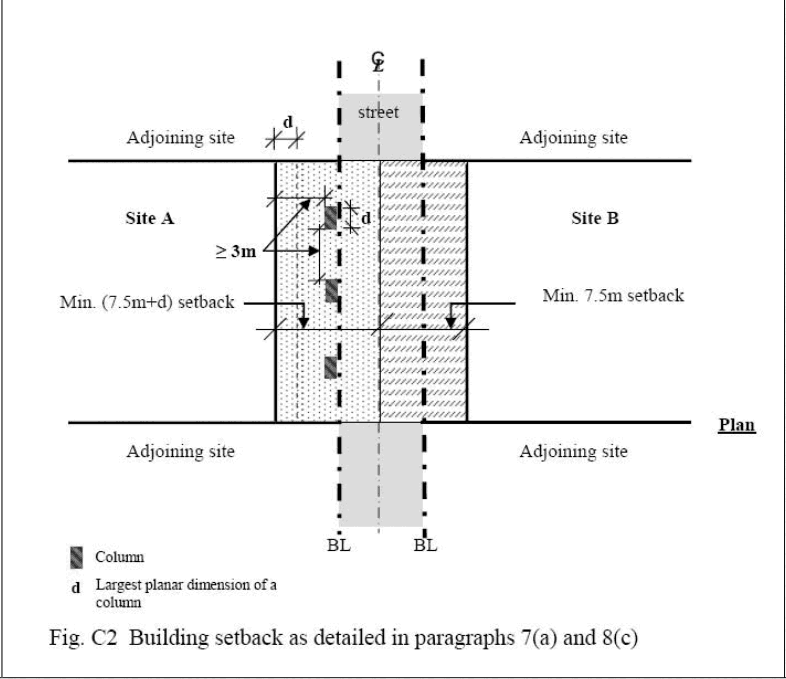{ width="508" loading=lazy }
  <figcaption>Diagram 1 from the original summary (ADF 5/2019, item 25). 原文附圖。</figcaption>
</figure>

**BD's response 屋宇署回覆:** BD confirmed that the dimension for the setback and column separation should be measured from the finished surface.
{: .apsec-a }

### 26. Fact-track Processing of Repairs to Curtain Wall, Glass Wall and Cladding {#i2019112226}

Raised by **AAP**

**Question 問題:** (Item raised by HKIE) Please confirm whether design calculation would still be required for “like to like” replacement of individual components of curtail wall, glass wall and cladding damaged by incidents.
{: .apsec-q }

**BD's response 屋宇署回覆:** BD advised that pursuant to the circular letter issued on 3.10.2019, submission of structural analysis and design calculations would not be required for replacement of individual components of curtain wall, glass wall or cladding panels same as the approved design.
{: .apsec-a }

### 27. Wind Tunnel Test {#i2019112227}

Raised by **AAP** · Related 相關: [APP-139](../pnap/app-139.md)

!!! warning "Later discussion 其後再討論"
    This question was discussed again on **29 May 2020**; use the [later response](2020.md#i202005295) where they differ. 如有不同，以較新回覆為準。

**Question 問題:** (Item raised by HKIE) Please advise whether submission to Structural Engineering Committee (SEC) would still be required if wind tunnel test would be carried out in accordance with the procedures and requirements stipulated in the Code of Practice on Wind Effects in Hong Kong 2019. Please also advise BD’s time pledge on processing the method statement and test report for wind tunnel test.
{: .apsec-q }

**BD's response 屋宇署回覆:** BD advised that submission of the method statement for wind tunnel test to the Structural Engineering Committee would not be necessary if the technical requirements specified in the Code of Practice on Wind Effects in Hong Kong 2019 were complied with.
{: .apsec-a }

### 28. Processing of Referral from LandsD on Application for Wavier {#i2019112228}

Raised by **AAP**

**Question 問題:** (Item raised by HKIS) In processing the application for waiver, some members were advised by LandsD that comment/reply could not be issued because comments from Buildings Department were still pending. As such, please advise if there is any performance pledge or agreed processing time between LandsD and BD for our planning of the application process?
{: .apsec-q }

**BD's response 屋宇署回覆:** BD advised that referrals from LandsD would be handled in accordance with the established procedures as agreed between the departments. While there was no performance pledge or agreed processing time between LandsD and BD, BD would work closely with LandsD to ensure a timely response would be provided as per the request of LandsD.
{: .apsec-a }

### 29. Repair/Replacement of Protective Barrier under MWCS {#i2019112229}

Raised by **AAP**

<small>Related discussions 相關討論: [10 Jan 2020 item 19](2020.md#i2020011019)</small>

**Question 問題:** (Item raised by AAP) For repair/replacement of glass balustrade in shopping mall under MWCS, members were advised that A&A submission should be made instead. Would BD please clarify if repair/replacement of protective barrier in accordance with the original design could be carried out by MWCS?
{: .apsec-q }

**BD's response 屋宇署回覆:** If the repair/replacement of the concerned glass balustrade fulfilled the criteria of the relevant MW items, the works could be carried out under MWCS. It was suggested that further information on that particular case should be provided.
{: .apsec-a }

## ADF 4/2019 · 23 Aug 2019 {#adf-42019-23-aug-2019}

[Original summary (PDF) 原文](https://www.hkie-st.org/wp-content/uploads/2022/07/80_Summary-of-Items-Discussed-in-APSEC-Discussion-Forum-on-23-Aug-2019.pdf) · 17 items

### 1. Application for Consent to Commence Superstructure Works for GBP involving Bonus PR/SC for Dedication/Surrender of Land under Regulation 22 of B(P)R {#i201908231}

Raised by **HKIA** · Related 相關: [ADM-2](../pnap/adm-2.md), [APP-108](../pnap/app-108.md)

!!! warning "Later discussion 其後再討論"
    This question was discussed again on **19 Mar 2021**; use the [later response](2021.md#i2021031919) where they differ. 如有不同，以較新回覆為準。

**Question 問題:** For building plans involving dedication/surrender of land under regulation 22 of B(P)R in return for bonus PR/SC, Appendix E of PNAP ADM-2 requires the Deed of Dedication or Agreement to Surrender be executed and registered at the Land Registry prior to application for consent to commence the building works. However, it is usually a lengthy process for Lands Department to agree on the content and execute the Deed of Dedication or Agreement to Surrender with the lot owner. Please therefore consider if the commonly used BD106 condition for dedication as specified in paragraph 10 of PNAP APP-108, i.e. OP will not be issued before the execution of the Deed of Dedication, can be adopted instead of requiring the said Deed/Agreement to be executed before application for consent to the commencement of works.
{: .apsec-q }

**BD's response 屋宇署回覆:** BD noted that it took time for the preparation and execution of the Deed of Dedication or Agreement to Surrender. In this regard, BD had been adopting a pragmatic and flexible approach on a case merit basis to facilitate the AP in making application for consent to commencement of works in phases by excluding the portion with bonus GFA.
{: .apsec-a }

### 2. PNAP APP-161 – Modular Integrated Construction (MiC) {#i201908232}

Raised by **HKIA** · Related 相關: [APP-151](../pnap/app-151.md), [ADM-19](../pnap/adm-19.md), [APP-161](../pnap/app-161.md)

**Question 問題:** (i) Paragraph 1 of PNAP APP-161 mentions that “MiC is a construction method that employs the technique of having freestanding volumetric modules…”. Please clarify what is meant by “freestanding”. (ii) Paragraph 2(a) of PNAP APP-161 states that “6% of the MiC floor area … may be disregarded from the GFA of the development…”, (a) Since the MiC may solely or partly be adopted for GFA non-accountable uses such as M/E plant rooms, pipe ducts, etc., please clarify whether any GFA non-accountable uses within the MiC are to be fully accountable for calculating the 6% of GFA exemption. (b) Similarly, since part or whole of MiC may also be subject to GFA Concession under PNAP APP-151 (e.g. 50% of green balconies/UP, and non-structural prefabricated external wall), please clarify how the 6% of GFA exemption be calculated in such cases. (iii) Please clarify if similar concession to site coverage calculation would be provided as part of the incentive to promote MiC, since site coverage restriction may be equally critical for site with site coverage restriction under OZP. Concession in GFA but NOT in site coverage calculation may imply that the incentive provided in the PNAP does not apply to such cases. (iv) Please advise the level of details of the MiC components to be shown on GBP for the sake of applying for the 6% GFA exemption.
{: .apsec-q }

**BD's response 屋宇署回覆:** AP/RSE were encouraged to make use of the pre-submission enquiry service as mentioned in PNAP ADM-19 and/or the pre-acceptance mechanism for granting in-principle acceptance (IPA) to individual MiC systems for enquiries about MiC proposals. BD further advised that the submission for IPA and GBP could be made concurrently to streamline the approval process. [Post-meeting note: A briefing session to practitioners was held by BD on 16.9.2019 to facilitate understanding on the new/revised PNAPs on MiC including the general principles in granting GFA exemption under PNAP APP-161 and plan submission process for MiC projects.]
{: .apsec-a }

### 3. Installation of Stove in Open Kitchen for OP Inspection {#i201908233}

Raised by **HKIA**

<small>Related discussions 相關討論: [23 Feb 2024 item 18](2024.md#i2024022318)</small>

**Question 問題:** Would BD please clarify if installation of stove in open kitchen is required at the time of OP inspection for situations where the location of stove is critical to demonstrate compliance with the open kitchen requirements, such as the 2m distance measured from the nearest corner of the stove to the door knob.
{: .apsec-q }

**BD's response 屋宇署回覆:** Stove at open kitchen was not required to be installed at the time of OP inspection, save and except for those situations where the location of stove was critical to demonstrate compliance with the open kitchen requirements, such as the 2m distance measured from the nearest corner of the stove to the door knob pursuant to item 7 of ADF 1/2016.
{: .apsec-a }

### 4. FRR Screen Wall {#i201908234}

Raised by **HKIA** · Related 相關: [Code of Practice for Fire Safety in Buil](../codes/fire-safety-code-2011.md)

<small>Related discussions 相關討論: [22 Nov 2019 item 2](2019.md#i201911222)</small>

**Question 問題:** Corrigenda issued in Sept 2013 for the FS Code 2011 refers. Example (b) was incorporated to Diagram C2 with the addition of FRR screen wall. Would BD please clarify whether the unprotected opening at less than 6m measured horizontally from the unprotected opening of the required staircase as illustrated in the sketch below comply with the Code.
{: .apsec-q }

<figure markdown>
  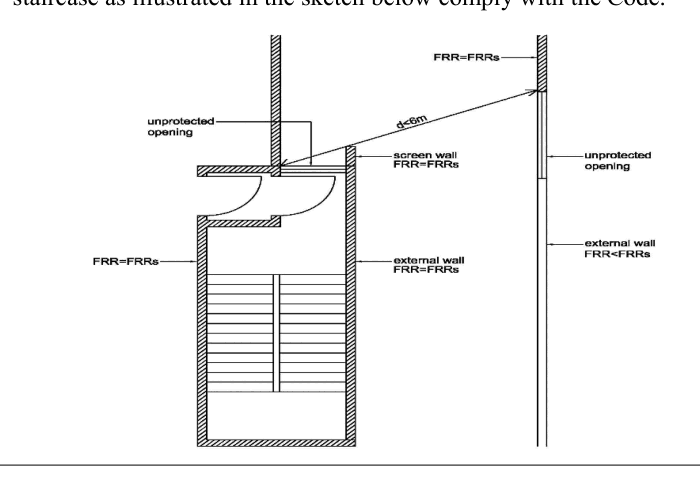{ width="453" loading=lazy }
  <figcaption>Diagram 1 from the original summary (ADF 4/2019, item 4). 原文附圖。</figcaption>
</figure>

**BD's response 屋宇署回覆:** (Item withdrawn by HKIA during meeting.)
{: .apsec-a }

### 5. Smoke Seal Lobby for Lift Doors at Basement {#i201908235}

Raised by **HKIA** · Related 相關: [FS Code 2011 Part C: Fire Resisting Cons](../codes/fsc-part-c-fire-resisting-construction.md)

!!! warning "Later discussion 其後再討論"
    This question was discussed again on **29 Sep 2020**; use the [later response](2020.md#i202009294) where they differ. 如有不同，以較新回覆為準。

**Question 問題:** As per Item 3(c) of ADF 5/2013 held on 18.10.2013, BD confirmed that the smoke seal lobby at basement did not require to have any specific FRR (for non-fireman lift lobby), providing that its construction should be able to perform its function as a smoke seal lobby under the relevant criteria of the testing standards. However, there are recent cases that AP has been asked to provide 4hr FRR to such non-fireman lift lobby at basement, on the reason that the lift door is provided only with an FRR of -/120/- rather than an FRR of -/240/-. We opine that this is not the intention of the FS Code 2011. Our understanding is that the lift shaft/lift landing door at basement will only need to be provided with an FRR of -/120/- as per Clause C9.1 of the FS Code 2011, whereas the respective non-fireman lift lobby at basement will also NOT be required to have any specific FRR as confirmed in item 3(c) of ADF 5/2013. Please confirm if our understanding is correct.
{: .apsec-q }

**BD's response 屋宇署回覆:** Item 3(c) of ADF 5/2013 was still applicable.
{: .apsec-a }

### 6. Clear Height of Balcony/Utility Platform {#i201908236}

Raised by **HKIA** · Related 相關: [APP-5](../pnap/app-5.md)

**Question 問題:** For residential development where AC outdoor units/gas heaters, etc. are to be accommodated at the space above suspended ceiling of balconies/utility platforms, it was clarified by BD earlier that the minimum clear height below such suspended ceiling has to be 2.5m. We understand that such clear height can be measured from the structural floor level of such balcony/utility platform to the underside of the suspended ceiling regardless of floor finishes pursuant to the established practice of BD as per paragraph 2 of PNAP APP-5. Please confirm our understanding is correct.
{: .apsec-q }

**BD's response 屋宇署回覆:** BD advised that HKIA’s understanding was correct.
{: .apsec-a }

### 7. Display Kitchen {#i201908237}

Raised by **HKIA** · Related 相關: [FS Code 2011 Part C: Fire Resisting Cons](../codes/fsc-part-c-fire-resisting-construction.md)

<small>Related discussions 相關討論: [23 Mar 2018 item 4](2018.md#i201803234), [23 Feb 2024 item 18](2024.md#i2024022318)</small>

**Question 問題:** While a kitchen in a restaurant has to comply with Clause C13.2 of the FS Code 2011, display kitchen, i.e. kitchen with opening protected by fire shutter with appropriate FRR, instead of a solid fire barrier is not uncommon. We are given to understand that such a configuration is acceptable in the case of a restaurant license application, which authority is the FEHD, but may not be acceptable in the case of a hotel or clubhouse license application, which authority is the HAD. Despite the Building Authority has no direct jurisdiction over these license applications, BD is still the authority over matters in connection with the fire safety of a building, as well as the technical advisor to the licensing authorities on fire safety aspect. We would therefore like to ask if BD could provide relevant guidelines on the matter so that the acceptance criteria on display kitchen could be aligned amongst the different situations.
{: .apsec-q }

**BD's response 屋宇署回覆:** BD advised that different licensing authorities had to exercise the control under the purview of their concerned Ordinance and the respective requirements.
{: .apsec-a }

### 8. EVA to Virgin and Redevelopment Sites {#i201908238}

Raised by **HKIA** · Related 相關: [Code of Practice for Fire Safety in Buil](../codes/fire-safety-code-2011.md)

**Question 問題:** We would like to know if a site previously occupied by temporary building(s) under Short-term Tenancy granted by Lands Department is to be considered as a virgin or redevelopment site under FS Code 2011.
{: .apsec-q }

**BD's response 屋宇署回覆:** Pursuant to Section 3 of Part A of FS Code 2011, “virgin site” means a site where there is no temporary or permanent building, including a building exempted from the Buildings Ordinance under the Buildings Ordinance (Application to the New Territories) Ordinance, in existence before. Nevertheless, special consideration would be given on case basis should circumstances so warrant, for example, the scale of the existing building as compared with the overall area of the site.
{: .apsec-a }

### 9. Requirement of Tension Proof Load Test {#i201908239}

Raised by **HKIE**

**Question 問題:** For piles carrying reverse tension and compression, e.g. rock socketed mini-piles or pre-bored H pile, Clause 5.3.3(1)(a) of CoP for Foundations 2017 stated that proof tension load test is normally required unless the tension capacity is taken as less than half of the compression capacity. However, some officers have been exercising a rule of requesting tension proof load test to be carried out should the design tension capacity of the pile exceed 25% of its design compression capacity (i.e. 50% of allowable bond stress in tension and the allowable bond stress is taken as 50% of allowable bond in compression). We would like to seek clarification on the inconsistency.
{: .apsec-q }

<figure markdown>
  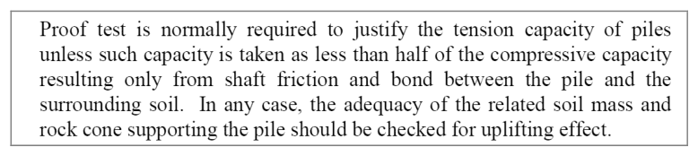{ width="503" loading=lazy }
  <figcaption>Diagram 1 from the original summary (ADF 4/2019, item 9). 原文附圖。</figcaption>
</figure>

**BD's response 屋宇署回覆:** BD confirmed that the proof tension loading test requirements of pile foundation shall follow Clause 5.3.3 (1)(a) of the CoP for Foundations 2017.
{: .apsec-a }

### 10. Steel H-piles Driven to Bedrock {#i2019082310}

Raised by **HKIE**

**Question 問題:** Clause 5.4.11 of CoP for Foundations 2017 stated the technical concerns of the piles driven to refusal and laid down the design and construction requirements for those piles with pile bases terminated on or very close to bedrock. Clause 5.4.11(2)(b) defines the bedrock to be not inferior to Category 1(d) defined in Table 2.1. We would like to enquire shall such requirement be extended to cover meta-sedimentary rock (Category 2 rock as defined in Table 2.1 of the CoP) which was newly introduced in CoP 2017 and other rock materials, e.g. Grade III, marble and sedimentary rocks, for which the final set behavior is pretty much similar to driven to refusal.
{: .apsec-q }

<figure markdown>
  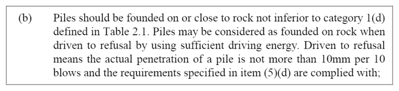{ width="502" loading=lazy }
  <figcaption>Diagram 1 from the original summary (ADF 4/2019, item 10). 原文附圖。</figcaption>
</figure>

**BD's response 屋宇署回覆:** BD advised that the subject item would be thoroughly reviewed in the Technical Committee (TC) for the CoP for Foundations. [Post-meeting note: HKIE has submitted a discussion paper on the captioned to the TC for discussion in the forthcoming meeting in Oct 2019.]
{: .apsec-a }

### 11. Approval of ELS Plans before Submission/Approval of Piling and Pile Cap Plans {#i2019082311}

Raised by **HKIE**

**Question 問題:** This issue was discussed before. BD agreed that ELS plans could be approved before the submission or approval of piling and pile cap plans. This allows practitioner more flexibility. However, some area engineers have different view on this and refuse to approve or acknowledge ELS plans submission before approval of piling plans. It would be grateful if BD could clarify this.
{: .apsec-q }

**BD's response 屋宇署回覆:** BD agreed in-principle that ELS plans could be approved before the submission of piling and pile cap plans. However, the layout of pile cap and/or any other sub-structures should be shown on the ELS plans for considering the extent and depth of excavation and the removal sequence of the struts. Consent for bulk excavation would not be granted prior to the approval of piling and pile cap plans.
{: .apsec-a }

### 12. Installation of Temporary Pile Wall along Site Boundary before Installation of Socketed H-piles {#i2019082312}

Raised by **HKIE**

!!! warning "Later discussion 其後再討論"
    This question was discussed again on **22 Nov 2019**; use the [later response](2019.md#i2019112214) where they differ. 如有不同，以較新回覆為準。

**Question 問題:** For site with adjacent sensitive buildings/structures, BD would request installation of temporary pile wall before installation of socketed H-piles. To avoid confusion and to make better provision in the submission of foundation plans, we would like to clarify the following: (i) It is understood that the term “sensitive building” should refer to (a) Heritage Buildings which is abutting the site; (b) Buildings found on shallow footings and rested on soil; (c) Building in dilapidated conditions, for which BD orders may have been served. (ii) It is also understood that there is a “10m zone” guideline that socketed H-piles could be carried out without the installation of the temporary pile wall even if there are sensitive buildings/structures nearby as trial socketed H-pile installation will be conducted. We would like to clarify the “10m” shall be measured from the relevant sensitive structures and not the site boundaries of the subject site.
{: .apsec-q }

**BD's response 屋宇署回覆:** BD advised that: (i) The installation of temporary pile wall is considered as precautionary measures required in accordance with paragraph 5.4.2 of CoP for Foundations 2017. The purpose of the requirement is to prevent ground loss and soil from falling into the pre-bored hole during the boring operation. (ii) This precautionary measure should be applied to the site with weak soil condition, and/or at close vicinity to settlement sensitive structures, roads or underground services. The requirement shall be imposed based on consideration of site specific conditions and is not preferable to be limited to certain particular types of buildings as proposed. (iii) The “10m zone” is based on the assumption that the sensitive buildings/structures are located at close vicinity of the site. Therefore, the 10m should be measured from the site boundary. If the sensitive buildings/structures are far away from the site, the said precautionary measures may not be required. (iv) BD would accept the submission of record plan of the as-built temporary pile wall certified by RSE as proof of completion of precautionary measure upon consent application for the socketed H-piles. Other supporting documents, except record plan, could be submitted later together with the Form BA14. In addition, RSE might also consider applying for partial consent as necessary.
{: .apsec-a }

### 13. Cantilevered Reinforced Concrete Structure {#i2019082313}

Raised by **HKIE** · Related 相關: [APP-68](../pnap/app-68.md)

**Question 問題:** Under paragraph 9 of Appendix A to PNAP APP-68, a construction report and Form BA14 should be submitted upon completion of the works for “external cantilevered slabs with a span exceeding 750mm exposed to weathering”. And there is footnote mentioning that “For the purpose of this practice note, cantilevered structures under permanent solid cover located at not greater than one storey height and of at least the same plan area as such solid cover may be considered as not exposed to weathering”. Would BD please clarify, for AC platform with cantilever slab more than 750 on typical floors (i.e. one over each other with the same plan area), can the cantilever slab be treated as not exposed to weathering (except the uppermost uncovered slab), and therefore, submission of construction report and Form BA14 required under PNAP APP-68 would not be required.
{: .apsec-q }

**BD's response 屋宇署回覆:** BD confirmed that the submission of construction report and Form BA14 would not be required for AC platform with clear span exceeding 750mm provided that the criteria stated in the footnote of PNAP APP-68 were fulfilled.
{: .apsec-a }

### 14. JPN5 – Building Height Restriction {#i2019082314}

Raised by **AAP** · Related 相關: [JPN](../pnap/jpn-5.md)

**Question 問題:** Before the issuance of JPN5, swimming pool and its pool deck with the pool bottom level and pool deck level above the building height limit under OZP were allowed on roof, as long as the remaining main roof area within OZP height limit is more than 50% of the tower footprint. However, since the promulgation of JPN5, swimming pool and deck on roof are no longer allowed since such are not included in the examples of ancillary structures in footnote 6 of JPN5. We understand that forbidding swimming pool at main roof level is not the intention of the JPN. There are also other limitations for swimming pool provisions under LAO practice notes of LandsD. Therefore, we suggest to follow the old practice and include swimming pool and its pool deck on main roof as an example of ancillary structures.
{: .apsec-q }

**BD's response 屋宇署回覆:** Since PlanD was the authority on building height restriction as stipulated in JPN5, the issue would be referred to PlanD for clarification in the Joint Sub-committee on Streamlining Development Control under LDAC.
{: .apsec-a }

### 15. Registration of Undertaking Letter to Land Registry {#i2019082315}

Raised by **AAP** · Related 相關: [APP-2](../pnap/app-2.md), [APP-104](../pnap/app-104.md), [APP-93](../pnap/app-93.md), [APP-151](../pnap/app-151.md), [APP-156](../pnap/app-156.md), [APP-42](../pnap/app-42.md), [APP-152](../pnap/app-152.md)

**Question 問題:** We wish to confirm with BD whether the following undertaking letters are required to be registered at the Land Registry or not: (i) Paragraph 7 of PNAP APP-2: Undertake to submit documents (curtain wall projecting over street for wholesale conversion projects) (ii) Paragraph 2(iii) of Appendix A to PNAP APP-2: Undertake to carry actions regarding DMC / Sales Brochure for voids (iii) PNAP APP-104: Undertake to carry out action regarding DMC for recreational facilities (iv) PNAP APP-93: Undertake to carry out action regarding DMC for external pipe ducts (v) Paragraph 6(d) of PNAP APP-151: Undertake to submit various documents (vi) Paragraph 6 of PNAP APP-156: Undertake to submit provisional and final energy efficiency reports (vii) Paragraph 14(b) of PNAP APP-42: Undertake to carry out action regarding DMC for counters, guard rooms, etc. We note that JPNs and paragraph 6(c) of Appendix D to PNAP APP-152 (i.e. for greenery areas) explicitly required the registration of undertaking letters to Land Registry while some PNAPs do not. We also note that registration of some of the above (those requiring submission of documents and unrelated to DMC) were refused by Land Registry recently.
{: .apsec-q }

**BD's response 屋宇署回覆:** Registration of undertaking letters from developer or owner would only be required for certain situations as stipulated in relevant PNAPs and modification conditions. In some cases, registration of undertaking letters might not be required, e.g. relevant requirements or obligations would have been incorporated in the DMC approved by LACO upon OP application. For undertaking letter required to be registered but could not be done upon OP application due to special circumstances, consideration would be given on case basis.
{: .apsec-a }

### 16. Thickness of Transfer Plate {#i2019082316}

Raised by **AAP** · Related 相關: [APP-5](../pnap/app-5.md)

**Question 問題:** (Item raised by HKIE) Paragraph 6 of PNAP APP-5 stipulates the design criteria for thickness and area of transfer plate under tower blocks for non-accountable GFA. Would BD please clarify whether column drop would be taken as part of transfer plate in determination of its thickness.
{: .apsec-q }

**BD's response 屋宇署回覆:** To facilitate a thorough discussion, HKIE would submit examples with figures for BD’s consideration.
{: .apsec-a }

### 17. Streamlining of Structural Submissions {#i2019082317}

Raised by **AAP**

<small>Follows earlier discussion: [24 May 2019](2019.md#i201905249)</small>

**Question 問題:** (Item raised by BD) Further to item 9 of ADF 3/2019 held on 24 May 2019, BD advised that internal standard checklists for processing structural submissions relating to secondary structural elements including aluminium claddings and glass balustrades would be put on trial to facilitate the structural submission process.
{: .apsec-q }

**BD's response 屋宇署回覆:** Members welcomed BD’s initiative and advised that HKIE had approached certain façade consultants/specialists to streamline the structural submissions for curtain walls. Sample drawings for structural submission would be shared with BD for further comment.
{: .apsec-a }

## ADF 3/2019 · 24 May 2019 {#adf-32019-24-may-2019}

[Original summary (PDF) 原文](https://www.hkie-st.org/wp-content/uploads/2022/07/78_Summary-of-Items-Discussed-in-APSEC-Discussion-Forum-on-24-May-2019.pdf) · 10 items

### 1. RTTV and OTTV {#i201905241}

Raised by **HKIA** · Related 相關: [APP-156](../pnap/app-156.md), [APP-151](../pnap/app-151.md), [APP-2](../pnap/app-2.md), [Cap. 123M Building (Energy Efficiency) R](../regulations/beer-123m.md)

**Question 問題:** Paragraph 5(d) of PNAP APP-156 requires that glass forming part of the building envelope of a residential building and residents’ recreational facilities should have a VLT of not less than 50% and an ER of not more than 20%, as one of the pre-requisites for the granting of GFA concessions for green/amenity features, etc. in a residential building under PNAP APP-151. We understand that the above requirements are NOT applicable to OTTV calculation for commercial or hotel premises, save and except where curtain wall system of such commercial premises are to be disregarded from GFA/SC calculation, the ER of the glass used in the system should be not more than 20% in accordance with paragraph 6(d) of PNAP APP-2. That said, the requirement on VLT of not less than 50% is NOT applicable to commercial or hotel premises. Please advise if our understanding is correct.
{: .apsec-q }

**BD's response 屋宇署回覆:** BD advised that HKIA’s understanding was correct.
{: .apsec-a }

### 2. Building Setback under SBD Guidelines {#i201905242}

Raised by **HKIA** · Related 相關: [APP-152](../pnap/app-152.md)

<small>Related discussions 相關討論: [22 Nov 2019 item 25](2019.md#i2019112225), [12 Nov 2021 item 4](2021.md#i202111124), [10 Feb 2023 item 13](2023.md#i2023021013)</small>

**Question 問題:** Paragraph 10(a) of Appendix E to PNAP APP-152 states that where the setback of a building will result in a setback area of more than 15% of the area of the site, the requirement for building setback may be relaxed with compensatory measures including “Full height and full frontage setback of the building from the site boundaries abutting any narrow streets……with a total setback area which is not less than 15% of the area of the site……”. Considering the physical restrictions of small sites, we would envisage that such full height and full frontage setback can be of any setback distance from the narrow streets to which the site abuts, so long as the total setback area is not less than 15% of the site area. Please advise if our interpretation is correct.
{: .apsec-q }

**BD's response 屋宇署回覆:** BD advised that if the site abuts more than one narrow street and the required set back of the building will result in more than 15% of the area of the site, AP might provide the required full height and full frontage setback from any narrow streets to which the site abuts, provided that the total setback area is not less than 15% of the site area and such area will contribute to improving the street environment.
{: .apsec-a }

### 3. Protection against External Fire Spread {#i201905243}

Raised by **HKIA** · Related 相關: [FS Code 2011 Part C: Fire Resisting Cons](../codes/fsc-part-c-fire-resisting-construction.md)

**Question 問題:** The last paragraph of Clause C11.1 of the FS Code 2011 states explicitly that this clause does not apply to a single family house or a sprinkler protected building. By similar token, we reckon that this clause is also not applicable to the external wall between the upper and lower storey of a duplex unit (occupied by a single family) in a residential tower. Please advise if this understanding is correct.
{: .apsec-q }

**BD's response 屋宇署回覆:** BD advised that HKIA’s understanding was correct.
{: .apsec-a }

### 4. Consent Application for Pile Caps and Footings Works {#i201905244}

Raised by **HKIE**

<small>Follows earlier discussion: [23 Mar 2018](2018.md#i201803236)</small>

**Question 問題:** Consents for piling works can be granted prior to the approval of corresponding GBPs. We would like to clarify whether the approval of GBPs will affect the consent application for pile caps and footings works.
{: .apsec-q }

**BD's response 屋宇署回覆:** BD confirmed that consent for pile caps and footings works could be granted before the approval of corresponding GBPs. For submission of foundation and superstructure plans by different RSE, BD advised that attention should be drawn to Item 6 of ADF 2/2018 held on 23.3.2018 which is excerpted below for easy reference: “BD advised that different RSEs might submit foundation and superstructure plans separately on case-by-case basis provided that the two plans would be compatible and the responsibilities of the RSEs at the interface of design were clearly demarcated. BD also noted that such arrangement would be applicable to structural plan submissions only and the works would still be supervised by single RSE in each stage of the works.”
{: .apsec-a }

### 5. Application of PNAP APP-151 {#i201905245}

Raised by **HKIS** · Related 相關: [APP-151](../pnap/app-151.md), [APP-152](../pnap/app-152.md)

!!! warning "Later discussion 其後再討論"
    This question was discussed again on **3 May 2024**; use the [later response](2024.md#i2024050311) where they differ. 如有不同，以較新回覆為準。

**Question 問題:** For GFA concessions under A&A submission not resulting in new buildings, we would like to seek BD’s clarification that PNAP APP-151 would not apply if parent buildings were constructed before the implementation of PNAP APP-151 and 152.
{: .apsec-q }

**BD's response 屋宇署回覆:** BD advised that according to paragraph 3 of PNAP APP-151, the BA will take account of the compliance with the SBD Guidelines as promulgated in the PNAP APP-152, where applicable, as a pre-requisite in exempting or disregarding green/amenity features and non-mandatory/non-essential plant rooms and services from GFA calculations in new building development. Pursuant to the spirit of PNAP APP-151, the same requirements should also apply to A&A works resulting in new buildings. For A&A submissions not resulting in new buildings, justification for application for GFA exemptions in accordance with the criteria and requirements as stipulated in the relevant practice notes for the green/amenity feature and non-mandatory/ non-essential plant rooms and services should be submitted for consideration. In general, no surplus GFA should be resulted or left unused for any possible additions in future.
{: .apsec-a }

### 6. Replacement of Windows under MWIS {#i201905246}

Raised by **HKIS** · Related 相關: [B(I&R)R Building (Inspection and Repair)](../regulations/bir-123p.md)

**Question 問題:** After receiving a MWIS Notice, A&A submission may be made for replacement of all windows. However, it came to our notice that BD might still require the owner to appoint a QP for inspection of the newly replaced windows at one year after the acknowledgement of Form BA14. We would like to clarify whether appropriate measure or guidelines for such situation could be made between NBD and MBID with a view to facilitating the owners.
{: .apsec-q }

**BD's response 屋宇署回覆:** BD advised that the project AP could submit the corresponding specified form of MWIS upon completion of the windows replacement works to MBI Sections for compliance with the MWIS Notice. If necessary, the project AP could indicate the MWIS Notice No. on the A&A submission to facilitate BD’s internal communication.
{: .apsec-a }

### 7. Use of Office Toilets in CP3 {#i201905247}

Raised by **HKIS**

**Question 問題:** (Item raised by HKIS) As the on the spot drawings revision might take very long time, members would like to see if BD could consider opening the 7/F toilets for the use by the consultants’ staff.
{: .apsec-q }

**BD's response 屋宇署回覆:** BD acknowledged the suggestion and would consider as appropriate.
{: .apsec-a }

### 8. PNAP APP-45 {#i201905248}

Raised by **HKIS** · Related 相關: [APP-45](../pnap/app-45.md)

**Question 問題:** (Item raised by HKIE) Paragraph 9 of PNAP APP-45 (April 2019 revision) stated that batch sampling of rebars conducted in accordance with the quality management system of the Approved Yard and witnessed by the Independent Audit Team by CEDD is accepted as satisfying the requirement of qualified site supervision in respect of sampling of rebar in accordance with the purchaser’s testing requirement stipulated in Section 5 of Construction Standard CS2:2012. Would BD please clarify the following: (i) Will BD accept if the testing date of rebars is earlier than the consent date for the respective building works? (ii) What are the details of sampling and witness records and test reports required for the fulfilment of the requirements?
{: .apsec-q }

**BD's response 屋宇署回覆:** BD advised that under the streamlined arrangement as stipulated in the PNAP APP-45, the testing date of rebars by the Approved Yard could be earlier than the consent date of the building works. The sampling and witness records and test reports of rebars should be the certified copies provided by the Independent Audit Team and the HOKLAS accredited laboratories respectively.
{: .apsec-a }

### 9. Streamlining of Structural Submissions {#i201905249}

Raised by **HKIS**

!!! warning "Later discussion 其後再討論"
    This question was discussed again on **23 Aug 2019**; use the [later response](2019.md#i2019082317) where they differ. 如有不同，以較新回覆為準。

**Question 問題:** (Item raised by BD) BD advised that the statistics in 2018 indicated considerable amount of structural submissions relating to secondary structural elements included aluminium claddings, glass balustrades, curtain walls, etc. Without prejudice to the statutory requirements of obtaining prior approval and consent of building works, BD was exploring measures to streamline the structural submission process for secondary structural elements so as to enhance the plan processing efficiency. In this connection, BD encouraged members to suggest streamlining measures for discussion in the next meeting.
{: .apsec-q }

**BD's response 屋宇署回覆:** Members welcomed BD’s initiative to streamline the structural submission process and would provide suggestions for discussion in next meeting after consultation with practitioners.
{: .apsec-a }

### 10. Information to be provided for Referral of Plans {#i2019052410}

Raised by **HKIS**

**Question 問題:** (Item raised by BD) To enable the processing of plan submissions under the BO timely, BD reminded AP and RSE to specifically indicate on the covering letters and provide with adequate number of sets of plans for BD’s onward referrals to relevant government departments.
{: .apsec-q }

**BD's response 屋宇署回覆:** Members noted the arrangement and would follow the requirement accordingly.
{: .apsec-a }

## ADF 2/2019 · 22 Mar 2019 {#adf-22019-22-mar-2019}

[Original summary (PDF) 原文](https://www.hkie-st.org/wp-content/uploads/2022/07/77_Summary-of-Items-Discussed-in-APSEC-Discussion-Forum-2-2019-on-22-Mar-2019.pdf) · 13 items

### 1. Structural Supports for Building Services Installations relating to Licence Application {#i201903221}

Raised by **HKIA**

**Question 問題:** Upon licence application, “structural justifications” are used to be submitted to the Licensing Authority to demonstrate that structural supports from ceiling for building services equipment (such as AHU) which are heavier than 100kg are structurally safe. However, the Licensing Authority requires recently that approval and consent from BA should be obtained for such works and a copy of BD’s acknowledgement letter on Form BA14 should be provided upon its completion. Apparently, the above requirement cannot be acceded to, as such works, if already completed at the time of OP inspection and followed by BD’s issuance of OP, cannot be retrospectively submitted for BD’s approval. It has always been our industry stakeholders’ understanding that approval and consent for such works are not required, and “structural justifications” shall suffice. Please advise if this understanding is correct. If affirmative, we would appreciate if BD could clarify with the relevant parties (e.g. BD’s Licensing Unit and respective Licensing Authorities) that formal BD’s approval and consent for such works is not required prior to licence application. The AP and/or RSE and/or RC may however, upon the Licensing Authority’s request, submit a written confirmation that (i) such works have been completed under their supervision as part of the new building works upon OP application, and (ii) such completed installation works are structurally safe.
{: .apsec-q }

**BD's response 屋宇署回覆:** BD advised that the practice of (i) submission of “structural justifications” for structural supports suspended from ceiling slab for building services equipment heavier than 100kg; and (ii) supervision of the erection by AP/RSE in their capacity registered under the BO in the licence application would be maintained for the time being prior to the implementation of a new control regime. Relevant stakeholders would be consulted before implementation in due course. Relevant frontline officers had also been notified of such arrangement.
{: .apsec-a }

### 2. AC Platform in front of Curtain Wall {#i201903222}

Raised by **HKIA**

**Question 問題:** Please advise if the “Guidelines for Design and Safety Provisions for the ACs Platforms” appended to BD’s Circular Letter dated 23.12.2016 and the amendments provided in Item 4 of ADF 4/2018 and Item 4 of ADF 5/2018 are also fully applicable to the design and disposition of AC Platform in front of curtain wall.
{: .apsec-q }

**BD's response 屋宇署回覆:** BD advised that the Guidelines were also applicable to the design and disposition of AC Platform in front of curtain wall.
{: .apsec-a }

### 3. Structural Submission for Vertical Greening {#i201903223}

Raised by **HKIA**

**Question 問題:** The Circular Letter issued by BD on 14.2.2019 clarifying the structural submission requirements for vertical greening refers. As there is no mentioning of the effective date for implementation of the relevant requirements, we would suggest that the said Circular Letter will NOT be applicable to new building proposal or its major revision of which superstructure consent has already been issued as at the date of the Circular Letter, in order to avoid causing any undue impact on ongoing development projects especially for those which are approaching OP application.
{: .apsec-q }

**BD's response 屋宇署回覆:** BD confirmed that the new structural submission requirements would not be applicable to building projects with consent to commencement of superstructure works granted before 14.2.2019.
{: .apsec-a }

### 4. Post-OP Rectification Works Procedures (“PRWP”) {#i201903224}

Raised by **HKIA**

!!! warning "Later discussion 其後再討論"
    This question was discussed again on **13 Aug 2021**; use the [later response](2021.md#i202108136) where they differ. 如有不同，以較新回覆為準。

<small>Related discussions 相關討論: [22 Nov 2019 item 11](2019.md#i2019112211)</small>

**Question 問題:** The Circular Letter issued by BD on 9.1.2014 regarding the captioned stipulated that the scope of rectification works to be carried out under the PRWP only involved the building works shown on the latest approved plans. Based on the above, we understand that the scope of PRWP will also cover those rectification works which cannot be carried out under the simplified requirements of MWCS, such as rectification of external cladding which is ›6m from adjoining ground, rectification of fixed glazing or spandrel glass of curtain wall, etc., provided that these works are shown on the latest approved plans. Please advise if our understanding is correct.
{: .apsec-q }

**BD's response 屋宇署回覆:** BD would review and advise in due course.
{: .apsec-a }

### 5. Installation of Sanitary Fitments/Fittings after OP {#i201903225}

Raised by **HKIA** · Related 相關: [APP-114](../pnap/app-114.md), [B(SFP&W)R Building (Standards of Sanitar](../regulations/bsfpwr-123i.md)

<small>Related discussions 相關討論: [22 Nov 2024 item 21](2024.md#i2024112221)</small>

**Question 問題:** As stated in PNAP APP-114, BD will favourably consider to give a modification of B(SSFPDW&L)R to permit the installation of sanitary fitments and fittings after the issue of OP under certain circumstances/conditions for the purpose of waste minimisation. Whilst we fully support the said arrangement, we reckon that paragraph 3(b) of the PNAP stating “a developer has offered to provide fittings to individual purchaser’s choices” should not be a pre-requisite for the granting of such modification. Very often, refined fitting-out works of bathrooms will only be carried out after OP, and if the sanitary fitments/fittings are in place at the time of OP application, quite substantial abortive works (including damages to the installed sanitary fitments/fittings) will inadvertently be incurred at the course of subsequent fitting-out works. Indeed, quite a number of past projects have been granted with such modification without the need to fulfil paragraph 3(b) of the PNAP, whereas some others were not. We would therefore be obliged to have your advice that paragraph 3(b) of the PNAP is indeed not a pre-requisite for the granting of such a modification with the primary purpose of waste minimisation, and this should similarly be applicable to other building elements such as non-FRR doors.
{: .apsec-q }

**BD's response 屋宇署回覆:** BD reiterated that basic sanitary fitments required under the building regulations should be installed prior to the issue of an OP. Arising from reports of sanitary fitments and other fixtures/fitting in new buildings being discarded upon occupation, for the purpose of waste reduction, BD had been adopting a pragmatic approach to favourably consider giving modification of B(SSFPDW&L)R in the two circumstances as mentioned in paragraph 3(a) and (b) of PNAP APP-114. Damage/loss due to later-on fitting out works which could be avoided through proper site management/protection would not be considered as a strong justification for such.
{: .apsec-a }

### 6. Adoption of 3As System in Footing Submission {#i201903226}

Raised by **HKIE** · Related 相關: [APP-18](../pnap/app-18.md)

!!! warning "Later discussion 其後再討論"
    This question was discussed again on **29 May 2020**; use the [later response](2020.md#i202005296) where they differ. 如有不同，以較新回覆為準。

**Question 問題:** As required in paragraph 4(k) of PNAP APP-18, details of monitoring requirements for ground movement in adjacent and nearby buildings, structures, lands, streets and services arising from the proposed piling works should be included in the pile foundation submission for approval. AP/RSE/RGE may adopt the 3As system in their piling and ELS submissions for BD’s consideration. Do we need to adopt this 3As system in footing submission, which aims to approve bearing capacity of supporting stratum and the structural design of footings?
{: .apsec-q }

**BD's response 屋宇署回覆:** According to Clause 7.2.3 of Code of Practice for Foundations 2017, where the construction of a foundation might affect any building, structure, land, street or services, a monitoring plan should be provided. For simplicity, cross-referencing to the monitoring system as detailed in the monitoring plan given in the corresponding ELS submission was acceptable.
{: .apsec-a }

### 7. Details of Demountable Panels covering External Drainage Pipes {#i201903227}

Raised by **HKIE** · Related 相關: [APP-93](../pnap/app-93.md)

**Question 問題:** As required in paragraph 4.1 in Annex 1 of Appendix B to PNAP APP-93 on Planning and Design of Drainage Works, details of the demountable panel of the architectural feature enclosing the external drainage pipes shall be included in structural plans of the architectural feature for approval. While there might be occasions that such details were not required on the structural plans, we would like to know if there is any change in such requirement.
{: .apsec-q }

**BD's response 屋宇署回覆:** BD advised that the fixing details of the demountable panel of architectural features enclosing external drainage pipes should be included in the structural plans for approval. Nevertheless, provision of safety chain having sufficient capacity to hold the panel should be shown on the structural plans for information only.
{: .apsec-a }

### 8. Witnessing of Loading Test for Foundation Works {#i201903228}

Raised by **HKIE**

**Question 問題:** Would BD please advise the status of trial run of appointing an independent HOKLAS laboratory for pile loading test with surprise check by BD to replace current loading test arrangement.
{: .apsec-q }

**BD's response 屋宇署回覆:** BD advised that frontline officers would be flexibly deployed to assist each other team in witnessing loading test for foundation works. Should arrangement could not be made timely, trial on HKIE’s proposed arrangement would be considered on case-by-case basis and RSE might liaise with the respective case officer as necessary.
{: .apsec-a }

### 9. Submission Checklist for Certification of Completion of Works {#i201903229}

Raised by **HKIE**

**Question 問題:** To facilitate and streamline the processing of Form BA13 and Form BA14 submission, it is suggested to work out a standard submission checklist for various types of works with BD.
{: .apsec-q }

**BD's response 屋宇署回覆:** BD advised that a standard letter with a table summarising the required documentary submissions imposed under the approval conditions would be issued when the superstructure works were nearly completed. RSE should monitor to ensure the required submissions would be timely made before the application for OP.
{: .apsec-a }

### 10. PNAP APP-130 {#i2019032210}

Raised by **AAP** · Related 相關: [APP-130](../pnap/app-130.md)

<small>Related discussions 相關討論: [17 Aug 2018 item 11](2018.md#i2018081711), [19 Mar 2021 item 5](2021.md#i202103195)</small>

**Question 問題:** Paragraph 4.1(b) of Appendix A to PNAP APP-130 states that when a window can satisfy the UVA criteria (Diagram F), this window is considered to have met the performance standard of ventilation if, among others, the window faces into a clear and unobstructed area complying with at least the open air requirement. We understand that to face an open air does not necessarily require the window to open directly to open air. For instance, balcony sliding door satisfying UVA can still be considered to satisfy the ventilation criteria as illustrated below:
{: .apsec-q }

<figure markdown>
  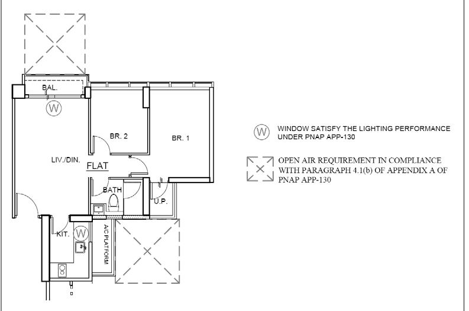{ width="512" loading=lazy }
  <figcaption>Diagram 1 from the original summary (ADF 2/2019, item 10). 原文附圖。</figcaption>
</figure>

**BD's response 屋宇署回覆:** BD confirmed that the scenarios depicted in the sketch were acceptable provided that conditions in paragraph 4.1(a) to (c) of Appendix A to PNAP APP-130 would be complied with.
{: .apsec-a }

### 11. FS Code 2011 - Clause C8.1 (2015 rev.) {#i2019032211}

Raised by **AAP** · Related 相關: [FS Code 2011 Part C: Fire Resisting Cons](../codes/fsc-part-c-fire-resisting-construction.md)

<small>Related discussions 相關討論: [25 May 2018 item 3](2018.md#i201805253)</small>

**Question 問題:** Clause C8.1 of FS Code 2011 reads “Openings should not be formed at fire barriers forming part of a fire compartment as described in Clause C3.1 unless such openings are protected by fire rated doors or fire shutters having an FRR of not less than that of such fire barriers. If the total width of the openings is more than 25% of the length of the compartment walls concerned, the fire rated doors or fire shutters should have an FRR with regard to the criterion of insulation of not less than that of the fire barrier.” Please advise whether the calculation is correct. a1
{: .apsec-q }

**BD's response 屋宇署回覆:** BD advised that, in accordance with Item 7(d) of ADF 1/2012 held on 6.1.2012, in the context of Clause C8.1 of FS Code 2011, the plan lengths of all perimeter fire barriers forming a fire compartment would be taken as the denominator for assessing whether the width of the openings to be installed with fire shutters would exceed 25% of the concerned fire compartment and hence requiring such shutters to have insulation performance as well. For example, in a basement, the length of the enclosing walls on all sides would be added up to obtain the denominator, and only fire shutters making up over 25% of that denominator would need to fulfill the insulation requirement. On the other hand, in the situations of above-ground portions, external enclosing walls which would not be required to have prescribed FRR would not be counted towards the total plan lengths of a fire compartment. In the quoted example, In basement situation For R1 and R2, FRR insulation would not be required if: Compartment A: (R1+R2) / [(b1+c1 +a1) x 2] ‹ 25% and Compartment B: (R1+R2+R3) / [(b1+b2) x 2] ‹ 25% For R3, FRR insulation would not be required if: Compartment B: (R1+R2+R3) / [(b1+b2) x 2] ‹ 25% and Compartment C: R3 / [(c1+b2) x 2] ‹ 25% In above-ground situation· For R1 and R2, FRR insulation would not be required if: Compartment A: (R1+R2) / (b1+c1) ‹ 25% and Compartment B: (R1+R2+R3) / (b1+b2) ‹ 25% For R3, FRR insulation would not be required if: Compartment B: (R1+R2+R3) / (b1+b2) ‹ 25% and Compartment C: R3 / (c1+b2) ‹ 25% ·external enclosing walls not required to have prescribed FRR
{: .apsec-a }

### 12. Access Panel to Air Duct {#i2019032212}

Raised by **AAP** · Related 相關: [APP-93](../pnap/app-93.md), [APP-151](../pnap/app-151.md), [Cap. 123J Building (Ventilating Systems)](../regulations/bvsr-123j.md)

**Question 問題:** PNAP APP-93 specifies the requirements for pipe ducts and its access panels for drainage pipe duct. We understand that access panels for air duct for non-mandatory plant rooms with GFA exemptions (under item 22 of Appendix A of PNAP APP-151) is not required. We note that such access panel to air duct serves no function at all. Please advise if our understanding is correct.
{: .apsec-q }

<figure markdown>
  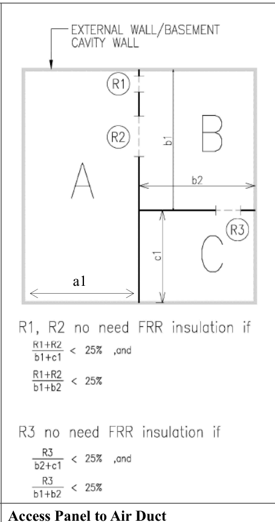{ width="294" loading=lazy }
  <figcaption>Diagram 1 from the original summary (ADF 2/2019, item 12). 原文附圖。</figcaption>
</figure>

**BD's response 屋宇署回覆:** BD advised that PNAP APP-93 which set out the requirements for the planning and design of drainage works for new buildings might not be appropriate for application to air duct. While the provision of access panels for air duct would not be a consideration for GFA exemptions under PNAP APP-151, the relevant requirements on provision of access for inspecting and cleaning/maintenance of ventilating systems under the Building (Ventilating Systems) Regulations should be observed.
{: .apsec-a }

### 13. Concurrent Consent for Pipe Pile Wall, ELS Grouting and Socketed Steel H-pile {#i2019032213}

Raised by **AAP**

**Question 問題:** (Item raised by HKIE) BD may require the completion of peripheral pile wall and grouting of the ELS works prior to the commencement of socketed steel H-pile works near to the site boundaries as a precautionary measure to mitigate effect of foundation piling works to the adjacent structures. Should pipe pile wall and grouting be adopted for ELS works, can the consent for pipe pile wall, grouting and socketed steel H-pile works be granted concurrently after the successful completion of the test/trial installations for each type of construction.
{: .apsec-q }

<figure markdown>
  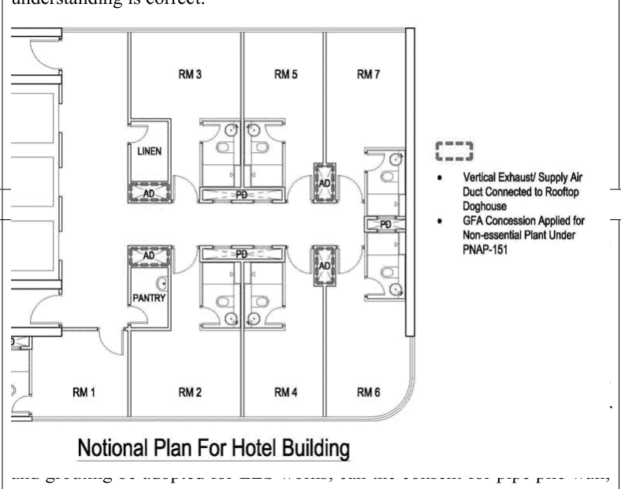{ width="510" loading=lazy }
  <figcaption>Diagram 1 from the original summary (ADF 2/2019, item 13). 原文附圖。</figcaption>
</figure>

**BD's response 屋宇署回覆:** BD advised the requirement would be a precautionary measure to mitigate possible adverse effect of socketed steel H-pile works to adjacent properties/grounds in marine deposit/loose soil stratum. BD would review the situation if pipe pile wall and grouting would be adopted for ELS works.
{: .apsec-a }

## ADF 1/2019 · 18 Jan 2019 {#adf-12019-18-jan-2019}

[Original summary (PDF) 原文](https://www.hkie-st.org/wp-content/uploads/2022/07/76_Summary-of-Items-Discussed-in-APSEC-Discussion-Forum-on-18-Jan-2019.pdf) · 13 items

### 1. Provision of Temporary Refuge Space (TRS) {#i201901181}

Raised by **HKIA** · Related 相關: [FS Code 2011 Part B: Means of Escape](../codes/fsc-part-b-means-of-escape.md), [Design Manual: Barrier Free Access 2008 ](../codes/bfa-2008.md)

<small>Related discussions 相關討論: [29 May 2020 item 14](2020.md#i2020052914), [8 Aug 2025 item 22](2025.md#i2025080822), [6 Feb 2026 item 4](2026.md#i202602064)</small>

**Question 問題:** Clause B29.1(a) of the Fire Safety Code 2011 stipulates that provisions of MOE for persons with a disability (i.e. provision of TRS) do not apply to a building or parts of a building exempted from the application of Obligatory Design Requirements in the DMBFA 2008; whereas paragraph 2.1.2(a) of the DMBFA 2008 stipulates that for certain categories of buildings, the means of access and facilities stipulated in the Mandatory Section shall be provided to the extent as specified in the right column of Table 1. Based on the above, we opine that the provision of TRS shall not be applicable to those areas of buildings which are outside the extent of application as described in Table 1 of DMBFA 2008, despite that these areas are not categorised under paragraph 2.2 “Exemptions” of DMBFA 2008. For instance, TRS should not be applicable to the common areas at typical floors above ground storey of a domestic building which does not exceed four (4) storeys. Please advise if our interpretation is correct.
{: .apsec-q }

**BD's response 屋宇署回覆:** BD advised that HKIA’s interpretation regarding TRS provision in common areas at typical floors above ground storey of a domestic building not exceeding four storeys was correct.
{: .apsec-a }

### 2. Deferring Submission of Minor Amendments for Ground Investigation Works within Scheduled Areas {#i201901182}

Raised by **HKIA** · Related 相關: [ADM-19](../pnap/adm-19.md), [BO s.40–56 and Schedules: offences, exem](../regulations/bo-parts-4-9-schedules.md), [B(A)R Building (Administration) Regulati](../regulations/bar-123a.md)

**Question 問題:** Paragraph 18 of PNAP ADM-19 states that subject to a modification of regulation 33(1) of the B(A)R being granted by the BA under section 42(1) of the BO, prior approval and consent to the minor amendments of building, superstructure and drainage works, for which the first consent has already been given, would not be required except for the amendments described in Appendix G. We would like to enquire if the aforesaid modification could also be applied to Ground Investigation Works within Scheduled Areas, which is NOT listed as an unqualified item in Appendix G of the said PNAP, provided that the approved method statements are to be strictly followed.
{: .apsec-q }

**BD's response 屋宇署回覆:** BD advised that paragraph 18 of PNAP ADM-19 regarding deferring submission of minor amendments was NOT applicable to Ground Investigation Works within Scheduled Areas since it normally involves complex ground condition, major underground utilities or existing railway facilities, etc. Referral to other government departments for comments would always be necessary prior to the commencement of works.
{: .apsec-a }

### 3. Technical Difficulties in Providing Underground Car Parks {#i201901183}

Raised by **HKIE** · Related 相關: [APP-2](../pnap/app-2.md), [APP-24](../pnap/app-24.md), [APP-137](../pnap/app-137.md)

<small>Related discussions 相關討論: [12 Aug 2022 item 8](2022.md#i202208128)</small>

**Question 問題:** Paragraph 5 of Appendix C of PNAP APP-2 concerning “Technical Difficulties in Providing Underground Car Parks” mentioned that “Above ground private car parks may be 100% disregarded from GFA calculation if it is proven with sufficient evidence that it is technically infeasible to construct an underground car park due to specific site constraints. Examples of such site constraints include sites located above major underground utilities, within Areas Number 1, 2, 3 or 4 in Schedule 5 of the BO or with other complex geotechnical constraints.” Meanwhile, PNAP APP-24 cites that site formation/foundation works shall not induce total movement in any railway structures/installations exceeding 20mm in any plane without any way forward. It is technically infeasible to design and construct deep basement right next to some railway structures especially those on-ground Light Rail with such stringent movement control. As such, will BD consider the above as site constraint such that the concerned above ground private car parks may be 100% disregarded from GFA calculation? Meanwhile, will the requirements of PNAP APP-24 also be reviewed in accordance with the spirit of PNAP APP-137? It is noted that the control limit in PNAP APP-24 was relaxed for some MTR related projects but none for other private development projects.
{: .apsec-q }

**BD's response 屋宇署回覆:** BD advised that whether above ground private car parks could be 100% disregarded from GFA calculation due to specific site constraints would be considered on case merits. For projects within railway protection area, technical evidence of infeasibility to construct underground car parks might be submitted to BD for consideration. BD also advised that the principle of PNAP APP-137 was applicable to railway and related structures and the requirements in PNAP APP-24 would be reviewed with MTRCL.
{: .apsec-a }

### 4. Monitoring of Ground-borne Vibrations and Ground Settlements {#i201901184}

Raised by **HKIE** · Related 相關: [APP-137](../pnap/app-137.md)

**Question 問題:** 3As (i.e. Alert/Alarm/Action) levels are proposed as monitoring for ground-borne vibrations and settlements arising from pile driving or similar operations in accordance with PNAP APP-137. When the monitoring data reach Alarm level, RSC shall notify AP/RSE/RGE and implement necessary remedial/mitigation measures in accordance with the agreed action plan. RSE/RGE will review the method statement of piling and ELS works for necessary modification. BD and relevant parties shall also be notified. Do AP/RSE/RGE need to submit an Investigation Report when the monitoring data reach Alert Level?
{: .apsec-q }

**BD's response 屋宇署回覆:** BD advised that while the RSC should report to the AP/RSE/RGE when the monitoring data reached the Alert level, BD might request AP/RSE/RGE to provide information of individual cases to facilitate the investigation of defects in adjoining buildings or complaints due to the works.
{: .apsec-a }

### 5. Vertical Lifting Platforms {#i201901185}

Raised by **HKIS** · Related 相關: [Design Manual: Barrier Free Access 2008 ](../codes/bfa-2008.md)

**Question 問題:** The use of Vertical Lifting Platforms (VLP) to meet BFA requirements has been discussed in previous Discussion Forums and it was concluded that the use of VLP in new buildings would be limited to those with insurmountable difficulties in providing accessible ramps or lifts (Item 24 of ADF 5/2016 refers). However, in light of the recent concern on design flexibility, we would like to ask BD reconsidering the use of VLP as an acceptable provision for complying with regulation 72 of B(P)R. Meanwhile, it is also doubtful to interpret “Ramp” as a vertical transportation in paragraph 5.5 A(a) in Chapter 5 of DMBFA 2008 for VLP, and therefore, insisting “Ramp” must be provided as a priority preference is unfair. VLP should be considered as a reasonable alternative. We would invite BD to re-consider the following: (i) either Ramp, Lift or VLP could be considered as an acceptable provision for overcoming changes in level by persons with a disability. DMBFA 2008 does not in anyway indicate any preference of Ramp to Lift or Lifting Platform noting that it only says “Ramps of an appropriate design shall be provided at all changes in level other than those served by an accessible lift or accessible lifting mechanism...”. Paragraph 14 in Division 5 of Chapter 4 of DMBFA 2008 refers. (ii) While paragraph A(a) in Division 19 of Chapter 4 of DMBFA 2008 states that lifts are the most convenient form of vertical access, paragraph 5.5 A(a) in Chapter 5 states that Vertical Lifting Platform is necessary if no other means of vertical transportation is available. (iii) Lengthy ramps due to great level difference may prejudice design flexibility and the long travel and climbing height may not be welcomed by wheelchair users and is not a better solution than VLP. (iv) VLP has been widely accepted as a reasonable alternative for vertical circulation in existing buildings.
{: .apsec-q }

**BD's response 屋宇署回覆:** BD advised that the Technical Committee (TC) on DMBFA had previously discussed the use of VLP and considered that a self-operated VLP should be considered as a reasonable alternative for vertical circulation for wheelchair users where it was impractical to provide a passenger lift or a ramp. In light of practitioners’ concern, more information might be provided for further consideration by the TC on DMBFA if necessary. [Post Meeting Notes: Arising from the above discussion, the TC on DMBFA had discussed again the use of VLP on 19.2.2019. It was re-affirmed that VLP could only be considered if it was impractical to provide a passenger lift or a ramp.]
{: .apsec-a }

### 6. Carpark GFA Exemption {#i201901186}

Raised by **AAP** · Related 相關: [APP-2](../pnap/app-2.md), [APP-152](../pnap/app-152.md)

**Question 問題:** Reference is made to the extreme weather and severe typhoons that had attacked HK recently. Flooding and severe damages at developments either completed or under construction at the coastal and low-lying areas were reported. In accordance with PNAP APP-2, underground and above ground carparks may be 100% and 50% disregarded from GFA calculation respectively. We understand that building bulk was one of the considerations in formulating the above principle. However, underground carparks are most susceptible to flooding / damages caused by extreme weather or super typhoons which are anticipated to be getting only more frequent in the future. Besides, there are also other means to control the building bulk, e.g. SBD Guidelines under PNAP APP-152 and building height limit under lease or OZP. In this regard, we suggest BD to consider allowing carpark to be 100% GFA exempted even if it is above ground, if the following conditions are satisfied: (i) SBD Guidelines under PNAP APP-152 is complied with; and (ii) There is a height limit control under lease or under OZP for the development. This flexibility will enable building professionals to recommend the most sensible design for developments to the owners based on technical and scientific considerations.
{: .apsec-q }

**BD's response 屋宇署回覆:** BD advised that the current policy of disregarding underground car park from GFA calculation and the SBD Guidelines were two distinct measures arising from the recommendations of Sustainable Development Council to foster a quality and sustainable built environment. Therefore, complying with SBD Guidelines should not direct imply that the building bulk of above ground carpark could be disregarded. Nevertheless, whether above ground private car parks could be 100% disregarded from GFA calculation due to specific site constraints would be considered on case merits in accordance with Appendix C of PNAP APP-2.
{: .apsec-a }

### 7. Second Set of Submission Plan {#i201901187}

Raised by **AAP**

**Question 問題:** (Item raised by HKIA) Pursuant to item 8 of ADF 3/2016 held on 27 May 2016, BD might consider accepting colour duplication of the hand-amended Set I plans as Set Ia plans for approval. While we noticed that the said arrangement might not be accepted in some occasions, we would like to clarify whether such arrangement has already been established as a standard practice.
{: .apsec-q }

**BD's response 屋宇署回覆:** BD advised that such streamlined practice had already been accepted and established, and based on item 12 of ADF 2/2017 held on 17 March 2017, the following statement for certifying Set Ia plans (coloured duplication of Set I) as true copy of Set I was to be endorsed by AP/RSE (as the case may be) as follows: “I hereby certify this drawing is a true copy of its original.” [Post Meeting Notes: BD confirmed that the practice of accepting colour photocopy of hand-amended Set I plans (with certification by AP/RSE) to be the Set II plans (or known as Set Ia plans) has been adopted by NBD1 since ADF 3/2016 and well received by practitioners. While it was noted that the arrangement was not prevailing for structural submissions, BD had reviewed the reasons why the practice was not well received. A survey was conducted recently to seek opinions from frontline staff and it was revealed that most of the SEs welcome the proposal. They would be willing to make such arrangement if request was received from RSE. However, no record of such request from RSE was received in the past 3 years. It was envisaged that the reasons of unpopular of the practice might be as follows: (i) It might be environmentally unfriendly for making photo copy of a large amount of plans. (ii) Submission of replacement plans/supplementary plans was allowed and it might be considered as a better option. (iii) For certain types of plans, such as superstructure plans, amendments were normally only required on a few number of plans. (iv) RSE might have difficulty to make A1/AO copy in a short period of time. (v) RSE might need to allow additional time for colour copying.]
{: .apsec-a }

### 8. Discrepancy in Presentation of Site Area/Dimensions {#i201901188}

Raised by **AAP** · Related 相關: [ADM-21](../pnap/adm-21.md)

**Question 問題:** (Item raised by HKIA) Pursuant to paragraph 9 of PNAP ADM-21, the decimal place on the presentation of site areas computed in accordance with the Code of Practice issued under the Land Survey Ordinance (Cap. 473) (Code) would be adopted by BD for the purpose of GBP. Under the Code, lot (constituting the site) co-ordinates and dimensions should be recorded and shown on plans to 0.001 of a metre and the areas shall be rounded off (5 up 4 down) to the nearest 0.1m2 for area under 2,000m2 and to the nearest 1m2 for area of 2,000m2 and above. While we noticed that there were cases of which discrepancy was raised by BD in converting the dimensions from “inch” to “metre”, we would like to clarify if the practice could be aligned.
{: .apsec-q }

**BD's response 屋宇署回覆:** BD noted the discrepancy due to unit conversion and would further advise after checking with their Drawing Office. [Post Meeting Notes: BD confirmed that there was no change in the policy on the subject matter and paragraph 9 of PNAP ADM-21 should be followed.]
{: .apsec-a }

### 9. Non-recognised Type of Pile Foundation {#i201901189}

Raised by **AAP** · Related 相關: [APP-18](../pnap/app-18.md)

**Question 問題:** (Item raised by HKIE) Pursuant to paragraph 3 of PNAP APP-18, where it is proposed to use a piling system, which is not a recognised type, the RSE is advised to prove its acceptability to the BA before detailed piling plans are submitted for approval. We would like to ask if BD could consider processing the submission of trial piles and working piles concurrently so that the approval process could be streamlined.
{: .apsec-q }

**BD's response 屋宇署回覆:** BD advised that paragraph 3 of PNAP APP-18 provided a recommendation on the approval process and it was not a prerequisite requirement for the approval of foundation plans. BD would consider the non-recognised type of pile proposal on case-by-case basis and there were precedent cases that BD had approved both trial piles and working piles concurrently. If the trial piles and working piles were approved concurrently, it was the normal practice that the consent for working piles be not granted until the assessment/review report for the trial piles was submitted and found satisfactory.
{: .apsec-a }

### 10. Submission of Documents before Certification of Completion of Works {#i2019011810}

Raised by **AAP**

<small>Follows earlier discussion: [17 Aug 2018](2018.md#i201808176)</small>

**Question 問題:** (Item raised by HKIE) Pursuant to item 6 of ADF 4/2018 held on 17 August 2018, BD advised that measures to facilitate and streamline the processing of Form BA13/14 submission had been implemented. We would like to enquire the status, in particular, the issue of reminder with sample checklists upon completion of the structural works for timely submission of the required technical documents prior to Form BA13/14 submission. Meanwhile, we would also like to suggest a separate Form BA14 for the completed structural works might be submitted upon its completion for early processing.
{: .apsec-q }

**BD's response 屋宇署回覆:** BD advised that a standard advisory letter with sample checklist to be completed by AP/RSE would be available for use shortly. Meanwhile, BD would study the feasibility of the submission of separate Form BA14 for structural works to facilitate early processing of submission.
{: .apsec-a }

### 11. Clear Space at Foot of Accessible Ramp {#i2019011811}

Raised by **AAP** · Related 相關: [Design Manual: Barrier Free Access 2008 ](../codes/bfa-2008.md)

**Question 問題:** (Item raised by AAP) Pursuant to paragraph 16 in Division 5 of Chapter 4 of DMBFA 2008, a clear space of not less than 1500mm x 1500mm shall be provided at the head and foot of every ramp. As regards a G/F entrance ramp abutting a public pavement, we would like to clarify whether a clear space within the development of not less than 1500mm in width and 900mm in depth (i.e. 600mm for tactile warning strip and 300mm for horizontal extension of the handrails) would be required at the foot of the ramp. A sketch is provided below for reference.
{: .apsec-q }

<figure markdown>
  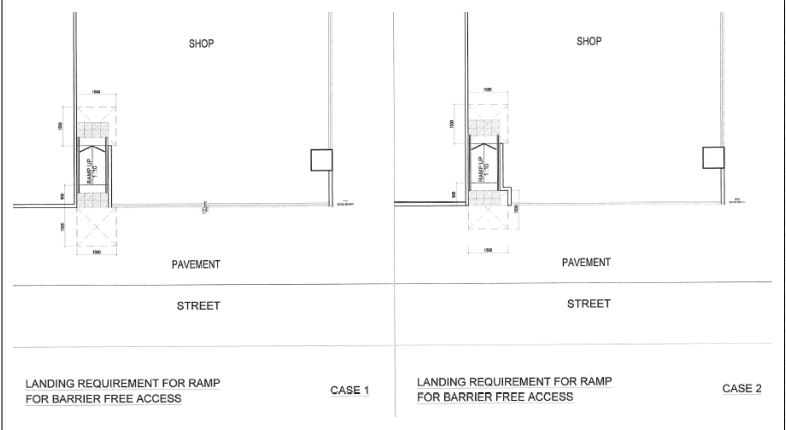{ width="508" loading=lazy }
  <figcaption>Diagram 1 from the original summary (ADF 1/2019, item 11). 原文附圖。</figcaption>
</figure>

**BD's response 屋宇署回覆:** BD would review and further advise. [Post Meeting Notes: BD confirmed that, for G/F entrance ramp abutting a public pavement, the provision of the 1500mm x 1500mm clear space at the foot of the ramp wholly within the curtilage of the development was not required provided that such clearance space would be available in the pavement for direct entry to and exit from the building. Notwithstanding this, a clear space within the development of not less than 900mm in depth, i.e. 600mm for tactile warning strip and 300mm for horizontal extension of the handrails as shown in Figures 7 and 16A of the DMBFA 2008 respectively, was still required to be provided at the foot of the ramp.]
{: .apsec-a }

### 12. Submission in Electronic Format {#i2019011812}

Raised by **AAP** · Related 相關: [ADM-8](../pnap/adm-8.md), [ADM-17](../pnap/adm-17.md)

**Question 問題:** (Item raised by BD) To promote green environment and facilitate processing of submission, BD would encourage paperless submission in electronic format as an alternative to the conventional paper format. To this end, BD was developing an Electronic Submission Hub (ESH) to receive and handle submissions in electronic format under the Buildings Ordinance which would be implemented in the first quarter of 2022 tentatively. Meanwhile, to prepare for and get familiar with submission in electronic format, practitioners were encouraged to make their submissions in electronic format on a voluntary basis. Apart from the Part II structural calculations referred in PNAP ADM-8, BD would also accept other submissions in electronic format and reference should be made to PNAP ADM-17 for more details.
{: .apsec-q }

**BD's response 屋宇署回覆:** Members appreciated the effort of the Government in promoting electronic submission and were keen to see the development of the ESH. As a trial, Members suggested that submission of documents other than plans in electronic format might be considered. BD would study the feasibility and follow up accordingly.
{: .apsec-a }

### 13. Testing Requirements on Bond Properties of Steel Reinforcing Bars {#i2019011813}

Raised by **AAP**

**Question 問題:** (Item raised by BD) Further to BD’s circular letter dated 31 October 2018, BD reminded that the grace period in respect of waiving the requirement of purchaser’s test on bond properties of steel reinforcing bars had already expired on 31 December 2018. For the avoidance of doubt, purchaser’s test on bond properties would not be required for steel reinforcing bars delivered on site on or before 31 December 2018.
{: .apsec-q }

**BD's response 屋宇署回覆:** Members acknowledged the arrangement and would follow the requirement accordingly.
{: .apsec-a }

---
<small>Source: Summary of Items Discussed in APSEC Discussion Forum, published by the HKIE Structural Division. Condensed for reference; the PDF is the authoritative record.</small>
