---
tags:
  - APSEC
  - Structural 結構
  - Fire safety 消防安全
  - Registration 註冊
  - Plan submission & approval 呈交及審批
  - Foundation 地基
  - GFA 總樓面面積
  - Geotechnical 岩土
---

# APSEC discussion items 2020 <small>2020 年認可人士及註冊結構工程師委員會討論項目</small>

!!! info "About this page 關於本頁"
    Questions raised at the APSEC Discussion Forum (ADF) and **BD's responses**, extracted from the summaries published by the HKIE Structural Division. Text is condensed from the English source; check the PDF before relying on an item. Where a later meeting discussed the same question, the item is flagged and **the later response prevails**.
    摘錄自香港工程師學會結構分部發布的會議摘要（只有英文版本）。如其後會議再討論同一問題，以**較新的回覆為準**。

## ADF 4/2020 · 26 Nov 2020

[Original summary (PDF) 原文](https://www.hkie-st.org/wp-content/uploads/2022/07/87_Summary-of-Items-Discussed-in-APSEC-Discussion-Forum-held-on-26-November-2020.pdf) · 17 items

### 1. Non-Mandatory Feature or Non-essential Plant Room {#i202011261}

Raised by **HKIA** · Related 相關: [APP-151](../pnap/app-151.md), [APP-2](../pnap/app-2.md)

!!! warning "Later discussion 其後再討論"
    This question was discussed again on **5 May 2023**; use the [later response](2023.md#i2023050514) where they differ. 如有不同，以較新回覆為準。

**Question 問題:** Footnote 4 to item 20 in Appendix A of PNAP APP-151 states that area of non-essential plant rooms including hot water boiler room, filtration plant room for swimming pool in a hotel, etc. may be exempted under Building Planning Regulation (B(P)R) 23(3)(a), provided that the pre-requisites and overall cap of 10% as required under PNAP APP-151 are complied with. For other non-domestic buildings, e.g. sports hall or commercial building, we would like to clarify whether the same non-essential plant rooms (i.e. …

**BD's response 屋宇署回覆:** BD advised that plant rooms, other than those described under paragraph 11 of PNAP APP-2 and PNAP APP-151 that might be exempted from GFA calculations, were GFA accountable. Grease trap room and sump pump room for F&B facilities were GFA accountable while irrigation water tank and plant room for greenery might be exempted from GFA calculation subject to the provision of environmentally friendly systems under paragraph 4 of PNAP APP-2.

### 2. Irrigation water tank and plant room for greeneries. {#i202011262}

Raised by **HKIA** · Related 相關: [Code of Practice for Fire Safety in Buil](../codes/fire-safety-code-2011.md)

!!! warning "Later discussion 其後再討論"
    This question was discussed again on **13 Aug 2021**; use the [later response](2021.md#i202108135) where they differ. 如有不同，以較新回覆為準。

**Question 問題:** 2. AC Platform Combined with Balcony/UP Where AC platform is to be combined with Balcony and/or UP as per Appendix B of the CoP on Design for Safety - External Maintenance 2019 (“the DfS Code”), it is not uncommon that such AC platform is to be designed as an integral part of the Balcony/UP so as to achieve a coherent and decent outlook with incorporation of the following features: 1) Same external finishing treatment, such as with 90mm thick cladding and/or architectural features along the outer perimeter of the combined balcony/UP/AC platform; 2) Aluminium ceiling above the whole combined balcony/UP/AC platform; and/or 3) For the uppermost combined balcony/UP/AC platform, having a top …

<figure markdown>
  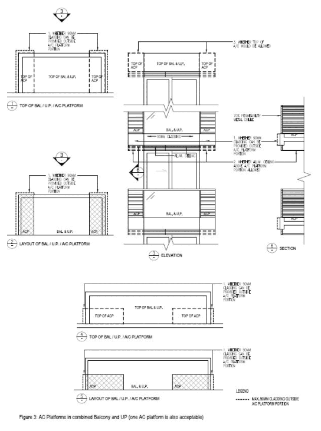{ width="352" loading=lazy }
  <figcaption>Diagram 1 from the original summary (ADF 4/2020, item 2). 原文附圖。</figcaption>
</figure>

**BD's response 屋宇署回覆:** BD had no objection in principle provided that the screen of the AC platforms could meet the requirements under Appendix B of the DfS Code and no part of any wall finishes/cladding should project beyond the site boundaries. by 3

### 3. Code of Practice on Design for Safety - External Maintenance 2019 {#i202011263}

Raised by **HKIA** · Related 相關: [Code of Practice for Fire Safety in Buil](../codes/fire-safety-code-2011.md)

<small>Follows earlier discussion: [22 Nov 2019](2019.md#i2019112217)</small>

**Question 問題:** As per item 17 of ADF 5/2019 held on 22.11.2019, BD advised that “whether the short side of the AC platform if not for the purpose of air intake/ exhaust could be changed to solid design would be further reviewed in the Technical Committee on the Code of Practice on Design for Safety- External Maintenance.” We would like to further follow up on the issue.

**BD's response 屋宇署回覆:** BD advised that the matter was discussed at the meeting of TC on the DfS Code held on 8 October 2020. Noting that different designs in intake and exhaust system of AC were available in the market, the screens and protective barriers as appropriate should satisfy the permeability requirements set out in paragraph (g) of Appendix B of the DfS Code. To this end, the proposed solid design was considered not acceptable.

### 4. Sunken Slab at G/F of the House/ Garden Unit of Apartment Block {#i202011264}

Raised by **HKIA** · Related 相關: [APP-93](../pnap/app-93.md), [B(SFP&W)R Building (Standards of Sanitar](../regulations/bsfpwr-123i.md)

!!! warning "Later discussion 其後再討論"
    This question was discussed again on **5 May 2023**; use the [later response](2023.md#i202305051) where they differ. 如有不同，以較新回覆為準。

<small>Related discussions 相關討論: [5 May 2023 item 1](2023.md#i202305051)</small>

**Question 問題:** Sunken slab design is commonly adopted by the industry for accommodating pipeworks associated with bathroom/ lavatory/ kitchen in domestic unit and the design should comply the requirements as stipulated in paragraph 5 of PNAP APP-93. It is our understanding that such sunken slab arrangement could also be adopted at the G/F of house as well as garden unit of apartment block where the floor slab is situated directly on grade, subject to that appropriate access panels and cleaning eyes are provided to facilitate maintenance of pipeworks inside the G/F sunken slab. …

**BD's response 屋宇署回覆:** BD advised that according to paragraph 3(d) of PNAP APP-93, for domestic buildings other than those intended for single occupancy or single family residence, no pipeworks for a unit shall protrude into the unit under separate occupancy on the floor below. To provide flexibility in the design of pipeworks to satisfy the requirement set out in paragraph 3(d) of PNAP APP-93, sunken slab arrangement was an acceptable solution to facilitate drainage repair and maintenance of domestic units in multiple occupancy/ownership by providing access to drainage pipes from individual unit concerned without the need for obtaining access from another unit. The design of which should comply with the requirements as stipulated in paragraph 5 of PNAP APP-93. B(SSFPDW&L)R 54 was about the design and construction of drains and sewers under buildings. It specified the design and construction requirements for underground drains and sewers which were considered different from those stipulated in paragraphs 3(d) and 5 of PNAP APP-93 regarding the access to drainage pipes for maintenance and repair. For underground drains and sewers, their design and construction should comply with B(SSFPDW&L)R 54.

### 5. Pedestrian Walkway Required under Lease {#i202011265}

Raised by **HKIA** · Related 相關: [B(P)R 23 & 23A Building height, site are](../regulations/bpr-23-23a.md)

**Question 問題:** In some occasions, the land leases may require the Grantee to provide pedestrian walkways/footpaths or similar passages within private lots to permit public to have free and uninterrupted access to certain features such as existing grave(s) located within or outside the lots. The alignment and/or width of such pedestrian walkways may not be specified under the respective lease. Would BD please clarify that such pedestrian walkways are not required to be deducted from site area for PR/SC calculation under the Buildings Ordinance.

**BD's response 屋宇署回覆:** BD advised that if the pedestrian walkway/footpath required under the lease was specified as a “right-of-way” to the public or adjoining lot owners, it should be excluded from site area under B(P)R 23(2)(a).

### 6. Fire Safety Management Plan for Open Kitchen of Single Family House {#i202011266}

Raised by **HKIA** · Related 相關: [FS Code 2011 Parts E, F & G: Fire Proper](../codes/fsc-parts-e-f-g.md)

**Question 問題:** Clause F5.8 of the Fire Safety Code 2011 (FS Code 2011) states that “If open kitchen in flats are provided in accordance with C13.4, the following conditions should be incorporated into the fire safety management plan and DMC, where applicable, to ensure the implementation and operation of following fire safety provisions:…” For site with only one single family house provided with open kitchen, our understanding is that the requirement of preparation/submission of fire safety management plan is not applicable, as there will neither be any management office nor DMC available for such development. Please confirm if our understanding is correct.

**BD's response 屋宇署回覆:** BD advised that the fire safety provisions for open kitchen should be incorporated into the fire safety management plan and DMC, where applicable, under Clause F5.8 of FS Code 2011.

### 7. Evidence of Realistic Prospect of Control {#i202011267}

Raised by **HKIA**

**Question 問題:** It has been our understanding that either of the following cases can be considered as valid evidences/proofs that an applicant for approval of GBP has realistic prospect of control of the land concerned: 1. The applicant’s acceptance of the Provisional Basic Terms Offer (PBTO) issued by the Lands Department; and 2. The District Lands Conference has in-principle approved the relevant land grant submitted by the applicant. However, we noted recently that only the issuance of binding basic terms offer with premium by Lands Department is considered as a valid evidence for proving realistic prospect of control of the land concerned, which deviates from our long understanding. …

**BD's response 屋宇署回覆:** BD advised that HKIA’s understanding was correct and the cases quoted could be considered as valid proofs in demonstrating realistic prospect of control of the land forming the site by the applicant.

### 8. Code of Practice for Foundation 2017 {#i202011268}

Raised by **HKIE**

**Question 問題:** Over the past 2 years, various items regarding the subject CoP have been discussed and agreed in the TC on the Code of Practice for Foundation. Would BD please advise if the discussion items can be promulgated for industry‘s adoption and better application of the Code.

**BD's response 屋宇署回覆:** BD advised that the items discussed and agreed in the TC on the CoP for Foundation would be promulgated via amendments to the CoP. It was expected that the proposed amendments would be promulgated by December 2020.

### 9. Code of Practice for Site Supervision 2009 {#i202011269}

Raised by **HKIE** · Related 相關: [ADM-6](../pnap/adm-6.md), [APP-157](../pnap/app-157.md)

<small>Related discussions 相關討論: [22 Nov 2024 item 8](2024.md#i202411228)</small>

**Question 問題:** While the frequency level of site inspections for TCP T3 and T5 are clearly stated in the CoP for Site Supervision 2009 and the Technical Memorandum for supervision Plans 2009, the required inspection frequency for the Directorate Site Supervisor (DSS) is not specified. The CoP only states the circumstance under which the supervision by a DSS may be required but there is no guidelines on the inspection frequency. In some projects, the RGE is required to propose a frequency of inspection for DSS while the frequencies in other case might range from “monthly”, “fortnightly” or even “weekly” inspection. …

**BD's response 屋宇署回覆:** BD advised that the required inspection frequency by a DSS would be considered and imposed by GEO on a case by case basis. The RGE was advised to approach GEO during plans submission stage to discuss the inspection frequencies at different construction stages if necessary. Members of HKIE suggested to include some guidelines on prescribed inspection frequency of DSS in the CoP for Site Supervision 2009 and would raise the issue in the TC on the CoP for Site Supervision for further deliberation. BD advised that according to PNAP ADM-6, the RSE/RGE was responsible for applying for renewal of prior acceptance of computer programs. RSE/RGE was reminded to duly observe the validity and expiry date of such programs in making plans submissions. For subsequent amendment submissions using the same computer programs adopted in the first submission, the RSE might use the same but expired programs provided that the RSE confirmed that there was no bugs identified in the programs during their execution.

### 11. Submission of Monitoring Data and RGE T5 Report {#i2020112611}

Raised by **HKIE**

**Question 問題:** In most of the projects, BD required the project RSE to submit the factual monitoring data on a bi-weekly basis. Meanwhile, the RGE in the same project with significant geotechnical content is also requested to submit a bi-weekly RGE T5 report instead of monthly report as per previous practice. In such circumstance, we suggest BD to accept a combined document to avoid duplicated effort for both BD/GEO and RSE/RGE in handling repetitive data.

**BD's response 屋宇署回覆:** BD advised that monitoring data signed by RSE and RGE T5 report signed by RGE were two different documents which should be submitted and handled separately. The T5 report usually only required cumulative monitoring results to be presented in graphical form with an interpretation of the monitoring results. To streamline the submission, the RSE/RGE might submit the RGE T5 report and monitoring data under one covering letter.

### 12. Refuge Floors {#i2020112612}

Raised by **AAP** · Related 相關: [FS Code 2011 Part B: Means of Escape](../codes/fsc-part-b-means-of-escape.md)

!!! warning "Later discussion 其後再討論"
    This question was discussed again on **4 Aug 2023**; use the [later response](2023.md#i202308046) where they differ. 如有不同，以較新回覆為準。

<small>Follows earlier discussion: [29 May 2020](2020.md#i202005292)</small>

<small>Related discussions 相關討論: [4 Aug 2023 item 6](2023.md#i202308046)</small>

**Question 問題:** Clause B18.2(b) and Clause B18.2(e) of FS Code 2011 states that “The net area for refuge should be not less than 50% of the total gross floor area of the refuge floor and should have a clear headroom of not less than 2300mm” and “The area for refuge should be open-sided above safe parapet height on at least two opposite sides to provide adequate cross ventilation;…” We opine that: 1. The 2300mm clear headroom requirement is not applicable for E/M services (drenchers, lightings, speakers, etc.) and signage (exit signs, exit directional signs, etc.), provided that a clear height of 2000mm should be maintained; 2. …

**BD's response 屋宇署回覆:** BD advised the area for refuge should have a clear headroom of not less than 2300mm pursuant to Clause B18.2(b) of FS code 2011. While there were no specific requirements on the "open-sided above safe parapet height" stipulated in Clause B18.2(e) of FS Code 2011, adequate cross ventilation should be provided.

### 13. Lobby to a Fireman’s Lift {#i2020112613}

Raised by **AAP** · Related 相關: [FS Code 2011 Part D: Means of Access](../codes/fsc-part-d-means-of-access.md)

<small>Related discussions 相關討論: [12 Nov 2021 item 6](2021.md#i202111126)</small>

**Question 問題:** Referring to Clause D11.1 of FS Code 2011, “each point of discharge from a fireman’s lift to the floor served…, should be through a lobby having a floor area of not less than 2.25 m 2 and a minimum dimension of 1.5m”. The layout below providing a 1.5m x 1.5m clear space in front of the fireman’s lift door would satisfy this requirement, please advise if our interpretation is correct.

**BD's response 屋宇署回覆:** As regards the sketch plan provided, BD advised that AAP’s interpretation was correct provided that other requirements including the provision of MoE and access for persons with a disability were complied with.

### 14. Staircases, Lift Shafts and Lobbies Passing Through Non-domestic GFA Accountable Areas Leading to Domestic Towers in a Composite {#i2020112614}

Raised by **AAP**

**Question 問題:** Building If the captioned features also serve non-domestic GFA accountable areas at podium floors, they could be calculated for either domestic or non-domestic GFA. Would BD please confirm if our understanding is correct.

<figure markdown>
  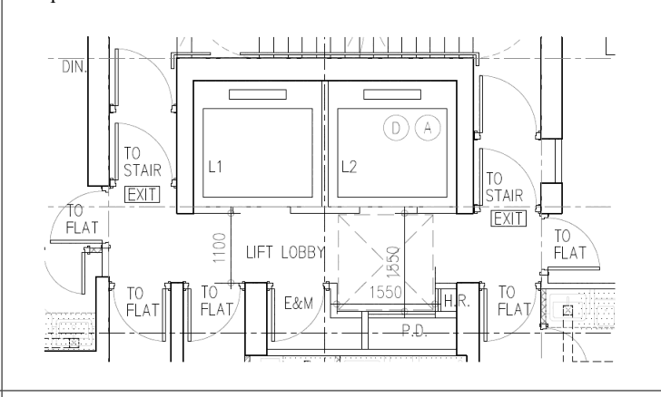{ width="471" loading=lazy }
  <figcaption>Diagram 1 from the original summary (ADF 4/2020, item 14). 原文附圖。</figcaption>
</figure>

**BD's response 屋宇署回覆:** BD advised if the features leading from domestic towers also served non-domestic GFA accountable areas at podium floors, such features might be counted as non-domestic GFA in a particular floor where it was solely for non-domestic use.

### 15. Service Lane {#i2020112615}

Raised by **AAP** · Related 相關: [APP-73](../pnap/app-73.md), [B(P)R 24–37 Storey heights, open space, ](../regulations/bpr-24-37.md)

!!! warning "Later discussion 其後再討論"
    This question was discussed again on **19 Mar 2021**; use the [later response](2021.md#i202103192) where they differ. 如有不同，以較新回覆為準。

**Question 問題:** B(P)R 28 requires that every domestic building shall be provided with a service lane, would BD please confirm if the following scenarios are considered acceptable: Scenario 1 When there is an existing service lane of 1.8m wide adjoining the site, the building on the site is to set back 600mm from the lot boundary such that 1.5m width measured from the centreline of the service lane to the building on the site is provided. Upon development of the opposite site, a lane of not less than 3m wide could be achieved. …

<figure markdown>
  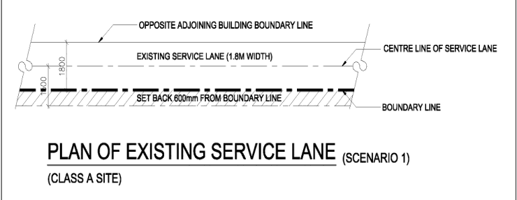{ width="478" loading=lazy }
  <figcaption>Diagram 1 from the original summary (ADF 4/2020, item 15). 原文附圖。</figcaption>
</figure>

<figure markdown>
  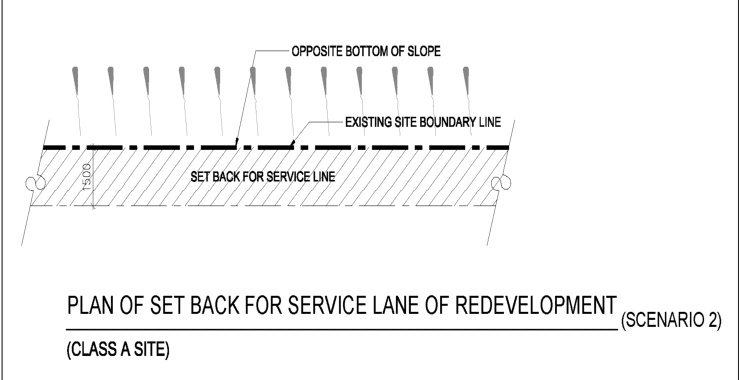{ width="479" loading=lazy }
  <figcaption>Diagram 2 from the original summary (ADF 4/2020, item 15). 原文附圖。</figcaption>
</figure>

**BD's response 屋宇署回覆:** BD advised that, pursuant to paragraph 10 of PNAP APP-73, the long-term objective was that upon full development of abutting sites, a lane would be direct and have an unobstructed width of not less than 3m. In this connection, if there were sites abutting on both sides of the lane, a setback of 1.5m on each side would be acceptable, otherwise a setback of 3m should be provided. For Scenario 1, if the existing 1.8m service lane was a public lane, then a setback of 600mm would be acceptable on each side On the other hand, if the existing 1.8m service lane was a private lane (no matter the site had the right of way over such private lane), a setback of 1.5m should be provided. For Scenario 2, if there was no building site at the other side, then a setback of 3m should be provided.

### 16. Discharge on Ground Level {#i2020112616}

Raised by **AAP** · Related 相關: [APP-152](../pnap/app-152.md), [FS Code 2011 Part C: Fire Resisting Cons](../codes/fsc-part-c-fire-resisting-construction.md)

**Question 問題:** (Item raised by AAP) We would like to confirm if our understanding on the following is correct. Under Code of Practice of Fire Safety in Buildings 2011 Clause 5.3, if any part of any building is within a distance of not more than 900mm from the site boundary of the adjoining site, the external walls and roofs of that part should have an FRR of not less than that of the internal elements of construction. Discharge of MOE through lift lobby to the street is acceptable and the external enclosure facing street does not require FRR construction, which is represented by “Lot A” in the diagram. However, for S.B.D. …

<figure markdown>
  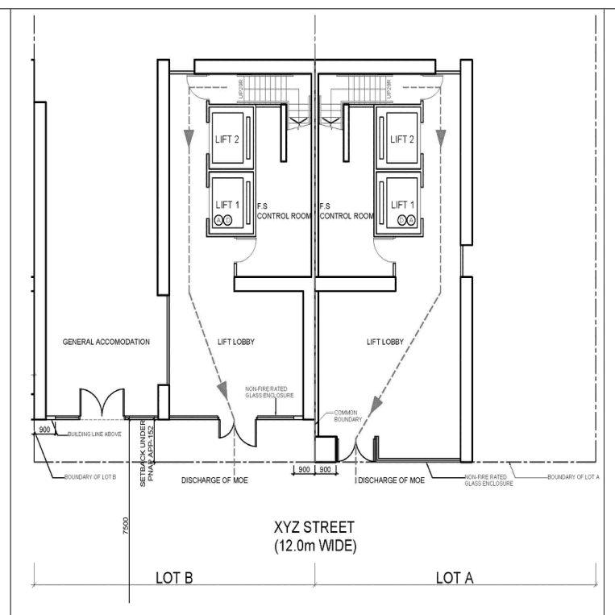{ width="493" loading=lazy }
  <figcaption>Diagram 1 from the original summary (ADF 4/2020, item 16). 原文附圖。</figcaption>
</figure>

**BD's response 屋宇署回覆:** BD advised that the requirements under Clause C9.7 of FS Code 2011 were not applicable to “Lot A” under the specified situation but applicable to “Lot B” according to AAP’s sketch. if a portion for of and except 13

### 17. Stating alternative Uses of the Building {#i2020112617}

Raised by **AAP**

**Question 問題:** (Item raised by AAP) For commercial development, it is not uncommon that the uses of the building may not be decided or finalised during building plan submission stage, for example the tower floors may be used as “Office” or “F&B”. Provided that the design of the building could accommodate both uses (e.g. MOE, floor loading, sanitary provision, etc.), will BD accept the alternative uses of the tower floors in the GBP?

**BD's response 屋宇署回覆:** BD advised that specific use of the building should be indicated on the GBP for approval. Upon completion of the building development, the use would be specified on the Occupation Permit accordingly.

### 18. Perforated Construction for the Portion of AC Platform Projecting {#i2020112618}

Raised by **AAP** · Related 相關: [Code of Practice for Fire Safety in Buil](../codes/fire-safety-code-2011.md)

**Question 問題:** More than 750 mm (Item raised by BD) Noting that the 150 mm wide perforated construction of AC platform required under paragraph 2(a) of Appendix C of the DfS Code would complicate the structural design and construction and might not benefit the natural lighting and ventilation of building, TC on the DfS Code accepted the recommendation to dispense with such requirement in the meeting held on 8.10.2020. The concerned revision will be promulgated in due course.

**BD's response 屋宇署回覆:** Members noted TC's recommendation and welcomed the proposed revision.

## ADF 3/2020 · 29 Sep 2020

[Original summary (PDF) 原文](https://www.hkie-st.org/wp-content/uploads/2022/07/86_Summary-of-Items-Discussed-in-APSEC-Discussion-Forum-on-29.9.2020-with-attachment.pdf) · 23 items

### 1. Open Kitchen in Premises with Internal Staircase {#i202009291}

Raised by **HKIA** · Related 相關: [FS Code 2011 Part C: Fire Resisting Cons](../codes/fsc-part-c-fire-resisting-construction.md)

**Question 問題:** As stated in Clause C13.4(e) of the FS Code 2011, a non-combustible barrier with FRR of not less -/30/- and of not less than 450mm measured vertically downwards from the underside of floor should be provided to surround the notional open kitchen area where the open kitchen is in premises with internal staircase. We would like to ask if smoke curtain fulfilling the requirements as stated in Clause C10.1(b) and the respective Commentary section of the FS Code 2011 be accepted as an alternative arrangement for provision of such downward barrier.

**BD's response 屋宇署回覆:** BD advised that Clause C10.1 of the FS Code 2011 was only applicable to internal unprotected openings in floors within a fire compartment for sprinkler protected building. Hence, the provision of smoke curtain as referred to in Clause C10.1(b) of the FS Code 2011 was considered not acceptable as downward barrier required for open kitchen in premises with internal staircase(s) under Clause C13.4(e) of the FS Code 2011.

### 2. FRR Requirement for Main Staircase in Single-Family House/Unit {#i202009292}

Raised by **HKIA** · Related 相關: [FS Code 2011 Part C: Fire Resisting Cons](../codes/fsc-part-c-fire-resisting-construction.md)

**Question 問題:** In a single-family house/unit, it is not uncommon that the main staircase connecting the floors is a standalone structure with void around. Since there is no compartment wall enclosing the staircase and that it is a rather open structure within the premises, we opine that both integrity and insulation requirements are immaterial under such circumstances and hence NOT required for the staircase floor slab. On the other hand, stability requirement to the structural frame, beam or column supporting such main staircase is relevant and has to be fulfilled in accordance with Table C2 of the FS Code 2011. Please advise if our understanding is correct.

<figure markdown>
  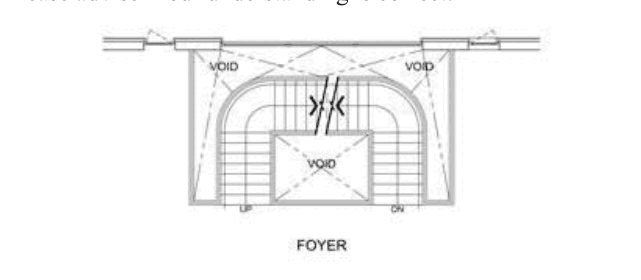{ width="414" loading=lazy }
  <figcaption>Diagram 1 from the original summary (ADF 3/2020, item 2). 原文附圖。</figcaption>
</figure>

**BD's response 屋宇署回覆:** Noting that the main staircase connecting the different floors within a single-family house/unit served as means of escape and element of construction akin to a floor, BD advised that it should comply with stability, integrity and insulation of FRR requirements under Table C2 of the FS Code 2011.

### 3. Smoke Outlets {#i202009293}

Raised by **HKIA**

**Question 問題:** Referring to item 10 of ADF 2/2015 held on 20 March 2015, BD advised that each smoke outlet should not be more than 30m away from another smoke outlet along the frontage. For large development, it is not practicable to have each and every smoke outlet to be arranged 30m max. apart sequentially and continuously from one another along all the building frontages as illustrated in the diagram attached to item 10 of ADF 2/2015. …

<figure markdown>
  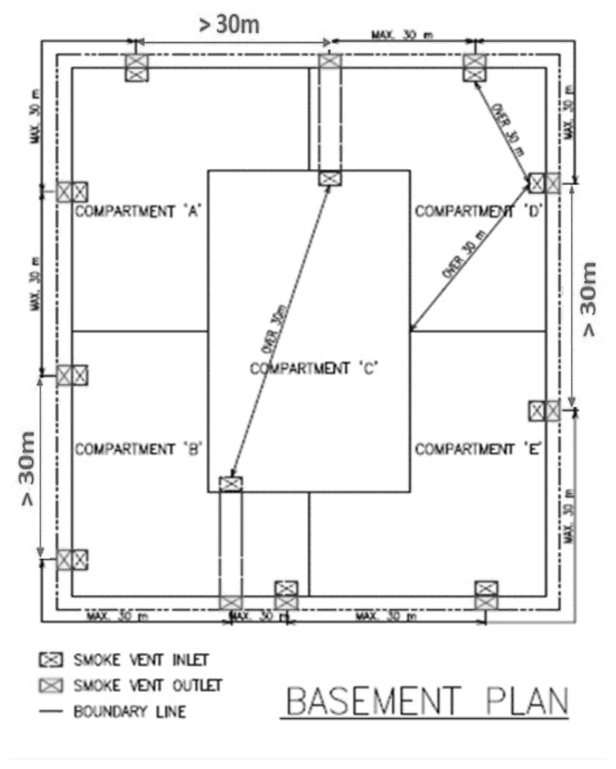{ width="501" loading=lazy }
  <figcaption>Diagram 1 from the original summary (ADF 3/2020, item 3). 原文附圖。</figcaption>
</figure>

**BD's response 屋宇署回覆:** HKIA would further supplement sample past cases examples to deliberate the constraints and practicality aspect for BD’s consideration. 3

### 4. Smoke Seal Lobby for Lift Doors at Basement {#i202009294}

Raised by **HKIA** · Related 相關: [FS Code 2011 Part C: Fire Resisting Cons](../codes/fsc-part-c-fire-resisting-construction.md)

<small>Follows earlier discussion: [10 Jan 2020](2020.md#i2020011012), [23 Aug 2019](2019.md#i201908235)</small>

**Question 問題:** Further to BD’s reply to item 12 of ADF 1/2020 held on 10 January 2020, we wish to further clarify if the non-loadbearing lift shaft wall should indeed be required to have an FRR of -/120/120 only, instead of -/240/240, as per clause C9.1(a) of the FS Code 2011. This is also in line with having the lift landing door at basement to be provided with an FRR of -/120/- only as per clause C9.1(c) of the FS Code 2011.

**BD's response 屋宇署回覆:** BD advised that HKIA’s understanding was correct.

### 5. Locking Devices under PNAP APP-37 {#i202009295}

Raised by **HKIA** · Related 相關: [APP-37](../pnap/app-37.md)

**Question 問題:** Paragraph 18 of PNAP APP-37 stipulates that relevant information of locking devices for openable sashes / sub-frames of window, window walls and curtain walls should be shown on structural plans for approval, and that proof load test report for the locking devices should also be submitted prior to the application for an occupation permit or submission of Form BA14. It is our understanding that both requirements are NOT applicable for windows or window walls that do not require structural submission for approval pursuant to paragraph 4 of the same PNAP. Please confirm if our understanding is correct.

**BD's response 屋宇署回覆:** BD advised that HKIA’s understanding was correct. Notwithstanding that structural submission to BD was not required, BD reminded that the AP/RSE should ensure that the design, fabrication and installation of the window and window wall should achieve the required safety standard pursuant to paragraph 6 of PNAP APP-37.

### 6. Size of Top-Hung Sash under PNAP APP-37 {#i202009296}

Raised by **HKIA** · Related 相關: [APP-37](../pnap/app-37.md)

**Question 問題:** Paragraph 20 of PNAP APP-37 stipulates that “…In general, the size of a top-hung sash should not exceed 2.5m 2 .” Despite the same, we understand that top-hung sash with size larger than 2.5m 2 is still acceptable so long as it can be demonstrated that the adopted hinges are adequate to hold its own weight. Please confirm our understanding is correct.

**BD's response 屋宇署回覆:** BD advised that HKIA’s understanding was correct.

### 7. PNAP APP-2 - Vertical Shafts at E&M Floor {#i202009297}

Raised by **HKIA** · Related 相關: [APP-2](../pnap/app-2.md)

<small>Follows earlier discussion: [10 Jan 2020](2020.md#i202001104)</small>

**Question 問題:** According to item 13 of ADF 1/2017 held on 13 January 2017, vertical shafts at E/M floor in Case B that also serve GFA accountable floors above is GFA accountable. Revised PNAP APP-2 was issued on March 2017, where the phrase “(i.e., not serving GFA accountable floors above or below)” was removed from paragraph 14. Our interpretation is that the above revisions are merely editorial in nature, and BD’s reply/advice given in ADF 1/2017 remains valid, taking heed of BD’s reply/advice to item 4 of ADF 1/2020 held on 10 January 2020 as well. Please confirm that our interpretation is correct.

**BD's response 屋宇署回覆:** were still pertinent.

### 8. PNAP APP-29 – Lift & Escalator Installations {#i202009298}

Raised by **HKIA** · Related 相關: [APP-29](../pnap/app-29.md)

**Question 問題:** Paragraph 4(b) of PNAP APP-29 states that the new amended requirements as contained in Appendix B – September 2019 are “applicable to all new building plans or major revision of building plans for development proposals … submitted to the BA for approval on or after 1 December 2019.” Where building plans had been submitted before 1 December 2019 but subsequently disapproved and re-submitted for BA’s approval after the said date, we understand that the new amended requirements are NOT applicable to such re-submission of building plans which was prepared on the basis of the initial submission. …

**BD's response 屋宇署回覆:** BD advised that HKIA’s understanding was correct.

### 9. Disposition of AC Platform combined with Balcony and/or UP {#i202009299}

Raised by **HKIA**

!!! warning "Later discussion 其後再討論"
    This question was discussed again on **18 Mar 2022**; use the [later response](2022.md#i202203186) where they differ. 如有不同，以較新回覆為準。

**Question 問題:** According to item (a) of Appendix B to the Code of Practice on Design for Safety – External Maintenance 2019 (the Code), the AC platform combined with balcony and/or UP should follow the disposition shown in Figures 1, 2 or 3. To allow design flexibility, we would appreciate if BD could consider alternative dispositions such as, without limitation to, those illustrated below:

<figure markdown>
  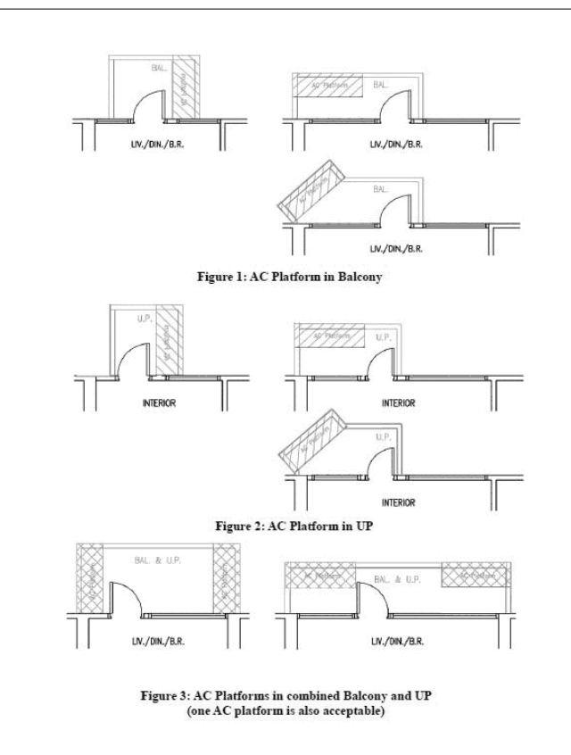{ width="414" loading=lazy }
  <figcaption>Diagram 1 from the original summary (ADF 3/2020, item 9). 原文附圖。</figcaption>
</figure>

**BD's response 屋宇署回覆:** In general, the disposition of AC platforms other than those shown in Figures 1 to 3 in Appendix B of the Code might be considered provided that the design criteria of AC platforms as stated in Appendix B of the Code were complied with; the provision of natural lighting and ventilation of the adjoining habitable space was not obstructed by the AC outdoor units; and the open side requirements of balcony and utility platform under JPN No.1 and No.2 respectively were complied with. The inclined AC platforms as shown in Figure 1 and Figure 2 were considered not acceptable as the length of the 400 mm working space should be not less than that of the AC platform as stated in item (d) of Appendix B of the Code. In response to another member’s enquiry, BD clarified that AC platform combined with balcony and/or UP might co-exist with AC room and/or individual AC box/hood at the same building.

### 10. Building with Centralised Air-Conditioning System {#i2020092910}

Raised by **HKIA** · Related 相關: [APP-42](../pnap/app-42.md)

**Question 問題:** According to PNAP APP-42, centralised air-conditioning plant room like chiller plant not exceeding 1% of the total GFA of a building and air handling units (AHUs) not exceeding 4% of the total GFA of each floor are considered to be reasonable. It is very common in typical centralised air-conditioning system design that one Primary Air Handling Unit (PAU) will serve multiple AHUs at different floors/areas to provide pre-treated fresh air for the AHUs, whereas one AHU may need to serve more than one floor due to various reasons such as limited floor plate area or efficient plants usage, etc. Under such circumstances, we consider area of the PAUs/AHUs (i.e. …

<figure markdown>
  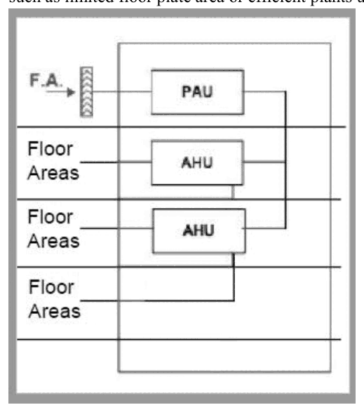{ width="336" loading=lazy }
  <figcaption>Diagram 1 from the original summary (ADF 3/2020, item 10). 原文附圖。</figcaption>
</figure>

**BD's response 屋宇署回覆:** BD advised that paragraph 8 of PNAP APP-42 stipulated the general sizes of AC plant room (1% of the total GFA of a building) and AHU rooms (4% of the total GFA of each floor on which they were situated) which would be considered reasonable in the absence of the detailed designed layout of the plants. As regards the sample case put forward by HKIA or other cases deviating from the general requirements stipulated in PNAP APP-42, BD advised that full justifications including the detailed design and plant room layout should be submitted to BD for consideration on a case by case basis. EMSD’s advice might be sought in this regard.

### 11. Uplift Resistance of Pile Group of Socketed Steel H-Pile {#i2020092911}

Raised by **HKIE** · Related 相關: [APP-18](../pnap/app-18.md)

**Question 問題:** According to Clauses 5.3.3(2)(b)(v) & (vi) of Foundation Code 2017, if the piles in a pile group has the same individual tension capacity, checking of rock/soil cone failure of individual pile is not necessary when the group effect has been considered in Clause 5.3.3(2)(b)(iv). When the tension capacities of piles within a group are not the same, checking according to Clause 5.3.3(2)(b)(vi) should be followed. In this regard, the tensile capacity of a rock-socketed pile has not been categorically defined. It has been interpreted by some BD officers that the tensile capacity be taken as the anchor resistance of the pile, being the lesser of Clause 5.3.3(1)(a) and (b). …

**BD's response 屋宇署回覆:** HKIE would supplement sample cases for BD’s further consideration. [Post Meeting Notes: HKIE supplemented sample cases to BD in October 2020. A separate meeting between BD and HKIE representatives to discuss this item was held on 23.11.2020. BD advised HKIE on the following: 1. The anchorage resistance of individual socketed steel H-Pile is governed by: (a) structural capacity of the structural steel section under tension; (b) bond resistance between grout and structural steel; and (c) bond resistance between grout and rock. 2. The anchorage resistance would be limited by effective weight of soil mass/rock cone that can be mobilised. 3. In cl. 5.1.6 of the Foundation Code 2017, it stipulated the deemed-to-be satisfied conditions for each pile in a pile foundation in providing anchorage resistance against uplift, overturning and/or buoyancy. 4. For a group of closely-spaced piles subjected to tension, cl. 5.3.3 (2)(b)(iv) stated that the overlapping effect should be considered when assessing the volume of rock/soil cone to be used for resisting the combined uplift force. In this respect, cl. 5.3.3(2)(b)(v) and (vi) provide guidelines for the assessment under different scenarios. 5. To address the query raised by HKIE, BD suggested amending cl. 5.3.3(2)(b)(v) & (vi) as follows: (v) For a group of piles of same size with same individual tension capacity allowable anchorage resistance, checking of overlapping effect on rock/soil cone failure of individual pile is not necessary when the group effect has been considered as stated in (iv) above. …

### 12. Proof Test frequency for Driven Steel H-Pile {#i2020092912}

Raised by **HKIE** · Related 相關: [APP-18](../pnap/app-18.md)

**Question 問題:** In accordance with Clauses 5.3.1 and 5.3.2 of the Foundation Code 2017, the bearing capacity of driven steel H-piles and steel H-piles driven to bedrock are derived on the same design principles with respect to structural and geotechnical aspects. Upon completion, their loading performance will be ascertained by proof loading test with at least 1% of piles. Since both types of foundation piles are installed by the same construction method, i.e. pitched with a hydraulic hammer and final set with a drop hammer, we understand that the numbers of proof loading test are based on total numbers of driven steel H-piles plus steel H-piles driven to bedrock. Would BD please confirm the above.

**BD's response 屋宇署回覆:** BD advised that driven steel H-piles and steel H-piles driven to bedrock were different recognised types of pile. Hence, their loading performance should be ascertained separately.

### 13. BD/MTRCL Liaison Meeting on the Review of PNAP APP-24 {#i2020092913}

Raised by **HKIE** · Related 相關: [APP-24](../pnap/app-24.md)

<small>Follows earlier discussion: [29 May 2020](2020.md#i202005297)</small>

**Question 問題:** As discussed in item 7 of ADF 2/2020 held on 29 May 2020, we would like to know the progress of BD/MTRCL Liaison Meeting on the Review of PNAP APP-24. Members would also like to join the discussion to express their views.

**BD's response 屋宇署回覆:** BD advised that the working group between BD and MTRC had already held three meetings. It might not be appropriate for HKIE to the join meeting at this juncture. Nevertheless, the draft revised PNAP APP-24 would be submitted to the BSC and APSEC for consultation with the industry in due course.

### 14. Implementation of Wind Code 2019 {#i2020092914}

Raised by **HKIE** · Related 相關: [APP-139](../pnap/app-139.md)

**Question 問題:** As stipulated in BD’s circulation letter dated 30 September 2019, grace period for implementation of the new Wind Code will be expired after September 2020. Since Covid-19 pandemic occurred in early 2020, the planned technical seminars/talks for briefing and elaborating the applications of the new Wind Code cannot be conducted by the Industry. The outbreak also affects the proper planning and implementation of GI works for supporting foundation submissions before October 2020. In this regard, we would like to request the extension of the grace period for mandatory adoption of the new Wind Code for 1 year.

**BD's response 屋宇署回覆:** BD advised that the grace period for adoption of the new Wind Code was extended to expire on 31 March 2021 as stipulated in the circular letter issued on 28 August 2020.

### 15. GFA and SC Calculations for Curtain Walls {#i2020092915}

Raised by **HKIS** · Related 相關: [APP-2](../pnap/app-2.md)

<small>Related discussions 相關討論: [29 May 2020 item 19](2020.md#i2020052919), [14 Jan 2022 item 8](2022.md#i202201148), [13 May 2022 item 23](2022.md#i2022051323)</small>

**Question 問題:** Under paragraph 6(b) of PNAP APP-2, a reinforced concrete dwarf perimeter wall not less than 300mm high measured from the floor level is required for disregarding the curtain wall from GFA and SC calculations. However, some members reported that they were asked to count the curtain wall for the GFA and SC at some locations where the construction of such dwarf perimeter wall are found not practical. Such locations include across entrance or exit (Scenario A) & between the void and its external enclosure (Scenario B). …

<figure markdown>
  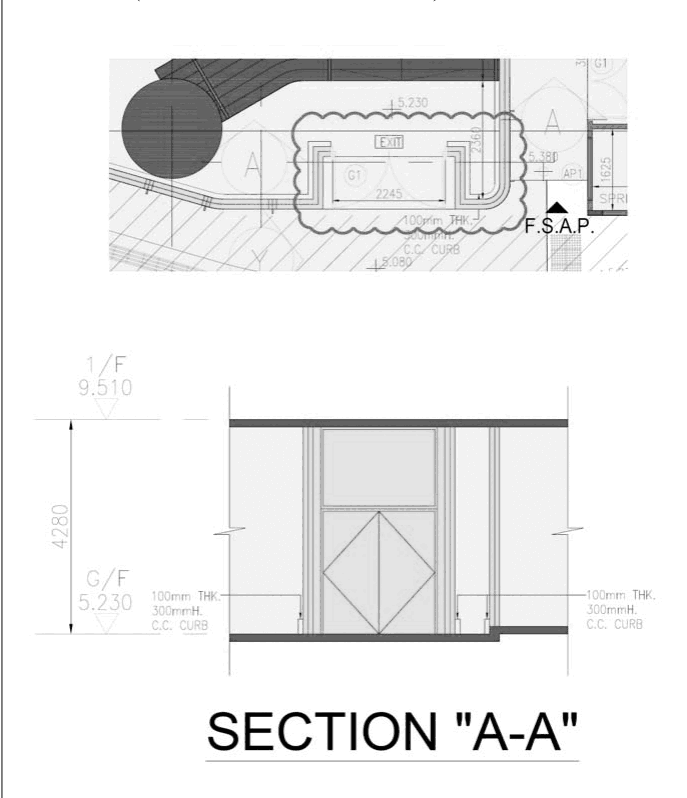{ width="444" loading=lazy }
  <figcaption>Diagram 1 from the original summary (ADF 3/2020, item 15). 原文附圖。</figcaption>
</figure>

<figure markdown>
  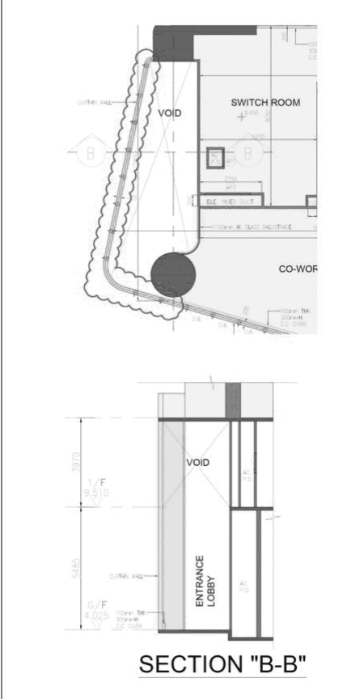{ width="290" loading=lazy }
  <figcaption>Diagram 2 from the original summary (ADF 3/2020, item 15). 原文附圖。</figcaption>
</figure>

**BD's response 屋宇署回覆:** BD advised that the dwarf wall was not required to be provided at locations across entrance/exit (Scenario A) or at void levels (Scenario B). However, as clarified in ADF 4/2016 (item 15), the curtain wall could be disregarded from GFA and SC calculations except for the part providing access to outside, flat roof or balcony. 14 15

### 16. Separation between Use Classifications Clause C7.3 of FS Code 2011 states that: {#i2020092916}

Raised by **AAP** · Related 相關: [FS Code 2011 Part C: Fire Resisting Cons](../codes/fsc-part-c-fire-resisting-construction.md)

**Question 問題:** “Provided that the fire compartment area limitations in Table C1 are complied with, separation by fire barriers are not required between different occupancies for the following uses: (a) Use Classification 4a; or …” Clause C7.4 of FS Code 2011 states that: “Except for shopping arcade in Use Classification 4b, every common internal corridor serving rooms or flats in different occupancies should be separated from such occupancies by fire barriers having an FRR of not less than that of the Use Classification of that floor…” Based on the above, we opine that for offices with different occupancies: (a) Separation by fire barriers are not required between different occupancies; (b) The common …

<figure markdown>
  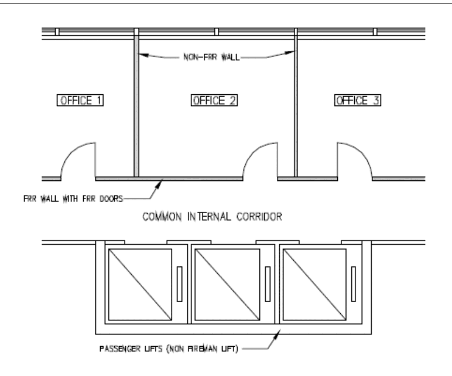{ width="499" loading=lazy }
  <figcaption>Diagram 1 from the original summary (ADF 3/2020, item 16). 原文附圖。</figcaption>
</figure>

**BD's response 屋宇署回覆:** —

### 17. Design of Protective Barrier of AC Platform combined with Balcony {#i2020092917}

Raised by **AAP**

!!! warning "Later discussion 其後再討論"
    This question was discussed again on **22 Jan 2021**; use the [later response](2021.md#i202101222) where they differ. 如有不同，以較新回覆為準。

<small>Follows earlier discussion: [22 Nov 2019](2019.md#i2019112217)</small>

**Question 問題:** and/or Utility Platform As per item 17(iii) of ADF 5/2019 held on 22 November 2019, BD interpreted the design of protective barrier of AC platform in combined balcony and utility platform. We would like to raise the question whether the short side of the AC platform if not for the purpose of air intake/exhaust could be changed to solid design, say a full-height solid wall.

<figure markdown>
  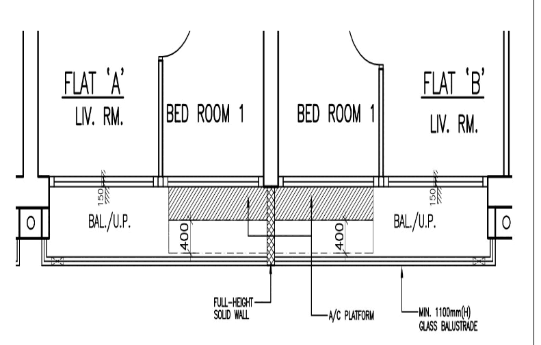{ width="512" loading=lazy }
  <figcaption>Diagram 1 from the original summary (ADF 3/2020, item 17). 原文附圖。</figcaption>
</figure>

**BD's response 屋宇署回覆:** BD advised that the issue would be further reviewed in the Technical Committee on the Code of Practice on Design for Safety – External Maintenance. [Post Meeting Notes: The matter was discussed at the Technical Committee Meeting of Code of Practice on Design for Safety – External Maintenance held on 8.10.2020. It was considered that as different designs in intake and exhaust system of AC were available in the market, the screens and protective barriers as appropriate should satisfy the permeability requirements set out in paragraph (g) of Appendix B of the Code. To this end, the proposed solid design is considered not acceptable.]

### 18. Exemption of GFA and SC for Covered Areas Underneath Lowest Balcony/Utility Platform {#i2020092918}

Raised by **AAP**

<small>Follows earlier discussion: [22 Nov 2019](2019.md#i201911229)</small>

**Question 問題:** A follow-up question on item 9 of 5/2019 ADF held on 22 November 2019. We would like to enquire whether the area underneath the staggered balcony would be GFA exempted. For some of the case officers they are of the opinion that such area is not exempted since the balcony above is not the “lowest” balcony and hence does not match the exemption criteria stated in the JPN. …

<figure markdown>
  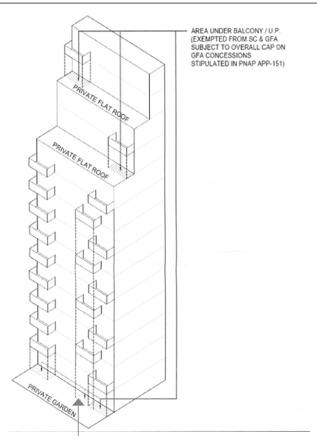{ width="338" loading=lazy }
  <figcaption>Diagram 1 from the original summary (ADF 3/2020, item 18). 原文附圖。</figcaption>
</figure>

**BD's response 屋宇署回覆:** BD advised that responses to item 9 of ADF 5/2019 was still valid. Pursuant to the JPN Nos. 1 & 2 jointly endorsed by the Buildings Department, Lands Department and Planning Department, only the covered areas underneath the lowest balcony and utility platform might be fully exempted from GFA and SC calculations. in BD, 19

### 19. Provision of Building Logo at Building Rooftop {#i2020092919}

Raised by **AAP** · Related 相關: [APP-126](../pnap/app-126.md), [BO s.1–13A Interpretation; registration ](../regulations/bo-part-1-registration.md)

**Question 問題:** It is not uncommon to have the building name / logo installed on the building envelopes at rooftop level, some examples of the possible locations of such logo as shown below. The building logos can be in the form of letter words, artistic signage, etc. Their scale and nature are different from “Signboard” as defined in PNAP APP-126 and thus these building logos at rooftop level should not be required to set back from the roof parapet or curb to maintain a 1.5m wide maintenance path as stated in paragraph 18 of Appendix B of the said PNAP. …

<figure markdown>
  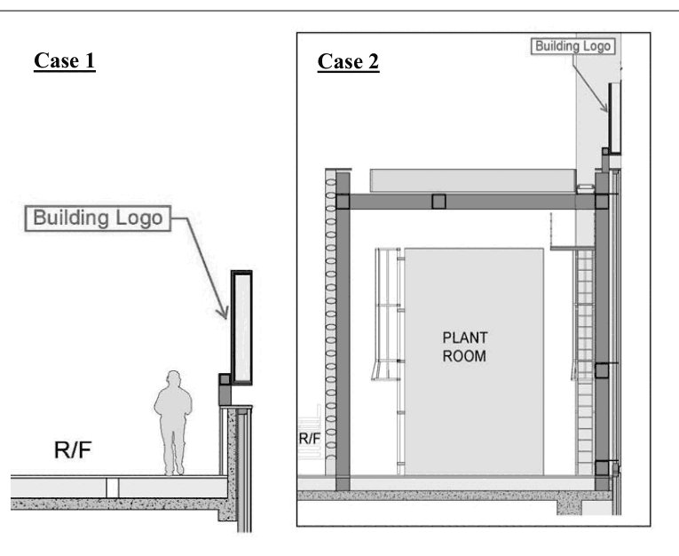{ width="495" loading=lazy }
  <figcaption>Diagram 1 from the original summary (ADF 3/2020, item 19). 原文附圖。</figcaption>
</figure>

<figure markdown>
  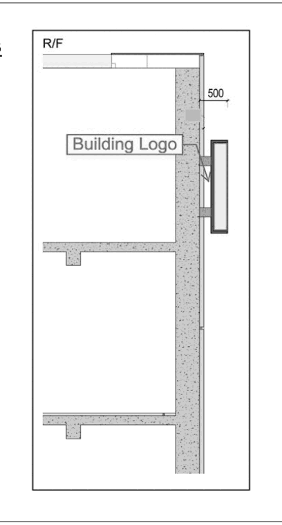{ width="263" loading=lazy }
  <figcaption>Diagram 2 from the original summary (ADF 3/2020, item 19). 原文附圖。</figcaption>
</figure>

**BD's response 屋宇署回覆:** BD advised that according to section 2 of the Buildings Ordinance, the building name / logo as shown in the diagrams was considered as “signboard” for the purpose of displaying visual image or other information. According to paragraph 18 in Appendix B of PNAP APP-126, no portion of a signboard erected on the roof of a building shall be within a distance of 1.5m from the inside face of the roof parapet or curb. Therefore, a 1.5m setback should be provided for both cases 1 and 2. For Case 3, BD advised that the building logo was considered as “Wall Signboard” and thus paragraph 18 in Appendix B of PNAP APP-126 was not applicable. 21

### 20. Disposition of Refuge Floor {#i2020092920}

Raised by **AAP** · Related 相關: [Code of Practice for Fire Safety in Buil](../codes/fire-safety-code-2011.md)

<small>Follows earlier discussion: [29 May 2020](2020.md#i2020052913)</small>

**Question 問題:** Further to item 13 of ADF 2/2020 held on 29 May 2020, please confirm whether the scenario illustrated below is acceptable under FS Code 2011.

<figure markdown>
  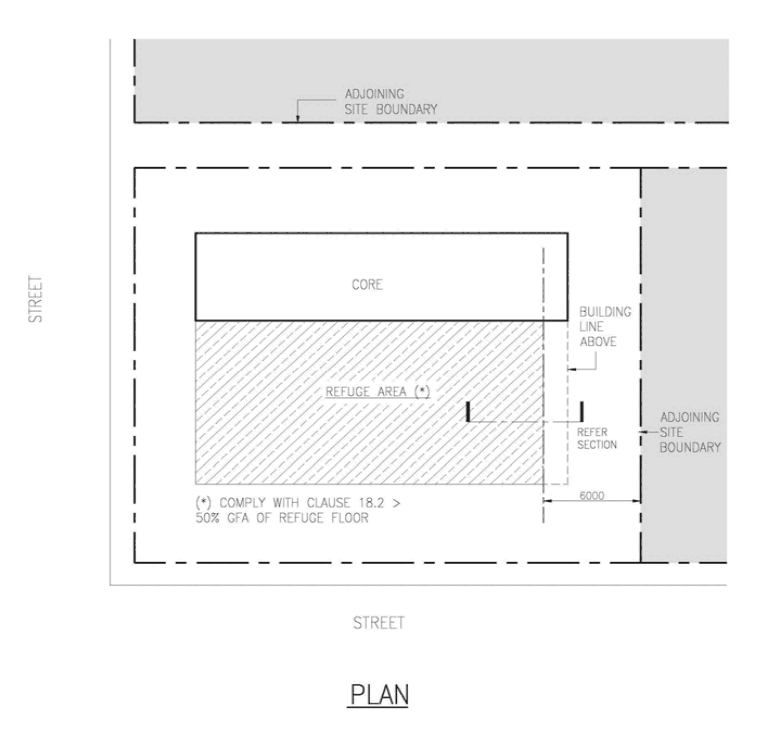{ width="497" loading=lazy }
  <figcaption>Diagram 1 from the original summary (ADF 3/2020, item 20). 原文附圖。</figcaption>
</figure>

<figure markdown>
  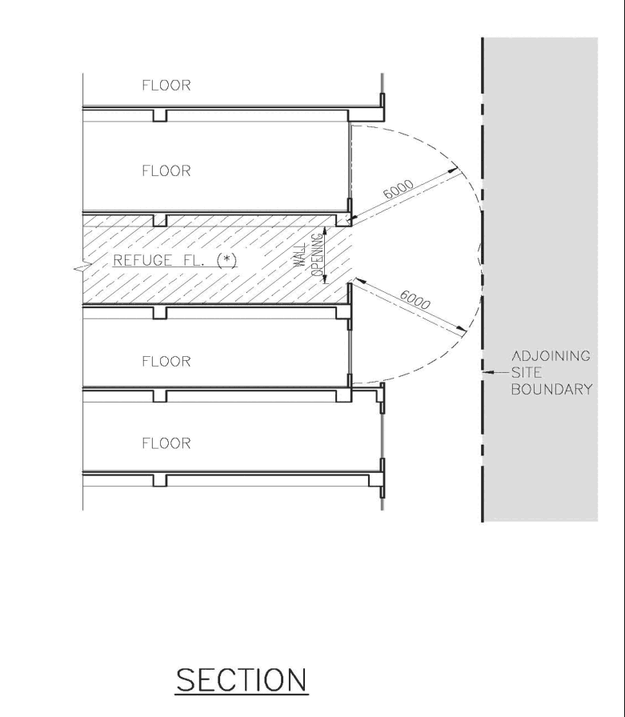{ width="505" loading=lazy }
  <figcaption>Diagram 2 from the original summary (ADF 3/2020, item 20). 原文附圖。</figcaption>
</figure>

**BD's response 屋宇署回覆:** BD had no in-principle objection to the proposal. 23 24

### 21. Escalator Void {#i2020092921}

Raised by **AAP**

**Question 問題:** According to item 1(b) of 3/2015 APSEC Discussion Forum, only the escalator and the undercover space at the lowermost floor shall be accountable for GFA calculation. For scissor escalators, gap / void is necessary so that minimum clearance between outer edge of the handrail and adjacent escalator pit cladding could be maintained in accordance to clause 1.2.5 Section E Part 4 of CoP ON THE DESIGN AND CONSTRUCTION OF LIFTS AND ESCALATORS. Since such gap / void is not contributing any usable floor space, our understanding such gap / void could be regarded as escalator void and disregarded from GFA calculation, BD please clarify if our understanding is correct. AOB Items

<figure markdown>
  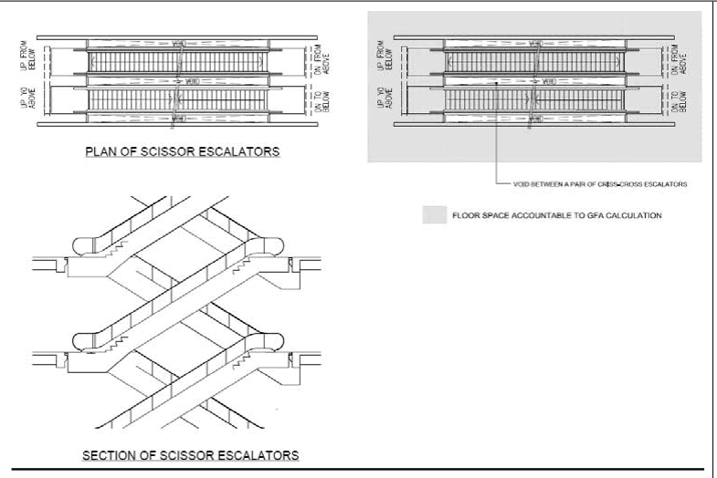{ width="508" loading=lazy }
  <figcaption>Diagram 1 from the original summary (ADF 3/2020, item 21). 原文附圖。</figcaption>
</figure>

**BD's response 屋宇署回覆:** BD advised that the gap or void in-between escalators for compliance with the subject CoP may be exempted from GFA calculation upon application.

### 22. Special Work Arrangement of New Building Divisions (NBDs) {#i2020092922}

Raised by **AAP**

**Question 問題:** (Item raised by BD) While the normal public service had been resumed from 15.9.2020, BD would continue to implement targeted measures to reduce social contact and apply infection control measures. BD reminded that practitioners might continue to adopt the facilitating measures promulgated by BD on 28.9.2020 regarding communication with BD officers, statutory submissions and site inspections via the Notice to Registered Building Professionals. BD advised that witnessing of pile proof test by HOKLAS accredited laboratory with video recording would continue to be allowed on a case-by case basis.

**BD's response 屋宇署回覆:** Members welcomed the continuation of BD's special work arrangement. Members of HKIE suggested BD to copy the referral emails to GEO to AP/RSE/RGE to facilitate their follow-up action. BD would consider HKIE’s suggestion. [Post Meeting Note: As advised by GEO, they considered copying the referral emails to GEO to AP/RSE/RGE did not conform to their established practice. In view of the current mode of operation which is proven effective, GEO advised the status quo should be maintained. ]

### 23. Minor Amendments to the Plans at BD’s Office {#i2020092923}

Raised by **AAP**

**Question 問題:** (Item raised by BD) To facilitate practitioners for case discussions with BD officers and making minor amendment to the plans, BD advised that 17 tables had been set up in the lift lobbies on 7/F, 8/F and 9/F. Prior appointments could be made with BD officers for case discussions and reservation of the meeting table would be made by BD officers. To make the best use of the resources, each booking session would be of 30 minutes. In view of the continued need to reduce social contact, the number of users at each meeting table is limited to 3 (including the BD officer). …

**BD's response 屋宇署回覆:** Members welcomed BD’s facilitating measures and would notify the members of their institutes/association of the arrangements accordingly. Sample 1 –Pile Load Schedule Load Combination Pile Capacity TENSION CHECKING Required COMPRESSION Ultimate Required Tension D+L+I W D+L+I W Uplift Tension IW 1+ W 2+ W p I D - 0.9Ru + D (W1+W2+Wp) + D - D + Ra - Capacity › D+L+S WITHOUT WITH D + UL MIN MIN MIN MIN max.I max.I +S Resistance Capacity (kN) MIN 1.5IWmaxI + - 1.5IWmaxI D MIN - 1.5IWmaxI IWmaxI + UL IWmaxI + UL 1/2 (kN) WIND WIND (kN) (kN) (kN) Ru (kN) Ra (kN) 1.1UL (kN) + 1.1UL (kN) + 1.1UL (kN) (kN) + Soil (kN) Compression (kN) (kN) Capacity? 2183 7201 7303 6100 7625 12200 6100 13730 1380 -6311 4669 7419 -3741 2359 Yes 2444 6458 6560 6100 7625 12200 3050 3980 1549 -4636 6344 -656 · -2568 482 No 2702 5575 5677 6100 7625 12200 3050 6980 1715 -4616 6364 2364 -2499 551 No 3006 5005 5107 6100 7625 12200 3050 6690 1906 -2755 8225 3935 -1195 1855 No 3184 5894 5996 6100 7625 12200 3050 8690 2019 -3708 7272 4982 -1793 1257 No 3362 6942 7044 6100 7625 12200 3050 13730 2134 -3400 7580 10330 -1550 1500 No 2275 6621 6723 6100 7625 12200 3050 13730 1408 -5274 5706 8456 -3040 10 No 2531 5851 5953 6100 7625 12200 3050 13730 1573 -3570 7410 10160 -1849 1201 No 2714 4861 4963 6100 7625 12200 3050 13730 1690 -3195 7785 10535 -1560 1490 No 3047 4670 4772 6100 7625 12200 --- 13730 1904 -694 10286 13036 179 --- No 3166 5430 5532 6100 7625 12200 3050 9730 1980 -1579 9401 8151 -386 2664 No 3333 7040 7142 6100 7625 12200 3050 4890 2089 -5516 5464 -626 · -2975 75 No 2388 6198 6300 6100 7625 12200 …

## ADF 2/2020 · 29 May 2020

[Original summary (PDF) 原文](https://www.hkie-st.org/wp-content/uploads/2022/07/84_Summary-of-Items-Discussed-in-APSEC-Discussion-Forum-on-29-May-2020.pdf) · 20 items

### 1. Innovative Building Designs with Large Projecting/Overhanging Features {#i202005291}

Raised by **HKIA** · Related 相關: [APP-19](../pnap/app-19.md)

<small>Related discussions 相關討論: [14 Jan 2022 item 2](2022.md#i202201142)</small>

**Question 問題:** According to paragraph 6 of PNAP APP-19, save for the areas covered by projecting features which provide a weather-protected shelter capable of functional use, it is accepted that where there is no objection from the relevant government departments and the clear height of the projecting feature is more than 7.5m above the covered areas, the covered areas are not required to be included in GFA calculation if they satisfy the following criteria: (a) The ratio of horizontal width of the covered area to the clear height of the projecting features above the covered area is not less than 1:8, OR (b) Access to the covered area is not possible and abuse is unlikely. …

<figure markdown>
  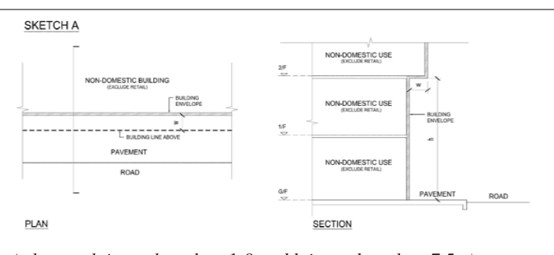{ width="456" loading=lazy }
  <figcaption>Diagram 1 from the original summary (ADF 2/2020, item 1). 原文附圖。</figcaption>
</figure>

<figure markdown>
  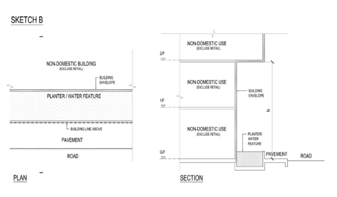{ width="448" loading=lazy }
  <figcaption>Diagram 2 from the original summary (ADF 2/2020, item 1). 原文附圖。</figcaption>
</figure>

**BD's response 屋宇署回覆:** BD advised that whether the concerned covered areas could be exempted from GFA calculation would depend on the overall building design as well as the chance of abuse, and hence had to be considered on a case basis. 2

### 2. Refuge Floors {#i202005292}

Raised by **HKIA** · Related 相關: [FS Code 2011 Part B: Means of Escape](../codes/fsc-part-b-means-of-escape.md)

!!! warning "Later discussion 其後再討論"
    This question was discussed again on **4 Aug 2023**; use the [later response](2023.md#i202308046) where they differ. 如有不同，以較新回覆為準。

<small>Related discussions 相關討論: [4 Aug 2023 item 6](2023.md#i202308046)</small>

**Question 問題:** Clause B18.1 of FS Code 2011 states that “… refuge floors should be provided for all buildings exceeding 25 storeys in height above the lowest ground storey, at not more than …25 storeys … for buildings … in other Use Classifications from any other refuge floor …”. Based on the above, we opine that the following schematic section is a correct interpretation of the requirement where there can be 25-storeys of residential or office accommodation between the refuge floors, i.e. the refuge floor itself is not counted into the 25 storeys as stipulated in the clause. Please advise if our interpretation is correct.

<figure markdown>
  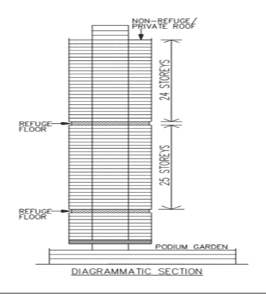{ width="287" loading=lazy }
  <figcaption>Diagram 1 from the original summary (ADF 2/2020, item 2). 原文附圖。</figcaption>
</figure>

**BD's response 屋宇署回覆:** For the scenario provided in HKIA’s sketch, the refuge floor needs not be counted towards the requirement of “25 storey” under Clause B18.1 of FS Code 2011.

### 3. Covered Walkway and Consent to Commence Superstructure Works {#i202005293}

Raised by **HKIE**

**Question 問題:** Similar to temporary shoring for ELS works or temporary propping for demolition works, it is not uncommon to erect hoarding in stages due to site constraints. For example, erecting single fence board hoarding for foundation and basement construction and modifying such to covered walkway at later stages when the superstructure is constructed. Such hoarding proposal is reflected in hoarding plans for acceptance by BD. Normally, basement and superstructure consent will be granted in one go after the completion of foundation piling works. Despite being a common practice, there have been cases in which the application for consent to commence superstructure works was affected by staged hoarding. …

**BD's response 屋宇署回覆:** BD advised that the matter had been discussed under item 2(b) of ADF 1/2017 held on 13 January 2017. Superstructure consent could generally be granted when the respective hoarding plans had been submitted and all the relevant conditions were complied with. BD reminded that it would be the AP/RSE’s duty to ensure that the hoarding works would be in gear with the progress of the construction.

### 4. Certification of Building Materials by RSE {#i202005294}

Raised by **HKIE**

**Question 問題:** As imposed under item 6 in Section 17(1) of the BO, RSE is required to append a statement to confirm the materials’ (including reinforcements, structural steel, couplers, glass and other structural materials, etc.) mechanical and chemical properties, testing reports and monitoring data are complied with relevant design standards, sampling and testing requirements and conducted by accredited HOKLAS laboratory and the proposed monitoring system in accordance with approved plans. …

**BD's response 屋宇署回覆:** BD advised that duly signed letters by RSE confirming that the relevant requirements and conditions imposed in the approval/consent letters had been complied with would suffice and RSE’s signature/certification on individual document would not be necessary.

### 5. Wind Tunnel Test {#i202005295}

Raised by **HKIE** · Related 相關: [APP-139](../pnap/app-139.md)

<small>Follows earlier discussion: [22 Nov 2019](2019.md#i2019112227)</small>

**Question 問題:** As per item 27 of ADF 5/2019 held on 22 November 2019, BD advised that submission of method statement for wind tunnel test to Structural Engineering Committee would not be required if the technical requirements specified in Code of Practice on Wind Effects in Hong Kong 2019 were fully complied with. Please advise BD’s time pledge of processing method statement for wind tunnel test.

**BD's response 屋宇署回覆:** BD advised that, similar to pre-submission enquiry, the submitted method statement would be processed within 45 days upon receipt.

### 6. Cross-referencing of Monitoring System {#i202005296}

Raised by **HKIE**

<small>Follows earlier discussion: [22 Mar 2019](2019.md#i201903226)</small>

**Question 問題:** As per item 6 of ADF 2/2019 held on 22 March 2019, advised that cross-referencing of monitoring system/proposal given in ELS and foundation plans for the same development is acceptable. However, it is not fully recognised by many case officers. Would BD please help to promulgate this practice amongst colleagues for simplicity.

**BD's response 屋宇署回覆:** BD advised that cross-referencing of monitoring system/proposal was acceptable provided that they were updated to comprehensively reflect the latest site situation and monitoring requirements of the ELS/ foundation plans.

### 7. Vibration and Settlement Control {#i202005297}

Raised by **HKIE** · Related 相關: [APP-24](../pnap/app-24.md)

!!! warning "Later discussion 其後再討論"
    This question was discussed again on **29 Sep 2020**; use the [later response](2020.md#i2020092913) where they differ. 如有不同，以較新回覆為準。

**Question 問題:** As advised in previous meetings, BD was liaising with MTRCL to review the requirements for building works to be carried out in the railway protection areas as stipulated in PNAP APP-24. As it would have grave implication to railway related developments, we would like to know the latest development.

**BD's response 屋宇署回覆:** BD advised that the review of the PNAP APP-24 was being carried out under a working group between BD and MTRCL and review items had been identified for further discussion. Members of HKIE requested for expressing their concerns at suitable opportunity.

### 8. PNAP APP-110 - Protective Barriers {#i202005298}

Raised by **HKIS** · Related 相關: [APP-110](../pnap/app-110.md), [APP-171](../pnap/app-171.md)

!!! warning "Later discussion 其後再討論"
    This question was discussed again on **9 Aug 2024**; use the [later response](2024.md#i202408099) where they differ. 如有不同，以較新回覆為準。

<small>Related discussions 相關討論: [12 Nov 2021 item 3](2021.md#i202111123), [5 May 2023 item 16](2023.md#i2023050516)</small>

**Question 問題:** According to PNAP APP-110, recommendation on the salient aspects of the design and construction of glass barriers are given in Appendix A and typical details are shown in Appendix B. Members would like to clarify that the typical details is just demonstrating one of the acceptable solutions and other designs shall also be acceptable by BD provided that it could comply with BO and with the support of the structural calculation by RSE. Examples of the variations might include (i) change in clamp dimension; and (ii) difference in railing shape, size, section, or even omission.

**BD's response 屋宇署回覆:** BD advised that the typical details appended to PNAP APP-110 was not a mandatory requirement. Alternative design would be acceptable to BD provided that the proposed design could comply with Clause 6.4.1 of the Code of Practice for Structural Use of Glass 2018. Any deviation from the code would require further testing to prove the integrity of the structural system in resisting the design loads.

### 9. Fire Discharge via Public Footbridge/Elevated Walkway {#i202005299}

Raised by **AAP** · Related 相關: [FS Code 2011 Part B: Means of Escape](../codes/fsc-part-b-means-of-escape.md)

**Question 問題:** When it is required under lease to provide a linkage from the site to an existing public footbridge/elevated walkway and such linkage shall be designated for general public use, will BD consider it acceptable if the occupants of the site are discharged to the street via such linkage and the existing public footbridge/elevated walkway?

**BD's response 屋宇署回覆:** BD advised that pursuant to Clause B5.2 of FS Code 2011, every exit route should lead directly to an ultimate place of safety fulfilling the relevant definition in FS Code 2011. In this regard, the proposed exit route arrangement was considered not complying with the above requirement.

### 10. Determination on Number of Storeys for Provision of Refuge Floor {#i2020052910}

Raised by **AAP** · Related 相關: [FS Code 2011 Part B: Means of Escape](../codes/fsc-part-b-means-of-escape.md)

**Question 問題:** Pursuant to Clause B18.1 of FS Code 2011, it is our understanding that storeys which contain solely mechanical plants can also be accounted in calculating the total number of storeys of the building for the purpose of determining the numbers and location of refuge floor. Please confirm if our understanding is correct.

**BD's response 屋宇署回覆:** BD confirmed that AAP’s interpretation was correct.

### 11. Horizontal Area of Staircases, Lift Shafts and Vertical Ducts {#i2020052911}

Raised by **AAP** · Related 相關: [APP-2](../pnap/app-2.md)

!!! warning "Later discussion 其後再討論"
    This question was discussed again on **19 Mar 2021**; use the [later response](2021.md#i202103193) where they differ. 如有不同，以較新回覆為準。

<small>Follows earlier discussion: [10 Jan 2020](2020.md#i202001104)</small>

**Question 問題:** Pursuant to paragraph 14 of PNAP APP-2, it is our understanding that staircases, lift shafts (same lift shafts of tower portion) and lift lobbies solely serving the underground car parking, loading and unloading areas (i.e. areas that are exempted from GFA calculation) may also be exempted from GFA calculation. Please confirm if our understanding is correct.

**BD's response 屋宇署回覆:** As per the discussion under item 13 of ADF 1/2017, where staircases and lift shafts solely served floors accepted as not being accountable for GFA (i.e. not serving GFA accountable floors above or below), the area of the features might also be discounted.

### 12. Definition of “Podium” for OTTV Calculation {#i2020052912}

Raised by **AAP** · Related 相關: [Cap. 123M Building (Energy Efficiency) R](../regulations/beer-123m.md)

**Question 問題:** Pursuant to paragraph 2 of CoP for OTTV in Buildings 1995, “podium” for calculation of OTTV is generally defined as 15m above ground level. However such definition may not be applicable for certain situations, for examples: (a) When there are more than one building on a site and the levels of the streets on which the site abuts are of significant level difference; (b) Special building design such as the height of a retail podium exceeds 15m above ground level, etc. Under special site situations/special building design, will BD accept podium could be more than 15m above the mean level of the street for OTTV calculation?

**BD's response 屋宇署回覆:** BD would adopt a pragmatic approach in considering the issue on a case-by-case basis.

### 13. Disposition of Refuge Floor {#i2020052913}

Raised by **AAP** · Related 相關: [FS Code 2011 Part C: Fire Resisting Cons](../codes/fsc-part-c-fire-resisting-construction.md), [FS Code 2011 Part B: Means of Escape](../codes/fsc-part-b-means-of-escape.md)

!!! warning "Later discussion 其後再討論"
    This question was discussed again on **29 Sep 2020**; use the [later response](2020.md#i2020092920) where they differ. 如有不同，以較新回覆為準。

**Question 問題:** Please confirm our interpretation that the 6m separation of refuge area from the boundary is suffice to comply with the requirement under Clause C17.2(b) of FS Code 2011 as per illustration below.

<figure markdown>
  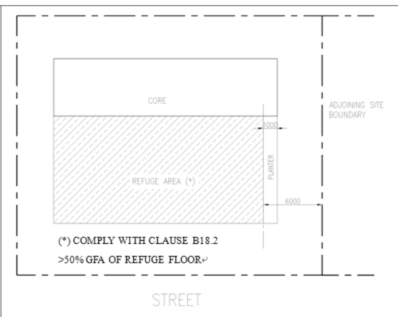{ width="506" loading=lazy }
  <figcaption>Diagram 1 from the original summary (ADF 2/2020, item 13). 原文附圖。</figcaption>
</figure>

**BD's response 屋宇署回覆:** Under Clause B18.2 (e) of FS Code 2011, the area for refuge should be open-sided on at least two opposite sides. Under Clause C17.2 of FS Code 2011, where the side of a refuge floor is required to be open, the open side should not be directly be within a distance of less than 6m from a boundary of another site. The proposed scenario is therefore considered not acceptable because the requirement on 6m separation should be measured from the external wall of a refuge floor.

### 14. Location of Temporary Refuge Spaces {#i2020052914}

Raised by **AAP** · Related 相關: [FS Code 2011 Part B: Means of Escape](../codes/fsc-part-b-means-of-escape.md)

<small>Related discussions 相關討論: [18 Jan 2019 item 1](2019.md#i201901181), [8 Aug 2025 item 22](2025.md#i2025080822), [6 Feb 2026 item 4](2026.md#i202602064)</small>

**Question 問題:** Pursuant to the commentary of Clause B30.1 of FS Code 2011, “no exit or accommodation (except pipe duct, building services room or the like not to be used in case of emergency) should be opened off directly to the temporary refuge space in Examples (c) & (d) of Diagram B6.” Our understanding is that there is no accommodation in the male/female/accessible lavatories and they would not be used in case of emergency. In this regard, “the like” as mentioned above should include the lavatories. Enclose herewith a diagram illustrating the situation and please confirm if our understanding is correct.

<figure markdown>
  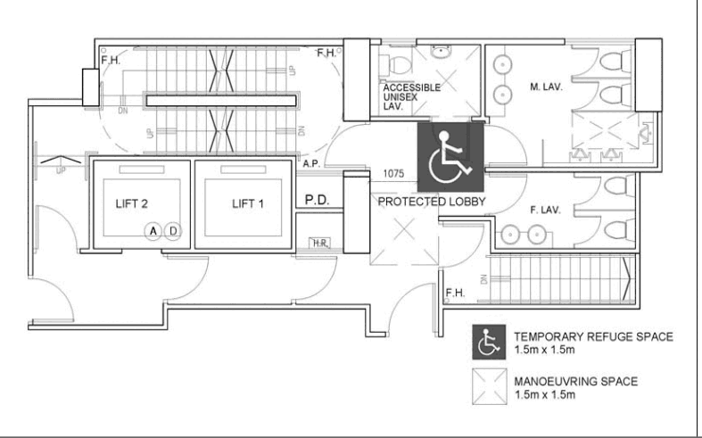{ width="509" loading=lazy }
  <figcaption>Diagram 1 from the original summary (ADF 2/2020, item 14). 原文附圖。</figcaption>
</figure>

**BD's response 屋宇署回覆:** BD advised that exits of lavatories should not be opened off to the temporary refuge space.

### 15. Minimum Requirements of Window – B(P)R 31 {#i2020052915}

Raised by **AAP** · Related 相關: [B(P)R 24–37 Storey heights, open space, ](../regulations/bpr-24-37.md)

**Question 問題:** According to B(P)R 31(3), the “rectangular horizontal plane” means a rectangular plane at the level of the sill of the window having the minimum area and minimum dimension prescribed by paragraph (2). Given that the requirements of rectangular horizontal plane as mentioned under B(P)R 31(2) and B(P)R 31(3) are already complied, is it allowed to have structure below this inclined plan as required under B(P)R 31(1)? Attached diagram refers:

<figure markdown>
  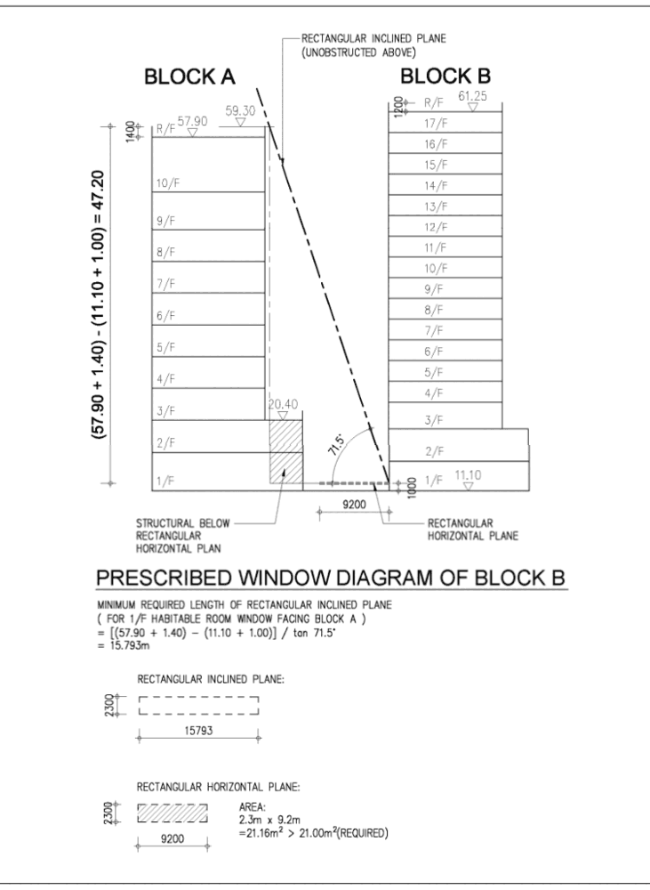{ width="486" loading=lazy }
  <figcaption>Diagram 1 from the original summary (ADF 2/2020, item 15). 原文附圖。</figcaption>
</figure>

<figure markdown>
  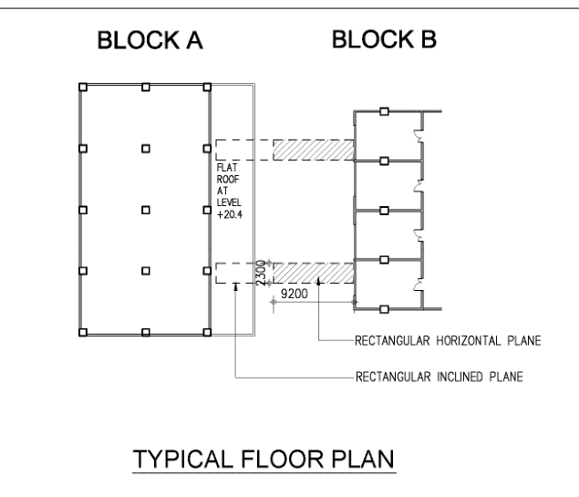{ width="411" loading=lazy }
  <figcaption>Diagram 2 from the original summary (ADF 2/2020, item 15). 原文附圖。</figcaption>
</figure>

**BD's response 屋宇署回覆:** BD advised that the scenario is acceptable provided that the space above the rectangular horizontal plane measuring 2.3m x 9.2m is uncovered and unobstructed and no part of any building protrudes above the inclined plane according to B(P)R 31(1)(b) & (c). 11

### 16. Lighting & Ventilation – B(P)R 30 & 31 {#i2020052916}

Raised by **AAP** · Related 相關: [B(P)R 24–37 Storey heights, open space, ](../regulations/bpr-24-37.md)

!!! warning "Later discussion 其後再討論"
    This question was discussed again on **25 Nov 2022**; use the [later response](2022.md#i2022112511) where they differ. 如有不同，以較新回覆為準。

<small>Follows earlier discussion: [17 Nov 2017](2017.md#i201711172)</small>

**Question 問題:** Following the post-meeting notes for item 2 of ADF 5/2017, is it correct that for french door or sliding door giving access to a balcony and such door faces into a street which is not less than 4.5m wide, the superficial area of opening that could be provided by such door including that portion below 1m A.F.F.L can be counted towards the aggregate openable window area as required under B(P)R 30(2)(a)(ii)?

**BD's response 屋宇署回覆:** AAP raised that there was still misinterpretation on the post-meeting notes for item 2 of ADF 5/2017. In this regard, BD reaffirmed that the deemed-to-be level of window sill as stipulated under B(P)R 31(3)(b) was solely for the purpose of assessing the rectangular horizontal plan as mentioned in B(P)R 31(1)(b). For windows, no matter facing street which is not less than 4.5m wide or facing an RHP, the superficial area of that portion of the glazing and window opening at level below 1m A.F.F.L. might also be counted towards the aggregate glazing area and aggregate openable window area as required under B(P)R 30(2)(a)(i) and (ii) respectively.

### 17. Provision of Sanitary Fitments for Food Room As per Building (Standards of Sanitary Fitments, Plumbing, Drainage {#i2020052917}

Raised by **AAP**

**Question 問題:** Works and Latrines) Regulations 3, “a food room of a restaurant where the number of persons in the restaurant is more than 300” is considered as a “workplace”. For food room serving a restaurant with less than 300 persons, will BD share the same point of view with FEHD in licensing requirement that “provision of independent sanitary fitments for staff is exempted, provided that the fitments are available for share use by customers and staff”? AOB Items

**BD's response 屋宇署回覆:** persons, separate assessment for provision of sanitary fitments for staff was not required.

### 18. Witnessing of Loading Test for Foundation Works {#i2020052918}

Raised by **AAP**

**Question 問題:** (Item raised by HKIE) HKIE reported that trial run of appointing independent HOKLAS laboratory for pile loading test with surprise check by BD to replace current loading test arrangement was successfully held in May 2020. Would BD consider wider application of such arrangement to facilitate the site progress.

**BD's response 屋宇署回覆:** BD advised that a flexible approach would be adopted to deploy sufficient manpower in witnessing loading test for foundation works. Should such arrangement not be made, RSE might propose alternative arrangement for witnessing the test by RSE or his/her representatives for BD’s consideration on case-by-case basis. Audit check might be carried out by BD for such cases.

### 19. GFA Calculation of Lorry Parking {#i2020052919}

Raised by **AAP** · Related 相關: [APP-2](../pnap/app-2.md), [B(P)R 23 & 23A Building height, site are](../regulations/bpr-23-23a.md)

<small>Related discussions 相關討論: [29 Sep 2020 item 15](2020.md#i2020092915), [14 Jan 2022 item 8](2022.md#i202201148), [13 May 2022 item 23](2022.md#i2022051323), [21 Nov 2025 item 17](2025.md#i2025112117)</small>

**Question 問題:** (Item raised by AAP) For non-domestic development (i.e. industrial building, commercial building), lorry parking is required under the Land Lease. When the lorry parking (the nos. is calculated in accordance with Hong Kong Planning Standards and Guidelines acceptable to Planning Department and Transport Department) is provided on ground floor (above ground), are they considered acceptable for GFA exemption?

**BD's response 屋宇署回覆:** BD advised that the principles laid down in PNAP APP-2 would be adopted to decide whether car parking and loading/unloading areas could be disregarded from GFA calculation under B(P)R 23(3)(b).

### 20. JPN No. 5 - Building Height Restriction {#i2020052920}

Raised by **AAP**

<small>Related discussions 相關討論: [22 Nov 2019 item 21](2019.md#i2019112221)</small>

**Question 問題:** (Item raised by AAP) We would like to enquire any updated status regarding item 21 of ADF 5/2019.

**BD's response 屋宇署回覆:** BD advised that the query was conveyed to PlanD for direct clarification.

## ADF 1/2020 · 10 Jan 2020

[Original summary (PDF) 原文](https://www.hkie-st.org/wp-content/uploads/2022/07/83_Summary-of-Items-Discussed-in-APSEC-Discussion-Forum-on-10-January-2020.pdf) · 21 items

### 1. Footbath to Swimming Pool as MOE {#i202001101}

Raised by **HKIA** · Related 相關: [Code of Practice for Fire Safety in Buil](../codes/fire-safety-code-2011.md)

**Question 問題:** Regarding the provision of footbath for giving access to swimming pool as part of the licensing requirements, we would like to enquire if such footbath can form part of the MOE for the swimming pool deck, provided that the level change of such footbath is negotiated with either ramp with gradient not steeper than 1:12 or at least 2 steps with risers not more than 175mm high and treads not less than 225mm wide.

**BD's response 屋宇署回覆:** According to item (j) of the guidance on factors to be considered for complying with the Performance Requirements B1 to B7 of Subsection A8 - MOE under Section 2 of the FS Code (p. 12), the MOE should be of suitable construction to prevent slipping and falling. Hence, footbath giving access to swimming pool should not be accepted as part of the MOE for swimming pool deck. Reference should also be made to BD’s response to item 2 of ADF 2/2015 held on 20 March 2015.

### 2. AC Platform in Steel Construction {#i202001102}

Raised by **HKIA** · Related 相關: [APP-19](../pnap/app-19.md)

**Question 問題:** It appears that paragraph 2(a) and Figure 4 of Appendix C to Code of Practice on Design for Safety – External Maintenance 2019 (the “Design for Safety Code”) regarding the projection and width of AC platform are essentially written/illustrated for AC platform in R.C. construction, except for those portions projecting beyond 750mm. We understand that the design criteria for allowing an AC platform to project up to 900mm disregarding the thickness of protective barrier/guard-rail/screen including its supporting structural members will equally be applicable to AC platform wholly in steel construction. Please confirm that our understanding is correct. …

**BD's response 屋宇署回覆:** The requirements stipulated under Appendix C to the Design for Safety Code were also applicable to AC platform wholly in steel construction. BD also advised that paragraph 3(c) of PNAP APP-19 should cover AC platforms complying with Appendices B and C to the Design for Safety Code, whilst paragraph 3(b) was retained for other AC platforms need not be counted for site coverage and plot ratio, e.g. those in existing project under construction.

### 3. Repairs to Curtain Wall, Glass Wall and Cladding {#i202001103}

Raised by **HKIA** · Related 相關: [APP-171](../pnap/app-171.md)

**Question 問題:** Footnote 1 of BD’s circular letter dated 3 October 2019 states that “For replacement of individual components of the curtain wall and glass wall (e.g. glass panes….etc.)……same as the approved design, structural analysis and design calculations for the replacement components……and the checking on the structural adequacy of the parent structure are not required”. …

**BD's response 屋宇署回覆:** (i) BD advised that pursuant to the circular letter issued on 3 October 2019, submission of structural analysis and design calculations would not be required for replacement of individual components of curtain wall, glass wall or cladding panels same as the approved design, unless there was safety concern warranting a need to review the structural design. (ii) BD advised that the pre-2018 Glass Code requirements could be followed for such replacement works under normal circumstances. 2

### 4. Horizontal Area of Staircases, Lift Shafts and Vertical Ducts {#i202001104}

Raised by **HKIA** · Related 相關: [APP-2](../pnap/app-2.md), [Code of Practice for Fire Safety in Buil](../codes/fire-safety-code-2011.md)

!!! warning "Later discussion 其後再討論"
    This question was discussed again on **29 Sep 2020**; use the [later response](2020.md#i202009297) where they differ. 如有不同，以較新回覆為準。

**Question 問題:** According to paragraph 14 of PNAP APP-2, the horizontal area of staircases, lift shafts and vertical ducts should normally be measured for GFA together with the floor through which they pass, except refuge floors; and where these features solely serve floors accepted as not being accountable for GFA, the area of the features may also be discounted. It follows that where these features serving other GFA accountable floors pass through say, M/E floor (or other floor which is non-accountable for GFA), only the horizontal area of the staircases and lift shafts at the M/E floor are to be accountable for GFA. …

**BD's response 屋宇署回覆:** The associated staircase lobbies and/or lift lobbies at the M/E floor, other than those required under FS Code, may be disregarded from GFA calculation provided that these features solely serve the M/E floor which is accepted as not being accountable for GFA.

### 5. Signature of ELS Plans by RGE {#i202001105}

Raised by **HKIE** · Related 相關: [APP-141](../pnap/app-141.md)

**Question 問題:** As per item 19 of ADF 1/2016 held on 15.1.2016, BD advised that RGE was not required to sign on ELS plans in accordance with the division of responsibilities between AP, RSE and RGE specified in Task 6 under Appendix B to PNAP APP-141 in dealing with “Excavation and Lateral Support” works. Nevertheless, there is still occasion that BD or GEO officers requesting RGE to sign on those ELS plans with significant depth of excavation. We therefore encourage BD to remind frontline officers of BD and GEO on such arrangement.

**BD's response 屋宇署回覆:** BD confirmed that PNAP APP-141 should follow and RGE would not need to sign on ELS plans. BD would remind GEO in their liaison meeting.

### 6. RGE Endorsement on Pre-drilling or Post-installation Drilling {#i202001106}

Raised by **HKIE** · Related 相關: [APP-157](../pnap/app-157.md)

**Question 問題:** Pursuant to the paragraph 7.1 of Code of Practice for Site Supervision 2009 (Supervision Code), only foundation works falling into the following situation are classified as “Building Works with Significant Geotechnical Content”. Foundation works outside this category do not require RGE stream supervision. A number of pre-drilling or post-installation drilling would be carried out at different stages of the foundation works. The quality supervision requirement for such drilling is stated in paragraph 6.28 of Supervision Code which also implies no RGE stream supervision would be required for the foundation works not falling into “Building Works with Significant Geotechnical Content” category. …

<figure markdown>
  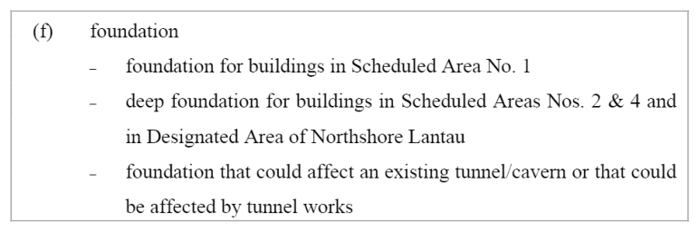{ width="499" loading=lazy }
  <figcaption>Diagram 1 from the original summary (ADF 1/2020, item 6). 原文附圖。</figcaption>
</figure>

<figure markdown>
  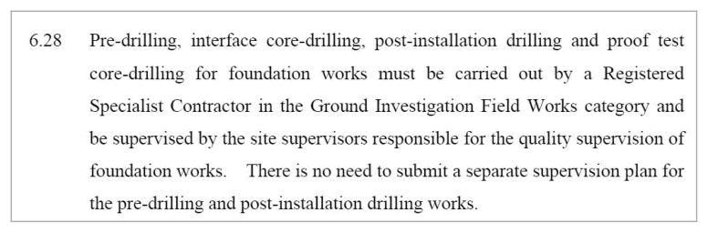{ width="502" loading=lazy }
  <figcaption>Diagram 2 from the original summary (ADF 1/2020, item 6). 原文附圖。</figcaption>
</figure>

<figure markdown>
  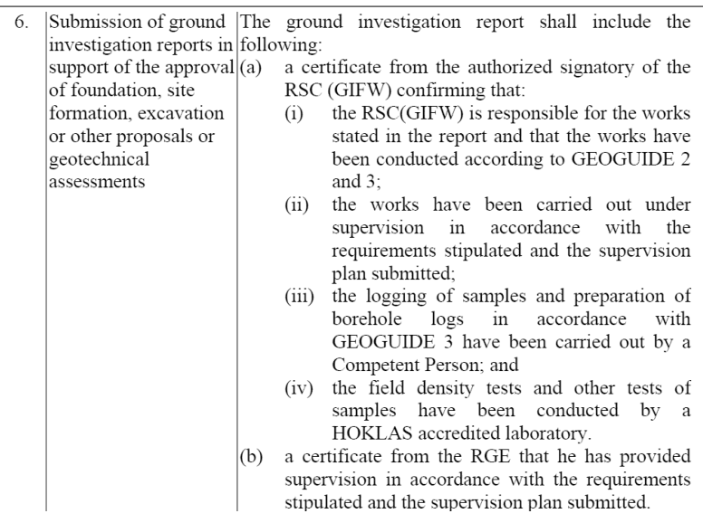{ width="502" loading=lazy }
  <figcaption>Diagram 3 from the original summary (ADF 1/2020, item 6). 原文附圖。</figcaption>
</figure>

**BD's response 屋宇署回覆:** BD confirmed that pre-drilling and post-installation drilling were classified as foundation works. Hence, completion certificate from RGE would not be required. 5

### 7. Split of ELS Plans Submission {#i202001107}

Raised by **HKIE** · Related 相關: [APP-57](../pnap/app-57.md)

**Question 問題:** Pursuant to paragraph 6 of PNAP APP-57, BD allows ELS plans to be submitted in two stages. The Stage 1 submission typically contains wall elements and grouting (if any) with pumping test (if required). Under the current arrangement, the design assumptions on the strut stiffness and pre-loading requirement are stated in the plans submitted for approval but the strutting layout and construction sequence are included into the submission package as “For Information” to demonstrate the feasibility of the entire scheme. Obviously, the accompanied design analyses should tally with the construction sequence and supporting arrangement. …

<figure markdown>
  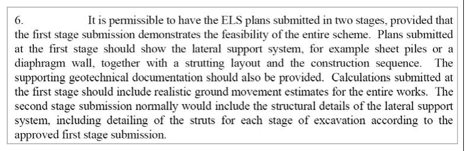{ width="506" loading=lazy }
  <figcaption>Diagram 1 from the original summary (ADF 1/2020, item 7). 原文附圖。</figcaption>
</figure>

**BD's response 屋宇署回覆:** BD confirmed that Stage 1 submission could be a schematic design of ELS system and the structural details of the lateral support system could be included in Stage 2 submission. In this regard, BD would draw GEO’s attention to the details stipulated in PNAP APP-57 in their liaison meeting to avoid ambiguity in the interpretation.

### 8. Requirement of Stipulating FoS on Cone Weight for R Check {#i202001108}

Raised by **HKIE** · Related 相關: [APP-18](../pnap/app-18.md)

!!! warning "Later discussion 其後再討論"
    This question was discussed again on **9 Aug 2024**; use the [later response](2024.md#i2024080913) where they differ. 如有不同，以較新回覆為準。

**Question 問題:** a Clause 5.3.3 (1)(a) of Code of Practice for Foundations 2017 (Foundation Code) stipulated the need in deriving anchorage resistance under unfactored and factored loading conditions. Clause 5.3.3 (1)(b) further provided guidance that the ultimate anchorage resistance is capped by the effective weight of soil mass and rock cone. Some officers might require a factor be applied to reduce the cone weight for unfactored load case (R ) check for which we opine that a FoS on cone a weight is inappropriate and performing a cone weight check under R case a should be unnecessary. …

<figure markdown>
  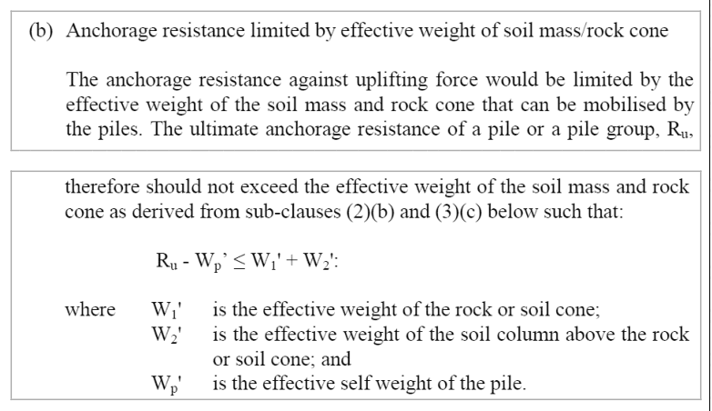{ width="506" loading=lazy }
  <figcaption>Diagram 1 from the original summary (ADF 1/2020, item 8). 原文附圖。</figcaption>
</figure>

**BD's response 屋宇署回覆:** BD confirmed that cone weight need not be checked under R case. a

### 9. Joining Column Main Bars by Welding/Weld Lap Joint According to Clause 8.7.1 of Code of Practice for Structural Use of {#i202001109}

Raised by **HKIE** · Related 相關: [APP-142](../pnap/app-142.md)

<small>Related discussions 相關討論: [25 Nov 2022 item 7](2022.md#i202211257)</small>

**Question 問題:** Concrete 2013 (Concrete Code), welding is allowed for joining the reinforcement bars unless the imposed loading is predominantly cyclical. Whilst the definition of cyclical loads has not been given in the Concrete Code, it is common understanding that such cyclical loads should refer to loads induced by machinery; but not wind other than oscillations due to aerodynamic instability such as flag post. Hence, welding should also be allowed for joining reinforcement bars of the wind frame structure. Would BD please clarify whether the above is correct.

**BD's response 屋宇署回覆:** as “Predominantly Cyclical” load. Hence, welding could be adopted in wind frame members.

### 10. Lengthy Process of Structural Engineering Committee (SEC) Cases {#i2020011010}

Raised by **HKIE**

**Question 問題:** The industry was told that submissions requiring SEC endorsement would be processed within the statutory processing time. Nevertheless, it is noted from recent SEC cases that the processing time after the corresponding SEC meetings has been dragged for a substantial period of time. We would therefore enquire whether BD could review and streamline the process wherever possible.

**BD's response 屋宇署回覆:** BD noted that it normally took time for RSE/RGE to prepare supplementary information in addressing the queries/requirements of the SEC Meeting. To facilitate approval process, BD would review the time frame on confirmation of minutes after the SEC Meeting.

### 11. Audit Check to Precast Concrete Factory {#i2020011011}

Raised by **HKIE** · Related 相關: [APP-143](../pnap/app-143.md)

**Question 問題:** Paragraph 10 of PNAP APP-143 requires the “RSE and the Authorized Signatory of the Registered Contractor should inspect and conduct audit checks to precast concrete factory at least once every month” as one of the quality control measures. While precast elements have been widely applied in local industry, precast construction is no longer complicated as compared with daily reinforced concrete works on sites. In this regard, it is proposed to replace monthly RSE factory inspection with monthly RSE Stream T-5 factory inspection.

**BD's response 屋宇署回覆:** BD advised that RSE have the responsibilities under the Buildings Ordinance (BO) to ensure that the precast concrete works comply with the provisions and standards of the BO and the approved plans. Without prejudice to the statutory duties under the BO, BD would review the requirements of audit by RSE with a view to facilitating audit inspection by RSE.

### 12. Smoke Seal Lobby for Lift Doors at Basement {#i2020011012}

Raised by **AAP** · Related 相關: [FS Code 2011 Part C: Fire Resisting Cons](../codes/fsc-part-c-fire-resisting-construction.md)

!!! warning "Later discussion 其後再討論"
    This question was discussed again on **29 Sep 2020**; use the [later response](2020.md#i202009294) where they differ. 如有不同，以較新回覆為準。

<small>Follows earlier discussion: [23 Aug 2019](2019.md#i201908235)</small>

**Question 問題:** In response to item 5 of ADF 4/2019, we would like to seek BD’s further clarification on the case where the basement and ground storey are two separate fire compartments and a non-fireman lift connects basement with ground floor and the storeys above, given the followings are provided: (i) the lift landing door at basement is provided with an FRR of -/120/-; (ii) a smoke seal lobby is provided at basement; and (iii) the lift shaft at basement is having an FRR of not less than -/240/240. Is the design be considered satisfying Clause C14.1(a) of FS Code 2011?

**BD's response 屋宇署回覆:** BD noted that items (i) and (ii) were in compliance with Clause C9.1(c) and C9.1(d) of FS Code 2011 respectively. For item (iii), BD would further clarify when the lift shaft at basement being non-loadbearing walls, its FRR requirement with respect to item 8 of Table C2 and Clause C9.1(a) of FS Code 2011. [Post-meeting note: For non-loadbearing elements separating the lift shaft and the rest of building in the basement, its FRR requirement should be not less than -/240/240, i.e. stability requirement was not applicable. Relevant requirements are provided in item 8 of Table C2 of FS Code 2011.]

### 13. Height of AC and Screen {#i2020011013}

Raised by **AAP**

**Question 問題:** It is not uncommon that alternative AC system is considered for residential development, e.g. VRV AC system with fewer nos. of VRV AC outdoor unit as compared with conventional split-type AC system. In terms of physical size, the VRV AC outdoor unit is usually taller than split-type AC outdoor unit, i.e. about 1.4m to 1.5m high. As specified in paragraph 2(d) of Appendix C to Code of Practice on Design for Safety – External Maintenance 2019, height of the screen shall be not more than 1.1m for single layer AC outdoor unit while 1.6m for double-stack AC outdoor units. For the case of single layer VRV AC outdoor unit, will BD relax the height of the screen to not more than 1.6m?

**BD's response 屋宇署回覆:** BD advised that whether the height of screen for single layer VRV AC outdoor unit could be relaxed would be considered on case merits. BD would review the issue in the Technical Committee on the Code of Practice on Design for Safety – External Maintenance.

### 14. PNAP APP-23 Clear Width in Covered Walkway {#i2020011014}

Raised by **AAP** · Related 相關: [APP-23](../pnap/app-23.md), [APP-170](../pnap/app-170.md)

<small>Related discussions 相關討論: [6 Feb 2026 item 5](2026.md#i202602065)</small>

**Question 問題:** According to paragraph 9 of PNAP APP-23 and Clause 3.2.2 of Code of Practice for Demolition of Buildings 2004, we understand the width of the covered walkway relates to the width of existing pavement and the minimum clear width of covered walkway on existing pavement over 3m wide is 2m. It is presumed the prescriptive requirements were agreed among government departments. …

**BD's response 屋宇署回覆:** BD noted that this was an individual case where Transport Department required pedestrian flow assessment. BD would liaise with Transport Department and revert in due course.

### 15. Determination of Openable Window Area {#i2020011015}

Raised by **AAP**

!!! warning "Later discussion 其後再討論"
    This question was discussed again on **21 May 2021**; use the [later response](2021.md#i202105213) where they differ. 如有不同，以較新回覆為準。

<small>Follows earlier discussion: [22 Nov 2019](2019.md#i2019112223)</small>

**Question 問題:** Further to item 23 of ADF 5/2019, we would like to further enquire when 600mm clear opening could be provided at the top of sash of the openable window as per the below diagram, its openable window area is to be calculated based on the elevation area of such window: When the openable window sash is near to the structural column as per the below diagram, will BD accept Dimension A for calculation of the openable window area? AOB Items

<figure markdown>
  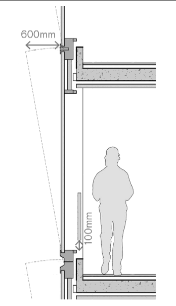{ width="225" loading=lazy }
  <figcaption>Diagram 1 from the original summary (ADF 1/2020, item 15). 原文附圖。</figcaption>
</figure>

<figure markdown>
  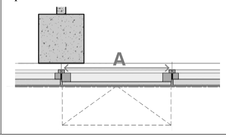{ width="292" loading=lazy }
  <figcaption>Diagram 2 from the original summary (ADF 1/2020, item 15). 原文附圖。</figcaption>
</figure>

**BD's response 屋宇署回覆:** BD advised the 600mm clear opening should be provided at the lowest point of the spandrel and the area obstructed by the protective barrier should be disregarded. BD also confirmed the window opening obstructed by the column should be disregarded. 13

### 16. Supporting Documentations for ELS Plans Submission {#i2020011016}

Raised by **AAP**

**Question 問題:** (Item raised by HKIE) It is noticed that GEO sometimes requested the submission of pipe leakage/burst incidents records within the affected area from the relevant government departments (i.e. WSD, DSD, HyD) for assessing the conditions of the surrounding ground in particular for the existence of ground loss and underground cavity to support the ELS submission or before consent application. The causes of the incidents and remedial actions taken by respective departments should also be included. (HKIE - Attachment 1 refers) HKIE - Attachment 1.pdf Would BD advise whether it is a standard requirement or only applicable for some particular site conditions. …

**BD's response 屋宇署回覆:** BD noted the situation and would liaise with GEO/CEDD on such requirement.

### 17. Self-certification System under Restaurant Licensing Regime {#i2020011017}

Raised by **AAP**

**Question 問題:** (Item raised by BD) BD briefed Members that the self-certification system under restaurant licensing regime has been implemented since December 2019 to streamline the procedures for complying with building safety requirements under the restaurant licensing regime. The system is applicable to submission of revised plans at licence application stage and alteration plans of licensed restaurants having exclusive and direct exit(s) to the ultimate places(s) of safety, except for (a) proposed or licensed restaurant served by fire safety constructions based on fire engineering design or (b) proposed changes to the revised layout plan/alteration plan involving change in the boundaries of the …

**BD's response 屋宇署回覆:** Members welcomed BD’s initiative to streamline the procedures for complying with building safety requirements under the restaurant licensing regime and would encourage practitioners to adopt the self-certification system. [Post-meeting note: The PowerPoint presentation on the self-certification was uploaded to the following website for practitioners’ reference: https://www.gov.hk/tc/theme/bf/pdf/FRNR_BLG_27_Annex4.pdf]

### 18. Access Panels of Typhoon-proof Ceiling {#i2020011018}

Raised by **AAP** · Related 相關: [B(MW)R Building (Minor Works) Regulation](../regulations/bmwr-123n.md)

<small>Follows earlier discussion: [22 Nov 2019](2019.md#i201911228)</small>

**Question 問題:** (Item raised by BD) Further to item 8 of ADF 5/2019 held on 22 November 2019, BD advised that repair to approved typhoon-proof ceiling was considered as building works requiring prior approval and consent. While legislative amendments for new Minor Works items would be proposed for the repair, replacement or removal of cladding at the external wall of a building, BD would explore the feasibility to include repair to typhoon-proof ceiling as Minor Works items.

**BD's response 屋宇署回覆:** Members noted the clarification and enquired whether access to concealed services inside the false ceiling void via access panels with fixed hinges could be exempted provided that the relevant structural design details had been approved. In response, BD advised that while such details were normally not submitted for approval, BD would further consider the issue with a view to facilitating the repair works to the concealed services inside the false ceiling void.

### 19. Repair/Replacement of Protective Barrier under MWCS {#i2020011019}

Raised by **AAP**

<small>Related discussions 相關討論: [22 Nov 2019 item 29](2019.md#i2019112229)</small>

**Question 問題:** (Item raised by BD) Further to item 29 of ADF 5/2019 held on 22 November 2019, BD advised that if the repair/replacement of the glass balustrade fulfilled the criteria of the relevant MW items, the works could be carried out under MWCS.

**BD's response 屋宇署回覆:** Members noted the clarification and would follow the requirement accordingly.

### 20. Central Data Bank (CDB) {#i2020011020}

Raised by **AAP** · Related 相關: [ADM-19](../pnap/adm-19.md)

**Question 問題:** (Item raised by BD) To provide a web-based point of reference to AP, RSE and other parties concerned in the building industry, BD has maintained a CDB which contains historical information on material acceptance in respect of a completed building development. The acceptance is generally based on tests and assessments carried out by the accredited laboratories and assessed and certified by the AP/RSE as meeting the performance standards stipulated in relevant building regulations and codes of practice at the time of submission to BD. …

**BD's response 屋宇署回覆:** Members noted that the purpose of the CDB is intended to help sharing of information to the industry. In response to members’ enquiries, BD would review the process of updating of accepted structural materials, components or construction systems to CDB.

### 21. Approval of Overhead Supporting Structures for Air-conditioning/ Mechanical Ventilation System and Internal Ventilation Ducts {#i2020011021}

Raised by **AAP** · Related 相關: [B(MW)R Building (Minor Works) Regulation](../regulations/bmwr-123n.md)

**Question 問題:** (Item raised by BD) BD advised that legislative amendments for new Minor Works items had been scheduled for the first quarter of 2020 for overhead supporting structures for air-conditioning or mechanical ventilation system plant of more than 150kg in weight inside a building, internal metal ventilation ducts with the smallest cross-sectional dimension greater than 900mm and fire damper of ventilation system. Upon enactment of the new legislation, such works should either be carried out under MWCS or the approval and consent regime. For projects in progress which involved the above works, BD would consider to promulgate further information such as the transitional arrangement.

**BD's response 屋宇署回覆:** Members noted the proposed legislative amendments and expressed that the implementation details of future submission should be provided to facilitate compliance with the new requirements.

---
<small>Source: Summary of Items Discussed in APSEC Discussion Forum, published by the HKIE Structural Division. Condensed for reference; the PDF is the authoritative record.</small>
