---
tags:
  - APSEC
  - Structural 結構
  - Plan submission & approval 呈交及審批
  - GFA 總樓面面積
  - Staircase 樓梯
  - Registration 註冊
  - Foundation 地基
  - Concrete & materials 混凝土及物料
  - Fire safety 消防安全
  - Domestic 住用
  - Lighting & ventilation 照明及通風
  - Lift 升降機
  - GFA concession 樓面面積寬免
  - Curtain wall & façade 幕牆及外牆
  - A&A works 改動及加建工程
  - Barrier free access 無障礙
  - Site supervision 地盤監督
  - Green & amenity features 環保及適意設施
  - Car park 停車場
  - Site safety 地盤安全
  - Plant rooms 機房
  - Maintenance access 維修通道
  - Site coverage 上蓋面積
  - Excavation & ELS 挖掘
  - Means of escape 逃生途徑
  - Geotechnical 岩土
  - Sustainable building design 可持續建築設計
  - Plumbing & sanitary 衞生設備
  - Means of access 救援通道
  - Drainage 排水
  - Wind 風力
  - Site area & classification 地盤面積及分類
  - Refuse 垃圾
  - Fire resisting construction 耐火結構
  - Demolition 拆卸
  - Open space 休憩用地
  - Occupation permit 佔用許可證
  - Balcony & utility platform 露台及工作平台
  - Refuge floor 庇護層
  - Minor works 小型工程
  - Building height 建築物高度
  - Industrial building 工業大廈
  - Protective barrier 防護欄障
  - Plot ratio 地積比率
---

# APSEC discussion items 2022 <small>2022 年認可人士及註冊結構工程師委員會討論項目</small>

!!! info "About this page 關於本頁"
    Questions raised at the APSEC Discussion Forum (ADF) and **BD's responses**, extracted from the summaries published by the HKIE Structural Division. Text is condensed from the English source; check the PDF before relying on an item. Where a later meeting discussed the same question, the item is flagged and **the later response prevails**.
    摘錄自香港工程師學會結構分部發布的會議摘要（只有英文版本）。如其後會議再討論同一問題，以**較新的回覆為準**。

## ADF 5/2022 · 25 Nov 2022 {#adf-52022-25-nov-2022}

[Original summary (PDF) 原文](https://www.hkie-st.org/wp-content/uploads/2025/02/Summary-of-items-discussed-in-5_2022-ADF-on-25.11.2022.pdf) · 19 items

### 1. Submissions of Secondary Building Elements – Metal Ceiling {#i202211251}

Raised by **HKIA** · Related 相關: [ADV-33](../pnap/adv-33.md)

!!! warning "Later discussion 其後再討論"
    This question was discussed again on **17 Nov 2023**; use the [later response](2023.md#i202311177) where they differ. 如有不同，以較新回覆為準。

<small>Related discussions 相關討論: [22 Jan 2021 item 14](2021.md#i2021012214), [12 Nov 2021 item 24](2021.md#i2021111224)</small>

**Question 問題:** The requirements for submission of secondary building elements have been clearly stated in PNAP ADV-33 with checklist and sample drawings. Under normal practice, some secondary building elements, such as metal ceiling will not be shown in general building plans (GBP) and it is our understanding that key plan(s) based on GBP showing the locations of the secondary building elements in the structural plans shall be sufficient for BD’s processing of the structural submission. Would BD please advise if our understanding is correct?

**BD's response 屋宇署回覆:** BD advised that HKIA’s understanding was correct, provided that the secondary building elements had been indicated in the general notes and/or with typical details in the GBP.

### 2. Supporting Frame for Suspended Air-conditioning (AC) Plant / Mechanical Ventilation Plant – PNAP ADM-19 {#i202211252}

Raised by **HKIA** · Related 相關: [ADM-19](../pnap/adm-19.md)

**Question 問題:** The requirement to include proposed minor building works involving the erection of supporting frame for suspended AC plant / mechanical ventilation plant in plans for approval applies to development projects with consent to the commencement of superstructure works granted after 31 August 2021, as stated in paragraph 35 of PNAP ADM-19. For large development site it is very common to have more than one superstructure consents due to phased piling and superstructure plan submissions. …

**BD's response 屋宇署回覆:** BD advised that HKIA’s understanding was correct, unless the later phases were in separate sites.

### 3. External Architectural Features for Screening of External Pipes in Single Family Houses {#i202211253}

Raised by **HKIA** · Related 相關: [APP-93](../pnap/app-93.md)

**Question 問題:** Further to the discussion of the captioned in item 6 of ADF 5/2015 held on 13 November 2015 regarding the effective arrangement for visual inspection for external drainage pipes enclosed by architectural features, and according to requirement in paragraph 7 of PNAP APP-93, it is our understanding that CCTV is not the only means for visual inspection for external drainage pipes enclosed by architectural features while provision of demountable panels on the external architectural features can also be accepted for inspection provided that the access to these demountable panels is demonstrated in the maintenance and repair (M&R) plan. Would BD please advise if our understanding is correct?

**BD's response 屋宇署回覆:** BD advised that as per paragraph 7 of PNAP APP-93, “ the AP should provide an effective arrangement for visual inspection of the pipes including pipe connexions, fixing of pipes, etc. to enable the detection or inspection of any defect, leakage or insanitary condition of the pipes in a convenient and safe manner, where necessary”. While Appendix B to PNAP APP-93 elaborated that the architectural features and enclosed space should comply with the design and construction requirements in its Annex 1 to facilitate the use of CCTV imaging device for inspection of the drainage pipes, the use of CCTV imaging device was only an example of effective arrangement for inspection of external drainage pipes enclosed by architectural features. In general, the provision of demountable panels on external architectural features alone without an effective arrangement for visual inspection of the external drainage pipes enclosed was not acceptable. AP should demonstrate how the visual inspection could be effectively arranged and carried out without the aids of specific tools or personnel, taking into account the design and construction of the architectural features as well as the M&R access.

### 4. Measurement of Gross Floor Area (GFA) and Site Coverage (SC) of Curtain Walls – PNAP APP-2 {#i202211254}

Raised by **HKIA** · Related 相關: [APP-2](../pnap/app-2.md), [APP-171](../pnap/app-171.md), [B(C)R Building (Construction) Regulation](../regulations/bcr-123q.md)

**Question 問題:** According to paragraph 6 of PNAP APP-2, where a curtain wall system forms the external face of a building, the Building Authority is prepared to accept the outer surface of the structural elements as the external wall for the purpose of measuring GFA and SC where the projection of the system from the outer surface of the structural elements does not exceed 200 mm for a domestic building and 250 mm for a non-domestic building. …

<figure markdown>
  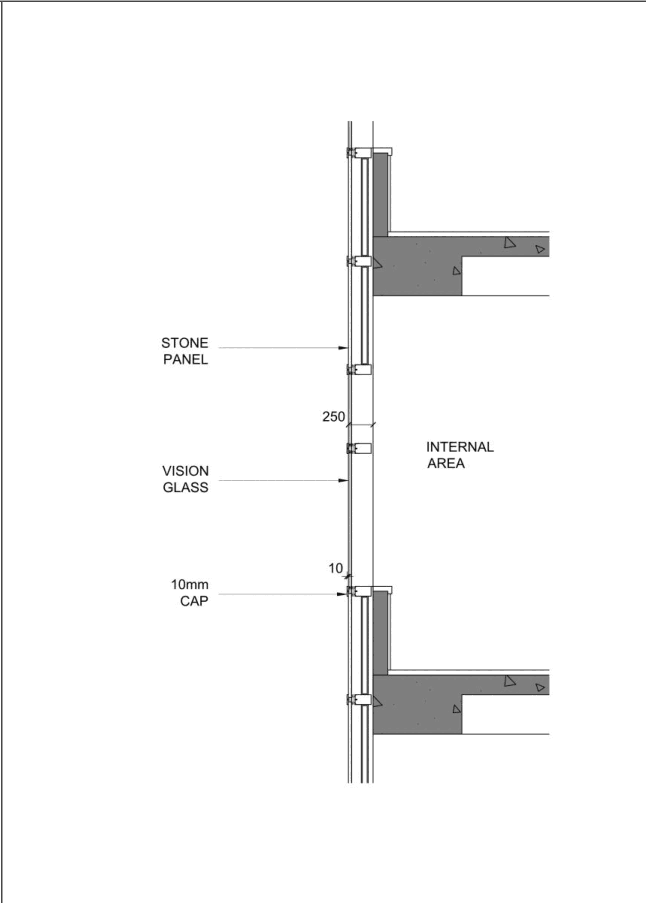{ width="417" loading=lazy }
  <figcaption>Diagram 1 from the original summary (ADF 5/2022, item 4). 原文附圖。</figcaption>
</figure>

**BD's response 屋宇署回覆:** BD advised that the HKIA’s understanding on both i) and ii) were correct. For i), BD would consider the extent of the projection of the curtain wall as up to the external face of the glass panel instead of the 10 mm thick capping provided that it complied with Clause 7.1.1 of the Glass Code. For ii), stone or aluminum panels, forming part of the curtain wall as stipulated in section 26 of the Building (Construction) Regulation, could be excluded from GFA calculations in accordance with paragraphs 6 to 10 of PNAP APP-2.

### 5. Lift Shaft and Staircase GFA passing through Floors with Non-accountable GFA {#i202211255}

Raised by **HKIA** · Related 相關: [APP-2](../pnap/app-2.md), [JPN 4](../pnap/jpn-4.md)

**Question 問題:** It is stated in item 3 of Group I in JPN No. 4 that “horizontal areas of staircases, lift shafts and vertical ducts solely serving floors accepted as not being GFA accountable” are generally exempted from GFA calculation by all the three departments regardless of any GFA exemption provision under the respective lease. It is our understanding that the horizontal area of staircases, lift shafts and vertical ducts should normally be measured for GFA together with the floor through which they pass (e.g. E&M floors sandwiched between GFA accountable floors). …

<figure markdown>
  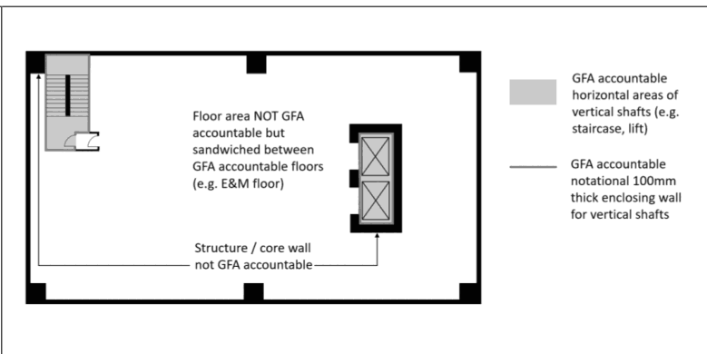{ width="504" loading=lazy }
  <figcaption>Diagram 1 from the original summary (ADF 5/2022, item 5). 原文附圖。</figcaption>
</figure>

**BD's response 屋宇署回覆:** For the scenario illustrated by HKIA, BD clarified that apart from the horizontal areas of staircases, lift shafts and vertical ducts, the entire thickness of their enclosing walls should be fully accounted for the purpose of GFA calculation. BD supplemented that paragraph 12 of PNAP APP-2 referred to the disregarding of GFA of the enclosing walls for plant rooms and other features that were to be disregarded from GFA calculation, was irrelevant to the said scenario.

### 6. Quality Supervision – PNAP APP-158 {#i202211256}

Raised by **HKIE** · Related 相關: [APP-158](../pnap/app-158.md), [APP-157](../pnap/app-157.md)

**Question 問題:** Appendix A to PNAP APP-158 lists the items of works at various stages of Superstructure/Excavation and Lateral Support/Site Formation Works for required for Quality Supervision. The list covers almost every item of site activities during construction period. With the provision of Code of Practice for Site Supervision 2009 (Site Supervision Code) and Technical Memorandum for Supervision Plans 2009, it is not possible for technically competent persons (TCPs) under AP/RSE/RGE Streams to conduct inspection for every single item of works listed in the said PNAP during their daily or part-time routine inspection. …

**BD's response 屋宇署回覆:** BD advised that in accordance with the Site Supervision Code, PNAP APP-158 provided guidelines for AP/RSE/RGE/Authorized Signatory of Registered Contractor (RC) to devise checklists by reference to the typical items, and to include any other particular items or critical elements considered essential for the project, including those for quality supervision and any other conditions imposed at approval and/or consent stages, for compliance by TCPs. AP/RSE/RGE should determine appropriate frequencies of periodic inspections to suit the needs of individual project. BD also advised that Appendix B to the said PNAP provided a sample of record of quality supervision and inspection carried out by the respective TCPs based on the specific tasks performed given in Appendix VI of the Site Supervision Code. Such inspection records should be properly kept on site and made available for inspection by BD officers.

### 7. Flat Slab Design according to the Code of Practice for Structural Use {#i202211257}

Raised by **HKIE** · Related 相關: [APP-142](../pnap/app-142.md)

!!! warning "Later discussion 其後再討論"
    This question was discussed again on **6 Feb 2026**; use the [later response](2026.md#i2026020611) where they differ. 如有不同，以較新回覆為準。

<small>Related discussions 相關討論: [10 Jan 2020 item 9](2020.md#i202001109), [13 Aug 2021 item 12](2021.md#i2021081312), [9 Aug 2024 item 18](2024.md#i2024080918), [9 May 2025 item 9](2025.md#i202505099)</small>

**Question 問題:** of Concrete 2013 (2020 Edition) (Concrete Code) According to Clause 6.1.5.1(a) of the Concrete Code, design provisions on flat slab design are given with the following limitations:- (i) generally rectangular arrangement of columns using the equivalent frame method; and (ii) ratio of the longer to the shorter spans does not exceed 2. Designer is reminded the applicability of the design provisions in Section 6.1.5. The said Clause of the Concrete Code also advised the acceptance of flat slab design based on a finite element analysis (FEA). …

**BD's response 屋宇署回覆:** BD advised that HKIE’s understanding that the FEA of flat slab was considered as “a more rigorous treatment” such that Clause 6.1.5.2(c) to (j) of the Concrete Code were not applicable to flat slab design with FEA was correct. BD also advised that the Concrete Code did not specify that Clauses 6.1.5.3 (a), 6.1.5.6(b) and 6.1.5.6(c) were not applicable to flat slab design with FEA, as there might be certain limitations in the FEA due to the assumptions and set-up in its modelling. The issue would be deliberated in the Technical Committee on the Concrete Code.

### 8. GFA Measurement for Horizontal Area of Staircases {#i202211258}

Raised by **AAP** · Related 相關: [JPN 4](../pnap/jpn-4.md)

<small>Follows earlier discussion: [22 Jan 2021](2021.md#i202101228)</small>

**Question 問題:** In accordance with JPN No. 4, the following items are generally exempted BD advised that the horizontal area from GFA calculation by all the three departments regardless of any GFA exemption provision under the respective lease: 1. Group I Item 4, open flat roofs 2. Group I Item 8, rooftop staircase hoods of residential developments (size being not excessive and that no other building facilities, features and structures at roof are accountable for GFA) 3. …

<figure markdown>
  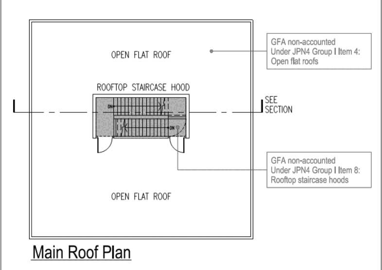{ width="508" loading=lazy }
  <figcaption>Diagram 1 from the original summary (ADF 5/2022, item 8). 原文附圖。</figcaption>
</figure>

<figure markdown>
  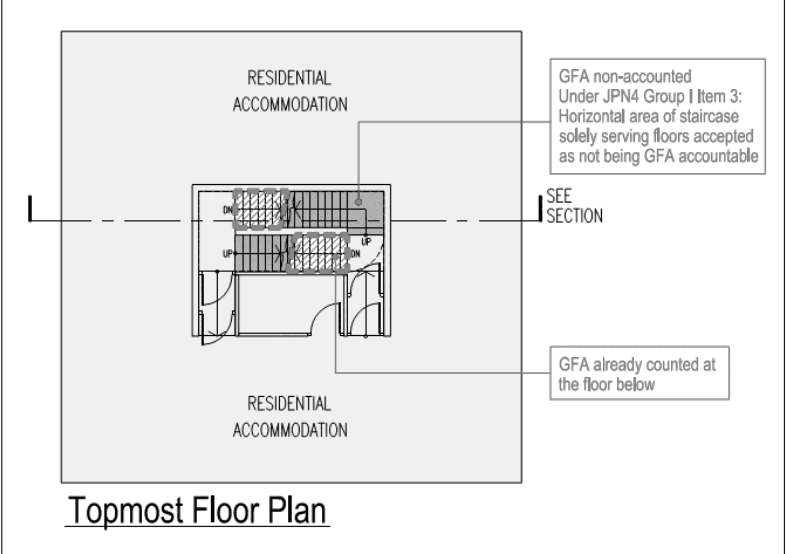{ width="508" loading=lazy }
  <figcaption>Diagram 2 from the original summary (ADF 5/2022, item 8). 原文附圖。</figcaption>
</figure>

<figure markdown>
  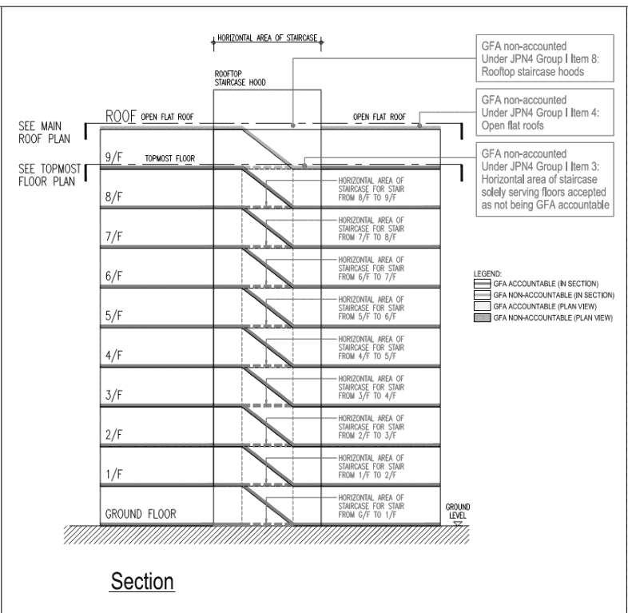{ width="508" loading=lazy }
  <figcaption>Diagram 3 from the original summary (ADF 5/2022, item 8). 原文附圖。</figcaption>
</figure>

**BD's response 屋宇署回覆:** of staircase to be exempted from GFA calculation should refer to its horizontal area on that particular floor which was exempted from GFA calculation. Item 2 of ADF 4/2012 held on 3 August 2012 and item 7 of ADF 4/2014 held on 8 August 2014 also clarified that area of the staircase would be measured at each floor level for the purpose of GFA calculation. In the illustrated scenario, the topmost floor was GFA accountable and therefore the horizontal area of the staircase connecting to the roof at the topmost floor level should be included in GFA calculation. This had long been the practice adopted by BD on measurement of GFA for staircase. BD also advised that the space underneath the staircase connecting to the roof as highlighted in blue dotted line in the Section illustrated, should be GFA accountable as per item 8 of ADF 1/2021 held on 22 January 2021 regarding GFA calculation of space below open staircase to roof.

### 9. Site Coverage of Greenery – PNAP APP-152 According to paragraph 2 of Appendix D to PNAP APP-152, a 50% {#i202211259}

Raised by **AAP** · Related 相關: [APP-152](../pnap/app-152.md)

<small>Related discussions 相關討論: [18 Mar 2022 item 4](2022.md#i202203184), [23 Feb 2024 item 6](2024.md#i202402236)</small>

**Question 問題:** reduction factor in computing the greenery areas should be applied for “water features” in calculating the Site Coverage of Greenery. In some cases of town planning application, the Agriculture, Fisheries and Conservation Department (AFCD) may require to provide a “water feature with natural habitat” for conservation / compensation of existing natural pond in the approval conditions. Such re-provision of “natural habitat” may include types of aquatic plants (e.g. water-lily) for a balanced aquatic ecosystem. Would BD consider these aquatic planting provisions in water features to be counted as greenery areas, without imposing the 50% reduction factor in computing the greenery areas?

**BD's response 屋宇署回覆:** water features which was subject to the 50% reduction factor in calculating the Site Coverage of Greenery under PNAP APP-152.

### 10. Set Back Approach – PNAP APP-132 {#i2022112510}

Raised by **AAP** · Related 相關: [APP-132](../pnap/app-132.md)

!!! warning "Later discussion 其後再討論"
    This question was discussed again on **10 Feb 2023**; use the [later response](2023.md#i2023021012) where they differ. 如有不同，以較新回覆為準。

**Question 問題:** For the 18% setback area at domestic portion, it is our understanding that this setback area at the lowest domestic floor can be served as private flat roof (refer to sketch below), provided that the requirements set out under paragraph 3 of PNAP APP-132 are complied with. Please advise if this understanding is correct.

<figure markdown>
  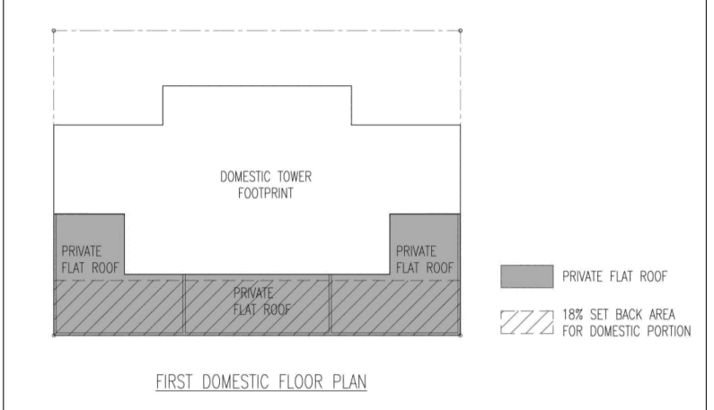{ width="515" loading=lazy }
  <figcaption>Diagram 1 from the original summary (ADF 5/2022, item 10). 原文附圖。</figcaption>
</figure>

**BD's response 屋宇署回覆:** BD advised that paragraph 3(c) of PNAP APP-132 required the assurance of satisfactory arrangements for the control and maintenance of the setback area and any resultant flat roofs and covered areas. In view that effective control and maintenance would not be available for private flat roofs generally, the setback area under PNAP APP-132 could not include such areas.

### 11. Lighting and Ventilation – Regulation 30 & 31 of the Building (Planning) Regulations (B(P)R) {#i2022112511}

Raised by **AAP** · Related 相關: [APP-130](../pnap/app-130.md)

<small>Follows earlier discussion: [29 May 2020](2020.md#i2020052916)</small>

**Question 問題:** Following the previous discussion in item 16 of ADF 2/2020 held on 29 May 2020, it is understood that: a) the superficial area of the glazing and window opening at level below 1 m above finished floor level (A.F.F.L.) (window sill level of the rectangular horizontal plane) can be counted towards the aggregate glazing area and aggregate openable window area as required under regulation 30(2)(a)(i) and (ii) of the B(P)R respectively. …

<figure markdown>
  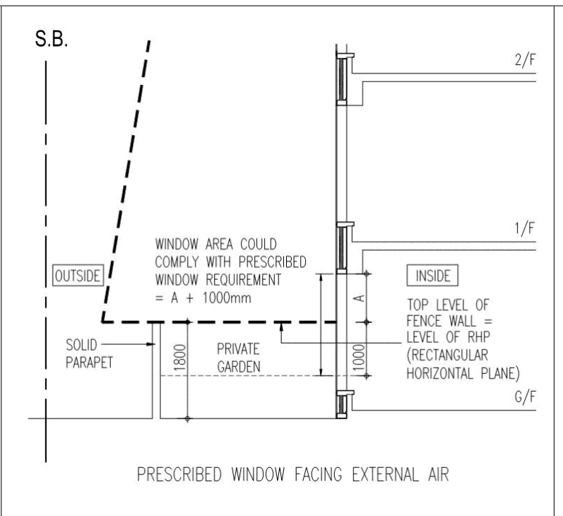{ width="515" loading=lazy }
  <figcaption>Diagram 1 from the original summary (ADF 5/2022, item 11). 原文附圖。</figcaption>
</figure>

**BD's response 屋宇署回覆:** BD advised that for prescribed window facing into a space uncovered and unobstructed above the area delineated by the rectangular horizontal plane, the sill of the window should be deemed to be at a level of 1 m A.F.F.L. Alternatively, the use of performance-based approach promulgated in PNAP APP-130 was also acceptable. The sketch showing that the window sill level at 1.8 m A.F.F.L. for the purpose of delineating the rectangular horizontal plane was not acceptable. Item 16 of ADF 2/2020 held on 29 May 2020 related to window facing into a balcony, and Item 4 of ADF 2/2015 held on 20 March 2015 related to window facing a street of not less than 4.5 m wide, were not sketch.

### 12. Measures to Deter Misuse of Industrial Buildings for Residential Use – PNAP APP-159 {#i2022112512}

Raised by **AAP** · Related 相關: [APP-159](../pnap/app-159.md)

**Question 問題:** Paragraph 2(d) of PNAP APP-159 states that “for an industrial building with BD advised that AAP’s understanding small workshop units and provided with curtain walls, the outer face of the curtain walls will be taken as the external wall of the building for the purpose of measuring GFA and site coverage”. We understand that the above provision also applies to precast units, to deter misuse, even though they are not explicitly mentioned in the above PNAP.

**BD's response 屋宇署回覆:** was correct.

### 13. Proposed Adoption of Soil Nail Design for Underground Supports {#i2022112513}

Raised by **ACEHK**

**Question 問題:** Flexible barriers are designed to resist impact from the landslide debris or boulder fall. An isometric view of the above ground arrangement is shown as follows:- There is no serviceability concern for the flexible barriers as they are designed to endure large deformation under impact and expected to be sacrificial. Also, the supports of the barriers will only be subjected to high stress during the impact and for most of its service life they will be subjected to minimal self-weight and transient wind load, which is different from the pile foundation for building structures with sustained loads. …

<figure markdown>
  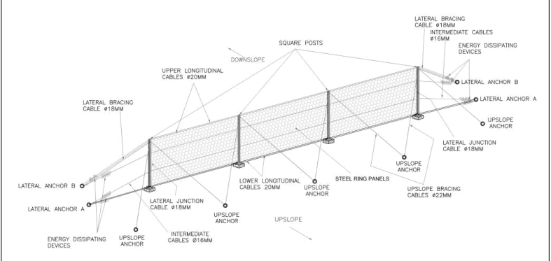{ width="509" loading=lazy }
  <figcaption>Diagram 1 from the original summary (ADF 5/2022, item 13). 原文附圖。</figcaption>
</figure>

**BD's response 屋宇署回覆:** BD noted the design of flexible barriers adopted in public works and advised that discussion with the GEO would be arranged for clarifications of the assumptions and design parameters of the flexible barriers. BD also reminded that public works on government land were exempted from the provisions of the Buildings Ordinance.

### 14. Application of Steel Reinforced Concrete (SRC) in Composite Beam Design {#i2022112514}

Raised by **ACEHK** · Related 相關: [APP-168](../pnap/app-168.md)

**Question 問題:** Figure 10.1 of Code of Practice for the Structural Use of Steel 2011 (2021 Edition) (Steel Code) illustrates the typical section of composite beam arrangement of concrete slab and steel I-beam as follows: We would like to enquire if SRC can be applied to composite beam design given this form has already been commonly applied to composite columns.

<figure markdown>
  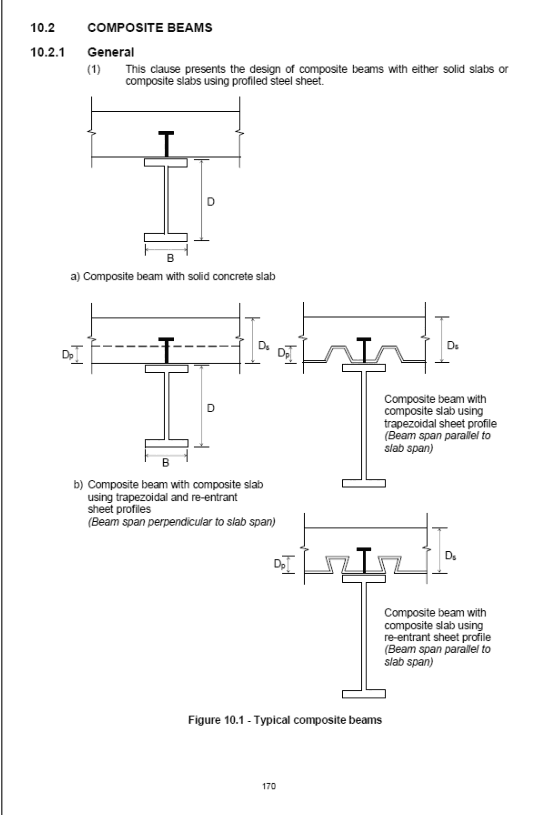{ width="352" loading=lazy }
  <figcaption>Diagram 1 from the original summary (ADF 5/2022, item 14). 原文附圖。</figcaption>
</figure>

**BD's response 屋宇署回覆:** BD advised that Figure 10.1 of the Steel Code only illustrated the sections of typical composite beams, and BS EN 1994-1-1:2004 stipulated under Section A2.3 of Annex A of the Steel Code provided the requirements of acceptable composite beam design. For unconventional composite beam design not provided in the said standard, the proposed design would be considered on case-by-case basis and might be submitted to the Structural Engineering Committee for deliberation if necessary.

### 15. Erection of Internal Staircase and Stairhood between Top Floor and Roof in Domestic and Non-Domestic Buildings {#i2022112515}

Raised by **PBSCA**

**Question 問題:** For the existing domestic and non-domestic buildings, it is common to erect an internal staircase between the main roof and the top floor underneath, with stairhood as shelter on top of the staircase. Regarding the erection of such staircase and stairhood, it is our understanding that: (a) the stairhood portion shall not be GFA accountable, provided that the stairhood is of reasonable size and there is no GFA accountable accommodations on the roof; and (b) provision of accessible lift to the roof is not required after the erection of staircase. Please confirm if our understanding is correct.

**BD's response 屋宇署回覆:** BD advised that PBSCA’s understanding was correct. For (a), the stairhood of reasonable size might not be accountable for GFA if there was no area accountable for GFA nor provision of commercial activities/uses on the roof. For (b), the provision of accessible lift to the roof, would depend on the use of the roof, which was irrelevant to the erection of such internal staircase.

### 16. Acknowledgment of Form BA14 {#i2022112516}

Raised by **PBSCA** · Related 相關: [APP-13](../pnap/app-13.md)

<small>Follows earlier discussion: [12 Nov 2021](2021.md#i2021111219)</small>

**Question 問題:** Members commented that Form BA 14 acknowledgement is long outstanding from BD, and appreciated if the issue can be improved accordingly.

**BD's response 屋宇署回覆:** BD advised that as discussed in item 19 of ADF 5/2021 held on 12 November 2021, BD had been monitoring regularly and reminding staff on processing submissions of Form BA14 in a timely manner. Designated teams had been set up to clear the long outstanding Form BA14. BD would continue to monitor the situation. As most of the outstanding acknowledgements involved incomplete information/documents submitted by AP/RSE/RC, BD reminded again that AP/RSE should submit full set of required documentations to facilitate the processing of Form BA14. In response to PBSCA’s suggestion on the submission of site photo and/or video records to facilitate the processing of Form BA14, BD advised that such practice had been adopted for accepting the rectification works of defects/irregularities found at the site inspection. The acceptance of such records would depend on the nature and scale of the defects/irregularities. BD also mentioned that new streamlining measures were being explored, which include the fast track acceptance of simple alteration and addition works, repair/replacement works of curtain wall, window wall and cladding, as well as erection/alteration of certain signboards in existing buildings. The proposal had been deliberated at the Joint BSC & APSEC Meetings and the revised PNAP APP-13 was being finalised for issuance.

### 17. Approval of Plans in the First Submission {#i2022112517}

Raised by **PBSCA** · Related 相關: [ADM-19](../pnap/adm-19.md)

**Question 問題:** Members commented that it is difficult to get approval of plans in the first submission. To our understanding, the approval should focus on the fundamental issues referred in PNAP ADM-19. We appreciate if BD can brief their frontline officers for such practice. AOB Items

**BD's response 屋宇署回覆:** According to PNAP ADM-19, BD adopted curtailed check system when processing GBP, superstructure plans and drainage plans, under which only the fundamental issues would be checked. Non-fundamental issues would not be checked or raised as disapproval items. It was the responsibility of the AP/RSE/RGE to ensure that all such non-fundamental issues fully complied with the relevant regulations and codes of practice before the commencement of works. After the commencement of works, any contravention of the BO and its subsidiary regulations should be rectified as and when they were discovered and in any event, before certification of completion of works.

### 18. Exit Route within Residential Flat with Open Kitchen {#i2022112518}

Raised by **PBSCA**

<small>Related discussions 相關討論: [23 Feb 2024 item 18](2024.md#i2024022318)</small>

**Question 問題:** (Item raised by BD) For a domestic flat provided with an open kitchen, the notional area of the open kitchen should be defined on the GBP. A minimum working space of 850 mm in front of the cooking bench should be provided to form part of the notional kitchen area; and the exit route within the flat should not pass through the notional kitchen area.

**BD's response 屋宇署回覆:** Members noted and would follow the arrangement accordingly. BD clarified that the requirement would generally apply to development projects with consent to the commencement of foundation works granted after the date of this ADF. Meanwhile, BD reminded that it was AP’s responsibility to ensure adequate means of escape in case of fire were provided in residential flats with open kitchen, and AP should duly review the layout of these flats in developments which were under construction.

### 19. Headroom for Communal Sky Gardens and Podium Gardens {#i2022112519}

Raised by **PBSCA**

**Question 問題:** (Item raised by BD) According to JPN Nos. 1 and 2, sky gardens and podium gardens for residential and non-residential buildings should have a clear height of not less than 4.5 m. A previous study of air ventilation assessment (AVA) on the ventilation performance of sky gardens and podium gardens revealed that the greater the headroom of the gardens, the better the ventilation effect. However, the additional positive effect tends to diminish when the clear height reaches 6 m. …

**BD's response 屋宇署回覆:** Members noted and would follow the arrangement accordingly.

## ADF 4/2022 · 12 Aug 2022 {#adf-42022-12-aug-2022}

[Original summary (PDF) 原文](https://www.hkie-st.org/wp-content/uploads/2025/02/Summary-of-items-discussed-in-4_2022-ADF-on-12.8.2022-rev.pdf) · 26 items

### 1. Maintenance and Repair (M&R) Access to Air-conditioner (AC) Platform from M&E Plant Room {#i202208121}

Raised by **HKIA**

**Question 問題:** It is our understanding that the provision of M&R access to AC platform from the window of M&E plant room in common area is acceptable to BD provided that the access route within the plant room is a genuine maintenance and/or circulation space of reasonable width. Would BD please advise if our understanding is correct?

**BD's response 屋宇署回覆:** BD advised that shared use of circulation space / working space within a plant room as the M&R access to A/C platform might be acceptable provided that (i) the size of the window fulfilled the requirements given in paragraph 2.2.1 of Part 3 of the Code of Practice on Access for External Maintenance 2021 (AfEM Code); (ii) circulation space was of adequate width for the workers to deliver the equipment/machines and materials to the A/C platform; and (iii) other requirements for M&R of AC platform, such as access to the outer surface of A/C platform in accordance with paragraph 3.1.3 of Part 2 of the AfEM Code, were complied with.

### 2. Liquefied Petroleum Gas (LPG) Room / Cabinet {#i202208122}

Raised by **HKIA** · Related 相關: [Code of Practice for Fire Safety in Buil](../codes/fire-safety-code-2011.md)

**Question 問題:** Further to the following items discussed at the APSEC Discussion Forum (ADF) regarding the definition of “special hazard” in Section 3 of Part A of the Code of Practice for Fire Safety in Buildings 2011 (FS Code),  item 3 of ADF 5/2013 held on 18 October 2013;  item 1 of ADF 2/2014 held on 14 March 2014;  item 1(d) of ADF 4/2014 dated 8 August 2014;  item 1 of ADF 3/2015 held on 29 May 2015; and  item 14 of ADF 3/2016 held on 27 May 2016, it is our understanding that LPG room / cabinet with riser pipes and pressure regulator is not considered as an area of special hazard under the FS Code. Would BD please advise if our understanding is correct?

**BD's response 屋宇署回覆:** In the FS Code, ““Special hazard” means a hazard that requires special consideration given the occupant awareness, knowledge of building, fire services systems installed, physical construction and location and width of exits, relative to the ignition risk, spread of fire, generation of smoke, heat or toxic gases that may endanger the life and safety of the occupants.” BD advised that the fire risk of a room should be dependent on the chances of catching fire and the fire load therein. Areas of special hazard had a relatively higher fire risk with regard to ignition. LPG room / cabinet with riser pipes and pressure regulator should be regarded as an area of special hazard under the FS Code.

### 3. Height of Storeys {#i202208123}

Raised by **HKIA** · Related 相關: [APP-5](../pnap/app-5.md), [B(P)R 23 & 23A Building height, site are](../regulations/bpr-23-23a.md)

**Question 問題:** According to paragraph 5 of PNAP APP-5, for the purpose of regulation 23(3)(a) of the Building (Planning) Regulations (B(P)R), the maximum acceptable storey height of a domestic flat at the topmost floor is 4 m. We would like to seek BD’s advice if the storey height of the common area outside the residential flat exceeding 4 m is acceptable for technical reasons to cater for waterproofing construction and 150 mm level differences between indoor at outdoor at main roof level.

<figure markdown>
  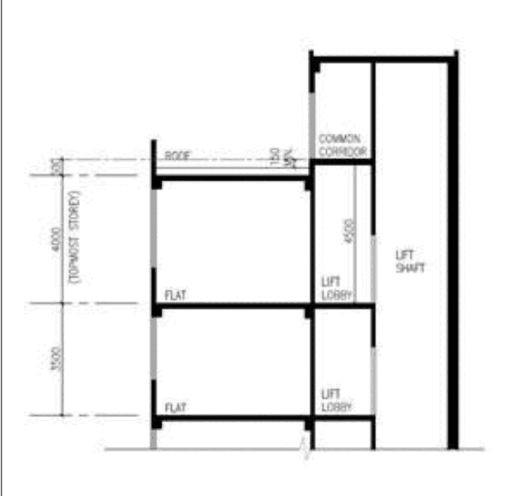{ width="421" loading=lazy }
  <figcaption>Diagram 1 from the original summary (ADF 4/2022, item 3). 原文附圖。</figcaption>
</figure>

**BD's response 屋宇署回覆:** BD advised that provided that the storey height of the flat at topmost floor did not exceed 4 m as well as the common area outside was of genuine design and its abuse was unlikely, the BA would favourably consider accepting the common corridor with high storey height on a case-by-case basis.

### 4. GFA Calculations of Fan Room serving Refuse Storage and Material Recovery Rooms (RS&MRR) {#i202208124}

Raised by **HKIA** · Related 相關: [APP-151](../pnap/app-151.md), [Cap. 123H Building (Refuse Storage and M](../regulations/brsr-123h.md)

<small>Related discussions 相關討論: [23 Feb 2024 item 16](2024.md#i2024022316)</small>

**Question 問題:** To avoid the nuisance due to the smell emitted from the RS&MRR provided on floors with domestic units, it is a good practice to provide centralised ventilation system with exhaust air duct and a fan room at the uppermost storey. In some cases, BD officers refused to accept gross floor area (GFA) exemption for these fan rooms. We understand that these fan rooms serving the RS&MRR, although not separately listed in the PNAP APP-151, are provided to serve a mandatory feature and should be acceptable for disregarding from GFA calculations and not subject to the compliance with the pre-requisites and the 10% overall cap specified under the said PNAP.

**BD's response 屋宇署回覆:** BD advised that subject to the merits of and justifications provided for each case, a centralised ventilation system plant room for the purpose of provision of mechanical ventilation and air purifying facilities for refuse storage and material recovery rooms under the Building (Refuse Storage and Material Recovery Chambers and Refuse Chutes) might be regarded as an essential plant room for disregarding from GFA calculations and would not be subject to compliance with the pre-requisites and the overall cap on GFA concessions stipulated in PNAP APP-151.

### 5. GFA Calculations of Staircase {#i202208125}

Raised by **HKIA**

<small>Follows earlier discussion: [14 Jan 2022](2022.md#i202201145), [22 Jan 2021](2021.md#i202101228)</small>

**Question 問題:** According to item 5 of ADF 1/2022 held on 14 January 2022, BD advised that the staircase hood of a private staircase linking the top floor to the roof might be non-accountable for GFA calculation provided that the size of the staircase hood was not excessive and that no other building facilities, features and structures at roof were accountable for GFA. And according to item 2 of ADF 4/2012 held on 3 August 2012, BD confirmed that area of the staircase would be measured at each floor level for the purpose of GFA calculation irrespective of the number of flights between the floors of two adjoining storeys as long as such staircase travelled within the same staircase shaft. …

<figure markdown>
  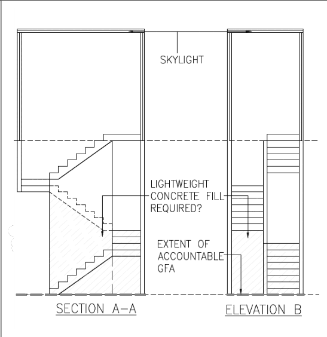{ width="353" loading=lazy }
  <figcaption>Diagram 1 from the original summary (ADF 4/2022, item 5). 原文附圖。</figcaption>
</figure>

**BD's response 屋宇署回覆:** Based on the scenario and the diagram provided by HKIA, BD advised that no lightweight concrete fill was required underneath the staircase as the respective area had already been included in the GFA calculation.

### 6. Projections from External Wall – PNAP APP-19 {#i202208126}

Raised by **HKIA** · Related 相關: [APP-19](../pnap/app-19.md), [B(P)R Parts I–II General and Projections](../regulations/bpr-parts-1-2.md)

**Question 問題:** Paragraph 3(f) of PNAP APP-19 states that architectural mouldings and the like features complying with the projection (i.e. project no more than 500 mm over a street) and clear height limits in regulation 7(1) of the B(P)R need not be counted for site coverage (SC) and plot ratio (PR). Where such feature is located around the external wall corner of a building as per the following sketch plan, it is inevitable that the feature at the corner will be more than 500 mm as measured diagonally from the wall corner. …

<figure markdown>
  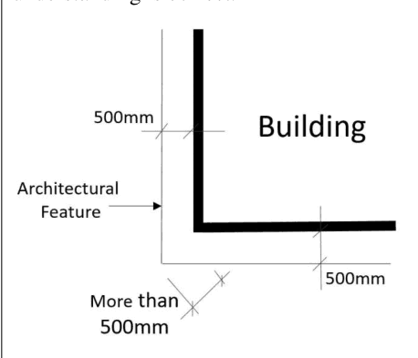{ width="295" loading=lazy }
  <figcaption>Diagram 1 from the original summary (ADF 4/2022, item 6). 原文附圖。</figcaption>
</figure>

**BD's response 屋宇署回覆:** For the purpose of PNAP APP-19, BD accepted that part of the architectural feature wrapping around the corner of a building as shown in the sketch plan need not be counted for SC and PR. Reference was made to item 12 of ADF 5/2012 held on 26 October 2012, in which similar consideration was applied to curtain wall situation.

### 7. Fire Resistance Rating (FRR) for an Enclosed Footbridge over a Public Street between Two Buildings – Clause C15.1 of the FS Code {#i202208127}

Raised by **HKIA** · Related 相關: [FS Code 2011 Part C: Fire Resisting Cons](../codes/fsc-part-c-fire-resisting-construction.md), [FS Code 2011 Part B: Means of Escape](../codes/fsc-part-b-means-of-escape.md)

**Question 問題:** An enclosed footbridge is proposed to be constructed as part of Building I over a public street to connect Building II on the other side of the street. We understand that:  The FRR at the junctions between the footbridge and Building II should follow the principles shown in Examples (b), (c) and (d) of Diagram C1 of the FS Code. Hence the FRR details shown in the following sketches at Junctions (1) and (2) are all acceptable.  By-pass lobby at the fire shutter location is NOT required unless the travel distance from the footbridge to the means of escape of Building I does not comply with Clause B11.2 and B11.3. Please confirm if the above understanding is correct.

<figure markdown>
  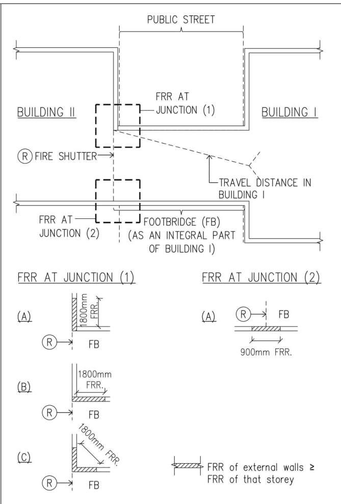{ width="432" loading=lazy }
  <figcaption>Diagram 1 from the original summary (ADF 4/2022, item 7). 原文附圖。</figcaption>
</figure>

**BD's response 屋宇署回覆:** BD advised that with regard to the situation illustrated in the sketch that the buildings are situated on two different sites separated by a public street and an enclosed footbridge is proposed to be constructed as part of Building I and to connect to Building II, the requirements under Clause C5.3 of the FS Code should be complied with. Under Clause C5.3 of the FS Code, the situation illustrated in Scenario (C) of Junction (1) might be acceptable subject to the location of site boundary of Building II. For the situation illustrated in Scenarios (A) & (B) of Junction (1), BD would take a pragmatic approach to consider the provisions of FRR for separation between buildings under both the proposals for construction of footbridge as part of Building I and the A&A proposal for Building II. For Junction (2), Scenario (A) was considered not acceptable according to Clause C5.3 of the FS Code. Regarding the provision of by-pass lobby, BD advised that HKIA’s understading was correct.

### 8. Definition of Underground Car Park – Paragraph 3(a) of Appendix C {#i202208128}

Raised by **HKIA** · Related 相關: [APP-2](../pnap/app-2.md)

<small>Related discussions 相關討論: [17 Nov 2017 item 10](2017.md#i2017111710), [18 Jan 2019 item 3](2019.md#i201901183), [8 May 2026 item 12](2026.md#i2026050812)</small>

**Question 問題:** to PNAP APP-2 As stated in paragraph 3(a) of Appendix C to PNAP APP-2, if the site abuts on only one street, the structural ceiling soffit of underground car park shall be at or below the mean level of that portion of the street on which the site abuts, provided that such mean level is not more than 5 m above the lowest level of such portion of the street. …

<figure markdown>
  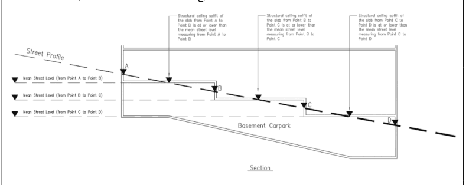{ width="514" loading=lazy }
  <figcaption>Diagram 1 from the original summary (ADF 4/2022, item 8). 原文附圖。</figcaption>
</figure>

**BD's response 屋宇署回覆:** Regarding to the definition of an underground car park, BD advised that for car park abutting a sloping street, according to paragraph 3(a) of Appendix C to PNAP APP-2, BD might consider accepting a car park as an underground one if the structural ceiling soffit of the car park was at or below the mean level of that portion of the street on which the site abutted. In general, there should only be a single mean level for the entire portion of the street which the site abutted. The information provided by HKIA was not sufficient for BD to consider the case. HKIA would provide further information about the case for discussion with BD separately.

### 9. Design of New Works in Existing Buildings under PNAP APP-117 {#i202208129}

Raised by **HKIE** · Related 相關: [APP-117](../pnap/app-117.md), [APP-139](../pnap/app-139.md)

**Question 問題:** Paragraph 3 of PNAP APP-117 states that all new structural elements in the A&A works should be designed in accordance with the current Building Regulations and relevant codes of practice. On the other hand, paragraph 4 of the said PNAP states that the structural adequacy of an existing building or part thereof, as may be affected by proposed A&A works may, subject to some requirements, be checked according to the then prevailing Building Regulations and codes of practice to which they were designed. …

**BD's response 屋宇署回覆:** BD advised that if the A&A works did not involve the situations described in both i and ii under paragraph 4(a) of PNAP APP-117, the structural adequacy of the building due to wind should be checked based on the prevailing wind code.

### 10. APSEC Discussion Forum {#i2022081210}

Raised by **HKIE**

**Question 問題:** Would BD consider to post the finalised Summary of ADF on BD website such that all frontline BD officers and industry finalised Summary of Items Discussed would not be uploaded to the practitioners can be fully aware of the contents?

**BD's response 屋宇署回覆:** Items Discussed in BD advised that the ADF was not an official meeting as such the website. Notwithstanding, the finalised Summary of Items Discussed would be disseminated to all frontline BD officers. Item 16 of ADF 5/2015 held on 13 November 2015 was applicable.

### 11. Foundation Submission {#i2022081211}

Raised by **HKIE**

**Question 問題:** To facilitate fast track development program, the practitioners always based on assumed loads for foundation submissions. In some occasions, RSE was requested to provide full computational model of superstructures to support the assumed loads in foundation plan submissions. Would BD please clarify whether this requirement is necessary?

**BD's response 屋宇署回覆:** BD advised that assumed loads were generally acceptable for foundation design submission, unless under special circumstances where further information were required for justification.

### 12. Record Plan submissions {#i2022081212}

Raised by **HKIE** · Related 相關: [APP-13](../pnap/app-13.md)

**Question 問題:** Would BD please clarify whether record plans should possess the BD’s approval stamp or not?

**BD's response 屋宇署回覆:** BD advised that according to paragraph 5 of PNAP APP-13, the record plans should bear either the signed and dated approval chop applied by the BA or a chop giving the AP’s personal certification of the plans being identical to those approved by the BA on the date specified.

### 13. Hoarding / Covered walkway for Superstructure Works {#i2022081213}

Raised by **AAP** · Related 相關: [B(P)R 50–70 Temporary buildings, hoardin](../regulations/bpr-50-70.md)

!!! warning "Later discussion 其後再討論"
    This question was discussed again on **6 Feb 2026**; use the [later response](2026.md#i202602065) where they differ. 如有不同，以較新回覆為準。

<small>Follows earlier discussion: [12 Nov 2021](2021.md#i202111129)</small>

<small>Related discussions 相關討論: [12 Nov 2021 item 9](2021.md#i202111129)</small>

**Question 問題:** Regarding item 9 of ADF 5/2021 held on 12 November 2021, BD advised that for sites where superstructure works were being carried out, provisions of hoardings, covered walkways and gantries were required; additional catch platform and protective screen should also be provided during the erection of structural frame of a building unless the works satisfied the conditions under paragraph 4 of PNAP APP-102. …

**BD's response 屋宇署回覆:** BD advised that in view of different site situations which warrant different safety precautionary measures, such considerations would be taken into account during the review of PNAP APP-102. For case with adequate justifications submitted by the AP to demonstrate the specific site constraints/conditions, the BA would consider accepting alternative hoarding design proposal on a case-by-case basis.

### 14. Provision of Smoke Outlets in Basement {#i2022081214}

Raised by **AAP** · Related 相關: [FS Code 2011 Part C: Fire Resisting Cons](../codes/fsc-part-c-fire-resisting-construction.md)

<small>Related discussions 相關討論: [3 May 2024 item 2](2024.md#i202405032)</small>

**Question 問題:** An access door leading to a stair shall be provided to the lift pit if the pit depth exceeds 2m in accordance with Clause 3.8.2 under Code of Practice for Building Works for Lifts and Escalators 2011 (2020 Edition). To our understanding, provision of smoke outlets in accordance with Clause C14.2 of the FS Code for the abovementioned lift pit and the associated maintenance and access area is not required. A typical case is demonstrated in below diagrams. Please advise if our understanding is correct.

<figure markdown>
  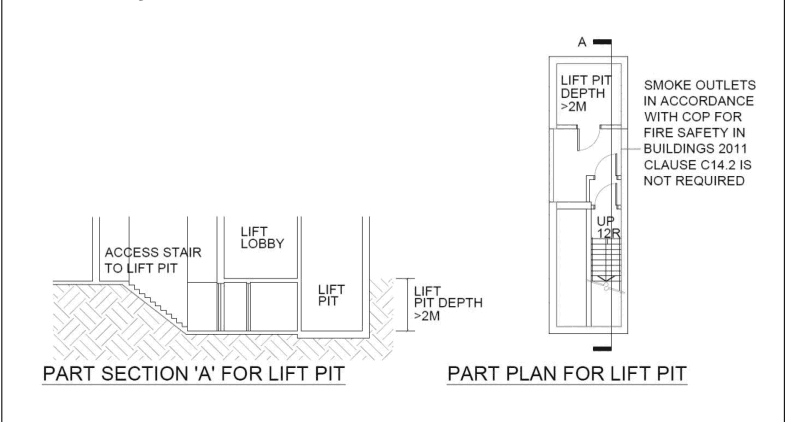{ width="517" loading=lazy }
  <figcaption>Diagram 1 from the original summary (ADF 4/2022, item 14). 原文附圖。</figcaption>
</figure>

**BD's response 屋宇署回覆:** BD advised that AAP’s understanding was correct.

### 15. Space Underneath Internal Staircase {#i2022081215}

Raised by **AAP**

**Question 問題:** Space underneath an internal staircase within a staircase core which leads to the main roof of a building is accountable for GFA calculation. Based on the above, we opine that the underside of the staircase need not be filled up by light-weight mass concrete to avoid abusive use of the subject space. Please advise whether our interpretation is correct.

<figure markdown>
  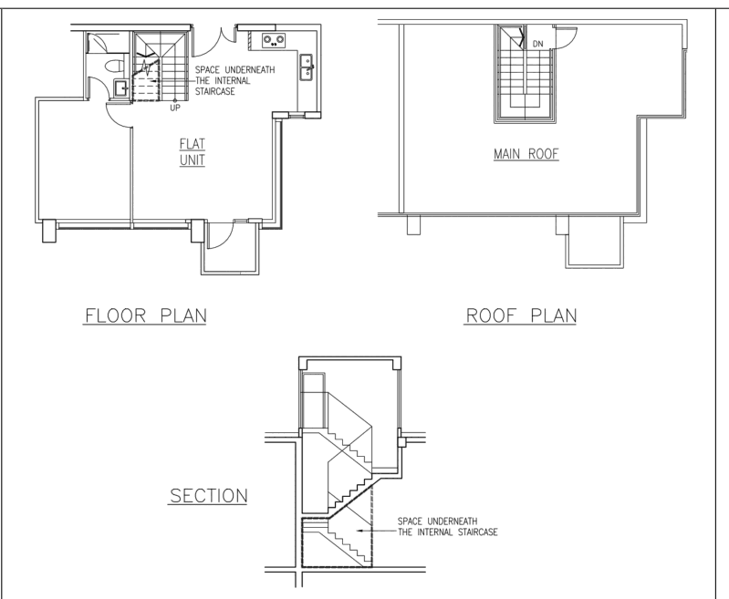{ width="517" loading=lazy }
  <figcaption>Diagram 1 from the original summary (ADF 4/2022, item 15). 原文附圖。</figcaption>
</figure>

**BD's response 屋宇署回覆:** BD advised that AAP’s understanding was correct.

### 16. Location of Open Kitchen {#i2022081216}

Raised by **AAP**

<small>Follows earlier discussion: [19 Mar 2021](2021.md#i2021031922)</small>

**Question 問題:** Reference is made to the previous discussion under item 22 of ADF 2/2021 held on 19 March 2021 for the requirement that the open kitchen should be located in a position where most of the open kitchen area could face the prescribed window(s) of the room for the required natural lighting and ventilation. Over the year, we have encountered different interpretations from the case officers of BD. …

<figure markdown>
  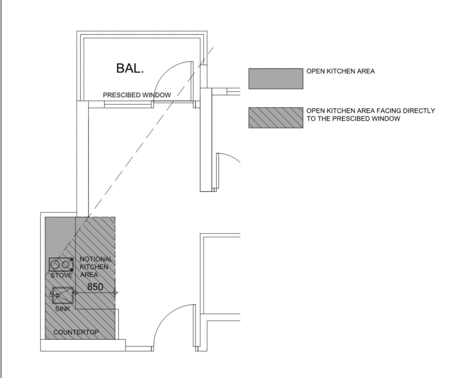{ width="506" loading=lazy }
  <figcaption>Diagram 1 from the original summary (ADF 4/2022, item 16). 原文附圖。</figcaption>
</figure>

**BD's response 屋宇署回覆:** BD advised that as per item 22 of ADF 2/2021 held on 19 March 2021, open kitchen should be located in a position where most of the open kitchen area could face the concerned prescribed window(s) of the room for the required natural lighting and ventilation. To this end, the open kitchen in the sketch was considered acceptable. is kitchen 15

### 17. Design and Supervision Responsibilities for the Adoption of Modular Integrated Construction (MiC) {#i2022081217}

Raised by **ACEHK** · Related 相關: [ADV-36](../pnap/adv-36.md), [APP-158](../pnap/app-158.md), [BO s.14–21 Approval and consent, grounds](../regulations/bo-part-2-building-works.md)

<small>Related discussions 相關討論: [9 Aug 2024 item 23](2024.md#i2024080923)</small>

**Question 問題:** We would like to enquire on the respective design and supervision responsibilities of the following parties in new building developments adopting MiC: 1. the AP and RSE who obtained the in-principle acceptance of the MiC system which had been included in the Lists of Pre-accepted MiC Systems/Components (the Accepted Lists) on BD website; 2. the Project AP and Project RSE who adopted the MiC system in the Accepted Lists into their superstructure design; 3. the Registered General Building Contractor (RGBC) who constructed the MiC system.

**BD's response 屋宇署回覆:** BD advised that the pre-acceptance mechanism aimed to resolve the non-site specific design and construction matters of a MiC system/component by granting in-principle acceptance (IPA) to individual MiC systems/components and provide curtailed assessment on whether the design and materials used meet certain minimum standards for a particular aspect set out under the provisions of the Buildings Ordinance (BO) so that the industry would have greater confidence in using such systems/components for the local projects. An AP and a RSE appointed by MiC supplier/manufacturer for preparing the application for IPA of MiC system should ensure that the fundamental issues could be fully considered and essential information set out in Appendix C to PNAP ADV-36 be included in the submission to facilitate processing by the BD. The Project AP and Project RSE who adopted MiC granted with IPA would assume the full responsibilities for the application and performance of the pre-accepted MiC systems/components, and ensure that they had been properly designed and constructed in compliance with the latest provisions of the BO and its subsidiary regulations including the supervision requirements upon their application in a project. . The RGBC appointed had to provide continuous supervision to the carrying out of the building works in accordance with requirements as stipulated under PNAP ADV-36, PNAP APP-158, supervision plans and conditions imposed under item 6 of section 17(1) of the BO.

### 18. Criteria for Submission of Excavation and Lateral Support (ELS) Plans {#i2022081218}

Raised by **ACEHK** · Related 相關: [APP-57](../pnap/app-57.md)

!!! warning "Later discussion 其後再討論"
    This question was discussed again on **8 Aug 2025**; use the [later response](2025.md#i2025080825) where they differ. 如有不同，以較新回覆為準。

**Question 問題:** Paragraph 3 of PNAP APP-57 for ELS works stipulates that: It is understood that submission is only required when both criteria in paragraph 3(a) and 3(b) are met. However, some case officers of BD interpreted that an ELS submission is still required when either criterion (a) or (b) is met. We would like to seek clarification on the above. If BD’s clarification on the above is positive, does RSE/RGE still need to submit the ELS proposal to BD “for information” prior to superstructure consent application or to include such ELS details for information in the submissions of pile caps, manholes, etc. involving shallow excavation works?

<figure markdown>
  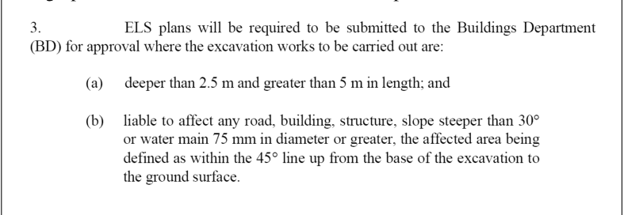{ width="508" loading=lazy }
  <figcaption>Diagram 1 from the original summary (ADF 4/2022, item 18). 原文附圖。</figcaption>
</figure>

**BD's response 屋宇署回覆:** BD clarified that ELS plans were required to be submitted for approval when both criteria in paragraph 3(a) and 3(b) of PNAP APP-57 were met. BD advised that notwithstanding the above, the intended method and details of shallow/local excavation for substructures such as pile caps and ground beams, could be indicated on the foundation plans for BD’s acceptance.

### 19. Width of Design Strip in Transfer Plates {#i2022081219}

Raised by **ACEHK** · Related 相關: [APP-142](../pnap/app-142.md)

**Question 問題:** Our member encountered a case of transfer plate design submission that the transfer plate was designed to support the residential towers above with shear wall systems. The transfer plate was 4 m thick and supported by columns of about 2.5 m x 2.5 m below. During the processing of plans, the case officer of BD only accepted the width of the design strips to be taken as 1 m even it was far from the lift/staircase openings. Case officers of BD opined that there was no code or guideline accepted by BD to determine the strip width so that it should be as narrow as possible. …

**BD's response 屋宇署回覆:** BD advised that the results generated by commonly used computer softwares should be sufficient for determining the width of design strip. The required 1 m wide design strips might be an individual case and BD would further review the issue when information of the particular case were available. BD would put forward the issue for discussion at the Technical Committee on Concrete Code if considered necessary.

### 20. Incorporating Conditions of Modifications/Exemptions in final General Building Plan (GBP) Amendment Submission {#i2022081220}

Raised by **PBSCA** · Related 相關: [ADM-2](../pnap/adm-2.md), [BO s.40–56 and Schedules: offences, exem](../regulations/bo-parts-4-9-schedules.md)

<small>Follows earlier discussion: [19 Mar 2021](2021.md#i2021031912)</small>

**Question 問題:** For modifications/exemptions granted pursuant to section 42 of the BO, it is required to incorporate the relevant conditions of modifications/exemptions in the final GBP amendment submissions for both new development and A&A works. For A&A works, if amendment submission for GBP is not required after the first approval, could the summary of the modifications/exemptions be incorporated in the record plan instead so no amendment submission is necessary for such purpose before the submission of Form BA14?

**BD's response 屋宇署回覆:** BD advised that according to paragraph 14 of PNAP ADM-2, in order to ensure that the imposed conditions were fulfilled and the parameters for granting modifications/exemptions could be made known to the public and any person who might have an interest in such building/building works, it was one of the conditions imposed in the Form BD 106 that items covered by Form BD 106 should be incorporated into the subsequent amendments for approval before the submission of Form BA14. As advised in item 12 of ADF 2/2021 held on 19 March 2021, AP might communicate with the case officers to expedite processing of amendments solely involving incorporating valid Form BD106 on the amendment plans.

### 21. Requirement of Floor Drain – PNAP APP-164 {#i2022081221}

Raised by **PBSCA** · Related 相關: [APP-164](../pnap/app-164.md)

<small>Related discussions 相關討論: [13 Aug 2021 item 4](2021.md#i202108134)</small>

**Question 問題:** As per paragraph 2(a) of PNAP APP-164, the trap of a floor drain should be prevented from loss of water seal by replenishing with used water diverted from a lavatory basin, a bath or a shower bath. There are cases for A&A works at G/F that the provision of the replenishing pipe from the wash basin to the floor drain may require crossing the ground beams which poses difficulties in complying with the requirement in the said PNAP. Would BD take pragmatic approach to allow for modification or relaxation of the requirement on case basis? AOB Items

**BD's response 屋宇署回覆:** BD would consider the application of enhanced design standards to A&A works on a case-by-case basis.

### 22. Part A & Part B of Form BA5 {#i2022081222}

Raised by **PBSCA**

!!! warning "Later discussion 其後再討論"
    This question was discussed again on **14 Feb 2025**; use the [later response](2025.md#i2025021413) where they differ. 如有不同，以較新回覆為準。

**Question 問題:** (Item raised by HKIE) Part A & Part B of Form BA5 are to be completed by the owner as the applicant for approval of plans of building works and Part C of the said form is to be completed by AP/RSE/RGE as a certificate of preparation of the plans. As clarified by BD at item 19 of ADF 3/2016 held on 27 May 2016, for subsequent submissions, Part A and Part B are not required after the 1 st submission of GBP unless there is a change of ownership, but Part C is still required. Would BD please confirm if this arrangement is still valid?

<figure markdown>
  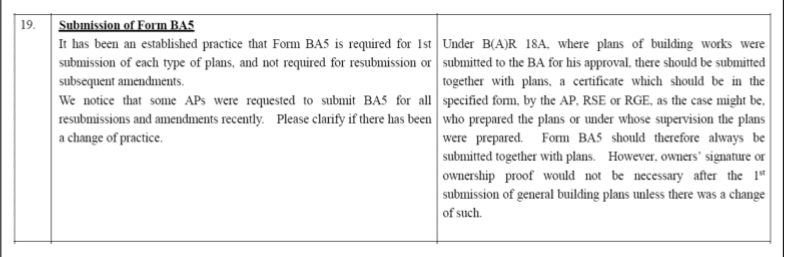{ width="508" loading=lazy }
  <figcaption>Diagram 1 from the original summary (ADF 4/2022, item 22). 原文附圖。</figcaption>
</figure>

**BD's response 屋宇署回覆:** remained valid. It was noted that the industry adopted a common practice that when submitting amendment plans, the AP/RSE would fill in and sign Part A and B of Form BA5 as the applicant of the submission and BD had been all along accepting such practice. Meanwhile, the Form BA5 was being revised.

### 23. Mass Concrete Fill for Foundation Works {#i2022081223}

Raised by **PBSCA** · Related 相關: [APP-18](../pnap/app-18.md), [APP-142](../pnap/app-142.md)

<small>Related discussions 相關討論: [22 Nov 2024 item 9](2024.md#i202411229)</small>

**Question 問題:** (Item raised by HKIE) According to paragraph 3 of PNAP APP-18 on Foundation Works, “Mass concrete fill is often applied for benching uneven or sloping rock surface for construction of shallow foundation. However, mass concrete fill of significant size (i.e. with a maximum depth greater than 1 m) placed beneath the footing or raft foundation should be regarded as a structural element and designed in accordance with the Code of Practice for Structural Use of Concrete 2013.” Would BD please clarify whether mass concrete fill, which is generally subject only to direct compressive force and no tensile stress, can be designed as plain concrete without reinforcement in accordance with the clause …

**BD's response 屋宇署回覆:** BD advised that mass concrete fill of significant size placed beneath the footing or raft foundation should be regarded as a structural element, as it was subject to other components’ forces in addition to axial load, such that minimum reinforcements in accordance with the Concrete Code were required. Subject to justifications by the RSE, BD would consider the issue on a case-by-case basis.

### 24. Foundation Submission {#i2022081224}

Raised by **PBSCA**

**Question 問題:** (Item raised by HKIE) According to item 11 of ADF of 2/2022 held on 18 March 2022, BD may consider foundation submission as Major Revision/Amendment if it involves new types of foundations or change in load path which would affect nearby sensitive receivers. It does not categorically spell out if it applies to vertical load bearing foundations or even to traditional shear piles taking only wind lateral loads. The checking of lateral loads using shear piles is straightforward and should not warrant additional 30 days for plan processing, which violates BD’s facilitation intention. Would BD please clarify?

**BD's response 屋宇署回覆:** BD advised that whilst shear pile might not be a type of foundation pile, whether the proposal should be treated as Major Revision also depended on other considerations such as the extent of revision and any change in overall design concept. The examples given in item 11 of ADF of 2/2022 held on 18 March 2022 were not exhaustive. The RSE might discuss with the frontline BD officers on whether a foundation submission would constitute a Major Revision/Amendment before the submission.

### 25. Check List in Appendix A to PNAP ADM-2 {#i2022081225}

Raised by **PBSCA** · Related 相關: [ADM-2](../pnap/adm-2.md)

**Question 問題:** (Item raised by HKIS) Given that BD would review the prescribed forms, HKIS therefore reminded BD that, although the Check List on Documents included in New Building / A&A Plan Submissions in Appendix A to PNAP ADM-2 is not a prescribed form, there is a bug in its PDF version, which is downloadable from BD website. The formula being used on P.4/4 of the check list for automatically generating the “Total no. of sets of plans to be submitted” was found incorrect.

**BD's response 屋宇署回覆:** BD would review the issue.

### 26. Minor Works Items indicated on A&A Plans {#i2022081226}

Raised by **PBSCA** · Related 相關: [B(MW)R Building (Minor Works) Regulation](../regulations/bmwr-123n.md)

**Question 問題:** (Item raised by PBSCA) In submission of A&A plans, sometimes, there are works to be carried out under the Minor Works Control System indicated on the GBP. In the past, upon the application for consent to the commencement of A&A works, there was no requirement that the notice of commencement of the minor works indicated on the GBP should be submitted to BD before granting the consent for the A&A works. But in a recent case, BD’s officer requested the AP to submit the notice of commencement of the minor works to BD before granting the consent for the A&A works. We would like BD to clarify on this issue.

**BD's response 屋宇署回覆:** BD clarified that saved for special circumstances, there was no such requirement in general.

## ADF 3/2022 · 13 May 2022 {#adf-32022-13-may-2022}

[Original summary (PDF) 原文](https://www.hkie-st.org/wp-content/uploads/2025/02/Summary-of-items-discussed-in-3_2022-ADF-on-13.5.2022.pdf) · 29 items

### 1. Temporary Scaffolding as Maintenance and Repair Access {#i202205131}

Raised by **HKIA**

!!! warning "Later discussion 其後再討論"
    This question was discussed again on **23 Feb 2024**; use the [later response](2024.md#i202402234) where they differ. 如有不同，以較新回覆為準。

**Question 問題:** According to paragraph 1.3 in Part 2 of the Code of Practice on Access for External Maintenance 2021 (AfEM Code), “Attention shall be drawn to the design of building projection, building recess and free-form building profile to enable the erection of temporary scaffold in accordance with the Guidelines on the Design and Construction of Bamboo Scaffolds.” Please clarify whether this implies that temporary scaffolding is acceptable for compliance with the maintenance and repair (M&R) access requirements set out in the AfEM Code, in particular for maintenance area located not more than 13 m above the adjacent ground.

**BD's response 屋宇署回覆:** BD advised that the compliance with the AfEM Code did not preclude the use of temporary scaffolding for substantial repair. However, M&R access should also cater routine maintenance of the building including cleansing, inspection and local repair / replacement of defective building elements and components, etc. The use of alternative means such as metal scaffold tower should be considered on case basis. The AP should demonstrate to the satisfaction of BD that the proposed M&R access would not be inferior to the deem-to-satisfy provisions stipulated in the AfEM Code. The issue would be further reviewed / deliberated in the Technical Committee on the Code of Practice on Design for Safety – External Maintenance to formulate more guidelines.

### 2. Void over Main Entrance Lobby of Domestic Building {#i202205132}

Raised by **HKIA** · Related 相關: [APP-2](../pnap/app-2.md), [APP-42](../pnap/app-42.md), [B(P)R 23 & 23A Building height, site are](../regulations/bpr-23-23a.md)

**Question 問題:** For a domestic building with residential units at G/F, it is our understanding that the void over the main entrance lobby located at the same G/F with headroom not more than 5 m can be exempted from gross floor area (GFA) calculations. Attached please find a typical section showing the arrangement. Please confirm our understanding is correct.

<figure markdown>
  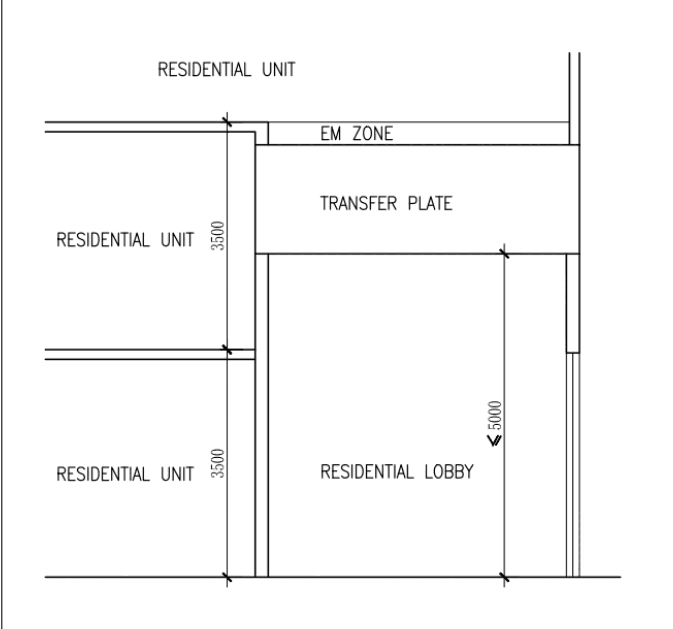{ width="435" loading=lazy }
  <figcaption>Diagram 1 from the original summary (ADF 3/2022, item 2). 原文附圖。</figcaption>
</figure>

**BD's response 屋宇署回覆:** BD advised that according to paragraph 2(f) of PNAP APP-2 and paragraph 24 of PNAP APP-42, BD might only consider to grant modification of regulation 23(3)(a) of the Building (Planning) Regulations (B(P)R) to exempt voids over main common entrance lobbies of non-domestic buildings in prestige entrance design from GFA calculations. This was not applicable to void over main entrance lobbies serving domestic building. The section provided by HKIA was only a partial section so the information was not sufficient. Thus, it could not be considered as a typical section showing the general disposition of domestic building. Taking into consideration of the disposition, layout and design of the domestic building, exemption of voids over residential main entrance lobbies from GFA calculations might be considered on case basis.

### 3. Vertical Greening (VG) {#i202205133}

Raised by **HKIA** · Related 相關: [APP-152](../pnap/app-152.md)

!!! warning "Later discussion 其後再討論"
    This question was discussed again on **9 Aug 2024**; use the [later response](2024.md#i202408098) where they differ. 如有不同，以較新回覆為準。

**Question 問題:** According to Appendix A to PNAP APP-152, vertical greening has to be “within the primary zone on a vertical surface abutting a street or public pedestrian way/public open space accessible from a street”. Despite the above, it is our understanding that the VG located within the primary zone is also readily acceptable by BD if its location can provide visual contact with the public, visitors or occupiers of the premises. In other words, the VG is NOT restricted to locations abutting a street, a public pedestrian way or public open space accessible from a street. Please confirm that our understanding is correct.

**BD's response 屋宇署回覆:** BD confirmed that HKIA’s understanding was correct. The VG was located in the primary zone and this zone was for providing visual contacts or access from a street through common parts of the building for enhancing the walkability of urban space to the public, visitors or occupiers.

### 4. Building Separation – Projected Building Facade at Low Zone {#i202205134}

Raised by **HKIA** · Related 相關: [APP-152](../pnap/app-152.md)

**Question 問題:** Paragraph 2.4 of Appendix B to PNAP APP-152 states that for “the purpose of measuring Lp of a building or a group of buildings along its long side, the part of the building(s) that is within the low zone of a height of not more than 6.67 m may be disregarded.” Paragraph 4.2 of the same Appendix further states that for the assessment of Separating Distance (S) between the ends of the projected building facades and the adjacent site boundaries or centre line of adjoining streets/lanes, the part of the building as mentioned in paragraph 2.4 of the same Appendix can be disregarded. …

**BD's response 屋宇署回覆:** BD confirmed that HKIA’s understanding was correct. Paragraph 2.4 of Appendix B to PNAP APP-152 delineated Design Requirement (1) and it stipulated that when measuring Lp, which must be the long side, the part of the building of a height not more than 6.67 m within the low zone might be disregarded. Paragraph 4.2 of Appendix B to PNAP APP-152 delineated Design Requirement (2) and the part of the building referred to in paragraph 2.4 might be disregarded when assessing the S, irrespective of the projection planes.

### 5. Natural Ventilation under Performance-based Approach (PNAP APP-130) {#i202205135}

Raised by **HKIA** · Related 相關: [APP-130](../pnap/app-130.md)

<small>Related discussions 相關討論: [12 Nov 2021 item 14](2021.md#i2021111214)</small>

**Question 問題:** For situation where there is a vertical acoustic fin alongside the external wall for protecting the primary opening from external noise source (such as traffic noise), we would like BD to confirm that the following 2 scenarios are acceptable to BD:

<figure markdown>
  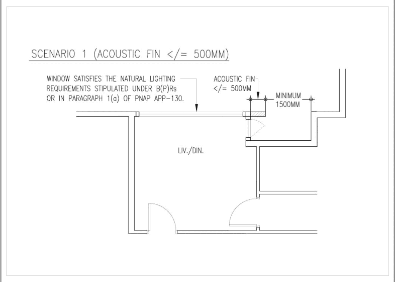{ width="508" loading=lazy }
  <figcaption>Diagram 1 from the original summary (ADF 3/2022, item 5). 原文附圖。</figcaption>
</figure>

<figure markdown>
  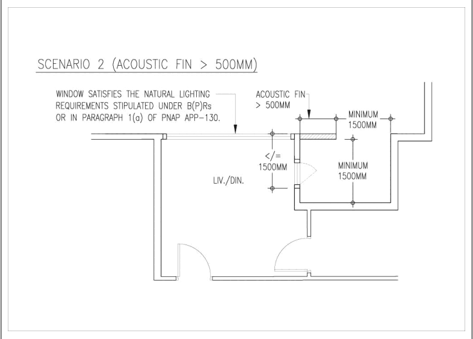{ width="508" loading=lazy }
  <figcaption>Diagram 2 from the original summary (ADF 3/2022, item 5). 原文附圖。</figcaption>
</figure>

**BD's response 屋宇署回覆:** BD advised that subject to the requirements stipulated in paragraph 4.1 of Appendix A to PNAP APP-130, Scenario 1 was acceptable. BD also advised that Scenario 2 was acceptable if the proposed length of the projecting feature (i.e. the acoustic fin) was not more than 750 mm. If the acoustic fin was more than 750 mm, BD would consider the proposal on case basis to ensure that the natural ventilation provided would be sufficient.

### 6. Effective Width of Socketed Steel H-Pile for Assessing Reduction of Subgrade Reaction for Pile Group {#i202205136}

Raised by **HKIE**

**Question 問題:** It has been a long-accepted practice to take the width of steel H-pile (i.e. 338 mm for 305x305x223 kg/m) as the width of socketed steel H-pile in the direction of bending for the determination of the reduction factor for the coefficient of subgrade reaction for a laterally loaded pile group. The use of the width of steel H-pile for assessing the reduction of subgrade reaction is based on the premise that the structural capacity of socketed steel H-pile is based on the steel section only and the contribution of the grout surround is totally ignored. …

**BD's response 屋宇署回覆:** BD confirmed that the corresponding width of steel H-pile section of a socketed steel H-pile could be adopted for the assessment of reduction factor for subgrade reaction in that direction.

### 7. Presumed Allowable Bearing Pressure of Marble Class I or II {#i202205137}

Raised by **HKIE** · Related 相關: [APP-18](../pnap/app-18.md)

**Question 問題:** Referring to item 3 of the Amendment to Code of Practice for Foundations 2017 (Foundations Code) (February 2021), it is clarified that Category 2 rock should exclude marble and marble-bearing rock. However, no “presumed allowable bearing pressure” for marble was given. It is suggested making reference to paragraph 5.4.1 of GEO Technical Guidance Note No. 26 (TGN 26) and revising note (12) of Table 2.1 of the Foundations Code as follows: (12) Category 2 rock should exclude marble and marble-bearing rocks. The presumed allowable bearing pressure of Marble Class I or II shall refer to Category 1(b) and 1(c) rock (granite and volcanic) according to the TCR, UCS and PLI values. …

**BD's response 屋宇署回覆:** BD advised that the issue would be discussed in the Technical Committee on the Code of Practice for Foundations.

### 8. Criteria for Fast Track Processing of Simple A&A Submission under PNAP ADM-19 {#i202205138}

Raised by **HKIE** · Related 相關: [ADM-19](../pnap/adm-19.md)

<small>Follows earlier discussion: [23 Mar 2018](2018.md#i201803232)</small>

**Question 問題:** Paragraph 28 of PNAP ADM-19 states that for simple A&A works, where AP/RSE confirm that the proposed works do not involve the structure of the building and do not affect the fundamental issues mentioned in paragraph 6 and referrals to other Government departments (except FSD) are not necessary, the concurrent applications for fast track approval and consent will be processed within 30 days. Some case officers of BD interpret “do not involve the structure of the building” as “not involving any structural works” and refuse to process the submission under fast-track. …

**BD's response 屋宇署回覆:** BD advised that the concurrent application for fast track approval and consent would be eligible to A&A works not involving any structural alteration, addition or strengthening works to the existing structural elements.

### 9. Adoption of Code of Practice on Wind Effects in Hong Kong 2019 (Wind Code 2019) for Minor Structures {#i202205139}

Raised by **HKIE** · Related 相關: [APP-139](../pnap/app-139.md)

<small>Related discussions 相關討論: [21 May 2021 item 10](2021.md#i2021052110), [21 May 2021 item 9](2021.md#i202105219)</small>

**Question 問題:** According to Circular Letters dated 30 September 2019 and 28 August 2020, BD accepts the adoption of the Code of Practice on Wind Effects in Hong Kong 2004 (Wind Code 2004) for subsequent submissions if the foundation or superstructure plans were submitted before 31 March 2021 and eventually approved by the Building Authority. Would BD please clarify whether the design of independent minor structures such as fence walls, guide houses, pavilion and features etc. can adopt the Wind Code 2004 as that for the main building(s).

**BD's response 屋宇署回覆:** BD advised that they accepted the adoption of the same Wind Code for the structural works processed under the same BD file reference. Hence, in general, the design of independent minor structures could adopt the same Wind Code as that for the main building(s).

### 10. PNAP APP-132 – Site Coverage and Open Space Provision {#i2022051310}

Raised by **AAP** · Related 相關: [APP-132](../pnap/app-132.md), [APP-19](../pnap/app-19.md)

<small>Follows earlier discussion: [22 Nov 2019](2019.md#i2019112216), [21 May 2021](2021.md#i2021052113), [13 Aug 2021](2021.md#i202108131), [13 Aug 2021](2021.md#i2021081310)</small>

<small>Related discussions 相關討論: [25 May 2018 item 6](2018.md#i201805256), [14 Jan 2022 item 14](2022.md#i2022011414)</small>

**Question 問題:** Paragraph 3(d) of PNAP APP-132 states that in considering applications for site coverage to exceed the limit laid down in the B(P)R using the “setback approach”, the BA will favourably consider the application if “the setback area is properly landscaped and/or paved and open, uncovered and without any permanent building structures other than the landscaped features and perforated boundary walls”. In this regard, please clarify if the thickness of vertical green is considered acceptable as the landscaped features located within / projected over the setback area.

**BD's response 屋宇署回覆:** BD advised that vertical green which would contribute to improving street environment was acceptable to be provided at the setback area under PNAP APP-132. For metal supporting frames for growing of plants projecting not more than 300 mm from the external walls within lot boundary, site coverage (SC) and plot ratio were not accountable in accordance with paragraph 3(n) of PNAP APP-19. For other types of vertical green of reasonable height with overall thickness of the system not more than 300 mm, BD might favourably consider to grant modification of regulations 20 and 23(3)(a) of B(P)R to exempt from SC and GFA.

### 11. Covered Landscaped Area {#i2022051311}

Raised by **AAP** · Related 相關: [APP-104](../pnap/app-104.md), [APP-42](../pnap/app-42.md), [APP-151](../pnap/app-151.md)

**Question 問題:** (i) Paragraph 7 of PNAP APP-104 states that open-sided covered landscaped areas/children play areas provided under the footprint of the domestic tower would not be subject to the limitation in Table 1 (i.e. sliding scale of GFA concession for recreational facilities), but should be within 5% of the total domestic GFA, details as stated under PNAP APP-42 and subject to compliance with the pre-requisites stipulated in PNAP APP-151 on Building Design to Foster a Quality and Sustainable Built Environment. …

<figure markdown>
  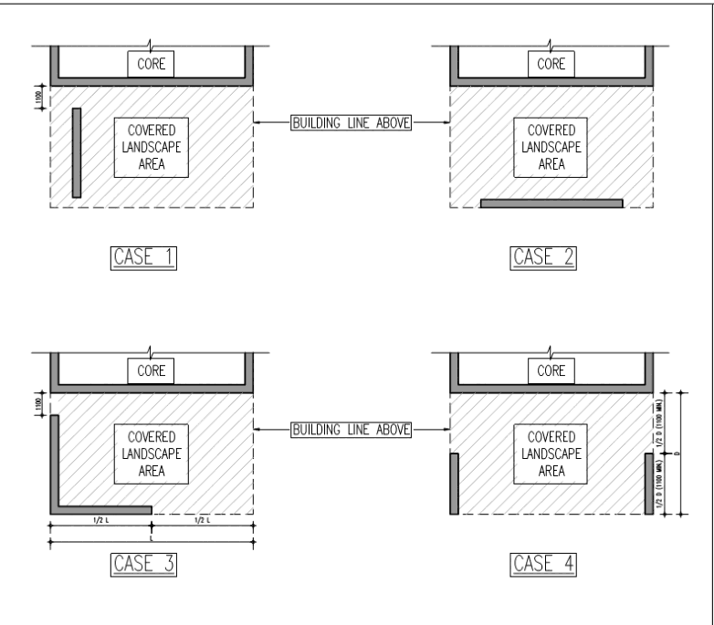{ width="506" loading=lazy }
  <figcaption>Diagram 1 from the original summary (ADF 3/2022, item 11). 原文附圖。</figcaption>
</figure>

**BD's response 屋宇署回覆:** (i) BD confirmed that AAP’s understanding was correct. (ii) BD advised that according to paragraph 26 of PNAP APP-42, covered landscaped areas/children play areas should be open in design and not encumbered with structural elements. Therefore, covered landscaped area would be acceptable if it was open-sided and abuse was unlikely. Cases 1 to 4 were generally acceptable.

### 12. Cast-in Anchor for AC Platform {#i2022051312}

Raised by **AAP**

**Question 問題:** According to the diagram under Appendix G to the AfEM Code, it is stipulated that the cast-in anchors should be installed at pre-determined locations before casting of the supporting structural elements. The anchor bars should be of Grade B500 stainless steel, complying with BS 6744:2016 and designation number 1.4436, or of equivalent standard, with a minimum diameter of 16 mm, OR be designed to sustain the load test as required for “Type A” anchor device in BS EN 795:2012. …

**BD's response 屋宇署回覆:** BD advised that according to paragraph 6 in Appendix C of the AfEM Code, the design and location of the cast-in anchors should be shown on the general building plans and structural plans for approval. Drill-in anchors might be acceptable provided that the design loading and structural design comply with the relevant codes of practice and/or international standards achieving the performance requirements. Conditions on testing requirements might be imposed on approval of relevant plans. BD also reminded that the Guidance Notes on Classification and Use of Safety Belts and their Anchorage System issued by the Labour Department should be observed.

### 13. Folding Grab Rail in Accessible Lavatories As required in paragraph 53 of the Design Manual: Barrier Free Access {#i2022051313}

Raised by **AAP** · Related 相關: [Design Manual: Barrier Free Access 2008 ](../codes/bfa-2008.md)

<small>Related discussions 相關討論: [17 Aug 2018 item 1](2018.md#i201808171), [5 May 2023 item 3](2023.md#i202305053), [8 May 2026 item 4](2026.md#i202605084)</small>

**Question 問題:** 2008 (2021 Edition) (DM:BFA), a folding grab rail has to be installed on the wide side of the cubicle adjacent to the water closet at a height between 725 mm and 750 mm above the finished floor level, when lowered from the wall. Our understanding is that the height shall be measured from the finished floor level to the centre of the grab rail, as shown in the below diagram extracted from Figure 24 of the DM:BFA. However, we have encountered some cases that the said measurement shall be taken from the finished floor level to the top of the grab rail. …

<figure markdown>
  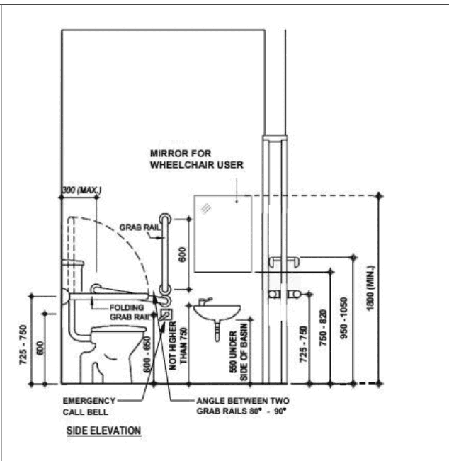{ width="409" loading=lazy }
  <figcaption>Diagram 1 from the original summary (ADF 3/2022, item 13). 原文附圖。</figcaption>
</figure>

<figure markdown>
  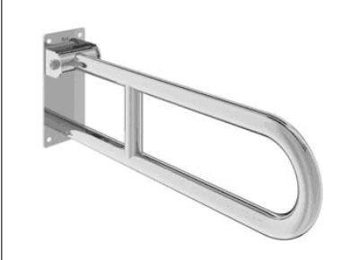{ width="252" loading=lazy }
  <figcaption>Diagram 2 from the original summary (ADF 3/2022, item 13). 原文附圖。</figcaption>
</figure>

**BD's response 屋宇署回覆:** level to the centre of the folding grab rail when lowered from the wall, as shown on Figure 24 of the DM:BFA. If U-shaped folding grab bar was adopted, the measurement should be taken to the centre of the top rail.

### 14. Staircase Interchange {#i2022051314}

Raised by **AAP** · Related 相關: [FS Code 2011 Part B: Means of Escape](../codes/fsc-part-b-means-of-escape.md), [FS Code 2011 Part C: Fire Resisting Cons](../codes/fsc-part-c-fire-resisting-construction.md)

<small>Related discussions 相關討論: [5 May 2023 item 9](2023.md#i202305059)</small>

**Question 問題:** With reference to Clause B8.2 of the Code of Practice for Fire Safety in Buildings 2011 (FS Code), “Where two or more required staircases are needed, people using one required staircase should be able to gain access to at least one other required staircase at any time, without having to pass through other person’s private premises.” To our understanding, if such staircase (ST-3 in the diagrammatic floor plan below) solely serves the entire occupancy of that floor, for example at 1/F, there is no need to designate a common area, at that floor, for interchange of the subject staircase to any other staircases, as indicated in blue dotted line below. …

<figure markdown>
  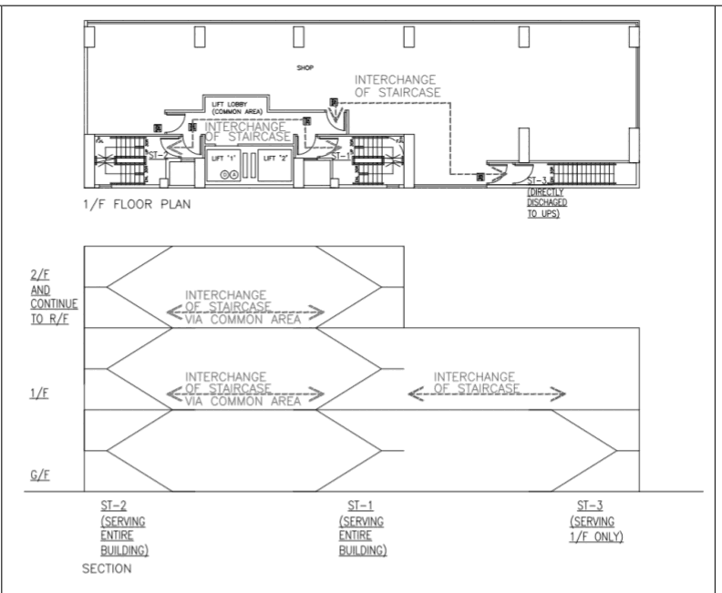{ width="512" loading=lazy }
  <figcaption>Diagram 1 from the original summary (ADF 3/2022, item 14). 原文附圖。</figcaption>
</figure>

**BD's response 屋宇署回覆:** BD advised that the requirement under Clause B8.2 of the FS Code on access between required staircases would be applicable to all types of buildings and except for shopping arcade situations, passages physically separated from the remainder of the building should be provided as access between the required staircases, and whether fire resisting rating being required for such separations would be governed by Subsection C7 of the FS Code. Such internal common corridor or passage for interchange between required staircases should be shown on the respective floor plans as “common part”. Noting that the staircase ST-3 solely served the single occupancy of the first floor, BD advised that it would favourably consider to accept that no designated common route for interchange of ST-3 need be provided on the condition that the occupants on 1/F can gain access to another required staircase from ST-3 without passing through other person’s private premises.

### 15. Canopy Projection {#i2022051315}

Raised by **AAP** · Related 相關: [APP-19](../pnap/app-19.md), [B(P)R Parts I–II General and Projections](../regulations/bpr-parts-1-2.md)

**Question 問題:** Under regulation 10 of the B(P)R, the maximum projection of a canopy erected over any street shall be 1/10 of the width of the street or 3 m, whichever is less. Moreover, as stipulated in paragraph 3(k) of PNAP APP-19, it is accepted that canopies projecting not more than 2 m over an entrance to a building may be exempted from GFA calculation. To our understanding, the condition stipulated in PNAP APP-19 shall only apply to the scenario where the canopy projection is within the site. …

<figure markdown>
  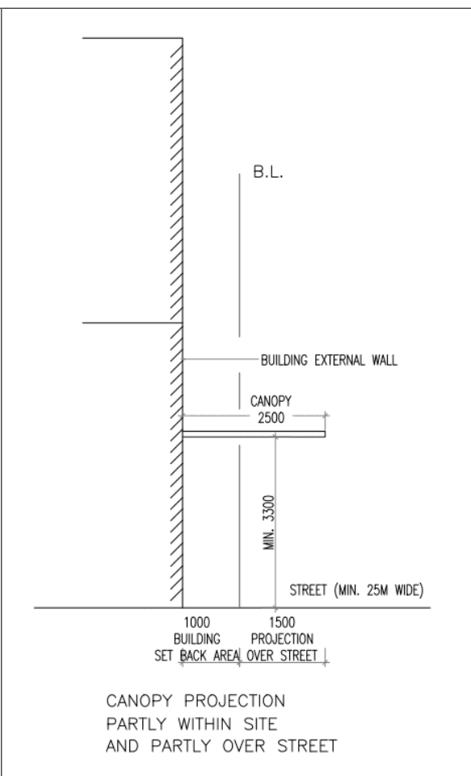{ width="376" loading=lazy }
  <figcaption>Diagram 1 from the original summary (ADF 3/2022, item 15). 原文附圖。</figcaption>
</figure>

**BD's response 屋宇署回覆:** BD advised that the area covered by a canopy projecting not more than 2 m within the site boundary, over the entrance of a building, might be favourably considered for exemption from GFA calculation as per PNAP APP-19. For an entrance canopy complying with regulation 10 of the B(P)R, which projected partly within the site and partly over the street, the covered area to a maximum width of 2 m within the site might also be exempted from GFA calculation.

### 16. Requirement of Links in Composite Columns {#i2022051316}

Raised by **ACEHK** · Related 相關: [APP-142](../pnap/app-142.md)

**Question 問題:** For basements using a top-down construction sequence, steel stanchions are normally required and occupy the major cross-sectional area of the permanent composite columns. The presence of stanchion inevitably blocked the column links as required in section 9 of the Code of Practice for Structural Use of Concrete 2013 (2020 Edition) (Concrete Code). We would like BD to clarify whether in such composite column configuration, the column link requirement stated in the Concrete Code is still mandatory. Different BD case officers appeared to have different interpretations and different acceptance criteria. …

**BD's response 屋宇署回覆:** BD agreed that the cross-section of the composite column was largely occupied by the steel stanchion which had already been a key element for confinement and flexibility in the column link arrangement was allowed. Nevertheless, as the details of the composite columns with steel stanchions vary from project to project, BD welcomed practitioners or members of ACEHK to provide several typical configurations for consideration.

### 17. Reinforced Concrete (RC) Beam-Composite Column Joint {#i2022051317}

Raised by **ACEHK** · Related 相關: [APP-142](../pnap/app-142.md), [APP-168](../pnap/app-168.md)

**Question 問題:** Referring to the above item, the presence of stanchion will also inevitably block the conventional RC beam rebars arrangement and those blocked rebars are probably connected onto the steel stanchion by couplers. The steel section inside the permanent column is thus very strong and able to resist all the unbalanced shear force. In the Code of Practice for the Structural Use of Steel 2011 (2021 Edition) (Steel Code), it is allowed to use the encased steel for column shear force design, and we opine that it should be acceptable to extend the same principle for RC beam-composite column joint. …

**BD's response 屋宇署回覆:** BD advised that as long as the column was designed as a composite construction, it would be reasonable to refer to the Steel Code for structural checking. BD also advised that the shear capacity of the steel stanchion was high as compared with the normal RC element and it was acceptable to assume the transverse shear acting on to steel element only.

### 18. Cladding – PNAP APP-16 {#i2022051318}

Raised by **ACEHK** · Related 相關: [APP-16](../pnap/app-16.md)

**Question 問題:** Paragraph 4 of PNAP APP-16 on Cladding specified that submission of structural plans is required when the cladding to be installed is above 6 m from the adjoining ground level or adjoining floor. Is there any specific width of the adjoining floor to be defined as an “adjoining floor”, i.e. set back distance X from the edge of podium floor? Can we assume it as the dimension sufficient for safe erection of the cladding, e.g. width of a cherry picker? Tower X Podium In addition, can paragraph 4 of PNAP APP-16 also be applied to atypical construction materials, such as Bronze, Brass, GRC, etc., if the safety concern of their erection has been satisfied?

<figure markdown>
  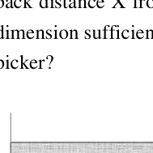{ width="121" loading=lazy }
  <figcaption>Diagram 1 from the original summary (ADF 3/2022, item 18). 原文附圖。</figcaption>
</figure>

**BD's response 屋宇署回覆:** BD clarified that the said requirement was for public safety concerns on fallen objects after the cladding was installed. BD also clarified that paragraph 4 of PNAP APP-16 did not preclude the use of other materials for the cladding. BD advised that there was no specific dimensional requirement (i.e. value of X) for the definition of adjoining floor. Representatives from HKIE, AAP, ACEHK and AREC requested for guidelines on such requirement for determining the need of submission of structural plans for cladding, in order to minimise the chance of disagreement amongst AP, RSE and the Client. BD would look into the issue. BD reminded that the AP/RSE was responsible for the cladding design no matter the submission of structural plans for cladding was required or not.

### 19. Ground Settlement Limits – PNAP APP-137 {#i2022051319}

Raised by **ACEHK** · Related 相關: [APP-137](../pnap/app-137.md)

**Question 問題:** In some projects, extraordinarily deep basement is required to accommodate car park or alike structures underground to fulfil the planning requirement. Coupled with a weak ground condition, the incurred cumulative ground / utility settlements during foundation construction and ELS stages are likely beyond 25 mm even a robust embedded retaining wall (e.g. diaphragm wall) and close to practical limit strut spacing are adopted. The current revision of PNAP APP-137 (extract of Appendix B below) allows RSE/RGE to adopt the serviceability limit of the adjacent ground, structures and utilities as the trigger value of the Action Level, instead of the provisional trigger value of 25 mm. …

<figure markdown>
  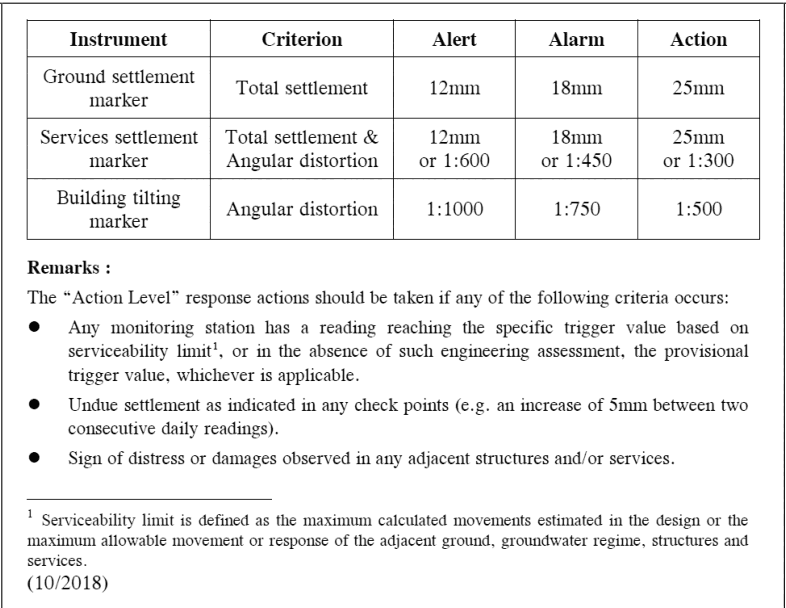{ width="508" loading=lazy }
  <figcaption>Diagram 1 from the original summary (ADF 3/2022, item 19). 原文附圖。</figcaption>
</figure>

**BD's response 屋宇署回覆:** BD clarified that the engineering approach was applicable to all sites and the adoption of the serviceability limits greater than the provisional trigger values might be adopted as long as the impact to the surrounding roads, utilities and buildings were properly assessed and the serviceability limits were agreed by the affected undertakers. BD would remind officers the relevant requirements in PNAP APP-137.

### 20. Clarification of Maximum Vertical Bar Spacing for Columns {#i2022051320}

Raised by **AREC** · Related 相關: [APP-142](../pnap/app-142.md)

**Question 問題:** According to clauses 9.5.1 and 9.9.2.1 of the Concrete Code, the maximum allowable spacing for vertical bar is not specified. In clause 9.5.1 of the Concrete Code, it only stated the minimum number of vertical bars required. In clause 9.9.2.1 of the Concrete Code, it only stated the rebar ratio and spacing of transverse rebar (where vertical bar was not mentioned).

**BD's response 屋宇署回覆:** BD advised that no maximum allowable spacing for vertical bar was specified in the Concrete Code, and BD would review the issue in the Technical Committee on the Code of Practice for Structural Use of Concrete.

### 21. GFA Concession for Plant Rooms {#i2022051321}

Raised by **PBSCA** · Related 相關: [APP-2](../pnap/app-2.md), [APP-150](../pnap/app-150.md), [B(P)R 23 & 23A Building height, site are](../regulations/bpr-23-23a.md)

<small>Related discussions 相關討論: [9 Aug 2024 item 31](2024.md#i2024080931), [22 Nov 2024 item 6](2024.md#i202411226), [21 Nov 2025 item 17](2025.md#i2025112117)</small>

**Question 問題:** According to paragraph 11 of PNAP APP-2, “Under regulation 23(3)(b) of B(P)R, the BA may disregard from GFA calculation floor space occupied solely by machinery or equipment for lift, air-conditioning, heating system or any similar service. The phrase "any similar service" may generally be interpreted to include fire control centre, water tanks, electrical switch rooms, meter rooms, transformer rooms, generator rooms, pump rooms, telephone equipment rooms, cable riser duct room, CO rooms, hose reel closets, sewage treatment plant rooms and smoke extraction system. …

**BD's response 屋宇署回覆:** BD advised that according to paragraph 4 and 5 of PNAP APP-150, for wholesale or partial conversion of an existing industrial building to data centre, where the proposed conversion would result in certain covered carparking spaces shown on the approved building plans of the original industrial building becoming redundant and such carparking spaces had previously been disregarded from the GFA calculation under regulation 23(3)(b) of the B(P)R, application for modification of regulation 23(3)(a) of the B(P)R to convert such redundant carparking spaces to additional transformer rooms or other mandatory features or essential plant rooms would be favourably considered according to its special circumstances and subject to favourable comments from relevant government departments.

### 22. GFA Concession for AC Plant Rooms {#i2022051322}

Raised by **PBSCA** · Related 相關: [APP-42](../pnap/app-42.md), [APP-151](../pnap/app-151.md), [APP-2](../pnap/app-2.md), [B(P)R 23 & 23A Building height, site are](../regulations/bpr-23-23a.md)

**Question 問題:** According to paragraphs 7 and 8 of PNAP APP-42, “in accordance with regulation 23(3)(b) of the B(P)R, any floor space genuinely intended for air-conditioning may be disregarded from GFA calculations, subject to compliance with the pre-requisites and the overall cap on GFA concessions stipulated in PNAP APP-151. The following provisions would be considered reasonable in the absence of the detailed design layout of the plants: (a) air-conditioning plant rooms not exceeding 1% of the total GFA of a building; and/or (b) air handling units, not exceeding 4% of the total GFA of each floor on which they are situated.” In case of data centre which requires high cooling capacity, the …

**BD's response 屋宇署回覆:** BD advised that according to regulation 23(3)(b) of B(P)R, any floor space genuinely intended for AC might be disregarded from GFA calculation, subject to compliance with the pre-requisites and the overall cap on GFA concessions stipulated in PNAP APP-151. In case of data centre which required high cooling capacity and adopted cooling towers with a large water tank to support the building use, full justification would be required to be submitted to BD for seeking the advice from the Director of Electrical and Mechanical Services during the plan processing stage.

### 23. GFA Calculation of U/G Fuel Tank {#i2022051323}

Raised by **PBSCA** · Related 相關: [APP-2](../pnap/app-2.md), [B(P)R 23 & 23A Building height, site are](../regulations/bpr-23-23a.md)

<small>Related discussions 相關討論: [29 May 2020 item 19](2020.md#i2020052919), [29 Sep 2020 item 15](2020.md#i2020092915), [14 Jan 2022 item 8](2022.md#i202201148)</small>

**Question 問題:** According to paragraph 1 of PNAP APP-2, “regulation 23(3)(a) of the B(P)R stipulates that gross floor area (GFA) is the area contained within the outer surface of external walls of a building measured at each floor level. Any portions of this area not floored over should also be included in the GFA calculations.” For an outdoor underground fuel tank of less than 2 m depth, with opening covered by steel cover, resembling a large manhole, can the fuel tank be exempted from GFA calculation?

**BD's response 屋宇署回覆:** BD would favourably consider disregarding the outdoor underground fuel tank from GFA calculation provided that it was in a genuine design and the abuse of such was unlikely.

### 24. GFA Concession for Electric Vehicle (EV) Charging-enabling Carparking Spaces {#i2022051324}

Raised by **PBSCA** · Related 相關: [APP-2](../pnap/app-2.md)

**Question 問題:** According to paragraph 18 of PNAP APP-2 as shown below, carparking spaces to be disregarded from GFA calculations should be EV charging-enabling. Is this requirement also applicable to carparking spaces for light goods vehicles and heavy goods vehicles?

<figure markdown>
  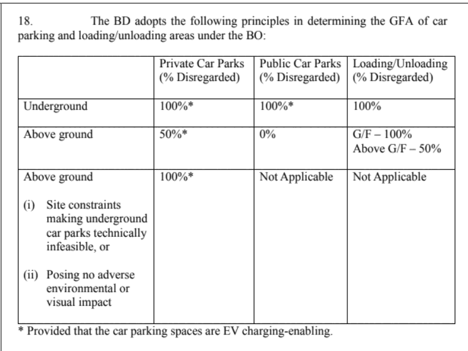{ width="494" loading=lazy }
  <figcaption>Diagram 1 from the original summary (ADF 3/2022, item 24). 原文附圖。</figcaption>
</figure>

**BD's response 屋宇署回覆:** BD advised that EV charging-enabling facilities should be provided for all types of carparking spaces to be disregarded from GFA calculation under PNAP APP-2.

### 25. Temporary Security Mesh Fence {#i2022051325}

Raised by **PBSCA**

**Question 問題:** For security purpose, a cordon by mesh fence is provided for equipment / materials temporarily placed in the loading and unloading area before they are loaded onto vehicles or delivered away from the loading and unloading area. As the equipment / materials cordoned off by mesh fence is uncovered, we note that there should be no GFA implication for the erection of temporary security mesh fence enclosing a portion of the loading and unloading area which is GFA non-accountable. Is our understanding correct?

**BD's response 屋宇署回覆:** BD advised that loading and unloading area should only be used for loading and unloading purpose. If any portion of such loading and unloading area was changed to temporary storage use, it should be included in GFA calculation and the proposed change in the car park design would be circulated to relevant government departments for comments.

### 26. Provision of Firefighting and Rescue Stairway (FRS) Lobby {#i2022051326}

Raised by **PBSCA** · Related 相關: [FS Code 2011 Part D: Means of Access](../codes/fsc-part-d-means-of-access.md)

**Question 問題:** According to Clause D16.1(a) of the FS Code, a lobby to FRS has limitation in area ranging from 5 m 2 to 10 m 2 . Due to the site constraints of an existing building, the existing fireman’s lift is not closed to the perimeter of the building or the proposed FRS. In case the proposed A&A works of the building require an upgrading for the provision of a new FRS, would it be acceptable by forming a protected link corridor between the proposed FRS and the existing fireman’s lift lobby (see Scenario 1) to comply with the requirement and/or to have the area of the fireman’s lift lobby to be more than 10 m 2 (see Scenario 2)? Firemen lift lobby and FRS (3).pdf

**BD's response 屋宇署回覆:** BD advised that under Section 3, Part A of the FS Code, FRS meant a stairway accommodating an access staircase and a fireman’s lift. Clause D16.1(a) of the FS code stipulated that access from the stairway to that floor should be through a lobby which should have a floor area of not less than 5 m 2 and not more than 10 m 2 with a minimum dimension of 1.5 m. Scenario 1 was not acceptable noting that the fireman's lift was not accommodated in a stairway with the access staircase. For Scenario 2, it was noted that the size of the lobby marginally exceeded the maximum requirement of 10 m 2 . BD would take a pragmatic approach and consider the case merit subject to AP's justification and the comments of relevant departments.

### 27. Provision of Sanitary Fitments {#i2022051327}

Raised by **PBSCA**

**Question 問題:** There is no stipulated requirement on sanitary fitments for data center. Would BD confirm whether the total usable floor area (UFA) of all floors of the data center could be adopted for the calculation of the required provision of sanitary fitments (similar to that for shopping mall), so that all the required sanitary fitments to be provided at ancillary office level or the entrance lobby (caretaker floor level) would be acceptable, instead of providing the fitments on floor-by-floor basis? Other than the above, would BD accept the provision of accessible unisex toilets only at the levels of ancillary office and entrance lobby? AOB Items

**BD's response 屋宇署回覆:** BD advised that a data centre would fall within the category of “industrial undertaking” under “workplaces”. The number of sanitary fitments provided in a workplace should follow regulation 5 of Building (Standards of Sanitary Fitments, Plumbing, Drainage Works and Latrines) Regulations, depending on the number of persons based on the UFA of the workplaces. In general, the proposed sanitary fitments should be readily accessible to the intended users of the workplaces without the need of gaining access through other private premises. In addition, in view of the variety of layouts and the relatively large floor areas of data centre, the location of toilets should be reasonably designed taking into consideration of the convenience of the users. BD also advised that according to paragraph 47 in Division 11 of the DM:BFA, where toilet was provided on a floor, at least one shall be designed as an accessible unisex sanitary facility.

### 28. Increasing the Number of Attendees at the APSEC Discussion Forum {#i2022051328}

Raised by **PBSCA**

**Question 問題:** (ADF) (Item raised by HKIA) Owing to the relatively large number of questions raised by HKIA in the past ADFs, HKIA requests BD to consider increasing the number of their attendees from 4 to 6 in the future ADFs, to allow members who contributed the questions to attend the ADFs in person and participate in the discussion.

**BD's response 屋宇署回覆:** BD would look into the issue.

### 29. Safety Test for Curtain Wall {#i2022051329}

Raised by **PBSCA** · Related 相關: [APP-37](../pnap/app-37.md)

**Question 問題:** (Item raised by ACEHK) Due to the backlog of testing accumulated during the COVID-19 pandemic, some contractors have expressed their difficulties in finding a local laboratory to carry out safety test for curtain wall as specified in PNAP APP-37 before the end of September 2022. This will seriously affect the site progress. To alleviate the possible delay, they can carry out the tests in other laboratories located in Guangdong Province. However, due to the current COVID-19 situation, supervisory personnel are unable to carry qualified supervision for the tests in the mainland China. …

**BD's response 屋宇署回覆:** BD advised that they would consider the proposed arrangement on case basis. BD also reminded that the test should be carried out by an independent laboratory accredited by the Hong Kong Laboratory Accreditation Scheme (HOKLAS) or by other laboratory accreditation bodies which had reached mutual recognition agreements/arrangements with HOKLAS.

## ADF 2/2022 · 18 Mar 2022 {#adf-22022-18-mar-2022}

[Original summary (PDF) 原文](https://www.hkie-st.org/wp-content/uploads/2022/07/101_Summary-of-Items-Discussed-in-2_2022-ADF-on-18.3.2022.pdf) · 24 items

### 1. Sites separated by a Street under the Same Lease {#i202203181}

Raised by **HKIA** · Related 相關: [APP-104](../pnap/app-104.md), [BO s.31–39C Projections over streets, co](../regulations/bo-part-3-miscellaneous.md)

**Question 問題:** Some sites, separated by public streets, are under a single CDA zone and the same lease with a single lot number. Those separate sites are connected on aboveground levels, with plant rooms and services, green features, and other features like amenity features shared among the sites within the same development. i) Our understanding is that the plant rooms and services, green features, and other features like amenity features can be shared between both Site A and Site B and each site does not need to be “self-sustained”. …

<figure markdown>
  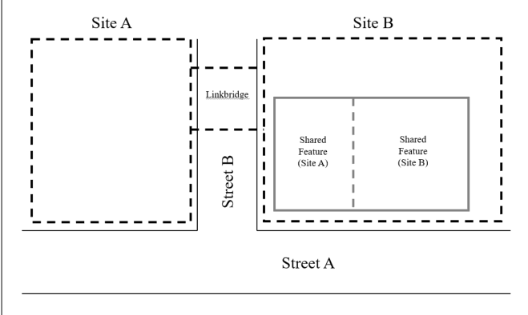{ width="426" loading=lazy }
  <figcaption>Diagram 1 from the original summary (ADF 2/2022, item 1). 原文附圖。</figcaption>
</figure>

**BD's response 屋宇署回覆:** In principle, if a single lot was completely divided by a public street, the subject lot would then be regarded as two separate sites under the Buildings Ordinance (BO). As such, GFA concessions for the plant rooms and services, green features and other features like amenity features should be considered individually for each site. Any link bridge connecting the buildings on the two sites and projecting over the street should be subject to the control under section 31(1) of the BO. Notwithstanding the above, if the two sites were under same lease and same ownership and subject to effective planning controls in addition to the BO, particularly in relation to enforceable lease control drawings, Master Layout Plans, conditional permissions under Section 16 of the Town Planning Ordinance, etc., BD was prepared to favourably consider on case basis to allow sharing of some features such as recreational facilities between the two sites as long as it was technically feasible. If the two separate portions were pursued as two phases, the phasing plan should be submitted to BD for approval.

### 2. Regulation 23(3)(a) of Building (Planning) Regulations (B(P)R) and PNAP APP-2 - Voids in Main Common Entrance Lobbies of {#i202203182}

Raised by **HKIA** · Related 相關: [APP-2](../pnap/app-2.md), [APP-42](../pnap/app-42.md), [APP-151](../pnap/app-151.md)

**Question 問題:** Non-domestic Buildings Voids in main common entrance lobbies of non-domestic buildings can be exempted from GFA calculation according to paragraph 2(f) of PNAP APP-2. It is our understanding that same principle is applicable to voids in common entrance lobbies of the non-domestic portion of the composite buildings provided that the lobbies are accountable for non-domestic GFA. Would BD please clarify if our understanding is correct?

**BD's response 屋宇署回覆:** According to paragraph 2(f) of PNAP APP-2 and paragraph 24 of PNAP APP-42, BD might favourably consider to grant modification of regulation 23(3)(a) of B(P)R to exempt voids over main common entrance lobbies of non-domestic buildings in prestige entrance design from GFA calculation subject to compliance with the pre-requisites and the overall cap on GFA concessions under PNAP APP-151. For prestige entrance lobbies serving the non-domestic portion of composite developments, for example, the main entrance of shopping arcade, the Building Authority (BA) might also consider to grant modification of regulation 23(3)(a) of B(P)R to exempt the voids over such prestige entrances from GFA calculation.

### 3. Room Containing Soil Fitment - Regulation 36(4) of B(P)R {#i202203183}

Raised by **HKIA**

**Question 問題:** Further to item 2 of the APSEC Discussion Forum (ADF) 3/2016 and item 3 of ADF 5/2016, we would like to seek BD’s further advice on whether the following scenarios comply with regulation 36(4) of B(P)R:-

<figure markdown>
  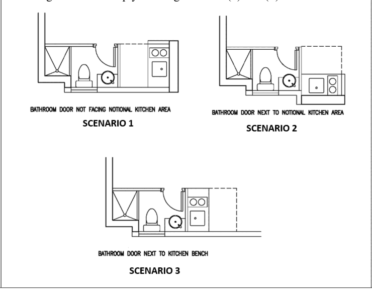{ width="479" loading=lazy }
  <figcaption>Diagram 1 from the original summary (ADF 2/2022, item 3). 原文附圖。</figcaption>
</figure>

**BD's response 屋宇署回覆:** Taking a pragmatic approach, BD might favourably consider that the doors under the proposed scenarios did not open directly into a kitchen noting that the doors were not fronting on to the notional kitchen areas, and the scenarios might comply with regulation 36(4) of B(P)R.

### 4. Site Coverage of Greenery {#i202203184}

Raised by **HKIA** · Related 相關: [APP-152](../pnap/app-152.md)

!!! warning "Later discussion 其後再討論"
    This question was discussed again on **23 Feb 2024**; use the [later response](2024.md#i202402236) where they differ. 如有不同，以較新回覆為準。

<small>Related discussions 相關討論: [25 Nov 2022 item 9](2022.md#i202211259)</small>

**Question 問題:** Under Appendix D to PNAP APP-152, for greenery areas to be provided at locations other than the Primary zone, it is our understanding that such greenery areas are NOT required to be visible or accessible to the public, visitors or occupiers of the premises (where such greenery can still help mitigating the heat island effect and hence improving the environmental quality), subject to the access for maintenance is to be provided. That said, such greenery areas are acceptable to be located, inter alia, at the inaccessible top roof of a high-rise building, where provision of maintenance access to the same is in place. Please confirm that our understanding is correct.

**BD's response 屋宇署回覆:** BD had no adverse comment on HKIA’s interpretation. According to paragraph 5 in Appendix D to PNAP APP-152, communal access paths from the common areas should be provided for maintenance of the planters on the inaccessible flat roofs.

### 5. Night-time Public Parking Spaces under Lease {#i202203185}

Raised by **HKIA** · Related 相關: [APP-2](../pnap/app-2.md)

**Question 問題:** As a Government’s policy, it has now becoming common in some new land leases that certain percentages of ancillary motor vehicle parking spaces and/or ancillary loading/unloading spaces in private developments are required by the Commissioner of Transport to be reserved and designated for “night-time parking” by members of the public for the parking of respective types of motor vehicles as specified in the respective leases. …

**BD's response 屋宇署回覆:** BD advised that HKIA’s understanding was correct. Except during night-time parking, the primary function as car parking spaces and/or loading/unloading areas ancillary to the building would remain unchanged. In this connection, the concerned ancillary car parking spaces and/or loading/unloading areas would not be considered as “public car parks”. GFA concession would be granted in accordance with paragraph 18 of PNAP APP-2.

### 6. AC Platform combined with Balcony/Utility Platform (UP) {#i202203186}

Raised by **HKIA**

<small>Follows earlier discussion: [21 May 2021](2021.md#i2021052112)</small>

**Question 問題:** Subsequent to item 12 of ADF 3/2021 dated 21 May 2021, BD had advised earlier that the requirement of 400mm working space on one side of the AC as stipulated in paragraph 2(b) of Appendix C to the Code of Practice on Access for External Maintenance 2021 (AfEM Code) was also applicable to AC platform combined with balcony/UP. Due to limited external wall frontages, it is very common that only one AC platform combined with balcony/UP can be accommodated for each unit. …

**BD's response 屋宇署回覆:** While further study and consultation with the practitioners were required for the review of the AfEM Code, suggestion of HKIA was considered acceptable as an interim measure. For AC platform combined with balcony/UP with working space on one side of the AC unit less than 400 mm, a Registered Professional Engineer in building services division should certify that the design of the A/C installation had been fully assessed and the working space provided was adequate for future maintenance and repair (M&R) through the access as outlined in the approved M&R access plan, and such certification should be submitted together with the relevant building plans prepared by the AP to the BA for consideration.

### 7. Architectural Features not Projecting over Street {#i202203187}

Raised by **HKIA** · Related 相關: [APP-19](../pnap/app-19.md)

**Question 問題:** For paragraph 3(f) of PNAP APP-19, from our understanding, the height limit of 2.5m above the level of the ground shall not apply to architectural features that are entirely within the site which are NOT projecting over a street. Please advise if our understanding is correct.

**BD's response 屋宇署回覆:** BD advised that under paragraph 3(f) of PNAP APP-19, architectural features projecting from the face of a building, having no significant impact on building bulk, and complying with the limits on projection (i.e. 500mm) and clear height (i.e. 2.5m) in regulation 7(1) of B(P)R, need not be counted for site coverage and plot ratio. BD might consider to accept architectural features not complying the height limit of 2.5m above ground level on individual case merit provided that they would not pose any positional danger to the public and occupants of the building.

### 8. Usable Floor Space {#i202203188}

Raised by **HKIA**

**Question 問題:** Under regulation 2 of B(P)R, the definition of Usable Floor Space (UFS) is “any floor space other than staircases, staircase halls, lift landings, the space used in providing water-closet fitments, urinals and lavatory basins and the space occupied by machinery for any lift, air-conditioning system or similar service”. To our understanding, the common corridors and lift lobbies in multi-units buildings shall be consider as “staircase halls and lift landings” and shall not be required to be included in the calculation of UFS. Please advise if our understanding is correct.

**BD's response 屋宇署回覆:** BD advised that the common corridors and lift lobbies in multi-units buildings might be excluded from the calculations of UFS provided that they were solely for circulation purpose without occupied accommodation.

### 9. Proposed Amendments to Form BA5 {#i202203189}

Raised by **HKIE** · Related 相關: [B(A)R Building (Administration) Regulati](../regulations/bar-123a.md)

**Question 問題:** (i) The certificate of registration number of AP/RSE/RGE shall be adopted in lieu of his/her HKID No. in Section 2 of Part A. (ii) In case the person who prepared the plans is a nominated AP/RSE/RGE under section 4(2) of BO, Form BA21 instead of Form BA4 shall be referred to in Section 3 of Part A. (iii) Form BA5 (Part A and Part B) in respect of the application for approval of plans pursuant to regulation 29 of Building (Administration) Regulations (B(A)R), may not be applicable for Type II plans which are submitted in writing for approval under regulation 33 of B(A)R. …

**BD's response 屋宇署回覆:** BD advised the following:- For (i), the applicant might be the building owner and hence it was necessary for the applicant to indicate his/her HKID no. or business registration no., as the case might be. For (ii), with reference to the current practice, Form BA21 or the copy of Form BA21 would be submitted together with Form BA5 for application for approval of plans. For (iii), regulation 18A of B(A)R was applicable to plans submitted for BA’s approval under regulations 29 or 33 of B(A)R. BD would review if any amendments to Form BA 5 was necessary.

### 10. Certified Copy of the Plan during Approval {#i2022031810}

Raised by **HKIE**

**Question 問題:** As regards the streamlined measure in item 8 of ADF 3/2016 held on 27.5.2016, some BD officers still refuse to accept certified true copy of the Set I plans with amendments agreed by BD officer for the approval process. Would BD please clarify this policy with frontline officers.

**BD's response 屋宇署回覆:** BD advised that the streamlined measure promulgated in item 8 of ADF 3/2016 was still pertinent, and would remind their frontline colleagues again on such arrangement. BD reminded that certified true copy of the whole Set I plans should be submitted.

### 11. Definition of Major Revision/Amendment for Foundation Works {#i2022031811}

Raised by **HKIE**

**Question 問題:** Would BD provide more guidelines on the definition of “Major Revision/Amendment” for foundation submissions.

**BD's response 屋宇署回覆:** BD advised that the following revisions might be considered as “Major Revisions” of Foundation Works:- • Proposal of a non-recognised type of pile foundation without first approval in this submission; • Material change of founding materials; • Revisions involving new type(s) of foundation; • Amendments leading to changes in load path which would affect nearby sensitive receivers; and • Cases requiring decisions from the Structural Engineering Committee (SEC) BD advised that the above examples were not exhaustive and the RSE/RGE were encouraged to make use of the pre-submission enquiry service to settle the issue at early stage. To have a better understanding of BD’s consideration, HKIE requested BD to provide reasons in their notification letter for major revisions.

### 12. Pre-drilling for Foundation Works {#i2022031812}

Raised by **HKIE**

**Question 問題:** As a general practice, BD accepts boreholes executed under the quality site supervision of AP/RGE for the proposed GI works as pre-drilling record for ascertaining the rockhead profile for subsequent foundation works. Would BD please confirm if this practice is still valid.

**BD's response 屋宇署回覆:** BD confirmed the prevailing practice was still valid.

### 13. Minor Amendment with Modification to regulation 33(1) of B(A)R for Superstructure Works {#i2022031813}

Raised by **HKIE** · Related 相關: [ADM-19](../pnap/adm-19.md), [B(A)R Building (Administration) Regulati](../regulations/bar-123a.md)

**Question 問題:** As regards Appendix G to PNAP ADM-19, the amendment of BD advised that deferred submission of minor amendment might be superstructure works (cast-in embeds for curtain balustrade etc.) will not affect the overall structural stability of the building, and calculations of the cast-in embeds for curtain wall, glass wall, it can be taken as one of the minor amendment items subject to balustrade etc. had been obtained. modification of regulation 33(1) of B(A)R.

**BD's response 屋宇署回覆:** wall, glass wall, favourably considered only if the first approval of the relevant details To streamline the submission process involving curtain wall, BD advised that the matter would be discussed in the working group for the streamlined arrangement on structural submission of secondary structural elements.

### 14. Revised Clause 10.3.4.2 of the Code of Practice for Structural Use of Concrete 2013 (2020 Edition) (Concrete Code) on Concrete Cube Tests {#i2022031814}

Raised by **HKIE** · Related 相關: [APP-142](../pnap/app-142.md)

<small>Related discussions 相關討論: [13 Aug 2021 item 12](2021.md#i2021081312)</small>

**Question 問題:** During Construction (i) The revised clause specifies 150 mm cubes be adopted if the maximum aggregate size of concrete exceeds 20 mm. However, the industry normally adopts the term “Nominal Aggregate Size” to define grading of aggregate (Table 3.1 of CS3 attached refers). Should “maximum aggregate size” be adopted, only 150 mm cube can be used. Would BD please clarify. Table 3.1 of CS3.pdf (ii) The circular letter dated 23 February 2022 promulgates that the revision of the subject Code of Practice takes immediate effect without any exemption. …

**BD's response 屋宇署回覆:** BD advised the following:- For (i), reference should be made to Clause 7.1 of CS1:2010. “Maximum aggregate size” specified in the revised clause 10.3.4.2 of the Concrete Code should be interpreted as the nominal maximum aggregate size, and should be referred as the “nominal aggregate size” given in Table 3.1 of the CS3. For (ii), the addition of design requirements for plain concrete linings and the addition of general guidelines on monitoring early compressive strength of insitu concrete by maturity method would not affect ongoing projects; the revised requirements on the use of 100 mm and 150 mm concrete cubes were only applicable to concrete cubes made after the issuance of the circular letter on 23 February 2022.

### 15. Refuge Floor {#i2022031815}

Raised by **AAP** · Related 相關: [FS Code 2011 Part B: Means of Escape](../codes/fsc-part-b-means-of-escape.md)

!!! warning "Later discussion 其後再討論"
    This question was discussed again on **4 Aug 2023**; use the [later response](2023.md#i202308046) where they differ. 如有不同，以較新回覆為準。

<small>Follows earlier discussion: [29 May 2020](2020.md#i202005292), [26 Nov 2020](2020.md#i2020112612)</small>

<small>Related discussions 相關討論: [4 Aug 2023 item 6](2023.md#i202308046)</small>

**Question 問題:** According to Clause B18.2 (e) of the Code of Practice for Fire Safety in Buildings 2011 (FS Code), “The area for refuge should be open-sided above safe parapet height on at least two opposite sides to provide adequate cross ventilation…” There is no specific requirement on the opening size nor effective area for the mentioned “open-sided”. We would like to enquire whether safety meshes / grilles or louvers can be provided for the “open-sided”.

**BD's response 屋宇署回覆:** BD advised while there were no specific requirements on the "open-sided above safe parapet height" stipulated in Clause B18.2(e) of the FS Code, adequate cross ventilation should be provided. The open-sided portions should not be covered up by any meshes/grilles or louvres. Structural elements or mullions of the curtain wall at the open-sided portions might be considered on case basis if they have no adverse impact to the provision of adequate cross ventilation and the performance of the openings. [Post meeting note: The openings allow air movement through the refuge floor, and by providing direct access to the outside air, occupants feel safer, which was an important psychological aspect to the refuge floor . FSD had also advised previously that provision of meshes / grilles or louvers at the wall openings in refuge floor was considered not acceptable from firefighting point of view. The presence of louvers would block the views of those stranded in refuge floor waiting for rescue and obstruct them from signaling for rescue. This would add to their anxiety as they would like to know the latest development of the emergency situation and when they could be led to an ultimate place of safety.]

### 16. Covered Landscaped and Play Areas Paragraph 26 of PNAP APP-42 Amenity Features stipulates that: {#i2022031816}

Raised by **AAP** · Related 相關: [APP-42](../pnap/app-42.md), [APP-152](../pnap/app-152.md)

**Question 問題:** “The provision of communal podium gardens, covered landscaped and play areas is encouraged. Where these amenities occur under and within the perimeter of a domestic tower, a modification of Regulation 23(3)(a) of the B(P)R would be granted, provided the area is open in design and not encumbered with structural elements, and the total area exempted is within 5% of total domestic GFA.” We understand that there is no limitation on the height for the covered landscaped and play areas, please confirm if our understanding is correct.

**BD's response 屋宇署回覆:** APP-42 for communal podium gardens, covered landscaped and play areas. Nevertheless, under PNAP APP-152, for a communal podium garden adopted for fulfilling the building setback requirement under an alternative approach, such communal podium garden should have a clear height of not less than 4.5m for cross ventilation purpose.

### 17. Prescribed Window Under regulation 31 of B(P)R {#i2022031817}

Raised by **AAP** · Related 相關: [APP-124](../pnap/app-124.md)

**Question 問題:** (1) No prescribed window shall, for the purposes of regulation 30, be deemed to face into external air unless – (a) it faces into a street which is not less than 4.5m wide where under regulation 2 of B(P)R, “street” includes any footpath and private and public street. To our understanding, the guidelines for determining what constitutes a street for site classification and the criteria for regarding a street as a “specified street” as stated in PNAP APP-124 are not necessary to be complied with for determining the street for the purpose of prescribed window requirement as mentioned in regulation 31(1)(a) of B(P)R. Please confirm if our understanding is correct.

**BD's response 屋宇署回覆:** provided guidelines in determining what constitutes a street for the purpose of site classification under regulation 18A of B(P)R; whereas, regulation 31 of B(P)R prescribed the minimum requirements of window. Nevertheless, attention should be drawn to situations where the windows faced into a strip of land or intervening space before reaching a street or specified street. Under such situation, the strip of land or intervening space might not be forming part of the street or specified street.

### 18. Submission of Form BA10 {#i2022031818}

Raised by **AAP**

**Question 問題:** It is understood that submission of Form BA10 is intended to notify the BA of the appointment of registered contractor (RC) and the commencement of building works in accordance with the approved plans. As a single RC will be appointed to a construction site to carry out the works and supervision duty, it would be reasonable to submit one Form BA10 to cover all works for different type of plans approved under the same BD file reference (i.e. plans for metal canopy, cladding, protective barrier, metal louvre screen etc). Hence is it necessary to submit additional Form BA10 for every type of approved structural plans?

**BD's response 屋宇署回覆:** BD advised that AAP’s understanding was correct that a Form BA 10 might cover the appointment of a single contractor for different types of building works as long as the consent referred to in the Form BA 10 covered those types of building works. A new Form BA10 was required to be submitted for consent granted with a new permit number.

### 19. Submission of Form BA6 {#i2022031819}

Raised by **AAP**

**Question 問題:** When works are carried out to a building, a Form BA6 should be submitted to certify that the building has been inspected by the AP and is capable of bearing the loads and stresses which may be increased or altered. It is understood that such certification is necessary for existing buildings, should this also be required for alteration works of underground drainage involving temporary excavation?

**BD's response 屋宇署回覆:** BD advised that the submission of Form BA6 was required for all types of alteration and addition works including the said works.

### 20. Definition of Floor Area in Section 4 of the FS Code {#i2022031820}

Raised by **PBSCA** · Related 相關: [FS Code 2011 Part B: Means of Escape](../codes/fsc-part-b-means-of-escape.md)

**Question 問題:** In Clause B29.1(b) of the FS Code, the provisions of means of escape for persons with a disability under Section 4 do not apply to “any floor of a building on a site of an area of not more than 500 m 2 subject to the area of such floor being not more than 200 m 2 ”. For this floor area of 200 m 2 , we note that it should be referred to the usable floor area as defined in Section 3 in Part A of the FS code. Is our interpretation correct? AOB Items

**BD's response 屋宇署回覆:** BD clarified that the floor area of 200 m 2 mentioned in Clause B29.1(b) of the FS Code referred to the covered area instead of usable floor area.

### 21. Future Road / Street in New Development Areas (NDA) {#i2022031821}

Raised by **PBSCA** · Related 相關: [ADM-19](../pnap/adm-19.md), [B(P)R 18A–22 Site classification, site c](../regulations/bpr-18a-22.md), [B(P)R 39–49E Staircases, means of escape](../regulations/bpr-39-49e.md)

**Question 問題:** (Item raised by BD) The permanent public road/street serving NDA site as the specified street under regulation 18A of the B(P)R for the determination of site classification, or the EVA to the development under regulation 41D of the B(P)R, may still be under planning or construction at the time of GBP submission stage of the development. Also, the timing of the completion of such permanent road/street by the Government may not match with that of the application of Occupation Permit (OP) for NDA site. …

**BD's response 屋宇署回覆:** Members welcomed the pragmatic approaches. As regards whether similar guidelines and approaches would be set out for open spaces and pedestrian walkways required under lease of NDAs and also served as EVA or for the provision of natural lighting and ventilation for a development, BD advised that in view of different characteristics of NDAs with different development programme and phasing, considerations should be given on individual case merits, and encouraged the use of pre-submission enquiries to clarify the issues at early stage.

### 22. Submission of Information and Documents upon Certification of Completion of Building Works and/or OP Application {#i2022031822}

Raised by **PBSCA** · Related 相關: [APP-13](../pnap/app-13.md)

**Question 問題:** (Item raised by BD) Upon the submission of certificate of completion of building works and/or OP application, AP/RC should submit the certificate of accepted buildings materials and products and the schedule of building materials and products in accordance with PNAP APP-13. Delivery notes or respective demarcation plans to support the use of the materials and products as specified in the material schedule are not required unless under special circumstances. In case of doubt, AP may approach the respective chief or senior case officers for clarification.

**BD's response 屋宇署回覆:** Members noted and would follow the arrangement accordingly.

### 23. Arrangement for Site Inspections during the Latest Epidemic Situation {#i2022031823}

Raised by **PBSCA**

**Question 問題:** (Item raised by BD) Owing to the latest epidemic situation, BD advise that special arrangements of site inspections for processing OP applications and/or submissions of certificate of completion of works have been adopted. With prior agreement with the case officers, the use of videotelephony or 360-degree video may be accepted as an alternative to site inspection depending on case merits. Submission of photo records may be accepted for completion of minor A&A works.

**BD's response 屋宇署回覆:** Members welcomed the BD’s measures. Members also reported difficulties in reaching the relevant officers of some other departments during the epidemic. As discussed at the last Joint BSC and APSEC Meeting held on 24.2.2022, BD suggested Members to provide requests and suggestions with specific details for BD’s coordination and follow up.

### 24. Electronic Submission Hub (ESH) {#i2022031824}

Raised by **PBSCA**

**Question 問題:** (Item raised by BD) BD is spearheading the development of the ESH as a digital platform for receiving and processing of building plans, documents and applications submitted under the BO, as an alternative means to the present paper-based mode of submission. ESH will be implemented in three stages. Stage 1 of ESH will cover structural plan submissions for building works above ground not requiring cross-department referral (excluding alteration and addition works). Due to the epidemic situation and its impact on the system development process, the launch of Stage 1 of ESH, which was originally planned first quarter of 2022, will be rescheduled. …

**BD's response 屋宇署回覆:** Members noted the update on the ESH. for the BD for will be 17

## ADF 1/2022 · 14 Jan 2022 {#adf-12022-14-jan-2022}

[Original summary (PDF) 原文](https://www.hkie-st.org/wp-content/uploads/2022/06/99_Summary-of-items-discussed-in-1_2022-ADF-on-14.1.2022.pdf) · 16 items

### 1. Application of UVA Method for Provision of Natural Lighting and {#i202201141}

Raised by **HKIA** · Related 相關: [APP-130](../pnap/app-130.md)

**Question 問題:** Ventilation within a Courtyard of a Building Under PNAP APP-130, the unobstructed vision area (UVA) method is acceptable as an alternative way to demonstrate compliance of natural lighting and ventilation requirements. Please advise whether such UVA method is applicable to windows opened onto unobstructed area facing buildings and site boundary, as well as within a 4-side enclosed (but vertically unobstructed) courtyard within a building or between buildings (see Scenario 1 and 2 below).

<figure markdown>
  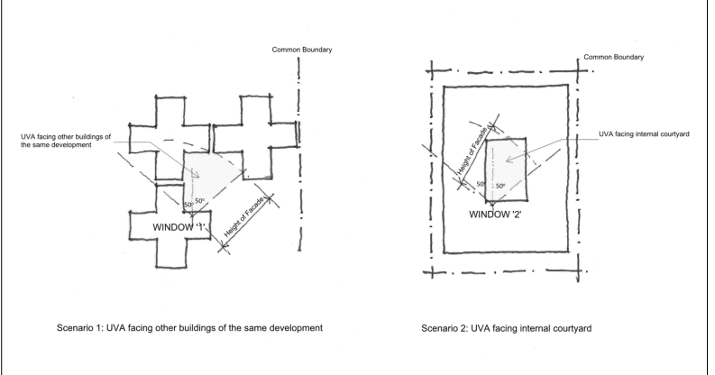{ width="513" loading=lazy }
  <figcaption>Diagram 1 from the original summary (ADF 1/2022, item 1). 原文附圖。</figcaption>
</figure>

**BD's response 屋宇署回覆:** BD accepted the unobstructed vision area (UVA) method to demonstrate compliance with the performance requirements. The principles and requirements of the UVA method were described in paragraphs 3.3 and 3.4 of Appendix A to PNAP APP-130. For scenarios not meeting the requirements, APs might alternatively demonstrate compliance with the above performance standards using any suitably verified and scientifically validated methods. According to paragraph 3.4 of Appendix A to PNAP APP-130, no window in the building should be counted for the calculation of UVA unless it faced into a space which was uncovered and not bounded on the side opposite the window by any obstruction of the building. Based on the above, BD advised that the UVA method was applicable to Scenario 1, but generally not applicable to Scenario 2. Subject to individual case merit, APs might discuss with the case officers including CBS for the particular issue. In response to HKIA’s request, BD would consider reviewing the application of the UVA method as an alternative way to demonstrate compliance with natural lighting and ventilation requirements.

### 2. Covered Areas under Elevated Structures and Large Projecting/Overhanging Features – JPN No. 4 and PNAP APP-19 {#i202201142}

Raised by **HKIA** · Related 相關: [APP-19](../pnap/app-19.md), [JPN 4](../pnap/jpn-4.md)

<small>Follows earlier discussion: [12 Nov 2021](2021.md#i202111125)</small>

<small>Related discussions 相關討論: [29 May 2020 item 1](2020.md#i202005291)</small>

**Question 問題:** Under Group I in the Appendix to JPN No. 4: Item 1: elevated structures are not accountable for gross floor area (GFA), provided BA is satisfied that the covered areas underneath such elevated structures would not be abused; and Item 12: covered areas under large projecting / overhanging features are not accountable for GFA provided they fulfill the requirements in paragraph 6 of PNAP APP-19. (i) Please clarify whether covered areas under elevated footbridges between two buildings within the same site are GFA accountable, if the concerned covered areas will not be abused, due to the fact that they are used as: - EVA with footpath; - Driveway for vehicles; and/or - Planters, etc. …

**BD's response 屋宇署回覆:** BD advised that, in general, the covered areas under the elevated footbridge between two buildings were GFA accountable under regulation 23(3)(a) of B(P)R. If the covered areas were used as EVA with footpath / driveway / planters of genuine design, or were designated as common parts of the building satisfying the requirements in paragraph 6 of PNAP APP-19, BD would pragmatically consider excluding such covered areas from GFA calculation under regulation 23(3)(b) of B(P)R on its case merits, provided that the covered areas were open in design and abuse was unlikely. Similar item was also mentioned in item 5 of ADF 5/2021 held on 12 November 2021. Elevated structures under Item 1 of Group I in the Appendix to JPN No. 4 referred to elevated platforms over sloping site, e.g. elevated garden areas and terraces, which were irrelevant to building setback area. For covered areas under projecting / overhanging features under Item 12 of Group I, if the projecting / overhanging features satisfied the requirements in paragraph 6 of PNAP APP-19, BD would pragmatically consider excluding the covered areas from GFA calculation on its case merits.

### 3. Clause B20.9 of Code of Practice for Fire Safety in Buildings 2011 (FS Code) – Provision of Thoroughfare for Cinemas or Theatres of {#i202201143}

Raised by **HKIA** · Related 相關: [FS Code 2011 Part B: Means of Escape](../codes/fsc-part-b-means-of-escape.md)

<small>Related discussions 相關討論: [17 Aug 2018 item 14](2018.md#i2018081714)</small>

**Question 問題:** Capacity not more than 500 Persons Regarding item 14 of the Summary of Items Discussed in ADF 4/2018 held on 17 August 2018, BD advised that favourable consideration would be given on case basis in extending the relaxation under Clause B20.9 of FS Code to cover cinemas and theatres in a non-domestic building not having polluting industrial undertakings or the non-domestic portion of a composite building, such that the site of such premises might be permitted to abut on one thoroughfare if the said thoroughfare was an acceptable EVA and the Director of Fire Services had no adverse comment on the arrangement. …

**BD's response 屋宇署回覆:** BD advised that the revision of Clause B20.9 of FS Code was in progress. Before the upcoming amendment of the FS Code, item 14 of the was still valid.

### 4. Areas/Spaces for Accommodating Parking Information System {#i202201144}

Raised by **HKIA**

**Question 問題:** As a government policy, parking information system has recently been required to be provided in new developments to the satisfaction of the Commissioner of Transport (C for T) via the lease control regime. Relevant clauses are included in new leases which require, inter alia, the lessee to designate areas or spaces within the development for accommodating facilities, installations and equipment for the purpose of submitting information regarding parking spaces of motor vehicles, including the number of vacant spaces, to C for T. …

**BD's response 屋宇署回覆:** BD advised that according to the Guidelines for Provision of Parking Information issued by the Transport Department, the developer should submit a layout plan indicating the designated common area for accommodating the facilities, installations and equipment to provide parking information to Commissioner for Transport’s (C for T) approval. In deciding on the areas of car parks including driveway and any associated facilities that could be disregarded from GFA calculation, BD would take into considerations if the car park is of genuine design and the spaces for such facilities are of reasonable size and to the satisfaction of C for T. This applied to parking information facilities.

### 5. Rooftop Staircase Hoods of Residential Developments – JPN No. 4 {#i202201145}

Raised by **HKIA** · Related 相關: [JPN 4](../pnap/jpn-4.md)

!!! warning "Later discussion 其後再討論"
    This question was discussed again on **12 Aug 2022**; use the [later response](2022.md#i202208125) where they differ. 如有不同，以較新回覆為準。

<small>Follows earlier discussion: [22 Nov 2019](2019.md#i2019112220)</small>

**Question 問題:** Regarding item 20 of ADF 5/2019 held on 22 November 2019, BD replied that whether GFA would be accountable for the staircase hood on roof of a private staircase linking the top floor to the roof would be considered on a case-by-case basis. Subsequent to the above discussion, the recent revision of JPN No. 4 stipulates that rooftop staircase hoods of residential developments are not counted towards GFA calculation provided that the size of the staircase hood is not excessive and that no other building facilities, features and structures at roof are accountable for GFA. In light of the above, can BD please clarify that provided the criteria in JPN No. …

**BD's response 屋宇署回覆:** BD advised that the staircase hood of a private staircase linking the top floor to the roof might be non-accountable for GFA calculation provided that the size of the staircase hood was not excessive and that no other building facilities, features and structures at roof were accountable for GFA. There had not been any change in BD’s requirement. The revised JPN No. 4 was issued to align the practices in determining the GFA accountability amongst BD, LandsD, and PlanD.

### 6. Acceptance of Hoarding Plan Prior to Approval of Demolition Plan {#i202201146}

Raised by **HKIE** · Related 相關: [ADM-19](../pnap/adm-19.md), [APP-21](../pnap/app-21.md), [APP-170](../pnap/app-170.md), [B(A)R Building (Administration) Regulati](../regulations/bar-123a.md)

**Question 問題:** Recently, it is noticed that a demolition plan was not approved by BD because the hoarding plan had not yet been accepted. Would BD please clarify whether the acceptance of hoarding proposal is a pre-requisite for demolition plan approval?

**BD's response 屋宇署回覆:** BD advised that according to paragraph 1(a) of Appendix D to PNAP ADM-19, precautionary measures particularly the hoarding, covered walkways and any necessary propping and shoring were the fundamental issues to be considered in processing demolition plans. While acceptance of hoarding proposal was not a pre-requisite for approval of demolition plans under the Buildings Ordinance, adequate precautionary and protective measures for the demolition works should be included in the demolition plans submitted for approval. Regulation 8(3) of Building (Administration) Regulations, Section 3 of the Code of Practice for Demolition of Buildings 2004 and PNAP APP-21 referred.

### 7. Safety Certificate for Hoardings / Covered Walkways or Gantries – PNAP APP-23 {#i202201147}

Raised by **HKIE** · Related 相關: [APP-23](../pnap/app-23.md)

<small>Related discussions 相關討論: [17 Nov 2017 item 4](2017.md#i201711174), [6 Feb 2026 item 5](2026.md#i202602065)</small>

**Question 問題:** PNAP APP-23 requires AP/RSE to sign and submit the safety certificates provided in its Appendices F, G and H, in which the AP/RSE confirms their personal inspection by signing “… hereby certify that I have inspected the hoarding, covered walkways and gantries erected at …” during annual safety certification, renewal application and minor amendment. As these routine inspection are conducted by AP/RSE’s representatives, it is recommended to slightly amend the wordings of certificates as below:- “… hereby certify that my representative has inspected the hoarding…”

**BD's response 屋宇署回覆:** BD advised that the proposed amendment was considered not acceptable. The objective of the self-certification scheme was to promote self-discipline of AP/RSE and to facilitate the development progress in compliance with the requirements under PNAP APP-23. It was crucial for AP/RSE to conduct the inspection in person to maintain a high standard of self-regulation and to safeguard the safety of the public and the workers on sites.

### 8. GFA Calculation in Duplex Unit {#i202201148}

Raised by **AAP** · Related 相關: [APP-2](../pnap/app-2.md)

<small>Related discussions 相關討論: [29 May 2020 item 19](2020.md#i2020052919), [29 Sep 2020 item 15](2020.md#i2020092915), [13 May 2022 item 23](2022.md#i2022051323)</small>

**Question 問題:** PNAP APP-2 stipulates that the horizontal area of a staircase may be disregarded/exempted from GFA if it solely serves floors accepted as not being accountable for GFA. Would BD please advise if the horizontal area of a circulation staircase on the upper floor of a duplex unit and the adjoining lift shaft may be exempted from GFA calculation, if there are no doors from the staircase or the lift shaft opened to the residential floor in question and the staircase leads up to the roof floor which is accepted as not being accountable for GFA.

<figure markdown>
  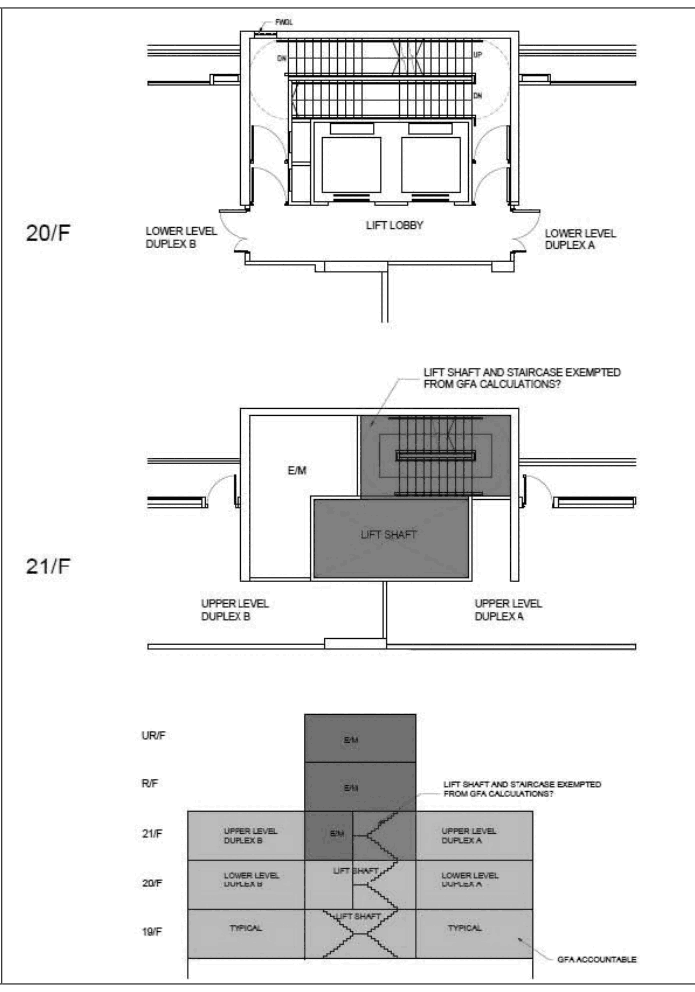{ width="449" loading=lazy }
  <figcaption>Diagram 1 from the original summary (ADF 1/2022, item 8). 原文附圖。</figcaption>
</figure>

**BD's response 屋宇署回覆:** BD advised that in the case as per the attached diagrams, the horizontal areas of the staircase and the lift shaft may be exempted from GFA calculation.

### 9. Requirements for Accessible Lifts {#i202201149}

Raised by **AAP** · Related 相關: [Design Manual: Barrier Free Access 2008 ](../codes/bfa-2008.md)

**Question 問題:** According to Division 19 of the Design Manual: Barrier Free Access 2008, paragraph 78(2) states that “Where there are more than three lifts in a building, access shall be provided to every floor by at least one lift having minimum internal car dimensions of 1500 mm x 1400 mm (either wide or deep) with a minimum clear entrance width of 850 mm.” To our understanding, “more than three lifts in a building” should mean “more than three lifts in a group of lifts serving the same zone”. Please confirm if our understanding is correct.

**BD's response 屋宇署回覆:** BD advised that according to Division 19 of the Design Manual: Barrier Free Access 2008, paragraph 78(2), “more than three lifts in a building” should mean more than three (i.e. four or more) lifts in the whole building instead of in a group of lifts serving the same zone.

### 10. Streamlining the Plan Approval Process {#i2022011410}

Raised by **PBSCA** · Related 相關: [ADV-33](../pnap/adv-33.md)

**Question 問題:** (i) BD’s officers often asked the staff of our members to make several times of visits to the office of BD for rectifying minor amendments of plans before giving approvals, even the plans were not final amendment plans . Could BD’s officers make comments and review amendments via email or telephone to reduce the number of amendments / visits by our members? (ii) Essentially, BD should carry out curtailed check on plans but it seems to us that each and every detail of the submitted plans was checked everytime and our members had to amend the plans to address all the comments. …

**BD's response 屋宇署回覆:** BD reminded the statutory duties of AP in complying with the provisions under the BO and its subsidiary regulations and advised that good quality of the building plans prepared by AP would definitely relief the workload of AP and BD’s staff arising from amendments necessary for approval. BD had been exploring means to facilitate the early approval of building plans. One of the ideas was to categorise essential information to be provided at various critical stages, e.g. obtaining the first GBP approval, applying for the first superstructure consent and occupation permit. In addition, in order to simplify the GBP submission, certain details as required according to current practice were proposed to be trimmed down. In this connection, draft revised PNAP ADV-33 was being prepared and would be circulated for BSC and APSEC Members’ comments in due course. In general, AP might communicate with BD’s officers on necessary amendments for approval via email, telephone or video conferencing before visiting BD’s office. To facilitate the above, BD had stepped up efforts in adopting appropriate information technology provisions which include (i) assigning a dedicated email box to strengthen the communications with applicants and practitioners, (ii) encouraging practitioners to provide an e-copy of drawings/supporting calculations & reports or hyperlink for accessing the soft copy with their submissions, and (iii) holding video conferences to facilitate deliberation and plan vetting process. …

### 11. BD’s Resources for Approval of Plans {#i2022011411}

Raised by **PBSCA**

**Question 問題:** While we appreciate BD’s effort in approving GBPs, members have recently reflected that the approvals of GBPs were usually dated back for two to three weeks. We understand that BD has been processing a lot of submissions. We appreciate that BD could allow sufficient resources to approve plans within the time frame. AOB Items

**BD's response 屋宇署回覆:** BD clarified that the letters of approval were dated on the day of the approval. BD also explained the administrative procedures for despatch of the approval plans to AP BD would monitor situation on plan processing and would ensure that the time lag between the approval of plan by BD and dispatch of approved plans to AP would be kept minimal.

### 12. Special Work Arrangement of New Buildings Divisions of BD {#i2022011412}

Raised by **PBSCA**

**Question 問題:** (Item raised by BD) BD clarifies that no “work from home” arrangement is adopted by the New Buildings Divisions (NBDs) of BD. Further to the Special Work Arrangement announced in BD’s Notice to Registered Building professionals and Registered Contractors dated 7 January 2022, BD updates that the AP/RSE Rooms in the NBDs’ offices will be closed until further notice. To implement targeted social distancing and infection control measures, communications with case officers should be carried out via telephone, email or video conferencing. “Drop-in” points have been set up in the lobbies of the respective floors of NBDs’ offices for the return of amended plans. …

**BD's response 屋宇署回覆:** Members noted and would follow the updated arrangement accordingly.

### 13. Quality Supervision in Factories by Grade T1 TCP of RC’s Stream {#i2022011413}

Raised by **PBSCA** · Related 相關: [APP-174](../pnap/app-174.md), [APP-157](../pnap/app-157.md)

**Question 問題:** (Item raised by HKIA) Precast concrete construction, tempered glass and MiC, which are widely adopted in the construction industry, are mostly fabricated in factories in the Mainland. Quality Supervisions are to be provided by AP, RSE and RC in accordance with the relevant requirements in the PNAPs and approval letters. Under the stepped up cross-boundary control as one of the anti-epidemic measures, BD issued a Circular Letter dated 7 February 2020 adopting a pragmatic and flexible approach to accept alternative arrangements for meeting supervision requirements. …

**BD's response 屋宇署回覆:** BD advised that the Circular Letter dated 7 February 2020 was under review and Members’ concern would be considered.

### 14. Flexibility in Site Coverage and Open Space Provision for A&A Works – PNAP APP-132 {#i2022011414}

Raised by **PBSCA** · Related 相關: [APP-132](../pnap/app-132.md), [APP-151](../pnap/app-151.md), [APP-152](../pnap/app-152.md)

<small>Related discussions 相關討論: [22 Nov 2019 item 16](2019.md#i2019112216), [21 May 2021 item 13](2021.md#i2021052113), [13 Aug 2021 item 1](2021.md#i202108131), [13 Aug 2021 item 10](2021.md#i2021081310), [13 May 2022 item 10](2022.md#i2022051310)</small>

**Question 問題:** (Item raised by HKIA) Under PNAP APP-132, in order to allow “greater flexibility in the design of buildings” for “the application of the site coverage and open space provisions under the B(P)R” and to “facilitate innovative building designs, the BA is prepared to consider applications for more flexible application of the requirements under Regulations 20 and 25 of the B(P)R and modify the provisions thereof…”. We would like to clarify if such allowance of “more flexible application of the requirements under regulations 20 and 25 of the B(P)R” is also applicable to A&A works as long as the criteria mentioned in paragraph 3 or 4 of the PNAP are being fulfilled. …

**BD's response 屋宇署回覆:** BD advised that the flexible site coverage under PNAP APP-132 was only applicable to new developments, subject to the pre-requisites set out under PNAP APP-151 and PNAP APP-152. It is not applicable to A&A works.

### 15. Performance-based Approach to Demonstrate Compliance with Natural Lighting and Ventilation Requirements {#i2022011415}

Raised by **PBSCA** · Related 相關: [APP-130](../pnap/app-130.md), [APP-156](../pnap/app-156.md)

**Question 問題:** (Item raised by AAP) To follow up on with Item 1, regarding the “Performance-based Approach” to demonstrate the compliance with natural lighting and ventilation requirements, BD may consider setting up a working group to review some of the requirements and cases on which the building industry has raised their concerns. In this connection, BD is invited to review the criteria set out under item 4(iii) in the Guidance Notes on Validation of Lighting Simulation Software, Appendix B to PNAP APP-130, regarding the material “reflectance” settings to be adopted in the validation test. …

**BD's response 屋宇署回覆:** BD would look into the issue.

### 16. Vote of Thanks {#i2022011416}

Raised by **PBSCA**

**Question 問題:** (Item raised by BD) AD/NB1 proposed a vote of thanks to Mr HO Hon-kit, Humphrey, AD/NB2 who attended this Forum for the last time before proceeding on pre-retirement leave.

**BD's response 屋宇署回覆:** Members supported the vote of thanks to Mr HO and wished him a happy retirement.

---
<small>Source: Summary of Items Discussed in APSEC Discussion Forum, published by the HKIE Structural Division. Condensed for reference; the PDF is the authoritative record.</small>
