---
tags:
  - APSEC
  - Structural 結構
  - Plan submission & approval 呈交及審批
  - Fire safety 消防安全
  - Foundation 地基
  - Staircase 樓梯
  - Registration 註冊
  - GFA 總樓面面積
  - Sustainable building design 可持續建築設計
  - Means of escape 逃生途徑
  - Site supervision 地盤監督
  - Fire resisting construction 耐火結構
  - Curtain wall & façade 幕牆及外牆
  - Barrier free access 無障礙
  - Domestic 住用
  - Site coverage 上蓋面積
  - Site safety 地盤安全
  - Geotechnical 岩土
  - GFA concession 樓面面積寬免
  - Minor works 小型工程
  - Excavation & ELS 挖掘
  - Balcony & utility platform 露台及工作平台
  - Maintenance access 維修通道
  - Lighting & ventilation 照明及通風
  - Concrete & materials 混凝土及物料
  - Lift 升降機
  - Car park 停車場
  - Means of access 救援通道
  - Drainage 排水
  - Open space 休憩用地
  - A&A works 改動及加建工程
  - Protective barrier 防護欄障
  - Refuge floor 庇護層
  - Site area & classification 地盤面積及分類
  - Plant rooms 機房
  - Hotel 酒店
  - Energy efficiency 能源效率
  - Building height 建築物高度
  - Green & amenity features 環保及適意設施
---

# APSEC discussion items 2023 <small>2023 年認可人士及註冊結構工程師委員會討論項目</small>

!!! info "About this page 關於本頁"
    Questions raised at the APSEC Discussion Forum (ADF) and **BD's responses**, extracted from the summaries published by the HKIE Structural Division. Text is condensed from the English source; check the PDF before relying on an item. Where a later meeting discussed the same question, the item is flagged and **the later response prevails**.
    摘錄自香港工程師學會結構分部發布的會議摘要（只有英文版本）。如其後會議再討論同一問題，以**較新的回覆為準**。

## ADF 4/2023 · 17 Nov 2023 {#adf-42023-17-nov-2023}

[Original summary (PDF) 原文](https://www.hkie-st.org/wp-content/uploads/2025/02/Summary-of-items-discussed-in-4_2023-ADF-on-17.11.2023.pdf) · 25 items

### 1. Cladding outside Floor/Room Without Accountable GFA {#i202311171}

Raised by **HKIA** · Related 相關: [APP-2](../pnap/app-2.md)

<small>Follows earlier discussion: [5 May 2023](2023.md#i202305054)</small>

<small>Related discussions 相關討論: [23 Feb 2024 item 1](2024.md#i202402231)</small>

**Question 問題:** Further to item 4 of ADF 2/2023 held on 5 May 2023, it was agreeable to BD that for floor/room which was non-accountable to GFA calculation with the curtain wall system projecting from the outer surface of the structural elements exceeding 200 mm for a domestic building or 250 mm for a non-domestic building, BD will take a pragmatic approach to consider disregarding the entire projection of the curtain wall enclosing such floor/room from GFA and SC calculations on case basis. We would like BD to clarify if the same understanding is also applicable to “cladding”.

**BD's response 屋宇署回覆:** BD advised that cladding could be disregarded from the calculations of GFA and site coverage if the relevant requirements under PNAP APP-2 were fulfilled. Whether the floors/rooms were accountable to GFA calculation or not was not a consideration under PNAP APP-2. If there were special circumstances that the thickness of the cladding exceeded the limit specified in PNAP APP-2, BD would consider each case on its own merits.

### 2. Site Coverage Flexibility under PNAP APP-132 – Minor Projecting Features {#i202311172}

Raised by **HKIA** · Related 相關: [APP-132](../pnap/app-132.md), [APP-19](../pnap/app-19.md), [B(P)R 18A–22 Site classification, site c](../regulations/bpr-18a-22.md)

<small>Related discussions 相關討論: [17 Nov 2023 item 3](2023.md#i202311173)</small>

**Question 問題:** As one of the criteria for considering the flexible application of the site coverage requirements under regulation 20 of the Building (Planning) Regulations (B(P)R) on the ground of setting back a building for its full height from a site boundary abutting on a street, it is stated in paragraph 3(d) of PNAP APP-132 that “the setback area is properly landscaped and/or paved and open, uncovered and without any permanent building structures other than the landscaped features and perforated boundary walls.” Following the principle for “total covered area” stated in footnote 3 of PNAP APP-132, we understand that “projections” under PNAP APP-19 are allowed within the setback area. …

**BD's response 屋宇署回覆:** BD advised that according to footnote 3 of PNAP APP-132, the projections under PNAP APP-19 was excluded from the calculation of the total covered area of the buildings on the site for the purpose of determining whether an unexcavated or backfilled area and open-sided covered areas of green features described under paragraph 4 of the said PNAP could be excluded from site coverage assessment. According to paragraph 3(d) of PNAP APP-132, building setback area should not have any permanent building structures other than the landscaped features and perforated boundary walls. In this regard, projections other than landscape features (i.e. metal supporting frames for growing of plants) under PNAP APP-19 were not allowed within the setback area.

### 3. Site Coverage Flexibility under PNAP APP-132 – Aggregated Site Coverage {#i202311173}

Raised by **HKIA** · Related 相關: [APP-132](../pnap/app-132.md), [B(P)R Parts I–II General and Projections](../regulations/bpr-parts-1-2.md)

<small>Related discussions 相關討論: [17 Nov 2023 item 2](2023.md#i202311172)</small>

**Question 問題:** For assessing the site coverage for buildings under PNAP APP-132 and to allow innovative building forms, would BD take a pragmatic approach to allow the permitted percentage site coverage listed in Appendices A and B to the said PNAP be applied discretely to each storey according to its corresponding building height stratum as illustrated in the diagrams below?

<figure markdown>
  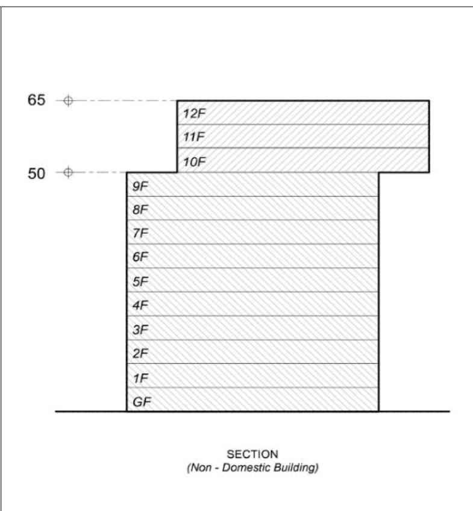{ width="507" loading=lazy }
  <figcaption>Diagram 1 from the original summary (ADF 4/2023, item 3). 原文附圖。</figcaption>
</figure>

<figure markdown>
  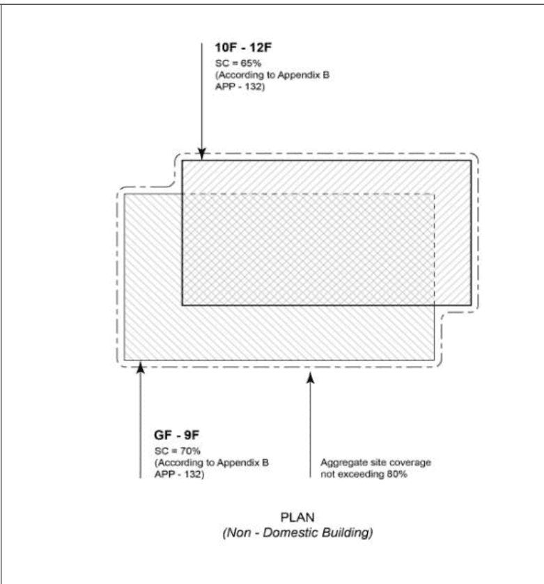{ width="505" loading=lazy }
  <figcaption>Diagram 2 from the original summary (ADF 4/2023, item 3). 原文附圖。</figcaption>
</figure>

**BD's response 屋宇署回覆:** BD advised that in accordance with regulation 2 of the B(P)R, site coverage referred to the area of the site that was covered by the building that was erected thereon. For assessing the site coverage of the building at a particular level under PNAP APP-132, area at that level covered by the structure above should be included in the site coverage calculation. Hence, the aggregate site coverage of the non-domestic building at the levels of G/F to 9/F as illustrated in the diagrams should not exceed the permitted site coverage according to its corresponding levels set out in Appendix B to PNAP APP-132.

### 4. Access between Required Staircases – Clause B8.2 of the Code of {#i202311174}

Raised by **HKIA** · Related 相關: [FS Code 2011 Part B: Means of Escape](../codes/fsc-part-b-means-of-escape.md)

**Question 問題:** Practice for Fire Safety in Buildings 2011 (June 2023 Edition) (FS Code) Clause B8.2 of the FS Code states that “where two or more required (a) staircases are needed, people using one required staircase should be able to gain access to at least one other required staircase at any time, without having to pass through other person’s private premises. Such access should be provided in the following manners: (b) (a) at least every 5 storeys, and on the roof or the topmost floor accessible to the required staircases; or (b) in case of refuge floor(s) are provided evenly between floors of the building, at the refuge floor(s) and the roof.” “Security measures that prevent access to a required …

**BD's response 屋宇署回覆:** BD advised that the horizontal area of a corridor which served as an access between the required staircases required under Clause B8.2 of the FS Code should be included in GFA calculation. BD advised that the delineation of an internal common corridor or passage without any physical enclosures (e.g. walls, glass, railing, etc.) on the floor for interchange between required staircases was acceptable under Clause B8.2 of the FS Code. Such internal common corridor or passage should be shown on the respective general building plans (GBP) as “common part”. In addition, security measures that prevent access for interchanging of staircases should be automatically deactivated upon actuation of a fire alarm signal or in power failure situation. The above requirements should be indicated on the respective GBP. In passing, BD reminded that minimum fire resistance rating (FRR) should be provided if such internal common corridor or passage in itself was also subject to the requirements in Clauses C6.1 and C7.4 of the FS Code.

### 5. Discharge Value Calculation {#i202311175}

Raised by **HKIA** · Related 相關: [FS Code 2011 Part B: Means of Escape](../codes/fsc-part-b-means-of-escape.md)

**Question 問題:** Clause B12.1 of the FS Code stipulates that “the required staircases serving the storeys of a building above the ground storey should have a total discharge value of not less than the total occupant capacity of those storeys assessed in accordance with Subsection B4.” It is our understanding that there is no need to demonstrate the sufficiency of the discharge value of each required staircase by dividing the total occupant capacity of the storeys by the number of required staircases serving these storeys and verifying that the divided occupant capacity would not exceed the discharge value of each staircase. Would BD please clarify whether the understanding is correct?

**BD's response 屋宇署回覆:** BD advised that under normal circumstances, it might not be necessary to demonstrate the sufficiency of the discharge value of each required staircase by dividing the total occupant capacity of the storeys by the number of required staircases serving those storeys. However, if part of the building was designed to be served by independent staircases, BD might require separate demonstrations on the sufficiency of discharge value of the staircases depending on the circumstances of the case.

### 6. Temporary Refuge Space (TRS) for Alteration and Addition (A&A) Works {#i202311176}

Raised by **HKIA** · Related 相關: [FS Code 2011 Part B: Means of Escape](../codes/fsc-part-b-means-of-escape.md)

<small>Related discussions 相關討論: [14 Feb 2025 item 21](2025.md#i2025021421), [8 Aug 2025 item 22](2025.md#i2025080822), [6 Feb 2026 item 4](2026.md#i202602064)</small>

**Question 問題:** Clause B30.1 of the FS Code states that “at least one temporary refuge space with an area of not less than 1.5 m x 1.5 m should be provided within the protected exit or fireman’s lift lobby of every fire compartment at every floor of a building to which this Section applies.” In some recent A&A submissions involving localised / minor A&A works on individual floors, provision of TRS is required even if there is no A&A works proposed within the building core or protected exits/fireman’s lift lobby of the floor. …

**BD's response 屋宇署回覆:** BD advised that the requirements of TRS were applicable to wholesale conversion or change of use of an entire existing building, while A&A works and change of use of parts or certain floors of an existing building were not required to comply with the said requirements.

### 7. Submission of Secondary Building Elements – Curtain Wall, Window Wall, Cladding etc. {#i202311177}

Raised by **HKIA**

<small>Follows earlier discussion: [25 Nov 2022](2022.md#i202211251)</small>

**Question 問題:** Based on item 1 of ADF 5/2022 held on 25 November 2022, BD advised that secondary building elements, such as metal ceiling, will not be required to be shown in the GBP provided that they had been indicated in the general notes and/or with typical details in the GBP. Would BD please clarify that the same principle could be adopted for curtain wall, window wall, aluminum/stone cladding, and/or similar secondary building elements so that not all of their elevations are required to be shown in the GBP, as long as their locations and detailed elevations are indicated in the separate structural submissions for these secondary building elements. …

**BD's response 屋宇署回覆:** BD advised that according to item 1 of ADF 5/2022 held on 25 November 2022, some secondary building elements, such as metal ceiling needed not be shown in the GBP, provided that the secondary building elements had been indicated in the general notes and/or with typical details in the GBP. However, such practice would not be applicable to curtain wall, cladding and the like, or other secondary elements that demonstration on compliance with the relevant requirements on planning, fire safety and/or building control was required in processing the GBP submission.

### 8. Maximum Headroom of Required Staircases for Common Use {#i202311178}

Raised by **HKIA** · Related 相關: [APP-5](../pnap/app-5.md)

**Question 問題:** In some recent cases, APs are required to add a false slab above the area with headroom higher than the maximum storey height allowed in paragraph PNAP APP-5 in the required staircases for common use in domestic buildings, which is normally found at their uppermost flight, so that headroom would not exceed the maximum storey height allowed in the PNAP. It is considered that the concerned area is a common area building and the chance of abuse of use is highly unlikely, if not impossible. It is our understanding that such false slab is therefore not required. BD please clarify whether our understanding is correct or not?

<figure markdown>
  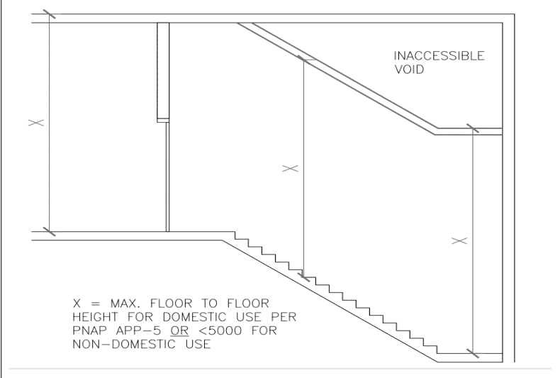{ width="511" loading=lazy }
  <figcaption>Diagram 1 from the original summary (ADF 4/2023, item 8). 原文附圖。</figcaption>
</figure>

**BD's response 屋宇署回覆:** BD advised that the HKIA’s understanding was correct. 5 of the said of the Would 8

### 9. Partial Screening of External Drainage Pipes by Architectural Features – Appendix C to PNAP APP-93 {#i202311179}

Raised by **HKIA** · Related 相關: [APP-93](../pnap/app-93.md)

<small>Related discussions 相關討論: [23 Feb 2024 item 3](2024.md#i202402233)</small>

**Question 問題:** In accordance with Appendix C to PNAP APP-93, the pipes should be exposed to the external at least on one side. As illustrated in the sketch below, direct visual sightline for pipes can be achieved via a building maintenance unit (BMU) with a reachable distance for maintenance. Would BD consider that such arrangement fulfils the requirements in Appendix C to the said PNAP.

<figure markdown>
  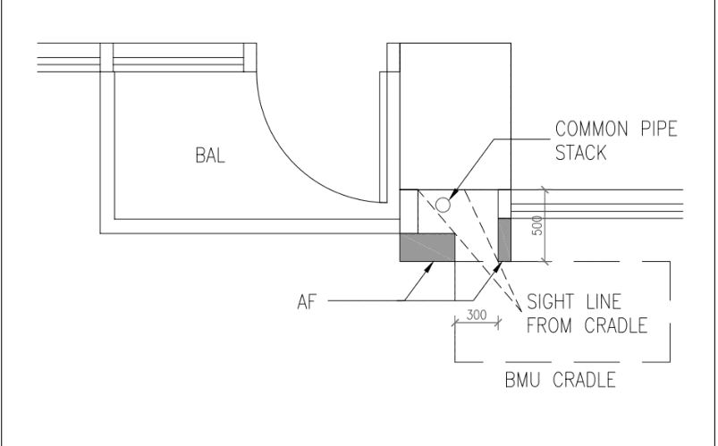{ width="519" loading=lazy }
  <figcaption>Diagram 1 from the original summary (ADF 4/2023, item 9). 原文附圖。</figcaption>
</figure>

**BD's response 屋宇署回覆:** BD advised that the proposed arrangement illustrated in the sketch was not acceptable as the pipe could not be readily inspected without the use of BMU, and hence did not fulfill the requirement in Appendix C to PNAP APP-93. Also, pursuant to paragraph 1.2 in Part 3 of the Code of Practice on Access for External Maintenance 2021, the maintenance and repair (M&R) should enable the workers to reach the extended external building elements within a hand-reachable range of not more than 500 mm. It appeared that architectural feature in the sketch would hinder carrying out the M&R works.

### 10. Separation between Common Internal Corridor and Rooms or Flats – Clause C7.4 of the FS Code {#i2023111710}

Raised by **HKIA** · Related 相關: [FS Code 2011 Part C: Fire Resisting Cons](../codes/fsc-part-c-fire-resisting-construction.md)

**Question 問題:** Example (a) “Travel distance requirements for Use Classifications 1 and 2” illustrated in Diagram B2 “Internal Corridor Access” of the FS Code, which was amended in its June 2023 Edition, indicates that the internal corridor is a protected corridor. Clause C7.4 of the FS Code only requires that “every common internal corridor serving rooms or flats in different occupancies should be separated from such occupancies by fire barriers having an FRR of not less than that of the Use Classification of that floor”. …

**BD's response 屋宇署回覆:** BD advised that the issue would be separately discussed.

### 11. Required Clear Width of Doors under Design Manual: Barrier Free Access 2008 (2021 Edition) (DMBFA) {#i2023111711}

Raised by **HKIA** · Related 相關: [FS Code 2011 Part B: Means of Escape](../codes/fsc-part-b-means-of-escape.md), [Design Manual: Barrier Free Access 2008 ](../codes/bfa-2008.md)

<small>Related discussions 相關討論: [17 Aug 2018 item 1](2018.md#i201808171), [21 May 2021 item 2](2021.md#i202105212), [5 May 2023 item 3](2023.md#i202305053), [8 May 2026 item 4](2026.md#i202605084)</small>

**Question 問題:** Paragraph 38 in Division 10 of DMBFA states that “door, including one leaf of a pair of double doors, shall have a clear width of not less than 800 mm between the open door and opposite jamb or the other leaf.” Paragraph 37 of the same division of DMBFA states that “the requirements of this Division apply to doors on accessible routes”, and according to Chapter 3 of DMBFA, “accessible route is a continuous unobstructed path which is easily identifiable for persons with a disability or the elderly to approach, enter and leave the building and to use the facilities therein without assistance or undue difficulties.” It is our understanding that the required staircase and its protected lobby …

<figure markdown>
  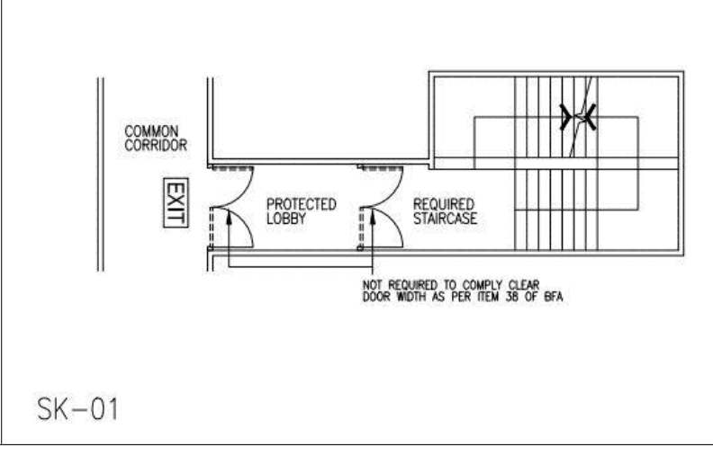{ width="512" loading=lazy }
  <figcaption>Diagram 1 from the original summary (ADF 4/2023, item 11). 原文附圖。</figcaption>
</figure>

<figure markdown>
  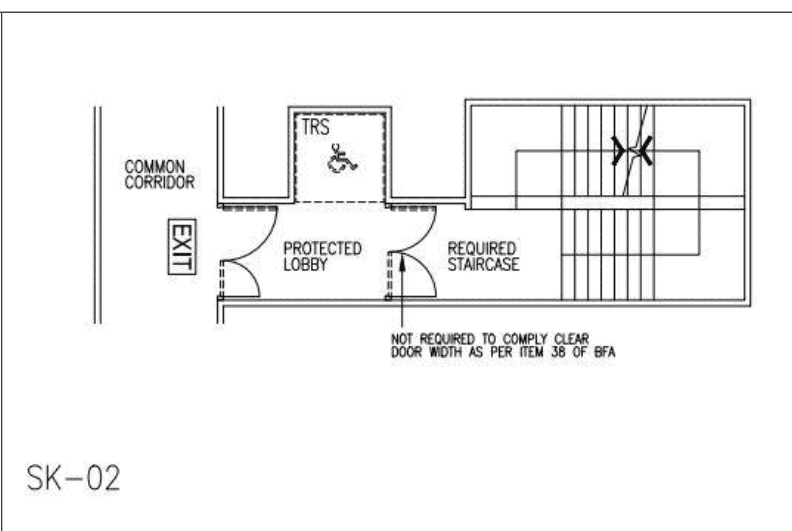{ width="512" loading=lazy }
  <figcaption>Diagram 2 from the original summary (ADF 4/2023, item 11). 原文附圖。</figcaption>
</figure>

**BD's response 屋宇署回覆:** BD advised that as long as the door at the protected lobby only led to the required staircase, HKIA’s understanding was correct. In case the protected lobby including its doors not only led to the required staircase, but also to other facilities (e.g. TRS, accessible unisex toilets, etc.) or areas/passages to which persons with a disability should have or might reasonably be expected to have access, all the relevant requirements under Divisions 9 and 10 of Chapter 4 of DMBFA should be complied with. BD also drew members’ attention to Clause B30.3 of the FS Code which required the minimum clear width of door leading to a TRS to be 850 mm. Item 15 of ADF 3/2016 held on 27 May 2016 was relevant.

### 12. Measurement of the Width of Exit Door {#i2023111712}

Raised by **HKIA** · Related 相關: [FS Code 2011 Part B: Means of Escape](../codes/fsc-part-b-means-of-escape.md)

**Question 問題:** “the width of an exit door Notes 2 of Table B2 of the FS Code states that should be the least clear width measured between the vertical members of the door frame.” Our understanding is that the measurement should be taken according to the diagram below. Would BD please advise if our understanding is correct or not?

<figure markdown>
  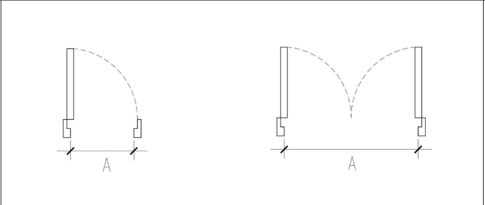{ width="519" loading=lazy }
  <figcaption>Diagram 1 from the original summary (ADF 4/2023, item 12). 原文附圖。</figcaption>
</figure>

**BD's response 屋宇署回覆:** BD advised that HKIA’s understanding was correct.

### 13. Building Works outside Railway Protection Area {#i2023111713}

Raised by **HKIE** · Related 相關: [APP-24](../pnap/app-24.md)

**Question 問題:** Paragraph 5 of PNAP APP-24 states that guidelines given in Appendices B and C only apply to building works within Railway Protection Area. Whilst AP/RSE/RGE should ensure their proposed building works will not cause any adverse impact on the railway facilities and structures, we suppose MTRCL’s comments on the proposal shall not be regarded as conditions imposed upon granting of consent to commence works outside Railway Protection Area. Would BD please confirm the above?

**BD's response 屋宇署回覆:** BD advised that if the site was wholly outside the Railway Protection Area, HKIE’s understanding was correct. If the site was located partly within the Railway Protection Area and the works outside such area might have impact on the railway facilities and structures (e.g. deep excavation works), BD would consider the case holistically including imposing MTRCL’s comments as conditions upon granting of consent to commence works outside Railway Protection Area on case basis.

### 14. Compliance Assessment under BEAM Plus NB – PNAP APP-151 {#i2023111714}

Raised by **AAP** · Related 相關: [APP-151](../pnap/app-151.md)

**Question 問題:** Paragraph 10 of PNAP APP-151 mentioned that “the pre-requisites for granting GFA concessions and relevant provisions in paragraphs 6 to 9 above are applicable to all new GBP or major revision of GBP for development proposals submitted to the BA for approval on or after 30 June 2024 and to GBP which have been previously disapproved and are resubmitted for approval on or after 30 June 2024.” Would BD please confirm the new pre-requisites shall not apply to localised major revision of GBP for development proposals submitted to the BA for approval on or after 30 June 2024?

**BD's response 屋宇署回覆:** BD advised that AAP’s understanding was correct.

### 15. GFA Calculation for Cavity Wall Systems at Car parks {#i2023111715}

Raised by **AAP** · Related 相關: [APP-2](../pnap/app-2.md)

**Question 問題:** Cavity wall systems are commonly provided in underground car parks to allow for proper drainage in case of water seepage and are considered as good practice according to Guidelines on Prevention of Water Seepage in New Buildings issued by the Buildings Department. It is commonly accepted for cavity wall systems at underground car park floors to be disregarded from GFA calculations. It is our understanding that the GFA of cavity wall system shall be determined in accordance with the determination of GFA for the car park floor it serves. …

<figure markdown>
  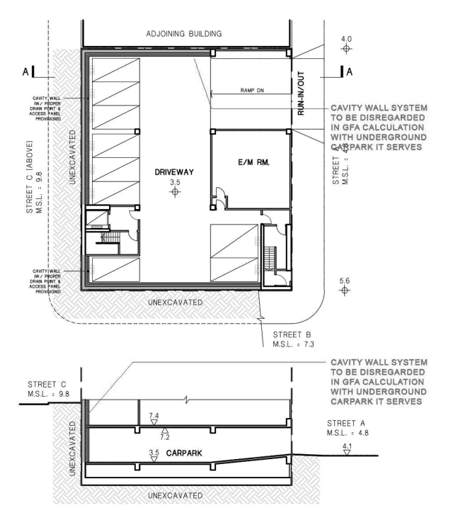{ width="414" loading=lazy }
  <figcaption>Diagram 1 from the original summary (ADF 4/2023, item 15). 原文附圖。</figcaption>
</figure>

<figure markdown>
  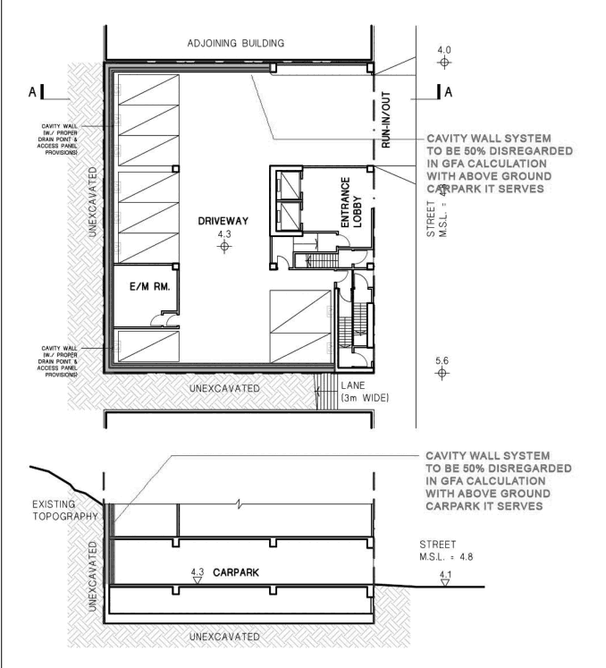{ width="438" loading=lazy }
  <figcaption>Diagram 2 from the original summary (ADF 4/2023, item 15). 原文附圖。</figcaption>
</figure>

**BD's response 屋宇署回覆:** BD advised that AAP’s understanding was correct. The cavity wall of basement or semi-basement which served as underground or aboveground car parks could enjoy the same percentage of GFA concession as that of the relevant car parks according to paragraph 18 of PNAP APP-2, provided that the car parks fulfilled the relevant requirements under the same PNAP. shall park as 15 wall the car 16

### 16. Access to a Fireman’s Lift at Ground Storey – Clause D7.3 of the FS Code {#i2023111716}

Raised by **AAP** · Related 相關: [FS Code 2011 Part D: Means of Access](../codes/fsc-part-d-means-of-access.md)

<small>Follows earlier discussion: [5 May 2023](2023.md#i202305058)</small>

**Question 問題:** As discussed in item 8 of ADF 2/2023 held on 5 May 2023, the communication between the remainder of the ground floor with occupancy and passage from the fire service access point (FSAP) to the fireman’s lift at ground floor cannot form an exit route for such occupancy use. We would like to seek BD’s clarification on whether the exit route for such occupancy use can go through the passage leading from the FSAP to the fireman’s lift at ground floor but not discharging through the FSAP, as shown in the diagram below:

**BD's response 屋宇署回覆:** BD advised that according to item 8 of ADF 2/2023 held on 5 May 2023, the arrangement shown in the diagram was not acceptable as the opening serving as the exit of the function room which possessed occupant capacity, instead of serving for communication purpose only.

### 17. Access to a Fireman’s Lift at Ground Storey – Clause D7.3 of the FS Code {#i2023111717}

Raised by **AAP** · Related 相關: [FS Code 2011 Part D: Means of Access](../codes/fsc-part-d-means-of-access.md), [FS Code 2011 Part B: Means of Escape](../codes/fsc-part-b-means-of-escape.md)

!!! warning "Later discussion 其後再討論"
    This question was discussed again on **14 Feb 2025**; use the [later response](2025.md#i202502142) where they differ. 如有不同，以較新回覆為準。

<small>Follows earlier discussion: [5 May 2023](2023.md#i202305058)</small>

**Question 問題:** Clause B9.1 of the FS Code stipulates that “the enclosing walls of every required staircase should be so continued at ground storey as to separate from the remainder of the building any passage or corridor leading from the required staircase to its ground storey discharge point. Every opening from the ground storey to such passage or corridor should be separated from it by a protected lobby; provided that in the case of a building severed by two or more required staircases, a cloakroom, lavatory, water-closet, caretaker’s office, fire control room or caretaker’s counter may open off such passageway”. …

<figure markdown>
  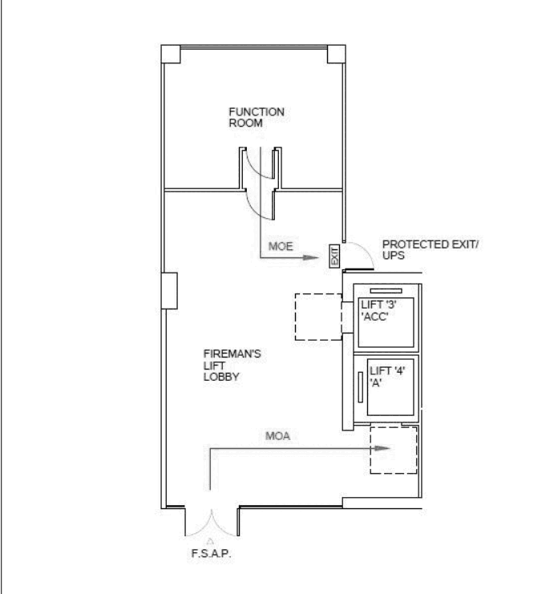{ width="450" loading=lazy }
  <figcaption>Diagram 1 from the original summary (ADF 4/2023, item 17). 原文附圖。</figcaption>
</figure>

<figure markdown>
  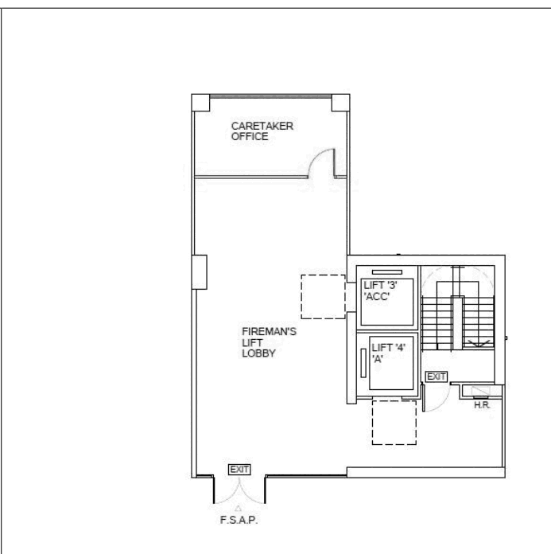{ width="448" loading=lazy }
  <figcaption>Diagram 2 from the original summary (ADF 4/2023, item 17). 原文附圖。</figcaption>
</figure>

**BD's response 屋宇署回覆:** BD advised that the arrangement depicted in the diagram generally fulfilled the separation requirement within the enclosing walls of the required staircases at ground storey in Clause B9.1 of the FS Code, but did not fulfil the requirement for opening to the passage from the FSAP to the fireman’s lift in Clause D7.3 of the same code. BD would seek comments from the Fire Services Department on such arrangement of means of access.

### 18. Lighting and Ventilation of Rooms used as Office – Regulation 30 of the B(P)R {#i2023111718}

Raised by **AAP** · Related 相關: [APP-130](../pnap/app-130.md), [B(P)R 24–37 Storey heights, open space, ](../regulations/bpr-24-37.md)

**Question 問題:** Regulation 30(2)(b) of the B(P)R stipulates that “prescribed window” is required to “face directly into external air” with minimum area fulfilling regulation 30(2)(a)(i) of the B(P)R, however such requirement is not stipulated for window being openable for ventilation with minimum area fulfilling regulation 30(2)(a)(ii) of the B(P)R. The above requirements are applicable to rooms used for habitation or as an office or a kitchen. …

**BD's response 屋宇署回覆:** BD advised that the simplified assessment method on natural ventilation requirement stipulated in PNAP APP-130 was not applicable to office. Meanwhile, the applicability of the said PNAP was under review.

### 19. Replicating Content of Clauses from Codes of Practice into Plans {#i2023111719}

Raised by **ACEHK** · Related 相關: [ADM-8](../pnap/adm-8.md), [ADM-19](../pnap/adm-19.md), [APP-142](../pnap/app-142.md), [APP-168](../pnap/app-168.md)

**Question 問題:** Recently during BD vetting process, we have been asked to copy the text from the relevant sections of the Codes of Practice to the submission drawings (Figure 8.5 – Factors for lapping bars in the Code of Practice for Structural Use of Concrete 2013 (2021 Edition), as well as Table 9.8 – Design tension strength of bolts, and Table 9.6 – Design Bearing Strength of Bolts in the Code of Practice for Structural Use of Steel 2011 (2023 Edition)). …

**BD's response 屋宇署回覆:** BD advised that essential information for structural submission should be clearly shown in structural plans according to PNAP ADM-8 and ADM-19. In case information from the relevant Codes of Practice was directly adopted, simply quoting the relevant sections/clauses of the Codes in the submission was acceptable.

### 20. Central Data Bank (CDB) References {#i2023111720}

Raised by **ACEHK**

**Question 問題:** Recently we have been asked to provide supporting documentation such as fire test reports for pre-accepted fire protection products listed in the CDB during BD submission stage. Often, the aforementioned test reports have a period of validity and in fact there are report references listed in the CDB with validity expired. When we submit the test reports, the BD officer requests that the expired, current test reports and the clarification letter from the manufacturer for updating the fire test assessment shall all be submitted prior to approval of plans. …

**BD's response 屋宇署回覆:** BD clarified that CDB contained only historical information on material acceptance in respect of a development project and did not confer any pre-acceptance of building materials or products. BD advised that AP/RSE had the responsibility to ensure that the test reports of materials/products were valid for adoption in a project and such valid test reports should be submitted to BD upon completion of works.

### 21. Thickness of Fire Protection Coatings for Pre-accepted Fire Protection Coatings in CDB {#i2023111721}

Raised by **ACEHK**

**Question 問題:** There has been increasing requests from BD officers on stating the exact fire coating thicknesses and steel section factors (Hp/A ratios) in the steel member schedules for every steel section specified. Since the products listed in the CDB is pre-accepted by BD, we propose that we can quote these products without providing the exact fire coating thicknesses for each type of member in the first superstructure plan submission (on the other hand, fire resistance rating should be included in the plan). We can supplement the information on thicknesses separately once the steel fabricator is appointed and before consent application. Please advise if this arrangement is acceptable. AOB Items

**BD's response 屋宇署回覆:** BD advised that as the requirements of different fire protection coating products/systems varied, the information of the fire coating thicknesses and the Hp/A ratios were required to be provided in the structural submissions for consideration.

### 22. Assessment of Occupant Capacity {#i2023111722}

Raised by **ACEHK** · Related 相關: [ADM-19](../pnap/adm-19.md), [ADV-33](../pnap/adv-33.md), [FS Code 2011 Part B: Means of Escape](../codes/fsc-part-b-means-of-escape.md)

**Question 問題:** (Item raised by AAP) Referring to Table B1 in Clause B4.1 of the FS Code, to our understanding, for the calculation of occupant capacity for Use Classification 1b regarding “flats with corridor or balcony access having five or more flats on each floor served by each staircase”, the occupant capacity shall be equal to the sum of usable floor area of all flats on each floor divided by the occupancy factor (usable floor area in m 2 per person), i.e. 4.5. Please advise if our understanding is correct.

**BD's response 屋宇署回覆:** BD advised that separate assessments of occupant capacity within a room, a fire compartment and a storey were all required for demonstrating the compliance with different requirements under the FS Code, including the minimum number and width of exit doors and exit routes under Table B2 of the same code. In this regard, assessment of occupant capacity of individual room would be required for “Flats” and other Use Classifications. [Post-meeting note: under the staged submission of essential information on GBP referred in PNAP ADM-19, AAP’s understanding was correct upon the submission of GBP for the first approval (i.e. Stage I), as shown in sample drawing no. C042 in Appendix A4 to PNAP ADV-33. However, in the submission of GBP prior to applying for consent for the commencement of the superstructure works (i.e. Stage II), the rounded-up figures of the occupant capacities of individual units/flats should be summed up for the assessment of occupant capacity of each storey, as shown in sample drawing no. C057 in Appendix A4 to PNAP ADV-33. Amendment of MoE Table and DV calculation shown in Stage I submission drawing should be made correspondingly.]

### 23. Excel Calculator for Area Checking {#i2023111723}

Raised by **ACEHK**

**Question 問題:** (Item raised by BD) To facilitate practitioners’ preparation of GBP submissions, a Microsoft Excel template had been developed by BD for the calculations of GFA and site coverage, as well as compliance checking on various GFA concession items. The template was available for download at BD website. The automated calculation functions built in the template would save the manual effort in handling and verifying the accuracy of the information or data involved and in turn enhance the efficiency, quality and certainty of the submission. The standard schedules produced by the tool could be readily imported and updated in the calculation sheets prepared by AutoCAD for submission to BD. …

**BD's response 屋宇署回覆:** Members welcomed BD’s provision of the Excel template and supported the upcoming workshops. Members were also encouraged to submit the area calculations completed with the Excel template together with the GBP to facilitate BD’s processing of plans. [Post-meeting note: Two workshops were conducted at the premises of HKIS and HKIA on 18 and 21 December 2023 respectively. Around 400 practitioners attended the workshops in person or through online platform.]

### 24. Construction Site Safety {#i2023111724}

Raised by **ACEHK** · Related 相關: [BO s.22–30 BA's powers, orders, unauthor](../regulations/bo-part-2-enforcement.md), [APP-157](../pnap/app-157.md)

**Question 問題:** (Item raised by BD) In light of the recent incidents on construction sites, BD reminded practitioners to enhance site management and review the provisions on site/labour safety in the construction contracts. A Circular Letter was issued on 30 March 2023 to encourage the adoption of Smart Site Safety System (SSSS) and funding support was available under the Construction Innovation and Technology Fund. BD also reminded that in case of major/serious incidents, the Building Authority might serve order under section 23 of the Buildings Ordinance (BO) to require the ceasing of works.

**BD's response 屋宇署回覆:** Members agreed that construction site safety was of paramount importance. However, they considered that site operation relating to labour safety should be the responsibility and under the expertise of contractors, hence, AP/RSE/RGE should not be liable for the malpractice of the contractors causing such site safety incidents. They concerned if the supervisory role of AP/RSE/RGE under the BO would cover the labour safety issue which was not under the purview of the BO. As such, they also enquired on the delineation of responsibilities between AP/RSE/RGE and registered contractors regarding activities on construction sites under the BO. Some members also raised that to enhance the safety working culture among construction workers, it was suggested including the registration of safety officer in the site supervision control mechanism. Members also supported that the registered contractors should report major/serious site incidents to the BA within a specified time frame. BD advised that, the government was comprehensively exploring measures to tighten the safety requirements on construction site. In this regard, BD was considering relevant legislative amendments and reviewing the requirements in the Code of Practice for Site Supervision 2009 (2021 Edition).

### 25. Vote of Thanks {#i2023111725}

Raised by **ACEHK**

**Question 問題:** (Item raised by BD) AD/NB1 proposed a vote of thanks to Mr AU-YEUNG Hoi-pang, AD/NB2 who co-chaired this Forum for the last time before his retirement.

**BD's response 屋宇署回覆:** Members supported the proposal and wished Mr AU-YEUNG a happy retirement.

## ADF 3/2023 · 4 Aug 2023 {#adf-32023-4-aug-2023}

[Original summary (PDF) 原文](https://www.hkie-st.org/wp-content/uploads/2025/02/Summary-of-items-discussed-in-3_2023-ADF-on-4.8.2023.pdf) · 15 items

### 1. GFA Calculation of Covered Area under Portal above Driveway {#i202308041}

Raised by **HKIA**

<small>Follows earlier discussion: [10 Feb 2023](2023.md#i2023021018)</small>

**Question 問題:** Referring to item 18 of ADF 1/2023 held on 10 February 2023, “the covered area under the portal for metal gate at main entrance of a development might be exempted from GFA calculation on case merits if the size of the portal was commensurate with the scale of the development.” By the same token, if a portal with adequate height and width is provided above an entrance driveway / emergency vehicular access (EVA), could the covered area under the portal be also exempted from GFA calculation?

**BD's response 屋宇署回覆:** BD advised that the covered area under the said portal might also be exempted from GFA calculation on case merits if the portal was genuine in design and its size was commensurate with the scale of the development.

### 2. Inaccessible Roof – Code of Practice on Access for External Maintenance 2021 (AfEM Code) {#i202308042}

Raised by **HKIA**

!!! warning "Later discussion 其後再討論"
    This question was discussed again on **9 Aug 2024**; use the [later response](2024.md#i2024080922) where they differ. 如有不同，以較新回覆為準。

**Question 問題:** Regarding paragraph 4.2 - Inaccessible roof of Part 2 of the AfEM Code, it is our understanding that provision of safety measures under paragraph 4.2.3 shall not be required for the following inaccessible flat roofs so long as stepping onto them for routine maintenance and repair (M&R) works is not required: a) Cover of Combined Balcony / Utility Platform / AC Platform at the top floor b) Cover of Balcony / Utility Platform at the top floor c) Small flat roof reachable by power-operated elevating work platform or suspended working platform Would BD please confirm if the understanding is correct?

**BD's response 屋宇署回覆:** BD advised that HKIA’s understanding was correct, given that stepping onto the inaccessible flat roofs in question for routine M&R works was not required.

### 3. Protective Barrier {#i202308043}

Raised by **HKIA**

<small>Follows earlier discussion: [10 Feb 2023](2023.md#i202302101)</small>

**Question 問題:** Further to item 1 of ADF 1/2023 held on 10 February 2023, we would like to clarify with BD that the provision of protective barrier is not required for maintenance trench or sunken filtration pit for swimming pool with depth exceeding 600 mm provided that the covers of the trench or pit are designed to withstand normal live load of pedestrian or vehicular traffic according to its location. It shall be common practice for ordinary manhole, services trench and cable draw pit, etc. located at pavement or driveway that no protective barrier will be required irrespective to the depth of trench or pit. Would BD please confirm if the understanding is correct?

**BD's response 屋宇署回覆:** BD advised that HKIA’s understanding was correct.

### 4. Minor Amendments – PNAP ADM-19 {#i202308044}

Raised by **HKIA** · Related 相關: [ADM-19](../pnap/adm-19.md), [B(A)R Building (Administration) Regulati](../regulations/bar-123a.md)

!!! warning "Later discussion 其後再討論"
    This question was discussed again on **8 Aug 2025**; use the [later response](2025.md#i2025080815) where they differ. 如有不同，以較新回覆為準。

<small>Related discussions 相關討論: [25 May 2018 item 9](2018.md#i201805259), [5 May 2023 item 12](2023.md#i2023050512)</small>

**Question 問題:** According to PNAP ADM-19, AP/RSE/RGE can submit an application for modification of regulation 33(1) of the Building (Administration) Regulations (B(A)R) that prior approval and consent to the minor amendments of building, superstructure, drainage, foundation, pile cap, site formation, excavation and lateral support works, for which the first consent to the carrying out of works has already been given, would not be required except for the amendments described in Appendix G to the said PNAP. The application can either be made after obtaining the first consent or simultaneously with the application for the first consent. …

**BD's response 屋宇署回覆:** BD advised that HKIA’s understandings were correct.

### 5. Openings through Vertical Shaft – Clause C8.3 of the Code of Practice {#i202308045}

Raised by **HKIA** · Related 相關: [FS Code 2011 Part C: Fire Resisting Cons](../codes/fsc-part-c-fire-resisting-construction.md)

**Question 問題:** for Fire Safety in Buildings 2011 (June 2023 Edition) (FS Code) Clause C8.3 of the FS Code states that “where a vertical shaft linking different floors is formed by fire barriers, the openings within the vertical shaft for passage of air-conditioning ducts, ventilation ducts, electrical trunkings, conduits, pipes, cables and the like should be fire sealed. …

<figure markdown>
  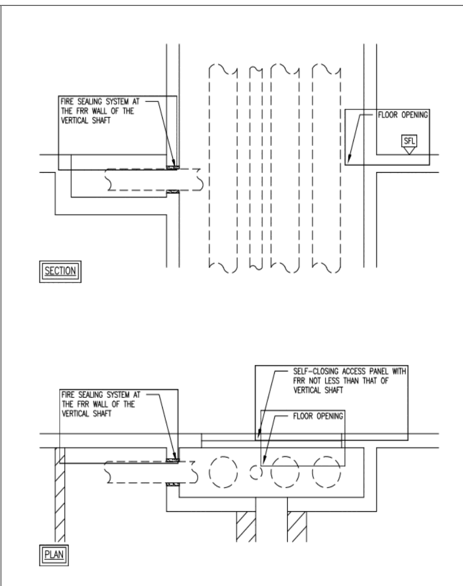{ width="507" loading=lazy }
  <figcaption>Diagram 1 from the original summary (ADF 3/2023, item 5). 原文附圖。</figcaption>
</figure>

**BD's response 屋宇署回覆:** BD advised that HKIA’s understanding was correct. with shaft the that 4 5

### 6. Refuge Floor – Clause B18.2(e) of FS Code {#i202308046}

Raised by **HKIA** · Related 相關: [FS Code 2011 Part B: Means of Escape](../codes/fsc-part-b-means-of-escape.md)

<small>Follows earlier discussion: [18 Mar 2022](2022.md#i2022031815)</small>

<small>Related discussions 相關討論: [29 May 2020 item 2](2020.md#i202005292), [26 Nov 2020 item 12](2020.md#i2020112612), [18 Mar 2022 item 15](2022.md#i2022031815)</small>

**Question 問題:** Item 15 of the ADF 2/2022 held on 18 March 2022 refers. BD advised that BD structural elements or mullions of the curtain wall at the open-sided portions the of refuge floor might be considered acceptable on case basis if they have no adverse impact to the provision of adequate cross ventilation and the performance of openings. We would like to enquire if there is any change in views or considerations by BD on this topic?

**BD's response 屋宇署回覆:** advised that the views and considerations mentioned in item 15 of ADF 2/2022 held on 18 March 2022 remained unchanged.

### 7. Discharge Value and Width of Required Staircase {#i202308047}

Raised by **HKIA** · Related 相關: [FS Code 2011 Part B: Means of Escape](../codes/fsc-part-b-means-of-escape.md)

<small>Related discussions 相關討論: [14 Feb 2025 item 21](2025.md#i2025021421), [8 May 2026 item 18](2026.md#i2026050818)</small>

**Question 問題:** (a) It is quite common for a building to have its required staircases widened (a) at the podium or lower storeys to comply with the means of escape requirements under the FS Code. For the sake of calculating the discharge value (DV) of each of such staircases with its width widened at the lower storeys, our opinion on calculating the total DV of such staircase is as follows: DV of required staircase serving upper storeys + DV of the same required staircase (with increased width) serving lower storeys For example, according to Table B3 of the FS Code extracted below, if a required staircase in a non-sprinkler protected building (1050mm in width) serving 10 storeys at upper floors is widened …

<figure markdown>
  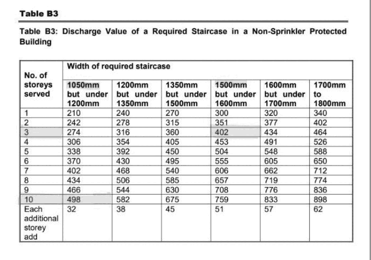{ width="479" loading=lazy }
  <figcaption>Diagram 1 from the original summary (ADF 3/2023, item 7). 原文附圖。</figcaption>
</figure>

**BD's response 屋宇署回覆:** BD advised that the DV of the required staircase in the scenario described by HKIA should be calculated as follows: DV of required staircase (with increased width) serving lower storeys (above G/F) + DV of required staircase serving upper storeys by adopting the figures of “each additional storey add” in Table B3 or Table B4 of the FS Code as appropriate. In this regard, the DV of the required staircase in a non-sprinkler protected building in the example illustrated by HKIA should be calculated as follows: 402 (i.e. 1500 mm wide staircase serving 3 storeys above G/F) + 32 × 10 (i.e. 1050 mm wide staircase serving 10 additional storeys) = 722 (b) BD advised that HKIA’s understanding was correct.

### 8. FRR wall at open Kitchen {#i202308048}

Raised by **HKIA** · Related 相關: [FS Code 2011 Part C: Fire Resisting Cons](../codes/fsc-part-c-fire-resisting-construction.md)

<small>Related discussions 相關討論: [23 Mar 2018 item 4](2018.md#i201803234), [23 Feb 2024 item 18](2024.md#i2024022318)</small>

**Question 問題:** Referring to Clause C13.4(d) of the FS Code, it is our understanding that full height 600 mm wide fire rated wall should be provided adjacent to the flat exit door only. It is not necessary to provide wall or fire rated wall at locations indicated in the sketch below. Please advise if the above understanding is correct.

<figure markdown>
  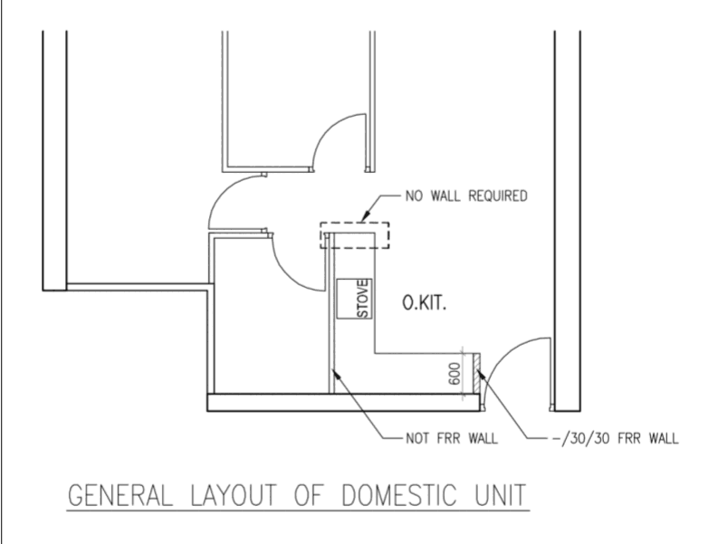{ width="505" loading=lazy }
  <figcaption>Diagram 1 from the original summary (ADF 3/2023, item 8). 原文附圖。</figcaption>
</figure>

**BD's response 屋宇署回覆:** BD advised that HKIA’s understanding was correct.

### 9. Requirements on Sunshades – PNAP APP-19 and APP-67 {#i202308049}

Raised by **HKIS** · Related 相關: [APP-19](../pnap/app-19.md), [APP-67](../pnap/app-67.md), [APP-156](../pnap/app-156.md), [B(P)R 23 & 23A Building height, site are](../regulations/bpr-23-23a.md), [Cap. 123M Building (Energy Efficiency) R](../regulations/beer-123m.md)

**Question 問題:** As illustrated in the section below, for sunshades solely used for the purpose of energy conservation projecting over 750 mm from the external wall of a non-domestic building , besides quantitative assessment on Overall Thermal Transfer Value (OTTV) reduction for meeting the criteria set out in PNAP APP-67 and subject to consideration by the Building Committee, are there any other requirements for the sunshades to be exempted from GFA calculation? There seems no specific requirement set out under PNAP APP-19 & APP-67.

<figure markdown>
  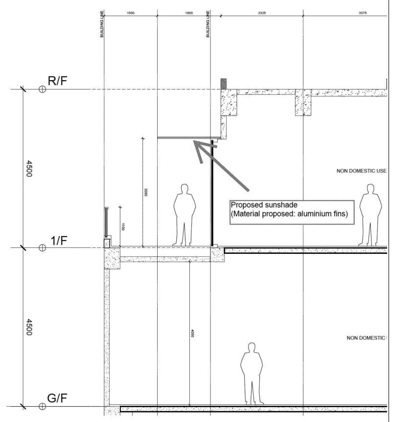{ width="519" loading=lazy }
  <figcaption>Diagram 1 from the original summary (ADF 3/2023, item 9). 原文附圖。</figcaption>
</figure>

**BD's response 屋宇署回覆:** BD advised that according to PNAP APP-19, genuine sunshades solely used for the purpose of energy conservation projecting not more than 1.5 m from the external wall complying with the criteria set out in PNAP APP-67 and APP-156 were not accountable for GFA and site coverage. According to paragraph 10 of PNAP APP-67, in determining whether the sunshades would assist in the reduction of the OTTV, quantitative assessment should be submitted to the Building Authority for consideration, if the sunshades project over 750 mm from the external walls. Similar requirements for sunshades which are conducive to the reduction of RTTV had also been promulgated in PNAP APP-156. In consideration of the design of the proposed sunshade illustrated in the the sectional drawing, the sunshade projecting more than 1.5 m from the external wall and over a flat roof should be accountable for GFA under regulation 23(3)(a) of the Building (Planning) Regulations.

### 10. Structural Submissions for M&R Access {#i2023080410}

Raised by **AAP** · Related 相關: [APP-110](../pnap/app-110.md)

**Question 問題:** The following elements do not form part of building structure nor serve as protective barrier and are solely for the access and safety for maintenance. Would BD please clarify if structural plan submissions for below cases are required: Case 1 Guard rail for inaccessible flat roof. Case 2 Metal grating platform, guard rail and cat ladder for internal pipe duct/ pipe well. Case 3 Maintenance platform and guard rail for large size plant inside building.

**BD's response 屋宇署回覆:** For Case 1, BD advised that the design requirements of protective barriers stipulated in paragraph 6 of PNAP APP-110 were not applicable to guard rails at inaccessible flat roof which was intended to be accessible to personnel for maintenance or repair works only, thus structural submission for such guard rail was not required . For Case 2, structural plan submission for metal grating platform of size not more than 1200 mm x 1500 mm in pipe duct was not required, and structural plan submissions for guard rail and cat ladder in pipe duct or pipe well were also not required. For Case 3, considering the size of the maintenance platform for large size plant, structural plan submission for the platform was required, while that for guard rail was not required. Considering members’ concern on the plan processing time of the maintenance platform, BD would explore streamlining measures to facilitate the plan approval and consent application for these secondary building elements.

### 11. Calculation of Setback Area – PNAP APP-132 {#i2023080411}

Raised by **AAP** · Related 相關: [APP-132](../pnap/app-132.md)

**Question 問題:** Refer to paragraph 4 of PNAP APP-132, if the criteria in paragraph 3(a) to (f) of the said PNAP are fully met, 40% of site coverage is permitted for domestic buildings with height over 61 m from street level setback approach as per Appendix A to the said PNAP. The diagrams below indicated that there is an existing slope in the adjacent site. A proposed retaining wall within the building setback area is required to support the slope for the adjacent site. Please advise if this retaining wall would be allowed to be built within the setback area and not affecting the calculation of the setback area.

<figure markdown>
  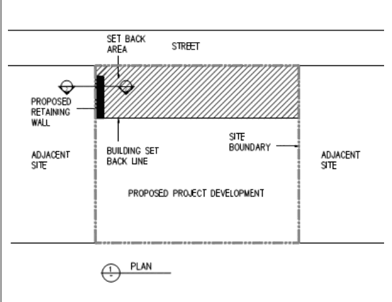{ width="415" loading=lazy }
  <figcaption>Diagram 1 from the original summary (ADF 3/2023, item 11). 原文附圖。</figcaption>
</figure>

<figure markdown>
  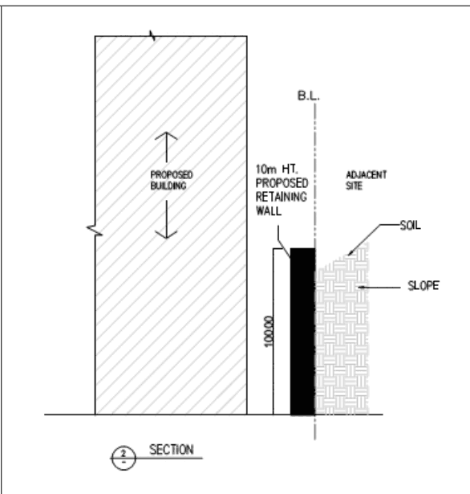{ width="378" loading=lazy }
  <figcaption>Diagram 2 from the original summary (ADF 3/2023, item 11). 原文附圖。</figcaption>
</figure>

**BD's response 屋宇署回覆:** BD advised that according to paragraph 3(e) of PNAP APP-132, the setback area should contribute to improve the street environment, such as enhancing air ventilation and permeability as well as promoting connectivity and walkability. In case the retaining wall as illustrated in the diagram was essential in providing support to the adjacent slope, such wall was acceptable to be built within the setback area, provided that criteria laid down in paragraph 3(a) to (f) of the said PNAP were complied with and the area of such wall was excluded from the calculation of the setback area.

### 12. Site Supervision Requirement of Combined Works in the Same Site {#i2023080412}

Raised by **ACEHK** · Related 相關: [APP-157](../pnap/app-157.md)

**Question 問題:** For a site with different types of works being carried out concurrently, e.g. superstructure, curtain wall, alterations and additions (A&A) and excavation and lateral support (ELS), the combined supervision input in Form C (Calculation Sheet for Combination of Technically Competent Persons (TCPs)) of the Code of Practice for Site Supervision 2009 (Supervision Code) will determine the required total man-day/month (frequency level of site supervision) for each grade of TCPs. However, as the inspection items may be specific/exclusive to each type of works, separate Form A Specific Tasks Performed by TCP) of the Supervision Code may to be filled in for each type of works. …

**BD's response 屋宇署回覆:** BD advised that ACEHK’s understanding was correct, provided that the TCP would provide sufficient supervision input to the site and the minimum supervision requirements for both individual works and combined works were fulfilled. (Record of be required of to that an example Total Supervision Input for Combined Works - - - 11 man-days per month (with 14 reference to Table 8.3 of the Supervision Code, it is considered that the required frequency of site supervision is Level 4.2, i.e. 3 visits per week.) No single Form A for the combined works. No need to specify the frequency of inspection for the combined works in Form A.

### 13. Bondek Slab Design {#i2023080413}

Raised by **ACEHK** · Related 相關: [Code of Practice for Fire Safety in Buil](../codes/fire-safety-code-2011.md), [APP-142](../pnap/app-142.md), [APP-168](../pnap/app-168.md)

**Question 問題:** If the profiled steel sheets are adopted as permanent formwork, the typical details in the Code of Practice for the Structural Use of Steel 2011 (2021 Edition) (Steel Code) and in Bondek catalogue can be referred to such that the position bars / distribution bars are placed on the profile sheet ribs as shown in Figure 10.10 of the said Code extracted below: Also, once the overall slab thickness of the Bondek slab fulfils the minimum thickness required in Table 10.10 of the Steel Code, the slab is deemed have achieved the respective fire resistance period specified in the Table, and there is no need to consider the effective slab thickness which the thickness of the concrete above the …

<figure markdown>
  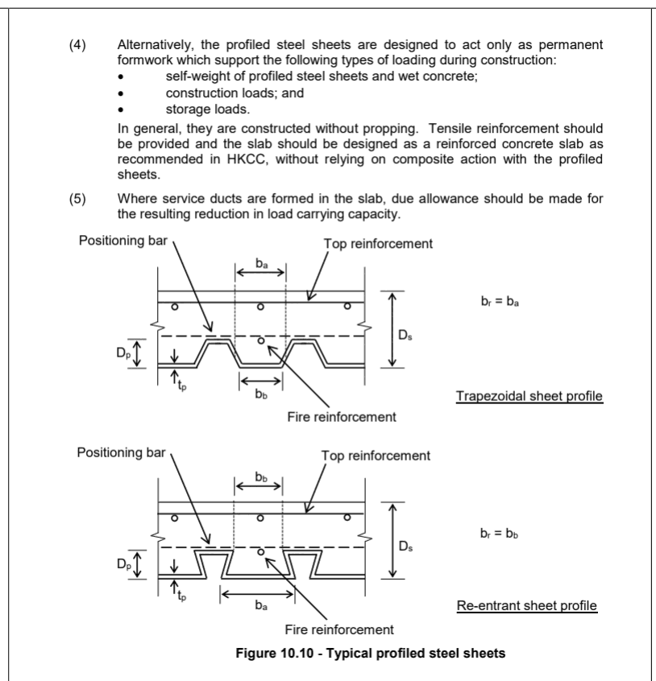{ width="526" loading=lazy }
  <figcaption>Diagram 1 from the original summary (ADF 3/2023, item 13). 原文附圖。</figcaption>
</figure>

**BD's response 屋宇署回覆:** BD advised that for the profiled steel sheets which acted as permanent formwork only, the reinforced slab thickness, i.e. Ds- Dp, should comply with the requirements of the Code of Practice for Structural Use of Concrete 2013 (2020 Edition) and the FS Code against the specified fire resistance rating. In accordance with Clause 10.4.3 of the Steel Code, nominal minimum slab thickness of concrete given in Table 10.9 and Table 10.10 were applicable to composite slab with profiled steel sheets. Notwithstanding, a full-scale structure fire tests were also required to demonstrate structural adequacy in load carrying capacity, insulation and integrity in fire limit state against specific fire resistance rating. to said is 17

### 14. Requirements of Building Setback – PNAP APP-132 and APP-152 {#i2023080414}

Raised by **ACEHK** · Related 相關: [APP-132](../pnap/app-132.md), [APP-152](../pnap/app-152.md)

**Question 問題:** (Item raised by AAP) According to paragraph 3(a) of PNAP APP-132, one of the criteria for considering applications on the ground of setting back a building for its full height from a site boundary abutting on a street is that “the setback of the building is of an area not less than 8% of the site area for non-domestic buildings and not less than 18% of the site area for domestic buildings. For a composite building, the non-domestic and domestic portions of the building should illustrate the required setback of 8% and 18% respectively”. …

<figure markdown>
  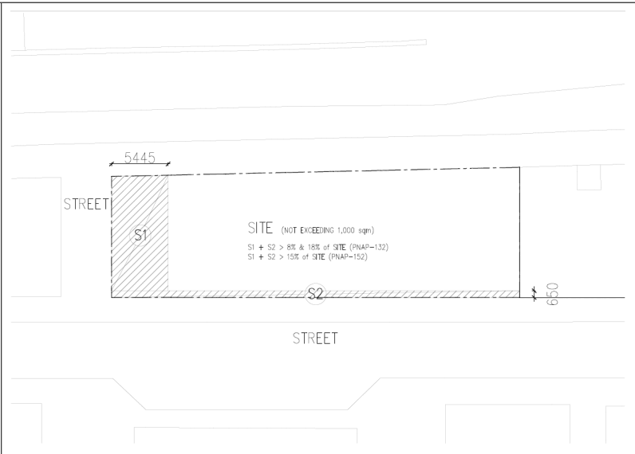{ width="515" loading=lazy }
  <figcaption>Diagram 1 from the original summary (ADF 3/2023, item 14). 原文附圖。</figcaption>
</figure>

<figure markdown>
  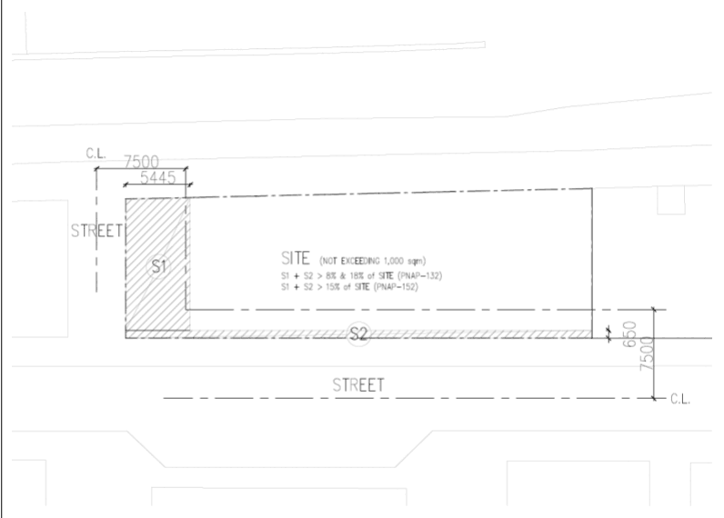{ width="515" loading=lazy }
  <figcaption>Diagram 2 from the original summary (ADF 3/2023, item 14). 原文附圖。</figcaption>
</figure>

**BD's response 屋宇署回覆:** BD advised that there was no requirement on minimum setback distance under PNAP APP-132 or under the alternative approach for building setback stipulated in Appendix E to PNAP APP-152 except for those stipulated in paragraph 7 of PNAP APP-152. The proposed setback areas illustrated in the diagrams should comply with the required full height and full frontage setback of the building with a total area not less than those stipulated in the said PNAPs and such setback area should contribute to the improvement of the street environment. 3(a) of total exceed up the in “full 19 a total that the two in 15% of under 20

### 15. Combined Utility Platform (UP) and Balcony {#i2023080415}

Raised by **ACEHK**

<small>Follows earlier discussion: [5 May 2023](2023.md#i2023050518)</small>

**Question 問題:** (Item raised by AAP) According to item 18 of ADF 2/2023 held on 5 May 2023, BD advised that washing machine may be placed at the combined UP and balcony. We understand that similar to the requirement on air-conditioner platform stipulated in Appendix B to the AfEM Code, a reinforced concrete plinth of 50 mm high from the finished floor can also be provided at the combined UP and balcony to facilitate fixing of the washing machine.

**BD's response 屋宇署回覆:** BD advised that AAP’s understanding was correct.

## ADF 2/2023 · 5 May 2023 {#adf-22023-5-may-2023}

[Original summary (PDF) 原文](https://www.hkie-st.org/wp-content/uploads/2023/08/Summary-of-items-discussed-in-2_2023-APEC-DF-on-5.5.2023.pdf) · 25 items

### 1. Sunken Slab at Single Family House and G/F of Apartment {#i202305051}

Raised by **HKIA** · Related 相關: [APP-93](../pnap/app-93.md), [B(SFP&W)R Building (Standards of Sanitar](../regulations/bsfpwr-123i.md)

<small>Follows earlier discussion: [26 Nov 2020](2020.md#i202011264)</small>

<small>Related discussions 相關討論: [26 Nov 2020 item 4](2020.md#i202011264)</small>

**Question 問題:** Referring to item 4 of ADF 4/2020 held on 26 November 2020, we would (i) like to confirm our understanding regarding the sunken slab arrangement of single family house and G/F of apartment as follows:- (i) Sunken slab arrangement is still acceptable at all levels of single family house and G/F of apartment to facilitate drainage repair and maintenance work. The design of sunken slab should comply with the requirements as stipulated in paragraph 5 of PNAP APP-93. …

<figure markdown>
  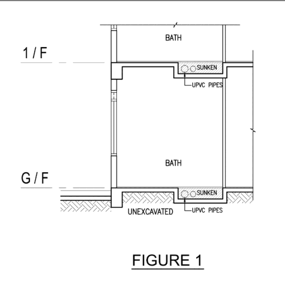{ width="313" loading=lazy }
  <figcaption>Diagram 1 from the original summary (ADF 2/2023, item 1). 原文附圖。</figcaption>
</figure>

<figure markdown>
  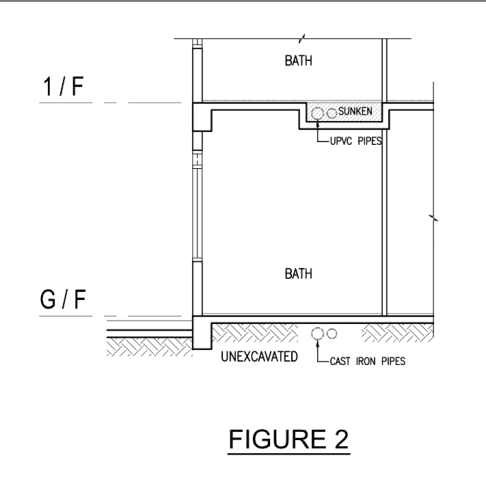{ width="313" loading=lazy }
  <figcaption>Diagram 2 from the original summary (ADF 2/2023, item 1). 原文附圖。</figcaption>
</figure>

**BD's response 屋宇署回覆:** According to paragraph 5 of PNAP APP-93, sunken slab design complying with the relevant requirements should be considered as an acceptable solution to satisfy the requirement set out in paragraph 3(d) of PNAP APP-93, which stated that “for domestic buildings other than those intended for single occupancy or single family residence, no pipeworks for a unit shall protrude into the unit under separate occupancy on the floor below”. Regulation 54 of the B(SSFPDW&L)R regarding the design and construction of drains and sewers under buildings were considered different from the requirements stipulated in paragraphs 3(d) and 5 of PNAP APP-93 regarding the access to drainage pipes within a building for maintenance and repair. The UPVC pipes in Figure 1 were installed within a building instead of under a building, regulation 54 of the B(SSFPDW&L)R was therefore not applicable. For underground drains and sewers, their design and construction should comply with the said regulation. BD advised that HKIA’s understanding was correct. pipes 2

### 2. “Atrium” in Clause C10.3(a) of the Code of Practice for Fire Safety in Buildings 2011 (FS Code) {#i202305052}

Raised by **HKIA** · Related 相關: [FS Code 2011 Part C: Fire Resisting Cons](../codes/fsc-part-c-fire-resisting-construction.md)

!!! warning "Later discussion 其後再討論"
    This question was discussed again on **23 Feb 2024**; use the [later response](2024.md#i202402237) where they differ. 如有不同，以較新回覆為準。

<small>Related discussions 相關討論: [8 May 2026 item 2](2026.md#i202605082)</small>

**Question 問題:** Clause C10.3(a) of the FS Code states that “the atrium should be separated from all other spaces by fire barriers having an FRR of not less than that of those spaces”. We understand that this is intended to mean that “the atrium should be separated from other parts of the building by fire barriers …” (i.e. areas outside the compartment which constitutes the atrium). Hence it is NOT intended to restrict uses within the atrium compartment, and uses such as retail shops, cafeteria, pop-up stores, kiosks, etc. are always permitted, provided they comply with the relevant clauses of the FS Code. Please advise if our understanding is correct.

**BD's response 屋宇署回覆:** BD advised that HKIA’s understanding was correct.

### 3. Location of Accessible Parking Spaces Paragraph 8(2) of the Design Manual: Barrier Free Access 2008 (2021 {#i202305053}

Raised by **HKIA** · Related 相關: [Design Manual: Barrier Free Access 2008 ](../codes/bfa-2008.md)

<small>Related discussions 相關討論: [17 Aug 2018 item 1](2018.md#i201808171), [21 May 2021 item 2](2021.md#i202105212), [13 May 2022 item 13](2022.md#i2022051313), [17 Nov 2023 item 11](2023.md#i2023111711), [8 May 2026 item 4](2026.md#i202605084)</small>

**Question 問題:** Edition) (DMBFA) states the required no. of accessible car parking spaces (based on total no. of car parking spaces in lot). Paragraph 9(1) of the DMBFA requires the accessible parking spaces to “be located in proximity and with an accessible route to the lobby with an accessible lift or entrance”. For a project with multi-storey carparks, we understand that it is NOT required to have accessible parking space(s) on every floor, provided the above-mentioned requirements are complied with. Please advise if the above understanding is correct.

**BD's response 屋宇署回覆:** —

### 4. Curtain Wall outside Floor / Room without Accountable GFA {#i202305054}

Raised by **HKIA** · Related 相關: [APP-2](../pnap/app-2.md)

!!! warning "Later discussion 其後再討論"
    This question was discussed again on **23 Feb 2024**; use the [later response](2024.md#i202402231) where they differ. 如有不同，以較新回覆為準。

**Question 問題:** Curtain wall proposed for the building façade is normally designed to cover the whole of an external wall to achieve a continuous and coherent façade design. In many cases, certain part of the curtain wall will cover floors/rooms with floor area disregarded from GFA calculation, such as mechanical floors/plant rooms, car parks, refuge floors, transfer plates, etc., forming part of the same elevation. Hence, curtain wall proposed for the external wall of such floors/rooms should be permitted as an integral part of the floor/room which is/are GFA non-accountable. Please advise if this understanding is correct.

**BD's response 屋宇署回覆:** BD advised that the curtain wall could be disregarded from the calculations of GFA and site coverage (SC) if the requirements under PNAP APP-2 on curtain wall were fulfilled. Whether the floors/rooms enclosed by a certain part of curtain wall were accountable to GFA calculation or not was not a consideration under PNAP APP-2. For floor/room which was non-accountable to GFA calculation with projection of the curtain wall system from the outer surface of the structural elements exceeded 200 mm for a domestic building or 250mm for a non-domestic building, BD will take a pragmatic approach to consider disregarding the entire projection of the curtain wall enclosing such floor/room from GFA and SC calculations on case basis.

### 5. Basement Smoke Vent {#i202305055}

Raised by **HKIA** · Related 相關: [FS Code 2011 Part C: Fire Resisting Cons](../codes/fsc-part-c-fire-resisting-construction.md)

**Question 問題:** According to Clause C14.2(a) and (b) of the FS Code, smoke outlets should “be not more than 30 m apart and situated along the street frontages or adjacent to external walls”, and “be sited at a high level, be evenly distributed around the perimeter of the building and be so arranged as to create a through draft”. The diagram below indicates a Class A site with only one side of the basement facing the street. Smoke outlets are located only on the side facing the street within the same compartment. Our understanding is that the smoke outlets design complies with the FS Code. Please advise if our understanding is correct.

<figure markdown>
  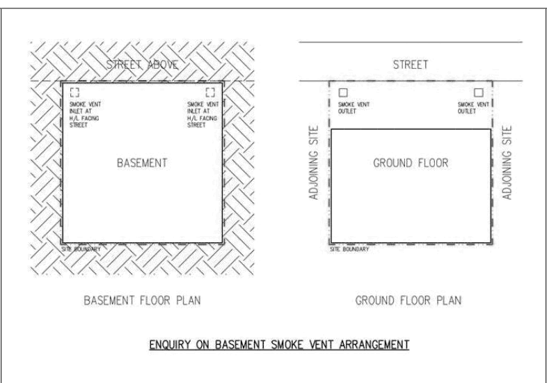{ width="508" loading=lazy }
  <figcaption>Diagram 1 from the original summary (ADF 2/2023, item 5). 原文附圖。</figcaption>
</figure>

**BD's response 屋宇署回覆:** BD advised that provided that the external discharge points of the smoke outlets were not more than 30 m apart, the proposal illustrated in the diagram could fulfil the requirements under Clause C14.2(a) and (b) of the FS code. Item 10 of ADF 2/2015 held on 20 March 2015 was relevant.

### 6. Kitchen with Natural Lighting and Ventilation Not Relying on Window of Living / Dining Area and Complying with FS Code Clause {#i202305056}

Raised by **HKIA** · Related 相關: [FS Code 2011 Part C: Fire Resisting Cons](../codes/fsc-part-c-fire-resisting-construction.md)

**Question 問題:** C13.4 It is our understanding that kitchen (open kitchen) with natural lighting and ventilation not relying on window(s) of living / dining area and at the same time complied with the requirements (a) to (e) as stipulated in Clause C13.4 of the FS Code, the fire barrier under Clause C13.3 shall not be required. Would BD please confirm if the understanding is correct?

**BD's response 屋宇署回覆:** BD advised that as long as the open kitchen was provided with fire safety provisions in accordance with Clause C13.4 of the FS Code, the provision of fire barrier under Clause C13.3 of the FS Code would not be required.

### 7. Exit Route from a Ground Storey Forming Part of the Exit Route from Required Staircases – Clause B9.2 of the FS Code {#i202305057}

Raised by **HKIA** · Related 相關: [FS Code 2011 Part B: Means of Escape](../codes/fsc-part-b-means-of-escape.md)

!!! warning "Later discussion 其後再討論"
    This question was discussed again on **3 May 2024**; use the [later response](2024.md#i202405039) where they differ. 如有不同，以較新回覆為準。

<small>Related discussions 相關討論: [12 Nov 2021 item 20](2021.md#i2021111220)</small>

**Question 問題:** Clause B9.2 of the FS Code stipulates that an exit route from a ground storey can form part of the exit route from a required staircase, provided that the sum of exit route can meet the requirements under the said Clause. We would like to seek BD’s clarification on whether the following scenarios are acceptable: Scenario 1: Scenario 2: Scenario 3:

<figure markdown>
  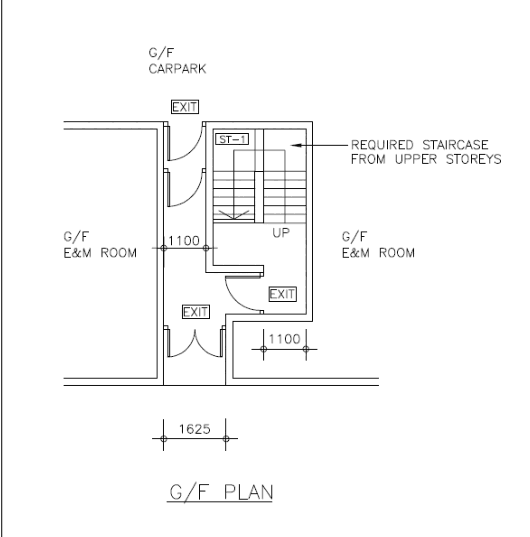{ width="342" loading=lazy }
  <figcaption>Diagram 1 from the original summary (ADF 2/2023, item 7). 原文附圖。</figcaption>
</figure>

<figure markdown>
  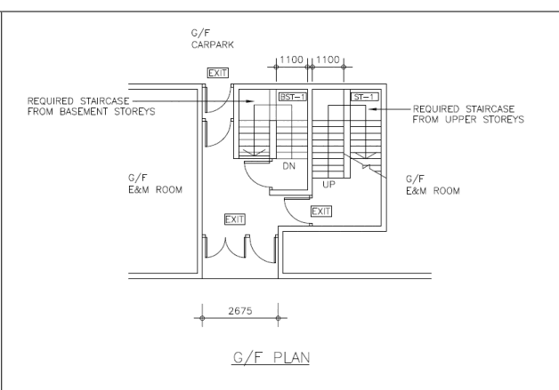{ width="406" loading=lazy }
  <figcaption>Diagram 2 from the original summary (ADF 2/2023, item 7). 原文附圖。</figcaption>
</figure>

<figure markdown>
  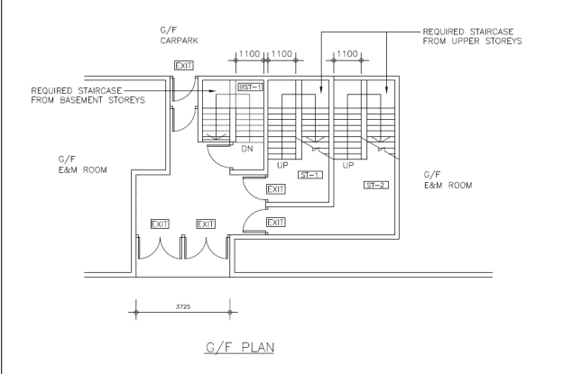{ width="409" loading=lazy }
  <figcaption>Diagram 3 from the original summary (ADF 2/2023, item 7). 原文附圖。</figcaption>
</figure>

**BD's response 屋宇署回覆:** BD advised that Scenario 1 was considered acceptable under Clause B9.2 of the FS Code, provided that the width of the combined exit route including the clear width of the exit door measured between the vertical members of the door frame, was not less than the sum of half the width required for the exit route from the ground storey and the width required for the required staircase from the upper storeys. BD also advised that under Clause B5.2 of the FS Code, every exit route should lead directly to an ultimate place of safety. As such, Scenarios 2 and 3 were considered unacceptable under the said Clause as more than one required staircase were arranged to discharge into a protected lobby instead of leading directly to an ultimate place of safety, which should be a street or open area outside the building under Section 3 of Part A of the FS Code. Besides, Clause B9.2 was only applicable to an exit route from a ground storey which also forms part of the exit route from a required staircase. It was not applicable to the merging of two or more required staircases before discharging into an ultimate place of safety.

### 8. Access to a Fireman’s Lift at Ground Storey – Clause D7.3 of the FS Code {#i202305058}

Raised by **HKIA** · Related 相關: [FS Code 2011 Part D: Means of Access](../codes/fsc-part-d-means-of-access.md)

!!! warning "Later discussion 其後再討論"
    This question was discussed again on **14 Feb 2025**; use the [later response](2025.md#i202502142) where they differ. 如有不同，以較新回覆為準。

**Question 問題:** Clause D7.3(b) of the FS Code stipulates that the passage from the fire service access point to the fireman’s lift should be separated from the remainder of the ground storey by walls having and FRR of not less than that required for the elements of construction in the ground storey. Any opening in these walls for communication with ground storey should be through a protected lobby. We would like to seek BD’s clarification on whether the communication with ground floor can also form an exit route from the ground floor in the following scenarios: Scenario 1: Scenario 2:

<figure markdown>
  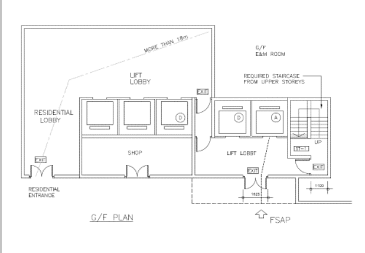{ width="395" loading=lazy }
  <figcaption>Diagram 1 from the original summary (ADF 2/2023, item 8). 原文附圖。</figcaption>
</figure>

<figure markdown>
  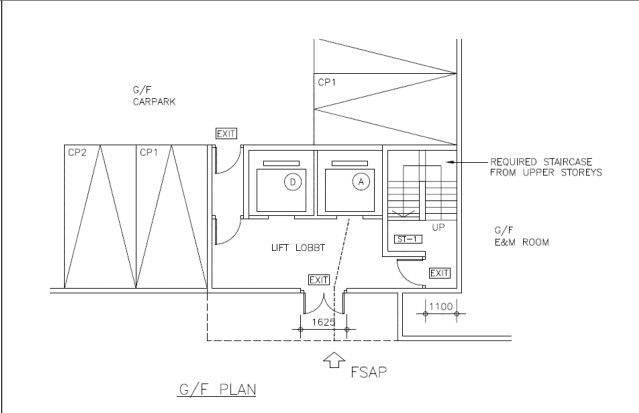{ width="413" loading=lazy }
  <figcaption>Diagram 2 from the original summary (ADF 2/2023, item 8). 原文附圖。</figcaption>
</figure>

**BD's response 屋宇署回覆:** BD advised that under Clause D7.3(b) of the FS Code, the passage from the fire service access point to the fireman’s lift should be separated from the remainder of the ground storey by walls having the requisite FRR. Opening in these walls might only be allowed for communication only with the ground storey. Nevertheless, BD advised that Scenario 1 would be considered as the residential lift lobby was a public circulation space excluded from the calculation of occupant capacity and the opening was solely provided as a secondary exit for compliance with the travel distance requirements. For Scenario 2, BD advised that it was considered not acceptable as the opening served as the exit of the carpark with occupant capacity instead of communication purpose only.

### 9. Protection of Passage for Staircase Interchange {#i202305059}

Raised by **HKIA** · Related 相關: [FS Code 2011 Part B: Means of Escape](../codes/fsc-part-b-means-of-escape.md), [FS Code 2011 Part C: Fire Resisting Cons](../codes/fsc-part-c-fire-resisting-construction.md)

<small>Related discussions 相關討論: [13 May 2022 item 14](2022.md#i2022051314)</small>

**Question 問題:** For compliance with Clause B8.2 of the FS Code for staircase interchange, it is our understanding that the requirement under Clause C9.7 of FS Code for the external wall of a required staircase and its protected lobby does not apply to the interlink passage for staircase interchange. As illustrated in the sketch below, no fire rate protection should be required along the interlink passage hatched red. Please advise if our understanding is correct.

<figure markdown>
  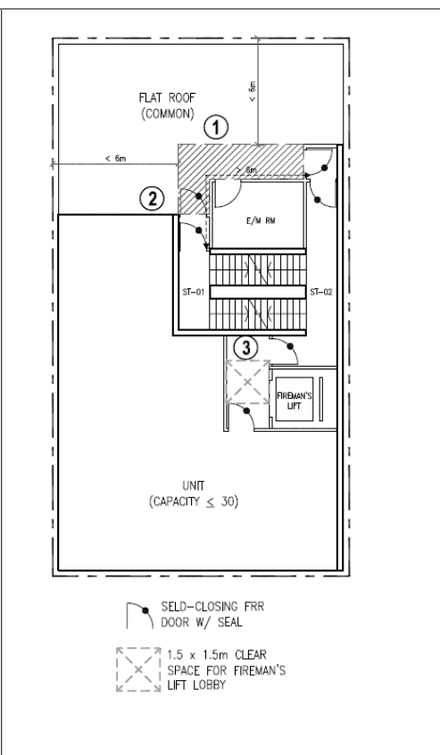{ width="318" loading=lazy }
  <figcaption>Diagram 1 from the original summary (ADF 2/2023, item 9). 原文附圖。</figcaption>
</figure>

**BD's response 屋宇署回覆:** BD advised that HKIA’s understanding was correct. However, it should be clarified in the sketch that access to two required staircases should be available for the subject unit for compliance with Clauses B8.1 and 10.3 of the FS Code.

### 10. Provision of Open Space {#i2023050510}

Raised by **HKIA** · Related 相關: [B(P)R 24–37 Storey heights, open space, ](../regulations/bpr-24-37.md)

**Question 問題:** For the calculation of open space under the B(P)R, it is our understanding that there is no restriction in the provision of facilities (either common or private) within the calculated area, e.g. planter, swimming pool, Jacuzzi pool. Please confirm if our understanding is correct.

**BD's response 屋宇署回覆:** BD advised that pursuant to regulation 25(1) of the B(P)R, open space for a domestic building should be provided at the rear, or partly at the rear and partly at the side, at a level of not less than 150 mm below the floor of the lowermost storey. Besides, no part of the building which bounds on such open space at any level should be within 1.5 m, measured horizontally, of a line drawn vertically from a point in the boundary of the open space immediately opposite thereto. In view that the facilities suggested by HKIA, viz. planters, pools, etc, were generally open in design and would not form part of a building, if such facilities were provided at a level not less than 150 mm below the floor of the lowermost domestic storey, they were generally acceptable.

### 11. Socketed Steel H-pile Works {#i2023050511}

Raised by **HKIE**

**Question 問題:** For the Socketed Steel H-pile works at close proximity to sensitive structures, road and underground services, etc., BD normally imposes the condition under item 7 of section 17(1) of Buildings Ordinance requiring the submission of two sets of pile wall record plans, grout curtain record plans and report prior to consent application for the commencement and carrying out of Socketed Steel H-pile works. To minimise the idling time of the construction site, it is suggested BD to consider allowing the commencement of Socketed Steel H-pile works upon RSE’s submission of the pile wall record plans, grout curtain record plans and report to BD.

**BD's response 屋宇署回覆:** BD advised that the condition only required the submission of the said documents instead of the acknowledgement of the completion of works prior to consent application for the commencement of Socketed Steel H-pile works at close proximity to sensitive structures, road and underground services, etc. RSE might optimise the works programme to minimise site idling. Furthermore, RSE was encouraged to make use of ESH to speed up the consent application process.

### 12. Minor Amendments for Deferring Submission {#i2023050512}

Raised by **HKIE** · Related 相關: [ADM-19](../pnap/adm-19.md), [B(A)R Building (Administration) Regulati](../regulations/bar-123a.md)

<small>Related discussions 相關討論: [25 May 2018 item 9](2018.md#i201805259), [4 Aug 2023 item 4](2023.md#i202308044), [8 Aug 2025 item 15](2025.md#i2025080815)</small>

**Question 問題:** For the stipulated criteria qualifying for modification of regulation 33(1) of the Building (Administration) Regulations for foundation, pile cap, ELS and site formation works as given in PNAP ADM-19, would BD please clarify if the following interpretation of “minor amendments” are correct. Foundation Works Minor amendments may include the following: (i) Providing additional piles (including relocation of piles to positions not more than 5 m from their original position). …

**BD's response 屋宇署回覆:** BD reminded that amendments not listed in Appendix G to PNAP ADM-19 were qualified as minor amendments for deferring submission. Foundation Works BD advised that except item (vii), other items in the list were generally acceptable to be qualified as minor amendments. For item (vii), RSE were encouraged to discuss with BD officers before the submission on whether the extent of increase in the number of foundation elements would qualify for deferring submission. Pile Cap Works BD advised that the items in the list were generally acceptable to be qualified as minor amendments. For item (iii), RSE were reminded to check whether such amendment would have implication on the framing layout of the superstructure (e.g. column locations), which might result in revisions for other types of plans. Excavation and Lateral Support Works BD advised that except items (ii) and (v), the items in the list were generally acceptable to be qualified as minor amendments. RSE were encouraged to discuss with BD officers before the submission on whether the proposed amendments to the excavation and lateral support works would qualify for deferring submission. Site Formation Works For items (i) and (ii) in the list, BD advised that RSE should refer to paragraphs 7(e) and 7(g) of Appendix G to PNAP ADM-19. For items (iii), (iv) and (v), consideration on whether the works were qualified as minor amendments the works would be on case basis.

### 13. Implementation of Minor Works for Minor Structural Works in New Development {#i2023050513}

Raised by **HKIE** · Related 相關: [B(MW)R Building (Minor Works) Regulation](../regulations/bmwr-123n.md)

**Question 問題:** To streamline the approval procedures for better work efficiency and productivity, we suggest BD to permit the implementation of the Minor Works Control System (MWCS) for minor structural elements in new development, e.g. minor works items 1.8, 2.10 and 2.11 for the erection of fence wall and its footing as well as the associated shoring and excavation works.

**BD's response 屋宇署回覆:** BD advised that the legislative intent of the MWCS was to facilitate the carrying out of minor works in existing buildings. BD also advised that further streamlining measures for the approval of plans and the processing of consent application for minor building works would be explored.

### 14. GFA Exemption for Hot Water Boiler Room {#i2023050514}

Raised by **HKIS** · Related 相關: [APP-2](../pnap/app-2.md), [APP-151](../pnap/app-151.md), [APP-40](../pnap/app-40.md), [APP-104](../pnap/app-104.md)

<small>Follows earlier discussion: [26 Nov 2020](2020.md#i202011261)</small>

**Question 問題:** Further to item 1 of ADF 4/2020 held on 26 November 2020, it is noted that BD would only allow the exemption from GFA calculation of the plant rooms described under paragraph 11 of PNAP APP-2, and Note (4) to Item 20 in Appendix A to PNAP APP-151, i.e. “hot water boiler room, filtration plant room for swimming pool in a hotel or for a water feature in a communal garden/landscape area…”, which is extracted below: For non-domestic buildings, e.g. …

<figure markdown>
  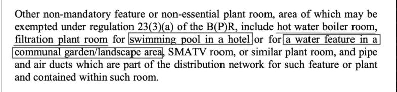{ width="508" loading=lazy }
  <figcaption>Diagram 1 from the original summary (ADF 2/2023, item 14). 原文附圖。</figcaption>
</figure>

**BD's response 屋宇署回覆:** BD advised that HKIS’s understanding was correct. Boiler room for centralised hot water supply system in a hotel or clubhouse might be exempted from GFA calculation subject to the pre-requisites and overall cap under PNAP APP-151 and the limitations as stipulated in PNAP APP-40 and PNAP APP-104 for hotel development and residential recreational facilities respectively.

### 15. Provision of Hoarding for Sites with Special Site Conditions {#i2023050515}

Raised by **HKIS** · Related 相關: [B(P)R 50–70 Temporary buildings, hoardin](../regulations/bpr-50-70.md)

!!! warning "Later discussion 其後再討論"
    This question was discussed again on **6 Feb 2026**; use the [later response](2026.md#i202602065) where they differ. 如有不同，以較新回覆為準。

<small>Follows earlier discussion: [12 Nov 2021](2021.md#i202111129), [12 Aug 2022](2022.md#i2022081213)</small>

**Question 問題:** Referring to item 9 of ADF 5/2021 held on 12 November 2021, BD clarified that provision of hoarding are always required for superstructure works. The merit for the provision of hoarding are to provide physical separation from the public to the construction site. However, for some sites with special site conditions such as the subject superstructure works may be far away from other sites or public access, it seems that close board hoarding may be considered not necessary. Example 1: The proposed building was located on a sloping site and was around 13 m away from the other site. There were existing chain link fences around 5 m away from the site boundary for physical separation. …

<figure markdown>
  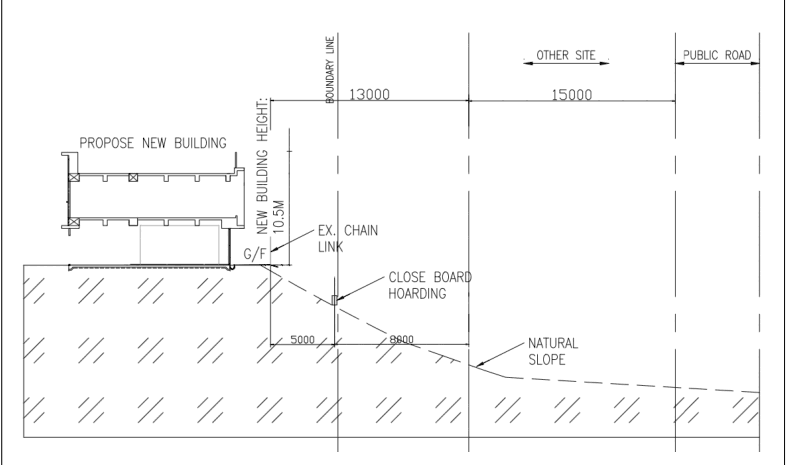{ width="508" loading=lazy }
  <figcaption>Diagram 1 from the original summary (ADF 2/2023, item 15). 原文附圖。</figcaption>
</figure>

<figure markdown>
  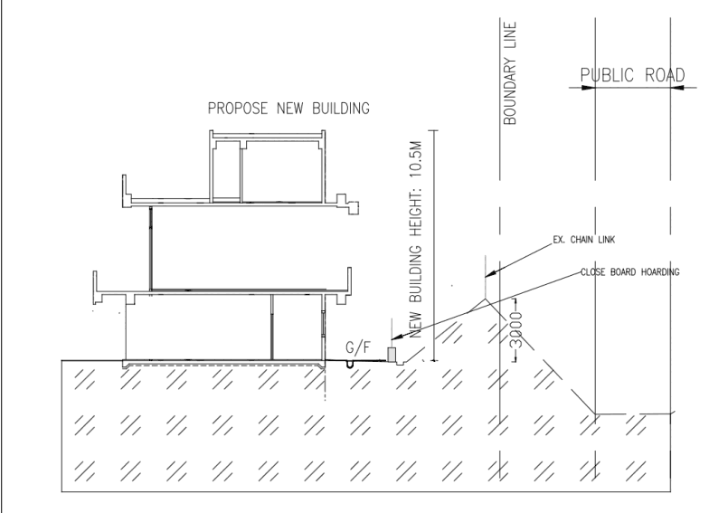{ width="507" loading=lazy }
  <figcaption>Diagram 2 from the original summary (ADF 2/2023, item 15). 原文附圖。</figcaption>
</figure>

**BD's response 屋宇署回覆:** BD advised that according to regulation 66(2) of the B(P)R, except for isolated sites, all hoardings, unless exempted by the BA, should be close boarded. According to similar discussion under item 13 of ADF 4/2022 held on 12 August 2022, in view of different site situations which warrant different safety precautionary measures, proposal of non-provision of close boarded hoarding should be considered on case basis provided that the safety of the public would not be jeopardised. the can be around fences of the 18

### 16. Protective Barriers – PNAP APP-110 {#i2023050516}

Raised by **AAP** · Related 相關: [APP-110](../pnap/app-110.md)

!!! warning "Later discussion 其後再討論"
    This question was discussed again on **9 Aug 2024**; use the [later response](2024.md#i202408099) where they differ. 如有不同，以較新回覆為準。

<small>Related discussions 相關討論: [29 May 2020 item 8](2020.md#i202005298), [12 Nov 2021 item 3](2021.md#i202111123)</small>

**Question 問題:** Paragraph 3 of PNAP APP-110 mentioned that “for railing type barrier on curb of less than 500 mm high, the top of the lowest horizontal rail 3 should be not more than 250 mm above the adjoining floor level.” Footnote 3 of the said PNAP also mentioned that “if the railing type barrier just has vertical balustrades without the bottom rail, the curb should be not less than 250 mm high with protruding width less than 75 mm.” As such, the following railing designs comply with the requirements. Please confirm if our understanding is correct:-

<figure markdown>
  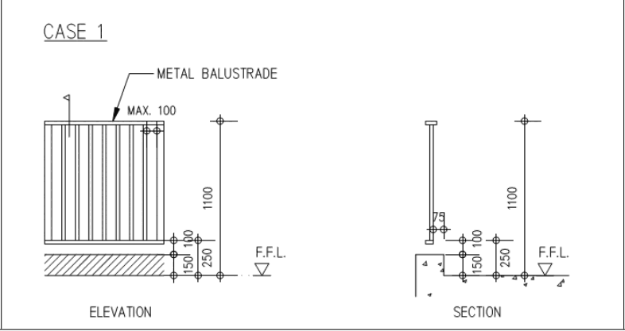{ width="508" loading=lazy }
  <figcaption>Diagram 1 from the original summary (ADF 2/2023, item 16). 原文附圖。</figcaption>
</figure>

<figure markdown>
  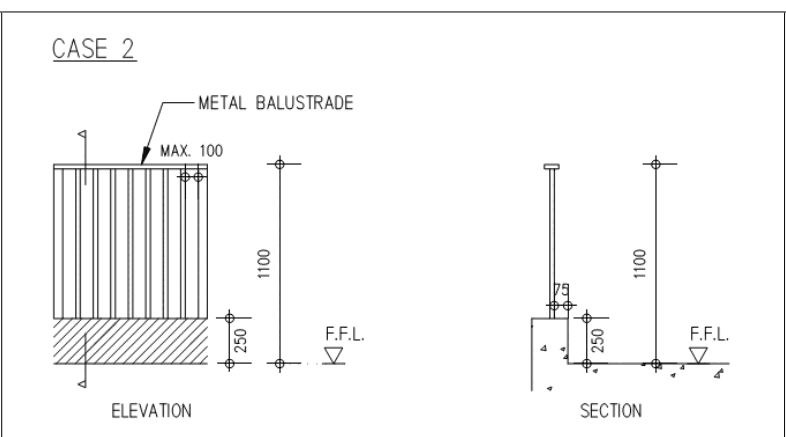{ width="508" loading=lazy }
  <figcaption>Diagram 2 from the original summary (ADF 2/2023, item 16). 原文附圖。</figcaption>
</figure>

<figure markdown>
  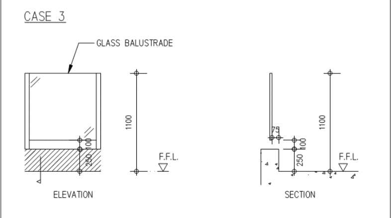{ width="508" loading=lazy }
  <figcaption>Diagram 3 from the original summary (ADF 2/2023, item 16). 原文附圖。</figcaption>
</figure>

**BD's response 屋宇署回覆:** BD advised that PNAP APP-110 was under review, and would provide response in due course.

### 17. Building Amendment Approval without Fire Certificate {#i2023050517}

Raised by **AAP**

**Question 問題:** Recently, some building amendment plans are approved before the corresponding fire certificate is issued by FSD. In some cases that fire certificates cannot be issued and resubmission to FSD is required, should the concerned submission be regarded as another subsequent amendment submission or resubmission of the already approved amendment?

**BD's response 屋宇署回覆:** BD advised that as the building plans had been approved, subsequent submissions involving minor amendments to the approved plans (other than major revision) should be regarded as amendment submissions instead of resubmission.

### 18. Utility Platform {#i2023050518}

Raised by **AAP** · Related 相關: [JPN 2](../pnap/jpn-2.md)

!!! warning "Later discussion 其後再討論"
    This question was discussed again on **4 Aug 2023**; use the [later response](2023.md#i2023080415) where they differ. 如有不同，以較新回覆為準。

**Question 問題:** According to footnote 3 of Appendix A to JPN No. 2, the utility platform may be provided with a water supply point and sink. We understand that a washing machine may be placed at the utility platform. By the same token, if we combined the utility platform with balcony according to the Code of Practice on Access for External Maintenance 2021, the water supply point, sink and washing machine would still be allowed to be placed on the utility platform. Please confirm if our understanding is correct.

**BD's response 屋宇署回覆:** BD advised that AAP’s understanding was correct.

### 19. Circumstances in which a Supervision Plan is Not Required {#i2023050519}

Raised by **ACEHK** · Related 相關: [APP-157](../pnap/app-157.md), [B(MW)R Building (Minor Works) Regulation](../regulations/bmwr-123n.md)

**Question 問題:** According to paragraph 11 of the Technical Memorandum for Supervision Plans 2009, a site supervision plan is not required for building works that satisfy certain criteria. The list of building works not requiring site supervision plans includes all building repairs, all Class II minor works and all Class III minor works. On the other hand, minor works item 1.17 covering repair of structural elements in accordance with the original design belongs to Class I minor works. For the avoidance of doubt, would BD clarify whether a site supervision plan is required for building repairs under minor works item 1.17.

**BD's response 屋宇署回覆:** BD advised that building repairs works carried out under MWCS as Class I minor works would not require the submission of site supervision plan. However, Prescribed Building Professionals and Prescribed Registered Contractors were reminded to observe the relevant supervision requirements for works carried out under the MWCS.

### 20. New Building Works and Concurrent Minor Works within Same Site {#i2023050520}

Raised by **ACEHK**

**Question 問題:** We would like to enquire if there is any rule prohibiting minor works under the MWCS to be carried out concurrently with new building works requiring prior approval and consent at the same site/premises.

**BD's response 屋宇署回覆:** This item was similar to item 13 raised by HKIE above. BD advised that for works in existing buildings, the carrying out of alteration and addition works under approval and consent regime and minor works under MWCS concurrently on the same site had always been allowed.

### 21. Electronic Submission Hub (ESH) {#i2023050521}

Raised by **AREC**

**Question 問題:** Since the first launch of ESH on 30 June 2022, practicing engineers have widely adopted the ESH for submissions to BD. There are 2 commons concerns engineers have encountered for using the system: (i) When a large number of drawings are to be uploaded (say 100 nos. of drawings), the system may have “no response” and the drawings are failed to be uploaded. Would BD recommend the maximum uploading size per batch (i.e. maximum number of drawings to be uploaded per batch) for an effective uploading mechanism? (ii) Some members found that when preparing an amendment submission, on the first page “basic information” there is a check box for applying for type II consent. …

**BD's response 屋宇署回覆:** For (i), BD advised that the maximum file size for uploading per batch was limited to 25 MB. Users of the ESH might contact the ESH hotline at telephone no. 3580 1000 for assistance when encountered difficulties in using ESH. BD would keep reviewing the system for improvement, if necessary. For (ii), BD advised that the allowance of selection of “type II submission” after the submission in ESH would affect the processing of data for plan submission in the system, including the determination of submission date for counting the statutory processing period. Notwithstanding, BD would consider displaying pop-up notifications on the ESH to remind AP/RSE for ticking the relevant check box. In response to AREC’s suggestion, BD would consider including the project name and address instead of BD file reference only, in the acknowledgement of receipt of submissions generated automatically by the ESH for easy reference.

### 22. Tie Beams within Building Setback Area under Sustainable Building Design Guidelines (SBD Guidelines) {#i2023050522}

Raised by **PBSCA** · Related 相關: [APP-152](../pnap/app-152.md), [B(C)R Building (Construction) Regulation](../regulations/bcr-123q.md), [APP-27](../pnap/app-27.md)

<small>Follows earlier discussion: [22 Nov 2019](2019.md#i2019112225)</small>

**Question 問題:** Pursuant to paragraph 7(a) of PNAP APP-152, the building setback requirement under SBD Guidelines can be achieved, provided that no part of building up to a level of 15 m above street level is within 7.5 m from the centreline of street. Paragraph 8(c) of PNAP APP-152 also specifies that columns supporting the building above may be permitted within the setback area subject to requirements in Figure C2 of Appendix C to the said PNAP. In the example illustrated above, there are columns in 650 mm x 650 (d) in structural dimensions, with additional 50 mm thick stone cladding all sides of column within the setback area to support the residential higher than 15 m above street level. …

<figure markdown>
  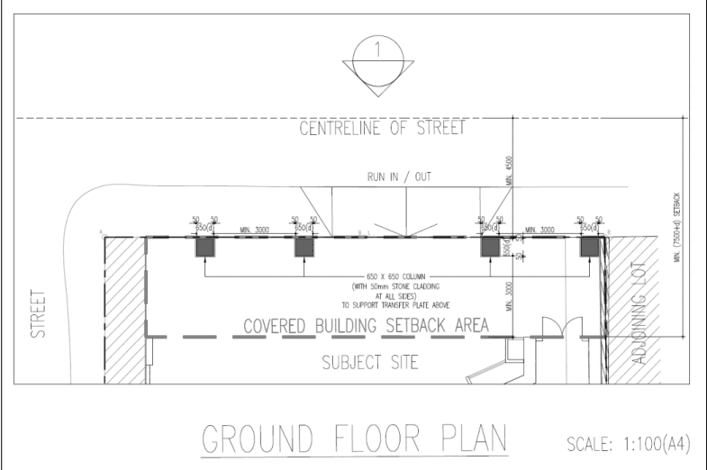{ width="507" loading=lazy }
  <figcaption>Diagram 1 from the original summary (ADF 2/2023, item 22). 原文附圖。</figcaption>
</figure>

<figure markdown>
  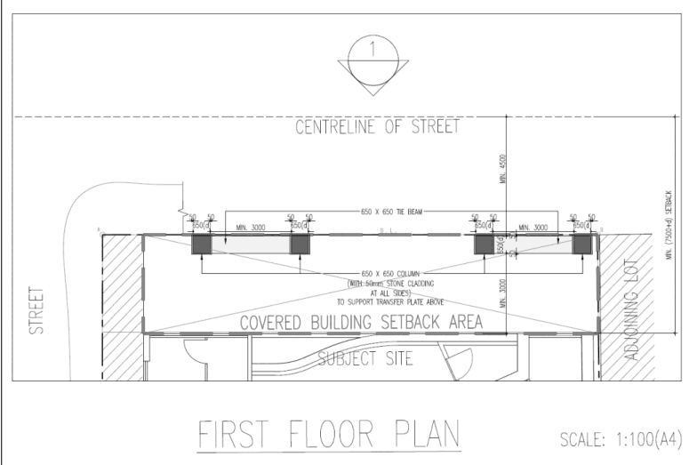{ width="506" loading=lazy }
  <figcaption>Diagram 2 from the original summary (ADF 2/2023, item 22). 原文附圖。</figcaption>
</figure>

<figure markdown>
  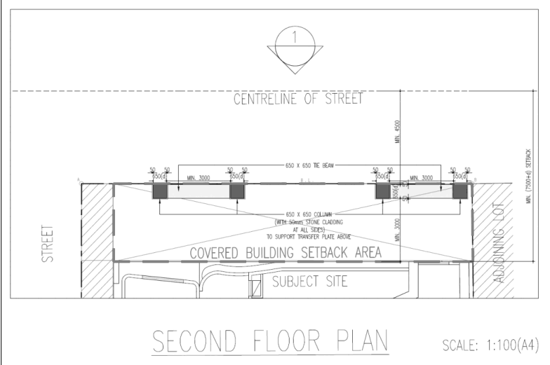{ width="506" loading=lazy }
  <figcaption>Diagram 3 from the original summary (ADF 2/2023, item 22). 原文附圖。</figcaption>
</figure>

<figure markdown>
  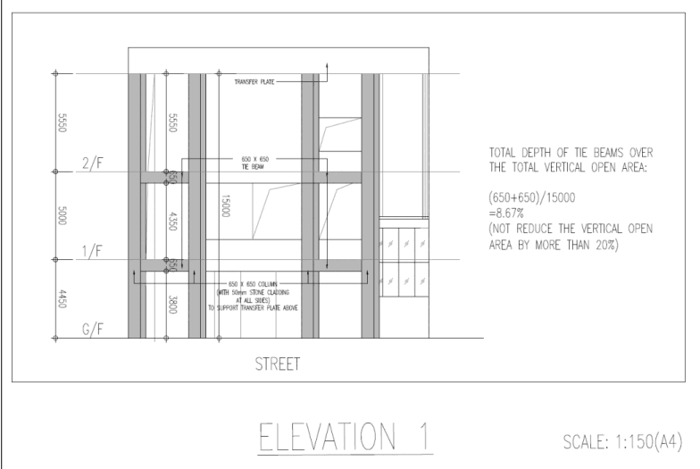{ width="506" loading=lazy }
  <figcaption>Diagram 4 from the original summary (ADF 2/2023, item 22). 原文附圖。</figcaption>
</figure>

**BD's response 屋宇署回覆:** BD would pragmatically consider the merits of the case with the provision of tie beams, provided that the ventilation effectiveness would not be adversely affected. Depending on the circumstances of the case, BD might require further setback from the centreline of the street. According to item 25 of ADF 5/2019 held on 22 November 2019, the dimensions for the setback and column separation should be measured from the finished surface. Due to site constraints and small site beams connecting the columns are 27 Water Heaters, tie beams at the adversely affecting the ventilation provided that all the other complied with. architectural decoration additional to that the overall thickness of wall 28

### 23. Accessible Ramp at Initial Access of Site {#i2023050523}

Raised by **PBSCA**

**Question 問題:** An accessible ramp will be constructed at the initial access of a site connecting to an access road steeper than 1:12 (the requirement of accessible ramp stipulated in paragraph 17 of the DMBFA), and no vehicular drop off area is available along the access road. We would like to know whether our understanding below is correct: BD will consider this accessible ramp acceptable even persons with disability will face hardship to enter the site through the steeper ramp outside.

**BD's response 屋宇署回覆:** BD advised that the provision of an accessible ramp as the initial access of the site might be acceptable provided that the ramp complied with the requirements stipulated in Divisions 4 and 5 of the Third Schedule of the B(P)R. Divisions 4 and 5 of the DMBFA were also relevant.

### 24. GFA Calculation of External Staircase {#i2023050524}

Raised by **PBSCA**

<small>Follows earlier discussion: [22 Jan 2021](2021.md#i202101228)</small>

**Question 問題:** To facilitate maintenance in the future, an external staircase (uncovered) to be constructed with reasonable size and attached to the external wall of a one storey building, will connect G/F (outside of the building) to R/F only, and the roof of the building is uncovered and is a maintenance roof (non-accountable to GFA calculation of the building). We consider that the external staircase can be disregarded from GFA calculation. Please advise whether our understanding is correct. AOB Item

**BD's response 屋宇署回覆:** BD advised that according to item 8 of ADF 1/2021 held on 22 January 2021, an external staircase such as circular one without solid risers and enclosure wall(s) would not be required to be included in the GFA calculation. The whole covered area of an external staircase with solid risers or enclosure wall(s) should be included in GFA calculation unless the space below was filled with lightweight mass concrete.

### 25. Shortening of the 7-day Notification Period before the Commencement {#i2023050525}

Raised by **PBSCA** · Related 相關: [B(A)R Building (Administration) Regulati](../regulations/bar-123a.md)

**Question 問題:** of Building Works – Regulation 20(1) of the Building (Administration) Regulations (B(A)R) (Item raised by HKIE) To facilitate a fast-track development programme, we suggest BD review regulation 20(1) of the B(A)R on whether the notification period of 7 days in advance of the commencement of building works can be shortened, and whether modification of the said regulation can be granted.

**BD's response 屋宇署回覆:** BD would consider the suggestion.

## ADF 1/2023 · 10 Feb 2023 {#adf-12023-10-feb-2023}

[Original summary (PDF) 原文](https://www.hkie-st.org/wp-content/uploads/2025/02/Summary-of-items-discussed-in-1_2023-ADF-on-10.2.2023.pdf) · 21 items

### 1. Maintenance Trench for On-grade Swimming Pool {#i202302101}

Raised by **HKIA**

!!! warning "Later discussion 其後再討論"
    This question was discussed again on **4 Aug 2023**; use the [later response](2023.md#i202308043) where they differ. 如有不同，以較新回覆為準。

**Question 問題:** For on-grade and suspended swimming pools constructed on raft footing or pile cap or as suspended structures, maintenance trench is required along the pool sides to house the filtration system water supply, overflow and drainage pipes, and also electrical system for pool lighting. The trenches are required for the following reasons: - (i) The trench allows regular visual inspection of the pipework for the early discovery of any water leakage to avoid loss of water and ensure water conservation. (ii) The trench provides space for pipework maintenance and replacement when defective pipework is found during regular inspection. …

<figure markdown>
  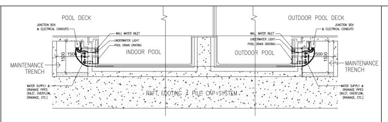{ width="516" loading=lazy }
  <figcaption>Diagram 1 from the original summary (ADF 1/2023, item 1). 原文附圖。</figcaption>
</figure>

**BD's response 屋宇署回覆:** BD advised that the maintenance trench along the pool side was not required to be included in GFA calculation if it was of reasonable size and its abuse would be unlikely.

### 2. Code of Practice on Access for External Maintenance (AfEM Code) {#i202302102}

Raised by **HKIA**

**Question 問題:** It is our understanding that the maintenance and repair (M&R) access requirements on inspection and maintenance/repair are different according to the AfEM Code. The provision of suspended working platform (gondola system) can facilitate routine visual inspection of external walls/building services and even some minor maintenance/repair works. But it shall not be considered as the only means of M&R access for reaching 100% of the building envelope due to its limitation of operation in terms of size and manoeuvring flexibility. …

**BD's response 屋宇署回覆:** BD advised that the compliance with the AfEM Code did not preclude the use of temporary scaffolding for substantial repair. However, M&R access should also cater routine maintenance of the building including cleansing, inspection and localised repair / replacement of defective building elements and components, etc. The use of alternative means such as scaffolding should be considered on case basis. The AP should demonstrate to the satisfaction of BD that the proposed M&R access would not be inferior to the deem-to-satisfy provisions stipulated in the AfEM Code and should exercise due considerations on the following: (i) adequate access should be provided through common area for conveying materials and erection of scaffold; (ii) the design of building projection, building recess and free-form building profile should enable the erection of temporary scaffold in compliance with the Guidelines on the Design and Construction of Bamboo Scaffolds; and (iii) adequate permanent edge protection and works restraint / fall arrest system should be provided for workers to erect the scaffold.

### 3. Minimum Headroom required for Refuse Collection Vehicles (RCV) {#i202302103}

Raised by **HKIA** · Related 相關: [APP-35](../pnap/app-35.md), [B(P)R 23 & 23A Building height, site are](../regulations/bpr-23-23a.md)

**Question 問題:** It comes to our attention that the Food and Environmental Hygiene Department (FEHD), through the comments on general building plan (GBP) submissions, has recently conveyed the following specifications and operational requirements of RCV, which are more stringent and do not tally with the specifications stated in PNAP APP-35: “The headroom along the RCV passage from the entrance to the exit should be at least 4.5m. At the point where the RCV is parked for loading/bin-lifting operation, the clear headroom should not be less than 5.5m.” This will have profound implication on the storey height at G/F. …

**BD's response 屋宇署回覆:** BD advised that the specifications of the RCV currently in use by FEHD specified in PNAP APP-35 were still applicable. In case of high headroom required by FEHD, BD would take a pragmatic approach and consider the case merits subject to AP's justification and the comments of the relevant government departments. HKIA would provide case details of the concerned developments for BD’s further liaison with FEHD. [Post-meeting note: Upon receipt of further information from HKIA, BD discussed with FEHD on the issue. BD was liaising with FEHD to provide update on the limiting specifications of RCV stated in PNAP APP-35.]

### 4. Shallow Foundation in Reclaimed Land with Consolidation Substantially Completed – Clause 2.4.4 of Code of Practice for {#i202302104}

Raised by **HKIE** · Related 相關: [APP-18](../pnap/app-18.md)

**Question 問題:** Foundations 2017 (Foundation Code) According to Clause 2.4.4 of the Foundation Code, “for practical design purpose, the effect of consolidation may be ignored when the ground has undergone a minimum of 95% of primary consolidation settlement. In the absence of a detailed consolidation assessment, the number of years after reclamation required to achieve the 95% degree of consolidation for marine clay of an aggregate thickness H could be taken as follows:” The above table however does not apply to situation where extensive shallow foundation with high soil bearing pressure will be placed to further consolidate the reclaimed land. …

<figure markdown>
  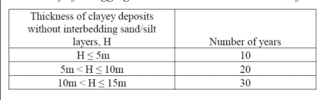{ width="429" loading=lazy }
  <figcaption>Diagram 1 from the original summary (ADF 1/2023, item 4). 原文附圖。</figcaption>
</figure>

**BD's response 屋宇署回覆:** BD advised that the said requirement in Clause 2.4.4 of the Foundation Code was imposed in response to comments received from the then BSC and APSEC members in 2016. The applicability of the table in the said Clause should be determined on case basis. BD would consider deliberating the issue in the Technical Committee (TC) on the Code of Practice for Foundations.

### 5. Presumed Allowable Bearing Capacity and Shaft Friction for Foundations {#i202302105}

Raised by **HKIE** · Related 相關: [APP-18](../pnap/app-18.md)

**Question 問題:** (a) Design in Igneous Rock and Marble GEO has recently updated the Technical Guidance Note (TGN) 53 on 19 January 2023 and TGN 26-1A on 18 January 2022, revising the presumed allowable bearing capacity and shaft friction for category 1(a), 1(b) and 1(c) rock as well as marble. Will BD accept the same presumed allowable bearing capacity and shaft friction for foundation designs in private development? Copy for TGNs are enclosed for your easy reference. …

<figure markdown>
  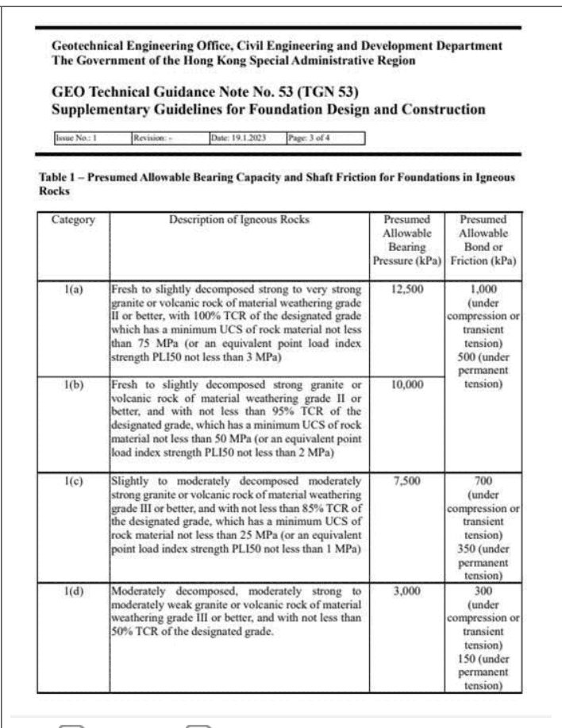{ width="457" loading=lazy }
  <figcaption>Diagram 1 from the original summary (ADF 1/2023, item 5). 原文附圖。</figcaption>
</figure>

<figure markdown>
  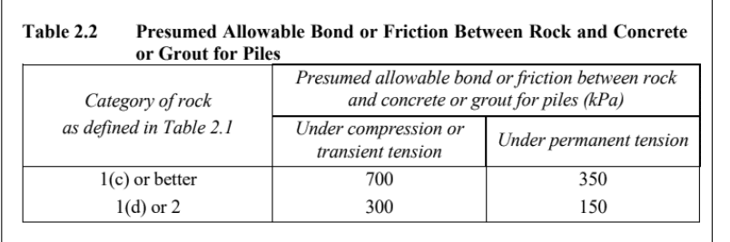{ width="520" loading=lazy }
  <figcaption>Diagram 2 from the original summary (ADF 1/2023, item 5). 原文附圖。</figcaption>
</figure>

**BD's response 屋宇署回覆:** For (a), BD advised that whilst amendment to the Foundation Code had specified in TGN 53 would be considered on case-by-case basis and might be referred to the Structural Engineering Committee for deliberation as necessary. Practitioners were encouraged to make use of the pre-submission enquiry service to resolve the issue before formal submission. For (b) and (c), BD advised that the issues had been raised by TC members of the Foundation Code. The issues were being considered and might be discussed in the TC. 5 TGN26-1A_rev_M arble.pdf 6 H-piles driven to category 2 rock / 7

### 6. Post Construction Proof Drilling for Frictional Piles without End Bearing Capacity {#i202302106}

Raised by **HKIE** · Related 相關: [BO s.14–21 Approval and consent, grounds](../regulations/bo-part-2-building-works.md), [APP-18](../pnap/app-18.md)

**Question 問題:** According to Clause 7.4.4 of the Foundation Code, post construction proof drilling shall be conducted to ascertain the soundness of concrete/rock interface for each of the large diameter bored piles, barrettes and the like. For specific site and geological conditions, frictional bored piles or frictional barrettes may be adopted as the foundation system. The design principle of these frictional piles is identical to that of socketed steel H-pile, i.e. the pile capacity is wholly contributed by the bond friction between concrete and soil/rock and the end bearing resistance is totally ignored. Hence, interface condition is not a concern for frictional piles. …

**BD's response 屋宇署回覆:** BD advised that according to Clause 8.4 of the Foundation Code, for large diameter bored piles, barrette piles and hand-dug caissons, other suitable acceptance criteria for the loading test with full justification might be used. Post construction proof drilling might not be necessary for large diameter bored piles, barrettes and the like where the pile capacity was solely contributed by bond friction along pile shaft. Approval conditions of adopting loading test as proof test may be imposed for such foundation types as necessary. BD may consider refining the common conditions and requirements imposed in approval letter for Foundation Works (Large Diameter Bored Piles) (SE-SA6 (5/2021)) for such types of foundation.

### 7. Design of Moment Connections according to Code of Practice for the Structural Use of Steel 2011 (2021 Edition) (Steel Code) {#i202302107}

Raised by **HKIE** · Related 相關: [APP-168](../pnap/app-168.md)

**Question 問題:** According to Clause 6.11 of the Steel Code, the detailing and design of connections must be consistent with the assumptions used in design calculations. Connections should be able to transmit forces and moments calculated in the design. Joints in Steel Construction: 1995 - Moment Connections published by the Steel Construction Institute in association with the British Constructional Steelwork Association Limited (SCI/BCSA Moment Connections) is a listed reference in Annex A of the Steel Code. This publication provides a guide to the design of moment connections in steelwork. …

**BD's response 屋宇署回覆:** BD advised that the guidance of SCI/BCSA Moment Connections was considered as a general design reference for moment connections in steelwork and the steel connections in structural plan submissions should be designed in accordance and complying with the Steel Code. BD also advised that the TC on the Steel Code was reviewing the classification for joint rigidity and considering to provide some guidelines/illustration diagrams in the Steel Code.

### 8. Elastomeric/mechanical bearing works {#i202302108}

Raised by **HKIE** · Related 相關: [B(C)R Building (Construction) Regulation](../regulations/bcr-123q.md)

**Question 問題:** According to section 3 of the Building (Construction) Regulation, all materials used in building works must be of a nature and quality suitable for their intended use or purpose. The materials used must be adequately tested by recognized tests. This section is a performance-based provision. For a submission involving elastomeric/mechanical bearing works, bearing schedules indicating the performance requirements including the design loads and movements in any specified direction for the bearings are shown on the plan. Details of the manufacturers of the bearings for identification purposes may not be available at the time of the plan submission. …

**BD's response 屋宇署回覆:** BD advised that as specified under the common conditions and requirements imposed in approval letter for Elastomeric/Mechanical Bearing Works (SE-SA28 (01/2021)), certain information of the quality assurance scheme of the manufacturer, such as the quality control documentation relating to the production of the bearings and documents to prove that manufacturing of the bearings were by a factory with ISO 9001 quality assurance certification, would not be required if the bearing was supplied by a manufacturer whose name and address was included in the list of approved suppliers of materials and specialist contractors for public works kept by the Development Bureau under the category of Supply and Installation of Bearings for Highway Structures. If the details of the manufacturers of the bearings were not available at the time of the plan submission, a copy of quality assurance scheme of the manufacturer would be required to be submitted prior to the application for consent to the commencement of the bearing works.

### 9. Qualified Supervision and Quality Audit for Precast Concrete Construction, Modular Integrated Construction and Heat Soak Process {#i202302109}

Raised by **HKIE** · Related 相關: [APP-174](../pnap/app-174.md)

**Question 問題:** of Tempered Glass BD has promulgated a pragmatic and flexible approach under the stepped up cross-boundary control to accept on-site audit checks by videotelephony with in Circular Letter dated 22 April 2022. Given the past 3 years of successful experience using videotelephony for qualified site supervision and Quality Audits, whilst the relaxation of cross-boundary control measures is being implemented in stage, we suggest BD to continuous accept videotelephony as an alternative arrangement for carrying out the qualified supervision and quality audit for enhancement of the industry’s work efficiency.

**BD's response 屋宇署回覆:** BD advised that the enhanced alternative arrangement on such use of videotelephony adopted under the stepped up cross-boundary control was still in place. BD would notify the building professionals if the arrangement was to be ceased.

### 10. Non-destructive Testing of Welds for Structural Steel Works {#i2023021010}

Raised by **HKIE** · Related 相關: [APP-157](../pnap/app-157.md)

**Question 問題:** According to the approval conditions of structural steel works, the test reports of non-destructive testing of welds shall be endorsed by Registered Structural Engineer (RSE) and kept on site for inspection by BD (extracted copy of the approval conditions attached for easy reference). Non-destructive testing of welds (Structural Steel works).pdf Under the Code of Practice for Site Supervision 2009 (2021 Edition) (Site Supervision Code), RSE can assigned representative (same as the Technically Competent Person of Grade T5 under the RSE’s stream) to conduct regular qualified site supervision of the structural steel works on site. …

**BD's response 屋宇署回覆:** BD advised that to ensure the quality of structural steel works, RSE’s endorsement on reports of non-destructive testing of welds was necessary. While there were no requirements on such endorsement by RSE’s signature on the said reports or in a written confirmation on the authenticity of the reports, RSE were reminded to endorse the said reports within reasonable time.

### 11. Removal of Retaining Walls in Site Formation Works {#i2023021011}

Raised by **HKIE** · Related 相關: [APP-96](../pnap/app-96.md)

**Question 問題:** Occasionally, removal of retaining walls will be shown and approved in a site formation plans as so to reflect the overall design intent/concept of the site formation works. BD sometimes requests these removal works to be carried out by a Registered Specialist Contractor (Demolition). As Register Specialist Contractors (Site Formation) (RSC(SF)) are experienced in the construction of retaining walls, we consider the removal works of retaining walls shown in site formation plans by RSC(SF) are safe and more suitable. Would BD please advise whether it is acceptable?

**BD's response 屋宇署回覆:** BD advised that the scope of works of Registered Specialist Contractors in the demotion works and site formation works categories were delineated under Appendix A to PNAP APP-96. HKIE would provide case details for BD’s consideration on the issue.

### 12. Set Back Approach – PNAP APP-132 {#i2023021012}

Raised by **AAP** · Related 相關: [APP-132](../pnap/app-132.md)

<small>Follows earlier discussion: [25 Nov 2022](2022.md#i2022112510)</small>

**Question 問題:** It is our understanding that the setback of building as mentioned in paragraph 3 of PNAP APP-132 should only be applied to the part of building above street level, such that part of building/ structures/ services below street level could still be erected within the setback area. Please confirm if our understanding is correct.

**BD's response 屋宇署回覆:** BD advised that AAP’s understanding was correct. Under paragraph 3(e) of PNAP APP-132, the setback area should contribute to improving the street environment such as enhancing air ventilation and permeability as well as promoting connectivity and walkability. In this regard, building/ structures/ services below street level (including smoke outlets covered by breakable panels on the ground of the pavement), not affecting street environmental, were generally acceptable to be erected within the setback area.

### 13. Building Setback – PNAP APP-152 {#i2023021013}

Raised by **AAP** · Related 相關: [APP-152](../pnap/app-152.md)

<small>Follows earlier discussion: [22 Nov 2019](2019.md#i2019112225)</small>

<small>Related discussions 相關討論: [24 May 2019 item 2](2019.md#i201905242), [22 Nov 2024 item 2](2024.md#i202411222)</small>

**Question 問題:** It is our understanding that the requirement of building setback in PNAP APP-152 should only be applicable to buildings fronting street vested in the Government and maintained by the Highways Department or a private street to be surrendered to the Government, as described under regulation 18A(3)(a)(i) and (ii) of B(P)R, and it is not applicable to buildings fronting other street as described under regulation 18A(3)(a)(iiii), (iv) and (v) of the B(P)R. Please confirm if our understanding is correct.

**BD's response 屋宇署回覆:** BD advised that AAP’s understanding was correct. The term “street” was defined in Appendix A to PNAP APP-152 as described under regulation 18A(3)(a)(i) and (ii) of B(P)R.

### 14. Fire Resisting Enclosures to Services {#i2023021014}

Raised by **AAP** · Related 相關: [FS Code 2011 Part C: Fire Resisting Cons](../codes/fsc-part-c-fire-resisting-construction.md)

**Question 問題:** There are recent cases that BD officers require drainage pipes coming from upper domestic floors to be enclosed by fire barriers when passing through areas at mechanical floor below (not being protected exits and protected lobbies) even when the openings for the pipes through the fire barriers are protected with fire stops. Would BD please clarify if such fire resisting enclosures to services could be omitted in accordance with Clauses C8.2 and C8.4 of the Code of Practice for Fire Safety in Buildings (FS Code)?

**BD's response 屋宇署回覆:** BD advised that the fire resisting enclosures to services within the mechanical floor as mentioned in the scenario are not required in accordance with Clauses C8.2 and C8.4 of the FS Code. According to Clause C8.2 of the FS Code, every opening for passage of air-conditioning ducts, ventilation ducts, electrical trunkings, conduits, pipes, cables and the like through a fire barrier should be protected with fire dampers or other suitable form of fire stop to maintain the required FRR of that fire barrier. According to Clause C8.4 of the same code, subject to Clause C8.2, building services including the associated ducts, trunkings, conduits, pipes, cables and the like were not required to be enclosed by fire barriers if they are installed within the same fire compartment.

### 15. Provision for Fire Resisting Construction for Landscape Features {#i2023021015}

Raised by **AAP** · Related 相關: [FS Code 2011 Part C: Fire Resisting Cons](../codes/fsc-part-c-fire-resisting-construction.md)

**Question 問題:** Clause C4.3 of the FS Code states that “where a single-storey building does not exceed 7,000 m 3 in volume and 7.5 m in height, any steelwork construction may be unprotected, provided that the building is separated from any adjoining building or the site boundary by a clear unobstructed open space not less than 6m in width”, and the commentary of the said Clause states that “no FRR is required for elements of construction of single-storey covered walkways on podium or ground floor if they comply with Subsection C9 and Clause C12.4 and are constructed of non-combustible materials complying with Part E.” To our understanding, similarly, no FRR is required for elements of construction for …

**BD's response 屋宇署回覆:** BD advised that subject to the design in each individual case, the commentary to Clause C4.3 of the FS Code might be applicable to amenity features similar in nature and construction to a single-storey covered walkway on podium or ground floor.

### 16. GFA Calculation of Covered Area under Roof Feature {#i2023021016}

Raised by **PBSCA**

**Question 問題:** We recently received comment from BD that the covered area under a 500 mm wide roof feature on the roof of a single family house as illustrated in the attached drawing shall be GFA accountable. The roof feature is 2750 mm high from roof level and open in design, which is not likely to be abused. We opined that the roof feature shall adopt similar approach as other architectural features projecting from the external wall, such that its covered area shall not be GFA accountable given that the roof feature has a maximum width of 500 mm and is open in design. Please confirm if our understanding is correct.

**BD's response 屋宇署回覆:** BD advised that GFA calculation for roof features on roof of a single family house would be considered on case basis, taking into account the chance of abuse of the roof features. For the drawing illustrated by PBSCA, BD advised that in consideration of the size of the roof feature and the low chance of abuse, the area covered by the 500 mm wide roof feature might be exempted from GFA calculation.

### 17. GFA Calculation of Covered Area under Doorway of Landscape Feature Wall {#i2023021017}

Raised by **PBSCA**

**Question 問題:** We recently received comment from BD that the covered area under the doorway of a standalone feature wall as illustrated in the attached drawing shall be GFA accountable. The feature wall is a landscape feature of 2500 mm high with a maximum thickness of 500 mm and the doorway is only 2300 mm wide. Given that the doorway is only an opening at the landscape feature wall and the covered area for such doorway is minimal, we opined that the covered area of the doorway of landscape feature wall shall not be GFA accountable. Please confirm if our understanding is correct.

**BD's response 屋宇署回覆:** BD advised that landscape features of reasonable size and rare chance of abuse might be exempted from GFA calculation. For the drawing illustrated by PBSCA, BD advised that the covered area under the doorway of a genuine landscape feature might be exempted from GFA calculation.

### 18. GFA Calculation of Covered Area under Portal of Metal Gate at Main Entrance {#i2023021018}

Raised by **PBSCA**

!!! warning "Later discussion 其後再討論"
    This question was discussed again on **4 Aug 2023**; use the [later response](2023.md#i202308041) where they differ. 如有不同，以較新回覆為準。

**Question 問題:** We recently received comment from BD that the covered area under the portal for metal gate at main entrance as illustrated in the attached drawing shall be GFA accountable. The portal is 3500 mm high and 5000 mm wide with a maximum thickness of 750 mm. It is common to have a portal for the access gates at main entrance of a development for better architectural design which at the same time provides better structural stability for the heavy metal gates. As there are no other structures nearby, the chance of abuse for the portal is minimal. …

<figure markdown>
  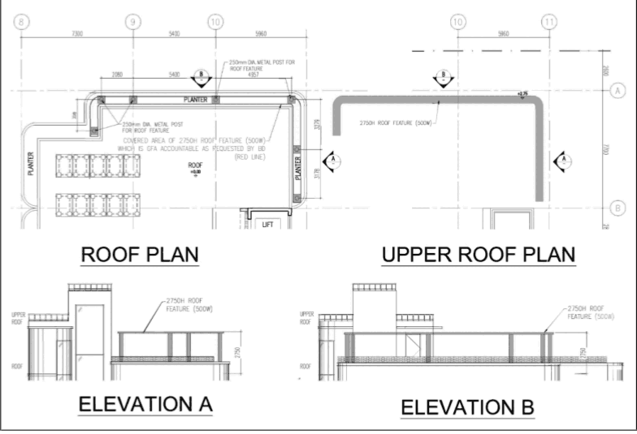{ width="507" loading=lazy }
  <figcaption>Diagram 1 from the original summary (ADF 1/2023, item 18). 原文附圖。</figcaption>
</figure>

<figure markdown>
  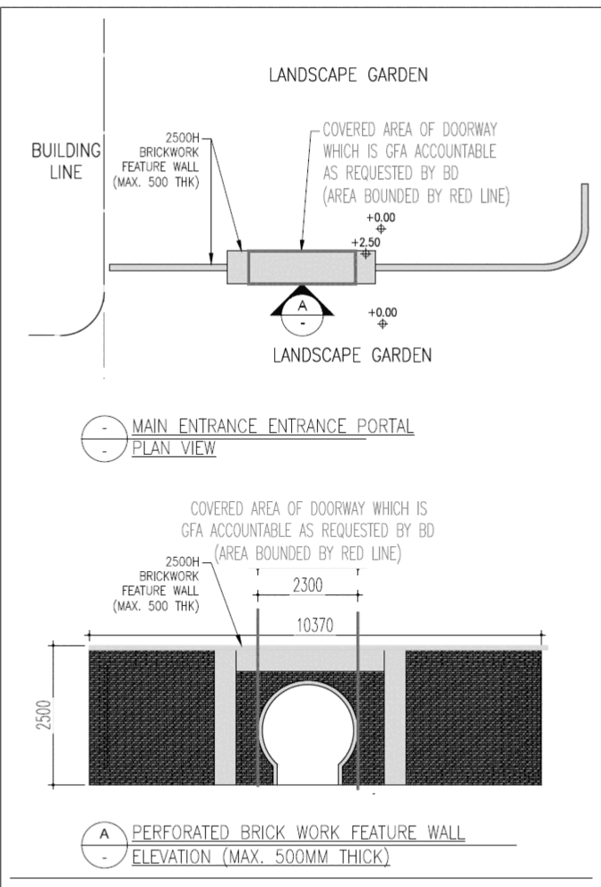{ width="484" loading=lazy }
  <figcaption>Diagram 2 from the original summary (ADF 1/2023, item 18). 原文附圖。</figcaption>
</figure>

<figure markdown>
  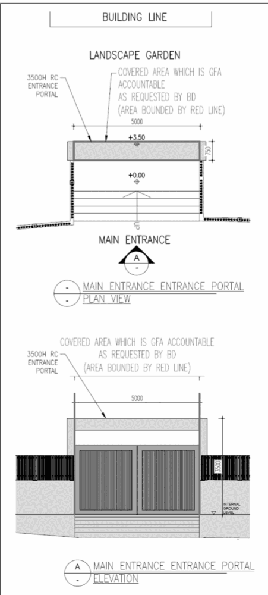{ width="321" loading=lazy }
  <figcaption>Diagram 3 from the original summary (ADF 1/2023, item 18). 原文附圖。</figcaption>
</figure>

**BD's response 屋宇署回覆:** BD advised that the covered area under the portal for metal gate at main entrance of a development might be exempted from GFA calculation on case merits if the size of the portal was commensurate with the scale of the development.

### 19. Dedicated Processing Units (DPU) {#i2023021019}

Raised by **PBSCA**

**Question 問題:** (Item raised by BD) As one of the measures in the Chief Executive’s 2022 Policy Address to enhance speed and efficiency of housing supply, DPU comprising senior professional officers and professional officers would be established in BD, adopting a “facilitator” mindset to expedite the approval process of plans submitted for high-yield private residential projects (i.e. residential project of 500 units or more) and transitional housing projects. DPU would be set up in NBD1 and NBD2 respectively in Q1 of 2023. …

**BD's response 屋宇署回覆:** Members welcomed the establishment of the DPUs. On the concern about the workload of the DPUs and manpower situation of BD, BD advised there would be suitable manpower deployment with regard to the actual workload. BD supplemented that their internal workflow in plan processing would be streamlined from time to time to facilitate plan approval. BD also encouraged the AP/RSE to make wider use of the promulgated streamlining measures on plan processing to facilitate the approval process. BD advised that the use of pre-submission enquiry service could help resolving complex or controversial issues effectively. If necessary, BD would put forward such issues for consideration by the Building Committee or Structural Engineering Committee before the formal submission of GBP or structural plans to facilitate the plan approval process. BD also appealed for AP/RSE/RGE/RC’s activation of accounts and wider use of the Electronic Submission Hub (ESH) which provided various useful features and functions to expedite the plan approval process. …

### 20. Maximum Span of Pure Cantilevered Slab {#i2023021020}

Raised by **PBSCA** · Related 相關: [APP-68](../pnap/app-68.md), [APP-142](../pnap/app-142.md)

!!! warning "Later discussion 其後再討論"
    This question was discussed again on **8 May 2026**; use the [later response](2026.md#i202605088) where they differ. 如有不同，以較新回覆為準。

**Question 問題:** (Item raised by HKIE) Whilst the Clause 9.4.1 of the Code of Practice for Structural Use of Concrete 2013 (Concrete Code) has been revised to allow the maximum span for pure cantilevered slab to be 1200 mm to address the feedback from the Industry, Appendix A to PNAP APP-68 “Design and Construction of Cantilever Reinforced Concrete Structures” (current revision issued September 2012) has not been updated to tally with the aforesaid Concrete Code, i.e. Concrete Code (2020 Edition) (the relevant documents are extracted below for your easy reference). …

<figure markdown>
  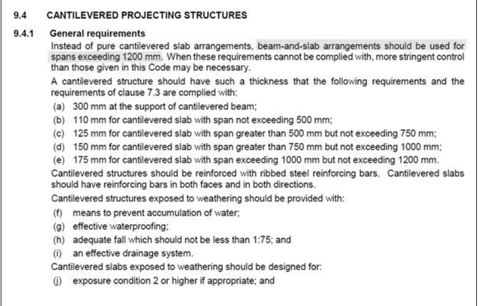{ width="514" loading=lazy }
  <figcaption>Diagram 1 from the original summary (ADF 1/2023, item 20). 原文附圖。</figcaption>
</figure>

<figure markdown>
  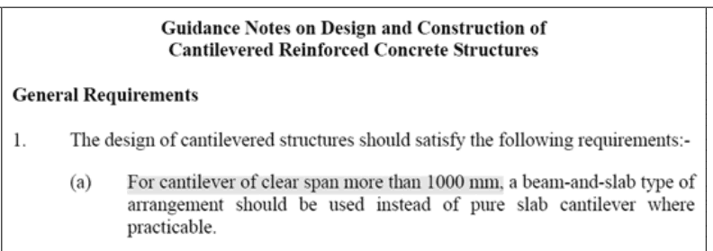{ width="512" loading=lazy }
  <figcaption>Diagram 2 from the original summary (ADF 1/2023, item 20). 原文附圖。</figcaption>
</figure>

**BD's response 屋宇署回覆:** BD advised that Appendix A to PNAP APP-68 would be updated soon. in revised design in 22

### 21. Witnessing of Setting-out of ELS and/or Foundation Piles by BD {#i2023021021}

Raised by **PBSCA**

**Question 問題:** (Item raised by HKIE) Some BD officers requested for a separate site visit for the checking of setting out for ELS and/or foundation piles before their witnessing of trial boring, test driving and trial piles etc. Would BD confirm whether such site visit is necessary as setting-out can be verified during trial boring and test driving operation.

**BD's response 屋宇署回覆:** BD advised that there was no site visit requirement of checking setting out for ELS works and the arrangement of having a representative from BD to witness the setting out of pile foundation prior to test boring/test driving was no longer required. BD officers would be reminded of the streamlined arrangement accordingly.

---
<small>Source: Summary of Items Discussed in APSEC Discussion Forum, published by the HKIE Structural Division. Condensed for reference; the PDF is the authoritative record.</small>
