---
tags:
  - APSEC
  - Plan submission & approval 呈交及審批
  - Structural 結構
  - Foundation 地基
  - Fire safety 消防安全
  - Registration 註冊
  - GFA 總樓面面積
  - Drainage 排水
  - Wind 風力
  - A&A works 改動及加建工程
  - Concrete & materials 混凝土及物料
  - Fire resisting construction 耐火結構
  - Site supervision 地盤監督
  - Curtain wall & façade 幕牆及外牆
  - Site safety 地盤安全
  - Geotechnical 岩土
  - Maintenance access 維修通道
  - Lift 升降機
  - Car park 停車場
  - Domestic 住用
  - Barrier free access 無障礙
  - Plant rooms 機房
  - Means of escape 逃生途徑
  - Green & amenity features 環保及適意設施
  - Staircase 樓梯
  - Occupation permit 佔用許可證
  - GFA concession 樓面面積寬免
  - Energy efficiency 能源效率
  - Signboard 招牌
  - Demolition 拆卸
  - Minor works 小型工程
  - Means of access 救援通道
  - Sustainable building design 可持續建築設計
  - Site coverage 上蓋面積
  - Refuse 垃圾
  - Refuge floor 庇護層
  - Protective barrier 防護欄障
  - Excavation & ELS 挖掘
  - Balcony & utility platform 露台及工作平台
  - Plumbing & sanitary 衞生設備
  - Statutory period 法定期限
  - Plot ratio 地積比率
  - Lighting & ventilation 照明及通風
---

# APSEC discussion items 2024 <small>2024 年認可人士及註冊結構工程師委員會討論項目</small>

!!! info "About this page 關於本頁"
    Questions raised at the APSEC Discussion Forum (ADF) and **BD's responses**, extracted from the summaries published by the HKIE Structural Division. Text is condensed from the English source; check the PDF before relying on an item. Where a later meeting discussed the same question, the item is flagged and **the later response prevails**.
    摘錄自香港工程師學會結構分部發布的會議摘要（只有英文版本）。如其後會議再討論同一問題，以**較新的回覆為準**。

## ADF 4/2024 · 22 Nov 2024 {#adf-42024-22-nov-2024}

[Original summary (PDF) 原文](https://www.hkie-st.org/wp-content/uploads/2025/02/Summary-of-items-discussed-in-4_2024-ADF-on-22.11.2024.pdf) · 30 items

### 1. Large-scale Televisions and LED Displays in Internal Space {#i202411221}

Raised by **HKIA** · Related 相關: [APP-126](../pnap/app-126.md), [BO s.1–13A Interpretation; registration ](../regulations/bo-part-1-registration.md)

**Question 問題:** It is our understanding that large-scale televisions and LED displays installed at interior space that require structural submission to BD are not ‘signboard ( 招 牌 )’ as defined under the Buildings Ordinance (BO). Thus, requirements under PNAP APP-126 is not required to be complied with for such televisions and LED displays. Please advise if our understanding is correct. Example of televisions and LED displays in interior space refer to the sectional diagram below:

<figure markdown>
  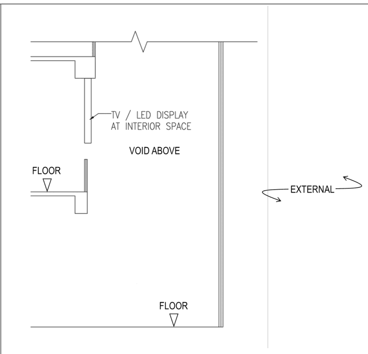{ width="491" loading=lazy }
  <figcaption>Diagram 1 from the original summary (ADF 4/2024, item 1). 原文附圖。</figcaption>
</figure>

**BD's response 屋宇署回覆:** BD advised that pursuant to section 2 of the BO, ‘signboard’ means a hoarding, framework, scaffolding or other structure erected solely for the purpose of displaying any advertisement, making any announcement or notification, or displaying any visual image or other information. A signboard with a TV wall or LED display or the like (whether it was fixed to the external wall and erected in a building) was designed to be fixed to a supporting frame, the installation of such display should follow the manufacturer's specifications and recommendations. The fire safety requirements for LED display signboards stipulated in Appendix A of PNAP APP-126 were intended for the signboards installed at the exterior of buildings only, and were not applicable to those installed in interior spaces of buildings.

### 2. Building Separation Requirement – PNAP APP-152 {#i202411222}

Raised by **HKIA** · Related 相關: [APP-152](../pnap/app-152.md)

<small>Related discussions 相關討論: [22 Nov 2019 item 25](2019.md#i2019112225), [10 Feb 2023 item 13](2023.md#i2023021013)</small>

**Question 問題:** Referring to paragraph 4.2 of Appendix B to PNAP APP-152, not less than 2/3 of the required permeability (P) shall be provided by intervening space (IS) between the ends of the projected building facades and the adjacent site boundaries or, where the site abuts a street or a lane, the centreline of adjoining street or lane, and that such IS shall provide a separating distance (S) of not less than 7.5 m wide. It is our understanding that if the required S can be sufficiently provided by one end of the projected façade, there is no requirement to provide IS on the other end of the projected façade. …

<figure markdown>
  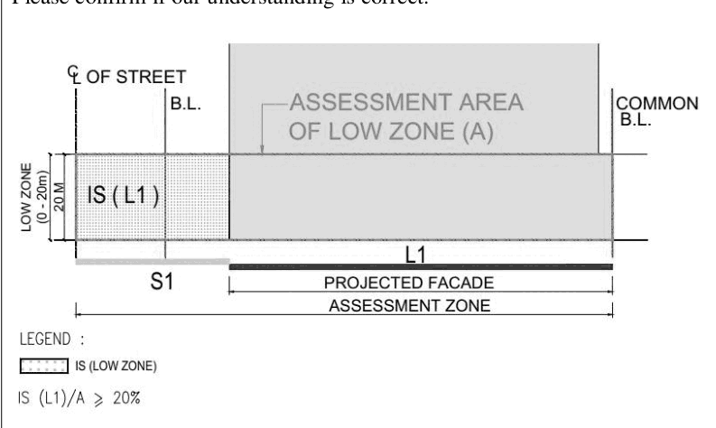{ width="513" loading=lazy }
  <figcaption>Diagram 1 from the original summary (ADF 4/2024, item 2). 原文附圖。</figcaption>
</figure>

**BD's response 屋宇署回覆:** BD advised that HKIA’s understanding was incorrect. The provision of separating distance (S) was one of the design requirements for building separation and should be complied with. There should be S of not less than 7.5 m wide between the projected building facades and the site boundaries or the centreline of the adjoining streets or lanes. Figure B12 of Appendix B of PNAP APP-152 was relevant. This requirement had been in effect since the first issue of PNAP APP-152 in January 2011.

### 3. Mandatory Circulation of Final Amendment of General Building Plans {#i202411223}

Raised by **HKIA** · Related 相關: [ADM-2](../pnap/adm-2.md)

**Question 問題:** (GBP) to the Fire Services Department (FSD) after Initial Inspection for Occupation Permit (OP) Application The application for inspection and testing of fire service (FS) installations and equipment for FSD’s issuance of the Fire Services Certificate (FS172) is usually made concurrently with the submission of final GBP amendment after the site inspection by BD for OP application. Such submission of the final GBP amendment usually involves only minor layout adjustments and does not affect FS installations. …

**BD's response 屋宇署回覆:** BD advised that referral to FSD under centralized processing of building plans was clearly stated in PNAP ADM-2. In the Electronic Submission Hub (ESH), building plans would be sent to FSD automatically. BD would further discuss with FSD to explore whether referral of those final GBP amendments involving minor layout adjustments only and not affecting FS installations to FSD would not be necessary.

### 4. Fireman’s Lift Lobby Clear Dimensions {#i202411224}

Raised by **HKIA** · Related 相關: [FS Code 2011 Part D: Means of Access](../codes/fsc-part-d-means-of-access.md)

<small>Related discussions 相關討論: [12 Nov 2021 item 6](2021.md#i202111126)</small>

**Question 問題:** Clause D11.1 of the Code of Practice for Fire Safety in Buildings (2011) (June 20223 Edition) (FS Code) states that “Each point of discharge from a fireman’s lift to the floor served, except at the fires service access point in Subsection D7, should be through a lobby having a floor area of not less than 2.25 m 2 and a minimum dimension of 1.5 m”. It is our understanding that the minimum dimension of 1.5 m shall be measured between walls of the Fireman’s Lift Lobby, instead of from the door swing of the lift lobby, as indicated in the diagram below in which the door swing encroaches on the 1.5 m x 1.5m space. Please confirm if our understanding is correct.

<figure markdown>
  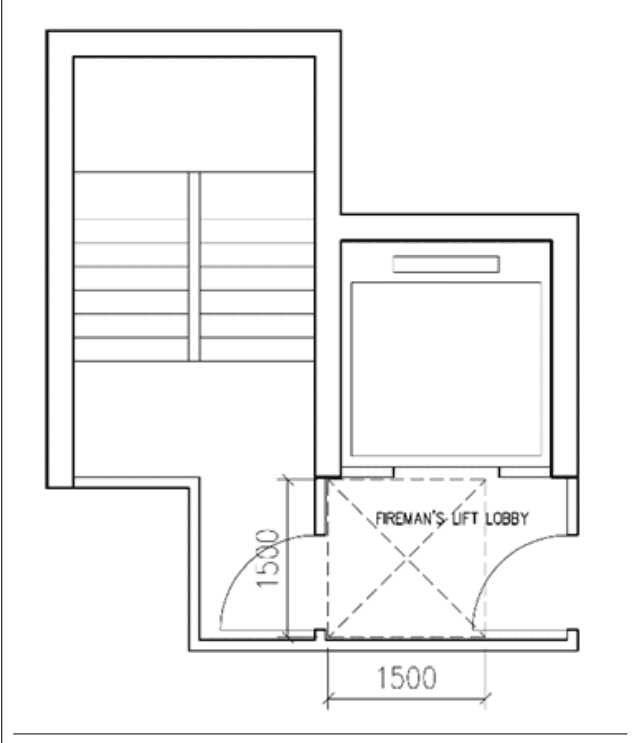{ width="413" loading=lazy }
  <figcaption>Diagram 1 from the original summary (ADF 4/2024, item 4). 原文附圖。</figcaption>
</figure>

**BD's response 屋宇署回覆:** BD advised that the proposed layout was not acceptable as the lobby door in its fully open/end position(s) would obstruct/jeopardize the provision of minimum dimension of 1.5 m in the said lobby.

### 5. Gross Floor Area (GFA) Concessions for Air Conditioning (AC) Plant Rooms serving Essential Plant Rooms {#i202411225}

Raised by **HKIA** · Related 相關: [APP-42](../pnap/app-42.md), [APP-84](../pnap/app-84.md)

**Question 問題:** According to paragraph 8(b) of PNAP APP-42, BD considers “air handling units (AHU) not exceeding 4% of the total GFA of each floor on which they are situated” reasonable. For essential plant rooms which are not accountable for GFA, such as telecommunications and broadcasting (TBE) room and switch room, which required air-conditioning to maintain proper functioning of the equipment, would BD consider the AC plant rooms serving these essential plant rooms also as part of the essential plant rooms for disregarding from the calculation of GFA? If otherwise, would BD consider applying the approach on AHU in PNAP APP-42 for these AC plant rooms with the 4% restriction calculated on the total …

**BD's response 屋宇署回覆:** BD advised that according to PNAP APP-84, the maximum area of TBE room that could be disregarded from GFA calculation had already accommodated the area of plants supporting the operation of the access facilities for telecommunications and broadcasting. However, the AC plant rooms serving essential plant rooms should be considered as non-essential plant rooms for the purpose of GFA calculation. BD might favourably consider disregarding such AC plant rooms from GFA calculation on case basis, provided that their area did not exceed 4% of the floor areas of the essential plant rooms they serve.

### 6. GFA L Concession for Carparks {#i202411226}

Raised by **HKIA** · Related 相關: [APP-2](../pnap/app-2.md), [APP-152](../pnap/app-152.md)

!!! warning "Later discussion 其後再討論"
    This question was discussed again on **21 Nov 2025**; use the [later response](2025.md#i2025112117) where they differ. 如有不同，以較新回覆為準。

<small>Follows earlier discussion: [9 Aug 2024](2024.md#i2024080931)</small>

<small>Related discussions 相關討論: [19 Mar 2021 item 14](2021.md#i2021031914), [13 May 2022 item 21](2022.md#i2022051321)</small>

**Question 問題:** u Item s 31 of ADF 3/2024 held on 9 August 2024 regarding the granting of 100% GFA concession for ancillary or public carparks in not more than one aboveground level in private project as stipulated in paragraph 7 of Appendix C to PNAP APP-2 refers. BD advised that “…if there are specific site constraints rendering it impossible to fully utilise the site for construction of the concerned aboveground carparking floor such that it is necessary to provide split levels or stack up the car park spaces in multi-levels, more than one aboveground carparking floors may be 100% disregarded from GFA calculation on the condition that the total floor area of the concerned aboveground carpark would not …

**BD's response 屋宇署回覆:** BD advised that the compliance with the SBDG promulgated in PNAP APP-152 was a pre-requisite in exempting or disregarding green/amenity features and non-mandatory/non-essential plant rooms and services from GFA and/or site coverage calculations, and would generally not be regarded as the “specific site constraints” mentioned under item 31 of ADF 3/2024 held on 9 August 2024. Nevertheless, AP might provide the details of the case with justifications for consideration by the Building Committee of BD.

### 7. Prevention of Water Seepage {#i202411227}

Raised by **HKIA** · Related 相關: [APP-105](../pnap/app-105.md)

**Question 問題:** (a) With respect to Figure 4 (Sunken Area under Bathtub) in Annex 2 to (a) Appendix B to PNAP APP-105, a vertical grating connecting drainage system via a trap with water replenishing arrangement is illustrated to discharge water seeped into the sunken area. We opine that a warning pipe discharging such seeped water to a prominent position at, say, pipe duct/well or other open area, may equally well serve the same purpose. Besides, it can also allow property management personnel to identify the location of water seepage, and thus take necessary follow-up actions with the occupier of the unit concerned. …

**BD's response 屋宇署回覆:** BD advised that as stipulated in paragraph 20(g) of Appendix B to PNAP APP-105, waterproofing membrane/material should be applied to the entire internal area of the sunken slab serving a bathroom or toilet. Water seeping from the bathtub area to the sunken area, if any, would be discharged to the foul water drainage system via a vertical grating, as illustrated in Figure 4 in Annex 2 to Appendix B to the said PNAP. Adequate access points with inspection chambers should be provided for the sunken slab to facilitate inspection of the pipeworks and clearance of any blockage thereof. Unconnected warning pipe was undesirable since it would create nuisance and/or water seepage elsewhere if the situation was unattended. BD advised that the demarcation for sunken area could facilitate future maintenance and reduce the risk to damage the waterproofing in identifying the sunken trench. The sample drawings of waterproofing works in a bathroom or a toilet provided in Annex 2 to Appendix B to the said PNAP were for reference only. BD would favourably consider alternative design and construction with equivalent or better performance.

### 8. Temporary Works for Tower Crane - Code of Practice for Site Supervision 2009 (2024 Edition) (Supervision Code) {#i202411228}

Raised by **HKIE** · Related 相關: [APP-157](../pnap/app-157.md)

<small>Related discussions 相關討論: [26 Nov 2020 item 9](2020.md#i202011269)</small>

**Question 問題:** Paragraph 4.12(e) of the Supervision Code states that “similar to all types of temporary works, the RC should provide continuous supervision of the works in accordance with this Code and the supervision plan. The AP/RSE/RGE should check to ensure that RC has followed the above requirements and provide periodic supervision of such works in accordance with this Code and the supervision plan”. …

**BD's response 屋宇署回覆:** BD advised that insofar as temporary works providing support to a tower crane was concerned, Table 4.2, Table 4.3, paragraphs 4.9 to 4.12 and item A9 in Table 5.1, item E7 in Table 5.2 and item G7 in Table 5.3 of the Supervision Code stipulated the responsibilities of AP/RSE/RGE for site supervision/inspection on temporary works carried out by RC. While RC had the sole responsibility of ensuring the integrity of the temporary works, including temporary works providing support to a tower crane such that the carrying out of temporary works should be safe and should not endanger the workers on site, the public and adjoining buildings and lands, AP/RSE/RGE and their TCPs were required to check if the administrative procedures set out for temporary works providing support to a tower crane in paragraphs 4.9 to 4.12 of the Supervision Code had been followed by the RC. In particular for Case 3, according to paragraphs 4.11(b) and 4.12(d)of the Supervision Code, RSE/RGE should check and give a written permission to RC for the carrying out the temporary works upon verifying that the safety and integrity of the permanent structures, adjoining buildings and lands would not be adversely affected.

### 9. Mass Concrete Fill in Shallow Foundations {#i202411229}

Raised by **HKIE** · Related 相關: [APP-18](../pnap/app-18.md), [APP-142](../pnap/app-142.md)

<small>Related discussions 相關討論: [12 Aug 2022 item 23](2022.md#i2022081223)</small>

**Question 問題:** In paragraph 7 of Appendix C to PNAP APP-18, it is stated that mass concrete fill with depth exceeding 1 m placed beneath footings or raft foundations should be regarded as structural element and be designed in accordance with the Code of Practice for Structural Use of Concrete 2013 (2020 Edition) (Concrete Code). In the absence of an established guideline, some BD officers had required that the whole depth of mass concrete be provided with a nominal rebar percentage of 0.13% in some previous projects, which resulted in huge amount of reinforcement for mass concrete depth of 2 to 3 m. …

**BD's response 屋宇署回覆:** BD advised that the paragraph 7 of Appendix C to of PNAP APP-18 provide for RSE to design mass concrete fill in accordance with Concrete Code. RSE should provide justifications to demonstrate the adequacy of the mass concrete stocky element. BD considered that providing nominal steel amount to mass concrete stocky element is deemed to satisfy the requirement in the Concrete Code when there was no justification given by RSE. The use of wire mesh against shrinkage and thermal effects of a fully enclosed mass concrete stocky element was generally acceptable, subject to the circumstances of the rock profile.

### 10. Reinforced Concrete (RC) Walls and Curbs for Secondary Structural Elements on Structural Framing Plans {#i2024112210}

Raised by **HKIE**

**Question 問題:** It has been a common practice that reference would be made to the GBP for the locations of RC walls providing support to metal cladding, stone cladding, air-conditioner supporting frames and similar elements. Moreover, the RC details of the walls will be shown in the typical details plan in the superstructure submission. In some recent projects, BD officers required the locations of all these RC walls to be shown on the structural framing plans. On top of that, they also require the RC curbs supporting glass balustrades and hanger walls for glass walls to be shown on the between structural framing plans. This will make the structural framing plans required. …

**BD's response 屋宇署回覆:** BD advised that the layout of curbs and RC walls which support the secondary structural elements (SSE) need not be shown on the structural framing plans of superstructure plan submission. However, the typical reinforcement details of such curbs and walls should be provided on plans. Justification for the structural adequacy of such curbs and walls should be included in the design report and structural calculations of the respective secondary structural elements, and the proof of compatibility the secondary structural elements and parent structure was also advised that any minor inconsistencies between the framing and structural plans of SSE would not hinder the grant of consent commencement of the SSE works. RSE were reminded of their to rectify any inconsistencies in superstructure plans.

### 11. Fire Resistance Rating (FRR) of Mechanical Bearing of Link Bridges {#i2024112211}

Raised by **HKIE** · Related 相關: [FS Code 2011 Part C: Fire Resisting Cons](../codes/fsc-part-c-fire-resisting-construction.md)

**Question 問題:** The diagram below shows link bridges connecting two underground structures with FRR of 240 minutes. One side of the link bridges are supported on the structure with sliding spherical bearings as indicated. The upper bearing is inside a fire rated compartment with 240-minute FRR whereas the lower one is outside the compartment and is above a sloping ground. Would BD please advise if the following interpretations are correct: (a) Bearing is not an element of construction and thus no fire protection (a) needs to be provided. [Note: bearing is provided to enable horizontal movements between the connected structures. …

<figure markdown>
  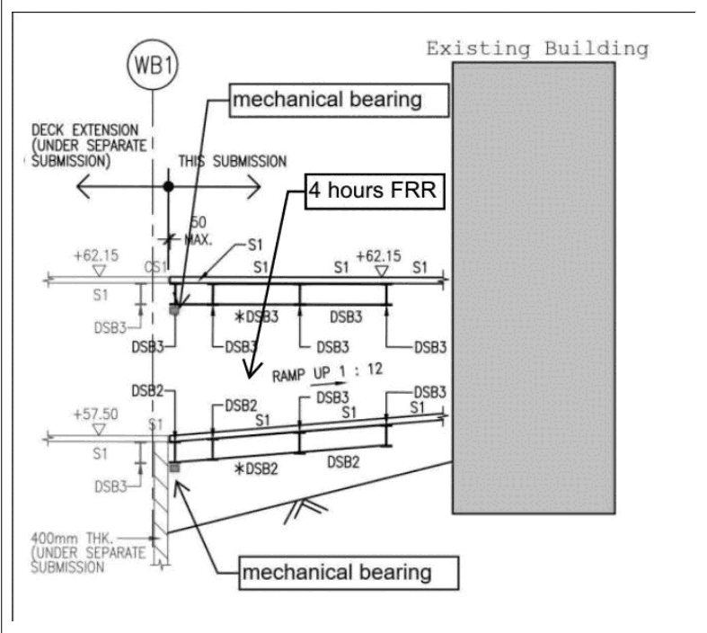{ width="508" loading=lazy }
  <figcaption>Diagram 1 from the original summary (ADF 4/2024, item 11). 原文附圖。</figcaption>
</figure>

**BD's response 屋宇署回覆:** BD advised that as shown in the diagram, since no fire barrier was provided at each end of the link bridge connecting two underground structures and the link bridge was unlikely unenclosed, according to Clause C15.1(c) of the FS Code, the link bridge should be considered as an integral part of the fire compartment it linked. The upper bearing, being a loadbearing member, and its associated supporting structural elements should therefore be considered as elements of construction and fire protection complying with the relevant requirements of the FS Code should be provided. BD advised that as the lower bearing was not within the fire compartment, no FRR was required.

### 12. Axial Compression Ratio Limit on RC Shear Walls {#i2024112212}

Raised by **HKIE** · Related 相關: [APP-142](../pnap/app-142.md), [APP-168](../pnap/app-168.md)

**Question 問題:** Axial compression ratio (N ) for RC shear wall is stipulated in Clause BD cr 9.9.3.3 of the Concrete Code for “ductility design”. This requirement imposes great constraint on structural design of RC walls, especially for medium and high-rise buildings, as it excludes the contribution of steel section for fulfilment of “ductility” requirement. Steel composite shear wall approach is a very common structural design method adopted in medium and high-rise buildings in Mainland China. …

<figure markdown>
  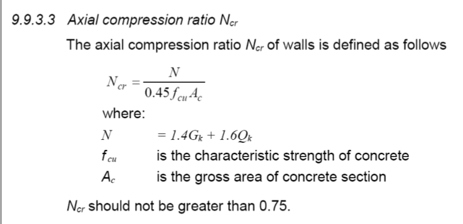{ width="508" loading=lazy }
  <figcaption>Diagram 1 from the original summary (ADF 4/2024, item 12). 原文附圖。</figcaption>
</figure>

<figure markdown>
  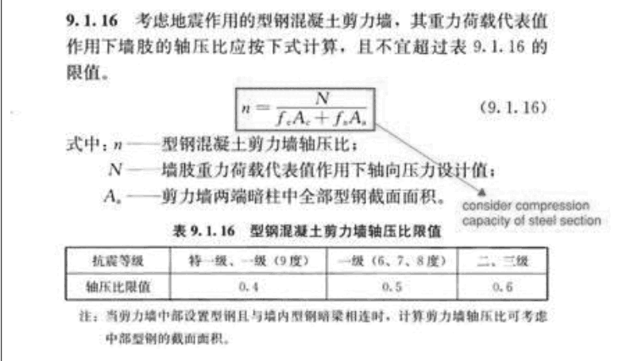{ width="506" loading=lazy }
  <figcaption>Diagram 2 from the original summary (ADF 4/2024, item 12). 原文附圖。</figcaption>
</figure>

<figure markdown>
  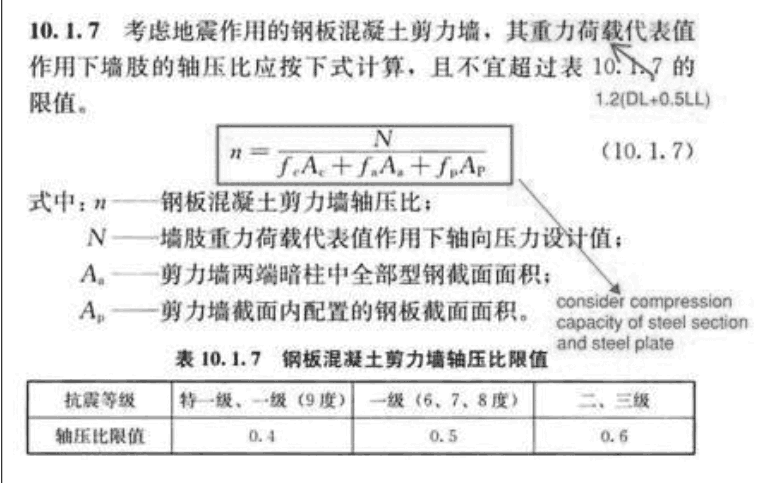{ width="499" loading=lazy }
  <figcaption>Diagram 3 from the original summary (ADF 4/2024, item 12). 原文附圖。</figcaption>
</figure>

**BD's response 屋宇署回覆:** advised that the axial compression ratio for RC shear wall was a critical parameter in structural engineering and had an effect on the shear wall’s ductility behaviour under lateral loads, such as due to wind or seismic effects. The extant clauses 9.9.3.2 and 9.9.3.3 of the Concrete Code stipulated the detailing requirements of RC shear wall for ductility in accordance with its axial compression ratio derived in Equation 9.8. While a new code of practice for the seismic effects of buildings was under preparation, BD would review the extant requirements of axial compression ratio for RC shear wall in Concrete Code for deliberation in the Technical Committee on the Concrete Code at a suitable juncture. Moreover, composite design of shear wall for ductility would be discussed in the Technical Committee on the Code of Practice for the Structural Use of Steel, where necessary. section plate 14

### 13. Construction of Shroff within Carpark {#i2024112213}

Raised by **AAP** · Related 相關: [FS Code 2011 Part C: Fire Resisting Cons](../codes/fsc-part-c-fire-resisting-construction.md)

**Question 問題:** Shroff, as an ancillary facility for carpark, is often designed within the parking area. Considering the same use classification, separation of parking area and its shroff by fire barriers in accordance with Clause C7.1 of the FS Code should not be required. Please advise if the above understanding is correct.

**BD's response 屋宇署回覆:** BD advised that shroff in a carpark might be considered as an ancillary small office to the carpark in accordance with Clause C7.2 of the FS Code subject to the detailed design and layout on a case-by-case basis. In such cases, separation by fire barriers would not be required.

### 14. Disregarded GFA for Generator Room {#i2024112214}

Raised by **AAP**

**Question 問題:** Uninterruptible Power Supply (UPS) with backup generator for equipment is often required for special building uses, such as medical facilities, elderly care facilities, etc. Considering the above provision of UPS is wellness design, please advise if such non-essential generator room can be disregarded from GFA calculations.

**BD's response 屋宇署回覆:** BD advised that only the emergency generator room for fire service installations required under the Codes of Practice for Minimum Fire Service Installations and Equipment and Inspection, Testing and Maintenance of Installations and Equipment could be disregarded from GFA calculation. Generator room for other purpose should be included in the GFA calculations.

### 15. ESH – Notice of Approval {#i2024112215}

Raised by **AAP**

**Question 問題:** Recently, we received e-mails from ESH in different formats for different projects. Some would enclose letters of approval or consent while some would not, and the enclosed PDF files would have different file name formats. As such, it is difficult to identify the relevant project and submission type. Examples are shown below: Example #1 Example #2 Example #3 May we request BD to standardise the email format and provide more information (e.g. date, BD reference number, information on first approval/major amendment/minor amendment, etc.) on the file names?

<figure markdown>
  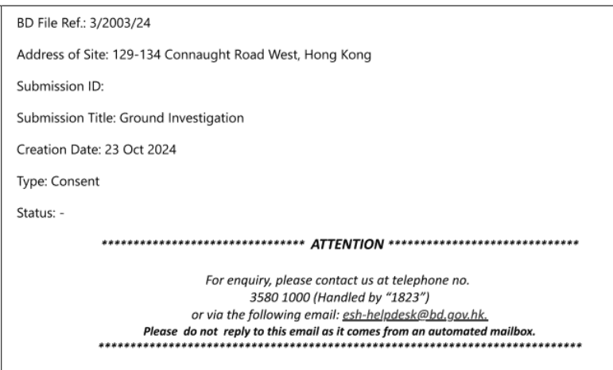{ width="499" loading=lazy }
  <figcaption>Diagram 1 from the original summary (ADF 4/2024, item 15). 原文附圖。</figcaption>
</figure>

<figure markdown>
  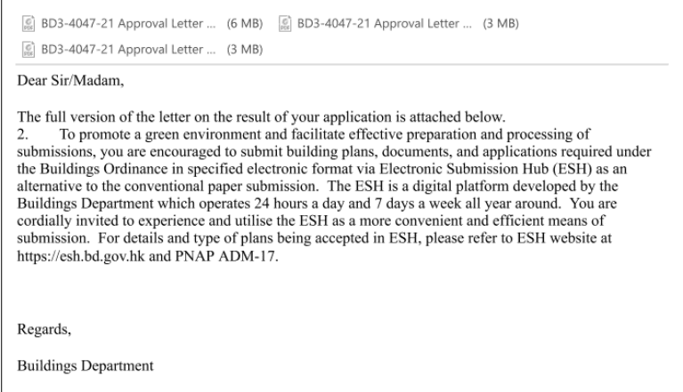{ width="496" loading=lazy }
  <figcaption>Diagram 2 from the original summary (ADF 4/2024, item 15). 原文附圖。</figcaption>
</figure>

<figure markdown>
  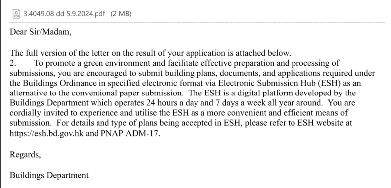{ width="508" loading=lazy }
  <figcaption>Diagram 3 from the original summary (ADF 4/2024, item 15). 原文附圖。</figcaption>
</figure>

**BD's response 屋宇署回覆:** BD advised that according to the Circular Letter on Notification on the Results for Approval and Consent Applications for Structural Works in Electronic Form issued on 13 May 2024, the arrangement of the issuance of the result letters for approval and consent applications for structural works (Result Letters) in electronic form in reply to paper submissions was implemented in two phases. In the first phase, Result Letters issued on or after 2 July 2024 was sent to the e-mail address of AP/RSE/RGE in the format shown in examples #2 and #3. In the second phase commencing from after 2 October 2024, AP/RSE/RGE would receive standardised email notifications generated by ESH as shown in example #1, and they should retrieve the result letters through ESH. 17

### 16. Interpretation of Permitted Coreloss for Bedrock {#i2024112216}

Raised by **ACEHK** · Related 相關: [APP-18](../pnap/app-18.md)

**Question 問題:** Note (5) under Table 2.1 of the Code of Practice for Foundations 2017 (2024 Edition) (Foundation Code) states that “the TCR of the designated grade should be proved to a depth at least 5 m into the specified category of rock. This requirement is deemed to be complied with if the rock underneath the minimum socket depth as mentioned in note (3) above has a length of at least 5 m which can be divided into a number of segments (in consecutive manner) such that (a) each segment is 1 m; and (b) the calculated TCR in accordance with Figure 2.1 of each segment should satisfy the required percentage of TCR of the designated grade”. …

<figure markdown>
  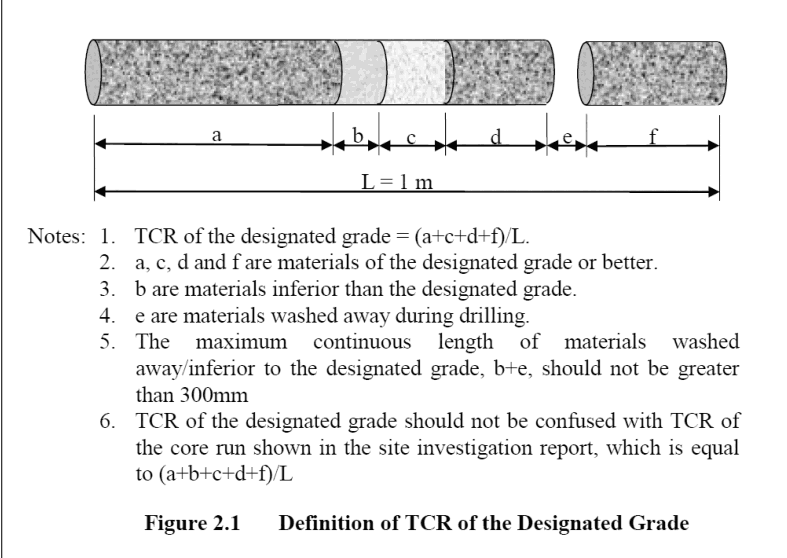{ width="509" loading=lazy }
  <figcaption>Diagram 1 from the original summary (ADF 4/2024, item 16). 原文附圖。</figcaption>
</figure>

<figure markdown>
  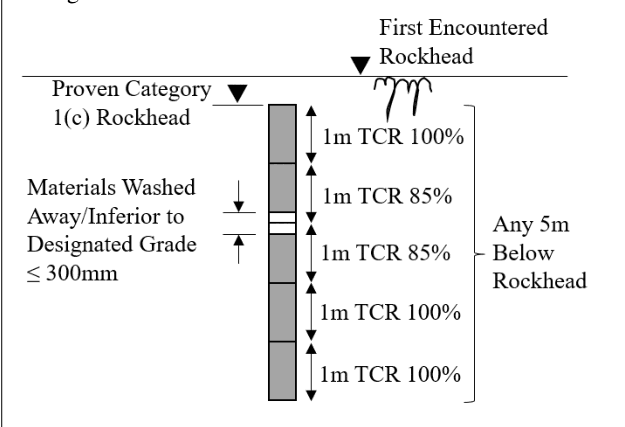{ width="403" loading=lazy }
  <figcaption>Diagram 2 from the original summary (ADF 4/2024, item 16). 原文附圖。</figcaption>
</figure>

**BD's response 屋宇署回覆:** BD advised that the examination of the rolling 1 m at the junction of 2 consecutive segment of 1 m cores should be done to check whether the maximum continuous length of materials washed away/inferior to the designated grade was greater than 300 mm or not. In other words, it was NOT acceptable to have more than 300 mm materials washed away/inferior to the designated grade right at the junction of the two consecutive segments for Category 1(c) rock. ACEHK’s interpretation was generally acceptable and applicable to Cat 1(b), 1(c) and 2 rocks with specified values in Table 2.1 except the starting location of 5 m below the rockhead for 5 no. of consecutive 1 m segments. BD clarified that, for defining TCR of the designated grade, the starting location for the 5 no. of consecutive 1 m segments should be taken at that right below the rockhead.

### 17. Wind Load for Tower Crane for Service Conditions {#i2024112217}

Raised by **ACEHK** · Related 相關: [APP-157](../pnap/app-157.md), [APP-139](../pnap/app-139.md)

!!! warning "Later discussion 其後再討論"
    This question was discussed again on **8 Aug 2025**; use the [later response](2025.md#i2025080823) where they differ. 如有不同，以較新回覆為準。

**Question 問題:** PNAP APP-157 promulgated the enhanced control on temporary works for providing support to tower cranes. As specified in paragraph 4.12(c) and (d) of the Supervision Code, for Case 2 temporary works, the RSE should acknowledge the design justification, and for Case 3 temporary works, the RSE should further verify their effects on permanent structure. In loading assumption review, the wind load under not-in-service conditions shall follow the Code of Practice on Wind Effects in Hong Kong 2019. However, there is no specified guidelines for wind load to be adopted for service conditions. …

<figure markdown>
  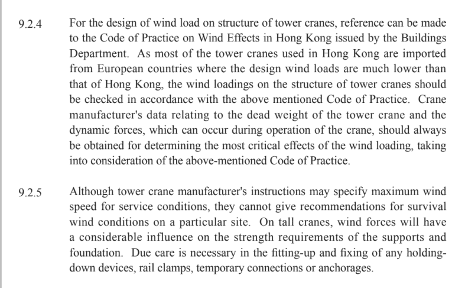{ width="508" loading=lazy }
  <figcaption>Diagram 1 from the original summary (ADF 4/2024, item 17). 原文附圖。</figcaption>
</figure>

<figure markdown>
  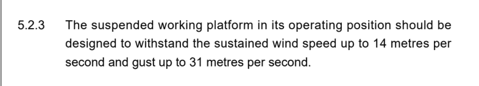{ width="508" loading=lazy }
  <figcaption>Diagram 2 from the original summary (ADF 4/2024, item 17). 原文附圖。</figcaption>
</figure>

<figure markdown>
  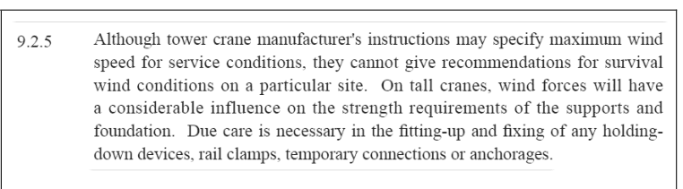{ width="493" loading=lazy }
  <figcaption>Diagram 3 from the original summary (ADF 4/2024, item 17). 原文附圖。</figcaption>
</figure>

**BD's response 屋宇署回覆:** BD advised that the design wind loads for temporary structures should be in accordance with Clause 2.5 of the Code of Practice on Wind Effects in Hong Kong 2019 (Wind Code). If a temporary structure would remain in the position for a period not more than one year, the structure might be designed for a minimum of 70% of the design wind loads for permanent buildings. For tower crane that would remain on site for one year or longer, the design wind load for all supporting structures and its connections should be taken as 100% of the design loads for permanent buildings both in-service and out-of-service condition. BD also advised that to determine the design wind load for the tower crane in service condition, the RSE should consider the appropriate design wind load resulting in most critical effects on the tower crane and its supporting structures taking into account of site operation need. BD would review members’ suggestion of adopting the wind gust speed of Typhoon Signal No.3 (110km/h or 30.56m/s) in determining the design wind load under service condition. [Post meeting notes: Regarding the design wind loads for tower crane in service condition, BD advised that with reference to Clause 9.2.5 of the Code of Practice for Safe Use of Tower Cranes issued by the Labour Department extracted below, the design wind loads on structure of the tower crane should adequately take into account of all adverse wind loads conditions. The design wind loads for the supporting structures of the tower crane should therefore comply with the Wind Code. …

### 18. Repair Works Under Minor Works Item 1.17 {#i2024112218}

Raised by **ACEHK** · Related 相關: [B(MW)R Building (Minor Works) Regulation](../regulations/bmwr-123n.md)

**Question 問題:** We refer to page 34 of the Amendments to Technical Guidelines on Minor Works Control System (MWCS) (March 2021), under Chapter 3.4 Repair of Structural Elements. It states that “for the connection of existing and new reinforcement, welding, drill-in reinforcement with chemical grout, couplers or any methods (other than lapping of reinforcement) are not allowed unless the relevant method statement and details are shown in the approval plans” Please advise if our understanding is correct that “approval plans” refers to whole set of approval plans under the same BD file reference number, including the first approval and subsequent alteration and addition (A&A) works, as well as any approvals …

**BD's response 屋宇署回覆:** BD advised that approval plans referred to all plans approved under the development. The approved method statement and details could be adopted for the said repair works under the MWCS, provided all specifications and manufacturers’ recommendations of the materials adopted were identical.

### 19. Case 2 and Case 3 Temporary Works – Paragraph 4.9 of Supervision Code {#i2024112219}

Raised by **AREC** · Related 相關: [APP-157](../pnap/app-157.md)

**Question 問題:** In accordance with paragraphs 4.9(b) and 4.9(c) of the Supervision Code, Case 2 temporary works are defined as those that “have no effect on the permanent structures by way of overstressing or overloading”, while Case 3 temporary works are defined as those that “may have effect on the permanent structures, adjoining buildings or lands, by way of overstressing or overloading”. We would like to seek BD’s clarification on the definition of “effect on the permanent structure”. To our understanding, temporary works sitting on the permanent structure with loading not exceeding the design live/wind load can be treated as Case 2. Would BD please confirm our understanding is correct?

**BD's response 屋宇署回覆:** BD advised that according to paragraph 4.9 (b) and (c) of the Supervision Code, for temporary works, the sequence of construction or method statements that were not required to be shown on prescribed plans, it would be a case 2 if such temporary works had no effect on the permanent structures, adjoining buildings and lands, by way of overstressing or overloading, and would be regarded as case 3 if there might have such effect. In general, it was the sole responsibility of RC’s TCP T5 to determine, based on the actual site situation, if it was a case 2 or 3 temporary works. If temporary works merely sat on the permanent structures and its loading effect did not exceed the design loads and had no conflict with the original design assumption of the permanent structures and without the need to go through assessment on the design of the permanent structures, it might be treated as Case 2, subject to individual case merits. In case of doubt, RC should consult RSE/RGE and submit the design of the temporary works to substantiate the effect of the temporary works on permanent structures following the procedures of Case 3.

### 20. Fire Stop for Opening on Ground Floor Slab for Passage of Underground Drainage Pipes {#i2024112220}

Raised by **PBSCA** · Related 相關: [FS Code 2011 Part C: Fire Resisting Cons](../codes/fsc-part-c-fire-resisting-construction.md)

**Question 問題:** Referring to the sketch below, since smoke spreads upwards, we opined that the design of the drainage pipe located at the underground passing through two fire compartments would be acceptable without providing fire collars or other forms of fire stop. Would BD please advise if our understanding is correct?

<figure markdown>
  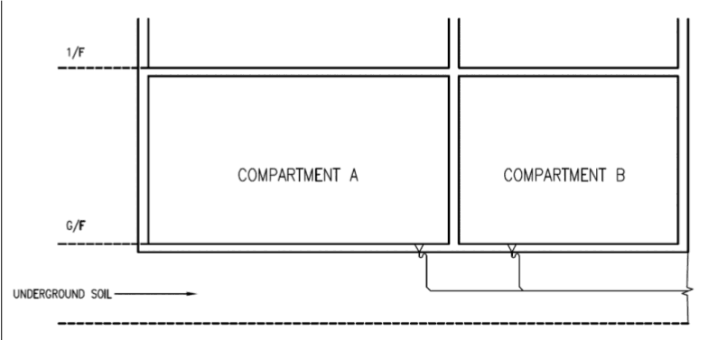{ width="507" loading=lazy }
  <figcaption>Diagram 1 from the original summary (ADF 4/2024, item 20). 原文附圖。</figcaption>
</figure>

**BD's response 屋宇署回覆:** BD advised that where water-borne metallic pipes including drain pipes pass through fire barriers, gaps between the pipes and the fire barriers should be properly filled by fire rated material having an FRR of not less than that of the fire barrier that it penetrates according to Clause C8.6 of the FS Code. PBSCA was encouraged to provide further information of the case for separate discussion with BD.

### 21. Non-provision of Sanitary Fitments Upon Application of OP – PNAP APP-114 {#i2024112221}

Raised by **PBSCA** · Related 相關: [APP-114](../pnap/app-114.md)

<small>Related discussions 相關討論: [22 Mar 2019 item 5](2019.md#i201903225)</small>

**Question 問題:** (Item raised by BD) BD received an enquiry concerning whether PNAP APP-114 is applicable to government accommodation (GA) of Residential Care Home for the Elderly (RCHE) and Residential Care Home for Person with Disabilities (RCHD) in a new private development. GA of RCHE and RCHD in a new private development will be handed over to the Social Welfare Department (SWD) after the issue of OP and its fitting out works will normally be carried out by an operator engaged by SWD in accordance with the requirements under lease/agreement with SWD and actual operational need. …

**BD's response 屋宇署回覆:** Members noted and welcomed the arrangement.

### 22. Stakeholders’ Consultation Forum for Building Information Modelling {#i2024112222}

Raised by **PBSCA** · Related 相關: [Code of Practice for Fire Safety in Buil](../codes/fire-safety-code-2011.md)

**Question 問題:** (BIM) (Item raised by BD) BD advised that a stakeholders’ consultation forum on new BIM tools for automated checking of building separation requirements under the SBDG and the fire safety requirements under the FS Code will be held on 25 November 2024. In the forum, BD’s consultants would share their research findings as well as the automated checking functions of two new BIM plug-in tools. BD encouraged members and their colleagues to attend the forum so as to learn more about the new tools and methodologies to enhance work efficiency in plan preparation and processing.

**BD's response 屋宇署回覆:** Members noted.

### 23. Stakeholder Engagement Sessions for BIM Consultancy Study {#i2024112223}

Raised by **PBSCA**

**Question 問題:** (Item raised by BD) Pursuant to the Roadmap on Adoption of BIM for Building Plan Preparation and Submission promulgated by the Development Bureau (DEVB) in December 2023, the Government was committed to promoting the adoption of BIM with the tentative target to mandate electronic submission and BIM submission by mid-2027 and 2029 respectively. In this connection, BD had commissioned a BIM consultancy study to formulate a technical framework for the full adoption of BIM by the private sector for preparation and submission of plans for approval under BO. …

**BD's response 屋宇署回覆:** Members noted.

### 24. Briefing Session on Revised PNAP APP-84 {#i2024112224}

Raised by **PBSCA** · Related 相關: [APP-84](../pnap/app-84.md)

**Question 問題:** (Item raised by BD) BD advised that the revised PNAP APP-84 was issued in September 2024 to promulgate the new requirements for provision of access facilities for mobile services in private buildings as stipulated in the Telecommunications (Amendment) Ordinance 2024 implemented on 1 October 2024. These new requirements would be applicable to new or major revision of general building plans (GBP) of specified buildings approved on or after 1 April 2025. To facilitate practitioners’ understanding of the requirements and the implementation details, BD and the Office of the Communications Authority would organise a briefing session on 19 December 2024. …

**BD's response 屋宇署回覆:** Members noted.

### 25. Tieback System for Excavation and Lateral Support (ELS) Works {#i2024112225}

Raised by **PBSCA**

**Question 問題:** (Item raised by BD) Further to Members’ suggestions on accepting the use of tieback system outside lot boundary for ELS works in private developments, BD advised that the issue had been deliberated by DEVB and the relevant government departments including the Lands Department and Highways Department. The government would favourably consider accepting the use of tieback system in private developments on case basis.

**BD's response 屋宇署回覆:** Members noted and welcomed the initiative.

### 26. Briefing Session on the Supervision Code {#i2024112226}

Raised by **PBSCA** · Related 相關: [APP-157](../pnap/app-157.md)

**Question 問題:** (Item raised by BD) BD advised that a briefing session on the Supervision Code, which had incorporated various amendments made in December 2023 and August 2024, would be held on 15 January 2025. BD encouraged practitioners to attend the briefing session.

**BD's response 屋宇署回覆:** Members noted.

### 27. Smart Check System {#i2024112227}

Raised by **PBSCA**

**Question 問題:** (Item raised by BD) BD advised that the government would launch the Smart Check System soon in public works projects to facilitate the processing of submissions of laboratory test reports. To make use of the said system in private developments, BD encouraged practitioners’ adoption of the standardised format published by the Hong Kong Accreditation Service (HKAS) in the submission of laboratory test reports for private building works.

**BD's response 屋宇署回覆:** Members noted and welcomed the arrangement.

### 28. Required Information of Wind Tunnel Test Report in Superstructure Plan Submission {#i2024112228}

Raised by **PBSCA**

<small>Related discussions 相關討論: [9 Aug 2024 item 19](2024.md#i2024080919)</small>

**Question 問題:** (Item raised by BD) Further to item 19 of ADF 3/2024 held on 9 August 2024, BD advised that key information of the wind tunnel test report, such as the lateral loads, torsional loads, base moment and load combination factors of two critical orthogonal wind directions of the subject building, should be included in the structural plans for approval.

**BD's response 屋宇署回覆:** Members noted and supported the arrangement. BD would consider a Member’s suggestion on including the required information of the wind tunnel test report only in Part I of the structural calculations submitted to BD for approval.

### 29. Indication of Bedroom Doors on GBP {#i2024112229}

Raised by **PBSCA**

**Question 問題:** (Item raised by AAP) Would BD please clarify whether it is acceptable for bedroom doors in a flat to be shown in dotted lines on the GBP and such doors to be installed after the OP is issued?

**BD's response 屋宇署回覆:** BD advised the matter would be separately discussed. [Post-meeting note: BD advised that in general there was no objection to bedroom doors in a flat to be shown in dotted lines on the GBP and such door to be installed after the issue of OP, provided that a legend/general note was included to clearly denote that such doors were shown “for information only”.]

### 30. Processing Time of Form BA14 for A&A Works {#i2024112230}

Raised by **PBSCA**

**Question 問題:** (Item raised by PBSCA) Members have cases that Form BA 14 for A&A works had not been addressed or acknowledged for more than 3 months. Would BD please review the matter and achieve to issue written reply for the submission of Form BA 14 within 3 months from the submission date?

**BD's response 屋宇署回覆:** BD had been monitoring regularly the processing of submissions of Form BA14 and submissions of Form BA14 with the full set of required documentations were targeted to be acknowledged within one month. AP were encouraged to contact the relevant senior and/or chief officers of BD for any long outstanding acknowledgements.

## ADF 3/2024 · 9 Aug 2024 {#adf-32024-9-aug-2024}

[Original summary (PDF) 原文](https://www.hkie-st.org/wp-content/uploads/2024/11/Summary-of-items-discussed-in-3_2024-ADF-on-9.8.2024.pdf) · 35 items

### 1. Gross Floor Area (GFA) Calculation of Rooftop Staircase Hoods {#i202408091}

Raised by **HKIA**

**Question 問題:** In some development projects, private residential roofs are located on the main roof, the common part of which are used as the exit route serving the private roofs discharging into the required staircases as illustrated below. Both the private roofs and common roof are not GFA-accountable. As there are no accountable GFA on the roof, it is the HKIA’s understanding that the required staircases on the main roof are not GFA-accountable. Please clarify if our understanding is correct or not.

<figure markdown>
  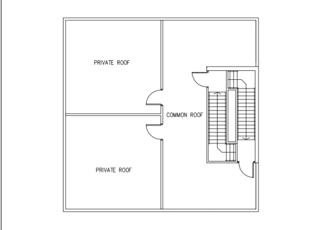{ width="348" loading=lazy }
  <figcaption>Diagram 1 from the original summary (ADF 3/2024, item 1). 原文附圖。</figcaption>
</figure>

**BD's response 屋宇署回覆:** Staircase of reasonable size on roof might not be accountable for GFA if there was no commercial activities / uses on the roof or there was no area accountable for GFA.

### 2. Projecting Greenery Paragraph 1.2 in Appendix B to PNAP APP-152 allows minor building {#i202408092}

Raised by **HKIA** · Related 相關: [APP-152](../pnap/app-152.md), [APP-19](../pnap/app-19.md)

**Question 問題:** features, including minor projecting features as described in paragraph 3 of PNAP APP-19 to be disregarded in the building separation assessment. Paragraph 3(g) of PNAP APP-19 includes window flower boxes projecting not more than 500 mm. Would BD please clarify if the projecting greenery at common parts of building, satisfying the requirements of exemption from plot ratio (PR) / site coverage (SC) calculation in paragraph 9 of PNAP APP-19, can be disregarded from the building separation assessment under PNAP APP-152?

**BD's response 屋宇署回覆:** building satisfying the requirements under paragraph 9 of PNAP APP-19 could be disregarded in the building separation assessment would be considered on case basis taking into account the design and permeability of the projecting greenery.

### 3. Refuge Floor cum Communal Podium Garden {#i202408093}

Raised by **HKIA** · Related 相關: [APP-122](../pnap/app-122.md), [FS Code 2011 Part B: Means of Escape](../codes/fsc-part-b-means-of-escape.md)

**Question 問題:** In PNAP APP-122, there are detailed requirements for refuge floor cum sky garden. We suppose that the same is applicable to refuge floor cum podium garden. Clause B18.2(b) of the FS Code states that “the net area for refuge should be not less than 50% of the total gross floor area of the refuge floor and should have a clear headroom of not less than 2300 mm”. As illustrated in the diagram below, the sum of the uncovered area and the covered area of the communal podium garden is not less than 50% of the total GFA of the largest tower floor plate. We would like to seek BD’s advice if the arrangements of using the communal podium garden as refuge floor (i.e. …

<figure markdown>
  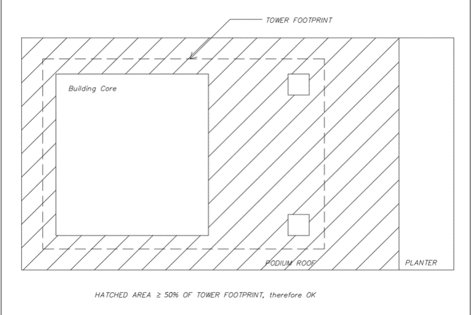{ width="521" loading=lazy }
  <figcaption>Diagram 1 from the original summary (ADF 3/2024, item 3). 原文附圖。</figcaption>
</figure>

**BD's response 屋宇署回覆:** BD advised that podium gardens were usually located on the lower portion of a development and close to the final discharge at ground storey. As such, the arrangement of refuge floor cum podium garden was considered not desirable and effective in serving the purpose as a refuge for the occupants in case of fire.

### 4. Automatic Door for Protected Lobby {#i202408094}

Raised by **HKIA** · Related 相關: [FS Code 2011 Part B: Means of Escape](../codes/fsc-part-b-means-of-escape.md)

**Question 問題:** Automatic door mechanism, i.e. automatically open when sensing an approaching individual, shall be acceptable for the door between general floor area and the fireman’s lift/protected lobby if the automatic mechanism will be disabled upon actuation of an automatic heat or smoke detection system or a fire alarm. It is the HKIA’s understanding that the circled exit doors as shown in the above diagram are all acceptable for incorporating automatic door mechanism as per description above. Would BD please advise if our understanding is correct or not.

<figure markdown>
  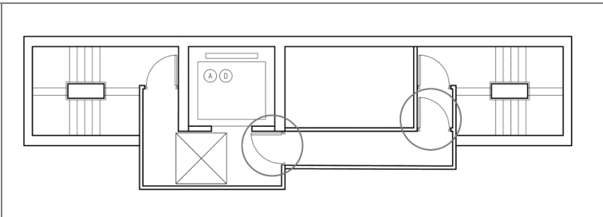{ width="488" loading=lazy }
  <figcaption>Diagram 1 from the original summary (ADF 3/2024, item 4). 原文附圖。</figcaption>
</figure>

**BD's response 屋宇署回覆:** BD advised that according to Clause B13.7(a) of the FS Code, the self-closing mechanism of every door to a required staircase or a protected lobby of a required staircase should not be capable of allowing a check action to hold the door open. Clause B13.8 also required that “hold-open device” should not be installed at the doors to a required staircase or its protected lobby. Similarly, automatic door mechanism was considered not desirable for the doors to a required staircase or its protected lobby. For fireman’s lift lobbies not serving as protected lobbies of the required staircase, the installation of the automatic door mechanism on the doors of these lobbies would be considered on case basis, subject to no objection from the Fire Services Department (FSD).

### 5. Fire Resistance Rating for Lift Doors of Alteration and Addition (A&A) Projects {#i202408095}

Raised by **HKIA** · Related 相關: [APP-153](../pnap/app-153.md), [Code of Practice for Fire Safety in Buil](../codes/fire-safety-code-2011.md)

**Question 問題:** Lift doors for many old buildings may not have fire resistance rating. Since fire-rated lift door is usually thicker than non-fire-rated door, this will render enlargement of lift shaft for upgrading of non-fire-rated lift door to fire-rated lift door. Based on the above, we would like to seek BD’s acceptance that upgrading of fire-rated lift door will not be required should there be evidence from lift supplier that thicker lift door is needed.

**BD's response 屋宇署回覆:** BD advised that according to paragraph 3(a) of PNAP APP-153, generally only the areas affected by the proposed A&A works would be required to comply with the requirements of the FS Code. Nevertheless, HKIA could provide the details of the subject case for further consideration.

### 6. UVA encroaching on Balcony and Utility Platform (UP) {#i202408096}

Raised by **HKIA** · Related 相關: [APP-130](../pnap/app-130.md)

**Question 問題:** It is our understanding that the window/door of the living/dining room facing the balcony/UP is considered satisfying the performance standards on the provision of natural lighting and ventilation for the purpose of regulations 30, 31 and 32 of the Building (Planning) Regulations by the unobstructed vision area (UVA) method under PNAP APP-130. By the same token, as illustrated in the below diagram, for the UVA of the adjacent room of the same unit, it is our understanding that the area of the UVA encroaching onto the balcony and UP can also be included into the UVA area calculation. Would BD please confirm if our understanding is correct or not.

<figure markdown>
  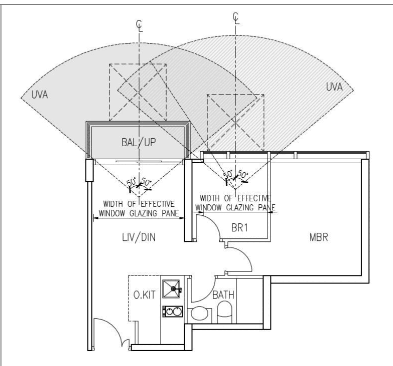{ width="508" loading=lazy }
  <figcaption>Diagram 1 from the original summary (ADF 3/2024, item 6). 原文附圖。</figcaption>
</figure>

**BD's response 屋宇署回覆:** BD advised that HKIA’s understanding was correct and the scenarios depicted in the diagram were generally acceptable. In passing, BD advised that PNAP APP-130 was currently under review including the measurement of UVA in relation to projecting features such as balcony, UP and A/C platform.

### 7. Maintenance of External Drain not being a Common Drain {#i202408097}

Raised by **HKIA** · Related 相關: [APP-93](../pnap/app-93.md)

**Question 問題:** According to the objective provided in paragraph 3 of PNAP APP-93, “… to facilitate the future maintenance of common drains…”, the whole PNAP including its appendices are not applicable to drains solely serving a private premise and are not a common drain. As such, any external drain that is not a common drain on the external wall shall not need to comply with the requirements in Appendices B and C to the said PNAP, even if it is fully or partially enclosed by architectural features, provided that maintenance and inspection works can be carried out via a building maintenance unit. Would BD please clarify if this understanding is correct or not.

<figure markdown>
  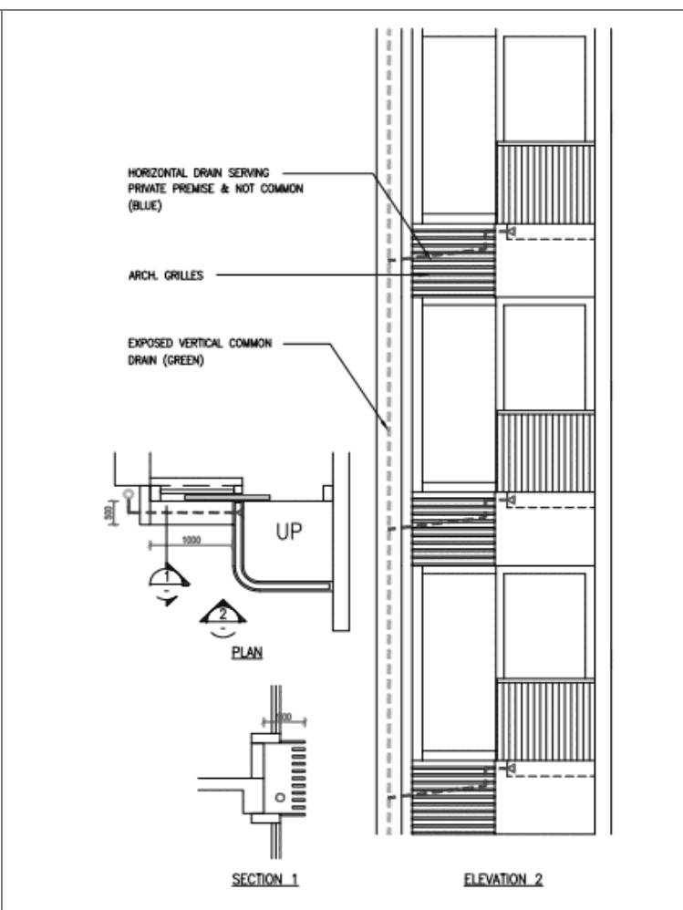{ width="484" loading=lazy }
  <figcaption>Diagram 1 from the original summary (ADF 3/2024, item 7). 原文附圖。</figcaption>
</figure>

**BD's response 屋宇署回覆:** BD advised that the requirements set out in paragraph 7 of PNAP APP-93 were applicable to the connections between the external drainage pipe serving a private premises and the common drainage pipe. BD also reminded that for the maintenance of external drainage works, the requirements stated in the Code of Practice on Access for External Maintenance 2021 (AfEM Code) should be observed. 8

### 8. Vertical Greening {#i202408098}

Raised by **HKIA** · Related 相關: [APP-152](../pnap/app-152.md), [APP-19](../pnap/app-19.md), [B(P)R 23 & 23A Building height, site are](../regulations/bpr-23-23a.md)

<small>Follows earlier discussion: [13 May 2022](2022.md#i202205133)</small>

**Question 問題:** It is general practice that a boundary fence wall of reasonable height and thickness is not accountable for SC and GFA calculations. Our understanding is that vertical greening (modular type/wire type) installed on a boundary fence wall in compliance with PNAP APP-152 or any additional provision for greening purposes shall be exempted from SC and GFA calculations, provided that the thickness of the vertical green wall system is reasonable and the modification of regulation 23(3)(a) of the Building (Planning) Regulations is granted by BD. Would BD please advise if our understanding is correct or not.

<figure markdown>
  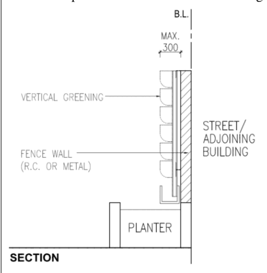{ width="294" loading=lazy }
  <figcaption>Diagram 1 from the original summary (ADF 3/2024, item 8). 原文附圖。</figcaption>
</figure>

**BD's response 屋宇署回覆:** BD advised that according to paragraph 3(n) of PNAP APP-19, metal supporting frames for growing of plants (including vertical frame for climbing and/or weeping plants and panel/modular planters) projecting not more than 300 mm from the external walls within lot boundary could be excluded from site coverage and plot ratio calculations under the Building (Planning) Regulations. The same principle was also applicable to similar metal supporting frames projecting from a fence wall.

### 9. Protective Barrier – PNAP APP-110 {#i202408099}

Raised by **HKIA** · Related 相關: [APP-110](../pnap/app-110.md)

<small>Follows earlier discussion: [29 May 2020](2020.md#i202005298), [12 Nov 2021](2021.md#i202111123), [5 May 2023](2023.md#i2023050516)</small>

**Question 問題:** According to paragraph 3 of PNAP APP-110 issued in June 2024, if the bottom solid curb portion is less than 500 mm, the height of curb of railing type protective barrier must be not less than 150mm and not more than 250 mm above the adjoining floor level, as shown in the following illustrations extracted from Appendix A to the said PNAP, in order for the curb not to be regarded as an adjoining floor level. For staircases requiring a protective barrier, the measurement should be based on the diagrams below. Could BD please clarify if the HKIA’s understanding is correct or not?

<figure markdown>
  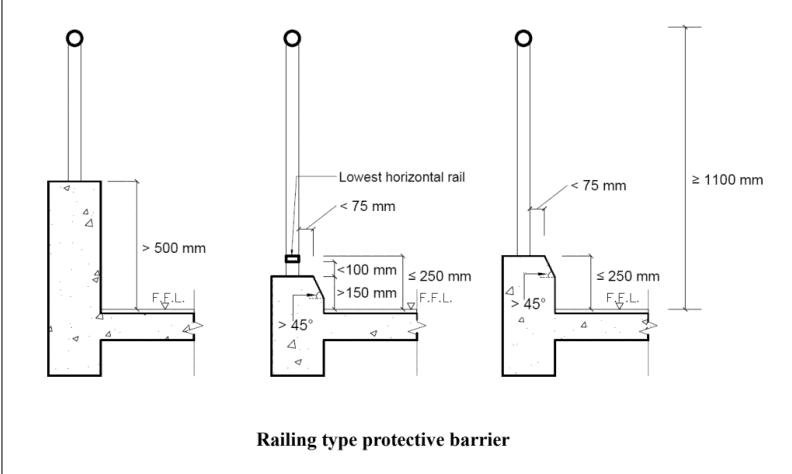{ width="512" loading=lazy }
  <figcaption>Diagram 1 from the original summary (ADF 3/2024, item 9). 原文附圖。</figcaption>
</figure>

<figure markdown>
  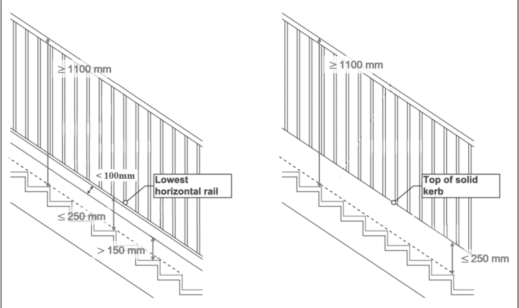{ width="489" loading=lazy }
  <figcaption>Diagram 2 from the original summary (ADF 3/2024, item 9). 原文附圖。</figcaption>
</figure>

<figure markdown>
  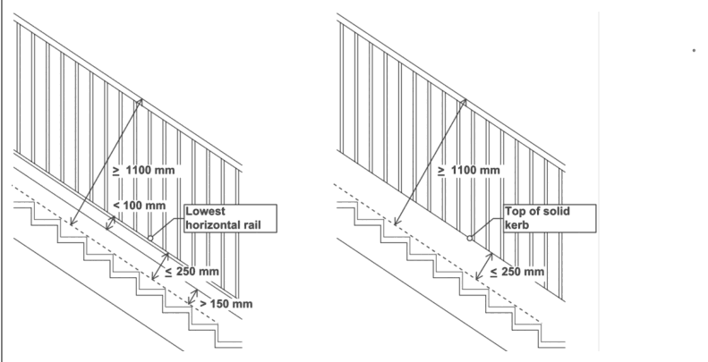{ width="511" loading=lazy }
  <figcaption>Diagram 3 from the original summary (ADF 3/2024, item 9). 原文附圖。</figcaption>
</figure>

**BD's response 屋宇署回覆:** BD advised that the measurements should be taken in a vertical manner from the highest point of each tread to the top of the balustrade as illustrated in red in the diagrams below for fulfilling the requirements laid down in PNAP APP-110.

### 10. Streamlining Approval Process {#i2024080910}

Raised by **HKIA** · Related 相關: [APP-18](../pnap/app-18.md)

**Question 問題:** It is the government’s policy to streamline the development approval process BD and the BD would be in support of this policy. streamlining completion In many projects, it is quite common that idling on site for 3 months is encountered to wait for consent to commence next stage of works after (i) submission of the notificaiton of completion of foundation works: 1. Day 1 – Submission of Form BA14 for Foundation Works 2. Day 31 – Selection of pile for Proof Test 3. Day 45 – Pile testing and inspection 4. Day 61 – Form BA14 Acknowledgement of Foundation Works & submission of Form BA8 for Pile Cap 5. Day 89 – Granting of Consent for Pile Cap 6. …

**BD's response 屋宇署回覆:** advised that to facilitate the development process, the following measures had been implemented for processing the of foundation works: The review of piling design with back-analysis and the updated pile loading schedule plan as required under PNAP APP-18 could be submitted together with Form BA 14 for certifying completion of piling works. BD would proceed to select piles for proof load test within 14 days upon receipt of all essential information of pile installation and process the pile loading schedule plan concurrently. For details, please refer to BD’s circular letter on “Streamlining Measures for Structural Works” issued on 27 February 2023. BD would accept alternative arrangement for witnessing pile proof load test to be conducted by videotelephony and video record upon application from the AP/RSE. For details, please refer to BD’s Circular Letter on “Alternative Arrangement for Witnessing Foundation Proof Load Test” issued on 2 June 2023. Upon notification from AP/RSE, BD officers would witness the pile proof load test(s) within 5 working days from the day of notification. For driven piles, consent for installation of working piles might be granted without completion of proof load test on trial piles provided that the result of Pile Driving Analyser test with Case Pile Wave Analysis Program analysis of trial piles were found satisfactory and relevant conditions for granting consent were fulfilled. For details, please refer to the said circular letter issued on 27 February 2023. …

### 11. Signing of Site Formation Plan - PNAP APP-141 {#i2024080911}

Raised by **HKIA** · Related 相關: [APP-141](../pnap/app-141.md)

**Question 問題:** Table 4 of Appendix B to PNAP APP-141 excerpted below clearly states the individual responsibility of AP/RGE/RSE for signing site formation plans:- It is our understanding that only the relevant drawings of the submission plans need to be signed by the AP, RGE, or RSE. The AP does not need to sign the entire set of submission plans, even though the AP is the party who submitted the site formation plans to the BD. Would BD please clarify if our understanding is correct or not?

<figure markdown>
  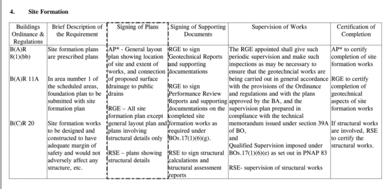{ width="513" loading=lazy }
  <figcaption>Diagram 1 from the original summary (ADF 3/2024, item 11). 原文附圖。</figcaption>
</figure>

**BD's response 屋宇署回覆:** BD advised that HKIA’s understanding was correct. The AP, RSE and RGE should sign the site formation plans in accordance with Table 4 of Appendix B of PNAP APP-141.

### 12. Air-conditioner (AC) Platform for Non-Domestic Portion {#i2024080912}

Raised by **HKIA**

<small>Follows earlier discussion: [22 Jan 2021](2021.md#i202101223)</small>

**Question 問題:** It was previously discussed at item 3 of ADF 1/2021 held on 22January 2021 that under item (h)(ii) of Appendix B to the AfEM Code, individual AC platforms must not be erected at the external walls of the building where AC platform combined with balcony and/or UP (the ‘combined features’) are provided. BD further clarified that such requirement is applicable to the entire development (including the non-domestic portion of a composite development). However, for composite developments comprising Government Accommodation (e.g. …

<figure markdown>
  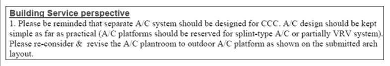{ width="508" loading=lazy }
  <figcaption>Diagram 1 from the original summary (ADF 3/2024, item 12). 原文附圖。</figcaption>
</figure>

**BD's response 屋宇署回覆:** BD advised that their response in item 3 of ADF 1/2021 was still pertinent. AC design with support from relevant government departments would be favourably considered on case basis.

### 13. Resistance for Piles Subject to Uplift Forces {#i2024080913}

Raised by **HKIE** · Related 相關: [APP-18](../pnap/app-18.md)

<small>Follows earlier discussion: [10 Jan 2020](2020.md#i202001108)</small>

**Question 問題:** According to item 8 of ADF 1/2020 held on 10 January 2020, BD confirmed that the cone weight need not be checked under R case for pile subjected to a uplift force. Clause 5.3.3(1) of the Code of Practice for Foundations 2017 (Foundation Code) states that “piles subject to uplift forces should satisfy the requirements of the ultimate anchorage resistance R & the allowable u anchorage resistance R of the piles stipulated in clause 5.1.6. The a anchorage resistance of the piles to resist uplifting force can be determined from sub-clauses (2) and (3) below as appropriate. …

**BD's response 屋宇署回覆:** BD advised that according to the amendment to Clause 5.3.3(1) of the Foundation Code promulgated in item 10 of Appendix A1 to PNAP APP-18 in February 2021, factor of safety of not less than 2 or 3 was only applicable to anchorage resistance of piles derived from bond resistance. BD also advised that when checking the uplift resistance of piles, there was no need to limit R to R /2, where R was estimated based on the a u u effective weight of soil column and rock or soil cone.

### 14. Streamlining the Application for Modification of Regulation 33(1) of the {#i2024080914}

Raised by **HKIE** · Related 相關: [ADM-19](../pnap/adm-19.md), [B(A)R Building (Administration) Regulati](../regulations/bar-123a.md)

**Question 問題:** Building (Administration) Regulations (B(A)R) for Ancillary Structures Modification of regulation 33(1) of the B(A)R can be applied for once the consent for superstructure works has been granted. However, it is noted in the approval letters of ancillary structures like curtain wall, balustrades, etc. that RSE are required to submit Form BA16 for such modification together with the application for consent for such works. As there are a great number of ancillary structures involved in modern buildings, such requirement will create unnecessary workload to both BD and the industry. …

**BD's response 屋宇署回覆:** BD advised that PNAP ADM-19 was under review to streamline the procedures of the application for modification of B(A)R 33(1) for secondary structural elements.

### 15. Streamlining the Application for Modification of Section 31(1)(a) of the Building (Construction) Regulation (B(C)R) {#i2024080915}

Raised by **HKIE** · Related 相關: [B(C)R Building (Construction) Regulation](../regulations/bcr-123q.md)

!!! warning "Later discussion 其後再討論"
    This question was discussed again on **6 Feb 2026**; use the [later response](2026.md#i2026020610) where they differ. 如有不同，以較新回覆為準。

<small>Follows earlier discussion: [23 Feb 2024](2024.md#i202402239)</small>

**Question 問題:** For curtain wall amendment submission, modification of section 31(1)(a) of the B(C)R has to be applied for in case cast-in embeds are misaligned/re-aligned and drilled-in anchors are proposed as remedial measures for fixing the curtain wall. As it has been confirmed in item 9 of ADF 1/2024 held on 23 February 2024 that there is no percentage limit on the use of remedial brackets using drill-in anchors, it is suggested that once modification of section 31(1)(a) of the B(C)R has been granted for the first curtain wall amendment, there is no need to apply for such modification again for subsequent curtain wall amendment with increased number of drilled-in anchors.

**BD's response 屋宇署回覆:** BD advised that the suggested arrangement was not acceptable. According to section 31(1)(a) of the B(C)R, a curtain wall support of a building must be fixed on to a load-bearing structure of the building by a cast-in anchorage in a structural concrete member of the structure. Notwithstanding that there was no percentage limit on the use of drilled-in anchors as remedial fixing for the curtain wall, subsequent amendment with revised anchorage system should be considered on case basis. BD advised that feasibility of administrative streamlining to minimise the number of modification application could be studied.

### 16. Minimum Number of Large Diameter Bored Piles subject to Post-construction Proof Drilling {#i2024080916}

Raised by **HKIE**

**Question 問題:** Upon the satisfactory submission of Form BA14 for large diameter bored piles, BD would require proof drilling of a certain number of bored piles subject to a minimum number of two, even for sites with only four bored piles. As interface coring test, sonic logging test and Koden test have been carried out for each bored pile to prove their quality, a minimum number of two test piles for sites with only a few bored piles would seem to be too demanding and uneconomical. Would BD revisit the minimum number of bored piles for proof drilling test taking into consideration of the total number of bored piles covered by the relevant Form BA14?

**BD's response 屋宇署回覆:** BD advised that a minimum of 2 proof core-drilling tests would be required for the certificate on completion of foundation works with more than 20 nos. of large diameter bored piles. For sites with not more than 20 nos. of large diameter bored piles of any diameters, only one of the piles would be subject to post-construction proof drilling.

### 17. Conditions Imposed upon Adoption of Presumed Allowable Values of {#i2024080917}

Raised by **HKIE** · Related 相關: [APP-18](../pnap/app-18.md)

**Question 問題:** the Founding Stratum given in GEO Technical Guidance Note No. 53 (TGN 53) For the adoption of a higher presumed allowable bearing pressure for Category 1(a), 1(b) and 1(c) rock according to TGN 53 issued by the Geotechnical Engineering Office (GEO), BD will impose the conditions stated in paragraphs 6(a), 6(b) and 6(c) of Appendix C to PNAP APP-18 on approval of foundation plans. …

**BD's response 屋宇署回覆:** BD advised the requirements set out in paragraphs 6(a), 6(b) and 6(c) of Appendix C to PNAP APP-18 were to review the settlement of the foundation and assess the structures above with as-constructed pile lengths/founding levels in consideration of the soil-structure interaction after completion of the foundation works. As the as-constructed conditions could be different from the tentative ones, the requirements were considered necessary to be imposed in the approval letter. In passing, a settlement monitoring scheme should be submitted for agreement and subsequent implementation to monitor the performance of foundations throughout the construction of superstructure. A final performance review report on the settlement behaviour should be submitted prior to the application for occupation permit (OP) or submission of Form BA14 for A&A works as stipulated in paragraphs 6(d) and 6(e) of Appendix C to PNAP APP-18.

### 18. Flat Slab Design {#i2024080918}

Raised by **HKIE** · Related 相關: [APP-142](../pnap/app-142.md)

<small>Related discussions 相關討論: [25 Nov 2022 item 7](2022.md#i202211257), [9 May 2025 item 9](2025.md#i202505099)</small>

**Question 問題:** Following the discussion in item 7 of ADF 5/2022 held on 22 November 2022 on flat slab design regarding the applicability of the relevant clauses in the Code of Practice for Structural Use of Concrete 2013 (2020 Edition) when employing finite element analysis (FEA) for flat slab analysis, would BD please provide an update on the conclusion of the considerations by the Technical Committee on Code of Practice for Structural Use of Concrete.

**BD's response 屋宇署回覆:** BD advised that the matter was under deliberation by the said Technical Committee.

### 19. Presentation of Structural Information in Submission of Superstructure Plan {#i2024080919}

Raised by **HKIE**

<small>Follows earlier discussion: [3 May 2024](2024.md#i202405037)</small>

<small>Related discussions 相關討論: [22 Nov 2024 item 28](2024.md#i2024112228)</small>

**Question 問題:** In item 7 of ADF 2/2024 ADF held on 3 May 2024, BD advised the details of lateral wind loads extracted from the wind tunnel test report, which are subjected to changes throughout the design and construction stage, should be shown in the structural plans for approval. However, BD confirmed that they would review the essential information of approval: lateral wind load to be shown on structural plans for approval. Would BD please advise the outcome of their review. Illustrative

<figure markdown>
  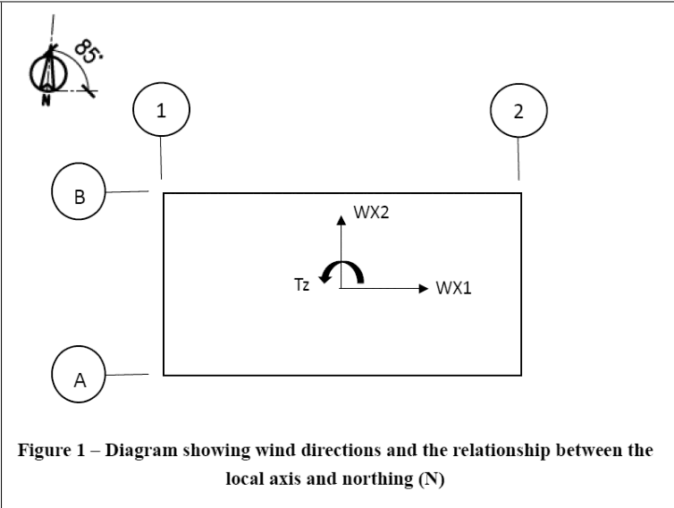{ width="488" loading=lazy }
  <figcaption>Diagram 1 from the original summary (ADF 3/2024, item 19). 原文附圖。</figcaption>
</figure>

<figure markdown>
  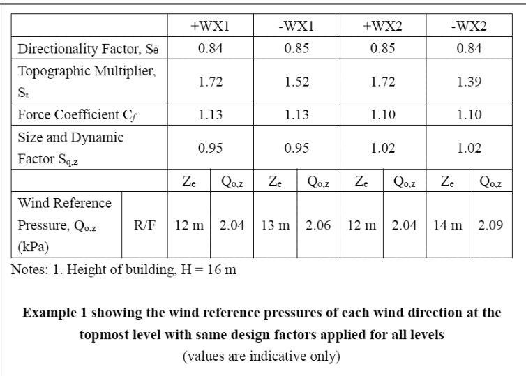{ width="488" loading=lazy }
  <figcaption>Diagram 2 from the original summary (ADF 3/2024, item 19). 原文附圖。</figcaption>
</figure>

<figure markdown>
  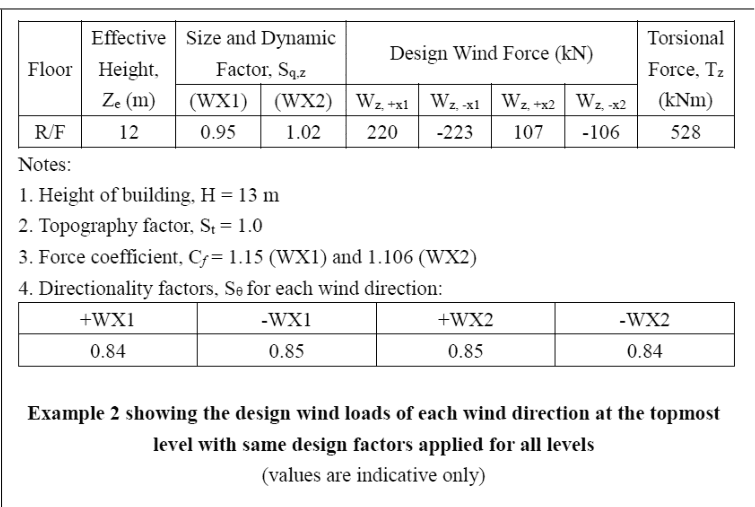{ width="488" loading=lazy }
  <figcaption>Diagram 3 from the original summary (ADF 3/2024, item 19). 原文附圖。</figcaption>
</figure>

**BD's response 屋宇署回覆:** BD advised that the matter was under review. [Post-meeting note: After reviewing of the current requirements, BD had streamlined the requirements and only the following key information were required to be shown on the superstructure plan for (a) a diagram showing the orthogonal wind directions of the subject building and the relationship between the building local axis and actual northing (N); (b) the height of building (H), the wind reference pressures or design wind loads of each wind directions at the topmost level with the corresponding effective height (Z ); e (c) directionality factors (S ); θ (d) topographic multipliers (S ); t (e) force coefficient (C ); and f (f) size and dynamic factors (S ). q,z examples were shown below for reference: 20 21 ]

### 20. Caretaker Counter at the Access to Fireman’s Lift at Ground Floor {#i2024080920}

Raised by **AAP** · Related 相關: [FS Code 2011 Part B: Means of Escape](../codes/fsc-part-b-means-of-escape.md), [FS Code 2011 Part D: Means of Access](../codes/fsc-part-d-means-of-access.md)

!!! warning "Later discussion 其後再討論"
    This question was discussed again on **14 Feb 2025**; use the [later response](2025.md#i202502142) where they differ. 如有不同，以較新回覆為準。

<small>Follows earlier discussion: [17 Nov 2023](2023.md#i2023111717)</small>

**Question 問題:** To revisit item 17 of ADF 4/2023 held on 17 November 2023, it is a usual practice that a caretaker counter at G/F lobby can open directly to the passage from the fire service access point (FSAP) to the fireman’s lift as illustrated in plan below and is acceptable to BD. Please confirm if such understanding is correct.

<figure markdown>
  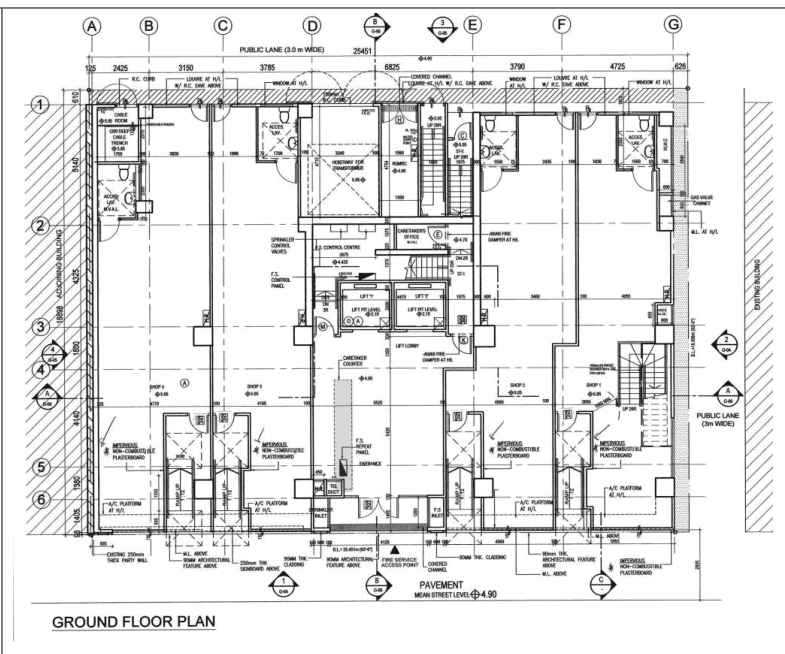{ width="507" loading=lazy }
  <figcaption>Diagram 1 from the original summary (ADF 3/2024, item 20). 原文附圖。</figcaption>
</figure>

**BD's response 屋宇署回覆:** BD advised that the arrangement depicted in the diagram generally complied with Clause B9.1 of the FS Code. As regards Clause D7.3(b), the case would be favourably considered subject to no objection from FSD.

### 21. Temporary Building – Code of Practice on Access for External Maintenance 2021 {#i2024080921}

Raised by **AAP** · Related 相關: [APP-163](../pnap/app-163.md), [B(C)R Building (Construction) Regulation](../regulations/bcr-123q.md)

**Question 問題:** It is our understanding the maintenance and repair (M&R) submission shall not be applicable to temporary buildings. Would BD please confirm if the understanding is correct.

**BD's response 屋宇署回覆:** BD advised that the requirements for the provision of M&R access and submission of M&R access plans were applicable to temporary buildings according to the relevant provisions of the B(C)R, the AfEM Code and PNAP APP-163. BD supplemented that according to paragraphs 2 and 3 of PNAP APP-163, the requirements for the provision of M&R access were not applicable to building works commenced before 31 January 2021 and A&A works to existing buildings only.

### 22. M&R Provision for Concrete Blank Wall {#i2024080922}

Raised by **AAP** · Related 相關: [B(C)R Building (Construction) Regulation](../regulations/bcr-123q.md)

<small>Follows earlier discussion: [4 Aug 2023](2023.md#i202308042)</small>

**Question 問題:** Further to item 2 of ADF 3/2023 held on 4 August 2023, it is our understanding that M&R provision shall not be required for concrete blank walls (e.g. wall of staircase tower, lift core wall or any wall facing the rear lot boundary, etc.) in view that routine maintenance and repair works for such blank walls are not required. Would BD please confirm if the understanding is correct.

**BD's response 屋宇署回覆:** BD advised that in case the concrete blank walls concerned were the outer surface of external wall of a building, the provision of adequate M&R access such as power-operated elevating work platform and suspended working platform was required according to section 27(2) of the B(C)R and paragraph 2 in Part 2 of the AfEM Code. The use of alternative means of M&R access such as temporary metal scaffolding should be considered on case basis.

### 23. Submission for In-principle Acceptance (IPA) of Modular Integrated Construction (MiC) System {#i2024080923}

Raised by **ACEHK** · Related 相關: [ADV-36](../pnap/adv-36.md), [BO s.14–21 Approval and consent, grounds](../regulations/bo-part-2-building-works.md)

<small>Related discussions 相關討論: [12 Aug 2022 item 17](2022.md#i2022081217)</small>

**Question 問題:** Our understanding of the IPA Submission for MiC is for the pre-acceptance of the “MiC system” but the essential information checklist in Appendix C to PNAP ADV-36 appeared to be related to the “details”, e.g. waterproofing. For instance, if the waterproofing detail in the actual project submission for approval is deviated from that shown in the pre-accepted system, will it render non-compliance with the IPA and will the pre-acceptance become inapplicable? If the inhabitants of the MiC unit modified the waterproofing details within 10 years’ time due to material dilapidation and thus the need for building maintenance, but did not quite follow the “as-accepted” details (or were unaware of …

**BD's response 屋宇署回覆:** BD advised that the pre-acceptance mechanism for MiC aimed to resolve non-site specific design and construction matters of MiC system/component and provided curtailed assessment on whether the design and materials used meet certain minimum standards for a particular aspect set out under the provisions of the BO so that the industry would have greater confidence in using such system/component for development project. IPA for a MiC system was not a pre-requisite for approval of plans for development project adopting MiC. Any proposed revisions to the pre-accepted MiC system for adoption in development project could be incorporated into the submission of plans for approval by the Building Authority (BA). The IPA was still valid for the non-site specific MiC system. BD advised that prior approval and consent from the BA in accordance with section 14(1) of the BO were required for building works to be carried out at a completed building with MiC systems/components, unless the works were exempted building works under sections 41(3), 41(3B) and 41(3C) of the BO, or were eligible to be carried out through the simplified requirements under the Minor Works Control System.

### 24. Adoption of 5A Approach for Ground Deformation Control Mechanism {#i2024080924}

Raised by **AREC** · Related 相關: [APP-137](../pnap/app-137.md), [APP-24](../pnap/app-24.md)

**Question 問題:** In GEO Technical Guidance Note No. 54 (TGN 54) and GEO Publication No. 1/2023, an enhanced empirical approach for ground deformation control mechanism, termed as “5A Approach”, is proposed. Please advise if such approach can be adopted under the BO as an update/alternative to the current “3A Approach” provided in PNAP APP-137.

**BD's response 屋宇署回覆:** BD advised that PNAP APP-137 was under review to incorporate the adoption of engineering approach on the assessment of the effects of foundation and ELS works to the nearby sensitive receivers, and to introduce additional triggering levels in addition to the extant three triggering levels as an enhanced monitoring control. BD also advised that the empirical limits as specified in GEO Publication No. 1/2023 might not be applicable to private building sites. Moreover, the proposed values of triggering levels other than the empirical limits as specified in the PNAP APP-24 and APP-137 should be assessed/determined according to the effects of building works to the nearby sensitive receivers and subject to the formal acceptance from the relevant government authorities and/or stakeholders (i.e. building owners, utilities providers, etc.).

### 25. Suspension of Works upon Exceedance of Groundwater Drawdown Action Level {#i2024080925}

Raised by **AREC**

**Question 問題:** Chapter 9.2.2.7 of GEO Publication 1/2023 extracted below mentioned that “suspension of works solely due to exceedance of groundwater Action Level is unnecessary and impractical, unless there is sudden ingress of excessive groundwater, as the impacts on the sensitive receivers are safeguarded by the control mechanism.” This situation is obvious in many cases that when the groundwater drawdown exceeds the Action Level, the ground settlement is still within the acceptable value. Please if our understanding that exceedance of groundwater DRAWDOWN Action Level will not trigger suspension of works unless the ground settlement has also reached its Action Level, is correct or not.

<figure markdown>
  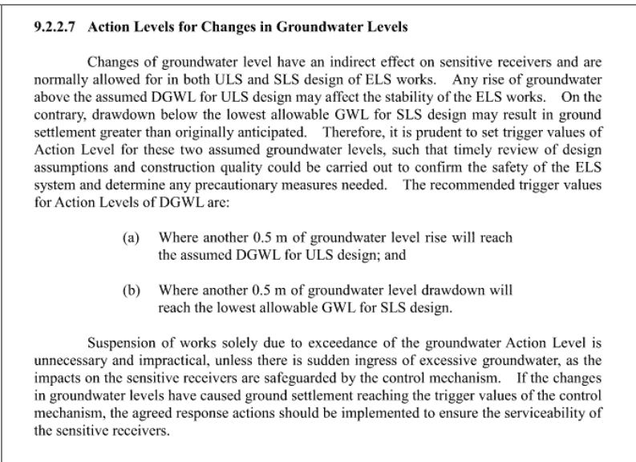{ width="512" loading=lazy }
  <figcaption>Diagram 1 from the original summary (ADF 3/2024, item 25). 原文附圖。</figcaption>
</figure>

**BD's response 屋宇署回覆:** BD advised that excessive groundwater drawdown could be a signal of undue water ingress and might not only cause undue settlement but also impair the integrity, stability and functionality of the adjoining buildings, structures, street, land and underground services/utilities (collectively known as sensitive receivers). AP/RSE/RGE and their TCPs were responsible for preparing an adequate instrumentation and monitoring pertinent to the foundation or ELS works to be carried out and checking the monitoring data throughout the construction process so as to ensure that the induced groundwater variations (drawdown and upsurge) and ground settlements were within the tolerable limits and compatible with the design assumption. If any exceedance in the changes of groundwater levels reached the trigger values of action level as prescribed in the monitoring plan, AP/RSE/RGE should review the design and construction methodology to ensure no adverse impacts on nearby sensitive receivers, in particular for those resting on shallow foundations (i.e. pad or raft footings), or pile foundations with inadequate lateral resistance, etc. Moreover, appropriate response actions corresponding to the reached trigger values should be rigorously assessed and implemented by AP/RSE/RGE and their TCPs, such as implementation of contingency measures, suspension of works, etc.

### 26. Corrosion Protection Measures of Permanent Soldier Piles {#i2024080926}

Raised by **AREC**

**Question 問題:** Please advise if the corrosion protection measures on permanent soldier piles shown in Figures 1 to 3 below are acceptable and hence no sacrificing thickness on the soldier piles is required if such protection measures are adopted.

<figure markdown>
  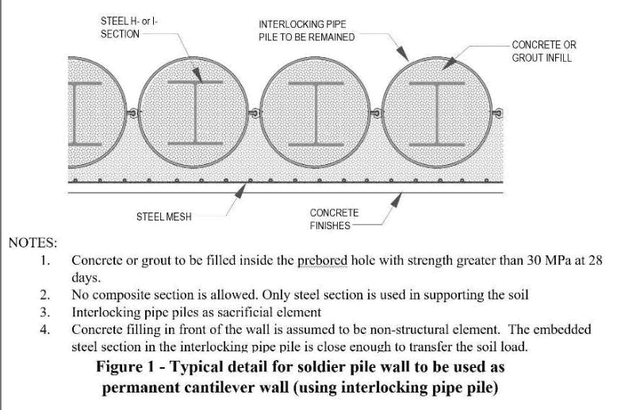{ width="506" loading=lazy }
  <figcaption>Diagram 1 from the original summary (ADF 3/2024, item 26). 原文附圖。</figcaption>
</figure>

<figure markdown>
  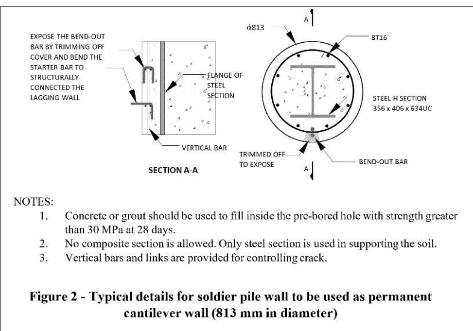{ width="508" loading=lazy }
  <figcaption>Diagram 2 from the original summary (ADF 3/2024, item 26). 原文附圖。</figcaption>
</figure>

<figure markdown>
  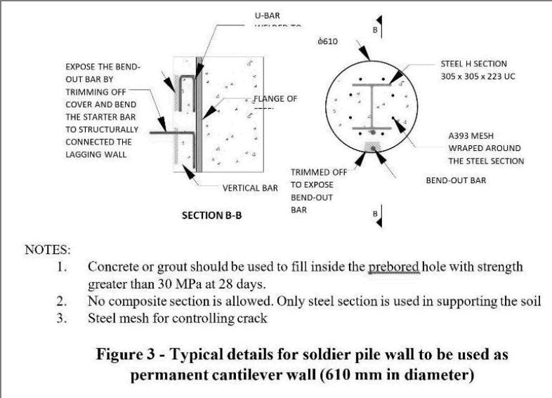{ width="509" loading=lazy }
  <figcaption>Diagram 3 from the original summary (ADF 3/2024, item 26). 原文附圖。</figcaption>
</figure>

**BD's response 屋宇署回覆:** BD advised that the issue was being reviewed by BD and GEO. 28 29

### 27. Signboard with Display System consisting of Light Emitting Diodes (LED) – Minor Works Item 1.22 {#i2024080927}

Raised by **PBSCA** · Related 相關: [APP-126](../pnap/app-126.md), [B(MW)R Building (Minor Works) Regulation](../regulations/bmwr-123n.md)

**Question 問題:** According to minor works item 1.22, if the signboard does not comprise any display system consisting of LED, the display area of the signboard allowed is more than 10 m 2 but not more than 40 m 2 . To our understanding, LED lightbox behind the fixed vinyl display surface is not treated as a display system consisting of LED. Only LED wall with digital display would be treated as a display system consisting of LED. Would BD please confirm if the understanding is correct? AOB Items

**BD's response 屋宇署回覆:** BD advised that PBSCA’s understanding was correct. BD also reminded that apart from the dimensional requirements, the signboard with vinyl display surface should comply the other requirements, including those related to structure and fire safety, as specified in PNAP APP-126.

### 28. Aperture protected with Ventilating Louvres for Internal Bathroom {#i2024080928}

Raised by **PBSCA** · Related 相關: [APP-98](../pnap/app-98.md)

**Question 問題:** (Item raised by AAP) According to paragraph 3(b) of PNAP APP-98, permanent ventilation in the form of an aperture in a door, which should be suitably located and protected with louvres having a minimum size of 1/20 of the floor area of the room is acceptable. As such, would BD please confirm that the size of the aperture protected with louvres as shown in below sketch is acceptable: Room Area = 3.85 sq.m Minimum required size of aperture protected with louvres = 3.85 sq.m / 20 = 0.1925 sq.m Louvre Area = 1.935m x 0.1m = 0.1935 sq.m › 0.1925 sq.m (required)

<figure markdown>
  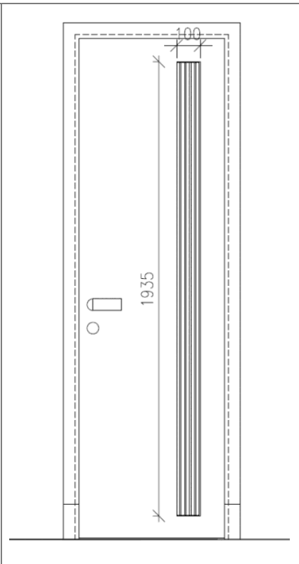{ width="272" loading=lazy }
  <figcaption>Diagram 1 from the original summary (ADF 3/2024, item 28). 原文附圖。</figcaption>
</figure>

**BD's response 屋宇署回覆:** BD advised that AAP’s proposed provision of louvre for compliance with the requirements in paragraph 3(b) of PNAP APP-98 was acceptable. 32

### 29. Insulation for Fire Dampers {#i2024080929}

Raised by **PBSCA** · Related 相關: [FS Code 2011 Part C: Fire Resisting Cons](../codes/fsc-part-c-fire-resisting-construction.md)

**Question 問題:** (Item raised by AAP) According to Table C2 of the FS Code, • fire dampers should have an fire resistance rating (FRR) with regard to the criterion of integrity only, the criterion of insulation is not required for fire dampers unless specified; and • fire barriers should have an FRR with regard to the criterion of both integrity and insulation According to Clause C8.2 of the FS Code, building services passing through a fire barrier should be protected with fire dampers or other suitable form of fire stop to maintain the required FRR of that fire barrier. In Hong Kong, there are very limited suppliers providing fire dampers with insulation. …

**BD's response 屋宇署回覆:** BD advised that under Clause C4.2 and item 9 in Table C2 of the FS Code, the criterion of insulation was not applicable to fire dampers unless specified otherwise. Accordingly, the criterion of insulation was not applicable to the fire dampers specified in Clause C8.2.

### 30. Overall Thermal Transfer Value (OTTV) and Residential Thermal Transfer Value (RTTV) {#i2024080930}

Raised by **PBSCA** · Related 相關: [APP-67](../pnap/app-67.md), [APP-156](../pnap/app-156.md), [Cap. 123M Building (Energy Efficiency) R](../regulations/beer-123m.md)

<small>Related discussions 相關討論: [8 Aug 2025 item 10](2025.md#i2025080810)</small>

**Question 問題:** (Item raised by BD) BD reminded that PNAP APP-67 and APP-156 were issued on 31 July 2024 to promulgate streamlining measures for submission of the required documents relating to OTTV, RTTV and OTTV of residents’ recreational facilities. Under the streamlined arrangement, the BA required only the submission of the Summary Sheets instead of the provisional OTTV Report and provisional Energy Efficiency (EE) Report after the approval of building plans and prior to the application for consent to commence building works. The submission of the OTTV Report and EE Report would be required upon application for OP or submission of Form BA14.

**BD's response 屋宇署回覆:** Members noted and supported the streamlining measures. In response to Members’ enquiry, BD advised that the EE Report could be submitted at any time before the application for OP.

### 31. GFA Concession for Carparks {#i2024080931}

Raised by **PBSCA** · Related 相關: [APP-2](../pnap/app-2.md)

!!! warning "Later discussion 其後再討論"
    This question was discussed again on **21 Nov 2025**; use the [later response](2025.md#i2025112117) where they differ. 如有不同，以較新回覆為準。

<small>Related discussions 相關討論: [19 Mar 2021 item 14](2021.md#i2021031914), [13 May 2022 item 21](2022.md#i2022051321)</small>

**Question 問題:** (Item raised by BD) BD has received an enquiry concerning the granting of 100% GFA concession for ancillary or public carparks in not more than one aboveground level in private project as stipulated in paragraph 7 of Appendix C to PNAP APP-2. In such case, there are specific site constraints rendering it impossible to fully utilise the site for construction of the concerned aboveground carparking floor such that it is necessary to provide the carpark in the form of split-levels or multiple levels. …

**BD's response 屋宇署回覆:** Members noted and supported the arrangement.

### 32. Stage 3 of Electronic Submission Hub (ESH) {#i2024080932}

Raised by **PBSCA**

**Question 問題:** (Item raised by BD) BD launched the Stage 3 of ESH on 30 June 2024 to accept all types of plan submissions and related applications under the BO, including general building plans and plans for alteration and addition works. BD briefed Members on the measures undertaken to resolve some technical issues reflected by practitioners as well as points to note to facilitate the use of the ESH, including: (i) activation of ESH accounts and projects; (ii) e-submissions/e-applications for on-going projects; (iii) enhancement on the functions of collaborators for projects; (iv) digital signing for e-form BA4 by owners; (v) maximum 50 characters for drawing title; (vi) uploading of remaining plans upon …

**BD's response 屋宇署回覆:** Members noted and welcomed the enhanced support given by BD on the use of ESH. In response to a Member’s concern on disclosure of information on all of his projects to the AP/RSE who acted temporarily in his stead, BD would discuss separately with the Member to troubleshoot the issue. When enquired about using ESH on mobile phone, BD advised that ESH was primarily optimised for use on desktop computers and laptops, not for mobile phones.

### 33. Area Tool for Building Information Modelling (BIM) {#i2024080933}

Raised by **PBSCA**

**Question 問題:** (Item raised by BD) To facilitate the use of Area Tool for BIM, BD advised that an enquiry hotline and a contact email were available on BD website. For submission of general building plans making use of the Area Tool, BD advised the AP to state such use in the cover letter in order to facilitate BD’s plan processing. Feedback from the practitioners on the adoption of this checking tool for further enhancement was welcomed. BD also advised that two automated checking tools for the requirements on sanitary fitments and fire safety provisions were being developed for launch soon.

**BD's response 屋宇署回覆:** Members noted and welcomed the enhanced support given by BD on the adoption of BIM in plan submission.

### 34. Smart Site Safety System {#i2024080934}

Raised by **PBSCA** · Related 相關: [BO s.14–21 Approval and consent, grounds](../regulations/bo-part-2-building-works.md)

!!! warning "Later discussion 其後再討論"
    This question was discussed again on **8 Aug 2025**; use the [later response](2025.md#i2025080829) where they differ. 如有不同，以較新回覆為準。

**Question 問題:** (Item raised by BD) BD reminded that according to the Circular Letter issued by BD on 28 March 2024 with effect from 1 July 2024, BD will impose conditions under item 6 of section 17(1) of the BO upon granting the first approval of superstructure plans or major revision of superstructure plans requiring the registered contractor to provide qualified supervision of building works involving the use of mobile plants and tower cranes by adopting the Mobile Plant Alert System and Tower Crane Alert System if the estimated cost of building works exceeds $30 million. …

**BD's response 屋宇署回覆:** Members noted.

### 35. Electronic Submission of Ground Investigation (GI) Report {#i2024080935}

Raised by **PBSCA**

**Question 問題:** (Item raised by BD) In the Joint BSC and APSEC 3/23 Meeting held on 15 September 2023, the Geotechnical Engineering Office (GEO) of the Civil Engineering and Development Department encouraged practitioners to submit digital copies of the GI and laboratory test reports together with the data files conforming to the specifications promulgated by the Association of Geotechnical & Geoenvironmental Specialists (AGS). BD appealed again to practitioners’ submission of the said AGS files of the GI and laboratory test reports via ESH.

**BD's response 屋宇署回覆:** Members noted and advised that currently the said AGS files were included in the CD-ROM submitted together with the hard copies of GI and laboratory test reports. On account of Members’ suggestions to allow practitioners’ access to the past GI and laboratory tests reports conducted for private developments on GEO’s Digital Geotechnical Information Unit (DGIU), BD advised that legitimacy of releasing GI information via DGIU would be studied.

## ADF 2/2024 · 3 May 2024 {#adf-22024-3-may-2024}

[Original summary (PDF) 原文](https://www.hkie-st.org/wp-content/uploads/2025/02/Summary-of-items-discussed-in-2_2024-ADF-on-3.5.2024.pdf) · 14 items

### 1. Provision of Telecommunications and Broadcasting (TBE) Room in Existing Shopping Arcade {#i202405031}

Raised by **HKIA** · Related 相關: [APP-84](../pnap/app-84.md), [B(P)R 24–37 Storey heights, open space, ](../regulations/bpr-24-37.md)

**Question 問題:** From our understanding, for alteration and addition (A&A) works submissions for the comprehensive renovation of an existing shopping arcade which has NO provision of TBE room in the original design, it is not required to provide the access facilities for the telecommunications and broadcasting services in accordance to the requirements laid down in PNAP APP-84. Please advise if our understanding is correct.

**BD's response 屋宇署回覆:** For existing buildings without the provision of TBE room in the original approved design, BD advised that unless the proposed A&A works would result in a new building where not less than one half measured by volume was rebuilt or the building was altered to such an extent as to necessitate the reconstruction of not less than one half of the superficial area of the main walls, the provision of the access facilities under regulation 28A of the Building (Planning) Regulations (B(P)R) would not be required.

### 2. Provision of Smoke Outlets in Fire Compartment in Basement {#i202405032}

Raised by **HKIA** · Related 相關: [FS Code 2011 Part C: Fire Resisting Cons](../codes/fsc-part-c-fire-resisting-construction.md)

<small>Related discussions 相關討論: [12 Aug 2022 item 14](2022.md#i2022081214)</small>

**Question 問題:** Clause C14.2 of the Code of Practice for Fire Safety in Buildings 2011 (June 2023 Edition) (FS Code) stipulates the requirements of smoke outlets for basement and that every compartment of a basement should be provided with smoke outlets. For large rooms in basement, it is common that the Fire Services Department (FSD) accepts the provision of gas flooding system for the exemption from the requirement to provide smoke extraction system. The room adopting gas flooding system will form a compartment on its own, and the smoke outlets therein are in conflict with the concept of gas flooding. Can smoke outlets not be provided under such scenario?

**BD's response 屋宇署回覆:** BD advised that the non-provision of smoke outlets at the basement area being served by gas flooding system would be favourably considered subject to the agreement by FSD.

### 3. Hoarding Permit Application involving Water-filled Barriers {#i202405033}

Raised by **HKIA** · Related 相關: [APP-170](../pnap/app-170.md)

**Question 問題:** Usually, when the building is close to lot boundary, the hoarding has to be demolished for the carrying out of external finishing works at the lower storeys of the building. It was our understanding that BD might favourably consider the adoption of water-filled barriers with sufficient height (say, 2.3 m in general) as precautionary measures / hoarding to safeguard the public from certain kinds of construction activities, such as street works, replacement of glazing panels for shops at ground level or minor A&A works at the external wall, etc. …

**BD's response 屋宇署回覆:** BD advised that for building/street works not posing any risk of falling objects to the public/occupiers, water-filled barriers might be used as precautionary measures to isolate a construction site from the public/occupiers. However, such water-filled barriers could not perform the function of a hoarding/covered walkway required under the Buildings Ordinance (BO) as measures to protect the public/occupiers from falling objects arising from buildings under construction or demolition. BD reminded that hoarding/covered walkway required under the BO for demolition and superstructure works should be structurally robust and not easily movable. According to paragraph 3.2.3 of the Code of Practice for Demolition of Buildings 2004, hoarding/covered walkway should be designed to sustain the wind load, and roof of the covered walkway should be designed to support a uniformly distributed load of 5 kPa. Such requirements were also applicable to the hoarding/covered walkway for superstructure works. In general, BD would consider on case basis to allow water-filled barriers to be shown on the hoarding plans for information and circulation to the relevant Government departments for their comments, provided that: (a) the barriers were only used to isolate a construction site from the public/occupiers; and (b) details of the water-filled barriers (including their height, width, thickness, weight, interlocking systems, etc.) and the remaining clear widths of the footpath, carriageway, etc. were clearly shown on the hoarding plans.

### 4. Submission of Overall Thermal Transfer Value (OTTV) Report for Building without Provision of Air-conditioning {#i202405034}

Raised by **HKIA** · Related 相關: [APP-67](../pnap/app-67.md), [Cap. 123M Building (Energy Efficiency) R](../regulations/beer-123m.md)

**Question 問題:** For some development projects, there is no air-conditioning provided but BD is still requiring the submission of OTTV report. Can BD consider waiving the requirement of submission of such report upon the client submission of undertaking letter of non-provision of air-conditioning to the development?

**BD's response 屋宇署回覆:** BD advised that pursuant to section 3 and the Schedule of the Building (Energy Efficiency) Regulation (B(EE)R), buildings to which the B(EE)R applied included commercial buildings and hotels, irrespective of whether such buildings were equipped with air-conditioning system. OTTV Report including information and calculations of the OTTV as required by regulation 5 of the B(EE)R should be submitted in accordance with PNAP APP-67.

### 5. Downloading of Electronic Copy of Approved Plans from Building Records Access and Viewing On-line (BRAVO) {#i202405035}

Raised by **HKIA**

**Question 問題:** We understand that currently the purchase of electronic copy of approved plans in PDF format from BRAVO still involves the delivery of DVD-ROMs. Please see if BD can improve such process by allowing the downloading of the relevant files online upon payments.

**BD's response 屋宇署回覆:** BD advised that the same suggestion was raised in the Joint BSC and APSEC 4/22 Meeting held on 22 September 2022. The enhanced service of allowing direct downloading of electronic copy of building records would require legislative amendment which was being considered.

### 6. Composite Column Design {#i202405036}

Raised by **HKIE** · Related 相關: [APP-168](../pnap/app-168.md)

**Question 問題:** According to Clause 10.5.3 of the Code of Practice for the Structural Use of Steel 2011 (2023 Edition) (Steel Code), application of “Simplified Method” is limited to members of doubly symmetrical and uniform cross section over column length. It is not applicable to structural steel component which consists of two or more unconnected sections. Would BD please clarify whether the “Simplified Method” provided in Clause 10.5.3 of the Steel Code is also applicable to design of a “doubly symmetrical composite column” when Clause 8.12 of the Steel Code is adopted to demonstrate the connectivity for the multiple inter-connected steel sections for their corresponding action effects whilst they are …

<figure markdown>
  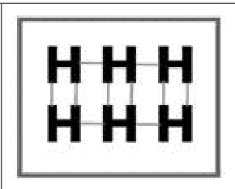{ width="187" loading=lazy }
  <figcaption>Diagram 1 from the original summary (ADF 2/2024, item 6). 原文附圖。</figcaption>
</figure>

**BD's response 屋宇署回覆:** BD advised that the simplified method of composite column design provided in the Steel Code did not cover the examples given, and the issue would be deliberated by the Technical Committee on the Code of Practice for the Structural Use of Steel.

### 7. Presentation of Structural Information in Submission of Superstructure Plan {#i202405037}

Raised by **HKIE** · Related 相關: [ADM-8](../pnap/adm-8.md), [APP-139](../pnap/app-139.md)

!!! warning "Later discussion 其後再討論"
    This question was discussed again on **9 Aug 2024**; use the [later response](2024.md#i2024080919) where they differ. 如有不同，以較新回覆為準。

**Question 問題:** According to PNAP ADM-8, lateral wind load shall only be provided in Part I of the Structural Calculation. Meanwhile, design codes and standards, materials strength and standards, concrete cover and corrosion protections as well as fire resistance requirements etc. are to be given in structural plans for approval. Please advise whether we need to show details of lateral wind loads, including force coefficient, directional factor, size and dynamic factor and wind load combination, and lateral wind loads with wind load combination extracted from wind tunnel test report, which are subjected to changes throughout the design and construction stages of the development, in the structural plans for …

**BD's response 屋宇署回覆:** BD advised that the details of lateral wind loads were essential information to be shown in structural plans for approval, and such practice had been in place since the promulgation of the Code of Practice on Wind Effects in Hong Kong 2019. Nevertheless, BD would consider reviewing the essential information of lateral wind load required to be shown in the structural plans for approval.

### 8. Barrier Free Access (BFA) Facilities for University Student Dormitories {#i202405038}

Raised by **AAP** · Related 相關: [Design Manual: Barrier Free Access 2008 ](../codes/bfa-2008.md)

**Question 問題:** It has been accepted that student dormitories for tertiary institutions is not regarded as “Hotels, Hostels and Guesthouses” even though sometimes they are named as “hostels” as the occupants will stay for a long duration. With regard to the above, the provision of accessible guest room required under section 7 in Division 2 of the Third Schedule of the B(P)R and paragraph 7 in Division 2 of the Design Manual: Barrier Free Access 2008 (2021 Edition) (DMBFA) is not applicable. …

**BD's response 屋宇署回覆:** BD advised that pursuant to section 7 in Division 2 of the Third Schedule of the B(P)R and paragraph 7 in Division 2 of the DMBFA, accessible guest rooms should be provided in every hotel, hostel or guesthouse. Hence, the provision of accessible guest rooms in student hostels for tertiary institutions was required. BD also reminded the owner/AP to observe the Disability Discrimination Ordinance (DDO) for the provision of accessible guest rooms in student dormitories.

### 9. Exit at Ground Storey {#i202405039}

Raised by **AAP** · Related 相關: [FS Code 2011 Part B: Means of Escape](../codes/fsc-part-b-means-of-escape.md)

<small>Follows earlier discussion: [5 May 2023](2023.md#i202305057)</small>

**Question 問題:** Clause B9.2 of FS Code stipulates the minimum width of an exit route at ground storey where the exit route from a ground storey also forms part of the exit route from a required staircase. Would BD please clarify if the minimum width of exit door locates along the exit route at ground storey, if any, should follow the same token, i.e. the width of exit door should be not less than the sum of: (a) half the width required for the exit door from the ground storey; (b) the width required for the exit door of the required staircase from the upper storeys; and (c) the width required for the exit door of the required staircase, if any, from the basements.

**BD's response 屋宇署回覆:** BD advised that HKIA’s understanding was incorrect. Clause B9.2(a) to (c) of FS Code refers to the width required for exit route from ground storey and the widths required for required staircases from upper storeys or basements, instead of the widths required for exit doors from such storeys. As discussed in item 7 of ADF 2/2023 held on 5 May 2023, the clear width of exit door measured between the vertical members of the door frame along the combined exit route at ground floor should not be less than the width of the combined exit route required under Clause B9.2 of FS Code.

### 10. Site Formation Plan involving Permanent Soldier Pile or Pipe Pile Wall {#i2024050310}

Raised by **AREC**

<small>Related discussions 相關討論: [23 Feb 2024 item 15](2024.md#i2024022315)</small>

**Question 問題:** To follow up with the discussion in item 15 of ADF 1/2024 held on 23 February 2024, please advise if a sacrificing thickness of 0.05 mm/year on steel section is acceptable for the design of permanent soldier and pipe piles.

**BD's response 屋宇署回覆:** BD advised that their discussion with GEO was still in progress and the item would be advised separately.

### 11. Application for Gross Floor Area (GFA) Concessions in Existing Building as Surplus GFA for Future A&A or Extension Works {#i2024050311}

Raised by **PBSCA**

<small>Follows earlier discussion: [24 May 2019](2019.md#i201905245)</small>

**Question 問題:** For the plant rooms in an existing shopping arcade which have not been disregarded or exempted from GFA calculations in the original design, the property developer would like to apply for GFA concessions for the plant rooms without proposing any alterations to the plant rooms, so as to retain the surplus GFA for better planning of future A&A or extension works. According to item 5 of ADF 3/2019 held on 24 May 2019, in general, no surplus GFA should be resulted or left unused for any possible additions in future. This will result in hardship for the property developer to have better planning and flexibility for the future A&A and extension works. …

**BD's response 屋宇署回覆:** BD advised that the plot ratio (PR)/GFA calculation shown on a building plan served the purpose to demonstrate that the actual PR/GFA did not exceed the permissible limits under the B(P)R or relevant Outline Zoning Plans. Any surplus PR/GFA shown on the calculation should not be regarded as unused PR/GFA guaranteed available for works in future submissions. GFA concession policy under the BO might be reviewed and changed from time to time, such that the PR/GFA of a building proposal in future submissions should be assessed in accordance with the prevailing policy at the time of the submission. Therefore, BD’s response in item 5 of ADF 3/2019 was still valid.

### 12. Completion of Exempted Building Works prior to the Grant of Consent {#i2024050312}

Raised by **PBSCA**

**Question 問題:** to the Commencement of A&A Works (Item raised by PBSCA) For an A&A works of an existing building involving the removal of some partition walls, which are exempted building works and shown as blue dotted lines in the diagram below, the BA requires the removal of these existing partition walls before granting the consent to the commencement of the A&A works, upon approval of the plans. We would like BD to clarify that the completion of such exempted building works shall not be a pre-requisite for granting consent to the commencement of A&A works.

<figure markdown>
  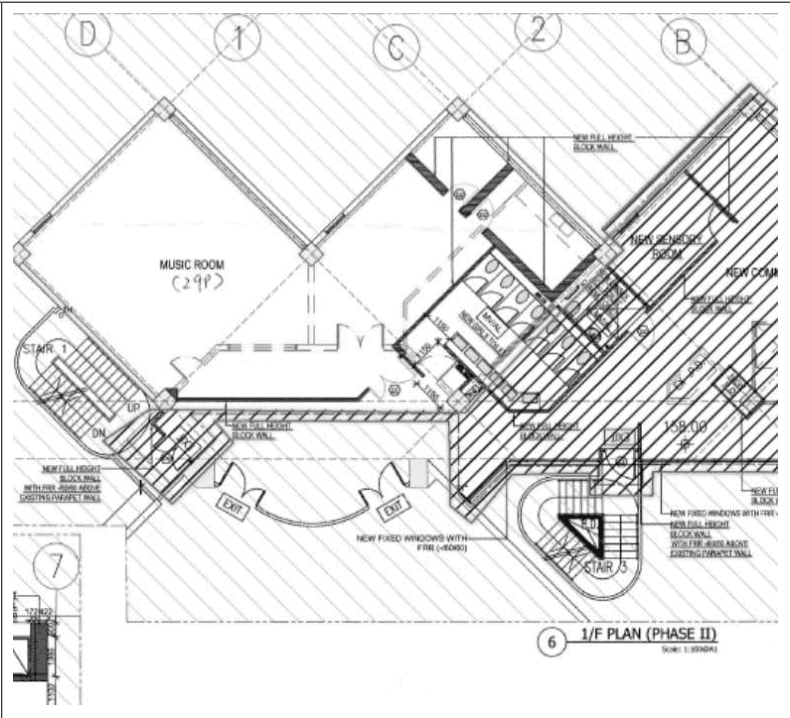{ width="511" loading=lazy }
  <figcaption>Diagram 1 from the original summary (ADF 2/2024, item 12). 原文附圖。</figcaption>
</figure>

**BD's response 屋宇署回覆:** BD advised that unless the exempted building works obstructed the carrying out of the proposed A&A works and/or the proposed essential precautionary measures in occupied premises, generally such pre-requisite for granting consent to the commencement of A&A works would not be imposed. Nevertheless, PBSCA could provide details of the case for separate discussion.

### 13. General Comments and Suggestions on BD’s Plan Processing {#i2024050313}

Raised by **PBSCA** · Related 相關: [ADM-2](../pnap/adm-2.md)

**Question 問題:** (Item raised by PBSCA) Members of PBSCA have the following general comments and suggestions: 1. Improve communication channel with BD officers. It is difficult to contact them nowadays. 2. ⁠ Some BD officers cannot provide precise comments until the last few days of the statutory period of 60 days, and/or cannot provide comments at early stage (i.e. on the 45 th day of submission of new building plans). The above problems may affect the timing of plan approval and fail to facilitate early approval of plans.

**BD's response 屋宇署回覆:** BD advised that practitioners might contact BD officers by email with copy to their respective senior and/or chief officers for effective communication as officers might not be able to answer telephone calls due to other engagements at work. BD also advised that while BD would strive to provide feedback on whether the submission of new building plans was fundamentally acceptable on the 45 th day of submission in accordance with PNAP ADM-2, the availability of other government departments’ comments, as well as the accuracy and timeliness of AP’s responses to address comments from BD and other government departments, might hinder the BD’s provision of feedback.

### 14. Last ADF of the Term {#i2024050314}

Raised by **PBSCA**

**Question 問題:** (Item raised by BD) BD advised that this would be the last meeting of this Forum in the current term which would end on 30 June 2024, and expressed gratitude for Convenors’ contribution. The respective institutes/associations of the Convenors had been invited to nominate members to serve as Convenors of this Forum from 1 July 2024 to 30 June 2027.

**BD's response 屋宇署回覆:** Members noted.

## ADF 1/2024 · 23 Feb 2024 {#adf-12024-23-feb-2024}

[Original summary (PDF) 原文](https://www.hkie-st.org/wp-content/uploads/2025/02/Summary-of-items-discussed-in-1_2024-ADF-on-23.2.2024.pdf) · 21 items

### 1. Curtain Wall outside Floor / Room without Accountable Gross Floor Area (GFA) {#i202402231}

Raised by **HKIA** · Related 相關: [APP-2](../pnap/app-2.md), [B(P)R 23 & 23A Building height, site are](../regulations/bpr-23-23a.md), [B(C)R Building (Construction) Regulation](../regulations/bcr-123q.md)

<small>Follows earlier discussion: [5 May 2023](2023.md#i202305054)</small>

<small>Related discussions 相關討論: [19 Mar 2021 item 3](2021.md#i202103193), [17 Nov 2023 item 1](2023.md#i202311171)</small>

**Question 問題:** Further to item 4 of ADF 2/2023 held on 5 May 2023, it was agreeable to BD that for floor/room which was non-accountable to GFA calculation, the curtain wall system projecting from the outer surface of the structural elements exceeding 200 mm for domestic building or 250mm for non-domestic building might also be disregarded from GFA and site coverage calculations on case basis. We would like to seek BD’s clarification if the same pragmatic approach is also applicable to transfer plate.

**BD's response 屋宇署回覆:** BD advised that under section 26 of the Building (Construction) Regulation (B(C)R), curtain wall meant “a non load-bearing enclosure of a building fixed on to the load-bearing structure of the building”, and cladding meant “a facing or architectural decoration additional to the structural elements of the building”. Under PNAP APP-2, curtain wall with projection from the outer surface of the structural elements not exceeding 200 mm for a domestic building or 250 mm for a non-domestic building could be disregarded from the GFA and site coverage (SC) calculations, and cladding with overall thickness of not more than 90 mm (75 mm in the case of cladding to non-structural prefabricated external walls) as the external wall finishes might be disregarded for the purpose of measurement of dimensions under regulation 23(3) of the Building (Planning) Regulations (B(P)R). Curtain wall at transfer plate was an external facing or architectural decoration of a structural element and did not serve as an external enclosure of a building. The pragmatic approach as mentioned in item 4 of ADF 2/2023 held on 5 May 2023 was not applicable to transfer plate, except for cases with specific and strong justifications.

### 2. Separation between Buildings not on the Same Site – Clause C5.3 of {#i202402232}

Raised by **HKIA** · Related 相關: [FS Code 2011 Part C: Fire Resisting Cons](../codes/fsc-part-c-fire-resisting-construction.md)

**Question 問題:** Code of Practice for Fire Safety in Buildings 2011 (June 2023 Edition) (FS Code) In accordance with Clause C5.3 of the FS Code, the minimum distance between any unprotected openings and the common lot boundary is 900mm. If the opening and the common lot boundary is more than 900mm, it is our understanding that air-conditioner (AC) platform / hood with air conditioning unit, and building services are allowed within the 900mm separation as illustrated in the diagram below. Would BD please confirm our understanding is correct?

<figure markdown>
  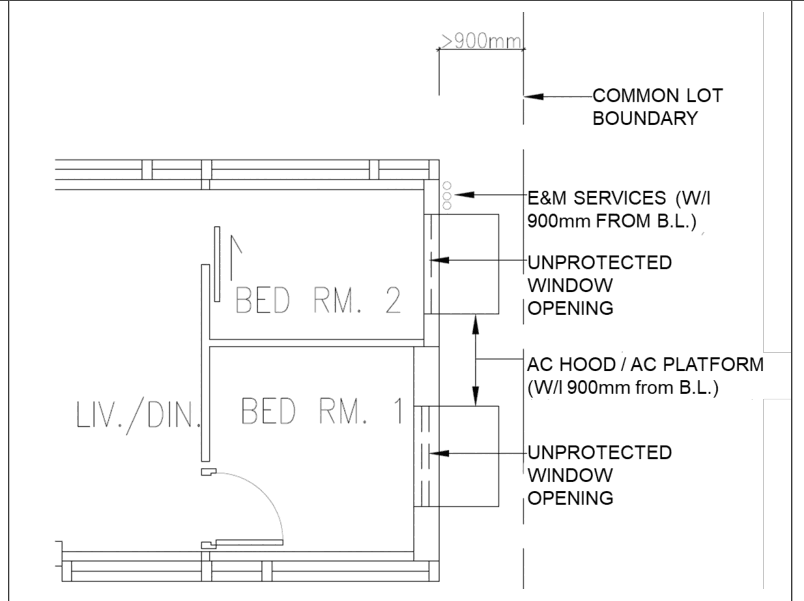{ width="520" loading=lazy }
  <figcaption>Diagram 1 from the original summary (ADF 1/2024, item 2). 原文附圖。</figcaption>
</figure>

**BD's response 屋宇署回覆:** BD advised that HKIA’s understanding was correct.

### 3. Access to External Services Covered by Architectural Features {#i202402233}

Raised by **HKIA** · Related 相關: [APP-93](../pnap/app-93.md)

<small>Related discussions 相關討論: [17 Nov 2023 item 9](2023.md#i202311179)</small>

**Question 問題:** It is our understanding that the maximum depth of pipe duct covered by external architectural features, such as cladding, is 500 mm in order to facilitate inspection and maintenance. Would BD please advise if the arrangement as shown in the figure below is acceptable:- - Access to “common” services from gondola within 500 mm - Access to “private” services from AC platform within 500 mm

<figure markdown>
  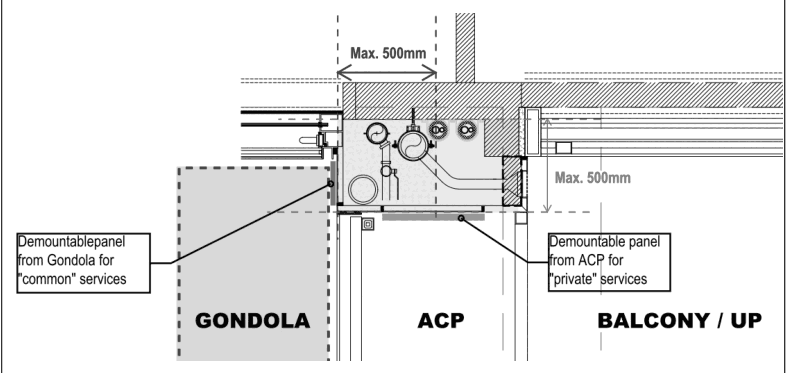{ width="515" loading=lazy }
  <figcaption>Diagram 1 from the original summary (ADF 1/2024, item 3). 原文附圖。</figcaption>
</figure>

**BD's response 屋宇署回覆:** BD advised that the arrangement shown in the figure failed to enable workers in the gondola to reach all common drainage pipes within 500 mm. Further information on the effective inspection of drainage pipe should be provided to demonstrate the fulfilment of relevant requirements in PNAP APP-93 and the Code of Practice on Access for External Maintenance (AfEM Code). If the “demountable panel from ACP” as shown in the figure was designed for the maintenance of common drainage pipes, right to access for maintenance should be demonstrated in accordance with paragraph 5 of Appendix F to AfEM Code.

### 4. Maintenance and Repair (M&R) Provision for Top Roof Structure {#i202402234}

Raised by **HKIA**

<small>Follows earlier discussion: [13 May 2022](2022.md#i202205131)</small>

**Question 問題:** Referring to item 1 of ADF 3/2022 held on 13 May 2022, the use of metal scaffold tower is one of the possible M&R access accepted by BD on case basis. For some projects which installation of gondola or davit arm are not possible, heavy spider lift may sometimes be required by BD to be provided at main roof for the M&R to the external walls of top roof structure. Taken into consideration that most of the external walls of top roof structures are tile finishes, the need for inspection and cleansing is relatively low and repair and replacement works can be carried out by scaffolding. Spider lifts with heavy loading are therefore not be the most practical way for M&R for top roof structures. …

**BD's response 屋宇署回覆:** held on 10 February 2023 was applicable. The use of alternative means of M&R access such as temporary metal scaffolding should be considered on case basis, and AP was reminded to observe the Code of Practice for Metal Scaffolding Safety issued by the Labour Department.

### 5. Cleaning Eye Provision for Drainage {#i202402235}

Raised by **HKIA** · Related 相關: [APP-93](../pnap/app-93.md), [B(SFP&W)R Building (Standards of Sanitar](../regulations/bsfpwr-123i.md)

**Question 問題:** According to regulation 28(2)(b) of the Building (Standards of Sanitary Fitments, Plumbing, Drainage Works and Latrines) Regulations (B(SSFPDWL)R), a cleaning eye or other suitable means of access shall be provided at or near the bend of soil pipes and waste pipes. Diagram 1 below demonstrates a common approach for the cleaning eye provision, i.e. every bend served by at least 1 no. of cleaning eye / access through a straight drainage pipe within a reasonable distance. In some drainage plan submissions, BD required that cleaning eye should be provided right at the bend or within a very close distance from the bend as marked in green in Diagram 2. …

<figure markdown>
  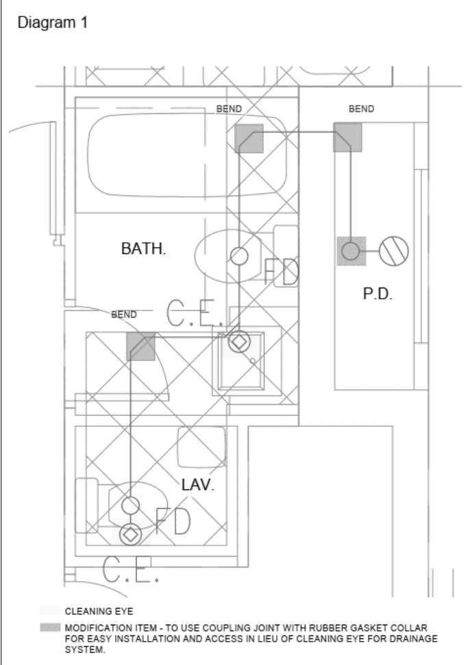{ width="443" loading=lazy }
  <figcaption>Diagram 1 from the original summary (ADF 1/2024, item 5). 原文附圖。</figcaption>
</figure>

<figure markdown>
  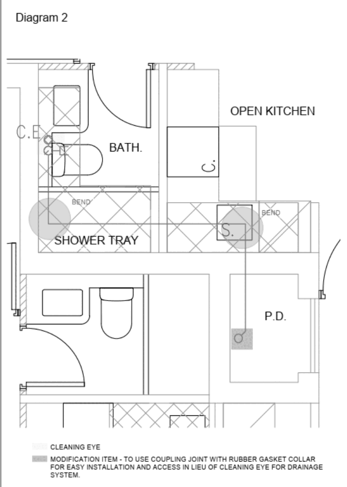{ width="444" loading=lazy }
  <figcaption>Diagram 2 from the original summary (ADF 1/2024, item 5). 原文附圖。</figcaption>
</figure>

**BD's response 屋宇署回覆:** BD advised that access points in sunken slab should be provided to facilitate inspection of every part of the pipe works and clearance of any blockage thereof in accordance with paragraph 5 of PNAP APP-93. BD also advised that the design of the drainage system illustrated in Diagrams 1 and 2 required further clarification to demonstrate the effectiveness and workability of cleaning. BD supplemented that practitioners were being consulted on the design and testing of drains in sunken slab for the preparation of the Code of Practice for Drainage in Buildings. Members were encouraged to provide their views on the matters. 6 7

### 6. Site Coverage of Greenery {#i202402236}

Raised by **HKIA** · Related 相關: [APP-152](../pnap/app-152.md)

<small>Follows earlier discussion: [18 Mar 2022](2022.md#i202203184)</small>

<small>Related discussions 相關討論: [25 Nov 2022 item 9](2022.md#i202211259)</small>

**Question 問題:** Paragraph 3 of Appendix D to PNAP APP-152 states that a 50% reduction factor will be applied on planters on an inaccessible roof located at primary zone is in computing the greenery areas. Whilst greenery on inaccessible roof located at areas other than the primary zone can be wholly included in the overall greenery areas calculation (subject to the provision of maintenance access), it is our understanding that those greenery on inaccessible roof located at primary zone can likewise be wholly included in the overall greenery areas calculation, provided that they are not included as the required greenery areas in primary zone. Please advise if our understanding is correct.

**BD's response 屋宇署回覆:** BD advised that uncovered greenery area, irrespective of location, could be included in the overall greenery areas calculation subject to compliance with all requirements under Appendix D to PNAP APP-152. For planters on inaccessible roof, in addition to other requirements, communal access paths should still be provided from the common areas for maintenance in accordance with paragraph 8 of Appendix D to PNAP APP-152. If planters on an inaccessible roof are to be included in the primary zone greenery areas calculation, they should comply with paragraph 3 of Appendix D to PNAP APP-152 (i.e. reduction factor and 30% cap would be applicable).

### 7. “Atrium” in Clause C10.3(a) of FS Code {#i202402237}

Raised by **HKIA** · Related 相關: [FS Code 2011 Part C: Fire Resisting Cons](../codes/fsc-part-c-fire-resisting-construction.md)

<small>Follows earlier discussion: [5 May 2023](2023.md#i202305052)</small>

<small>Related discussions 相關討論: [25 May 2018 item 3](2018.md#i201805253)</small>

**Question 問題:** It was discussed in item 2 of ADF 2/2023 held on 5 May 2023 that it was not the intention of BD to restrict uses (such as retail shops, cafeteria, pop-up stores, kiosks, etc) within the atrium compartment. Following the above, we understand that the atrium compartment is not merely restricted to the void space and the circulation aisle along the perimeter of the atrium void, but can also include the mercantile facilities beyond the aisle at each floor adjoining the atrium void (without any fire rated separation fromthe void) as indicatively illustrated in the following sketch section. Please confirm that our understanding is correct.

<figure markdown>
  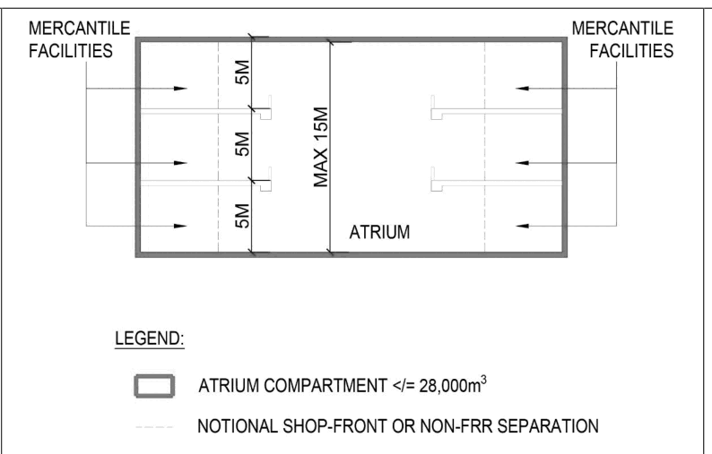{ width="514" loading=lazy }
  <figcaption>Diagram 1 from the original summary (ADF 1/2024, item 7). 原文附圖。</figcaption>
</figure>

**BD's response 屋宇署回覆:** BD advised that according to Clause C10.3(a) of the FS Code, an atrium should be separated from all other spaces by fire barriers having an FRR of not less than that of those spaces. The commentary to Clause C10.3 supplemented that there was a risk of smoke spread at the atrium that could affect adversely the life safety of the occupants, especially on upper floors of the atrium. Hence, the volume of an atrium should mainly include the atrium itself and fire barriers should be provided to separate the atrium from other spaces including shops. Noting that the atrium might be of irregular shape and the alignment of fire shutters along the edge of atrium might be impractical, BD would consider accepting minor arcade and circulation areas adjoining the atrium with relatively low fire risk to be included as part of the atrium compartment. However, mercantile facilities outside the atrium would not be accepted to be included within the same compartment of the atrium void.

### 8. Cast-in Embed {#i202402238}

Raised by **HKIE** · Related 相關: [B(A)R Building (Administration) Regulati](../regulations/bar-123a.md)

**Question 問題:** To streamline the approval process, it is suggested to treat the cast-in embeds as typical structural elements with all typical details given in superstructure plans. The design load, alignment and exact location shall be shown in the structural submission for the secondary building elements. Modification of regulation 33(1) of the Building (Administration) Regulations for the installation of cast-in embeds can be applied for once the first consent to the commencement of the superstructure works has been granted.

**BD's response 屋宇署回覆:** BD welcomed the proposed streamlining measure. BD advised that structural details, design standards, material specifications, design load and general locations of the cast-in embeds should be clearly indicated in the first submission of superstructure plans, while their exact locations, layout and setting-out could be provided in the subsequent superstructure amendment plans or the structural plans for the corresponding secondary building elements.

### 9. Percentage of Remedial Brackets for Curtain Wall {#i202402239}

Raised by **HKIE**

!!! warning "Later discussion 其後再討論"
    This question was discussed again on **6 Feb 2026**; use the [later response](2026.md#i2026020610) where they differ. 如有不同，以較新回覆為準。

**Question 問題:** It is noticed that some BD officers limit the adoption of remedial brackets with drill-in anchors not exceeding 10% of the cast-in embeds of the curtain wall. As random strength test will be conducted on these drill-in anchor, such limitation will certainly restrain the design flexibility and buildability. Would BD please clarify.

**BD's response 屋宇署回覆:** BD advised that no such percentage limit was imposed on the remedial works for cast-in embeds. In passing, BD advised that for alterations and additions (A&A) works adopting brackets solely with drill-in anchors for installation of new curtain wall in existing buildings, the sampling rate of at least 5% or 5 numbers, whichever is more, for pull-out test on each type and size of the drill-in anchors on each floor would be imposed.

### 10. Comparison of Total Loading for Foundation Piling Plan Approval {#i2024022310}

Raised by **HKIE**

**Question 問題:** For foundation piling submission, the following two capacity assessment tables are given for demonstration of the technical feasibility of the proposed piling system for approval: a) Column/Wall Loading Schedule: assumed loads on each column/wall of the superstructure on the foundation, e.g. dead loads, imposed loads, wind loads, earth loads including ground water pressure, etc. b) Pile Loading Schedule: magnitude of characteristic dead, imposed, wind and earth loads, including ground water pressure, negative skin friction (if applicable), and others, and their critical combinations acting on each pile. …

**BD's response 屋宇署回覆:** BD advised that while the total sum of the assumed DL and LL was required to be shown in the Column/Wall Loading Schedule in the foundation plan for BD’s approval, the total DL and LL of individual pile cap was not required to be shown on the plan.

### 11. “Means of Escape and Access ” in PNAP APP-73 {#i2024022311}

Raised by **AAP** · Related 相關: [APP-73](../pnap/app-73.md), [FS Code 2011 Part D: Means of Access](../codes/fsc-part-d-means-of-access.md)

**Question 問題:** Paragraph 5 of PNAP APP-73 states that “a service lane, public or private, would not be acceptable as a means of escape and access if it is obstructed, incapable of improvement or obviously in a decaying state.” We would like to seek BD’s advice on the acceptance criteria in this regard.

**BD's response 屋宇署回覆:** BD advised that a service lane, public or private, would not be acceptable as a means of escape and access if it was obstructed, incapable of improvement or obviously in a decaying state as stated in paragraph 5 of PNAP APP-73. BD would take into account the physical conditions of the service lane at the material time of submissions. Service lanes obstructed by unauthorised structures or fixtures such as railings, fence walls, security gates, etc. would not be acceptable as a means of escape and access. Under Clause D7.1 of the FS Code, fire service access point (FSAP) should be available either directly from a street accessible by vehicles of the Fire Services Department (FSD) or through an open area having a minimum dimension of 1.5 m and having access free from any obstruction to such a street. BD advised that if access from a street to the FSAP through a service lane was proposed, the AP should demonstrate that the service lane was free from any obstruction for the consideration by BD and FSD.

### 12. Communal Podium Garden for Residential Building {#i2024022312}

Raised by **AAP** · Related 相關: [APP-42](../pnap/app-42.md)

**Question 問題:** Under paragraph 26 of PNAP APP-42, it is stated that: “The provision of communal podium gardens, covered landscaped and play areas is encouraged. Where these amenities occur under and within the perimeter of a domestic tower, a modification of Regulation 23(3)(a) of the B(P)R would be granted, provided the area is open in design and not encumbered with structural elements, and the total area exempted is within 5% of total domestic GFA.” In a typical podium arrangement with residential tower sitting on top, as per below schematic building section, please advise whether it is acceptable to locate the communal podium garden at 1/F or any podium floor other than the floor immediately below the …

<figure markdown>
  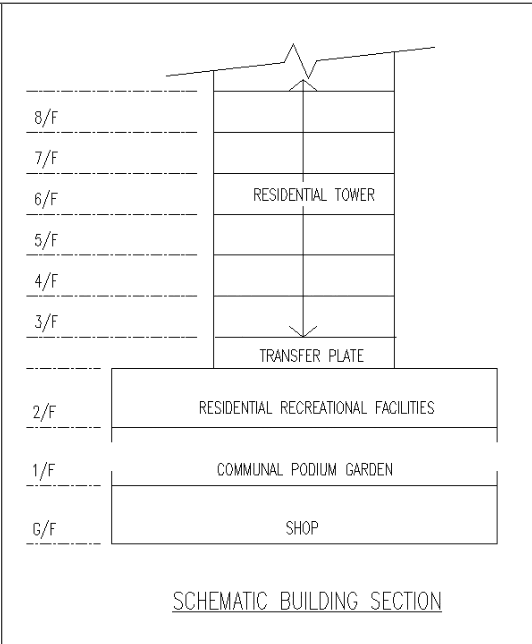{ width="343" loading=lazy }
  <figcaption>Diagram 1 from the original summary (ADF 1/2024, item 12). 原文附圖。</figcaption>
</figure>

**BD's response 屋宇署回覆:** BD advised that pursuant to the GFA concession under PNAP APP-42, the communal podium garden should be provided under and within the perimeter of a domestic tower. For the case shown in the “Schematic Building Section”, the communal podium garden on 1/F could not fulfill the said requirement for the purpose of GFA concession since it had extended beyond the perimeter of the domestic tower above. In passing, BD reminded that the communal podium garden under PNAP APP-42 and the communal sky garden for residential buildings under JPN No. 1 were subject to different requirements for fulfilling the criteria of GFA concession.

### 13. Application for Consent to Commencement of A&A works involving Removal of Structure {#i2024022313}

Raised by **ACEHK** · Related 相關: [BO s.14–21 Approval and consent, grounds](../regulations/bo-part-2-building-works.md), [Cap. 123C Building (Demolition Works) Re](../regulations/bdwr-123c.md)

**Question 問題:** It is understood that BD’s inspection of propping and temporary support is required for granting consent to commencement of Demolition Works. In the approval letters of structural (A&A) works, however, there is no requirement for the erection of propping or temporary support prior to the application for consent to the commencement of A&A works involving the removal of structures, e.g. a portion of structure slab. …

**BD's response 屋宇署回覆:** BD advised that the Building (Demolition Works) Regulations applied to the demolition of a building or of any substantial or significant part of a building. For A&A works involving demolition of any substantial or significant part of a building, precautionary and other protective measures including propping and temporary supports, etc. should be installed prior to consent application of such works, otherwise consent to the commencement of the A&A works would be refused under section 16(3)(bb) of the Buildings Ordinance. BD might impose conditions upon approval of plans on the requirements for the precautionary and other protective measures for A&A works involving substantial demolition works on a case-by-case basis.

### 14. Post-Occupation Permit (OP) Rectification Works Procedures (PRWP) {#i2024022314}

Raised by **ACEHK** · Related 相關: [APP-37](../pnap/app-37.md)

**Question 問題:** for Replacement of Tempered Glass Refer to BD’s circular letter dated 9 January 2014, PRWP can be used as an alternative to Minor Works Control System (MWCS). If the PRWP involve the replacement of tempered glass, could BD clarify if the quality supervision requirements as stipulated in PNAP APP-37 shall be strictly followed during manufacturing of the replacement tempered glass? To be specific, if the tempered glass is from the same manufacturing plant and the frequency of quality supervision prior to OP as stated in paragraph 13(e)(i) of PNAP APP-37 exceeds 30% of the number of tempered glass panes used in the project, such that it still meets the 30% requirement after counting the extra …

**BD's response 屋宇署回覆:** BD advised that if the tempered glass for replacement under PRWP was provided from the same batch of production for the project and the frequency of quality supervision prior to OP still met the 30% requirement on the quantity of the tempered glass for replacement, there was no need for such tempered glass to meet a separate 30% requirement on quality supervision.

### 15. Site Formation Plan involving Permanent Soldier Pile or Pipe Pile Wall {#i2024022315}

Raised by **AREC** · Related 相關: [APP-18](../pnap/app-18.md)

<small>Related discussions 相關討論: [3 May 2024 item 10](2024.md#i2024050310)</small>

**Question 問題:** In recent site formation plan submissions to BD and GEO, it was noted that corrosion of soldier pile walls in the long run shall be considered, or otherwise, such soldier piles shall only be used for temporary cases. Please advise if a sacrificing thickness of 0.05mm/yr on the steel section is adopted for the design life of the soldier pile wall and the steel section is hot-dip galvanized (say, 85 micro-meter thick), is it acceptable to adopt solider pile wall for permanent cases? Please advise whether the above design is also acceptable for the adoption of pipe pile wall for permanent cases.

**BD's response 屋宇署回覆:** BD advised that soldier pile might be used as permanent structure, provided that apart from the Code of Practice for Foundations 2017, assessments with regard to different codes of practices and standards were conducted for consideration by BD and GEO. BD would further discuss with GEO regarding the design and acceptance criteria of the permanent soldier and pipe pile wall.

### 16. Drainage of Refuse Storage and Material Recovery Chambers {#i2024022316}

Raised by **PBSCA** · Related 相關: [Cap. 123H Building (Refuse Storage and M](../regulations/brsr-123h.md)

<small>Related discussions 相關討論: [12 Nov 2021 item 23](2021.md#i2021111223), [12 Aug 2022 item 4](2022.md#i202208124)</small>

**Question 問題:** According to regulation 11(1) of the Building (Refuse Storage and Material Recovery Chambers and Refuse Chutes) Regulations (B(RSMRC&RC)R), “every refuse storage and material recovery chamber (RSMRC) shall be provided, in the floor thereof, with an outlet drain.” As per our understanding, there is no requirement of surface channel to be provided near the entrance door in RSMRC. Please advise whether our understanding is correct. Also, can the outlet drain be in the form of vertical grating instead?

**BD's response 屋宇署回覆:** BD advised that there was no requirement on the provision of surface channel near the entrance door of the RSMRC. BD also advised that the outlet drain should be provided on the floor of RSMRC to facilitate cleansing of the floor. In accordance with regulation 11(2) and 11(3) of the B(RSMRC&RC)R, the outlet drain should also be connected to a back inlet trapped gully for inspection and clearance of blockage in the pipe.

### 17. Location of Manholes in Car Park {#i2024022317}

Raised by **PBSCA** · Related 相關: [APP-93](../pnap/app-93.md)

**Question 問題:** As there is no restriction on the location of manholes in the car park area, can the manhole or the associated drainage pipes located within the private car parking area be acceptable by the Building Authority (BA), considering that the car can be easily relocated to other places for maintenance of the manhole/drainage pipes, if required? Please advise whether our understanding is correct. AOB Items

**BD's response 屋宇署回覆:** BD advised that all manholes or associated drainage system located at the car parking floors should be conveniently and safely accessible for frequent inspection and routine maintenance to meet the spirits in PNAP APP-93. Manholes or associated drainage system not accessible through common area in car park might also be acceptable if central management and control by a party with the right of entry was available at appropriate time to facilitate frequent inspection and routine maintenance.

### 18. Open Kitchen {#i2024022318}

Raised by **PBSCA** · Related 相關: [FS Code 2011 Part C: Fire Resisting Cons](../codes/fsc-part-c-fire-resisting-construction.md)

<small>Related discussions 相關討論: [23 Mar 2018 item 4](2018.md#i201803234), [23 Aug 2019 item 3](2019.md#i201908233), [23 Aug 2019 item 7](2019.md#i201908237), [12 Nov 2021 item 14](2021.md#i2021111214), [25 Nov 2022 item 18](2022.md#i2022112518), [4 Aug 2023 item 8](2023.md#i202308048)</small>

**Question 問題:** (Item raised by BD) In a recent review with the stakeholders on the following previous discussion items in ADF on fire safety requirements of open kitchen:  item 7 of ADF 1/2016 held on 15 January 2016,  item 7 of ADF 2/2016 held on 18 March 2016,  item 13 of ADF 3/2017 held on 19 May 2017,  item 4 of ADF 2/2018 held on 23 March 2018,  item 3 of ADF 4/2019 held on 23 August 2019,  item 14 of ADF 5/2021 held on 12 November 2021,  item 18 of ADF 5/2022 held on 25 November 2022, and  item 8 of ADF 3/2023 held on 4 August 2023, BD re-iterated that the purpose of the “full height fire for open kitchen under in Clause C13.4(d) of the FS Code occupants from radiant heat of stove fires and …

<figure markdown>
  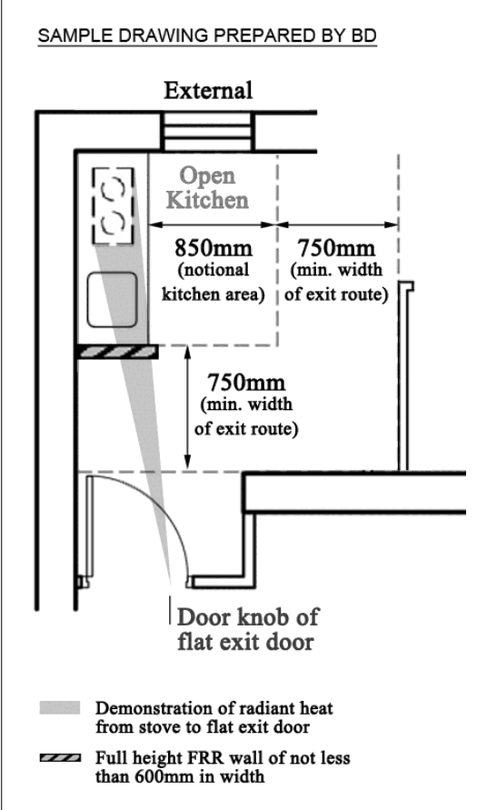{ width="339" loading=lazy }
  <figcaption>Diagram 1 from the original summary (ADF 1/2024, item 18). 原文附圖。</figcaption>
</figure>

**BD's response 屋宇署回覆:** Members noted and would observe the requirements accordingly. rated wall” required was to shield the necessary pause of Such wall must be shielding function. a minimum clear route adjacent to the than 750 mm in kitchen area. A provided below. 17 open and 18

### 19. Submission of Electronic Certificates / Test Reports for Building Materials {#i2024022319}

Raised by **PBSCA**

**Question 問題:** (Item raised by BD) While works department of the government had been accepting the submission of electronic certificates / test reports with digital signature for building materials, BD encouraged practitioners to do the same via the Electronic Submission Hub (ESH).

**BD's response 屋宇署回覆:** Members noted and expected no difficulty would be encountered in submitting certificates / test reports in PDF format via ESH. Members would further liaise with the contractors for the submission of electronic certificates/ test reports with digital signature.

### 20. Issuance of Letters of Notification for the Results of Plan Submission / Consent Application for Structural Works via ESH {#i2024022320}

Raised by **PBSCA**

**Question 問題:** (Item raised by BD) To encourage the wider use of ESH, BD advised that the letters of notification for the results of plan submission / consent application for all structural works (excluding A&A works) would be issued in electronic format via ESH only, and no hard copy of such letters would be issued. AP/RSE/RGE should activate their ESH accounts for receiving these letters. For structural plans not submitted via ESH, the set of the processed plans to be returned to RSE would include the hard copy of the first page of the letter of notification for easy reference. …

**BD's response 屋宇署回覆:** Members noted and would follow the arrangement accordingly. In passing, BD drew members’ attention that a tentative roadmap on adoption of Building Information Modelling (BIM) for building plan preparation and submission was issued by the Development Bureau in December 2023 for consultation with stakeholders. The roadmap outlined the key milestones for adoption of BIM by private sector with the ultimate goal of achieving full use of BIM throughout the preparation and approval process of all building plans submitted under the Buildings Ordinance (BO).

### 21. Site Safety Matters {#i2024022321}

Raised by **PBSCA**

**Question 問題:** (Item raised by BD) BD advised that BSC and APSEC Papers 4/23, 5/23 and 2/24 recently circulated for members’ comments regarding enhancement on control of temporary works providing support to tower crane, time frame for reporting non-conformities and site incidents to the Building Authority, and proposed implementation of Smart Site Safety System (SSSS) for private projects, aimed to clarify the duties and responsibilities of AP/RSE/RGE and/or their technical competent persons (TCP) on site safety under the BO, but not to impose additional supervision requirements on AP/RSE/RGE. …

**BD's response 屋宇署回覆:** Members responded that the proposals in the concerned papers would inevitably increase the responsibility and workload of AP/RSE/RGE and their TCP on site safety matters, as well as putting them in a position susceptible to legal actions in respect of construction site incidents. Members also raised that the adoption of SSSS in construction sites should be subject to the control under the Factories and Industrial Undertakings Ordinance instead of the BO. They suggested that the Labour Department should enhance the requirements on provision of safety officer in construction sites. BD reiterated that all practitioners had their roles in the construction site safety and would respond to members’ comments on the said BSC and APSEC Papers.

---
<small>Source: Summary of Items Discussed in APSEC Discussion Forum, published by the HKIE Structural Division. Condensed for reference; the PDF is the authoritative record.</small>
