---
tags:
  - APSEC
  - Structural 結構
  - Registration 註冊
  - Plan submission & approval 呈交及審批
  - Fire safety 消防安全
  - Car park 停車場
  - GFA 總樓面面積
  - Lighting & ventilation 照明及通風
  - Wind 風力
  - Site supervision 地盤監督
  - Lift 升降機
  - Concrete & materials 混凝土及物料
  - Foundation 地基
  - Staircase 樓梯
  - Geotechnical 岩土
  - Demolition 拆卸
  - Site safety 地盤安全
  - GFA concession 樓面面積寬免
  - Excavation & ELS 挖掘
  - Curtain wall & façade 幕牆及外牆
  - Means of escape 逃生途徑
  - Hotel 酒店
  - Elderly-friendly 長者友善
  - Domestic 住用
  - Green & amenity features 環保及適意設施
  - Fire resisting construction 耐火結構
  - Protective barrier 防護欄障
  - Means of access 救援通道
  - Occupation permit 佔用許可證
  - Barrier free access 無障礙
  - Industrial building 工業大廈
  - Plant rooms 機房
  - A&A works 改動及加建工程
  - Refuge floor 庇護層
---

# APSEC discussion items 2026 <small>2026 年認可人士及註冊結構工程師委員會討論項目</small>

!!! info "About this page 關於本頁"
    Questions raised at the APSEC Discussion Forum (ADF) and **BD's responses**, extracted from the summaries published by the HKIE Structural Division. Text is condensed from the English source; check the PDF before relying on an item. Where a later meeting discussed the same question, the item is flagged and **the later response prevails**.
    摘錄自香港工程師學會結構分部發布的會議摘要（只有英文版本）。如其後會議再討論同一問題，以**較新的回覆為準**。

## ADF 3/2026 · 14 Aug 2026 {#adf-32026-14-aug-2026}

[Original summary (PDF) 原文](https://www.hkie-st.org/wp-content/uploads/2026/11/Summary-of-items-discussed-in-3_2026-ADF-on-14.8.2026.pdf) · 15 items

### 1. Amenity Features under PNAP APP-42 {#i202608141}

Raised by **HKIA** · Related 相關: [APP-42](../pnap/app-42.md)

**Question 問題:** The following amenity features under PNAP APP-42 aim to promote friendly built environment: Paragraph 20 – Horizontal Screens / Covered Walkways; Paragraph 24 – Shelters for Outdoor Fixed Seats; Paragraph 30 – Covered Areas at Public Open Space; Paragraph 42 – Covered Picking Up and Setting Down Area for Passengers. However, paragraph 46 of the PNAP currently stipulates that these features applicable to residential and composite buildings, as well as commercial buildings often patronised by the elderly only. We opine that these amenity features should also be applicable building types, specifically institutional buildings (e.g. …

**BD's response 屋宇署回覆:** under PNAP APP-42 which aim to promote elderly friendly built environment were applicable to residential and composite buildings, as well as commercial buildings often patronised by the elderly. For the above amenity features in other types of buildings, such as institutional buildings with residential care home for the elderly or day care centre which were often patronised by and were genuinely beneficial as commercial from GFA and/or SC calculations on individual merits. community facilities, 1

### 2. Wind Load on Canopy with Height Greater Than Two Times The Canopy Projection {#i202608142}

Raised by **HKIE** · Related 相關: [APP-139](../pnap/app-139.md)

**Question 問題:** In Clause B2.3 of Appendix B to the Code of Practice on Wind Effects Hong Kong 2019 (the Wind Code), there is a limit on the height of canopy twice the canopy projection for the adoption of the recommended C p Would BD please advise if the C values in this clause can be adopted p the height limit is exceeded? If not, what procedures should be followed assessing the wind load on the canopy?

**BD's response 屋宇署回覆:** in BD advised that Clause B2.3 of Appendix B to the Wind Code could be to referred to if the concerned canopy was attached below half-way up the values. building and below a height of twice the canopy projection. in case in Clause B2.3 of Explanatory Notes to the Wind Code could be referred to for canopy attached to upper half of the building or free-standing canopy. Canopy is defined in regulation 2 under the Building (Planning) Regulations that any structure which projects more than 500 mm from any wall of any building and at a height of not more than 7.5 m above the level of the ground to provide protection from rain or sun, not carrying any floor load, either cantilevered or supported by brackets. In this case, the net pressure coefficients could be taken as +0.9 and -1.3 according to Clause B2.3 of Appendix B of the Wind Code. 2

### 3. Allowable Lateral Bearing Pressure of Rock With Allowable Vertical Bearing Pressure Conforming To The Recommendations in Technical {#i202608143}

Raised by **HKIE** · Related 相關: [APP-18](../pnap/app-18.md)

**Question 問題:** Guidance Note No. 53 According to paragraph 6 of Appendix C to PNAP APP-18, allowable bearing pressure for Category 1(c) granitic rock may be taken as 7500 subject to certain imposed conditions by the BA. It is specified in 2.2.2(3) of the Code of Practice for Foundations 2017 (2024 Edition) Foundation Code) that the allowable lateral bearing pressure of rock taken as 1/3 of the vertical bearing pressure provided that no adverse joints exist. It can thus be interpreted that if 7500 kPa is adopted allowable vertical bearing pressure of rock, then the allowable lateral pressure may be taken as 7500/3 =2500 kPa. Would BD please advise above interpretation is correct?

**BD's response 屋宇署回覆:** vertical BD advised that HKIE’s understanding was correct provided that no kPa adverse rock joints exist. Clause (the may be rock for the bearing if the

### 4. Concurrent Processing of Approval and Consent for Amendment Secondary Structural Element Without First Consent {#i202608144}

Raised by **HKIE** · Related 相關: [ADM-19](../pnap/adm-19.md)

**Question 問題:** Regarding an amendment plan for secondary structural elements, for which first consent has not been granted, submitted to BA for approval, can the concurrent processing of approval and consent as stated in paragraph 34 of PNAP ADM-19 be adopted? Concerns have been raised in some cases that as first consent for the works has not been granted, the concurrent processing of approval and consent should not apply. Would BD please advise?

**BD's response 屋宇署回覆:** BD advised that according to paragraphs 33 and 34 of PNAP ADM-19, concurrent application for approval of plans and consent to the commencement of secondary structural element works does not limit to the first plan submission for these works, provided that the criteria set out in paragraph 34(a) to (d) of the PNAP were met.

### 5. Arrangement for Rebound Hammer Test {#i202608145}

Raised by **HKIE** · Related 相關: [ADM-18](../pnap/adm-18.md)

**Question 問題:** We note that the arrangement for rebound hammer tests for superstructure works has recently been changed such that tests are now conducted prior notice. This has slowed the progress, as preparation of test could not be completed in advance. Additionally, as the technically competent person (TCP) of grade T3 of stream was not necessarily stationed full-time at site during the superstructure construction period, the requirement for TCP T3 attendance at short notice witness and endorse test results has caused inconvenience to the personnel involved. Would BD please clarify the current arrangement for rebound hammer

**BD's response 屋宇署回覆:** BD advised that according to paragraph 3 of PNAP ADM-18 on site without auditing for building works, BD would conduct surprise checks to audit surfaces building works without prior notification. The auditing officer of BD would have the discretion to determine the timing of audit inspection subject to the nature of various stages of building works on a case-by-case RSE’s basis. to tests?

### 6. The Code of Practice for Fire Safety in Buildings 2011 (2024 Edition) Code) - Access to Maintenance Roof by Required Staircase {#i202608146}

Raised by **AAP** · Related 相關: [FS Code 2011 Part B: Means of Escape](../codes/fsc-part-b-means-of-escape.md)

<small>Related discussions 相關討論: [21 Nov 2025 item 1](2025.md#i202511211)</small>

**Question 問題:** For a building with two or more required staircases, it is our understanding that it is not necessary for those required staircases serving the immediately below the main roof for maintenance only to be continued main roof, provided that:- a) Access to other required staircase on the roof is not required Clause B8.2 of the FS Code; b) The main roof is not regarded as refuge floor of the building Clause B18.3 of the FS Code ; and c) Other relevant provisions are complied with, such as access to for maintenance or repair. Would BD please advise if the above understanding is correct.

**BD's response 屋宇署回覆:** (FS BD advised that AAP’s understanding was correct. floors to such under under 4 the roof

### 7. PNAP APP-2 – Aboveground Private/ Public Car Park {#i202608147}

Raised by **AAP** · Related 相關: [APP-2](../pnap/app-2.md)

<small>Related discussions 相關討論: [6 Feb 2026 item 7](2026.md#i202602067)</small>

**Question 問題:** According to paragraph 18(b)(i) of PNAP APP-2, GFA for both aboveground private car park and aboveground public car park of not more than two can be 100% disregarded. Would BD please clarify if the 100% disregarded GFA for private car park and public car park are counted separately with more than two floors for each respective use as illustrated in the below.

<figure markdown>
  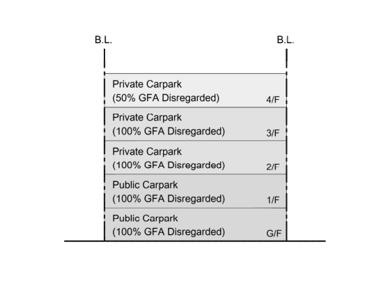{ width="361" loading=lazy }
  <figcaption>Diagram 1 from the original summary (ADF 3/2026, item 7). 原文附圖。</figcaption>
</figure>

**BD's response 屋宇署回覆:** BD advised that AAP’s diagram indicating the percentage of GFA floors concessions for the aboveground car parks was incorrect. Paragraph 7 and its footnote 4 of Appendix C to PNAP APP-2 stated that under not paragraph 18(b)(i) of this PNAP, not more than two aboveground diagram carparking floors (irrespective of the provision of private and public car parks) might be 100% disregarded from GFA calculation. 5

### 8. PNAP APP-93 {#i202608148}

Raised by **AAP** · Related 相關: [APP-93](../pnap/app-93.md)

<small>Related discussions 相關討論: [8 May 2026 item 1](2026.md#i202605081)</small>

**Question 問題:** According to paragraph 3(b)(ii) under PNAP APP-93, it is stated that of pipe wells could be exempted from the GFA calculations and open wells may also be exempted from SC calculations. We understand that well is also allowed to be covered provided that the relevant pipe well included in the SC calculation. Would BD please advise if the above understanding is correct?

**BD's response 屋宇署回覆:** the area BD advised that AAP’s understanding was correct, subject to compliance pipe with the criteria set in PNAP APP-93, especially the ventilation openings pipe with a minimum net area of 1/10 th of the horizontal area of the pipe well area is at both the top and bottom of the well.

### 9. Enhancement to Site Supervision {#i202608149}

Raised by **ACEHK**

**Question 問題:** Further to the Joint BSC & APSEC meeting held on 12 June 2026, a working group for enhancement to site supervision has been established. Can BD give us an idea of the envisaged timeline for the working group and new requirements to be implemented? Also, as a general principle, will the new requirements only affect new projects (BA4 yet submitted) since some consultancies have already been awarded with site supervision fee as part of the lump sum fee.

**BD's response 屋宇署回覆:** BD advised that the proposal to enhance the site supervision by AP, RSE, RGE and registered contractors, together with the implementation arrangement would be discussed in the working group meetings. The first meeting would be conducted soon. [Post-meeting note: The first meeting of the working group was held on 2 September 2026.]

### 10. Structural Submission for Maintenance Platforms {#i2026081410}

Raised by **AREC** · Related 相關: [ADM-23](../pnap/adm-23.md), [BO s.40–56 and Schedules: offences, exem](../regulations/bo-parts-4-9-schedules.md)

**Question 問題:** Would BD please advise whether there are any established guidelines criteria governing the necessity of structural submissions for maintenance platforms within the E&M plant rooms?

**BD's response 屋宇署回覆:** or BD advised that except for minor works commenced under the simplified requirements and building works exempted under section 41 of the BO , no person shall commence or carry out any building works without having 6 obtained a prior approval and consent from the BA. Nevertheless, the self-certification system with fast track processing procedures for plan submissions of simple structural works under PNAP ADM-23 might be considered, provided that the relevant eligibility criteria were fulfilled.

### 11. Use of Tied-Back Wall Support System for Excavation Works Paragraph 10 of the Information Note of LandsD attached to BD’s {#i2026081411}

Raised by **AREC** · Related 相關: [BO s.31–39C Projections over streets, co](../regulations/bo-part-3-miscellaneous.md)

**Question 問題:** letter dated 7 July 2026 states that for ground reinforcements encroaching Government land within a public road, street or footpath or future public street or footpath maintained or to be maintained by HyD, HyD would authority to consider and approve the Works. In this regard, would BD accept the submission of ELS plan for the temporary ground reinforcements within such Government land, provided these temporary ground reinforcements are installed at a specified below the existing road/street/footpath level? Furthermore, if BD accept such ELS scheme, would the workflow set out in Appendix Information Note remain applicable?

**BD's response 屋宇署回覆:** into ground reinforcements encroaching into Government land, including road, public roads, streets or footpaths currently maintained by HyD, BD will be the consult the relevant government departments under the centralised processing system and collate their comments within time limits allowed for processing the plan. use of that In view of the above, the workflow set out in Appendix II to the LandsD’s depth Information Note on streamlined arrangement for the use of ground does reinforcements in adjoining Government Land for excavation works II to the remains applicable. Additionally, AP/RSE/RGE might be required to apply for modification/exemption to exempt the provisions under section 31(1) of the BO for the approval of plans.

### 12. Supporting Frame of Building Maintenance Unit (BMU) {#i2026081412}

Raised by **AREC**

**Question 問題:** Would BD please advise whether the supporting frame of the BMU installed at the roof or upper roof level is subject to structural submission to BD? AOB Items

**BD's response 屋宇署回覆:** BD advised that supporting frame of the BMU installed on the building required structural plan submission to the BA for approval. According to paragraph 3 in Appendix F to the Code of Practice on Access 7 for External Maintenance 2021 (2024 Edition), structural details in respect of maintenance and repair access (e.g. cast-in anchors, restraint sockets, mechanical booms or anchorages for the temporary suspended working platform, etc.) should be submitted separately for approval.

### 13. Enhancement in processing Structural Engineering Committee Cases {#i2026081413}

Raised by **AREC**

**Question 問題:** (Item raised by BD) To enhance the efficiency of processing SEC cases, the AP/RSE/RGE choose to participate in the SEC meeting for presenting the case recommendations, and answering SEC members’ questions. Under arrangement, the AP/RSE/RGE should prepare the SEC paper himself, consultation with the case Senior Structrual Engineer (SSE) and submit paper to the Secretary of SEC via the case SSE for circulation to SEC members before the meeting. Agreement with the respective Chief Structural Engineer should be sought in advance.

**BD's response 屋宇署回覆:** (SEC) might Members noted and supported. and this in the

### 14. Building (Planning) (Amendment) Regulation 2026 {#i2026081414}

Raised by **AREC** · Related 相關: [APP-175](../pnap/app-175.md)

**Question 問題:** (Item raised by BD) Following the issuance of the revised PNAPs and Joint Practice Note promoting elderly-friendly building design through incentives in 2025, Building (Planning) (Amendment) Regulation 2026 (Amendment Regulation) was gazetted and tabled at the Legislative Council for vetting in May The Amendment Regulation was effective from 1 August 2026 and new APP-175 was issued on its implementation. BD briefed mandatory elderly-friendly design requirements and the scope A summary table illustrating the application scope, albeit appended below for reference. …

<figure markdown>
  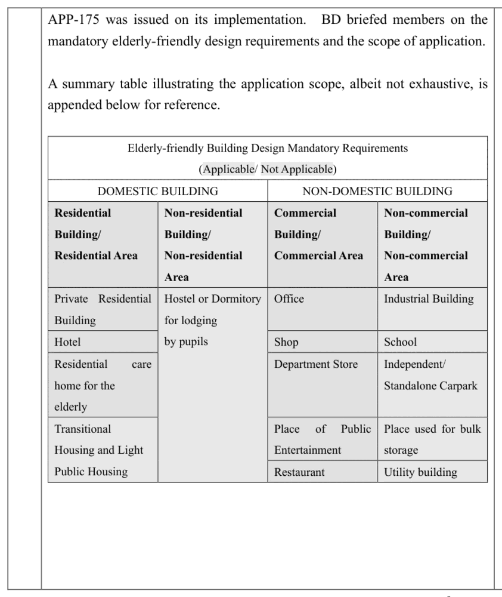{ width="571" loading=lazy }
  <figcaption>Diagram 1 from the original summary (ADF 3/2026, item 14). 原文附圖。</figcaption>
</figure>

**BD's response 屋宇署回覆:** 8 BD briefed members on the (Applicable/ Not Applicable) NON-DOMESTIC BUILDING Commercial Non-commercial Building/ Building/ Commercial Area Non-commercial Area Office Industrial Building Shop School Department Store Independent/ Standalone Carpark Place of Public Place used for bulk Entertainment storage Restaurant Utility building 9

### 15. Vote of Thanks {#i2026081415}

Raised by **AREC**

**Question 問題:** (Item raised by BD) AD/NB1 proposed a vote of thanks to Mr KO Kiu-kin, Chief Building Surveyor/Kowloon, who attended this meeting for the last time prior transfer to a new post.

**BD's response 屋宇署回覆:** Members supported the vote of thanks to Mr KO. to his 10

## ADF 2/2026 · 8 May 2026 {#adf-22026-8-may-2026}

[Original summary (PDF) 原文](https://www.hkie-st.org/wp-content/uploads/2026/11/Summary-of-items-discussed-in-2_2026-ADF-on-8.5.2026.pdf) · 19 items

### 1. PNAP APP-93 {#i202605081}

Raised by **HKIA** · Related 相關: [APP-93](../pnap/app-93.md)

<small>Related discussions 相關討論: [14 Aug 2026 item 8](2026.md#i202608148)</small>

**Question 問題:** Referring to PNAP APP-93, it stipulates that for domestic buildings intended for single occupancy, internal common soil and waste stacks be accessible from the common parts of the building, and no pipeworks unit should protrude into the unit under separate occupancy on the floor It is our understanding that this requirement, which aims to obviate difficulties and facilitate future maintenance of common drains, does not to hotel rooms or hostel rooms under the Hostels in the City Scheme, the premises are under central management and, under the policy, cannot sold separately. Please advise if our understanding is correct.

**BD's response 屋宇署回覆:** not BD advised that under PNAP APP-93, no pipeworks for a premises should should protrude into other premises under separate occupancy. However, for a pipeworks for a premises protruding into other premises under separate below. occupancy might be acceptable when both premises in concern are managed and controlled by the same party, such as guest rooms in a hotel access or hostel, with right of access available whenever needed. apply where be

### 2. Full Height Fire Rated Wall of Open Kitchen Clause C13.4(d) of the Code of Practice for Fire Safety in Buildings {#i202605082}

Raised by **HKIA** · Related 相關: [FS Code 2011 Part C: Fire Resisting Cons](../codes/fsc-part-c-fire-resisting-construction.md)

<small>Related discussions 相關討論: [5 May 2023 item 2](2023.md#i202305052)</small>

**Question 問題:** (2024 Edition) (FS Code) requires a full height wall having a fire resistance rating (FRR) of not less than -/30/30 should be provided adjacent to exit door (Wall “A” in diagram below). Would BD clarify if the FRR wall adjacent to the bedroom (Wall “B” diagram below) is required under Clause C13.4(d).

<figure markdown>
  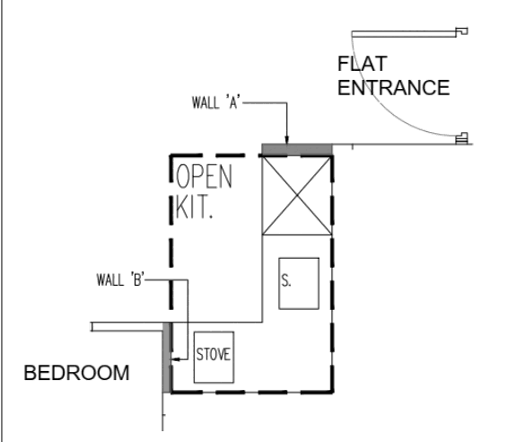{ width="365" loading=lazy }
  <figcaption>Diagram 1 from the original summary (ADF 2/2026, item 2). 原文附圖。</figcaption>
</figure>

**BD's response 屋宇署回覆:** February 2024 and advised that the purpose of the full height fire rated the flat wall required for open kitchen under Clause C13.4(d) of the FS Code was to shield the occupants from radiant heat of stove fires and allow the necessary pause of occupants to open the exit door (and gate, if any). in the 1 As Wall “B” in the diagram was not situated adjacent to the exit door of the flat, it was not subject to requirements of Clause C13.4(d) of the FS Code.

### 3. Projection of Handrail at Corner {#i202605083}

Raised by **HKIA** · Related 相關: [FS Code 2011 Part B: Means of Escape](../codes/fsc-part-b-means-of-escape.md)

**Question 問題:** Clause B14.6(b) of the FS Code requires that a handrail within the required staircase should not project so as to reduce the clear width of the required staircase by more than 90mm, for each handrail. However, due to the geometry at the corner, the projection would likely exceed 90mm. As illustrated in the diagram below of a staircase with an outer corner splayed, proposed layout as illustrated in the diagram was considered not taking into account the clear width between the handrails at the straight flight acceptable. (“A”) and at the landing (“B”), would BD consider accepting the handrail projection at the corner (“C”), which exceeds 90mm?

<figure markdown>
  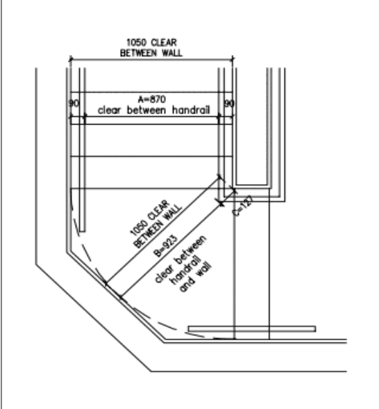{ width="353" loading=lazy }
  <figcaption>Diagram 1 from the original summary (ADF 2/2026, item 3). 原文附圖。</figcaption>
</figure>

**BD's response 屋宇署回覆:** BD advised that according to Note 3 of Table B2 of the FS Code, the width of a required staircase and staircase landing should be measured between the finished surfaces of walls or of the inner sides of any balustrade and should not be decreased by the introduction of any projections other than handrails the projection of which should not exceed 90mm. Hence, the

### 4. Braille and Tactile Floor Plan Paragraph 69(2) of the Design Manual: Barrier Free Access 2008 {#i202605084}

Raised by **HKIA** · Related 相關: [Design Manual: Barrier Free Access 2008 ](../codes/bfa-2008.md)

<small>Related discussions 相關討論: [17 Aug 2018 item 1](2018.md#i201808171), [21 May 2021 item 2](2021.md#i202105212), [13 May 2022 item 13](2022.md#i2022051313), [5 May 2023 item 3](2023.md#i202305053), [17 Nov 2023 item 11](2023.md#i2023111711)</small>

**Question 問題:** Edition) (DMBFA) states “if a floor plan for the use of the public is provided, Braille and tactile floor plan showing the main entrance, public toilet major common facilities shall be provided in a place in that building conspicuous to persons with visual impairment”. For a shopping complex which no visual floor plan is to be provided, would BD clarify if a and tactile floor plan is required to be provided.

**BD's response 屋宇署回覆:** tactile floor plan was not required if a floor plan for the use of the public and was not provided. which is Braille 3

### 5. Registration of Letters of Undertaking in the Land Registry {#i202605085}

Raised by **HKIA** · Related 相關: [APP-104](../pnap/app-104.md), [APP-152](../pnap/app-152.md), [APP-93](../pnap/app-93.md), [APP-151](../pnap/app-151.md), [APP-19](../pnap/app-19.md)

**Question 問題:** Paragraph 20 of JPN No. 1, Paragraph 16 of JPN No. 2, Paragraph 11 of PNAP APP-104 and Paragraph 10(c) of Appendix D to PNAP APP-152 require registration of relevant letters of undertaking, with the specified contents, the Land Registry before applying for an occupation permit (OP). To our understanding, registration is not necessary unless it is explicitly specified in the corresponding PNAP/JPN, or as a condition of modification where applicable. …

**BD's response 屋宇署回覆:** BD advised that the understanding of the HKIA was correct. the Registration in the Land Registry for the following undertaking letters in was required before OP application and might be imposed in the condition of the modification/exemption granted, if applicable: (a) For surrender/dedication of land to permit the site coverage and plot the ratio to be exceeded in accordance with regulation 22 of the Building is (Planning) Regulations (B(P)R); (b) For greenery areas and specific greening features for gross floor area (GFA) concessions under Appendix D to PNAP APP-152; by (c) For projecting planters and maintenance walkways to be excluded from GFA and site coverage calculations under PNAP APP-19; (d) For residential recreational facilities to be excluded from GFA of calculation under PNAP APP-104; of (e) For the provisions of specific standards under Appendix C to PNAP APP-151, including enhanced greenery provision, relevant features for health and well-being, as well as the light well and the required open area of the floor below for enhanced natural ventilation; and (f) For the relevant green and innovative features to be excluded from GFA and SC calculations under JPNs. 1 and 2.

### 6. Firefighting and Rescue Stairway (FRS) {#i202605086}

Raised by **HKIA** · Related 相關: [Code of Practice for Fire Safety in Buil](../codes/fire-safety-code-2011.md)

**Question 問題:** Pursuant to FSD Circular Letter No. 2/2025, data centres are now classified by the FSD as a distinct type of premises with revised fire safety requirements. Unlike the previous industrial classification, the revised Code of Practice Minimum Fire Service Installations and Equipment no longer requires provision of an FRS for data centres. Pending the formal updating of the FS Code to reflect this change, would please confirm that an FRS is not required for a building used as a data but currently classified as an industrial building under the prevailing code.

**BD's response 屋宇署回覆:** BD advised that the issue was being reviewed and the relevant proposal would be submitted to BSC & APSEC for comments shortly. In the for meantime, proposal involving non-provision of FRS in data centres would the be considered on a case by case basis. BD centre

### 7. Qualified Supervision and Quality Audit for Heat Soak Test {#i202605087}

Raised by **HKIA** · Related 相關: [APP-37](../pnap/app-37.md)

**Question 問題:** BD circular letter (BD reference no: BD GR/1-125/54) dated 22 April sets out the qualified supervision and quality audit requirements for concrete construction, modular integrated construction, and the heat process for tempered glass. The use of videotelephony as an enhanced alternative arrangement is to the requirements set out in paragraph 6 of the letter. In particular, AP, and AS are required to submit the quality audit reports together with rewritable DVD-ROM discs containing the video to BD within 14 days completion of the supervision/audit checks. …

**BD's response 屋宇署回覆:** BD advised that the understanding of HKIA was correct. Paragraph 14(e)(iii) of PNAP APP-37 set out that if the alternative arrangement of employing videotelephony for the tempered glass panes undergoing the heat soak process was adopted, all supervision items covered in the videos taken should be recorded contemporaneously in quality control supervisor (QCS) inspection log book and should be submitted together with the DVD-ROM discs of the videos taken to BD within 14 days after completion of the heat soak process for each batch of tempered glass panes. Only the RSE should certify on each disc with a permanent marker signifying that his/her QCS personally use videotelephony for compliance with the approval conditions.

### 8. Definition of Span in Clause 9.4.1 of Code of Practice for Structural {#i202605088}

Raised by **HKIE** · Related 相關: [APP-68](../pnap/app-68.md), [APP-142](../pnap/app-142.md)

<small>Follows earlier discussion: [10 Feb 2023](2023.md#i2023021020)</small>

**Question 問題:** of Concrete 2013 (2020 Edition) (Concrete Code) Clause 9.4.1 of the Concrete Code specifies minimum depth of beam thicknesses for different spans of cantilevered projecting structures. however no clear definition of the meaning of ‘span’ in the code. clear span or design span? Paragraph 1(a) of Appendix A to PNAP states that for cantilever of clear span more than 1000 mm, a beam-and-slab type of arrangement should be used instead of pure slab cantilever practicable. ‘Clear span’ is also indicated in the series of diagrams Appendix B of the above PNAP. …

**BD's response 屋宇署回覆:** BD confirmed that the span specified in Clause 9.4.1 of the Concrete Code should refer to the clear span of cantilevered structure. BD advised that an amendment to the Concrete Code was being prepared to incorporate the updated design and construction requirements for cantilevered reinforced concrete structures. Upon promulgation of the amendment to the Concrete Code, PNAP APP-68 would be updated in due course.

### 9. Wind Load for the Design of Free-standing Glass Balustrade Laminated Tempered Glass Without Top Handrail {#i202605089}

Raised by **HKIE** · Related 相關: [APP-139](../pnap/app-139.md), [APP-171](../pnap/app-171.md)

**Question 問題:** For free-standing glass balustrade without top handrail, it is categorically specified in the 4 th paragraph of Clause 6.4.1 of the Code of Practice Structural Use of Glass 2018 (Glass Code) that the handrail may be omitted the remaining intact glass pane of laminated glass used in the balustrade capable of resisting the working wind load or horizontal imposed load one layer in laminated glass is broken. It is not mentioned in the Glass what magnitude of wind load has to be adopted for this extreme condition. …

**BD's response 屋宇署回覆:** with BD advised that in accordance with Clause 2.5 of the Wind Code, the for requirement to adopt a minimum of 70% of the design wind loads was if applicable to the temporary buildings and associated constructions that is were not used for residency only, and was not applicable to the design of when free-standing glass balustrade for permanent use. Code Paragraph 4 of Clause 6.4.1 of the Glass Code set out that the top rail critical might be omitted if the remaining intact glass pane of laminated glass used limit in the balustrade was capable of resisting the working load when one layer load in a laminated glass pane was broken, where the working load was of considered as unfactored horizontal imposed load or unfactored wind is pressure, whichever produces the greater adverse effect. it is taken as (the panes confirm

### 10. PNAP ADM-19 – Building Approval Process According to PNAP ADM-19 – Building Approval Process, under the {#i2026050810}

Raised by **HKIE** · Related 相關: [ADM-19](../pnap/adm-19.md), [ADV-33](../pnap/adv-33.md)

**Question 問題:** section “Erection of Fire Damper in Ventilation System, Supporting Frame Suspending Air-conditioning Plant or Mechanical Ventilation Plant, and Metal Ventilation Duct or Associated Supporting Frame inside Building”, paragraph 41 states “For development projects or A&A proposals, proposed minor building works described in paragraph 40 above should included in the plans for approval before submitting application for OP/TOP or certificate of completion of building works respectively ...”, while paragraph 43 states “As an alternative for development projects and A&A proposals pending first plan approval, the AP/RSE may consider incorporating information in paragraph 42(a) above and sample …

**BD's response 屋宇署回覆:** 7 for Appendix B11 to PNAP ADV-33 in the structural plan submission of Large supporting frames for building services, the RSE would not be requested to submit the structural calculations of supporting frames to BD for the consideration of plan approval. Nonetheless, the RSE was responsible be for ensuring that the sample drawings including essential information (i.e. design loads, standards, material specifications, etc) being adopted were applicable to his proposed works and structural plan submission. Moreover, he/she was also required to demonstrate with structural the calculations that the installation of the proposed works was compatible with the parent building (i.e. structural adequacy of embeds and of GBP supporting structural elements, etc). under are

### 11. Height of Atrium According to Clause C10.3(c) of the FS Code, “the maximum height {#i2026050811}

Raised by **AAP** · Related 相關: [FS Code 2011 Part C: Fire Resisting Cons](../codes/fsc-part-c-fire-resisting-construction.md)

**Question 問題:** lowest connected floor to the underside of the lowest structural member ceiling of the upper-most connected floor should not exceed 15m”. Referring to the diagram below, the dimension “X” shall not exceed When “X” is 15m, the dimension “a” could be more than 15m. Would please confirm if our understanding is correct.

<figure markdown>
  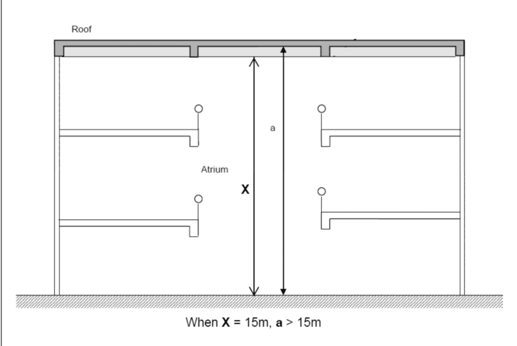{ width="488" loading=lazy }
  <figcaption>Diagram 1 from the original summary (ADF 2/2026, item 11). 原文附圖。</figcaption>
</figure>

**BD's response 屋宇署回覆:** of the 8 15m. BD

### 12. Underground Car Parks {#i2026050812}

Raised by **AAP** · Related 相關: [APP-2](../pnap/app-2.md)

<small>Related discussions 相關討論: [17 Nov 2017 item 10](2017.md#i2017111710), [12 Aug 2022 item 8](2022.md#i202208128), [6 Feb 2026 item 7](2026.md#i202602067)</small>

**Question 問題:** In accordance with paragraph 3 of Appendix C to PNAP APP-2, circumstances that may be favourably considered in accepting a car park as an underground car park: (a) If the site abuts on only one street, the structural ceiling soffit of park is at or below the mean level of that portion of the street on which abuts (referred to as “mean street level” hereinafter), provided that such level is not more than 5m above the lowest level of such portion of the For a car park with structural ceiling soffit at 4.95m above the lowest the street, we have the opinions that all the following cases can be accepted underground car parks:

<figure markdown>
  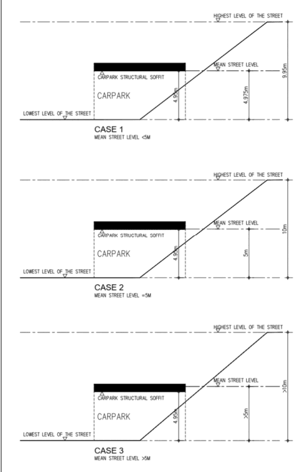{ width="327" loading=lazy }
  <figcaption>Diagram 1 from the original summary (ADF 2/2026, item 12). 原文附圖。</figcaption>
</figure>

**BD's response 屋宇署回覆:** BD advised that under paragraph 3(a) of Appendix C to PNAP APP-2, Case 3 could not be accepted as underground car park for the purpose of GFA concession as its mean street level was more than 5m above the lowest level of the street. the car the site Nevertheless, favourable consideration might be given if there were site mean constraints that affect the design and location of the car parking floors, 9 street; provided that the topmost car park floor is semi-sunken and follows the slope profile of the site and adjoining land, etc, according to paragraph level of 3(d) of Appendix C to PNAP APP-2. as In passing, BD reminded that excessive headroom of car parks should be justified for Building Authority (BA)’s consideration upon general building plan (GBP) submission. 10

### 13. Hostels in the City Scheme – Provision of Access Facilities Telecommunications and Broadcasting Services {#i2026050813}

Raised by **AAP** · Related 相關: [APP-84](../pnap/app-84.md), [B(P)R 24–37 Storey heights, open space, ](../regulations/bpr-24-37.md)

<small>Related discussions 相關討論: [6 Feb 2026 item 6](2026.md#i202602066)</small>

**Question 問題:** According to B(P)R 28A and PNAP APP-84, every commercial building, industrial building, residential building (other than a building for the residence of a single family) and hotel building shall be provided with access facilities for telecommunications and broadcasting services in accordance with design requirements as may be specified by BA from time to time. Our understanding is that hotel building in the above shall cover student hostel for the provision and requirements of Access Facilities Telecommunications and Broadcasting Services, as both building uses shall similar nature in terms of operation. Would BD please clarify if the above understanding is correct?

**BD's response 屋宇署回覆:** for BD advised that student hostel was a specified building where access facilities for telecommunications and broadcasting services should be provided under regulation 28A of the B(P)R. It had been recently the reviewed with Office of the Communications Authority and agreed that when considering the provision of such facilities in proposed student hostels, “no. of rooms” was similar in nature as “no. of flats” in residential buildings. for Therefore, when a GBP submission under the Hostels in the City Scheme involving newly built student hostel or such conversion of existing commercial building or hotel into student hostel which would result in a new building was received, provision of such access facilities would be assessed in accordance with the requirements under “Residential Building” in PNAP APP-84. The said clarification will be updated in PNAP APP-84 accordingly.

### 14. Demolition of Retaining Walls {#i2026050814}

Raised by **AREC** · Related 相關: [APP-54](../pnap/app-54.md), [B(A)R Building (Administration) Regulati](../regulations/bar-123a.md)

**Question 問題:** Paragraph 10 of PNAP APP-54 provides that “where it is intended to an existing retaining wall, demolition plans and supporting documents as demolished and was to be removed as part of site formation works or ELS prescribed in regulation 8(3) and (4) of the Building (Administration) works, the demolition of the retaining wall might be incorporated into the Regulations should be submitted for approval”. Please clarify whether the demolition of retaining walls can be incorporated in a site formation plan or an excavation and lateral support (ELS) plan such that a separate demolition plan is not required. Also, please clarify whether the demolition of retaining walls can be carried out by a Registered General Building Contractor(RGBC) or a Registered Specialist Contractor(RSC) who is not in the demolition work category.

**BD's response 屋宇署回覆:** demolish BD advised that if a retaining wall did not support a building to be site formation plan or ELS plan for BA’s approval. In such cases, all related documents for the demolition of the retaining wall as prescribed 11 under regulations 8(3) and (4) of the Building (Administration) Regulations (B(A)R) should be included in the submission. On the other hand, if the retaining wall supported a building to be demolished, demolition plans and supporting documents as prescribed in regulation 8(3) and (4) of the B(A)R should be submitted for BA’s approval. The demolition works might be carried out by an RGBC or an RSC subject to the conditions as specified in the Appendix A of PNAP APP- 96.

### 15. Supervision of Curtain Wall {#i2026050815}

Raised by **AREC** · Related 相關: [ADV-36](../pnap/adv-36.md), [APP-157](../pnap/app-157.md)

**Question 問題:** According to the Code of Practice for Site Supervision 2009 (2024 Edition), the Registered Contractor’s stream is required to provide a full-time to inspect and supervise curtain wall works on site. Based understanding, this full-time TCP T1 should be stationed at the factory China when the curtain wall is to be installed onto the MiC modules In such a scenario, would BD accept that the corresponding TCP records kept at the MiC factory instead of at the project site?

**BD's response 屋宇署回覆:** BD advised that according to Appendix B to PNAP ADV-36, TCP T1 of TCP T1 Quality Control Co-ordination Team (QCCT) under Registered on our Contractor’s stream should provide continuous qualified supervision to in the modular unit production works in the prefabrication factory and there. his/her supervision should cover the fabrication, assembly, installation and examination of modular units and pre-installed finishes including be curtain wall works if they were installed in the prefabrication factory. Both Quality Control Supervisory Team (QCST) under AP/RSE’s stream and QCCT should record the details of production, inspection, auditing and testing of modular units in an inspection log book. The log book should be kept in the prefabrication factory and a copy of which should be kept at the building site office and, when required, produced for inspection by BD officers. Paragraphs 4 to 6 of Appendix B to PNAP ADV-36 were relevant. 12

### 16. Clauses B9.1 and D7.3 of the FS Code {#i2026050816}

Raised by **PBSCA** · Related 相關: [FS Code 2011 Part D: Means of Access](../codes/fsc-part-d-means-of-access.md), [FS Code 2011 Part B: Means of Escape](../codes/fsc-part-b-means-of-escape.md), [FS Code 2011 Part C: Fire Resisting Cons](../codes/fsc-part-c-fire-resisting-construction.md)

**Question 問題:** For an entrance of a hotel building at G/F, there is a passage from fire service access point to fireman’s lift. According to Clause D7.3 of the FS Code, passage should be separated from the remainder of the ground storey by walls with adequate FRR and any opening in these walls for communication ground storey should be through a protected lobby complying with Clauses C9.3 and C16.5 of the FS Code. …

<figure markdown>
  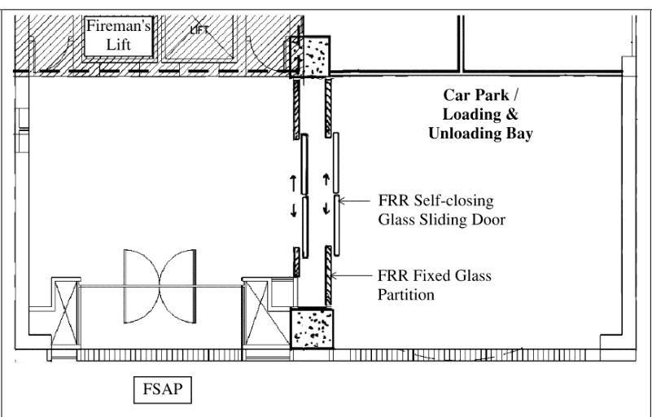{ width="518" loading=lazy }
  <figcaption>Diagram 1 from the original summary (ADF 2/2026, item 16). 原文附圖。</figcaption>
</figure>

**BD's response 屋宇署回覆:** BD advised that under Clause D7.3(b) of the FS Code, the passage from the the fire service access point to the fireman’s lift should be separated from the remainder of the ground storey by walls having the requisite FRR. with Opening in these walls might only be allowed for communication with the ground storey through a protected lobby. a per In addition, under Clause B9.1 of the FS Code, for the passage leading from the required staircase, every opening from the ground storey to such the passage should be separated from it by a protected lobby. Subject the above requirements, AP should demonstrate that the proposed fixed glass partition with self-closing glass sliding doors shown in the of diagram should comply with the provisions under Clause C16.5 of the FS The Code, supported by test reports in accordance with the applicable in standards under Section 4 of Part E of the FS Code. In case the protected lobby to other facilities/areas/passages to which persons with a disability should have or might reasonably be expected to have access, all the relevant requirements under Divisions 9 and 10 of Chapter 4 of DMBFA should be complied with. BD reminded of the duties and responsibilities of registered building professionals and registered contractors under the BO, in particular, to ensure all materials used in building works must be of a nature and quality suitable for their intended use or purpose and adequately tested by recognised tests. to allow

### 17. Lighting and Ventilation of Laundry {#i2026050817}

Raised by **PBSCA**

**Question 問題:** In view of the increasing demand due to government policy on student hostel, and to allow flexibility for conversion. Would BD consider granting a modification of the provisions regarding lighting and ventilation of laundry in hotel building or student hostel under the Hostels in the City Scheme, provided that mechanical ventilation and artificial lighting are installed? AOB Items

**BD's response 屋宇署回覆:** BD advised that for provision of prescribed windows under regulations 29 to 35 of B(P)R, a laundry being part of or used in connexion with any building (including hotel or student hostel) shall be deemed to be used for the purpose of habitation under regulation 35(2) of B(P)R. In view of a laundry would emit heat, odour and moisture from washing / drying machines, the requirements on provision of prescribed window should be maintained as to upheld the health standard of buildings.

### 18. Discharge Value of Scissors Staircase {#i2026050818}

Raised by **PBSCA** · Related 相關: [FS Code 2011 Part B: Means of Escape](../codes/fsc-part-b-means-of-escape.md)

<small>Related discussions 相關討論: [4 Aug 2023 item 7](2023.md#i202308047)</small>

**Question 問題:** (Item raised by AAP) According to Clause B12.7 of the FS Code, “the discharge value of a staircase without any intermediate landing between 2 consecutive should be… multiplied by a reduction factor of 0.7”. Our understanding is that the design of the two different scissors staircases under Case 1 and Case 2 as illustrated in the diagrams below both consist intermediate landing between 2 consecutive floors thus it is not necessary apply the reduction factor in determining the staircase’s discharge value. Would BD please confirm if our understanding is correct. Case 1 Case 2

<figure markdown>
  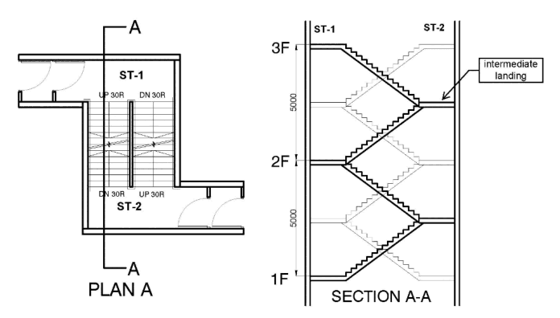{ width="450" loading=lazy }
  <figcaption>Diagram 1 from the original summary (ADF 2/2026, item 18). 原文附圖。</figcaption>
</figure>

<figure markdown>
  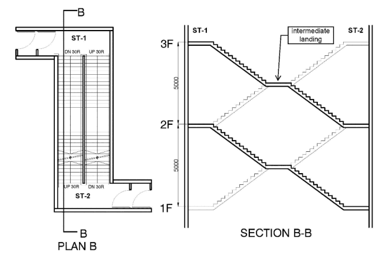{ width="422" loading=lazy }
  <figcaption>Diagram 2 from the original summary (ADF 2/2026, item 18). 原文附圖。</figcaption>
</figure>

**BD's response 屋宇署回覆:** scissors BD advised that AAP’s understanding was correct. floors of to 15

### 19. Expiry of Modification on 29 June 2026 Granted for GFA Concession {#i2026050819}

Raised by **PBSCA** · Related 相關: [APP-151](../pnap/app-151.md), [BO s.14–21 Approval and consent, grounds](../regulations/bo-part-2-building-works.md)

**Question 問題:** (Item raised by BD) The implementation of the new GFA concession mechanism as stipulated paragraphs 6 to 9 of the PNAP APP-151 are applicable to all new major revision of GBP for development proposals submitted to the approval on or after 30 June 2024, and to GBP which have been previously disapproved and are resubmitted for approval on or after 30 June Paragraph 10 of the said PNAP further stated that subject to section of the Buildings Ordinance (BO), GBP approved prior to the implementation of the new mechanism should make reference to the requirements concessions promulgated in the “August 2022” version (old mechanism) the said PNAP. …

**BD's response 屋宇署回覆:** approved prior to the implementation commencement of works may be 16 effect. GBP without a valid Form BD refused under sections 16(3)(a) and of the Form BD106 is generally not on a case by case basis according to 17

## ADF 1/2026 · 6 Feb 2026 {#adf-12026-6-feb-2026}

[Original summary (PDF) 原文](https://www.hkie-st.org/wp-content/uploads/2026/11/Summary-of-items-discussed-in-1_2026-ADF-on-6.2.2026.pdf) · 15 items

### 1. Requirement of Open Kitchen {#i202602061}

Raised by **HKIA**

<small>Follows earlier discussion: [19 Mar 2021](2021.md#i2021031922)</small>

**Question 問題:** For the natural ventilation requirement of open kitchen, the openable window BD area not less than 1/10 of the kitchen area may be provided by a window at the open kitchen should be located in a position where most of the open living room where the open kitchen is located, in addition to the openable kitchen area could face the concerned prescribed window(s) of the room window requirement for the living room. There is no requirement for the open kitchen area to be within the "direct sight line" to the openable window. For avoidance of doubt, the "direct sight line" requirement is applicable for the provisions of natural lighting only and can be fulfilled by fixed glass portion of a prescribed window. We would like to seek BD’s view on our understanding.

**BD's response 屋宇署回覆:** advised that as per item 22 of ADF 2/2021 held on 19 March 2021, for the required natural lighting and ventilation. When assessing whether the kitchen area faces prescribed window of concern, the requirements for natural lighting and ventilation should be evaluated in conjunction. Individual cases with design constraints might be considered on case basis.

### 2. Requirement of Open Kitchen {#i202602062}

Raised by **HKIA**

**Question 問題:** To facilitate BD's checking of the general building plan (GBP), the area of open kitchen is shown on the GBP for demonstrating compliance the provisions of natural lighting and ventilation, along with its relation exit route and the room containing soil fitment. There is no requirement the notional area of the open kitchen to be demarcated in actual condition. We would like to seek BD’s view on our understanding.

**BD's response 屋宇署回覆:** notional BD advised that HKIA’s understanding was correct. with to the for finished 1

### 3. Assessment of Occupant Capacity {#i202602063}

Raised by **HKIA** · Related 相關: [FS Code 2011 Part B: Means of Escape](../codes/fsc-part-b-means-of-escape.md)

**Question 問題:** Note 3 to Table B1 of the Code of Practice for Fire Safety in Buildings (2024 Edition)(FS Code) remarked that "the Building Authority recognises actual counting as a reliable way to establish the occupant capacity building". We would like to seek BD’s clarification to confirm that there has change in the policy regarding the acceptance of actual counting.

**BD's response 屋宇署回覆:** 2011 BD advised that Note 3 to Table B1 of the FS Code remained valid and in effect. The actual counting might be considered with sufficient of a justifications provided by AP. been no

### 4. Temporary Refuge Space (TRS) at Lift lobby {#i202602064}

Raised by **HKIA** · Related 相關: [FS Code 2011 Part B: Means of Escape](../codes/fsc-part-b-means-of-escape.md)

<small>Follows earlier discussion: [8 Aug 2025](2025.md#i2025080822)</small>

<small>Related discussions 相關討論: [18 Jan 2019 item 1](2019.md#i201901181), [29 May 2020 item 14](2020.md#i2020052914), [17 Nov 2023 item 6](2023.md#i202311176), [14 Feb 2025 item 21](2025.md#i2025021421)</small>

**Question 問題:** With reference to item 22 of ADF 3/2025 held on 8 August 2025, it was confirmed that the arrangement of TRS in front of the lifts not designated as fireman’s lifts, which caused obstruction to access to the lift lobby, was not acceptable. If lift home landing operations are provided for the lifts not designated as the lift lobby, was not acceptable. fireman’s lifts, with TRS located in front of the lift doors resulting in the doors of such lifts not opening during a fire alarm, would BD consider such an The proposed arrangement of TRS in front of non-fireman’s lifts with “lift arrangement acceptable?

<figure markdown>
  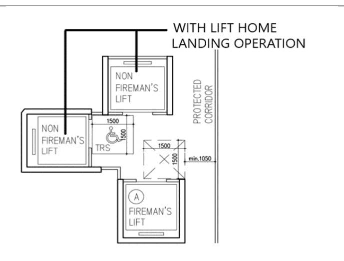{ width="446" loading=lazy }
  <figcaption>Diagram 1 from the original summary (ADF 1/2026, item 4). 原文附圖。</figcaption>
</figure>

**BD's response 屋宇署回覆:** BD advised that according to Clause B16.1 of the FS Code, every lift lobby should have access, without any obstruction and lockable door, to an exit route. Such access should be available at all times to any person who may come out from a lift car to the lift lobby. Therefore, the TRS positioned in front of the lift doors causing an obstruction to the access of home landing operation” would only be subject to the provision of sufficient justifications by AP and comments from FSD on case basis. The responsible party to ensure the reliability of such system should be clearly identified.

### 5. PNAP APP-23 - Hoardings, Covered Walkways and Gantries {#i202602065}

Raised by **HKIA** · Related 相關: [APP-23](../pnap/app-23.md), [B(P)R 50–70 Temporary buildings, hoardin](../regulations/bpr-50-70.md)

<small>Follows earlier discussion: [5 May 2023](2023.md#i2023050515)</small>

<small>Related discussions 相關討論: [17 Nov 2017 item 4](2017.md#i201711174), [10 Jan 2020 item 14](2020.md#i2020011014), [14 Jan 2022 item 7](2022.md#i202201147)</small>

**Question 問題:** Paragraph 7 of PNAP APP-23 stipulates that for building works other demolition works, precautionary measures should be provided in accordance with Appendix D and should meet the design requirements specified Appendix C. Paragraph 4 of Appendix D lists out the circumstances which single board hoardings without a covered walkway may be accepted. From the narratives in this latest version of the PNAP, it appears that board hoarding is the minimum requirement for the provision precautionary measures. However, situations often arise with various site constraints that hardship in providing single board hoardings. (e.g. …

**BD's response 屋宇署回覆:** BD advised that according to regulation 66(2) of the Building (Planning) Regulations (B(P)R), except on isolated sites, all hoardings, unless exempted by the BA, shall be close boarded. The requirements under paragraph 4 of Appendix D to PNAP APP-23 were mainly to specify the circumstances that provision of single board hoardings without covered walkway might be accepted. In view of different site situations which warrant different safety precautionary measures, proposal of non-provision of close boarded hoarding should be considered on case basis provided that the safety of the public would not be jeopardised. 2/2024 held on 5 May 2023 and 3 May 2024 respectively were still valid.

### 6. PNAP APP-84 - Access Facilities for Telecommunications and Broadcasting Services {#i202602066}

Raised by **HKIA** · Related 相關: [APP-84](../pnap/app-84.md)

<small>Related discussions 相關討論: [8 May 2026 item 13](2026.md#i2026050813)</small>

**Question 問題:** PNAP APP-84 sets out the detailed spatial requirements on the provisions various telecommunications and broadcasting facilities. Demonstration compliance shall be incorporated into the GBP submissions for BD OFCA’s review. However, there are recent cases that the OFCA case officer has further required the applicant to seek no adverse comments from all listed mobile operators (MNOs) before OFCA would provide their favourable reply submitted GBP, even though such a requirement is not stipulated in the Similar to the liaison with other utility companies, we understand that liaison with MNOs would not be a pre-requisite prejudicing the approval the GBP. …

**BD's response 屋宇署回覆:** BD advised that according to regulation 28A of B(P)R, every specified building shall be provided with access facilities for telecommunications and broadcasting services in accordance with PNAP APP-84 for the approval of GBP. Support from OFCA would be required for two scenarios only : (i) for a specified building which was not required to provide access facilities for mobile services (MAF), rooftop telecommunications equipment room or intermediate telecommunications equipment room might be provided in special circumstances and (ii) an alternative building, other than the tallest building within a development comprising multiple specified buildings is selected for the provision of Notwithstanding the above, AP were strongly advised to keep close working relationship with mobile network operators (MNOs) and consolidate the requirements of MAF at earliest stage for effective operation of MAF.

### 7. Aboveground Carpark {#i202602067}

Raised by **HKIA** · Related 相關: [APP-2](../pnap/app-2.md)

<small>Related discussions 相關討論: [17 Nov 2017 item 10](2017.md#i2017111710), [8 May 2026 item 12](2026.md#i2026050812), [14 Aug 2026 item 7](2026.md#i202608147)</small>

**Question 問題:** According to paragraph 18(b) of the latest PNAP APP-2, it is noted the aboveground car park with no more than two floors, 100% of the floor area (GFA) of private car parks, public car parks and loading unloading areas at ground level can be disregarded. Would BD please advise if the following interpretations are correct:- 1. Aboveground carparking floors with 100% GFA concession located on any floors, and are not required to be consecutive. The car solely serving such carparking floors is also 100% disregarded from calculations. 2. …

**BD's response 屋宇署回覆:** (b) For item 2, according to paragraph 12 of Appendix C to PNAP APP-2, in the case of the car ramp and run-in/out serving both car parking spaces at such floors entitling 100% GFA concessions and car parking spaces at other aboveground floors entitling only 50% GFA concessions, the percentage of GFA concessions of such run-in/out or driveway areas would be calculated on a pro-rata apportionment basis judging on the merits of each individual cases. Practitioners were encouraged to make use the automated checking tools

### 8. Works required under lease conditions {#i202602068}

Raised by **HKIA**

**Question 問題:** For a development, building works required under lease conditions are located in coloured areas (e.g., Pink Areas or Green Areas). We would to seek clarification from BD on whether the approval and consent from are required for the building works or site formation works within the coloured areas. On the other hand, works carried out within coloured areas are usually building works for government departments (such as TD, HyD, DSD, etc.) completion, these works will be handed back to the relevant departments. Because of this, these works are usually required to strictly follow the standard drawings and design standards set by those departments. …

**BD's response 屋宇署回覆:** usually BD advised that pursuant to section 41(1)(ba) of BO, unleased land in like respect of which a person was, under the terms of a Government lease, BA under an obligation to maintain, was not exempted from the provisions of BO. Submission of building works to the BA for approval should comply with the provisions of BO including those required under lease conditions outside private lot boundary to be handed over to the Government upon completion of works. Nevertheless, the application Upon for modification would be considered for special circumstances. some of BO. designs

### 9. Wind Pressure Criterion for Structural Submission of Window Window Wall Plans in PNAP APP-37 {#i202602069}

Raised by **HKIE** · Related 相關: [APP-37](../pnap/app-37.md), [APP-139](../pnap/app-139.md)

**Question 問題:** In paragraph 5 of PNAP APP-37, the wind pressure criterion under the of Practice on Wind Effects in Hong Kong (the Wind Code) 2019 has as the wind reference pressure, Q , being 2.86 kPa or more. However, o,z design wind pressure on the window or window wall concerned should multiplied by the related wind directionality factor, with the application topographic factor, size factor, and pressure coefficients, etc. The resultant design wind pressure, Q x S , will match the design wind pressure under o,z θ Wind Code 2004. Would BD please confirm if the above interpretation correct.

**BD's response 屋宇署回覆:** or Code BD advised that according to paragraph 5 of PNAP APP-37, structural been set submission of window or window wall plans were required when the the window or window wall was at 100m or more above adjoining ground be level, or where the wind reference pressure Q (or design wind pressure o,z of the q in preceding Wind Code 2004) is 2.86 kPa or more. This wind z 6 reference pressure Q was an unfactored value determined from Table 3- o,z the 1 of the Wind Code 2019 at the effective height, Z , for open exposure in e is flat terrain. Figure 2.2 of the Wind Code 2019 is relevant. The design wind pressure on the window or window wall shall then be obtained by multiplying the wind reference pressure Q by related wind o,z directionality factor, topography factor, size factor, pressure coefficients, etc. complying with the requirements as set forth in the Wind Code, regardless of whether a structural submission was required or not.

### 10. Streamlining the Application of Modification of Regulation 31(1)(a) Building (Construction) Regulation (B(C)R) {#i2026020610}

Raised by **HKIE** · Related 相關: [APP-37](../pnap/app-37.md), [B(C)R Building (Construction) Regulation](../regulations/bcr-123q.md)

<small>Follows earlier discussion: [14 Feb 2025](2025.md#i2025021416), [9 Aug 2024](2024.md#i2024080915)</small>

**Question 問題:** Regarding item 16 of ADF 1/2025 held on 14 February 2025, it was noted that BD would revise PNAP APP-37 to allow blanket application for modification of/exemption from regulation 31(1)(a) of the Building (Construction) Regulation (B(C)R) with a percentage of drilled-in anchors for fixing curtain wall not exceeding a specified value (25% in general). If the specified percentage was exceeded, an application for modification/exemption would be required. Would BD clearly specify what action the RSE needs to take if the percentage of drilled-in anchor supports exceeds 25%?

**BD's response 屋宇署回覆:** BD advised that if the specified percentage (generally 25%) was exceeded, AP/RSE was required to submit an application (i.e. Form BA16) for modification of/exemption from regulation 31(1)(a) of the B(C)R under Section 42 of the BO to apply for modification/exemption in respect of those remedial drilled-in anchors. The application for modification/exemption would be considered on case basis, and additional conditions (e.g. increasing the sampling rate for the strength test of remedial drilled-in anchors) might be imposed.

### 11. Flat Slab Design Using Finite Element Analysis (FEA) {#i2026020611}

Raised by **HKIE** · Related 相關: [APP-142](../pnap/app-142.md)

<small>Follows earlier discussion: [25 Nov 2022](2022.md#i202211257), [9 May 2025](2025.md#i202505099)</small>

**Question 問題:** Following the discussions in item 7 of ADF 5/2022, item 18 of ADF and item 9 in ADF 2/2025 held on 22 November 2022, 9 August 2024 May 2025 respectively on flat slab design regarding the applicability relevant clauses in the Code of Practice for Structural Use of Concrete (2020 Edition)(Concrete Code) when employing FEA for flat slab analysis, would BD please provide an update on the deliberations/conclusions Technical Committee on the Code of Practice for Structural Use of Concrete (TC).

**BD's response 屋宇署回覆:** 3/2024 BD advised that the issue had been deliberated in the Meeting of the TC. and 9 It was agreed in principle that an increase of design shear stress, as of the stipulated in clause 6.1.5.6(b) and (c) of the Concrete Code, was not 7 2013 required if the FEA results had already accounted for the effects of moment transfer at the column in the analysis. The list of BD’s pre-of the accepted structural programs would specify whether the effects of moment transfer at columns had been validated and address any limitations of the model. BD advised that an amendment to the Concrete Code was being prepared to incorporate this issue.

### 12. PNAP APP-84 Telecommunications and Broadcasting Services According to Appendix A1 of PNAP ADV-33, the telecommunications {#i2026020612}

Raised by **AAP** · Related 相關: [APP-84](../pnap/app-84.md), [ADV-33](../pnap/adv-33.md)

**Question 問題:** broadcasting (TBE) room is one of the basic information to be shown GBP for Stage I approval. Would BD please advise when the design for MAF has generally complied with the requirements specified in Appendix C of PNAP APP-84, necessary to obtain the input from the MNOs on the MAF nor the agreement between the building developer and the MNOs for Stage I GBP approval.

**BD's response 屋宇署回覆:** on the it is not

### 13. Requirement of Checking on Total Settlement of Foundation Design Clause 2.3.2(2) of Code of Practice for Foundation 2017 (2024 {#i2026020613}

Raised by **ACEHK** · Related 相關: [APP-18](../pnap/app-18.md)

**Question 問題:** (Foundation Code) laid down the reference criteria for acceptable foundation settlements. Criterion (a) of maximum total settlement not exceeding could be deemed to satisfied if “the foundation rests directly on categories 1(a), 1(b) and 1(d) and 2 rock or if the foundation elements are driven to ≥ bearing strata with SPT N value 200”. ≥200 If pile foundation driven to stratum with SPT N value as stated clause is acceptable in fulfilling Criterion (a), with the same principle, common types of deep foundations, such as large diameter bored piles, socketed H-piles and rock socketed mini-piles, would deem to meet the criterion which means no need to check the pile shortening against maximum …

<figure markdown>
  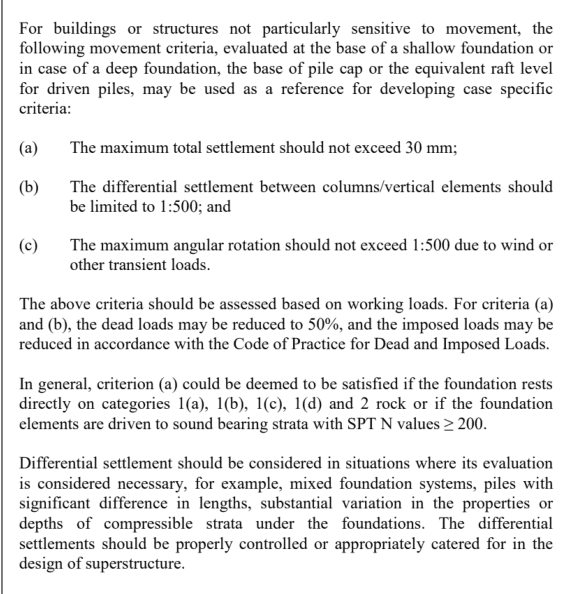{ width="373" loading=lazy }
  <figcaption>Diagram 1 from the original summary (ADF 1/2026, item 13). 原文附圖。</figcaption>
</figure>

**BD's response 屋宇署回覆:** could generally be deemed to be satisfied if the foundation was founded 30mm on or socketed directly into categories 1(a), 1(b), 1(c), 1(d) and 2 rock. 8 Nonetheless, pile shortening and elongation against the maximum angular sound rotation of 1:500 due to wind or other transient loads should always suffice. in the rock above the on 9

### 14. PNRC 85 on the Fire-retardant Performance of Protective Nets, Screens, Tarpaulins and Plastic Sheeting (Protective Materials) Installed {#i2026020614}

Raised by **ACEHK**

**Question 問題:** Scaffolding of External Walls (Item raised by BD) BD introduced the sampling and testing requirements for protective materials to be installed on the scaffolding through promulgation of PNRC 85 19 December 2025. The registered contractors should follow requirements set out in the PNRC 85 to ensure that the protective materials used on sites comply with the recognised standards of fire retardant performance. Prescribed building professionals should diligently exercise their supervisory role under the BO to ensure that appropriate precautionary measures were taken in carrying building works and the materials used were adequately tested by recognised standards.

**BD's response 屋宇署回覆:** BD briefed members on the new sampling and testing requirements as on well as BD’s site audit arrangement set out under PNRC 85. Members the noted.

### 15. Vote of Thanks {#i2026020615}

Raised by **ACEHK**

**Question 問題:** (Item raised by BD) AD/NB1 proposed a vote of thanks to Mr LAI Ho-cheong, Alvin, AD/NB2 who co-chaired this Forum for the last time before his retirement.

**BD's response 屋宇署回覆:** Members supported the vote of thanks to Mr LAI and wished him a happy retirement.

---
<small>Source: Summary of Items Discussed in APSEC Discussion Forum, published by the HKIE Structural Division. Condensed for reference; the PDF is the authoritative record.</small>
