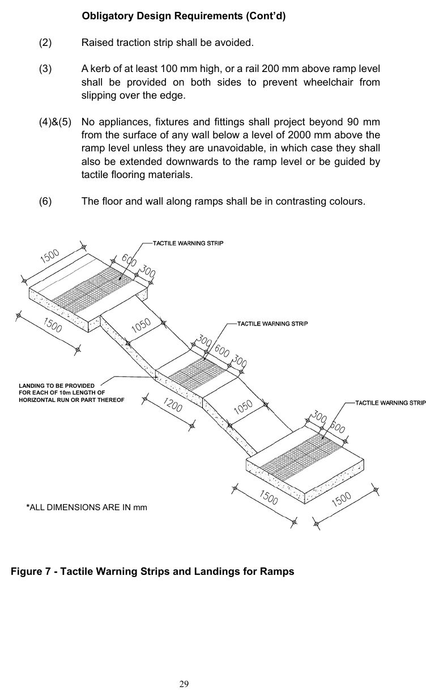
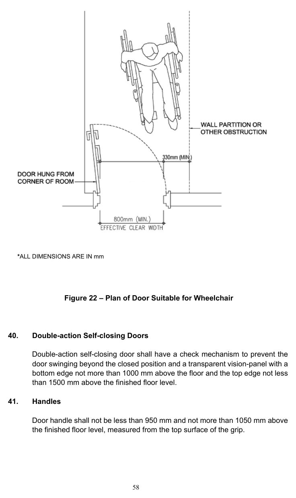
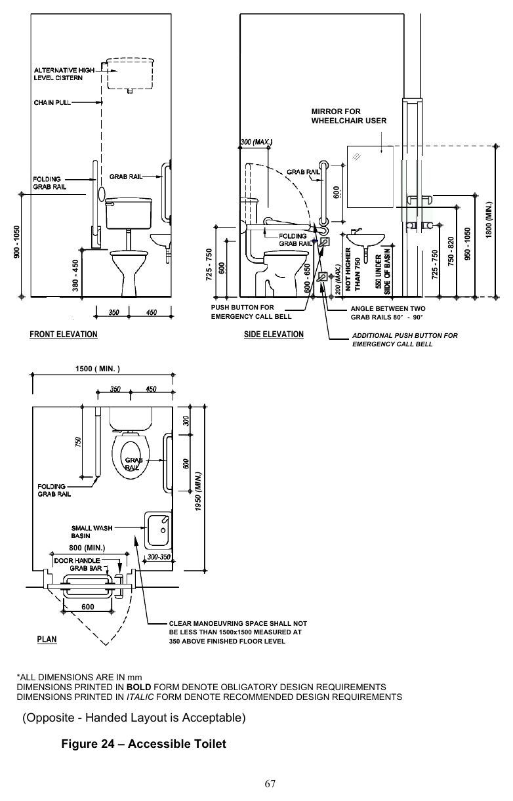
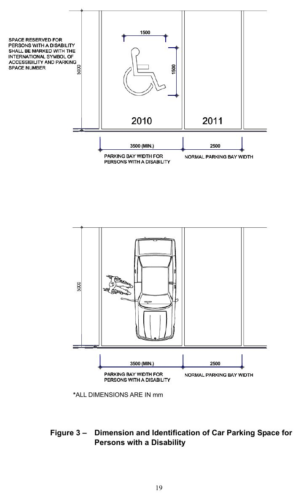
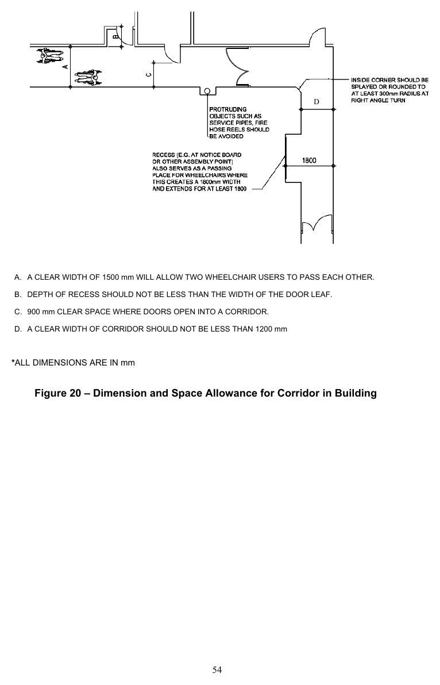
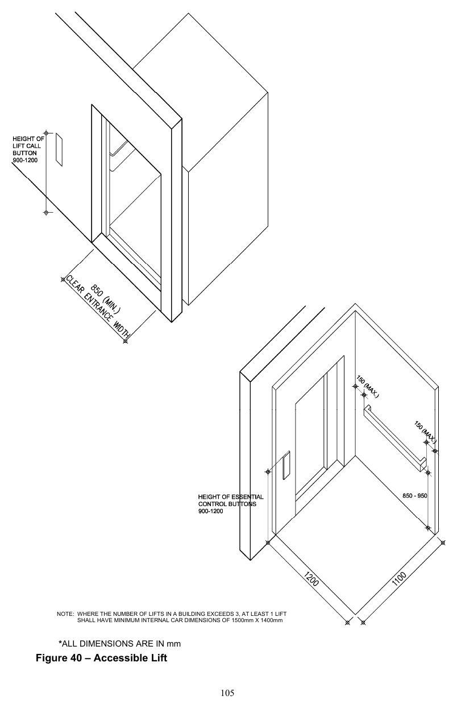

---
tags:
  - Code of Practice
  - Barrier free access 無障礙
  - Ramp 斜道
  - Accessible toilet 暢通易達洗手間
  - Lift 升降機
  - Domestic 住用
  - Elderly-friendly 長者友善
  - Means of escape 逃生途徑
  - Car park 停車場
---

# Design Manual: Barrier Free Access 2008 (BFA Manual) <small>《設計手冊：暢通無阻的通道 2008》</small>

!!! info "Document info 文件資料"
    | | |
    |---|---|
    | **Type 類別** | Design Manual 設計手冊 |
    | **Issued by 發出機構** | Buildings Department 屋宇署 |
    | **First issue 首次發出** | December 2008 |
    | **Version summarised 本摘要版本** | 2025 Edition (revision June 2025) 2025 年版本 |
    | **Official language 官方語言** | English only (Chinese version not available) 只有英文版 |
    | **Source 原文** | [BFA 2008 (PDF)](https://www.bd.gov.hk/doc/en/resources/codes-and-references/code-and-design-manuals/BFA2008_e.pdf) |
    | **Legal basis 法律依據** | B(P)R 72 and Third Schedule 第 72 條及附表 3 |
    | **Last checked 最後核對** | 2026-11-20 against the 2025 Edition |

!!! warning "Superseded by DMUA 2026 已被 DMUA 2026 取代"
    BD issued the **Design Manual on Universal Accessibility 2026** (see [APP-176](../pnap/app-176.md)), which replaces this BFA 2008 Manual. The **obligatory** clauses here still match the statutory **B(P)R Third Schedule**; best-practice items may differ in the DMUA.
    屋宇署已發出《設計手冊：暢道通行2026》（見 APP-176）取代本手冊；本頁的**強制性**條文仍與 B(P)R 附表 3 相同，良好作業部分或有不同。

!!! note "Scope of this entry 本條目範圍"
    This is the **overview** with the most-used obligatory requirements. Full detail by Division: [Div. 1–3](bfa-div-1-3.md) · [Div. 4–9](bfa-div-4-9.md) · [Div. 10–12](bfa-div-10-12.md) · [Div. 13–20](bfa-div-13-20.md) · [Ch. 5–6](bfa-ch-5-6.md).
    本條目為**概覽**；各分部詳情見上列連結。

## At a glance 重點摘要 {#at-a-glance}

=== "English"

    - Sets requirements for access and facilities for **persons with a disability and the elderly**. Chapters 3 and 4 follow the numbering of the **Third Schedule to the B(P)R**.
    - Two kinds of content: the **Mandatory Section** (Performance Objectives + **Obligatory Design Requirements**, which *shall* be complied with) and the **Best Practice Section** (Design Considerations + **Recommended** requirements).
    - **Applies** (Table 1) to: all parts of **non-domestic** buildings; all common areas of **domestic** buildings over **4 storeys**; and the G/F entrance and common areas of domestic buildings of 4 storeys or less.
    - Key numbers: access route / ramp / corridor clear width **≥ 1,050 mm**; ramp **≤ 1:12**; landings **1,500 × 1,500 mm**; door clear width **≥ 800 mm**; accessible lift car **≥ 1,200 × 1,100 mm**, entrance **≥ 850 mm**.
    - Table 2 lists **extra assistive provisions** (tactile guide paths, Braille plans, visual fire alarms, assistive listening) by building use.

=== "中文"

    - 訂明為**殘疾人士及長者**提供通道及設施的規定；第 3 及 4 章的編號與**《建築物（規劃）規例》附表 3** 對應。
    - 內容分兩類：**強制部分**（表現目標及**必須遵守的強制性設計規定**）及**最佳作業部分**（設計考慮及**建議**設計規定）。
    - **適用範圍**（表 1）：**非住用**建築物的所有部分；**超過 4 層**的**住用**建築物所有公用地方；4 層或以下住用建築物的地面入口及公用地方。
    - 主要數字：通道、斜道、走廊淨闊 **≥ 1,050 毫米**；斜道坡度 **≤ 1:12**；平台 **1,500 × 1,500 毫米**；門淨闊 **≥ 800 毫米**；暢通易達升降機機廂 **≥ 1,200 × 1,100 毫米**，入口 **≥ 850 毫米**。
    - 表 2 按建築物用途列出**額外輔助設施**（觸覺引路帶、點字平面圖、視像火警警報、輔助聆聽系統）。

## Diagram 圖解 {#diagram}

<figure markdown>
  { width="760" loading=lazy }
  <figcaption>From the BFA Design Manual 2008 to the Universal Accessibility manual 2026. 由暢通無阻設計手冊到暢道通行設計手冊。 Diagram prepared for this site; check the source text for exact wording.</figcaption>
</figure>

## Key table: obligatory dimensions 主要強制性尺寸 {#key-table-obligatory-dimensions}

| Element 元素 | Requirement 規定 | Para. 段 |
|---|---|---|
| Access route 通道 | Clear width **≥ 1,050 mm**; firm surface; no steps, kerbs (other than dropped kerbs) or steep ramps 淨闊 ≥ 1,050 毫米；表面堅實；不得有梯級、路緣（斜路緣除外）或陡斜道 | 12 |
| Ramp width 斜道闊度 | **≥ 1,050 mm** | 15 |
| Ramp landing 斜道平台 | **1,500 × 1,500 mm** clear at head and foot; no door swing onto it 頂部及底部淨空 1,500 × 1,500 毫米，門不得擺入 | 16 |
| Ramp gradient 斜道坡度 | **≤ 1:12**. Minor rise only: 1:10 for ≤ 1,500 mm long / ≤ 150 mm rise; 1:8 for ≤ 600 mm long / ≤ 75 mm rise 輕微升幅例外 | 17 |
| Ramps 1:20 or steeper 1:20 或更陡的斜道 | Landing **≥ 1,200 mm** long per **10 m** horizontal run; handrails **both sides**; tactile warning strips 每 10 米水平長度設 ≥ 1,200 毫米平台；兩邊扶手；觸覺警示帶 | 18 |
| Ramp edge 斜道邊 | Kerb **≥ 100 mm** high or rail **200 mm** above ramp level, both sides 兩邊設 ≥ 100 毫米路緣或離斜道 200 毫米的欄杆 | 19(3) |
| Corridor / lobby / path 走廊、大堂、通道 | Clear width **≥ 1,050 mm**; **1,500 × 1,500 mm** turning space within **3,500 mm** of every dead end; lobby length **≥ 1,200 mm** excl. door swings 淨闊 ≥ 1,050 毫米；盡頭 3,500 毫米內設迴轉空間 | 31 |
| Building entrance 建築物入口 | Level area **≥ 1,200 mm** beyond door swings and **≥ 1,500 mm** wide, both sides 門擺動範圍外 ≥ 1,200 毫米、闊 ≥ 1,500 毫米的平地 | 31(d) |
| Gratings / channel covers 格柵／坑渠蓋 | Grating slots **≤ 13 mm**, not parallel to travel; holes in covers **≤ 20 mm** 格柵縫 ≤ 13 毫米 | 32, 33 |
| Protrusions 突出物 | **≤ 90 mm** from wall below **2,000 mm** 2,000 毫米以下突出牆身不得多於 90 毫米 | 34 |
| Door clear width 門淨闊 | **≥ 800 mm** (incl. one leaf of a double door) | 38 |
| Door handle side space 門把旁空間 | **≥ 330 mm** on the leading face 門把一側 ≥ 330 毫米 | 39 |
| Door handle height 門把高度 | **950–1,050 mm** above floor | 41 |
| Accessible W.C. cubicle 暢通易達廁格 | **1** per floor if ≤ 20 cubicles; **2** if > 20 (not domestic) 每層 ≤ 20 個廁格設 1 個，> 20 個設 2 個 | 46 |
| Accessible unisex toilet 男女共用暢通易達洗手間 | **At least one** where toilets are provided on a floor 設有洗手間的樓層最少一個 | 47 |
| Accessible lift 暢通易達升降機 | Every floor served by one lift: car **≥ 1,200 mm × 1,100 mm** wide, entrance **≥ 850 mm**, handrails at **850–950 mm**. If **> 3 lifts**, at least one car **≥ 1,500 × 1,400 mm** 每層須由一部合規升降機服務；超過 3 部升降機時須有一部 ≥ 1,500 × 1,400 毫米 | 78 |

## Key table: accessible car parking 暢通易達停車位 {#key-table-accessible-car-parking}

| Total parking spaces in lot 地段內停車位總數 | Accessible spaces required 所需暢通易達停車位 |
|---|--:|
| 1 – 50 | 1 |
| 51 – 150 | 2 |
| 151 – 250 | 3 |
| 251 – 350 | 4 |
| 351 – 450 | 5 |
| Above 450 多於 450 | 6 |

## Key table: extent of application (Table 1) 適用範圍（表 1） {#key-table-extent-of-application-table-1-1}

| Category 類別 | Extent of application 適用範圍 |
|---|---|
| **Domestic** 住用 | All common areas of buildings of **more than 4 storeys**; main entrance, G/F common area and means of access for buildings **≤ 4 storeys** 超過 4 層：所有公用地方；4 層或以下：主要入口、地面公用地方及通道 |
| **Non-domestic** 非住用 | **All parts** of the building 建築物所有部分 |
| **Composite** 綜合用途 | Non-domestic parts; plus domestic common areas as for domestic buildings above 非住用部分；住用部分按上述住用規定 |

<small>All categories exclude the parts listed in para. 2.2.2 (exemptions). 各類別均不包括第 2.2.2 段所列的豁免部分。</small>

## Figures 圖則 {#figures}

<figure markdown>
  { loading=lazy }
  <figcaption>Figure 7 — Tactile warning strips and landings for ramps 斜道的觸覺警示帶及平台</figcaption>
</figure>

<figure markdown>
  { loading=lazy }
  <figcaption>Figure 22 — Plan of door suitable for wheelchair 適合輪椅使用的門（平面）</figcaption>
</figure>

<figure markdown>
  { loading=lazy }
  <figcaption>Figure 24 — Accessible toilet 暢通易達洗手間</figcaption>
</figure>

??? abstract "More figures: parking, corridor, lift 更多圖則：停車位、走廊、升降機"
    { loading=lazy }
    *Figure 3 — Dimension and identification of car parking space for persons with a disability 殘疾人士停車位的尺寸及標示*

    { loading=lazy }
    *Figure 20 — Dimension and space allowance for corridor in building 走廊的尺寸及空間*

    { loading=lazy }
    *Figure 40 — Accessible lift 暢通易達升降機*

<small>All figures: Design Manual: Barrier Free Access 2008 (2025 Edition), Buildings Department. 資料來源：屋宇署。</small>

## Key clauses 主要條文 {#key-clauses}

!!! quote "Para. 17 — Running slope and length 坡度及長度"
    No ramp shall be steeper than 1 in 12 gradient except in the following situations of minor rise: 1:10 (10%), max. length 1500 mm, max. rise 150 mm; 1:8 (12.5%), max. length 600 mm, max. rise 75 mm.

    **中譯（非官方）：** 除以下輕微升幅情況外，斜道坡度不得陡於 1:12：1:10（10%），最長 1,500 毫米、最大升幅 150 毫米；1:8（12.5%），最長 600 毫米、最大升幅 75 毫米。

!!! quote "Para. 46 — Provision of accessible W.C. cubicle 暢通易達廁格的提供"
    There shall be at least one accessible W.C. cubicle on a floor, or in that part of a floor designed for access by the persons with a disability where the total number of W.C. cubicles provided on that floor or in that part of a floor is 20 or less, or 2 where the total number exceeds 20. This paragraph shall not apply to domestic buildings and the domestic parts of composite buildings or where there is no toilet provided on the particular floor.

    **中譯（非官方）：** 如某樓層（或該樓層供殘疾人士使用的部分）的廁格總數為 20 個或以下，須最少設一個暢通易達廁格；如超過 20 個則須設兩個。本段不適用於住用建築物、綜合用途建築物的住用部分，或沒有設置洗手間的樓層。

!!! quote "Para. 78(1) — Accessible lifts 暢通易達升降機"
    Every floor of a building shall be accessible by at least one passenger lift which shall fully comply with all the obligatory design requirements… A lift shall have minimum internal car dimensions of 1200 mm x 1100 mm wide, with a minimum clear entrance width of 850 mm…

    **中譯（非官方）：** 建築物每層須最少有一部完全符合所有強制性設計規定的載客升降機到達……升降機機廂內部尺寸最少為 1,200 毫米 × 1,100 毫米（闊），入口淨闊最少 850 毫米……

## Explanation 淺白解釋 {#explanation}

=== "English"

    Think of the manual as a **continuous accessible route**. A wheelchair user must be able to get from the **lot boundary**, through an **accessible entrance**, to the **lift**, and then to every accessible facility (toilets, counters, seating) **without meeting a step**.

    - Use **1,050 mm** as the minimum clear width of every route, ramp and corridor, and **1,500 × 1,500 mm** wherever a wheelchair needs to turn.
    - A level change must be handled by a **ramp ≤ 1:12** or an **accessible lift / lifting platform**. Steeper "minor rise" ramps are only for very short lengths and cannot be combined (para. 18).
    - Only the **Obligatory** requirements are mandatory. The **Recommended** ones are good practice, often used for government or elderly-related projects.
    - An alternative design is acceptable if it meets the **Performance Objectives** (para. 2.1.1).

=== "中文"

    可把手冊理解為一條**連續的暢通易達路線**：輪椅使用者必須能由**地段界線**，經**暢通易達入口**到達**升降機**，再到每項暢通易達設施（洗手間、櫃枱、座位），**途中不遇到梯級**。

    - 所有路線、斜道及走廊的最少淨闊為 **1,050 毫米**；需要迴轉輪椅的地方須有 **1,500 × 1,500 毫米**空間。
    - 高低差須以 **≤ 1:12 的斜道**或**暢通易達升降機／升降台**處理。較陡的「輕微升幅」斜道只限極短距離，且不得組合使用（第 18 段）。
    - 只有**強制性**規定必須遵守；**建議**規定屬良好作業，常用於政府或長者相關項目。
    - 替代設計如能達到**表現目標**亦可接受（第 2.1.1 段）。

## Practical notes 實務提示 {#practical-notes}

=== "English"

    !!! example "Worked example: ramp"
        Level difference **450 mm** at an entrance.

        - At 1:12, horizontal run = 450 × 12 = **5,400 mm**.
        - 1:12 is steeper than 1:20, so provide **handrails on both sides**, **tactile warning strips** and landings of **≥ 1,200 mm** for each 10 m of horizontal run or part thereof (para. 18(1), Figure 7).
        - Landings **1,500 × 1,500 mm** at the top and bottom, clear of door swings.
        - The ramp must be **≥ 1,050 mm** wide, with an edge kerb of **≥ 100 mm** or a rail at 200 mm.

    !!! tip "Common pitfalls"
        - **Doors swinging onto ramp landings.** This is not allowed (para. 16).
        - **Two short "minor rise" ramps in series.** Combinations are not permitted (para. 18).
        - Forgetting the **1,500 × 1,500 mm** turning space near **dead ends** of corridors (para. 31(b)).
        - In buildings with **more than 3 lifts**, one lift must be **1,500 × 1,400 mm**.
        - Check **Table 2** for extra provisions (tactile paths, Braille maps, visual fire alarms) by building use.

=== "中文"

    !!! example "計算例子：斜道"
        入口高低差 **450 毫米**。

        - 以 1:12 計，水平長度 = 450 × 12 = **5,400 毫米**。
        - 1:12 比 1:20 陡，須設**兩邊扶手**、**觸覺警示帶**，並按每 10 米水平長度或其部分設 **≥ 1,200 毫米**平台（第 18(1) 段、圖 7）。
        - 頂部及底部設 **1,500 × 1,500 毫米**平台，門不得擺入。
        - 斜道闊度 **≥ 1,050 毫米**，兩邊設 **≥ 100 毫米**路緣或離斜道 200 毫米的欄杆。

    !!! tip "常見錯誤"
        - **門擺入斜道平台**：不准許（第 16 段）。
        - **兩段「輕微升幅」短斜道相連**：不准許組合使用（第 18 段）。
        - 忘記在走廊**盡頭**附近提供 **1,500 × 1,500 毫米**迴轉空間（第 31(b) 段）。
        - 建築物有**超過 3 部升降機**時，須有一部 **1,500 × 1,400 毫米**的升降機。
        - 按建築物用途查閱**表 2** 的額外設施（觸覺引路帶、點字地圖、視像火警警報）。

<!-- APSEC START -->
## APSEC clarifications 認可人士及註冊結構工程師委員會討論 {#apsec-clarifications}

BD's responses at the APSEC Discussion Forum that clarify this document, **newest first**. Where the same question came up more than once, only the **latest position** is listed. See [all APSEC items](../apsec/index.md). 屋宇署在討論會上就本文件作出的澄清，新者在前；同一問題只列最新立場。

- **[Braille and Tactile Floor Plan Paragraph 69(2) of the Design Manual: Barrier Free Access 2008](../apsec/2026.md#i202605084)** <small>ADF 2/2026, 8 May 2026</small> tactile floor plan was not required if a floor plan for the use of the public and was not provided. which is Braille 3
- **[Horizontal/Vertical Extension for Accessible Lifts at Existing Buildings](../apsec/2025.md#i2025112116)** <small>ADF 4/2025, 21 Nov 2025</small> BD advised that the GFA concession was applicable to the horizontal or vertical extension for additional accessible lifts to enhance communal barrier free access to existing buildings, and was not applicable to vertical lifting platforms.
- **[FS Code – Handrail on each side of the required staircase](../apsec/2025.md#i202511215)** <small>ADF 4/2025, 21 Nov 2025</small> BD advised that the understanding of HKIA was correct. Nevertheless, BD reminded that the provision of staircase handrails should comply with all relevant requirements as stipulated in the Design Manual: Barrier Free Access 2008 (2025 Edition).
- **[Requirement on Fire Resistancne Rating (FRR) for Supporting Frame](../apsec/2025.md#i2025050918)** <small>ADF 2/2025, 9 May 2025</small> BD advised that pursuant to “Section 3 – Definitions” in Part A of the FS Code, any raised flooring system at a height of more than 600 mm from the original floor would be considered as an element of construction. …
- **[Landing for Accessible Lift in Alterations and Additions (A&A) Works](../apsec/2025.md#i202505097)** <small>ADF 2/2025, 9 May 2025</small> According to paragraph 7 of PNAP APP-41, where alteration and addition works were proposed to an existing building without initial access for persons with a disability, all practical measures should be taken to provide suitable barrier free access. …
- **[Temporary Refuge Space (TRS) in Landing of Required Staircase](../apsec/2025.md#i2025021421)** <small>ADF 1/2025, 14 Feb 2025</small> BD advised that according to paragraph 37 of the DMBFA, doors should be designed to enable all people especially wheelchair user to enter and leave any room unaided or without undue difficulties. …
- **[Barrier Free Access (BFA) Facilities for University Student Dormitories](../apsec/2024.md#i202405038)** <small>ADF 2/2024, 3 May 2024</small> BD advised that pursuant to section 7 in Division 2 of the Third Schedule of the B(P)R and paragraph 7 in Division 2 of the DMBFA, accessible guest rooms should be provided in every hotel, hostel or guesthouse. Hence, the provision of accessible guest rooms in student hostels for tertiary institutions was required. …
- **[Required Clear Width of Doors under Design Manual: Barrier Free Access 2008 (2021 Edition) (DMBFA)](../apsec/2023.md#i2023111711)** <small>ADF 4/2023, 17 Nov 2023</small> BD advised that as long as the door at the protected lobby only led to the required staircase, HKIA’s understanding was correct. In case the protected lobby including its doors not only led to the required staircase, but also to other facilities (e.g. …

??? note "12 more APSEC items 更多項目"

    - **[Location of Accessible Parking Spaces Paragraph 8(2) of the Design Manual: Barrier Free Access 2008 (2021](../apsec/2023.md#i202305053)** <small>ADF 2/2023, 5 May 2023</small> 
    - **[Folding Grab Rail in Accessible Lavatories As required in paragraph 53 of the Design Manual: Barrier Free Access](../apsec/2022.md#i2022051313)** <small>ADF 3/2022, 13 May 2022</small> level to the centre of the folding grab rail when lowered from the wall, as shown on Figure 24 of the DM:BFA. If U-shaped folding grab bar was adopted, the measurement should be taken to the centre of the top rail.
    - **[Requirements for Accessible Lifts](../apsec/2022.md#i202201149)** <small>ADF 1/2022, 14 Jan 2022</small> BD advised that according to Division 19 of the Design Manual: Barrier Free Access 2008, paragraph 78(2), “more than three lifts in a building” should mean more than three (i.e. four or more) lifts in the whole building instead of in a group of lifts serving the same zone.
    - **[Addition of Slab over Void for Escalator in Shopping Arcades](../apsec/2021.md#i2021111218)** <small>ADF 5/2021, 12 Nov 2021</small> BD advised that the UFA of the existing building should be updated according to the proposed A&A works and the corresponding provision of sanitary fitments should comply with regulation 7A(1) of the Building (Standards of Sanitary Fitments, Plumbing, Drainage Works and Latrines) Regulations. …
    - **[Double leaf Exit Door](../apsec/2021.md#i2021111212)** <small>ADF 5/2021, 12 Nov 2021</small> BD advised that similar discussion on the acceptance of double leaf door at residential flats with the smaller leaf less than 600mm wide was made in item 15 of ADF 3/2015 held on 29 May 2015. …
    - **[Design Manual: Barrier Free Access 2008 (DM: BFA 2008), Division](../apsec/2021.md#i202105212)** <small>ADF 3/2021, 21 May 2021</small> BD advised that HKIA’s understanding was correct.
    - **[Enclosure Wall of Vertical Lifting Platform](../apsec/2019.md#i2019112215)** <small>ADF 5/2019, 22 Nov 2019</small> Pursuant to Clause C9.2 of FS Code 2011, provided that the lift machine room or pulley room would be completely separated by fire barriers from the rest of the building, fire resisting construction would not be required for the lift car including landing doors and the liftwell of a bullet lift, panorama lift and the like …
    - **[Clear Space at Foot of Accessible Ramp](../apsec/2019.md#i2019011811)** <small>ADF 1/2019, 18 Jan 2019</small> BD would review and further advise. [Post Meeting Notes: BD confirmed that, for G/F entrance ramp abutting a public pavement, the provision of the 1500mm x 1500mm clear space at the foot of the ramp wholly within the curtilage of the development was not required provided that such clearance space would be available in the …
    - **[Vertical Lifting Platforms](../apsec/2019.md#i201901185)** <small>ADF 1/2019, 18 Jan 2019</small> BD advised that the Technical Committee (TC) on DMBFA had previously discussed the use of VLP and considered that a self-operated VLP should be considered as a reasonable alternative for vertical circulation for wheelchair users where it was impractical to provide a passenger lift or a ramp. …
    - **[Provision of Temporary Refuge Space (TRS)](../apsec/2019.md#i201901181)** <small>ADF 1/2019, 18 Jan 2019</small> BD advised that HKIA’s interpretation regarding TRS provision in common areas at typical floors above ground storey of a domestic building not exceeding four storeys was correct.
    - **[Division 8 – Handrails, Chapter 4 of Design Manual: Barrier Free Access 2008 (DMBFA)](../apsec/2018.md#i201808171)** <small>ADF 4/2018, 17 Aug 2018</small> BD advised that the design of handrail should comply with the requirements stipulated in paragraph 28 in Division 8 of the Third Schedule of Building (Planning) Regulations. …
    - **[Barrier Free Access – Level Difference between Arcade and Shop](../apsec/2017.md#i201711179)** <small>ADF 5/2017, 17 Nov 2017</small> BD advised that minor level difference not more than 50mm between the finished arcade floor and the un-finished shop floor during OP inspection could be accepted as a temporary situation, provided that the building owner undertakes that the shop would level with the adjoining arcade after completion of shop decoration works.

<!-- APSEC END -->

## Related 相關文件 {#related}

| Document 文件 | Relationship 關係 |
|---|---|
| B(P)R 72 & Third Schedule 第 72 條及附表 3 | Legal requirement; manual numbering follows it 法律規定 |
| [FS Code 2011](fire-safety-code-2011.md) Part B Section 4 | Means of escape for persons with a disability 殘疾人士逃生途徑 |
| [APP-151](../pnap/app-151.md) item 17A | GFA concession for accessible lift extension at existing buildings 現有建築物加建升降機的寬免 |

---
<small>Prepared by: _[name]_ · Checked by: _[name]_ · Unofficial summary; refer to the Manual for the definitive text.</small>
