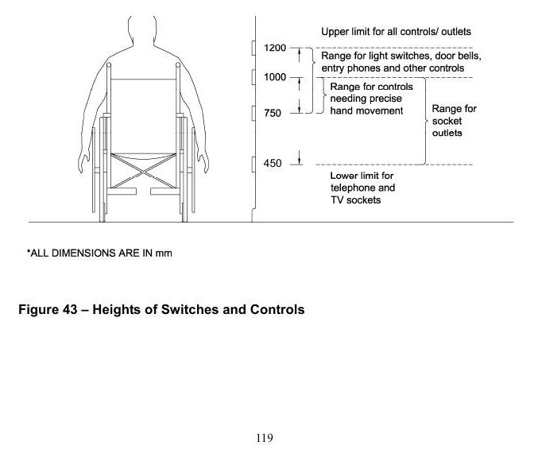
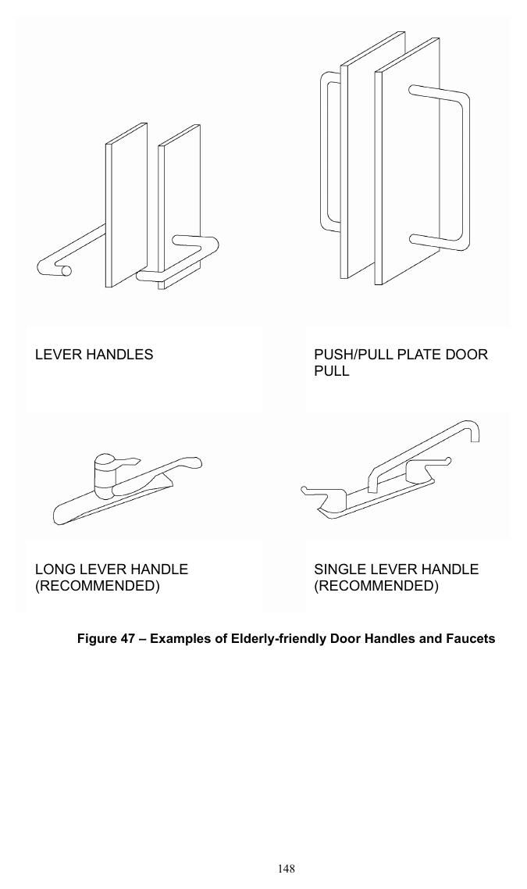
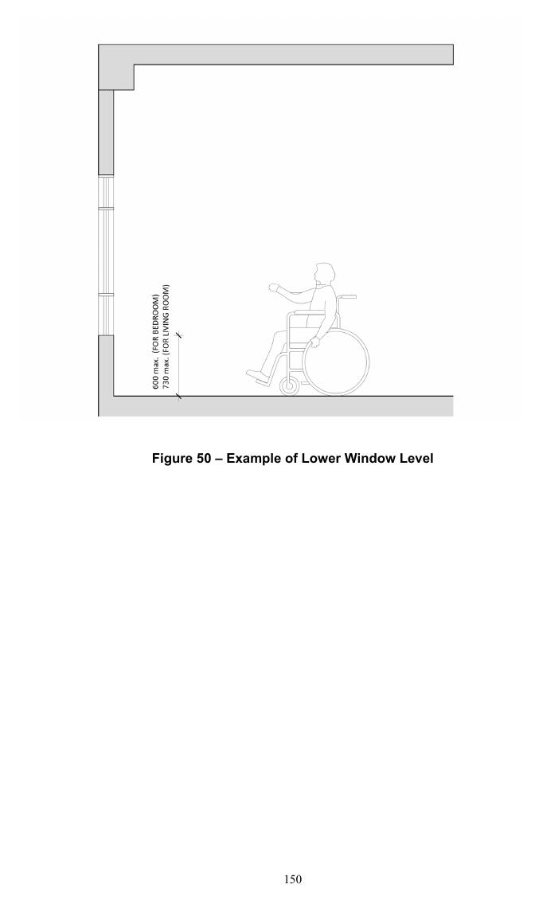

---
tags:
  - Code of Practice
  - Barrier free access 無障礙
  - Elderly-friendly 長者友善
  - Fire alarm 火警警報
  - Building services 屋宇裝備
  - Lift 升降機
  - Lighting & ventilation 照明及通風
  - Domestic 住用
  - Plant rooms 機房
  - Car park 停車場
---

# BFA Manual Chapters 5–6: Building Services and Elderly-friendly Design Guidelines <small>《設計手冊：暢通無阻的通道 2008》第 5–6 章：屋宇裝備設計規定及長者友善設計指引</small>

!!! info "Document info 文件資料"
    | | |
    |---|---|
    | **Type 類別** | Design Manual 設計手冊: BFA 2008 (2025 Edition), Chapters 5 and 6 |
    | **Status 地位** | Chapter 5: mostly **recommended**, except the **visual fire alarm** (obligatory). Chapter 6: **recommended** guidelines, but compare the obligatory **B(P)R reg. 73 / Fourth Schedule** (2026) 第 5 章大多屬建議（視像火警警報屬強制）；第 6 章屬建議 |
    | **Official language 官方語言** | English only (Chinese version not available) 只有英文版 |
    | **Source 原文** | [BFA 2008 (PDF)](https://www.bd.gov.hk/doc/en/resources/codes-and-references/code-and-design-manuals/BFA2008_e.pdf), pp. 118–151 |
    | **Last checked 最後核對** | 2026-11-20 against the 2025 Edition |

!!! warning "Superseded by DMUA 2026 已被 DMUA 2026 取代"
    BD issued the **Design Manual on Universal Accessibility 2026** (see [APP-176](../pnap/app-176.md)), which replaces this BFA 2008 Manual. The **obligatory** clauses here still match the statutory **B(P)R Third Schedule**; best-practice items may differ in the DMUA.
    屋宇署已發出《設計手冊：暢道通行2026》（見 APP-176）取代本手冊；本頁的**強制性**條文仍與 B(P)R 附表 3 相同，良好作業部分或有不同。

## At a glance 重點摘要 {#at-a-glance}

=== "English"

    - **Chapter 5 Building services** covers switches and controls, **fire alarm systems**, public telephones, remote signage, vertical lifting platforms and drinking fountains.
    - **Obligatory (5.2.3)**: in **Table 2** buildings, the fire alarm system must include a **flashing red visual alarm** labelled **"Fire Alarm 火警"**, at prominent locations. It is not required in exit staircases and their smoke lobbies, domestic units, and staff-only areas (offices, plant rooms, stores, kitchens, staff toilets, back of house). Manual call points at reachable heights; audible alarms to the FSD Code.
    - **Recommended**: switches and controls at **450–1 200 mm**, sockets ≥ **450 mm**, **30%** contrast; accessible payphones (one in a group, controls ≤ 1 200 mm, 750 × 1 200 mm clear space); **vertical lifting platforms** where a lift or ramp is impractical (door ≥ 900 mm, platform ≥ **1 100 × 1 500 mm**, barriers ≥ 1 100 mm, travel ≤ **7 m**, load ≤ 500 kg); drinking fountain spouts at **750–900 mm**.
    - **Chapter 6 Elderly-friendly design guidelines** (recommended, four groups):
        - **Mobility and accessibility**: 1 200 mm turning space in bathrooms; **850 mm** doors; showers 1 500 × 900 mm with a folding seat; slip-resistant, non-glossy floors; handrails along corridors at **810–900 mm**; door forces **28 N / 18 N**; lift cars **≥ 1.5 m** deep with seats; lift buttons at **1 050 mm**; **120 lux** in all common areas.
        - **Design adaptability**: flats convertible without structural work (grab bars, curbless showers, 950 mm corridors, 1 200 mm turning, 850 mm doors, knee space, 600 mm counters).
        - **Well-being**: lower window cills, resting seats every **50 m** and on stair landings, elderly-friendly toilets, adult changing benches, fitness equipment, farming planters.
        - **Gerontechnology**: network-ready flats and common areas (5G, IoT, sensors).

=== "中文"

    - **第 5 章屋宇裝備**涵蓋開關及控制裝置、**火警警報系統**、公眾電話、遙距標誌系統、垂直升降台及飲水器。
    - **強制（5.2.3）**：**表 2** 建築物的火警警報系統須包括標示**「Fire Alarm 火警」**的**紅色閃燈視像警報**，設於顯眼位置。走火樓梯及其防煙廊、住宅單位，以及只供職員使用的地方（辦公室、機房、貯物室、廚房、職員洗手間、後勤區）毋須設置。手動火警鐘按鈕須設於可觸及高度；聲響警報按消防處守則。
    - **建議**：開關及控制裝置高 **450–1 200 毫米**、插座 ≥ **450 毫米**、**30%** 亮度對比；暢通易達公眾電話（一組中最少一部，控制 ≤ 1 200 毫米，前方 750 × 1 200 毫米空間）；在無法設升降機或斜道時設**垂直升降台**（門 ≥ 900 毫米、平台 ≥ **1 100 × 1 500 毫米**、欄障 ≥ 1 100 毫米、行程 ≤ **7 米**、載重 ≤ 500 公斤）；飲水器出水口高 **750–900 毫米**。
    - **第 6 章長者友善設計指引**（建議，分四類）：
        - **行動及暢達**：浴室 1 200 毫米迴轉空間；**850 毫米**門；1 500 × 900 毫米淋浴間連摺合座椅；防滑、不反光地面；走廊扶手高 **810–900 毫米**；開門力 **28／18 牛頓**；升降機廂深 **≥ 1.5 米**並設座椅；升降機按鈕高 **1 050 毫米**；所有公用地方 **120 勒克斯**。
        - **設計適應性**：單位毋須結構改動即可改裝（扶手、無門檻淋浴、950 毫米走廊、1 200 毫米迴轉、850 毫米門、膝位空間、600 毫米深工作枱）。
        - **身心健康**：較低窗台、每 **50 米**及樓梯平台設休息座椅、長者友善洗手間、成人更換枱、健體設施、耕種花槽。
        - **樂齡科技**：單位及公用地方預留網絡（5G、物聯網、感應器）。

## Chapter 5 Building services design requirements 第 5 章 屋宇裝備設計規定 {#chapter-5-building-services-design-requirements-5}

| Section 節 | Subject 主題 | Key points 重點 | Status 地位 |
|---|---|---|---|
| 5.1 | Switches and controls 開關及控制裝置 | Controls at **450–1 200 mm**; sockets ≥ **450 mm**; **30%** luminous contrast; no tight grasping or twisting; not small buttons (Figure 43) | Recommended 建議 |
| 5.2 | **Fire alarm systems** 火警警報系統 | **Visual alarm**: flashing red light labelled "Fire Alarm 火警" at prominent locations in **Table 2** buildings; exemptions for exit stairs, smoke lobbies, domestic units and staff-only areas; call points reachable; audible alarm to the FSI Code | **Obligatory** 強制 |
| 5.3 | Public telephones 公眾電話 | One accessible payphone in a group: approach clear, controls ≤ 1 200 mm, enclosure from ≤ 650 mm, **750 × 1 200 mm** space, 750 × 650 × 430 mm footplate space, booth entrance ≥ 800 mm, grab rails, fold-down seat; versions for visual, hearing and speech impairment | Recommended 建議 |
| 5.4 | Remote signage systems 遙距標誌系統 | Audio beacons read by hand-held receivers for persons with visual impairment | Recommended 建議 |
| 5.5 | Vertical lifting platforms 垂直升降台 | Where a lift or ramp is impractical: automatic door, entrance ≥ **900 mm**, platform ≥ **1 100 × 1 500 mm**, barriers ≥ **1 100 mm** (or flip-up ramp), controls ≥ 50 mm, grab bar at 900 mm, travel ≤ **7 000 mm**, load ≤ **500 kg**, signage and owner's undertaking | Recommended 建議 |
| 5.6 | Drinking fountains 飲水器 | At least one accessible; spout **750–900 mm** high; front approach with knee space | Recommended 建議 |

<figure markdown>
  { width="440" loading=lazy }
  <figcaption>Figure 43 – Heights of switches and controls (450–1 200 mm). 開關及控制裝置高度。Source: BD, BFA 2008.</figcaption>
</figure>

## Chapter 6 Elderly-friendly design guidelines 第 6 章 長者友善設計指引 {#chapter-6-elderly-friendly-design-guidelines-6}

| Ref. | Item 項目 | Recommendation 建議 |
|---|---|---|
| **6.2.1 Mobility and accessibility 行動及暢達** | | |
| A1 | Bathrooms (flats) 浴室 | **1 200 mm** turning circle; grab bars |
| A2 | Doors (flats) 門 | Doorways **≥ 850 mm**; sliding (or folding / double swing) doors |
| A3 | Bathtubs / showers 浴缸／淋浴 | Built-in or attachable tub seat; shower **≥ 1 500 × 900 mm** with folding seat; grab bars |
| A4, A9 | Floor surfaces 地面 | **Slip-resistant**; avoid marble, glazed tiles and other shiny floors; avoid rough open-jointed pavers |
| A5 | Fittings and furniture 裝置及傢具 | Two-way switches; bedside switches; **lever** handles and taps (no knobs, push or self-closing taps); no overhead cabinets (or pull-down shelves); avoid projecting drying racks, provide flip hooks |
| A6 | Accessible routes 暢通路線 | No steps, thresholds or small ramps; grab bars at unavoidable level changes; handrails along corridors; wider treads and lower risers |
| A7 | Handrails 扶手 | Top at **810–900 mm**; timber or plastic-coated for grip |
| A8 | Doors (common areas) 公用地方門 | Automatic doors where practicable; opening force **≤ 28 N** (external) / **≤ 18 N** (internal) |
| A10–A12 | Lifts 升降機 | Car depth **≥ 1.5 m**; folding seats or lean-on rails (not fireman's lifts); lobby buttons at **1 050 mm**, 30% contrast; back-lit car buttons; audio indication |
| A13 | Escalators 自動梯 | Slower speed |
| A14 | Toilets 洗手間 | Doors open outward or both ways; large locks openable from outside with a coin; lever controls; call bells (pull-cords extended to floor level) |
| A15 | Car parks 停車場 | Audio / visual warning at vehicle entrances |
| A16 | Signs and wayfinding 標誌及導向 | Warm, bright contrasting colours (yellow on black, white on blue); bigger fonts; colour-coding by block / floor; landmarks |
| A17 | Lighting 照明 | **≥ 120 lux** in all common areas, uniform; sensor timers allowing for slow walking; stand-by lighting; avoid glare and harsh shadows |
| **6.2.2 Design adaptability 設計適應性** | | |
| B1 | Convertible flats 可改裝單位 | Without structural work: raised deck to balcony, grab bars, shower seat, curbless shower; lower door viewer; corridors **≥ 950 mm**; reachable two-way switches; **1 200 mm** turning at entrance, kitchen, toilet, bedroom; internal doors **≥ 850 mm**; knee space under sink and basin; counters **≤ 600 mm** deep; drainage for adaptation (Figure 49) |
| **6.2.3 Well-being 身心健康** | | |
| C1–C2 | Windows, lighting, ventilation 窗及通風 | Larger windows with **lower cills** (barrier rules still apply) (Figure 50); sliding windows; avoid glare at corridor ends; cross ventilation |
| C3 | Resting facilities 休息設施 | Seats or lean-on rails on stair landings, in corridors **> 50 m**, in typical lift lobbies; at **≤ 50 m** intervals in transport interchanges and connected passages, without reducing statutory widths |
| C4–C5 | Elderly-friendly toilets 長者友善洗手間 | Cubicle width **≥ 900 mm**, door **850 mm**, outward / folding door, grab bars both sides, call button, sensor flush, stick and bag holder, sign (Figure 51); **adult changing bench** in accessible toilets |
| C6–C8 | External recreation 戶外康樂 | Shaded seating, elderly fitness equipment, planters with **knee space** for community farming |
| C9 | Materials 物料 | Sound-absorbing, non-glare finishes; avoid glass and reflective materials |
| **6.2.4 Gerontechnology 樂齡科技** | | |
| D1 | Network 網絡 | Enabling works for high-speed internet (e.g. 5G), GPS and RFID to support smart entry, sensors, call-care services and IoT devices |

<figure markdown>
  { width="440" loading=lazy }
  <figcaption>Figure 47 – Elderly-friendly door handles and faucets (lever types recommended). 長者友善門把手及水龍頭。Source: BD, BFA 2008.</figcaption>
</figure>

<figure markdown>
  { width="420" loading=lazy }
  <figcaption>Figure 50 – Lower window level for seated views. 較低窗台。Source: BD, BFA 2008.</figcaption>
</figure>

## Guidelines vs the 2026 law 指引與 2026 年法例比較 {#guidelines-vs-the-2026-law-2026}

Several Chapter 6 **recommendations** are now **obligatory** for buildings under [B(P)R reg. 73 and the Fourth Schedule](../regulations/bpr-71-73.md). 第 6 章部分**建議**已成為第 73 條及附表 4 的**強制**規定：

| Item 項目 | Chapter 6 (recommended) 建議 | Fourth Schedule (obligatory, reg. 73 buildings) 強制 |
|---|---|---|
| Door width 門闊 | 850 mm (flats) | **850 mm** on regulated routes and flat main entrances |
| Lighting 照明 | 120 lux all common areas | **120 lux** on regulated routes and in lifts |
| Handrails 扶手 | 810–900 mm along corridors | **Dual-level** 850–950 / 700–800 mm on main circulation stairs |
| Floors 地面 | Slip-resistant | **Slip-resistant** routes and wet areas in flats |
| Lifts 升降機 | Car depth ≥ 1.5 m | Accessible lifts **≥ 1 200 × 1 400 mm**, mirror finish |
| Entrance 入口 | Automatic doors where practicable | **Automatic door** at a main residential entrance |

## Practical notes 實務提示 {#practical-notes}

=== "English"

    !!! tip "Common pitfalls"
        - Forgetting **visual fire alarms** in public areas of Table 2 buildings. This is an **obligatory** item hidden in a mostly advisory chapter.
        - Visual alarms placed where they cannot be seen from toilets, lift lobbies or counters.
        - Treating Chapter 6 as optional for new residential projects. Much of it is now **law** under reg. 73.
        - Vertical lifting platforms proposed where a **ramp or lift is practicable**. They are a last resort.

=== "中文"

    !!! tip "常見錯誤"
        - 表 2 建築物的公眾地方忘記設**視像火警警報**：這是隱藏在大部分屬建議的章節中的**強制**項目。
        - 視像警報設於洗手間、升降機大堂或櫃枱看不見的位置。
        - 以為新住宅項目可不理會第 6 章：當中不少已成為第 73 條下的**法例**要求。
        - 在**可設斜道或升降機**的情況下仍建議設垂直升降台：它只是最後選擇。

## Related 相關文件 {#related}

| Document 文件 | Relationship 關係 |
|---|---|
| [B(P)R 71–73](../regulations/bpr-71-73.md) | Reg. 73 and the Fourth Schedule (2026) 長者設計法例 |
| [BFA Div. 13–20](bfa-div-13-20.md) | Lifts, call bells, illumination 升降機、召援鐘、照明 |
| [BFA 2008 overview](bfa-2008.md) | Extent of application 適用範圍 |
| FSD Code of Practice for Minimum FSI and Equipment | Audible fire alarms 聲響火警警報 |

---
<small>Prepared by: _[name]_ · Checked by: _[name]_ · Summary of the English-only Manual; Chinese text prepared for this site (中譯（非官方）).</small>
