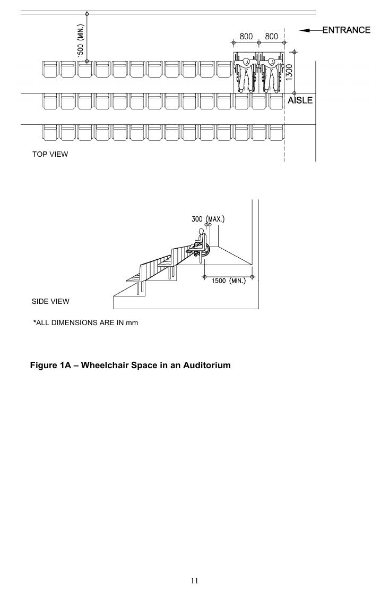
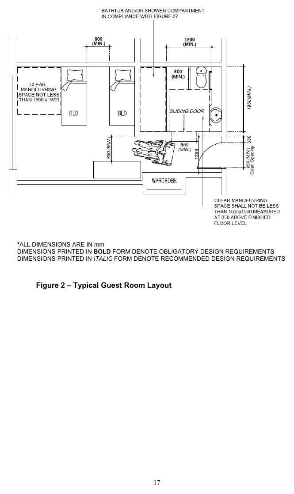
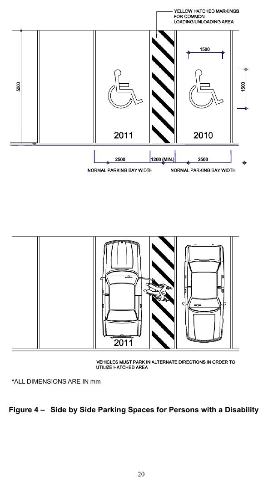

---
tags:
  - Code of Practice
  - Barrier free access 無障礙通道
  - Auditorium 觀眾席
  - Hotel 酒店
  - Car park 停車場
---

# BFA Manual Divisions 1–3: Auditoria, Hotels and Car Parks <small>《設計手冊：暢通無阻的通道 2008》第 1–3 分部：觀眾席、酒店及停車場</small>

!!! info "Document info 文件資料"
    | | |
    |---|---|
    | **Type 類別** | Design Manual 設計手冊: BFA 2008 (2025 Edition), Chapter 4, Divisions 1–3 |
    | **Legal basis 法律依據** | [B(P)R 72 and Third Schedule](../regulations/bpr-71-73.md), ss. 2–10 (same paragraph numbers) 附表 3 第 2–10 條（段號相同） |
    | **Official language 官方語言** | Manual: English only. Obligatory clauses quoted in Chinese from the **official Third Schedule text** 手冊只有英文；強制性條文的中文引自附表 3 官方中文本 |
    | **Source 原文** | [BFA 2008 (PDF)](https://www.bd.gov.hk/doc/en/resources/codes-and-references/code-and-design-manuals/BFA2008_e.pdf), pp. 10–22 |
    | **Last checked 最後核對** | 2026-11-20 against the 2025 Edition |

!!! warning "Superseded by DMUA 2026 已被 DMUA 2026 取代"
    BD issued the **Design Manual on Universal Accessibility 2026** (see [APP-176](../pnap/app-176.md)), which replaces this BFA 2008 Manual. The **obligatory** clauses here still match the statutory **B(P)R Third Schedule**; best-practice items may differ in the DMUA.
    屋宇署已發出《設計手冊：暢道通行2026》（見 APP-176）取代本手冊；本頁的**強制性**條文仍與 B(P)R 附表 3 相同，良好作業部分或有不同。

!!! note "How to read the Manual 如何閱讀本手冊"
    Each Division has a **Mandatory Section** (performance objectives and **obligatory design requirements**, which mirror the B(P)R Third Schedule and are deemed to comply with B(P)R 72) and a **Best Practice Section** (design considerations and **recommended** requirements, not mandatory). On figures, **bold** dimensions are obligatory and *italic* dimensions are recommended. The overview is at [BFA 2008](bfa-2008.md).
    每個分部分為**強制性部分**（表現目標及**強制性設計規定**，與附表 3 相同）及**良好作業部分**（設計考慮及**建議**規定，非強制）。圖則中**粗體**尺寸屬強制性，*斜體*屬建議。

## At a glance 重點摘要

=== "English"

    - **Auditoria** (Div. 1): theatres, cinemas, concert halls, stadiums, games, lecture and conference halls. **≥ 4 wheelchair spaces** up to **800** fixed seats; above 800, **2 per 400 seats** or part (e.g. 900 seats → **6**). In pairs, next to other seats, clear sight lines, each **800 × 1 300 mm** (800 side facing the stage), approach ≥ **1 500 mm** wide. Stage, backstage, dressing rooms and toilets accessible. **Braille and tactile fire exit maps** at all entrances; tactile warning strips at stage stairs.
    - **Hotels, hostels and guesthouses** (Div. 2): **2 accessible guest rooms per 100** rooms or part (minimum 2; e.g. 150 rooms → **4**), with accessible sleeping, bathing and sanitary facilities (bathrooms to Div. 12).
    - **Car parks** (Div. 3): accessible spaces by total (1–50: **1**; 51–150: **2**; 151–250: **3**; 251–350: **4**; 351–450: **5**; > 450: **6**), near an accessible lift or entrance. Width **3 500 mm**, or **2 500 mm** each with a shared **1 200 mm** yellow-hatched loading area; floor marked with the **international symbol** and space number.
    - **Recommended** (best practice): companion seats, removable seats for 16 wheelchairs, subtitles and audio description; guest rooms with visual door bells and Braille fire maps; more parking (1 per 25 for small car parks, then 1 per 100) and directional signs.

=== "中文"

    - **觀眾席**（第 1 分部）：劇院、電影院、音樂廳、體育場、遊戲廳、演講廳及會議廳。**800** 個固定座位或以下須設**最少 4 個輪椅位**；多於 800 個，每 **400 個座位**（不足 400 作 400 計）設 **2 個**（例如 900 個座位 → **6 個**）。輪椅位須成對、鄰接其他座位、視線無阻，每個 **800 × 1 300 毫米**（800 毫米一邊面向舞台），通道闊 ≥ **1 500 毫米**。舞台、後台、化妝室及洗手間須暢通易達；所有入口設**點字及觸覺走火通道圖**；通往舞台的樓梯設觸覺警示帶。
    - **酒店、旅舍及賓館**（第 2 分部）：每 **100 間客房**（不足 100 作 100 計）設 **2 間暢通易達客房**（最少 2 間；例如 150 間 → **4 間**），床鋪、沐浴及衞生設備均須暢通易達（浴室按第 12 分部）。
    - **停車場**（第 3 分部）：按總數設暢通易達停車位（1–50：**1**；51–150：**2**；151–250：**3**；251–350：**4**；351–450：**5**；> 450：**6**），靠近暢通易達升降機或入口；闊 **3 500 毫米**，或兩個共用 **1 200 毫米**黃斜線上落車位時各闊 **2 500 毫米**；地面標示**國際暢通易達標誌**及車位編號。
    - **建議**（良好作業）：同行者座位、可容納 16 個輪椅的可拆卸座椅、字幕及口述影像；設閃燈門鐘及點字走火圖的客房；較多停車位（小型停車場每 25 個 1 個，其後每 100 個加 1 個）及指示標誌。

## Division 1 Auditorium and related facilities 第 1 分部 觀眾席及有關設施

### Wheelchair spaces: obligatory requirements 輪椅位：強制性規定

| Para. 段 | Requirement 規定 |
|---|---|
| 4 | **Wheelchair spaces** at spectator level: ≤ 800 fixed seats → **≥ 4**; > 800 → **2 per 400** seats or part; grouped in **pairs**, adjacent to other seats; **unobstructed line of sight**; each **800 mm (facing stage) × 1 300 mm**; approach from an accessible entrance ≥ **1 500 mm** wide; removable seats allowed when unoccupied 輪椅位數目、尺寸及通道 |
| 5 | **Access for wheelchair users** to the auditorium, stage, backstage, changing, rehearsal, dressing and rest rooms, toilets and showers; where these connect, provide an equivalent accessible route (ramp to Div. 5, or accessible lift to Div. 19) 舞台及後台暢通易達 |
| 6 | **Braille and tactile fire exit maps** (Figure 32) at **all entrances** to the auditorium; **tactile warning strips** at the top and bottom of staircases to the stage 點字走火圖及觸覺警示帶 |

### Recommended 建議

| Item 項目 | Recommendation 建議 |
|---|---|
| Number 數目 | **8** wheelchair spaces up to 800 seats, plus **4 per extra 400** 8 個起 |
| Removable seats 可拆卸座椅 | Enough for **16** wheelchair spaces (≤ 800 seats), plus 8 per extra 400, for large groups 可供 16 個輪椅 |
| Location 位置 | Spaces at **different levels**, near egress and accessible toilets; **safety barriers** at high-level spaces; companion seats 不同高度、靠近出口 |
| Information 資訊 | Braille / tactile seat numbers; sound enhancement; **subtitles**; **audio description** room 字幕及口述影像 |

<figure markdown>
  { width="520" loading=lazy }
  <figcaption>Figure 1A – Wheelchair space in an auditorium (800 × 1 300 mm; 1 500 mm approach). 觀眾席輪椅位。Source: BD, BFA 2008.</figcaption>
</figure>

## Division 2 Hotels, hostels and guesthouses 第 2 分部 酒店、旅舍及賓館

### Obligatory requirements 強制性規定

| Para. 段 | Requirement 規定 |
|---|---|
| 7(1) | **Accessible guest rooms** are accessible, and so are all **sleeping, bathing and sanitary facilities** in them 房間及其所有設備暢通易達 |
| 7(2) | **2 accessible guest rooms per 100** guest rooms or part; minimum **2**; bathrooms and showers to **Div. 12** 每 100 間設 2 間 |

### Recommended 建議

| Item 項目 | Recommendation 建議 |
|---|---|
| Hearing 聽覺 | Per 100 rooms, **≥ 2 rooms with visual door bells** (switchable) 閃燈門鐘 |
| Vision 視覺 | Per 100 rooms, **≥ 2 rooms near the lift lobby** with Braille / tactile fire exit maps on the door and Braille light switches 點字走火圖 |
| Combining 合併 | Where planning allows, combine accessible, hearing and vision features in the same rooms 合併設施 |
| Signs 標誌 | Raised and Braille room numbers beside every door lock, and Braille exit signs, at **900–1 500 mm** 點字房號 |
| Layout 佈局 | Clear turning space **1 500 × 1 500 mm**; transfer space beside the bed; accessible wardrobes (Figure 2) 迴轉空間 |

<figure markdown>
  { width="560" loading=lazy }
  <figcaption>Figure 2 – Typical accessible guest room layout (bold = obligatory, italic = recommended). 暢通易達客房佈局。Source: BD, BFA 2008.</figcaption>
</figure>

## Division 3 Car parks 第 3 分部 停車場

### Obligatory requirements 強制性規定

| Total spaces in lot 停車位總數 | Accessible spaces (obligatory) 暢通易達停車位（強制） | Recommended 建議 |
|---|--:|---|
| 1–25 | 1 | 1 |
| 26–50 | 1 | 2 |
| 51–100 | 2 | 3 |
| 101–150 | 2 | 4 |
| 151–250 | 3 | 5–6 (1 per extra 100 or part) |
| 251–350 | 4 | 6–7 |
| 351–450 | 5 | 7–8 |
| > 450 | **6** | 1 more per extra 100 or part |

| Para. 段 | Requirement 規定 |
|---|---|
| 9(1) | Located near, with an **accessible route** to, a lobby with an **accessible lift** or entrance 靠近暢通易達升降機或入口 |
| 9(2) | Width ≥ **3 500 mm** 闊 ≥ 3 500 毫米 |
| 9(3)–(4) | Two spaces sharing a **loading / unloading area ≥ 1 200 mm** (yellow hatched) may each be **≥ 2 500 mm** wide 共用上落車位 |
| 10 | Floor marked with the **international symbol of accessibility** and the space number (Figure 3) 地面標示 |

<small>Recommended: signage at car park entrances giving the accessible space numbers (Figure 5); directional signs along driveways; ticket machines reachable from a wheelchair. 建議：入口及車道設指示標誌。</small>

<figure markdown>
  { width="480" loading=lazy }
  <figcaption>Figure 4 – Side-by-side accessible spaces with a shared 1 200 mm loading area. 並排暢通易達停車位。Source: BD, BFA 2008. (Figure 3, single space: see the <a href="../bfa-2008/">overview</a>.)</figcaption>
</figure>

## Key clauses 主要條文

!!! quote "Para. 4 / Third Schedule s.4 — Wheelchair spaces 輪椅位"
    A minimum of four wheelchair spaces shall be provided at spectator level in the auditorium with not more than 800 fixed seats. For auditorium with more than 800 fixed seats at spectator level, two wheelchair spaces shall be provided for every 400 fixed seats and any part thereof. … Each wheelchair space shall have unobstructed line of vision to the stage areas at which the relevant activity takes place, and be of minimum size of 800 mm x 1300 mm, with the side of 800 mm facing towards the stage podium or screen. The minimum width of the passage leading to a wheelchair space from an accessible entrance of the auditorium shall not be less than 1500 mm.

    **官方中文本（附表 3 第 4 條）：** (1) 如任何有觀眾席的處所的觀眾位置，設有不多於800個固定座位，則在觀眾位置，須設有不少於4個輪椅位。(2) 如任何有觀眾席的處所的觀眾位置，設有多於800個固定座位，則在觀眾位置每設有400個固定座位(不足400之數作400計)，須設有不少於2個輪椅位。(3) 任何輪椅位須鄰接最少另一個輪椅位。(4) 各輪椅位須鄰接固定座位。(5) 任何輪椅位須能看見有關活動進行位置而視線無阻。(6) 輪椅位面向有關活動進行位置的一邊不得少於800毫米，而另一邊不得少於1 300毫米。(7) 由觀眾席的暢通易達入口往輪椅位的通路，闊度不得少於1 500毫米。

!!! quote "Para. 9 / Third Schedule s.9 — Accessible parking spaces 暢通易達停車位"
    (1) The parking spaces reserved for persons with a disability shall be located in proximity and with an accessible route to the lobby with an accessible lift or entrance. (2) The minimum width for a parking space for persons with a disability shall be 3500 mm. (3) Where a common loading/unloading area is provided between two parking spaces for persons with a disability, such parking spaces shall be not less than 2500 mm in width. (4) The common loading/unloading area shall be of at least 1200 mm wide and be marked with yellow hatched markings.

    **官方中文本（附表 3 第 9 條）：** (1) 在暢通易達停車位與有暢通易達升降機或入口的大堂之間，須設有暢通易達路徑。(2) 除第(3)款另有規定外，暢通易達停車位的闊度不得少於3 500毫米。(3) 如2個暢通易達停車位之間設有符合第(4)款的上落車位，則該等停車位的闊度不得少於2 500毫米。(4) 為施行第(3)款，上落車位 —— (a) 的闊度不得少於1 200毫米；及 (b) 須用黃斜線標示。

## Practical notes 實務提示

=== "English"

    !!! tip "Common pitfalls"
        - Wheelchair spaces placed **all together** at the back or front, or separated from other seats (they must be in pairs **next to** fixed seats).
        - Counting **"or part thereof"** wrongly: 801 seats needs **6** spaces; 101 guest rooms needs **4** accessible rooms.
        - Accessible parking spaces far from the **accessible lift lobby**, or the route crossing kerbs without dropped kerbs.
        - A 2 500 mm space **without** the 1 200 mm hatched loading area beside it.
        - Stage access by stairs only, with no ramp or lift for performers.

=== "中文"

    !!! tip "常見錯誤"
        - 輪椅位**集中**在後排或前排，或與其他座位分開（須成對並**鄰接**固定座位）。
        - 錯誤計算「**不足之數作整數計**」：801 個座位須 **6** 個輪椅位；101 間客房須 **4** 間暢通易達客房。
        - 暢通易達停車位遠離**暢通易達升降機大堂**，或路線須跨越沒有下斜路緣的路緣。
        - 2 500 毫米車位旁**沒有** 1 200 毫米斜線上落車位。
        - 舞台只有樓梯而沒有供表演者使用的斜道或升降機。

## Related 相關文件

| Document 文件 | Relationship 關係 |
|---|---|
| [BFA 2008 overview](bfa-2008.md) | Extent of application and summary 適用範圍及概覽 |
| [BFA Div. 4–9](bfa-div-4-9.md) | Access routes, ramps, stairs, corridors 通道、斜道、樓梯、走廊 |
| [BFA Div. 13–20](bfa-div-13-20.md) | Braille fire exit maps (Fig. 32), lifts 點字走火圖、升降機 |
| [B(P)R 72–73](../regulations/bpr-71-73.md) | Legal basis; Third and Fourth Schedules 法律依據 |
| [APP-111](../pnap/app-111.md) | Car park design 停車場設計 |

---
<small>Prepared by: _[name]_ · Checked by: _[name]_ · English quotes from the BFA Manual; Chinese quotes from the official B(P)R Third Schedule text.</small>
