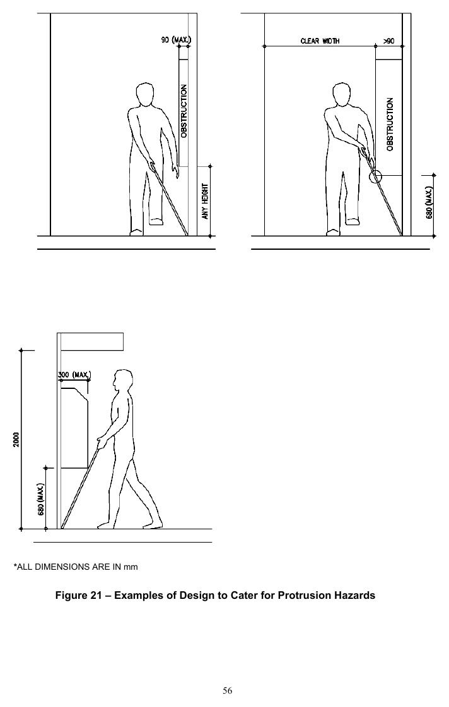
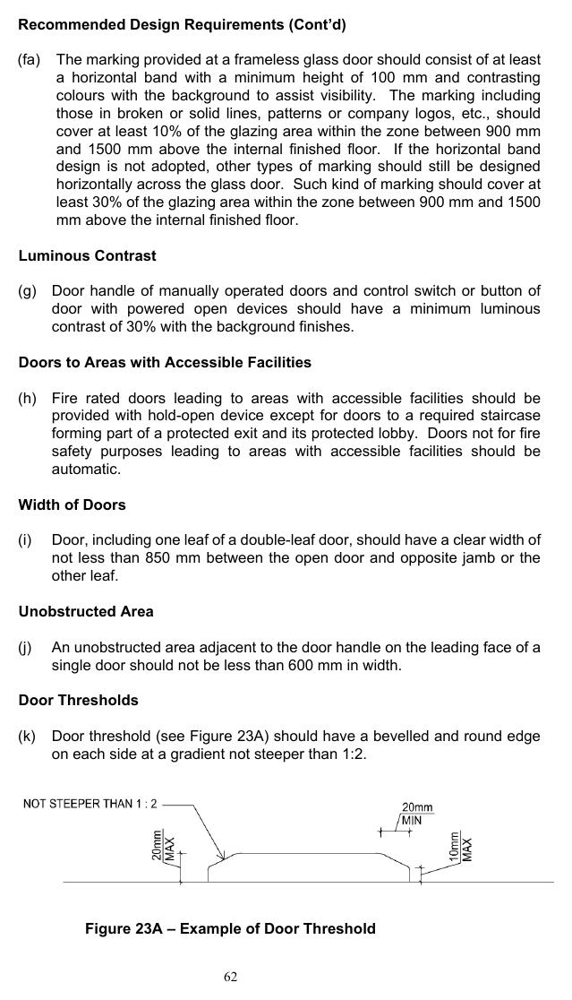
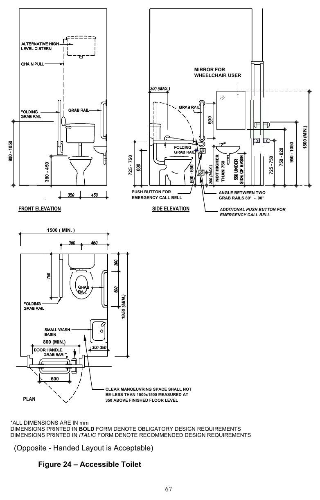
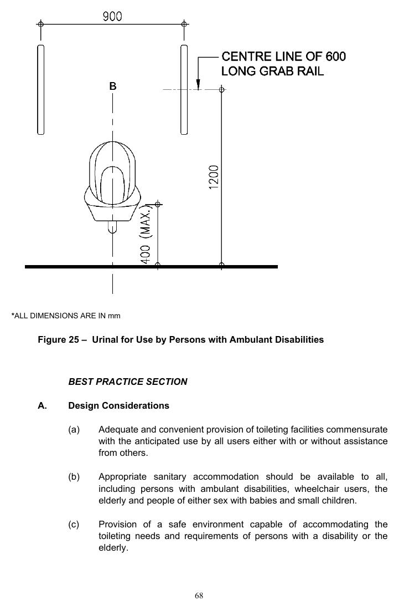
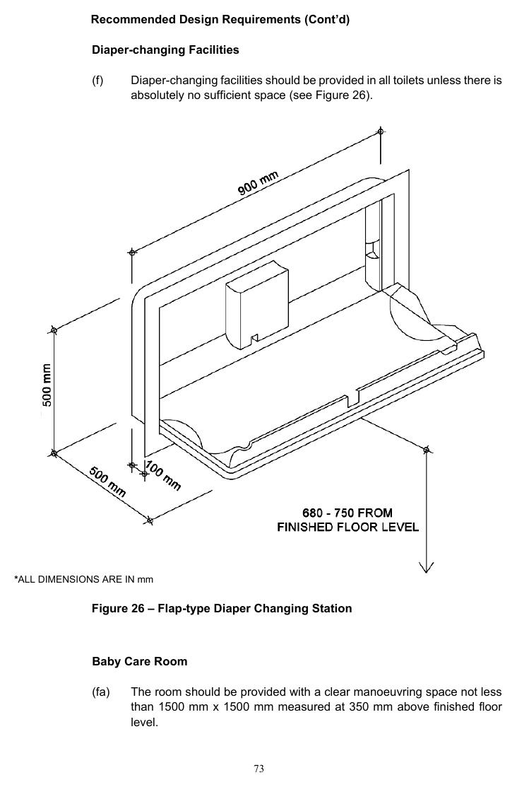
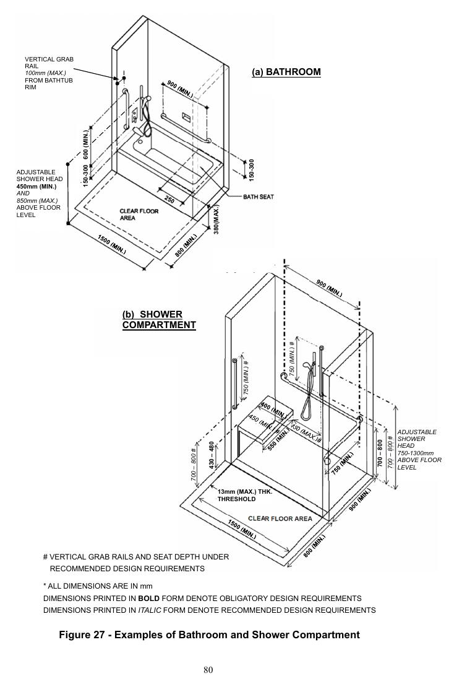

---
tags:
  - Code of Practice
  - Barrier free access 無障礙通道
  - Door 門
  - Accessible toilet 暢通易達洗手間
  - Bathroom 浴室
---

# BFA Manual Divisions 10–12: Doors, Toilets and Bathrooms <small>《設計手冊：暢通無阻的通道 2008》第 10–12 分部：門、洗手間及浴室</small>

!!! info "Document info 文件資料"
    | | |
    |---|---|
    | **Type 類別** | Design Manual 設計手冊: BFA 2008 (2025 Edition), Chapter 4, Divisions 10–12 |
    | **Legal basis 法律依據** | [B(P)R 72 and Third Schedule](../regulations/bpr-71-73.md), ss. 37–63 (same paragraph numbers) 附表 3 第 37–63 條 |
    | **Official language 官方語言** | Manual: English only. Obligatory clauses quoted in Chinese from the official Third Schedule 強制性條文中文引自附表 3 官方中文本 |
    | **Source 原文** | [BFA 2008 (PDF)](https://www.bd.gov.hk/doc/en/resources/codes-and-references/code-and-design-manuals/BFA2008_e.pdf), pp. 57–80 |
    | **Last checked 最後核對** | 2026-11-20 against the 2025 Edition |

!!! warning "Superseded by DMUA 2026 已被 DMUA 2026 取代"
    BD issued the **Design Manual on Universal Accessibility 2026** (see [APP-176](../pnap/app-176.md)), which replaces this BFA 2008 Manual. The **obligatory** clauses here still match the statutory **B(P)R Third Schedule**; best-practice items may differ in the DMUA.
    屋宇署已發出《設計手冊：暢道通行2026》（見 APP-176）取代本手冊；本頁的**強制性**條文仍與 B(P)R 附表 3 相同，良好作業部分或有不同。

!!! warning "Stricter rules since 2026 for some buildings 2026 年起部分建築物要求較嚴"
    Where **B(P)R reg. 73 / Fourth Schedule** applies (residential and commercial "specified buildings"), doors on regulated routes and main entrance doors of flats need **850 mm** clear width (Manual: 800 mm) and thresholds **≤ 15 mm** (Manual: 20 mm). See [B(P)R 71–73](../regulations/bpr-71-73.md).
    適用第 73 條／附表 4 的建築物，受規管路徑上的門及單位主要入口門淨闊須 **850 毫米**（手冊為 800 毫米），門檻 **≤ 15 毫米**（手冊為 20 毫米）。

## At a glance 重點摘要

=== "English"

    - **Doors** (Div. 10): clear width **≥ 800 mm** (each leaf of double doors); **330 mm** clear beside the handle on the pull side; handles at **950–1 050 mm**; thresholds **≤ 20 mm**, bevelled; opening force **≤ 30 N** (external and fire doors) / **≤ 22 N** (internal); closer **≥ 3 s**; double-action doors with a vision panel (**≤ 1 000 mm** to **≥ 1 500 mm**); **frameless glass** marked between **900–1 500 mm**; **automatic door** at one main public entrance of stadiums, civic buildings, museums, libraries, shopping and sports complexes, offices, hotels and hospitals.
    - **Accessible WC cubicles** (Div. 11): **1** per floor where there are **≤ 20** WCs, **2** where **> 20** (per sex in multi-cubicle toilets); plus at least one **accessible unisex toilet** on every floor with toilets. Not for domestic parts. Cubicle **≥ 1 500 × 1 750 mm** with **1 500 × 1 500 mm** turning space; WC seat **380–450 mm**; flush **600–1 050 mm**, ≤ 22 N; basin rim **≤ 750 mm**, 550 mm knee clearance; lever / auto taps; doors openable from outside; grab rails **32–40 mm**, **≥ 600 mm** long, folding rail at **725–750 mm**, all for **150 kg**; **emergency call bell**; one urinal with **800 × 1 500 mm** space, rim **≤ 400 mm** and grab rails at 1 200 mm.
    - **Bathrooms and showers** (Div. 12): bathtub **≤ 380 mm** high with a **250 mm** seat and **1 500 × 800 mm** clear space; grab rails 900 mm horizontal + 600 mm vertical; lever taps ≥ 75 mm; hand-held shower with **1 500 mm** hose; shower compartment **≥ 1 500 × 900 mm**, L-shaped rails **750 × 900 mm** at 700–800 mm, threshold **≤ 13 mm**, fold-down seat **550 × 400 mm** at **430–480 mm**.

=== "中文"

    - **門**（第 10 分部）：淨闊 **≥ 800 毫米**（雙扇門每扇計）；拉門一面把手旁留 **330 毫米**；把手高 **950–1 050 毫米**；門檻 **≤ 20 毫米**並成斜邊；開門力 **≤ 30 牛頓**（外門及防火門）／**≤ 22 牛頓**（內門）；關門機 **≥ 3 秒**；雙向自動關閉門設透視板（**≤ 1 000 毫米**至 **≥ 1 500 毫米**）；**無框玻璃門**在 **900–1 500 毫米**之間設標記；體育場、市政建築、博物館、圖書館、商場、體育館、辦公室、酒店及醫院的一個主要公眾入口須設**自動門**。
    - **暢通易達水廁間**（第 11 分部）：每層水廁 **≤ 20** 個設 **1** 個、**> 20** 個設 **2** 個（多水廁間洗手間按性別計）；設有洗手間的每層最少設一個**暢通易達無分性別洗手間**；住用部分不適用。水廁間 **≥ 1 500 × 1 750 毫米**，內有 **1 500 × 1 500 毫米**迴轉空間；廁座高 **380–450 毫米**；沖水掣 **600–1 050 毫米**、≤ 22 牛頓；洗手盆邊 **≤ 750 毫米**、膝位淨空 550 毫米；槓桿式或自動水龍頭；門可從外面打開；扶手直徑 **32–40 毫米**、長 **≥ 600 毫米**，摺合扶手高 **725–750 毫米**，均可承受 **150 公斤**；**緊急召援鐘**；最少一個尿盆前有 **800 × 1 500 毫米**空間、盆邊 **≤ 400 毫米**並在 1 200 毫米高設扶手。
    - **浴室及淋浴間**（第 12 分部）：浴缸高 **≤ 380 毫米**，設 **250 毫米**座位及 **1 500 × 800 毫米**淨空；扶手 900 毫米水平 + 600 毫米垂直；槓桿式水龍頭 ≥ 75 毫米；手提花灑配 **1 500 毫米**喉管；淋浴間 **≥ 1 500 × 900 毫米**，L 形扶手 **750 × 900 毫米**高 700–800 毫米，門檻 **≤ 13 毫米**，摺合座椅 **550 × 400 毫米**高 **430–480 毫米**。

## Division 10 Doors 第 10 分部 門

| Para. 段 | Obligatory requirement 強制性規定 |
|---|---|
| 38 | Clear width **≥ 800 mm** between the open door and the opposite jamb or other leaf (each leaf of double doors) 淨闊 800 毫米 |
| 39 | **≥ 330 mm** unobstructed width beside the handle on the leading face; a door < 330 mm from a room corner swings from the corner side 把手旁 330 毫米 |
| 40 | Double-action self-closing doors: **check mechanism** and **vision panel** from ≤ **1 000 mm** to ≥ **1 500 mm** 透視板 |
| 41 | Handles at **950–1 050 mm** (top of grip) 把手高度 |
| 42 | Threshold **≤ 20 mm**, bevelled 門檻 |
| 43 | Opening force: exterior **≤ 30 N**, interior **≤ 22 N**, fire doors on accessible routes **≤ 30 N**; interior closer **≥ 3 s** from 70° to 75 mm from closed 開門力及關門時間 |
| 44 | **Frameless glass doors** and adjacent glass panels prominently marked, partly within **900–1 500 mm** 無框玻璃門標記 |
| 45 | **Automatic door** at one main public entrance of sports stadia, town halls, civic centres, theatres, museums, public libraries, shopping complexes, sports complexes, public pools, office buildings, hotels and hospitals 自動門 |

<small>Recommended: external doors single-action, opening outwards; kick plates ≥ 200 mm; automatic doors open ≥ 5 s with a sign; vision panels on doors along routes; glass marking bands ≥ 100 mm or ≥ 10% coverage. 建議外門單向外開；自動門保持開啟最少 5 秒。</small>

<figure markdown>
  { width="480" loading=lazy }
  <figcaption>Figure 21 – Examples of door design. 門的設計例子。Source: BD, BFA 2008. (Figure 22, door clear width and 330 mm space: see the <a href="../bfa-2008/">overview</a>.)</figcaption>
</figure>

<figure markdown>
  { width="420" loading=lazy }
  <figcaption>Figure 23A – Bevelled door threshold. 斜邊門檻。Source: BD, BFA 2008.</figcaption>
</figure>

## Division 11 Toilets and WC cubicles 第 11 分部 洗手間及暢通易達水廁間

| Para. 段 | Obligatory requirement 強制性規定 |
|---|---|
| 46 | **Accessible WC cubicles** per floor (or part of a floor for persons with a disability): **≥ 1** if total WCs **≤ 20**; **≥ 2** if **> 20**; counted **per sex** in multi-cubicle toilets; not for domestic parts or floors without toilets; counted within the B(SFP&W)R fitment numbers 數目 |
| 47 | At least one **accessible unisex toilet** on every floor with toilets, reached without passing through a single-sex area 無分性別洗手間 |
| 48 | Reached **directly from a public corridor**; inside multi-cubicle toilets via a **1 500 × 1 500 mm** space in front (or direct approach) 位置 |
| 49 | Cubicle **≥ 1 500 × 1 750 mm**; clear turning **1 500 × 1 500 mm** at 350 mm above floor; WC seat top **380–450 mm**; back support; no spring seat 尺寸 |
| 50 | Flush control on the **wide side** at **600–1 050 mm**, one-hand or automatic, **≤ 22 N** 沖水掣 |
| 51 | Basin rim **≤ 750 mm**, **550 mm** clear under the apron; automatic or lever taps, **≤ 22 N** 洗手盆 |
| 52 | Push or lever handles; fastening releasable **from outside**; no coin box 門 |
| 53 | **≥ 2 grab rails** **32–40 mm** dia., **30 mm** from wall, **≥ 600 mm** long; a rail on **both faces** of the door; a **folding rail** on the wide side at **725–750 mm** with instructions in English, Chinese and Braille; rails and basin for **150 kg** 扶手 |
| 54 | **Emergency call bell** to Div. 17 緊急召援鐘 |
| 55 | If more than one urinal: at least one with **800 × 1 500 mm** level space, wall-hung, rim **≤ 400 mm**, vertical grab rails (32–40 mm, 600 mm long) both sides at **1 200 mm** 尿盆 |

<small>Recommended: mirror for wheelchair users; baby care rooms and fold-down **diaper changing** tables (Figure 26); ambulant cubicles; contrasting colours; coat hooks at 1 050 mm. 建議設嬰兒護理設施及摺合尿片更換枱。</small>

<figure markdown>
  { width="560" loading=lazy }
  <figcaption>Figure 24 – Accessible toilet: 1 500 × 1 750 mm min., 1 500 × 1 500 mm turning, WC 380–450 mm, folding rail 725–750 mm. 暢通易達洗手間。Source: BD, BFA 2008.</figcaption>
</figure>

<figure markdown>
  { width="420" loading=lazy }
  <figcaption>Figure 25 – Urinal with grab rails for persons with ambulant disabilities. 設扶手的尿盆。Source: BD, BFA 2008.</figcaption>
</figure>

<figure markdown>
  { width="420" loading=lazy }
  <figcaption>Figure 26 – Flap-type diaper changing counter (recommended). 摺合式尿片更換枱（建議）。Source: BD, BFA 2008.</figcaption>
</figure>

## Division 12 Bathrooms and shower compartments 第 12 分部 浴室及淋浴間

| Para. 段 | Obligatory requirement 強制性規定 |
|---|---|
| 56 | Bathtub: **1 500 × 800 mm** clear floor in front; seat **≥ 250 mm** wide; height **≤ 380 mm** 浴缸 |
| 57 | Bathtub grab rails **32–40 mm**, 30 mm from wall, non-rotating: **≥ 900 mm** horizontal (or ≤ 20° slope) along the tub at **150–300 mm** above the rim; **≥ 600 mm** vertical at the plug end 浴缸扶手 |
| 58 | Lever taps **≥ 75 mm** long, at the plug end, **≤ 450 mm** above the rim 水龍頭 |
| 59 | **Hand-held** shower, hose **≥ 1 500 mm**, wall bracket; vertical bar **≥ 500 mm** long, lower end ≥ 450 mm, **150 kg** load 花灑 |
| 60 | Shower compartment **≥ 1 500 × 900 mm**; **1 500 × 800 mm** clear space in front (1 500 parallel to the entrance) 淋浴間 |
| 61 | L-shaped grab rails **≥ 750 × 900 mm** at **700–800 mm**, **150 kg** 淋浴扶手 |
| 62 | Roll-in shower threshold **≤ 13 mm**, bevelled 門檻 |
| 63 | Shower seat: rounded, self-draining, next to the controls, **≥ 550 × 400 mm**, top at **430–480 mm** 座椅 |

<figure markdown>
  { width="480" loading=lazy }
  <figcaption>Figure 27 – Accessible bathroom and shower compartment. 暢通易達浴室及淋浴間。Source: BD, BFA 2008.</figcaption>
</figure>

## Key clauses 主要條文

!!! quote "Para. 46 / Third Schedule s.46 — Number of accessible WC cubicles 暢通易達水廁間的數目"
    There shall be at least one accessible W.C. cubicle on a floor, or in that part of a floor designed for access by the persons with a disability where the total number of W.C. cubicles provided on that floor or in that part of a floor is 20 or less, or 2 where the total number exceeds 20. This paragraph shall not apply to domestic buildings and the domestic parts of composite buildings or where there is no toilet provided on the particular floor.

    **官方中文本（附表 3 第 46 條）：** (1) 本條不適用於 —— (a) 住用建築物及綜合用途建築物的住用部分；或 (b) 建築物內沒有洗手間的個別樓層。(2) 在不抵觸第(3)款的條文下，如在每一樓層水廁的總數為 —— (a) 20個或少於20個，則該樓層須最少有一個暢通易達水廁間；或 (b) 多於20個，則該樓層須最少有2個暢通易達水廁間。

!!! quote "Para. 49 / Third Schedule s.49 — Design of accessible WC cubicle 暢通易達水廁間的設計"
    The accessible W.C. cubicle shall not be less than 1500 mm x 1750 mm in area and the clear manoeuvring space within the cubicle shall not be less than 1500 mm x 1500 mm measured at 350 mm above finished floor level and the cubicle shall have in it a watercloset at a height not less than 380 mm and not more than 450 mm, measured to the top of the toilet seat. Waterclosets shall be equipped with a back support such as a seat lid and seats shall not be spring-actuated.

    **官方中文本（附表 3 第 49 條）：** (1) 暢通易達水廁間的內部面積，不得少於1 500毫米乘以1 750毫米。(2) 暢通易達水廁間內活動範圍的淨空間面積不得少於1 500毫米乘以1 500毫米(於經修飾的地面水平上350毫米處量度)。(3) 暢通易達水廁間內須設有一個符合以下規定的水廁 —— (a) 其高度量至廁位頂部不得少於380毫米及不得多於450毫米；(b) 水廁須有背靠(例如座蓋)；及 (c) 廁板不得由彈簧牽動。

## Practical notes 實務提示

=== "English"

    !!! tip "Common pitfalls"
        - Measuring door width to the **door leaf** instead of the **clear opening** (open door to jamb).
        - Fire doors along accessible routes with closers needing **> 30 N**.
        - An accessible cubicle inside the **ladies' toilet** only, with no **unisex** accessible toilet on the floor (para. 47).
        - The **1 500 × 1 500 mm** turning circle blocked by the basin or bin at 350 mm height.
        - Folding grab rail on the **wall side** instead of the open (wide) side.
        - Roll-in shower with a **> 13 mm** lip.

=== "中文"

    !!! tip "常見錯誤"
        - 量度門的**門扇**而非**淨開口**（打開的門至門框）。
        - 暢通易達路線上的防火門關門機須 **> 30 牛頓**才能推開。
        - 暢通易達水廁間只設在**女洗手間**內，該層沒有**無分性別**暢通易達洗手間（第 47 段）。
        - **1 500 × 1 500 毫米**迴轉空間在 350 毫米高度被洗手盆或垃圾桶阻擋。
        - 摺合扶手設在**靠牆一邊**而非開放（較闊）的一邊。
        - 無檻式淋浴間的門檻 **> 13 毫米**。

## Related 相關文件

| Document 文件 | Relationship 關係 |
|---|---|
| [BFA Div. 4–9](bfa-div-4-9.md) | Routes, ramps, corridors 通道、斜道、走廊 |
| [BFA Div. 13–20](bfa-div-13-20.md) | Emergency call bells (Div. 17), signs 召援鐘、標誌 |
| [BFA Div. 1–3](bfa-div-1-3.md) | Accessible hotel guest rooms 暢通易達客房 |
| [B(SFP&W)R](../regulations/bsfpwr-123i.md) | Fitment numbers (accessible cubicles counted within) 設備數目 |
| [B(P)R 73, Fourth Schedule](../regulations/bpr-71-73.md) | 850 mm doors, 15 mm thresholds, slip-resistant wet areas 長者設計 |

---
<small>Prepared by: _[name]_ · Checked by: _[name]_ · English quotes from the BFA Manual; Chinese quotes from the official B(P)R Third Schedule text.</small>
