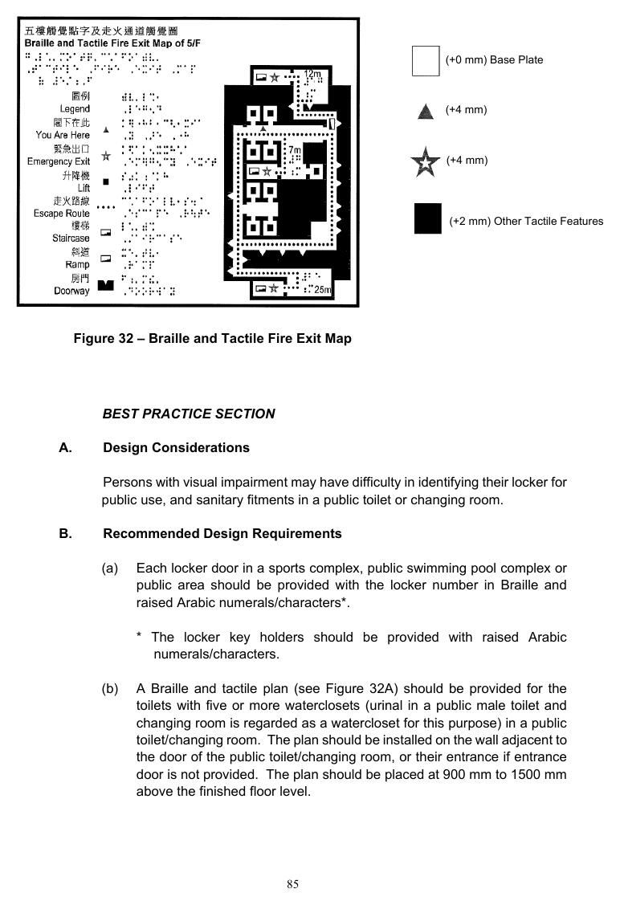
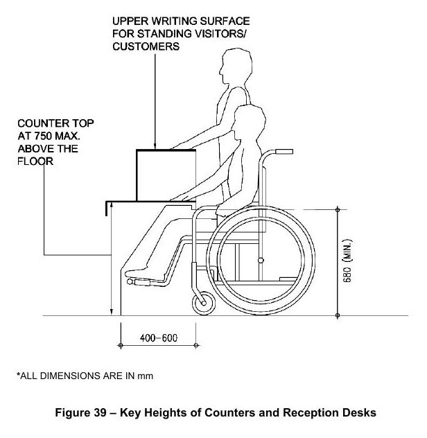
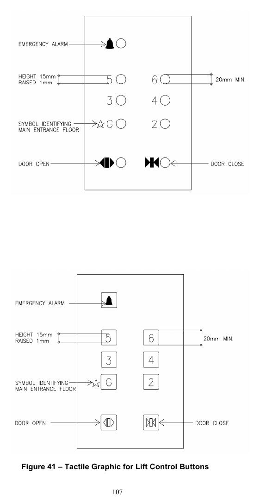

---
tags:
  - Code of Practice
  - Barrier free access 無障礙通道
  - Signs 標誌
  - Accessible lift 暢通易達升降機
  - Visual and hearing impairment 視障及聽障
---

# BFA Manual Divisions 13–20: Signs, Visual and Hearing Aids, Counters, Lighting, Call Bells, Lifts and Escalators <small>《設計手冊：暢通無阻的通道 2008》第 13–20 分部：標誌、視障及聽障設施、櫃枱、照明、召援鐘、升降機及自動梯</small>

!!! info "Document info 文件資料"
    | | |
    |---|---|
    | **Type 類別** | Design Manual 設計手冊: BFA 2008 (2025 Edition), Chapter 4, Divisions 13–20 |
    | **Legal basis 法律依據** | [B(P)R 72 and Third Schedule](../regulations/bpr-71-73.md), ss. 64–86 (same paragraph numbers) 附表 3 第 64–86 條 |
    | **Official language 官方語言** | Manual: English only. Obligatory clauses quoted in Chinese from the official Third Schedule 強制性條文中文引自附表 3 官方中文本 |
    | **Source 原文** | [BFA 2008 (PDF)](https://www.bd.gov.hk/doc/en/resources/codes-and-references/code-and-design-manuals/BFA2008_e.pdf), pp. 81–120 |
    | **Last checked 最後核對** | 2026-11-20 against the 2025 Edition |

!!! warning "Superseded by DMUA 2026 已被 DMUA 2026 取代"
    BD issued the **Design Manual on Universal Accessibility 2026** (see [APP-176](../pnap/app-176.md)), which replaces this BFA 2008 Manual. The **obligatory** clauses here still match the statutory **B(P)R Third Schedule**; best-practice items may differ in the DMUA.
    屋宇署已發出《設計手冊：暢道通行2026》（見 APP-176）取代本手冊；本頁的**強制性**條文仍與 B(P)R 附表 3 相同，良好作業部分或有不同。

## At a glance 重點摘要

=== "English"

    - **Signs** (Div. 13): **international symbol of accessibility** (white wheelchair on blue) at accessible entrances, exits, parking, toilets, lifts, cloakrooms and counters, with **directional signs**; sign height **≥ 60 mm** (doors), **110 mm** (corridors), **200 mm** (external); **hearing loss symbol** where an assistive listening system exists; **Braille and tactile** toilet signs at **900–1 500 mm**; Braille fire exit map above the accessible lift call button at **800–1 200 mm**.
    - **Visual / hearing aids** (Div. 14) in Table 2 buildings: Braille and tactile **floor plan**; **tactile guide path** from the lot boundary to the main entrance, then to the lift zone, nearest accessible toilet, counter, floor plan and staircase; **visual display** of public address messages.
    - **Counters** (Div. 15): at least one with a section **≤ 750 mm** high and **≥ 750 mm** wide, knee space **400–600 mm** deep and **≥ 680 mm** high; one with an **assistive listening system** where noisy or screened.
    - **Illumination** (Div. 16): G/F entrance lobby and lift **120 lux**; upper lift lobbies, corridors, accessible paths and stairs **85 lux**; signs **120 lux**.
    - **Emergency call bell** (Div. 17): weatherproof push button **600–650 mm** high below the vertical grab rail, "Emergency Call" in English, Chinese and Braille; alarm outside the toilet or in the caretaker's office.
    - **Assistive listening** (Div. 18): induction loop or infrared at one counter and in halls / auditoria of Table 2 buildings.
    - **Lifts** (Div. 19): every floor served by at least one **accessible lift**: car **≥ 1 200 (deep) × 1 100 mm (wide)**, door **≥ 850 mm**, handrails at 850–950 mm; **> 3 lifts**: one **≥ 1 500 × 1 400 mm**. Horizontal sliding power doors with a re-open sensor at **500–600 mm**; buttons **900–1 200 mm**, **≥ 20 mm**, Braille / tactile (star for main floor, bell for alarm); **intercom** with blinking acknowledgement light on emergency power; arrival chime (once up, twice down); jamb floor numbers **60 mm** at 1 200 mm; car position indicator 50 mm; voice announcements in **English, Cantonese, Putonghua**.
    - **Escalators and travelators** (Div. 20): **not** part of the barrier-free route; **tactile warning strips** at both ends.

=== "中文"

    - **標誌**（第 13 分部）：在暢通易達入口、出口、停車位、洗手間、升降機、衣帽間及櫃枱設**國際暢通易達標誌**（藍底白色輪椅），並設**方向指示標誌**；標誌高 **≥ 60 毫米**（門）、**110 毫米**（走廊）、**200 毫米**（室外）；設有聆聽輔助系統時設**聽障標誌**；洗手間設**點字及觸覺**標誌，高 **900–1 500 毫米**；暢通易達升降機召喚按鈕上方 **800–1 200 毫米**設點字走火通道圖。
    - **視障／聽障設施**（第 14 分部，適用表 2 建築物）：點字及觸覺**平面圖**；由地段界線至主要入口，再至升降機區、最近的暢通易達洗手間、櫃枱、平面圖及樓梯的**觸覺引路帶**；以**視像顯示**廣播內容。
    - **櫃枱**（第 15 分部）：最少一個櫃枱有部分 **≤ 750 毫米**高、**≥ 750 毫米**闊，膝位深 **400–600 毫米**、高 **≥ 680 毫米**；嘈雜或設屏障時，最少一個設**聆聽輔助系統**。
    - **照明**（第 16 分部）：地面入口大堂及升降機 **120 勒克斯**；上層升降機大堂、走廊、暢通易達路徑及樓梯 **85 勒克斯**；標誌 **120 勒克斯**。
    - **緊急召援鐘**（第 17 分部）：防水按鈕高 **600–650 毫米**，設於垂直扶手下方，附中英文及點字「緊急召援」；警報設於洗手間外或管理處。
    - **聆聽輔助系統**（第 18 分部）：表 2 建築物的一個櫃枱及禮堂／觀眾席設感應圈或紅外線系統。
    - **升降機**（第 19 分部）：每層最少有一部**暢通易達升降機**：機廂 **≥ 1 200（深）× 1 100 毫米（闊）**、門 **≥ 850 毫米**、扶手高 850–950 毫米；**多於 3 部**時，一部須 **≥ 1 500 × 1 400 毫米**。橫向自動趟門，**500–600 毫米**高設重開感應器；按鈕 **900–1 200 毫米**高、**≥ 20 毫米**，設點字及觸覺（主要樓層用星形、警鐘用鐘形）；**對講機**及閃燈確認，由緊急電源供電；到達鐘聲（上行一聲、下行兩聲）；門框樓層號 **60 毫米**高、離地 1 200 毫米；機廂位置顯示 50 毫米；以**英語、粵語、普通話**報層。
    - **自動梯及自動行人道**（第 20 分部）：**不**屬暢通無阻路線；兩端設**觸覺警示帶**。

## Division 13 Signs 第 13 分部 標誌

| Para. 段 | Obligatory requirement 強制性規定 |
|---|---|
| 64 | **International symbol of accessibility** (white on blue, Figure 28) at accessible entrances / exits, reserved parking, accessible toilets, usable vertical circulation, cloakrooms, special counters and telephones 國際暢通易達標誌 |
| 65 | **Directional arrows** with the symbol to guide to the facilities (Figure 29) 方向指示 |
| 66 | Sign height **≥ 60 mm** (doors), **≥ 110 mm** (corridors), **≥ 200 mm** (external) 標誌尺寸 |
| 67 | **Hearing loss symbol** (Figure 30) where an assistive listening system is provided 聽障標誌 |
| 68 | **Braille and tactile** signs on the wall or door of public toilets (male / female / unisex) at **900–1 500 mm** (on the facing wall if no door); **Braille / tactile fire exit map** above the accessible lift call button at **800–1 200 mm** where a public fire exit map is provided (Figures 31–32) 點字標誌及走火通道圖 |

<figure markdown>
  { width="480" loading=lazy }
  <figcaption>Figure 32 – Braille and tactile fire exit map. 點字及觸覺走火通道圖。Source: BD, BFA 2008.</figcaption>
</figure>

## Division 14 Visual and hearing impairment (Table 2 buildings) 第 14 分部 協助視障及聽障人士

| Para. 段 | Obligatory requirement 強制性規定 |
|---|---|
| 69(2) | If a public floor plan is provided: **Braille and tactile floor plan** showing the main entrance, public toilet and major facilities, in a conspicuous place 點字平面圖 |
| 69(3) | **Tactile guide path** from the lot boundary access point to the main entrance, and from the main entrance to the **lift zone**, **nearest accessible toilet**, **information counter**, **tactile floor plan** and **staircase** (Figures 33–35) 觸覺引路帶 |
| 69(4) | **Visual display boards** (e.g. LED) show the essence of public address announcements 視像顯示廣播 |

**Table 2 building categories** (Third Schedule Part 2, Div. 21): department stores and shopping complexes; hotels, hostels, guesthouses and banks; places of worship; cinemas, theatres, concert halls, stadiums, museums, theme parks; schools, colleges, universities and libraries; factories and industrial buildings; sports complexes and public pools; restaurants and food courts; indoor markets and supermarkets; hospitals and clinics; elderly homes and welfare centres; club houses; transport stations and terminals; car parks. Each category has its own list of required provisions in Table 2.
**表 2 建築物類別**：百貨公司及商場；酒店、旅舍、賓館及銀行；宗教場所；電影院、劇院、音樂廳、體育場、博物館、主題公園；學校、大專及圖書館；工廠；體育館及公眾泳池；食肆；街市及超市；醫院及診所；安老院及福利中心；會所；交通站及客運大樓；停車場。各類別須提供的設施見表 2。

## Division 15 Public information or service counters 第 15 分部 公共詢問或服務櫃枱

| Para. 段 | Obligatory requirement 強制性規定 |
|---|---|
| 70 | Counters in **Table 2** buildings; at least one with a portion **≤ 750 mm** high and **≥ 750 mm** wide; at least one with an **assistive listening system** where noisy or screened 櫃枱高度 |
| 71 | Accessible and identifiable from the entrance; knee space **400–600 mm** deep, **≥ 680 mm** high 膝位空間 |

<figure markdown>
  { width="420" loading=lazy }
  <figcaption>Figure 39 – Counter top ≤ 750 mm; knee space ≥ 680 mm high, 400–600 mm deep. 櫃枱主要高度。Source: BD, BFA 2008.</figcaption>
</figure>

## Divisions 16–18 Illumination, emergency call bells, assistive listening 第 16–18 分部 照明、召援鐘、聆聽輔助

| Para. 段 | Obligatory requirement 強制性規定 |
|---|---|
| 72 | Floor-level lighting on the passage centre line: **G/F entrance lobby and lift 120 lux**; **upper lift lobbies, corridors, accessible paths, staircases 85 lux** 照明度 |
| 73–74 | Signs **≥ 120 lux** on the sign face; automatic or manual switching allowed 標誌照明 |
| 75 | Emergency call bell gives an **audible or visible** alarm **outside the toilet**, or a buzzer in the caretaker's office 召援鐘 |
| 76 | **Weatherproof** push button below the vertical grab rail beside the WC, at **600–650 mm**; "Emergency Call" notice in **English, Chinese and Braille** 按鈕 |
| 77 | **Assistive listening system** (induction loop or infrared) at ≥ 1 counter and in halls / auditoria of Table 2 buildings 聆聽輔助系統 |

<small>The Fourth Schedule (2026) raises corridor and lift lighting to **≥ 120 lux** on regulated routes of buildings under reg. 73. 第 73 條適用的建築物須 120 勒克斯。</small>

## Division 19 Lifts 第 19 分部 升降機

| Para. 段 | Obligatory requirement 強制性規定 |
|---|---|
| 78(1) | Every floor served by **≥ 1 accessible lift** with direct access to the main lift lobby; car **≥ 1 200 × 1 100 mm (wide)**, clear entrance **≥ 850 mm**, handrails to within 150 mm of corners, top at **850–950 mm**, **30–50 mm** from wall 暢通易達升降機 |
| 78(2) | **More than 3 lifts**: at least one serving every floor **≥ 1 500 × 1 400 mm**, entrance ≥ 850 mm 多於 3 部 |
| 79 | **All passenger lifts**: horizontal sliding, power-operated doors; audible closing signal; obstacle **re-opening sensor at 500–600 mm** 升降機門 |
| 80 | **All passenger lifts**: car and hall buttons at **900–1 200 mm**; buttons **≥ 20 mm**; Braille / tactile on or left of buttons, tactile ≥ **15 mm** high, raised **1 mm**; **star** for the main entrance floor, **bell** shape for the alarm; emergency alarm, buzzer, **blinking acknowledgement light** and **intercom** to the management office, on emergency power 控制按鈕及對講機 |
| 81 | Hall: illuminated indicator and chime before arrival (**once up, twice down**); jamb floor numbers in Braille / tactile **≥ 60 mm** high at **1 200 mm** 到達指示 |
| 82 | Car: direction and position indicators, characters **≥ 50 mm**; **voice announcement** in **English, Cantonese and Putonghua** 報層 |
| 83 | Accessible lifts identified with the **accessibility symbol** at each landing (or at entrance levels if all lifts comply) 識別標誌 |

<small>The Fourth Schedule (2026) requires accessible lifts on regulated routes to be at least **1 200 mm wide × 1 400 mm deep**, with **mirror-like finishes** facing the door. 附表 4 要求 1 200 × 1 400 毫米並設鏡面。</small>

<figure markdown>
  { width="420" loading=lazy }
  <figcaption>Figure 41 – Tactile graphics for lift buttons (star for main floor, bell for alarm). 升降機按鈕觸覺圖形。Source: BD, BFA 2008. (Figure 40, accessible lift: see the <a href="../bfa-2008/">overview</a>.)</figcaption>
</figure>

## Division 20 Escalators and passenger conveyors 第 20 分部 自動梯及乘客輸送帶

| Para. 段 | Obligatory requirement 強制性規定 |
|---|---|
| 84 | Escalators and travelators are **not** part of a barrier-free route; warning and guarding alongside and at each end 不屬暢通無阻路線 |
| 85 | **Tactile warning strips** at the top and bottom of escalators and both ends of passenger conveyors (Figure 36) 觸覺警示帶 |

## Key clauses 主要條文

!!! quote "Para. 78(1) — Accessible lifts 暢通易達升降機"
    Every floor of a building shall be accessible by at least one passenger lift which shall fully comply with all the obligatory design requirements as stipulated in this section and have direct access to main lift lobby. … A lift shall have minimum internal car dimensions of 1200 mm x 1100 mm wide, with a minimum clear entrance width of 850 mm, and shall have handrails extending to within 150 mm of the corners at the rear and sides of the car. The top of the gripping surface of the handrails shall be at a height of 850 mm to 950 mm, with a space of 30 mm to 50 mm between the handrails and wall.

!!! quote "Para. 72 — General illumination level 一般照明度"
    Ground floor entrance lobby and lift: 120 lux. Lift lobby of upper floors, corridors, accessible paths and staircases: 85 lux.

<small>For the official Chinese of these clauses see B(P)R Third Schedule ss. 72 and 78 on [eLegislation](https://www.elegislation.gov.hk/hk/cap123F!zh-Hant-HK). 官方中文本見附表 3 第 72 及 78 條。</small>

## Practical notes 實務提示

=== "English"

    !!! tip "Common pitfalls"
        - Only some lifts reach the **car park or roof garden** levels, and none of those is accessible: **every floor** needs an accessible lift (para. 78(1)).
        - More than 3 lifts but **no 1 500 × 1 400 mm** car (para. 78(2)).
        - Lift buttons in a column reaching above **1 200 mm** with no secondary panel.
        - Emergency call bell button placed **out of reach** from the floor (it must be at 600–650 mm for someone who has fallen).
        - Tactile guide path stopping at the building entrance instead of continuing to the **lift zone, counter and accessible toilet** (para. 69(3)).
        - Corridor lighting designed to the general office standard but measured **below 85 lux** at floor level.

=== "中文"

    !!! tip "常見錯誤"
        - 只有部分升降機到達**停車場或天台花園**，而這些升降機都不是暢通易達的：**每層**都須有暢通易達升降機（第 78(1) 段）。
        - 多於 3 部升降機但沒有 **1 500 × 1 400 毫米**機廂（第 78(2) 段）。
        - 直排按鈕高於 **1 200 毫米**而沒有副控制板。
        - 緊急召援鐘按鈕設於**跌倒時無法觸及**的位置（須在 600–650 毫米）。
        - 觸覺引路帶只到建築物入口，沒有延伸至**升降機區、櫃枱及暢通易達洗手間**（第 69(3) 段）。
        - 走廊照明按一般辦公室標準設計，但地面量度**低於 85 勒克斯**。

## Related 相關文件

| Document 文件 | Relationship 關係 |
|---|---|
| [BFA Div. 10–12](bfa-div-10-12.md) | Accessible toilets (call bells) 暢通易達洗手間 |
| [BFA Ch. 5–6](bfa-ch-5-6.md) | Building services and elderly-friendly design 屋宇裝備及長者設計 |
| [APP-89](../pnap/app-89.md) | Better lift service 較佳升降機服務 |
| [B(C)R 39–41](../regulations/bcr-123q.md) | Lift and escalator construction 升降機及自動梯 |
| [B(P)R 73, Fourth Schedule](../regulations/bpr-71-73.md) | 120 lux; 1 200 × 1 400 mm lifts 長者設計 |

---
<small>Prepared by: _[name]_ · Checked by: _[name]_ · English quotes from the BFA Manual; Chinese summaries prepared for this site; official Chinese in the B(P)R Third Schedule.</small>
