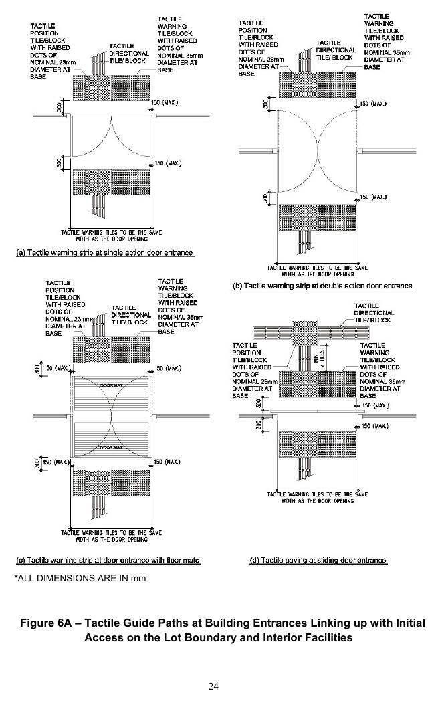
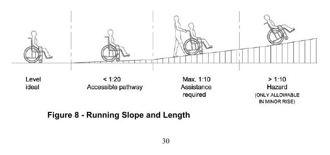
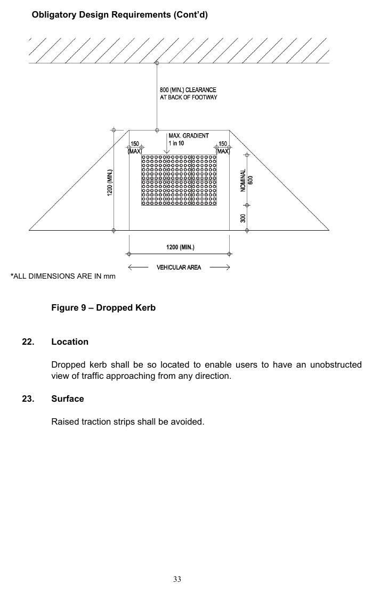
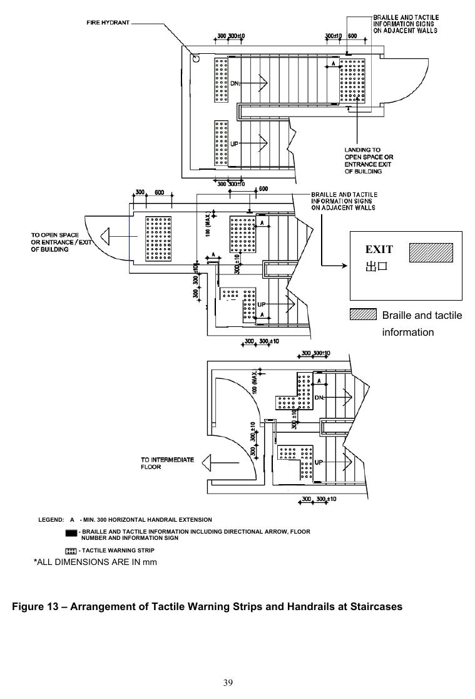
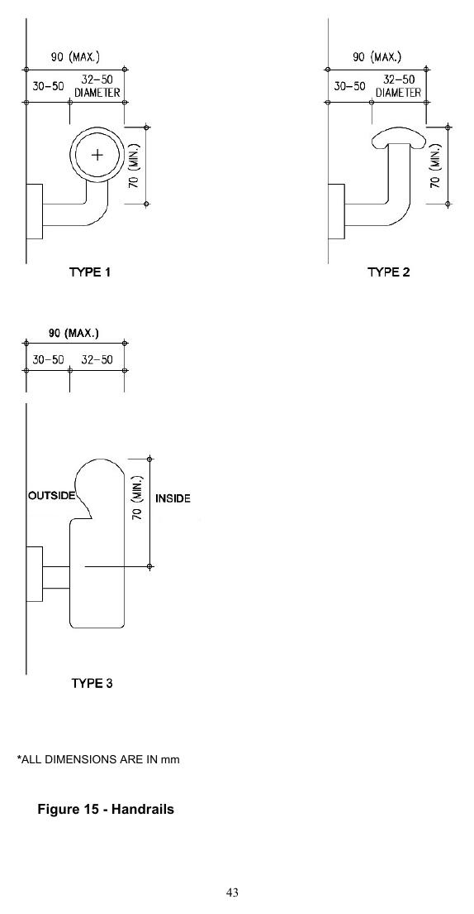
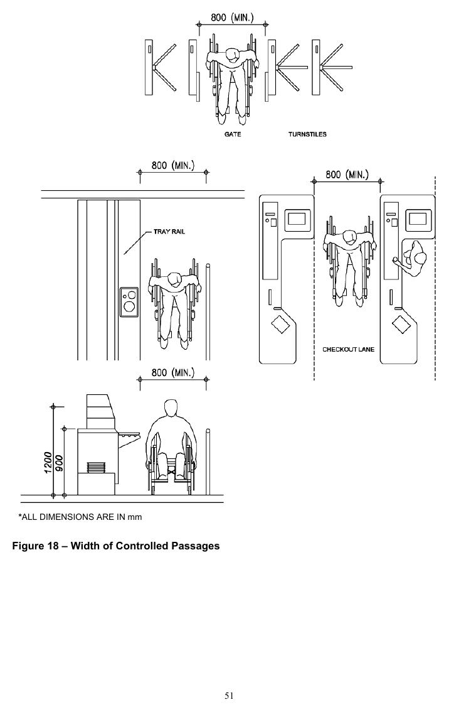
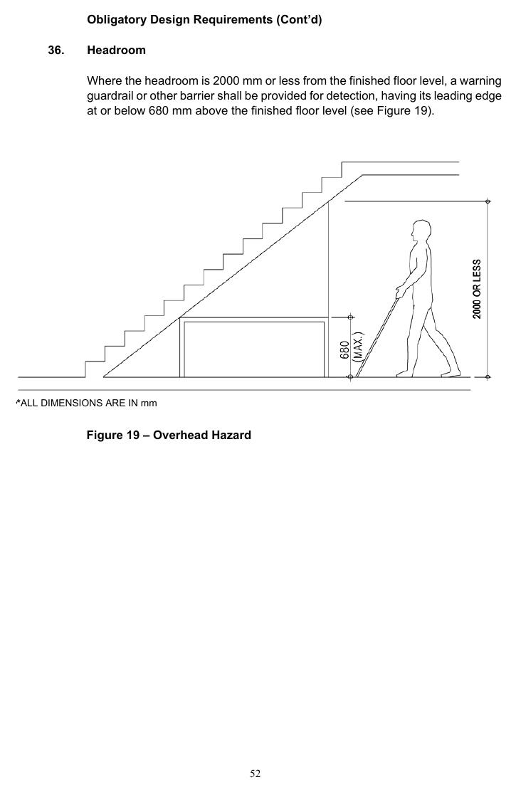

---
tags:
  - Code of Practice
  - Barrier free access 無障礙通道
  - Ramp 斜道
  - Staircase 樓梯
  - Handrail 扶手
  - Corridor 走廊
---

# BFA Manual Divisions 4–9: Access Routes, Ramps, Dropped Kerbs, Stairs, Handrails and Corridors <small>《設計手冊：暢通無阻的通道 2008》第 4–9 分部：通道、斜道、下斜路緣、樓梯、扶手及走廊</small>

!!! info "Document info 文件資料"
    | | |
    |---|---|
    | **Type 類別** | Design Manual 設計手冊: BFA 2008 (2025 Edition), Chapter 4, Divisions 4–9 |
    | **Legal basis 法律依據** | [B(P)R 72 and Third Schedule](../regulations/bpr-71-73.md), ss. 11–36 (same paragraph numbers) 附表 3 第 11–36 條 |
    | **Official language 官方語言** | Manual: English only. Obligatory clauses quoted in Chinese from the official Third Schedule 強制性條文中文引自附表 3 官方中文本 |
    | **Source 原文** | [BFA 2008 (PDF)](https://www.bd.gov.hk/doc/en/resources/codes-and-references/code-and-design-manuals/BFA2008_e.pdf), pp. 23–56 |
    | **Last checked 最後核對** | 2026-11-20 against the 2025 Edition |

## At a glance 重點摘要

=== "English"

    - **Access route** (Div. 4): from a prominent point on the **lot boundary** directly to at least one **public entrance** and an **accessible lift**; clear width **≥ 1 050 mm**, firm, free of steps, kerbs (except dropped kerbs), steep ramps and protrusions; **tactile guide path** where Table 2 requires.
    - **Ramps** (Div. 5): width **≥ 1 050 mm**; **1 500 × 1 500 mm** landings at head and foot (no door swing onto them); gradient **≤ 1:12**, except minor rises (**1:10** up to 1 500 mm long / 150 mm rise; **1:8** up to 600 mm / 75 mm), not combined. At **1:20 or steeper**: **1 200 mm landing every 10 m**, handrails **both sides**, tactile strips. Edge kerb **100 mm** or rail at 200 mm; contrasting floor and wall.
    - **Dropped kerbs** (Div. 6): **1 200 × 1 200 mm** min., **≤ 1:10**, **≤ 15 mm** lip, **800 mm** clear at the back, tactile strips (300 mm from the road, 600 mm wide on the ramp).
    - **Stairs** (Div. 7): required and main circulation stairs: tread **≥ 225 mm** (external **≥ 280 mm**), riser **≤ 175 mm** (external **≤ 160 mm**), **no projecting nosing**, ≤ **16** risers per flight, handrails **both sides**, contrasting non-slip nosings; tactile strips at top, bottom and landings (**300 mm**, or **600 mm** where leading to open space or an exit).
    - **Handrails** (Div. 8): top at **850–950 mm**; **30–50 mm** from wall, **70 mm** clear above the bracket; **32–50 mm** diameter; extend **≥ 300 mm** beyond the ends (100 mm at doors); **1.3 kN** load; Braille floor and arrow information on stair handrails.
    - **Corridors** (Div. 9): clear width **≥ 1 050 mm**; **1 500 × 1 500 mm** turning space within **3 500 mm** of every dead end; lobbies **≥ 1 200 mm** long; level area **1 200 mm** beyond door swing × **1 500 mm** wide at entrances; grating slots **≤ 13 mm** across the path; cover gaps **≤ 20 mm**; no wall projection > **90 mm** below 2 m; **800 mm** wheelchair lane at turnstiles and checkouts; guardrail where headroom ≤ **2 000 mm** (leading edge ≤ **680 mm**).

=== "中文"

    - **通道**（第 4 分部）：由**地段界線**的顯眼位置直達最少一個**公眾入口**及**暢通易達升降機**；淨闊 **≥ 1 050 毫米**、表面堅固，不得有梯級、路緣（下斜路緣除外）、陡斜道及凸出物；表 2 規定的建築物須設**觸覺引路帶**。
    - **斜道**（第 5 分部）：闊 **≥ 1 050 毫米**；頂部及底部設 **1 500 × 1 500 毫米**平台（門不得擺入）；坡度 **≤ 1:12**，輕微升高除外（**1:10** 長 1 500 毫米／升高 150 毫米；**1:8** 長 600 毫米／升高 75 毫米），不得連續組合。坡度 **1:20 或更陡**：**每 10 米設 1 200 毫米平台**、**兩邊**扶手、觸覺警示帶；邊緣設 **100 毫米**路緣或 200 毫米高欄杆；地面與牆身顏色對比。
    - **下斜路緣**（第 6 分部）：最少 **1 200 × 1 200 毫米**、坡度 **≤ 1:10**、與車路高差 **≤ 15 毫米**、後方 **800 毫米**淨空、觸覺警示帶（距車路 300 毫米、斜坡上闊 600 毫米）。
    - **樓梯**（第 7 分部）：規定的樓梯及主要往來樓梯：踏板 **≥ 225 毫米**（室外 **≥ 280 毫米**）、豎板 **≤ 175 毫米**（室外 **≤ 160 毫米**）、**突緣不得外伸**、每段 ≤ **16** 級、**兩邊**扶手、顏色對比的防滑突緣；頂部、底部及平台設觸覺警示帶（**300 毫米**，通往露天地方或出口為 **600 毫米**）。
    - **扶手**（第 8 分部）：頂部高 **850–950 毫米**；離牆 **30–50 毫米**、支架以上淨空 **70 毫米**；直徑 **32–50 毫米**；兩端伸延 **≥ 300 毫米**（門口 100 毫米）；承受 **1.3 千牛**；樓梯扶手設點字樓層及箭咀資料。
    - **走廊**（第 9 分部）：淨闊 **≥ 1 050 毫米**；每個盡頭 **3 500 毫米**內設 **1 500 × 1 500 毫米**迴轉空間；門廊長 **≥ 1 200 毫米**；入口兩旁設門擺幅外 **1 200 毫米** × 闊 **1 500 毫米**平坦空間；格柵縫 **≤ 13 毫米**且與行走方向不平行；渠蓋孔隙 **≤ 20 毫米**；2 米以下牆身凸出物 ≤ **90 毫米**；閘機及收銀處設 **800 毫米**輪椅通道；淨高 ≤ **2 000 毫米**處設護欄（前緣 ≤ **680 毫米**）。

## Division 4 Access route 第 4 分部 通道

| Para. 段 | Obligatory requirement 強制性規定 |
|---|---|
| 11 | Route from a **prominent point on the lot boundary** (accessible to a public street or pedestrian way) **directly** to at least one public entrance and an accessible lift, unless impractical (difficult terrain). If the main entrance is not accessible, reach by vehicle and **directional signs** at the main entrance to the accessible entrance 由地段界線直達入口 |
| 12 | Clear width **≥ 1 050 mm**; free from protrusions, steps, kerbs (except dropped kerbs), steep ramps, impeding doors; **firm** surface 淨闊 1 050 毫米 |
| 13 | **Tactile guide path** (Figures 6A–6C) for building categories in Table 2: **directional** tiles (bars), **hazard warning** tiles (35 mm dots), **positional** tiles (23 mm dots) 觸覺引路帶 |

<small>Recommended: route width **≥ 1 500 mm**; tactile guide path width by route width (1 050–1 200 mm: 350 mm; 1 200–1 350: 450; 1 350–1 500: 500; ≥ 1 500: 600 mm). 建議通道闊 ≥ 1 500 毫米。</small>

<figure markdown>
  { width="560" loading=lazy }
  <figcaption>Figure 6A – Tactile guide paths from the lot boundary to the entrance and interior facilities. 由地段界線至入口的觸覺引路帶。Source: BD, BFA 2008.</figcaption>
</figure>

## Division 5 Ramps 第 5 分部 斜道

| Para. 段 | Obligatory requirement 強制性規定 |
|---|---|
| 14 | Ramps at **all changes in level** not served by an accessible lift or lifting mechanism 所有高度變化處須設斜道 |
| 15 | Width **≥ 1 050 mm** |
| 16 | **1 500 × 1 500 mm** clear landing at head and foot; **no door swing** onto it |
| 17 | Gradient **≤ 1:12**; minor rises only: **1:10** (≤ 1 500 mm long, ≤ 150 mm rise) or **1:8** (≤ 600 mm, ≤ 75 mm) |
| 18 | No combining minor-rise ramps. **≥ 1:20**: landing **≥ 1 200 mm** per **10 m** run, **handrails both sides**, **tactile strips** at head, foot and landings (not for ramps to lifts or < 300 mm long) |
| 19 | Rise > **200 mm** towards vehicles: barrier across the foot ≥ **1 500 mm** from it; **no raised traction strips**; edge kerb ≥ **100 mm** or rail at **200 mm**; wall projections ≤ **90 mm** below 2 m; **contrasting** floor and wall |

| Recommended gradient 建議坡度 | Max. length 最大長度 | Max. rise 最大升高 |
|---|---|---|
| 1:20 (5.00%) | 10 000 mm | 500 mm |
| 1:16 (6.25%) | 6 400 mm | 400 mm |
| 1:14 (7.14%) | 4 200 mm | 300 mm |
| 1:12 (8.33%) | 1 800 mm | 150 mm |

<small>Recommended width **≥ 1 200 mm** (to turn) or **1 500 mm** (two wheelchairs pass); 1:20 to 1:15 preferred; avoid curved ramps and cross falls. 建議闊 1 200–1 500 毫米。</small>

<figure markdown>
  { width="560" loading=lazy }
  <figcaption>Figure 8 – Running slope: level ideal; < 1:20 accessible; up to 1:10 assistance needed; > 1:10 hazard (minor rise only). 斜道坡度。Source: BD, BFA 2008. (Figure 7, landings and tactile strips: see the <a href="../bfa-2008/">overview</a>.)</figcaption>
</figure>

## Division 6 Dropped kerbs 第 6 分部 下斜路緣

| Para. 段 | Obligatory requirement 強制性規定 |
|---|---|
| 20 | Dropped kerbs at **pedestrian crossings**, each end of footpaths of private streets / access roads, and between footpaths / ramps and vehicular areas 行人過路處等 |
| 21 | **≥ 1 200 mm** long and wide; **≥ 800 mm** clear at the back; gradient **≤ 1:10**; lip **≤ 15 mm**; tactile strip **300 mm** from the vehicular area, **600 mm** nominal width on the ramp |
| 22–23 | Located with an unobstructed **view of traffic**; no raised traction strips 可清楚看見交通 |

<figure markdown>
  { width="480" loading=lazy }
  <figcaption>Figure 9 – Dropped kerb. 下斜路緣。Source: BD, BFA 2008.</figcaption>
</figure>

## Division 7 Steps and staircases 第 7 分部 梯級及樓梯

| Para. 段 | Obligatory requirement (required and main circulation staircases) 強制性規定 |
|---|---|
| 25 | Tread **≥ 225 mm** (external **≥ 280 mm**); riser **≤ 175 mm** (external **≤ 160 mm**); vertical or receding riser face (≤ 15 mm), **no projecting nosing**; **≤ 16** steps per flight; **handrails both sides**; **non-slip nosing in contrasting colour**; treads and walls contrasting |
| 26 | **Tactile warning strips** at top, bottom and landings regardless of the number of steps: **300 mm** wide (landings to a floor or enclosed), **600 mm** (to open space or building entrance / exit, with Braille signs) (Figure 13) |
| 27 | No wall projection > **90 mm** below **2 000 mm** above the treads 凸出物 |

<small>Recommended: risers **150 mm** and treads **300 mm**; flights ≤ **1 800 mm** high and ≤ 12 risers; top nosing ≥ 300 mm from corridor; 30% luminous contrast. Note the **Fourth Schedule** (2026, [reg. 73](../regulations/bpr-71-73.md)) now makes **300 / 150 mm** obligatory on main circulation staircases of regulated routes. 第 73 條已把 300／150 毫米定為強制。</small>

<figure markdown>
  { width="520" loading=lazy }
  <figcaption>Figure 13 – Tactile warning strips (300 / 600 mm) and handrail extensions at staircases. 樓梯觸覺警示帶及扶手。Source: BD, BFA 2008.</figcaption>
</figure>

## Division 8 Handrails 第 8 分部 扶手

| Para. 段 | Obligatory requirement 強制性規定 |
|---|---|
| 28(1) | **30–50 mm** clear of the wall; **70 mm** clear from bracket top to rail top 離牆 30–50 毫米 |
| 28(2) | Top at **850–950 mm** above nosing, floor or landing 高 850–950 毫米 |
| 28(3)–(4) | Tubular **32–50 mm** OD, or a shape with a similar grip 直徑 32–50 毫米 |
| 28(5)–(6) | Extend **≥ 300 mm** horizontally beyond the first and last nosing / ramp ends; closed ends turning down or returning to wall / post; **100 mm** allowed at door openings 伸延 300 毫米 |
| 29 | Resist **1.3 kN** vertically or horizontally; must not rotate in fixings 1.3 千牛 |
| 30 | **Braille and tactile** directional arrow and floor number on stair handrails on every floor (Figure 16A) 點字資料 |

<small>Recommended: lower second rail at **700–800 mm** (for children / short persons); 45 mm clearance in recesses; 30% contrast with walls. 建議設 700–800 毫米下層扶手。</small>

<figure markdown>
  { width="420" loading=lazy }
  <figcaption>Figure 15 – Handrail sections: 32–50 mm diameter, 30–50 mm from wall, 70 mm clear above bracket. 扶手截面。Source: BD, BFA 2008.</figcaption>
</figure>

## Division 9 Corridors, lobbies and paths 第 9 分部 走廊、門廊及小路

| Para. 段 | Obligatory requirement 強制性規定 |
|---|---|
| 31 | Clear width **≥ 1 050 mm**; **1 500 × 1 500 mm** space within **3 500 mm** of every dead end; corridor lobbies **≥ 1 200 mm** long (excluding door swing); level area **1 200 mm** beyond door swings × **1 500 mm** wide on both sides of every building entrance (not for lobbies leading only to stairs) 迴轉空間 |
| 32 | Channel covers **flush**, holes **≤ 20 mm** 渠蓋 |
| 33 | Grating slots **≤ 13 mm**, **not parallel** to the travel path (Figure 17) 格柵 |
| 34 | No wall projection > **90 mm** below **2 000 mm** unless taken to the floor or tactile-guided 凸出物 |
| 35 | Cashier counters, shop security gates, turnstiles: **≥ 1 path of 800 mm** marked with the accessibility symbol, or an adjacent alternative passage (Figure 18) 受管制通道 |
| 36 | Headroom **≤ 2 000 mm**: warning guardrail with leading edge **≤ 680 mm** above floor (Figure 19) 通行高度 |

<small>Recommended: corridor width **≥ 1 200 mm**, preferably **1 500 mm** (two wheelchairs); 300 mm splayed corners; 900 mm clear where doors open into a corridor; 30% contrast between wall, floor and doors. 建議走廊闊 1 200–1 500 毫米。</small>

<figure markdown>
  { width="440" loading=lazy }
  <figcaption>Figure 18 – 800 mm wheelchair passages at gates, turnstiles and checkouts. 受管制通道闊度。Source: BD, BFA 2008.</figcaption>
</figure>

<figure markdown>
  { width="440" loading=lazy }
  <figcaption>Figure 19 – Overhead hazard: guardrail where headroom ≤ 2 000 mm. 頭頂障礙。Source: BD, BFA 2008.</figcaption>
</figure>

## Key clauses 主要條文

!!! quote "Para. 17 / Third Schedule s.17 — Ramp gradient 斜道坡度"
    No ramp shall be steeper than 1 in 12 gradient except in the following situations of minor rise: 1:10 (10%), maximum length 1500 mm, maximum rise 150 mm; 1:8 (12.5%), maximum length 600 mm, maximum rise 75 mm.

    **官方中文本（附表 3 第 17 條）：** 除遵照以下列表所列尺寸的單一輕微升高之處的情況外，所有斜道的坡度均不得超過1比12。坡度上限 1：10，即10%，長度上限 1 500毫米，高度上限 150毫米；1：8，即12.5%，600毫米，75毫米。

!!! quote "Para. 31 / Third Schedule s.31 — Manoeuvring space 移動空間"
    (a) area shall have a clear width of not less than 1050 mm; (b) a space not less than 1500 mm x 1500 mm shall be provided within 3500 mm of every dead end; (c) any lobby in a corridor shall have a length of not less than 1200 mm, excluding space for door swings; (d) a level area, extending not less than 1200 mm beyond the swings of the doors and not less than 1500 mm in width shall be provided on both sides of every entrance of a building …

    **官方中文本（附表 3 第 31 條）：** (1) 走廊、門廊、小路及類似空間的淨闊度，不得少於1 050毫米。(2) 如殘疾人士只可循一個方向離開某走廊、門廊或小路，則在距離該走廊、門廊或小路3 500毫米以內的地方，須有一個闊度及深度均不少於1 500毫米的空間。(3) 走廊內任何門廊的長度不得少於1 200毫米(門的擺幅所需的空間不計算在內)。(4) 建築物每個入口的兩旁須有平坦的空間。該空間須在門的擺幅所需的範圍之外延伸不少於1 200毫米，而闊度則不得少於1 500毫米。

## Practical notes 實務提示

=== "English"

    !!! tip "Common pitfalls"
        - Two **minor-rise** ramps in a row (e.g. 1:10 then 1:10). Combining is **not permitted** (para. 18).
        - Ramps at 1:20–1:12 **longer than 10 m** with no intermediate 1 200 mm landing.
        - A door swinging over the **1 500 × 1 500 mm** ramp landing (para. 16).
        - Stair nosings that **project** beyond the riser (trip hazard), or no contrasting nosing.
        - Handrails stopping at the last step with **no 300 mm** horizontal extension.
        - Fire hose reels or signs projecting **> 90 mm** into corridors below 2 m.
        - Grating slots running **parallel** to the walking direction (castor wheels drop in).

=== "中文"

    !!! tip "常見錯誤"
        - 連續兩段**輕微升高**斜道（例如 1:10 接 1:10）：**不容許**組合（第 18 段）。
        - 坡度 1:20–1:12 的斜道**長於 10 米**而沒有中途 1 200 毫米平台。
        - 門擺入 **1 500 × 1 500 毫米**斜道平台（第 16 段）。
        - 樓梯突緣**外伸**（絆倒危險），或沒有顏色對比的突緣。
        - 扶手在最後一級便終止，沒有 **300 毫米**水平伸延。
        - 消防喉轆或標誌在 2 米以下伸入走廊 **> 90 毫米**。
        - 格柵縫與行走方向**平行**（小輪會卡住）。

## Related 相關文件

| Document 文件 | Relationship 關係 |
|---|---|
| [BFA Div. 1–3](bfa-div-1-3.md) | Auditoria, hotels, car parks 觀眾席、酒店、停車場 |
| [BFA Div. 10–12](bfa-div-10-12.md) | Doors, toilets, bathrooms 門、洗手間、浴室 |
| [B(P)R 39](../regulations/bpr-39-49e.md) | Staircase dimensions under B(P)R 樓梯尺寸 |
| [B(P)R 73, Fourth Schedule](../regulations/bpr-71-73.md) | Elderly-friendly routes (1 200 mm, 300 / 150 mm stairs, dual handrails) 長者設計 |
| [FS Code Part B](fsc-part-b-means-of-escape.md) | Means of escape widths 走火通道闊度 |

---
<small>Prepared by: _[name]_ · Checked by: _[name]_ · English quotes from the BFA Manual; Chinese quotes from the official B(P)R Third Schedule text.</small>
