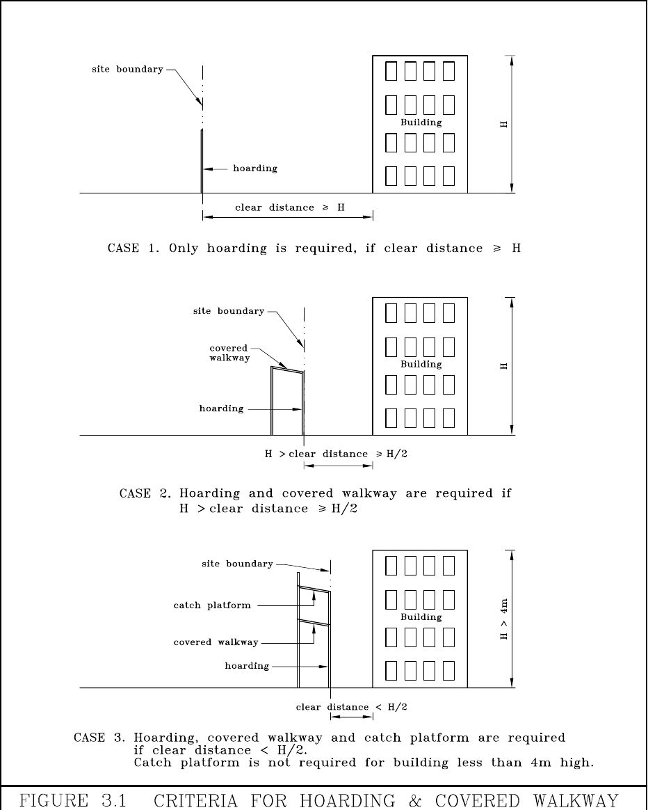
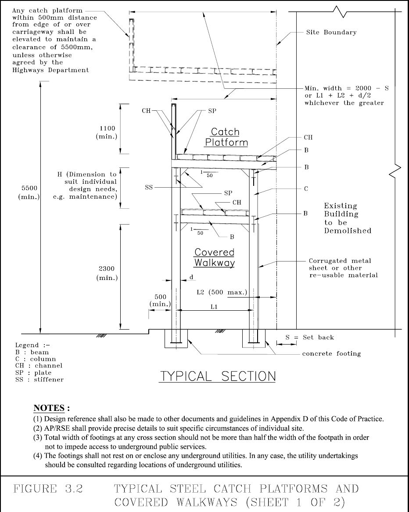
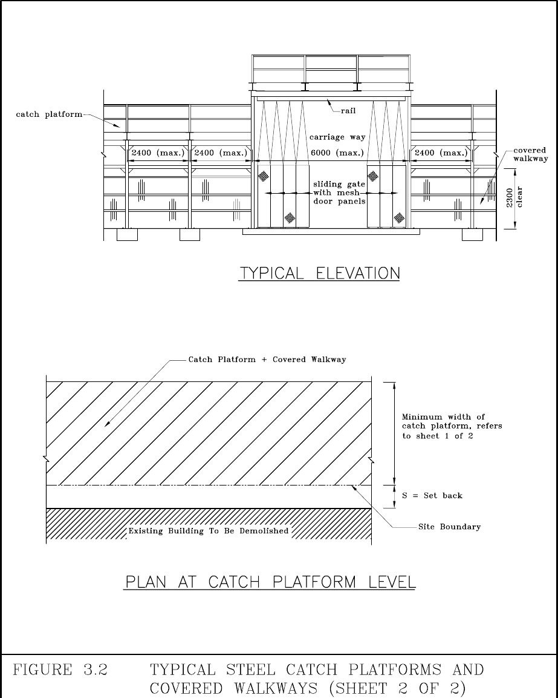

---
tags:
  - Code of Practice
  - Demolition 拆卸
  - Site safety 地盤安全
  - Site supervision 地盤監督
  - Hoarding 圍板
  - Structural 結構
  - Geotechnical 岩土
  - Lift 升降機
  - Building height 建築物高度
  - Concrete & materials 混凝土及物料
  - Minor works 小型工程
  - Foundation 地基
  - Drainage 排水
  - Balcony & utility platform 露台及工作平台
  - Wind 風力
  - Sustainable building design 可持續建築設計
  - Excavation & ELS 挖掘
  - Curtain wall & façade 幕牆及外牆
summary: "Code of Practice for Demolition of Buildings 2004 (with the 2016 and 2023 amendments): building and structural surveys, demolition plan and stability report, hoarding, covered walkway and catch platform criteria and loads, scaffolds, screens, catchfans, temporary supports and propping, party walls, debris handling, demolition methods and sequences, special structures and supervision."
keywords: demolition, 拆卸, demolition plan, 拆卸圖則, stability report, hoarding, 圍板, covered walkway, 有蓋行人道, catch platform, 承接平台, 5 kPa, 20 kN, catchfan, 防墮板, screen, nylon net, propping, 頂撐, Table 3.4, party wall, 共用牆, debris chute, top down, wrecking ball, implosion, prestressed, B(DW)R, B(A)R 8
---

# Code of Practice for Demolition of Buildings 2004 <small>《2004 年拆卸建築物作業守則》</small>

!!! info "Document info 文件資料"
    | | |
    |---|---|
    | **Edition 版本** | 2004; amendments **Sep 2016** (RGE role, scaffold ties, nylon net, catchfan, vibration, chutes) and **Oct 2023** (light plant propping, site interfaces, floor openings, debris chutes, exterior columns) ([APP-170](../pnap/app-170.md)) 2016 及 2023 年修訂 |
    | **Legal basis 法律依據** | Guidance for the [B(DW)R Cap. 123C](../regulations/bdwr-123c.md), [B(A)R 8(3)–(4)](../regulations/bar-123a.md) and BO s.14; demolition by a **Registered Specialist Contractor (Demolition)** 須由註冊專門承建商（拆卸）進行 |
    | **Structure 結構** | 1 General · 2 Planning · 3 Precautionary measures · 4 Methods · 5 Special structures · 6 Supervision · Appendices A–H |
    | **Source 原文** | [English (PDF)](https://www.bd.gov.hk/doc/en/resources/codes-and-references/code-and-design-manuals/Demolition_e2004.pdf) · [Oct 2023 amendment](https://www.bd.gov.hk/doc/en/resources/codes-and-references/code-and-design-manuals/Demolition_e2004_amendment_oct2023.pdf) · [Sep 2016 amendment](https://www.bd.gov.hk/doc/en/resources/codes-and-references/code-and-design-manuals/Demolition_e2004_amendment_sep2016.pdf) |
    | **Last checked 最後核對** | 2026-11-22 against the Code and both amendments |

## At a glance 重點摘要 {#at-a-glance}

=== "English"

    - Before demolition: a **building survey** and **structural survey**, then a **demolition plan** with a **stability report and calculations** (B(A)R 8(3)–(4)) for the building and everything around it.
    - **Hoarding / covered walkway / catch platform** depend on the clear distance (CD) from the building to the boundary versus the building height H: CD ≥ H hoarding only; CD < H covered walkway; CD < H/2 walkway **plus catch platform** (not for buildings under 4 m).
    - Covered walkway roof **5 kPa**; catch platform **5 kPa or 20 kN** on 300 × 300 mm; headroom **2.3 m**; catch platform ≥ **2 m** wide; **5.5 m** clear over the carriageway edge; upstand **1.1 m**; lighting 35–50 lux.
    - Scaffold with **two screen layers** (net + tarpaulin), plus a heavy-duty **nylon net** where needed (2016); **catchfan** ≤ **10 m** below the working floor, projecting **1.5 m** at 20–45°.
    - Machines on suspended floors: propping per **Table 3.4** (5,800 kg or 11,600 kg plant), props ≤ 1.2 m apart (1.5 m for light plant), no plant within **2 m** of edges or **1 m** of openings.
    - Demolish **top down**, in reverse order of construction; projections first; complex structures need a full-time **site engineer** (RPE) and more frequent supervision ([Site Supervision Code](site-supervision-2009.md#critical-stages)).

=== "中文"

    - 拆卸前須進行**樓宇勘察**及**結構勘察**，並提交附**穩定性報告及計算**的**拆卸圖則**（B(A)R 8(3)–(4)）。
    - **圍板／有蓋行人道／承接平台**按建築物與地界的淨距 CD 與建築物高度 H 比較：CD ≥ H 只需圍板；CD < H 須有蓋行人道；CD < H/2 須行人道**及承接平台**（4 米以下建築物免設平台）。
    - 有蓋行人道頂 **5 kPa**；承接平台 **5 kPa 或 20 kN**（300 × 300 毫米）；淨高 **2.3 米**；平台闊 ≥ **2 米**；行車道邊淨空 **5.5 米**；圍邊板 **1.1 米**；照明 35–50 lux。
    - 棚架須設**兩層防護**（網及帆布），需要時加**尼龍網**（2016 年）；**防墮板（斜棚）**設於工作層下 ≤ **10 米**，伸出 **1.5 米**，傾斜 20–45°。
    - 機械在懸空樓板上操作須按**表 3.4** 頂撐（5,800 或 11,600 公斤），頂撐間距 ≤ 1.2 米（輕型機械 1.5 米），離樓邊 **2 米**、開口 **1 米**內不得行駛。
    - 按**由上而下**、與建造相反次序拆卸；伸出物先拆；複雜結構須委任全職**地盤工程師**並加密監督。

!!! tip "Does it apply? 是否適用"
    **Applies 適用**: demolition of buildings, parts of buildings, basements, underground tanks and civil structures such as silos, industrial plants and piers. **Not** for Type G **minor works** under the MWCS (use the [Minor Works Technical Guidelines](../regulations/mw-technical-guidelines.md)) or major civil works (underpinning, excavation, bridges, dams). The **hoarding, covered walkway and catch platform rules (Section 3.2)** are also the usual design basis for hoardings for **new building works** ([APP-23](../pnap/app-23.md)). 第 3.2 節圍板準則亦常用於新建工程圍板設計。

## Definitions 定義 (1.2) {#definitions}

| Term 用詞 | Meaning 意思 |
|---|---|
| **Building height** 建築物高度 | From the top-most part of the building to be demolished to the **lowest ground level** |
| **Hoarding** 圍板 | Temporary fence along the site boundary separating the site from adjacent properties |
| **Covered walkway** 有蓋行人道 | Temporary structure with a protective roof along the boundary, on or next to the footpath |
| **Catch platform** 承接平台 | Temporary platform on top of the covered walkway, or under balconies and cantilevers being demolished, to catch debris |
| **Catchfan** 防墮板（斜棚） | Temporary structure round the outside of the building, on the scaffold, to catch debris falling outside |
| **Demolition plan** 拆卸圖則 | The plan prescribed by **B(A)R 8(3)** |
| **Stability report** 穩定性報告 | Report with calculations for the building, supports, neighbours and plant loads (**B(A)R 8(4)**) |
| Others | Blasting expert, implosion expert, hanging structure and tie, implosion, non-ventilated light well, party wall, public filling area, RSC (Demolition), RSE, **RGE** (added 2016), standards of scaffold, structural survey, thermal lance |

## Planning 規劃 (Section 2) {#planning}

### Building survey 樓宇勘察 (2.1.1) {#building-survey}

Retrieve record plans (if none: **on-site survey and material testing**, 2016). Survey items: (1) **age** and construction materials, deterioration of façades facing streets and projections over streets (2016); (2) past and present uses; (3) wastewater, hazardous, toxic, flammable, explosive, radioactive materials; (4) danger areas: enclosed voids, **non-ventilated light wells**; (5) neighbours: slopes, retaining walls, illegal structures, bridges, **railway** structures and facilities, overhead cables; (6) drainage, flooding, erosion; (7) **shared** staircases and **party walls**; (8) hoarding and covered walkway needs; (9) traffic; (10) headroom and space for loading debris; (11) sensitivity to noise, dust, vibration; EIAO designated projects; (12) space for on-site sorting; (13) street furniture. Hazardous materials: sample and test; remove under EPD, FSD, LD rules; soil contamination assessment where chemicals were stored.

### Structural survey 結構勘察 (2.1.2) {#structural-survey}

Study record framing plans; the **RSE** checks unusual details (e.g. upward-anchored tension bars in cantilevers). Survey: (1) **age** and materials; (2) original structural system; (3) construction method; (4) deterioration; (5) adjoining structures and their shoring; (6) **continuous structures** that will be truncated; (7) basements and tanks; (8) bracing; (9) wall types incl. **screen and retaining walls** (2016); (10) cantilevers; (11) fixtures such as signboards. Check special structures, possible modifications for demolition traffic, and limits on shoring. With no record plans: measure, test and expose key members.

### Demolition plan and stability report 拆卸圖則及穩定性報告 (2.1.3; Appendix B) {#demolition-plan}

| Demolition plan must show 拆卸圖則須顯示 | Stability report must include 穩定性報告須包括 |
|---|---|
| (1) Location, topography, ground removal / backfilling, **distances to neighbours, streets, street furniture** | (1) Stability of the building **at all stages** |
| (2) Floor plans and sections: uses, structural system, materials, condition, relation to neighbours (party walls, shared stairs, truncated frames, slopes, cables, services) | (2) With powered plant: calculations that the plant will not reduce the **margin of safety** of any building, structure, street, land or services |
| (3) **Unconventional elements**: prestressed, precast, stressed skin, steel frame, hangers, trusses, Vierendeel, deep beams, **beams > 10 m**, arches, **transfer plates**, earth-retaining buildings, **flat slabs**, hollow block ribbed slabs, large cantilevers | (3) Calculations for all **temporary supports and bracing** |
| (4) **Procedure and sequence**, method, limits on equipment | (4) Stability of neighbours, party walls, streets, land and services |
| (5) Plant routes, lifting onto the roof, strengthening, shoring and **floor propping** | (5) Calculations for supports to neighbours |
| (6) **Precautionary measures**: hoardings, covered walkways, catch platforms, catchfans, scaffolds, screens, nets | (6) That the works will not render inadequate the margin of safety of anything around |
| (7)–(8) Shoring for neighbours and for the building itself, at each stage | |
| (9) **Debris**: permitted accumulation, handling, routing, transport, timing, **truck records** (tonnage, plate, driver, trip tickets, dump site), supervisor, parking layout | |

### Utilities and hazardous materials 公用設施及有害物料 (2.2–2.3) {#utilities}

The AP records and arranges **termination** of all utilities (electricity, water, gas, telecom, drainage, cables, railway and sewage tunnels, disused tunnels) and ensures demolition does not affect those nearby. Keep **temporary water** (dust spraying), **telecom** and **electricity**, weather-proofed. **Asbestos** by specialists and disposed of as chemical waste ([ADV-1](../pnap/adv-1.md)); **soil contamination** test proposal and assessment to EPD.

## Hoarding, covered walkway and catch platform 圍板、有蓋行人道及承接平台 (3.2) {#hoarding}

### When each is needed 何時需要 (3.2.1; Fig. 3.1) {#hoarding-criteria}

| Clear distance CD from building to lot boundary 淨距 | Required 須提供 |
|---|---|
| **CD ≥ H** (building height) | **Hoarding** only 只需圍板 |
| **H/2 ≤ CD < H** | Hoarding + **covered walkway** 圍板及有蓋行人道 |
| **CD < H/2** | Hoarding + covered walkway + **catch platform** 加承接平台 (not required if the building is **< 4 m** high) |

Along the **full length** of the boundary next to public access (3.2.1(D)). The AP / RSE / **RGE** design them for the site (3.2, 2016).

<figure markdown>
  { width="560" loading=lazy }
  <figcaption>Figure 3.1 — Criteria for hoarding and covered walkway 圍板及有蓋行人道準則 <small>Source: Code of Practice for Demolition of Buildings 2004, Buildings Department 資料來源：屋宇署</small></figcaption>
</figure>

### Dimensions 尺寸 (3.2.2; Table 3.1) {#hoarding-dimensions}

| Item 項目 | Requirement 要求 |
|---|---|
| Covered walkway headroom 淨高 | **≥ 2.3 m** |
| Width on a **carriageway** 設於行車道 | Clear width **≥ 1.1 m** |
| Width on a **footpath**, pavement ≤ 2.5 m | Normally **1.5 m** minimum (exemption if the pavement is too narrow) |
| Pavement over 2.5 m to 3 m | **Pavement width − 0.8 m**, max. 2 m |
| Pavement over 3 m | **2 m** |
| Clear width | Not obstructed by signs, supports, scaffolds |
| Catch platform width 承接平台闊度 | **≥ 2 m** where it abuts a street; may be reduced by the building's setback |
| Gap walkway roof to catch platform | As design needs (e.g. maintenance) |
| Catch platform over carriageway edge | **≥ 5.5 m** clearance within **500 mm** of the carriageway edge, unless HyD agrees; **5.5 m** over a gantry as far as practicable |

### Loads and construction 荷載及構造 (3.2.3–3.2.6; Table 3.2) {#hoarding-loads}

| Item 項目 | Requirement 要求 |
|---|---|
| **Covered walkway roof** | UDL **5 kPa** |
| **Catch platform** | UDL **5 kPa**, or point load **20 kN** on **300 × 300 mm**, whichever is worse |
| Wind | Hoarding, walkway and platform for wind to the [Wind Code](wind-2019.md) |
| Use | No debris on the walkway roof; **no storage** in or on it; a contractor's shed over it must be **structurally independent**, its roof to the walkway or platform load |
| Roof form | **Pitched inwards**; **upstand edge board ≥ 1.1 m** from the toe of the catch platform's outer edge |
| Construction | Prefabricated, **bolted**, reusable; minimise site welding; use prefabricated shoring, GRP panels |
| **Lighting** 照明 | Average **35–50 lux** at floor level, weather-proof (e.g. 18 / 20 W 600 mm tubes at **3 m** spacing) |

<figure markdown>
  { width="560" loading=lazy }
  <figcaption>Figure 3.2 (1 of 2) — Typical steel catch platforms and covered walkways 典型鋼承接平台及有蓋行人道 <small>Source: Code of Practice for Demolition of Buildings 2004, Buildings Department 資料來源：屋宇署</small></figcaption>
</figure>

<figure markdown>
  { width="560" loading=lazy }
  <figcaption>Figure 3.2 (2 of 2) — Typical steel catch platforms and covered walkways 典型鋼承接平台及有蓋行人道 <small>Source: Code of Practice for Demolition of Buildings 2004, Buildings Department 資料來源：屋宇署</small></figcaption>
</figure>

## Scaffolds, screens and catchfans 棚架、防護網及防墮板 (3.3–3.4) {#scaffolds}

| Item 項目 | Requirement 要求 | Clause |
|---|---|---|
| Scaffold type | Bamboo or metal, to the **Construction Sites (Safety) Regulations** and LD codes; trained workers under a competent person | 3.3.1 |
| Elevated supports | Steel brackets or anchors carrying scaffold weight designed by the **RSE** | 3.3.1(A) |
| Working platforms | On the **three lifts** directly below the floor being demolished, with toe boards; clear debris regularly | 3.3.1(A) |
| **Bamboo scaffold** | Code of Practice for Bamboo Scaffolding Safety **and** BD [Bamboo Scaffold Guidelines](bd-guidelines.md#bamboo-scaffolds) (2016); ties **and struts** at **≤ 4 m** both ways; secure the part **above the top floor** (2016); steel brackets at **≤ 15 m** if over 15 m high | 3.3.1(B) |
| Metal scaffold | Code of Practice for Metal Scaffolding Safety; carry **three loaded lifts** plus self-weight | 3.3.1(C) |
| Dismantling | Keep pace with demolition; unbraced section **≤ 2 m** above the nearest anchor; secure the part above the floor being demolished (2016) | 3.3.1(D) |
| **Screens** | **Two layers**: heavy-duty net + **tarpaulin over it**, enclosing the building; meet the Construction Dust Regulation | 3.3.2(A) |
| Screen ties | **≤ 2 m** both ways (or the net width); overlap **≥ 300 mm** | 3.3.2(B) |
| Polyethylene net (Table 3.3) | String **1 mm**, **16 plys**, mesh **20 mm**, **130 g/m²**, UV resistant | 3.3.2(C) |
| **Nylon net** (2016) | Where appropriate, an extra heavy-duty nylon net, thread **≥ 3.5 mm**, mesh **≤ 50 mm**, as larger fragments can punch through | 3.3.2(C) |
| Tarpaulin | Light, **fire retardant**: BS 5867 **Type B** performance (2016), Japanese ministerial test, or equivalent | 3.3.2(D) |
| **Catchfan** | ≤ **10 m** below the working floor; projects **1.5 m** beyond the scaffold; **20°–45°**; not a support for loads; metal catchfans on **metal scaffolds only** | 3.4.1 |
| Bamboo catchfan | Supports at ≤ scaffold standard spacing or **1.3 m**; anchors **≤ 3 m** apart (anchor bolts, steel wire ties, or **through-bolts**, 2016); bamboo **≥ 40 mm**; decking at **≤ 200 mm**; tarpaulin, net and **0.5 mm** metal sheet, with **an extra bamboo layer tied over the sheet** against typhoons (revised Fig. 3.3, 2016) | 3.4.2 |
| Steel catchfan | Cantilevered steel framing; avoid expansion anchors as primary support; prefabricated, bolted | 3.4.3 |

## Temporary supports and propping 臨時支撐及頂撐 (3.5) {#temporary-supports}

**When needed** (3.5.1): excess loading from demolition, plant or debris; elements not self-supporting; stability impaired. Not removed until loads are gone; remaining supports are inspected and maintained by owner, AP, RSE, **RGE** and RSC.

- **Cantilevers**: never remove anchorage or holding-down load first unless temporarily supported. Cantilevers facing streets, **> 4 m** above ground and closer to the boundary than **H/2** need **temporary platforms** underneath for demolition and construction loads, unless removed by **cut and lift** (also noted on Appendix F and G figures, 2023).
- **Catch platforms** also under balconies, canopies and **any projection over a street** (2016), and special features; installed **before** demolition.
- **Neighbours**: support adjacent buildings, utilities, slopes, walls, truncated beams, exposed party walls, **common staircases** (keep access); stabilise any project left incomplete.

| Item 項目 | Rule 規定 | Clause |
|---|---|---|
| Materials | Structural steel, heavy timber, fill buttress; pre-manufactured props per manufacturer (test if capacity unknown); partitions not counted unless analysed; no damaged timber; used steel only with RSE approval, measured and checked | 3.5.2 |
| **Gravity loads** | Workers and tools **≥ 1.5 kPa**; debris and impact; machinery, **impact factor ≥ 1.25** | 3.5.3(A) |
| **Lateral loads** | Greater of calculated forces (slopes, plant, debris impact, wind), or **3% of vertical load** / **1.5 kN/m**, whichever is greater | 3.5.3(B) |
| Load path | Shore down to floors that can carry it; align props floor to floor; avoid differential settlement; check slab punching; use sleepers and base plates | 3.5.3(C) |

### Propping for machines on suspended floors 機械頂撐要求 (Table 3.4) {#propping-for-machines-on-suspended-floors-table-34}

| Design imposed load of floor 樓板設計荷載 | **1.5 kPa** (2023) | 3 kPa | 5 kPa | 7.5 kPa | 12.5 kPa |
|---|---|---|---|---|---|
| Max. plant weight 機械最大重量 | **5,800 kg** | 11,600 kg | 11,600 kg | 11,600 kg | 11,600 kg |
| Min. consecutive floors propped for the plant | 5 | 5 | 3 | 2 | 2 |
| Min. consecutive floors propped under a temporary ramp | 5 | 5 | 4 | 3 | 2 |
| Max. prop spacing each way 頂撐最大間距 | **1.5 m** | 1.2 m | 1.2 m | 1.2 m | 1.2 m |

Conditions: not for special or unconventional structures; **no debris accumulation** unless calculated; steel ramp **≤ 30°**; prop capacity **≥ 25 kN** under the plant and **≥ 45 kN** under the ramp; props braced in **2 directions with cross bracing at perimeter and end bays** (2016); top and bottom wedged tight; spreaders on ground. **Old buildings to the 1952 LCC codes** may be overstressed: any other arrangement needs full RSE substantiation (2016 note). Erect to plans; plumb; braced; dismantle only when no longer needed (3.5.6).

## Protecting neighbours, traffic and workers 保護鄰近物業、交通及工人 (3.6–3.8) {#protection}

| Topic 主題 | Requirement 要求 | Clause |
|---|---|---|
| **Party walls** 共用牆 | Keep and protect; demolish members next to them **by hand**; treat **each floor immediately** after it is demolished | 3.6.2 |
| Waterproofing | Clean, bonding agent, render **two 10 mm coats** (1:2:6 then 1:3:6 cement:lime:sand), or lapped waterproof paper; fill voids with concrete | 3.6.2(A) |
| Structural supports | Raking shores or steel stiffeners with protection (RSE design); leave stubs of common beams and slabs if possible; plan for permanent support in the new building | 3.6.2(B) |
| Foundations | Evaluate basements and foundations of neighbours; shoring or underpinning | 3.6.3 |
| **Traffic** | Avoid lane closures; if unavoidable, TD and Police permission and a **Traffic Impact Assessment**; site access with headroom, sightlines, segregation, lighting | 3.7 |
| Training | Induction and regular safety meetings; training on work at height, confined spaces, lifting, PPE, hot work, chemicals, health, plant zones (**HKIC**, 2023) | 3.8.1 |
| Equipment, electricity, fire | Daily inspection; proper supply (FIU Electricity Regs); remove flammables before welding; fire appliances | 3.8.2–3.8.4 |
| **Emergency exit** | At least **one** marked, lit, unobstructed exit route at all times | 3.8.6 |
| **Vibration** | PPV at adjoining structures **≤ 15 mm/s transient**, **≤ 7.5 mm/s prolonged** (2016, as [APP-137](../pnap/app-137.md)) | 3.8.7 |
| **Adjacent sites** (2023) | AP / RSE coordinate precautionary measures with the adjoining site's AP / RSE; amend plans if needed; RSC coordinates with neighbouring contractors | 3.8.8 |
| **Floor openings and free edges** (2023) | Solid fixed **marked covers**; railings: top **900–1,150 mm**, intermediate **450–600 mm**, toe board **200 mm**, bright safety mesh; safety nets where covers impracticable; otherwise fall arrest | 3.8.9 |
| **Debris through openings** (2023) | Only via chutes, full enclosures or shafts; **designated enclosed areas** accepted by AP / RSE, fenced, with warning notices; stop overhead conveying while clearing; chutes strong, fixed, enclosed at every entry, dust and noise controlled | 3.8.10 |

## Environment, debris and waste 環境、廢料及廢物 (3.9–3.10) {#debris}

| Topic 主題 | Requirement 要求 |
|---|---|
| Air, noise, water | Construction Dust Regulation; no burning; quiet plant; **Construction Noise Permit** for restricted hours; WPCO discharge licence |
| Asbestos | Asbestos Investigation Report; **Asbestos Abatement Plan ≥ 28 days** before abatement ([ADV-1](../pnap/adv-1.md)) |
| **Chutes** (3.10.1) | Nothing thrown from height; lift shafts, light wells (glass removed) and floor openings may be used; floor openings **< 25%** of floor area, each **≤ 900 × 900 mm** unless justified, not through structural members; exterior chutes only enclosed, no metal-barrel chutes; all chutes designed for strength (2016) |
| Recycling (3.10.2) | **Selective demolition**: strip furniture, metals, timber, tiles first; separate concrete and steel; crush concrete for reuse; CEDD advice |
| Dust, accumulation (3.10.3–3.10.4) | Water spraying with drainage control; **no debris accumulation** on floors unless calculated, nor against hoarding, walls, or behind or on top of retaining walls and slopes (2016) |
| **Debris management system** (3.10.5) | Handling method, routing, transport, timing, **truck records**, responsible supervisor |
| Loading (3.10.6) | Truck routes clear of props; ground-floor headroom and local strengthening; TD loading code |
| **Waste** (3.10.7) | Dispose under the **Waste Disposal Ordinance** (2023); sort on site; inert fill to public filling areas (earth, debris, rock, concrete only); **waste management plan** to AP / RSE / RGE ([ADV-19](../pnap/adv-19.md)) |

## Inspection and after demolition 巡查及完工後 (3.11–3.12) {#inspection}

- AP, RSE, **RGE** and RSC inspect at least at the [Supervision Code](site-supervision-2009.md#tm-table-1) frequencies; the RSC clears catchfans and catch platforms **daily**; the RSC's representative gives **full-time** supervision and checks partly demolished structures are stable **before leaving each day**.
- Deviation from the method statement: report; **no further demolition** until rectified and written instruction is given. Unsafe conditions: **stop all work**.
- **Scaffolds** inspected by a competent person before first use, after alterations or bad weather, and at intervals **≤ 14 days**, with a signed report.
- After demolition: level and drain the site; **enclose** it if not redeveloped at once; complete party-wall supports and weather-proofing with a final AP / RSE / RGE inspection; brace excavations; on slopes, seal the surface, stabilise, and pass the demolition plans to the next contractor.

## Methods of demolition 拆卸方法 (Section 4) {#methods}

| Method 方法 | Key rules 主要規定 | Clause |
|---|---|---|
| **General** | Reverse order of construction; top down suits most urban sites; projections by hand or cut and lift; wrecking ball and explosives with extreme care; Table 4.1 compares methods (applicability, noise, vibration, dust) | 4.1 |
| **Top down, manual** | Jack hammers, oxy-acetylene cutting; bars kept until concrete removed; pulling wires **≥ 4 ×** the pull force, checked **twice a day**, workers shielded | 4.2.1 |
| Sequence | (A) cantilevers and external features first; (B) roof structures top down; (C) slabs from **mid-span** to supports; (D) cantilever → secondary → main beams, propping beams losing restraint; (E) non-load-bearing before load-bearing walls; (F) columns after the beams above; (G) 1/F slab may be done by machine from the ground | 4.2.2 |
| Cantilevers | Supports, catch platform or temporary platform beneath; remove the linked external wall and any load first | 4.2.3 |
| External walls | Brick infill **pushed inward**, top down, layers **≤ 300 mm**, from outside platforms; frame bays **≤ 3 m** wide, wall sections **≤ 2 m**; **exterior columns tied at top and bottom** with wires and winches, pre-weakened at the base, pulled **inwards** (2023, revised Fig. 4.5) | 4.2.4 |
| Slabs, beams, columns | Two-way slab from the centre outwards; one-way in strips; flat slab from the centre of bays; interior beams after their slabs; columns pre-weakened and pulled | 4.2.5–4.2.7 |
| **Top down by machine** | Plant lifted onto the roof by crane (props below first); moves only in the **propped area**, never within **2 m** of edges, **1 m** of openings or on cantilevers, limits marked; ramps **≤ 1.75 : 1** (or per manufacturer), may be of compacted debris (2016); two floors may be worked together after descending | 4.3 |
| **Long-boom crusher** | Clear zone **≥ H/2**; firm ground; top down by section; debris platform **≤ 3 m** high, stable slopes | 4.4 |
| **Wrecking ball** | Top to bottom; vertical drop or in-line swing, no slewing; jib **≥ 3 m** above the part demolished; clearance to boundary **≥ 50% of H + 6 m** on all sides | 4.5 |
| **Implosion** | Risk and environmental assessments approved via BD; blasting design and pre-weakening; trench or bund; collapse inwards one or two floors at a time; exclusion zone | 4.6 |
| Other | NEDA (expansive agent); disc, chain and **wire saw**; diamond stitch drilling; **cut and lift** (check stability, support before cutting); pusher arm, deliberate collapse and wire rope pulling only for isolated buildings **< 15 m** high (push at ≥ 2/3 height, ≤ 600 mm below top); clam shell ≥ 1 m above; **thermal lance** only if no alternative; water jet with containment | 4.7 |

## Special structures 特殊結構 (Section 5) {#special-structures}

| Structure | Key points 要點 |
|---|---|
| **Precast** (5.1) | Simple: reverse order, keep stabilising elements, do not reuse lifting points unless verified; continuous: cut joints keeping lateral stability |
| **Prestressed** (5.2; App. C) | Classes I (precast P1–P3), II (cast-in-place C1–C3), III; **shore before detensioning**; sandbag or plywood screens at anchorages; procedures by an engineer experienced in prestressing; App. C helps identify prestress (span / depth ratios) |
| **Statically determinate** (5.3) | Cantilevers demolished before their supports or shored; trusses lifted down or each stage checked |
| **Steel and composite** (5.4) | Joints often simple: may become statically determinate; check slender members when restraints are removed |
| **Cladding walls** (5.5) | Each panel fully supported by crane before disconnecting; reverse order |
| **Hanging structures** (5.6) | Demolish from the **bottom up**; destress ties before cutting; keep the main gravity and bracing structure until all ties are released |
| **Oil storage** (5.7) | Clean and degas; chemical waste rules; inform FSD / Gas Standards Office; avoid flame cutting; soil contamination assessment after |
| **Marine** (5.8) | Soundings; check platforms for plant; remove debris from the seabed unless to be reclaimed; piles pulled or cut **≥ 3 m** below seabed |
| **Underground** (5.9) | Combine with new foundations; check **uplift**; geotechnical shoring evaluation; floors acting as props kept until replaced |
| **Supporting ground or on slopes** (5.10) | Plan by an **RGE** (2016); leave enough building to retain ground, buttress or shore; stabilise before removing retaining walls; no debris on slopes or behind walls |

## Supervision 監督 (Section 6) {#supervision}

- A **supervision plan** under the [TM and Supervision Code](site-supervision-2009.md) (6.1).
- **Complex structures** (flat slab, prestressed, transfer plate, hanger, beam > 10 m, steel frame, cantilever > 1.2 m over a street, buildings retaining ground > **1.5 m**): the RSC appoints a full-time **site engineer**, an RPE (structural, civil or building) or as the PNAP requires (6.2); RC's T5 full time and RSE's T5 twice a week ([Table 9.1](site-supervision-2009.md#critical-stages)).

## Procedure, checklists and notices 程序、核對表及通知 (Appendices A, B, D, E, H) {#procedure}

| Step 步驟 | What 內容 |
|---|---|
| 1. Surveys | Building and structural surveys; hazardous materials sampling |
| 2. Demolition plan | Plan + stability report with calculations to BD (**App. B checklist**); referrals through central processing |
| 3. Consent | Specified form for consent with: **supervision plan**; TCP names meeting **B(DW)R 8**; plant operators meeting **B(DW)R 9**; **debris management system**; site engineer (6.2) if required; **Chinese translation** of procedures; **video camera** set up ([APP-21](../pnap/app-21.md)) (App. A 1.10, App. E 4) |
| 4. Notices | Utilities terminated; EPD notifications (asbestos, noise permit, dust); **Form BA10**; post **Form BA20** near the entrance (HKID partly redacted, 2023) |
| 5. During works | Precautions and supports installed first; progress per method statement and approval of AP / RSE / RGE; debris removed regularly; dust control; full-time supervisor; **video record** of the whole process; party wall protection; scaffold inspection, and **before and after typhoons** |
| 6. Completion | Post-demolition precautions; completion certificate |

**Appendix D** lists the laws and documents: BO, B(A)R, B(C)R, B(DW)R, B(P)R, B(MW)R, this Code, Bamboo Scaffold Guidelines, Loading Code, Supervision Code, [APP-21](../pnap/app-21.md), [APP-23](../pnap/app-23.md), APP-69, APP-86, APP-96, [APP-141](../pnap/app-141.md), [ADV-1](../pnap/adv-1.md), [ADV-19](../pnap/adv-19.md), PNRC 4, 6, 38, the TM, and the MWCS guidelines. **Appendices F and G** are worked examples of a demolition plan and stability report for the **manual** and **machine** top-down methods. **Appendix H** is the flow chart of the demolition procedure.

## Step-by-step: hoarding for a demolition or new building site 逐步核對：圍板 {#step-by-step}

| Step 步驟 | Check 核對 | Clause |
|---|---|---|
| 1 | Measure the **building height H** (top to lowest ground) and the **clear distance CD** to each boundary with public access | 1.2, 3.2.1 |
| 2 | For each frontage: CD ≥ H → hoarding; H/2 ≤ CD < H → covered walkway; CD < H/2 → walkway + catch platform (if H ≥ 4 m) | 3.2.1, Fig. 3.1 |
| 3 | Walkway clear width from the existing pavement (Table 3.1) or 1.1 m on a carriageway; headroom 2.3 m | 3.2.2 |
| 4 | Catch platform width ≥ 2 m (less the building setback); 5.5 m clearance near the carriageway edge | 3.2.2 |
| 5 | Design loads: roof 5 kPa; platform 5 kPa or 20 kN on 300 × 300 mm; wind | 3.2.3 |
| 6 | Details: inward pitch, 1.1 m upstand, bolted prefabricated members, 35–50 lux lighting | 3.2.4–3.2.6 |
| 7 | Add temporary platforms under cantilevers > 4 m high within H/2, unless cut and lift | 3.5.1(B) |
| 8 | Hoarding permit, street furniture, trees, traffic: [APP-23](../pnap/app-23.md), B(P)R 64–66 | — |

## Worked example: hoarding and catch platform 計算例子：圍板及承接平台 {#worked-example}

!!! example "Illustrative only 只作說明"
    The site and numbers are **made up** to show the method; check every real case against the Code, APP-23 and the approved plans. 以下數字為虛構，只用作說明。

**Site**: a 12-storey building, **H = 38 m**, to be demolished. Front: building at **2.0 m** from the boundary on a street with a **3.5 m** pavement. Side lane: building **25 m** from the boundary. Rear: **40 m** to the boundary. Balconies project **1.2 m** at 4/F and above.

| Frontage | CD vs H | Required | Details |
|---|---|---|---|
| Front | 2.0 m < H/2 = 19 m | Hoarding + **covered walkway + catch platform** | Pavement 3.5 m > 3 m → walkway clear width **2 m**; headroom **2.3 m**; catch platform ≥ **2 m** wide, which the Code allows to be reduced by the building setback (2.0 m here); since a catch platform is still required (CD < H/2), agree the width with BD — this example keeps **2 m** over the walkway; if its edge is within 500 mm of the carriageway, keep **5.5 m** clearance |
| Side lane | H/2 = 19 ≤ 25 m < 38 m | Hoarding + **covered walkway** | Width per the lane pavement (Table 3.1) |
| Rear | 40 m ≥ 38 m | **Hoarding only** | — |

**Loads**: walkway roof 5 kPa; catch platform 5 kPa or a **20 kN** point load on 300 × 300 mm, whichever governs each member (for a 2 m wide platform spanning 3 m between brackets, check the 20 kN point load at mid-span for bending and the 5 kPa UDL for the brackets); wind to the Wind Code.

**Balconies**: 1.2 m projection at more than 4 m above ground, and the building is closer than H/2 to the street → **temporary platforms** under them during demolition (designed for demolition and construction loads), or remove them by **cut and lift**. The front catch platform must also cover the area under them (3.5.1(C)).

**Machines**: if a 5,000 kg excavator works on floors designed for **3 kPa**, Table 3.4 allows up to 11,600 kg with **5 consecutive floors** propped at **1.2 m** centres (25 kN props, 45 kN under the ramp). A 5,800 kg plant on a 1.5 kPa floor would also need 5 floors but props at 1.5 m.

## Whole picture 整體關係 {#whole-picture}

| Topic 主題 | Where 文件 |
|---|---|
| Amendments 修訂 | [APP-170](../pnap/app-170.md) |
| Public safety in demolition 公眾安全 | [APP-21](../pnap/app-21.md) |
| Hoardings, covered walkways, gantries 圍板 | [APP-23](../pnap/app-23.md) · [B(P)R 50–70](../regulations/bpr-50-70.md) |
| Demolition regulations 拆卸規例 | [B(DW)R Cap. 123C](../regulations/bdwr-123c.md) · [B(A)R](../regulations/bar-123a.md) |
| Supervision 監督 | [Site Supervision Code](site-supervision-2009.md) · [ADM-13](../pnap/adm-13.md) |
| Asbestos, waste 石棉及廢料 | [ADV-1](../pnap/adv-1.md) · [ADV-19](../pnap/adv-19.md) |
| Vibration 振動 | [APP-137](../pnap/app-137.md) |
| Minor works 小型工程 | [MW Technical Guidelines](../regulations/mw-technical-guidelines.md) |
| Loads and wind 荷載 | [Dead & Imposed Loads](dil-2011.md) · [Wind Code](wind-2019.md) |

<!-- CL START -->
## Related circular letters 相關通告函件 {#circular-letters}

- 🟢 [GB 5725‑2025 "Fall protection – Safety nets"](../circulars/2026.md#cl-fpsn2026) <small>31 Aug 2026 · GB 5725‑2025《墜落防護 安全網》</small>
- 🟢 [Use of Fire Retardant Protective Net/Screen/Tarpaulin/Plastic Sheeting on Facade of Buildings under Construction, Demolition, Repair or Minor Works](../circulars/2025.md#cl-ufrpnstpsfbcdrmw2025) <small>21 Oct 2025 · 就正在興建、拆卸，或進行修葺或小型工程的建築物在外牆裝設阻燃保護網／保護幕／防水油布／塑膠帆布須知</small>
- 🟢 [Precautionary Measures for Repair Works of External Walls in Buildings](../circulars/2023.md#cl-rwew2023) <small>28 Aug 2023 · 大廈外牆修葺工程的防護措施</small>
<!-- CL END -->

## Related 相關文件 {#related}

[B(DW)R Cap. 123C](../regulations/bdwr-123c.md) · [APP-21](../pnap/app-21.md) · [APP-23](../pnap/app-23.md) · [APP-170](../pnap/app-170.md) · [Site Supervision Code](site-supervision-2009.md)

---
<small>Summary of the Code and its amendments for reference. Wording and figures: see the official Code. 本頁為守則摘要，以官方守則為準。</small>
