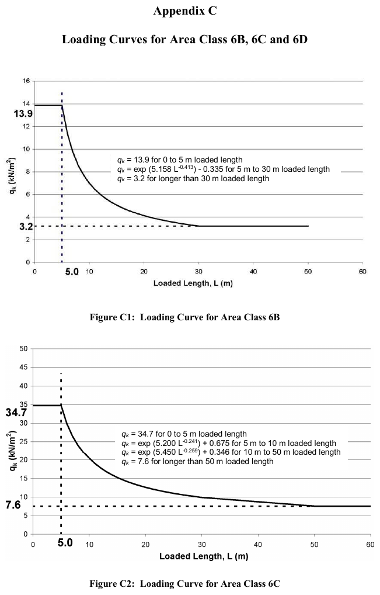
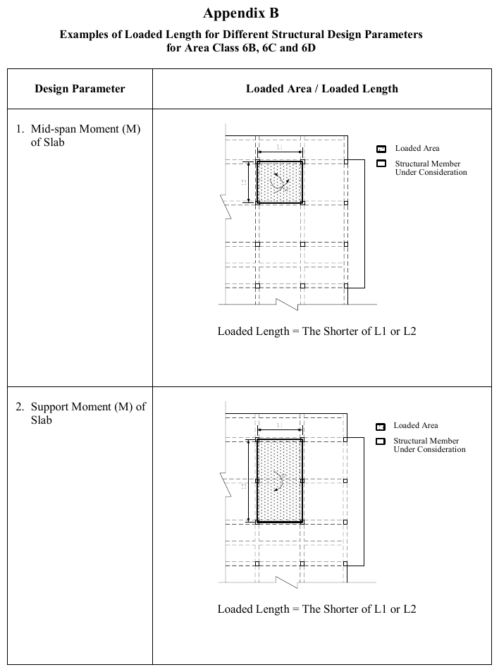
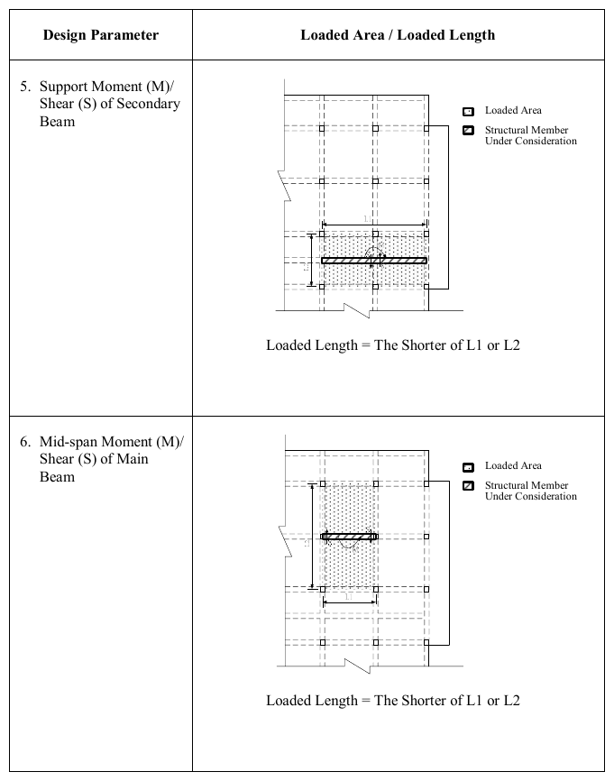

---
tags:
  - Code of Practice
  - Structural 結構
  - Loads 荷載
  - Protective barrier 防護欄障
  - Car park 停車場
  - Balcony & utility platform 露台及工作平台
  - Means of access 救援通道
  - Plant rooms 機房
  - Domestic 住用
  - Concrete & materials 混凝土及物料
  - Refuse 垃圾
  - Refuge floor 庇護層
  - Hotel 酒店
  - Green & amenity features 環保及適意設施
  - Foundation 地基
  - Wind 風力
  - Geotechnical 岩土
  - Curtain wall & façade 幕牆及外牆
  - Barrier free access 無障礙
  - Drainage 排水
  - Maintenance access 維修通道
  - Industrial building 工業大廈
summary: "Minimum imposed loads by use, vehicle classes, roof and balcony loads, reductions and barrier loads."
keywords: loading code, dead load, imposed load, live load, 恒載, 外加荷載, 活荷載, barrier load, 欄障荷載, kPa
---

# Code of Practice for Dead and Imposed Loads 2011 <small>《2011 年恒載及外加荷載作業守則》</small>

!!! info "Document info 文件資料"
    | | |
    |---|---|
    | **Edition 版本** | 2011 (2021 Edition), incorporating the 2014, 2016 and 2020 amendments 已納入 2014、2016、2020 年修訂 |
    | **Legal basis 法律依據** | Deemed-to-satisfy the [B(C)R](../regulations/bcr-123q.md) load provisions; values quoted from B(C)R are statutory 符合即當作符合規例 |
    | **Structure 結構** | 1 General · 2 Dead loads · 3 Imposed loads (3.1–3.11) · 4 Loads not prescribed · Appendices A (densities), B (loaded lengths), C (loading curves) |
    | **Source 原文** | [English (PDF)](https://www.bd.gov.hk/doc/en/resources/codes-and-references/code-and-design-manuals/DIL2011e.pdf) · [中文 (PDF)](https://www.bd.gov.hk/doc/tc/resources/codes-and-references/code-and-design-manuals/DIL2011c.pdf) |
    | **Last checked 最後核對** | 2026-11-22 against the 2021 Edition, clause by clause 逐條核對 |

## At a glance 重點摘要 {#at-a-glance}

=== "English"

    - **Dead loads** (Section 2) include the structure, finishes, fixed services, soil and drainage for **greenery**, and partitions **shown on the approved plans**. Columbarium niches: at least **2.0 kN/m per metre height** (lightweight) or **4.5** (concrete).
    - **Imposed loads** (Section 3) are **minimum, unfactored characteristic** values in **8 classes**. Check the distributed load **qk** and the concentrated load **Qk** separately.
    - **Partitions not shown on plans**: at least **1/3 of the weight per metre run** as a UDL, and at least **1 kPa** in offices.
    - **Reductions** for beams (up to **20 %**) and columns (up to **40 %**); no reduction for storage, vehicles, plant or partitions.
    - **Barriers**: line load **0.75 / 1.5 / 3.0 kN/m** at **1.1 m** height, depending on crowding. **Vehicle barriers**: F = 0.5Mv²/(δc+δb).
    - **Fire engine access**: also check **230 kN over 950 × 750 mm** and **100 kN over 300 × 300 mm**.
    - **Construction loads are not covered**; the designer must consider them separately (cl. 1.1.4).

=== "中文"

    - **恒載**（第 2 節）包括結構、飾面、固定設備、**綠化**用泥土及排水層，以及**已在核准圖則上顯示**的間隔牆。骨灰龕：每米高度每米長最少 **2.0 千牛**（輕質）或 **4.5 千牛**（混凝土）。
    - **外加荷載**（第 3 節）是**最低、未乘系數**的特徵值，分 **8 類**；均布荷載 **qk** 及集中荷載 **Qk** 須分開驗算。
    - **未在圖則顯示的間隔牆**：以每米長重量的 **1/3** 作均布荷載，辦公室最少 **1 千帕**。
    - **荷載折減**：樑最多 **20%**、柱最多 **40%**；貯物、車輛、機器、間隔牆不可折減。
    - **欄障**：視人羣擠迫程度，於 **1.1 米**高施加 **0.75／1.5／3.0 千牛／米**線荷載；**防撞欄**按 F = 0.5Mv²/(δc+δb)。
    - **消防車通道**另須驗算 **230 千牛（950 × 750 毫米）**及 **100 千牛（300 × 300 毫米）**。
    - **施工荷載不在本守則範圍**，設計者須另行考慮（第 1.1.4 條）。

!!! tip "Does it apply? 是否適用？"
    Every structural submission under the [Buildings Ordinance](../regulations/bo-part-2-building-works.md) – buildings, streets, building works and street works – uses this Code for dead and imposed loads. Wind loads are in the [Wind Code 2019](wind-2019.md); load factors and combinations are in the material codes ([concrete](concrete-2013.md), [steel](steel-2011.md)). 所有建築物、街道及相關工程的結構設計均須按本守則計算恒載及外加荷載；風荷載見風力守則，荷載系數及組合見各物料守則。

## 1 General 總則

| Clause 條文 | Requirement 要求 |
|---|---|
| 1.1.1 | Scope: dead and imposed loads for **building, street, building works and street works** in Hong Kong. 適用範圍。 |
| 1.1.2 | Uses not prescribed in B(C)R or Section 3: base on **reliable information or data**, or Section 4, subject to **BA acceptance**. 未列明用途須以可靠資料釐定，並經建築事務監督接納。 |
| 1.1.2.1 | Reliable information: CEDD **Port Works Design Manual** (marine structures); HyD **Structures Design Manual for Highways and Railways (SDM)**. 可靠資料例子。 |
| 1.1.2.2 | Reliable data: research by recognised academic institutions; international standards or codes; accredited laboratory reports; supplier or manufacturer literature. 可靠數據例子。 |
| 1.1.3 | All values are **unfactored**; take them as **characteristic loads** in limit state design. 全部為未乘系數的特徵荷載。 |
| 1.1.4 | **Construction loads are not covered**; the designer considers them and their effects. 施工荷載不包括在內。 |
| 1.2 | Symbols: qk (kPa) UDL; Qk (kN or kN/m) point or line load; M vehicle mass (kg); v velocity (m/s); δc vehicle deformation, δb barrier deflection (mm); γ ramp factor. 符號。 |

## 2 Dead loads 恒載 {#dead-loads}

| Clause 條文 | Requirement 要求 |
|---|---|
| 2.1.1 | Dead loads are the self-weight of **permanent** items acting throughout the service life with insignificant variation: (a) structure; (b) affixed elements – windows, cladding; (c) non-structural elements – finishes, roofing, surfacing, linings, kerbs, suspended ceilings, insulation, earth and ballast; (d) permanent equipment – fixed wiring and reticulated services; (e) **partitions shown on the plans submitted to BD**; (f) **soil fill, waterproofing and drainage for gardening, greenery or planting**. 恒載內容。 |
| 2.1.2 | **Tanks** and receptacles are dead load; their **contents are imposed load**. 水缸本身屬恒載，缸內物屬外加荷載。 |
| 2.1.3 | If permanency is in doubt, treat as **imposed load**, and do **not reduce** it under cl. 3.7 for beams and vertical members. 永久性存疑者作外加荷載，且不可折減。 |
| 2.2.1 | Calculate from dimensions and densities (Appendix A); other materials from reliable data. 按尺寸及密度計算。 |
| 2.2.2 | Partitions **shown on plans** = dead load by the layout; envisaged but **not shown** = imposed load under cl. 3.6. 間隔牆。 |
| 2.2.3 | Roofing (membrane, screed, tiles) from component weights; **roof greenery** – soil, waterproofing, drainage and plants – is dead load. 天台綠化屬恒載。 |
| 2.2.4 | Cladding (aluminium, metal, granite, limestone, marble and fixings) and finishes (plaster, screeds, wall panels, suspended ceilings, floor finishes). 外牆覆面及飾面。 |
| 2.2.5 | **Columbarium niches**: by material and urn weight; lightweight (wood, light metal) ≥ **2.0 kN/m length per m height**; concrete ≥ **4.5 kN/m per m height**. 骨灰龕。 |

### Appendix A – Densities of materials 物料密度 {#appendix-a-densities}

| Material 物料 | kN/m³ | Material 物料 | kN/m³ |
|---|---|---|---|
| Plain concrete (with or without PFA) 素混凝土 | 23.6 | Cement mortar 水泥砂漿 | 23 |
| **Reinforced / prestressed concrete** 鋼筋／預應力混凝土 | **24.5** | Gypsum mortar 石膏砂漿 | 18 |
| Brickwork 磚 | 21.7 | Lime-cement mortar 石灰水泥砂漿 | 20 |
| Concrete blocks 混凝土磚 | 20.6 | Lime mortar 石灰砂漿 | 18 |
| Aluminium 鋁 | 27.2 | Granite 花崗岩 | 29 |
| Brass 黃銅 | 83.3 | Marble 雲石 | 27 |
| Bronze / Copper 青銅／銅 | 87.7 | Basalt 玄武岩 | 30 |
| Cast iron 鑄鐵 | 70.7 | Sandstone 砂岩 | 25 |
| Wrought iron 熟鐵 | 75.4 | Slate 板岩 | 28 |
| Lead 鉛 | 111.0 | Timber 木材 | Supplier's spec 按供應商 |
| **Steel** 鋼 | **77.0** | Hardboard / Chipboard 硬質板／刨花板 | 11 / 8 |
| Zinc 鋅 | 70.0 | Plywood / Blockboard / Wood-wool 夾板／木芯板／木絲板 | 6 / 5 / 6 |
| **Glass** 玻璃 | **26** | **Soil** 泥土 | **20** |
| Acrylic sheet 亞加力板 | 12 | Asphaltic concrete 瀝青混凝土 | 25 |
| Mastic asphalt 瑪蹄脂瀝青 | 18 | Hot rolled asphalt 熱軋瀝青 | 23 |

## 3.1 Imposed loads – general 外加荷載總則 {#imposed-general}

| Clause 條文 | Requirement 要求 |
|---|---|
| 3.1.1 | Imposed load = the **greatest applied load likely** from the intended use during the service life, including forces from adjacent ground, excluding dead and wind loads (B(C)R). 法定定義。 |
| 3.1.2 | Tabled values are **minimums**; use higher values where the intended use, equipment, machinery or displayed items warrant. 表列為最低值。 |
| 3.1.3–3.1.4 | Use qk **or** Qk, whichever is more adverse; consider them **separately**. 兩者分開驗算，取較不利者。 |
| 3.1.5 | Apply qk to one or more areas (pattern loading) for the most adverse effect. 按最不利排列施加。 |
| 3.1.6 | Apply Qk at the most adverse position, spread over the stated contact area. 集中荷載置於最不利位置。 |
| 3.1.7–3.1.8 | Reductions (cl. 3.7), partition allowance (cl. 3.6) and horizontal loads (cl. 3.8) as appropriate. |

## Classes of floor use 樓面用途類別 (Table 3.1) {#classes-of-floor-use-table-31}

| Class 類別 | Use 用途 |
|---|---|
| 1 | Domestic and residential 住用 |
| 2 | Offices and non-industrial workplaces 辦公室 |
| 3 | Where people may congregate 人羣聚集 (3A tables · 3B fixed seats · 3C no obstacles · 3D physical activity) |
| 4 | Shopping 購物 |
| 5 | Storage, equipment, plant, industrial 貯物、機房、工業 |
| 6 | Vehicular traffic 車輛 (6A–6E) |
| 7 | Roofs 天台 (7A–7D) |
| 8 | Affiliated elements 附屬構件 (balconies, hoods, stairs) |

## Minimum imposed loads 最低外加荷載 (Table 3.2, full) {#minimum-imposed-loads-table-32-selected}

Qk for Classes 1–5 acts on any **50 mm square** (cl. 3.2.2). 第 1–5 類集中荷載作用於 50 毫米方形面積。

| Class | Specific use 用途 | qk (kPa) | Qk (kN) |
|---|---|---|---|
| **1** Domestic 住用 | Domestic uses; dormitories 住宅、宿舍 | 2.0 | 2.0 |
| 1 | Hotel, motel, guesthouse sitting rooms, bedrooms, toilets 酒店客房 | 2.0 | 2.0 |
| 1 | Hospital wards, nursing homes, **RCHE** bedrooms and toilets 病房、安老院 | 2.0 | 2.0 |
| 1 | Bathrooms (**Jacuzzi assessed separately**); pantries; kitchens 浴室（按摩浴缸另計）、茶水間、廚房 | 2.0 | 2.0 |
| **2** Offices 辦公室 | Medical consulting or treatment rooms; operating theatres, X-ray rooms 診療室、手術室 | 2.5 | 3.0 |
| 2 | Laboratories; light workrooms (no central power machines or storage); **general offices**; light electrical / electronic rooms; **meter rooms** (no storage); pantries 實驗室、辦公室、電錶房 | **3.0** | 4.5 |
| 2 | Banking halls; kitchens and laundries not in domestic buildings 銀行大堂、非住宅廚房及洗衣房 | 4.0 | 4.5 |
| 2 | Projection rooms 放映室 | 5.0 | 4.5 |
| **3A** Tables 有桌 | Childcare centres, kindergartens 幼兒中心、幼稚園 | 2.5 | 3.0 |
| 3A | Classrooms, lecture, tutorial, computer rooms; internet centres; private clubs with cubicles; massage, sauna, bath houses (pools assessed separately); reading rooms without book storage 課室、會所、桑拿、閱覽室 | 3.0 | 4.5 |
| 3A | Cafes, **mahjong parlours**, amusement game centres; restaurants, night-clubs, bars, canteens, fast food, non-domestic dining 餐廳、麻雀館 | **4.0** | 4.5 |
| **3B** Fixed seats 固定座位 | Assembly with fixed seating; places of worship with fixed seating 固定座位集會、宗教場所 | 4.0 | 4.5 |
| 3B | Concert halls; conference and waiting rooms; **grandstands** (see cl. 3.8.2); public halls, theatres, cinemas 音樂廳、會議室、看台、戲院 | 5.0 | 4.5 |
| **3C** No obstacles 無障礙物 | **Columbaria** (areas other than niches) 骨灰安置所（龕位以外） | 4.0 | 4.5 |
| 3C | Art galleries, museums; assembly without fixed seats; **refuge floors**; footbridges, footpaths, terraces, plazas; open garden areas (incl. grass turf) 博物館、**庇護層**、天橋、廣場、花園 | **5.0** | 4.5 |
| **3D** Activities 活動 | Billiard rooms, bowling alleys; dance practice rooms 桌球室、保齡球場、舞蹈室 | 3.0 | 4.5 |
| 3D | Dance halls, karaoke, discotheques, gymnasia; ice rinks (ice separate), ball courts, golf driving ranges 舞廳、卡拉OK、健身室、溜冰場、球場 | 5.0 | 4.5 |
| 3D | Stages, TV studios used as stages 舞台 | 7.5 | 9.0 |
| **4** Shopping 購物 | Department stores, supermarkets, markets, shops (stacking areas → Class 5) 商場、超市、街市 | **5.0** | 4.5 |
| **5** Storage 貯物 | Library rooms with book storage (not stack rooms); office storage and filing 圖書室、檔案室 | 5.0 | 4.5 |
| 5 | **Refuse storage**; general storage incl. warehouses 垃圾房、一般貯物、倉庫 | 2.5 per m height 每米貯物高度 | by weight, ≥ 9.0 |
| 5 | Stack rooms in book stores and libraries 書庫 | 3.5 per m, ≥ 10.0 | by weight, ≥ 9.0 |
| 5 | Cold storage 冷藏庫 | 5.0 per m, ≥ 15.0 | by weight, ≥ 9.0 |
| 5 | Paper storage in printing plants 印刷廠紙張 | 8.0 per m | by weight, ≥ 9.0 |
| 5 | **Battery and UPS rooms** 電池房 | 10.0 per m | by weight, ≥ 9.0 |
| 5 | **Plant, boiler, fan, motor rooms** 機房 | **7.5** | 9.0 |
| 5 | Workshops and factories: light / medium / heavy / printing 工廠：輕／中／重／印刷 | 5.0 / 7.5 / 10.0 / 12.5 | 9.0 |

<small>Note 2: storage height is from the floor to the physical limit formed by a ceiling, slab soffit, roof or other obstruction. 貯物高度量至天花、樓板底或其他阻礙物。</small>

## Vehicles 車輛 (Tables 3.3–3.6) {#vehicles-tables-3336}

Classes follow the gross vehicle weights in the Road Traffic (Construction and Maintenance of Vehicles) Regulations, Cap. 374A (cl. 3.3.1). 分類按《道路交通（車輛構造及保養）規例》。

| Class | Vehicles 車輛 | qk (kPa) | Qk (kN), contact area |
|---|---|---|---|
| **6A** ≤ 3,000 kg | Private cars, taxis, van-type LGV, motorcycles 私家車、的士 | **3.0** (**×2** for double-deck parking 雙層泊車加倍) | 20 on 200 mm sq. |
| **6B** ≤ 5,500 kg | Light goods vehicles, light buses ≤ 16 passengers 輕型貨車、小巴 | Table 3.6 | 30 on 200 mm sq. |
| **6C** ≤ 24,000 kg | Medium goods, single and double-deck buses, coaches 中型貨車、巴士 | Table 3.6 | 60 on 300 mm sq. |
| **6D** ≤ 30,000 kg | **Fire engines**, refuse collection vehicles, rigid HGV 消防車、垃圾車 | Table 3.6 | 80 on 300 mm sq. |
| **6E** other | Articulated HGV 拖頭 | HA / HB per SDM 路政署手冊 | — |

- **3.3.2** Loading/unloading areas **and the driveways leading to them** are 6B, 6C or 6D by vehicle use. 上落貨區及其車道屬 6B–6D。
- **3.3.3** **Fire engine areas**: in addition check **230 kN over 950 × 750 mm** and **100 kN over 300 × 300 mm**. See [EVA requirements](fsc-part-d-means-of-access.md) and [B(P)R 41D](../regulations/bpr-parts-1-2.md). 消防車通道附加集中荷載。
- Table 3.5 note: 6B–6D loads may also be derived by recognised engineering principles. 亦可按認可工程原理釐定。

### Table 3.6 – qk by loaded length 按受荷長度的均布荷載

| L (m) | 0–5 | 6 | 7 | 8 | 9 | 10 | 12 | 14 | 16 | 18 | 20 | 25 | 30 | 35 | 40 | 45 | ≥ 50 |
|---|---|---|---|---|---|---|---|---|---|---|---|---|---|---|---|---|---|
| **6B** | 13.9 | 11.4 | 9.7 | 8.6 | 7.7 | 7.0 | 6.0 | 5.3 | 4.8 | 4.4 | 4.1 | 3.6 | 3.2 | 3.2 | 3.2 | 3.2 | 3.2 |
| **6C** | 34.7 | 29.9 | 26.6 | 24.0 | 22.0 | 20.5 | 17.9 | 16.0 | 14.6 | 13.5 | 12.6 | 11.0 | 9.9 | 9.1 | 8.5 | 8.0 | 7.6 |
| **6D** | 46.6 | 39.4 | 34.4 | 30.6 | 27.8 | 25.5 | 21.9 | 19.4 | 17.6 | 16.2 | 15.1 | 13.1 | 11.8 | 10.9 | 10.2 | 9.6 | 9.2 |

Interpolate linearly, or use the Appendix C curves. 中間值可線性內插或用附錄 C 曲線。

**Loaded length (cl. 3.3.6.2)** 受荷長度：

- The **shorter side** of the loaded area, and the **full base length of the adverse area**. 受荷範圍的較短邊，亦即不利範圍的全長。
- For continuous construction with several adverse areas, use the adverse area or combination giving the maximum effect, with the load for the full base length or the **sum** of the base lengths combined. 連續結構按不利範圍組合，以長度總和取值。
- **Exception**: where traffic direction cannot change (other than reverse flow) because of physical constraints, e.g. an **access ramp**, measure along the traffic direction. 車道方向固定（如斜道）可沿行車方向量度。

**Appendix C loading curves** 荷載曲線（L in m）：

| Class | 0–5 m | Middle range 中段 | Long 長 |
|---|---|---|---|
| 6B | 13.9 | exp(5.158 L^-0.413) − 0.335 (5–30 m) | 3.2 (> 30 m) |
| 6C | 34.7 | exp(5.200 L^-0.241) + 0.675 (5–10 m); exp(5.450 L^-0.259) + 0.346 (10–50 m) | 7.6 (> 50 m) |
| 6D | 46.6 | exp(5.660 L^-0.237) − 1.099 (5–10 m); exp(6.279 L^-0.300) + 2.200 (10–50 m) | 9.2 (> 50 m) |

{ loading=lazy }
<small>Appendix C, Figures C1–C2 (BD). Figure C3 (6D) follows the same form. 附錄 C 荷載曲線。</small>

**Appendix B – loaded length examples** 受荷長度例子 (9 cases: slab mid-span, support, cantilever; secondary beam mid-span and support; main beam mid-span and support; cantilever beam; column axial load). In every case: **Loaded length = the shorter of L1 or L2** of the shaded adverse area.

{ loading=lazy }
{ loading=lazy }
<small>Appendix B examples (BD). 附錄 B 受荷長度例子。</small>

### 6E – highway loading 公路荷載 (cl. 3.3.7)

HA or HB loading per the latest HyD **SDM**. If not designed for HB, HA is acceptable with these changes:

1. Notional lane width **3 m** when converting the per-lane intensity (SDM Fig. 3, Table 17) to a UDL. 假設行車線寬 3 米。
2. Knife edge load **40 kN/m**, perpendicular to the loaded length. 刀口荷載 40 千牛／米。
3. UDL and knife edge load act **together** at the most adverse position. 同時作用。
4. All notional lanes giving the most adverse effect are **fully loaded**. 所有不利車道滿載。
5. Single wheel load **100 kN on 300 mm square**, assessed **separately**. 單輪荷載另計。
6. Secondary loads (centrifugal, traction, braking, skidding) **need not be considered for car parks**. 停車場毋須考慮次要荷載。

## Roofs and affiliated elements 天台及附屬構件 (Tables 3.7–3.9) {#roofs-and-affiliated-elements-tables-3839}

**Table 3.7 roof classes** 天台類別: **7A** inaccessible roofs and flat roofs (maintenance access only) · **7B** accessible roofs, or roofs used for Classes 1–6 · **7C** accessible flat roofs or Classes 1–6 uses not specified in B(C)R · **7D** canopies. Qk on a **50 mm square** (cl. 3.4.3).

| Class | Slope 坡度 | qk (kPa) | Qk (kN) |
|---|---|---|---|
| **7A** | ≤ 5° | **2.0** | 1.5 |
| 7A | > 5° to ≤ 20° | 0.75 | 1.5 |
| 7A | > 20° to < 40° | interpolate 0.75 → 0 | 1.5 |
| 7A | ≥ 40° | 0 | 1.5 |
| **7B** | ≤ 20° | As the use (Tables 3.2, 3.4, 3.5), **≥ 2.0** | ≥ 1.5 |
| 7B | > 20° to < 40° | interpolate 2.0 → 0 | 1.5 |
| 7B | ≥ 40° | 0 | 1.5 |
| **7C** | n/a | As the use, ≥ 2.0 | ≥ 1.5 |
| **7D** | Lightweight canopy (glass, metal sheet) 輕質簷篷 | **0.75** (no allowance for debris 不包括雜物堆積) | 1.5 |
| 7D | Concrete canopy 混凝土簷篷 | **2.0** (includes debris during maintenance 已包括維修雜物) | 1.5 |

- **3.4.4** Truss bottom chords, ceiling joists and hangers, skylight ribs, access hatch frames and covers that people may load: **1.5 kN** at the worst position, together with Table 3.8 loads. 天花吊架、天窗骨架等須承受 1.5 千牛。

**Table 3.9 – Class 8 affiliated elements** 附屬構件 (Qk on 50 mm square unless stated):

| Element 構件 | qk (kPa) | Qk |
|---|---|---|
| Projecting window hoods, A/C hoods (upper and lower slabs), **A/C platforms** 窗簷、冷氣機罩及平台 | — | **1.5 kN/m** along outer edge |
| **Utility platforms** 工作平台 ([APP-42](../pnap/app-42.md)) | As the floor served, **≥ 4.0** | **2.0 kN/m** along outer edge |
| **Balconies** 露台 ([APP-42](../pnap/app-42.md)) | As the floor served, **≥ 3.0** | **2.0 kN/m** along outer edge |
| Stairs, landings, corridors 樓梯、梯台、走廊 | As the floor served, **3.0 to 5.0** | 4.5 kN |
| Maintenance catwalks 維修走道 | — | 1.0 kN at 1 m centres |

## 3.6 Partitions not shown on plans 未在圖則顯示的間隔牆 {#partitions}

Treat as an imposed UDL **in addition** to other imposed loads: (a) ≥ **1/3 of the weight per metre run** of partition, per m²; and (b) ≥ **1 kPa** for office floors. Partitions shown on plans are dead load (cl. 2.2.2). 須另加：每米長重量的三分之一（每平方米），辦公室最少 1 千帕；不可折減。

## Reductions 荷載折減 (cl. 3.7) {#reductions-cl-37}

**Not reducible (cl. 3.7.1)** 不可折減: (a) plant or machinery specifically allowed for; (b) factory and workshop loads **< 7.5 kPa** (see 3.7.3.2); (c) vehicles; (d) office storage and filing; (e) dynamic effects; (f) storage; (g) partitions not shown on plans; (h) loads treated as imposed because permanency is uncertain (cl. 2.1.3).

| Beams: area per single span 樑每跨面積 (Table 3.10) | < 45 m² | 45 | 90 | 135 | ≥ 180 |
|---|---|---|---|---|---|
| Reduction 折減 | 0 % (no interpolation 不可內插) | 5 % | 10 % | 15 % | **20 % max** |

- Interpolate for intermediate areas **≥ 45 m²** only. The beam reduction applies to **that beam only**, not to the columns supporting it (cl. 3.7.2.2). 樑的折減只用於該樑，不得傳至支承柱。

| Vertical members: floors (incl. roof) carried (Table 3.11) | 1 | 2 | 3 | 4 | 5 | 6 | 7 | 8 | > 8 |
|---|---|---|---|---|---|---|---|---|---|
| Reduction 折減 | 0 | 5 | 10 | 15 | 20 | 25 | 30 | 35 | **40 % max** |

| Factories ≥ 7.5 kPa on every floor (Table 3.12) | 1 | 2 | 3 | > 3 |
|---|---|---|---|---|
| Reduction 折減 | 0 | 10 | 20 | **25 % max** |

<small>Table 3.12 note: the reduced load on each floor can never be less than **7.5 kPa**. 折減後每層不得少於 7.5 千帕。</small>

## Protective barriers 防護欄障 (Table 3.13) {#protective-barriers-table-313}

**3.8.1.1** Partition walls, glass walls, **curtain walls**, lightweight structures and barriers that restrict movement of persons resist Table 3.13 loads applied separately, or wind load where applicable, whichever is worse. 間隔牆、玻璃牆、幕牆及欄障須承受下表荷載或風荷載。

| Category 類別 | Line load 線荷載 | Infill UDL 填充均布 | Infill point load 填充集中 | Examples 例子 (cl. 3.8.1.2–3.8.1.4) |
|---|---|---|---|---|
| No congregation 不預期聚集 | **0.75 kN/m** | 1.0 kPa | 0.5 kN | Internal domestic areas, offices, stairs, landings 住宅、辦公室、樓梯 |
| Congregation, no overcrowding 聚集但不擠迫 | **1.5 kN/m** | 1.5 kPa | 1.5 kN | Fixed seats or tables, **balconies, utility platforms, roof edges**, footbridges / footpaths ≤ 3 m wide 露台、天台邊 |
| Overcrowding 易擠迫 | **3.0 kN/m** | 1.5 kPa | 1.5 kN | Theatres, cinemas, discotheques, bars, shopping, assembly areas, footbridges > 3 m wide 戲院、商場 |

<small>Line load acts at **1.1 m above floor or at the top edge, whichever is lower**. 線荷載作用於 1.1 米或欄頂（以較低者為準）。</small>

**3.8.2 Grandstands** 看台: with seats, at floor level of each row, separately: **0.35 kN/m** along the seats **or 0.15 kN/m** perpendicular; without seats **0.25 kPa** in any direction.

### Vehicle barriers 防撞欄 (cl. 3.8.3)

**F (kN) = 0.5 M v² / (δc + δb)**

| Class | M (kg) | v (m/s) | δc (mm) | δb (mm) | Bumper height 保險槓高度 (Table 3.16) |
|---|---|---|---|---|---|
| 6A | 3,000 | 3.0 | 100 unless better evidence | actual deflection (flexible); **0 (rigid)** | 600 mm |
| 6B | 5,500 | 2.5 | 〃 | 〃 | 800 mm |
| 6C | 24,000 | 1.5 | 〃 | 〃 | 1,200 mm |
| 6D | 30,000 | 1.5 | 〃 | 〃 | 1,200 mm |
| 6E | per Cap. 374A | 1.5 | 〃 | 〃 | 1,200 mm |

- **3.8.3.2 Ramp factor γ** (Table 3.15) for barriers at the **lower end of a straight ramp**: ramp < 10 m γ = 1.0; 10–20 m interpolate 1.0 → 2.0; > 20 m γ = **2.0**. 斜道底防撞欄放大系數。
- **3.8.3.3** F acts at bumper height, normal to the barrier, spread over any **1.5 m** length. 分布於任何 1.5 米長度。
- **3.8.3.4** Barriers **alongside** a ramp (oblique impact): **half** of F, applied the same way. 斜道旁防撞欄取一半。
- Barrier height and openings: [B(P)R 8](../regulations/bpr-parts-1-2.md), [APP-110](../pnap/app-110.md). 欄障高度見規例第 8 條。

## Other provisions 其他規定 {#other-provisions}

| Clause 條文 | Requirement 要求 |
|---|---|
| **3.9.1** Table 3.17 | Surcharge on slopes and earth-retaining structures: **public roads 20 kPa**, **private roads 10 kPa**, isolated footpaths, cycle tracks and play areas **5 kPa**. 斜坡及擋土結構附加荷載。 |
| 3.9.2 | Buildings on shallow foundations: actual loads from records; if none, assess by use and form, **≥ 10 kPa per storey**. 淺地基建築物每層最少 10 千帕。 |
| 3.9.3–3.9.4 | Consider other surcharges; lateral earth pressure and **landslide debris impact** by soil mechanics – see GEO **Geoguide 1**. 山泥傾瀉衝擊。見 [Foundations Code](foundations-2017.md)。 |
| **3.10.1** | Tabled loads allow for small dynamic effects; **rhythmic, synchronised crowds** and some machinery need specialist checks. 節奏性人羣活動須專門分析。 |
| 3.10.2 | Industrial buildings with no machinery data: (a) extra **2.5 kPa** for slabs and beams only; (b) frames and foundations: a horizontal **10 %** of (a), not combined with wind, on **N floors**, N ≥ **0.2 × floors with dynamic effects** (whole number). 工業樓宇附加動態荷載。 |
| **3.11.1** | **Notice as to load**: every storey of every **industrial building or warehouse** – durable incised or embossed notice in English and Chinese, letters **≥ 15 mm**, at each staircase or another suitable place: "BUILDINGS ORDINANCE (Chapter 123) NOTICE – The designed distributed imposed load on this floor is not to exceed …… kilograms per square metre / 建築物條例（第 123 章）告示 – 此樓面之設計分布外加荷載重量每平方米不得超過……千克". 荷載告示。 |
| 3.11.2 | Different loads on parts of a floor: a notice on each part showing the variation. 同層不同荷載須分區標示。 |
| 3.11.3 | Conversion **1 kPa = 102 kg/m²**, excluding dynamic effects. 換算 1 千帕 = 102 千克／平方米。 |
| **4.1** | Loads not prescribed and no reliable source: **performance-based approach**, subject to BA acceptance. 性能為本方法。 |
| 4.2 | Either (a) measured load data with probability analysis, ≤ **5 % probability of exceedance** in the service life; or (b) assessment of (i) assembly of people, (ii) equipment and furnishings, (iii) storage of materials. |

## Step-by-step check 逐步核對 {#step-by-step}

1. **Classify every area** on the plans by Table 3.1 – note mixed uses, plant rooms, refuse rooms, refuge floors, EVA and loading bays. 按用途分類。
2. **Dead loads** – structure (RC 24.5 kN/m³), finishes, cladding, ceilings, services, partitions **shown on plans**, roof greenery soil (20 kN/m³), tanks. 計恒載。
3. **Imposed loads** – Table 3.2 qk **and** Qk; storage rooms by **storage height**; check whether actual use needs more (cl. 3.1.2). 計外加荷載。
4. **Unshown partitions** – add 1/3 weight per m run, ≥ 1 kPa in offices. 加間隔牆荷載。
5. **Vehicles** – class 6A–6E; for 6B–6D find the **loaded length** (Appendix B) and qk (Table 3.6); add **fire engine** point loads where accessible to fire appliances. 車輛荷載。
6. **Roofs and Class 8** – slope, accessibility, canopy type, outer-edge line loads on balconies, utility platforms and A/C platforms. 天台及附屬構件。
7. **Horizontal loads** – barrier category; grandstands; vehicle barriers with γ and bumper heights. 水平荷載。
8. **Surcharges and dynamic loads** – slopes, retaining walls, industrial machinery. 附加及動態荷載。
9. **Reductions** – only qualifying loads; beam reduction not carried to columns; factory floors ≥ 7.5 kPa. 折減。
10. **Notice as to load** for industrial buildings and warehouses (kPa × 102). 荷載告示。

## Worked example 計算例子 {#worked-example}

!!! example "Illustrative only 只作說明 – column in a 10-storey office over car park"
    **Given 已知**: a column carries 9 office floors (3.0 kPa) and a roof (7B, 2.0 kPa), 40 m² each; offices have unshown partitions (1.0 kPa); level 1 is a **6A car park** (3.0 kPa, 40 m²).

    1. Qualifying floors: 9 offices + roof = **10 floors** → Table 3.11 → **40 %** reduction. 合資格樓層 10 層，折減 40%。
    2. Office + roof imposed: (9 × 3.0 + 2.0) × 40 = 1,160 kN → × 0.6 = **696 kN**.
    3. Partitions (not reducible): 9 × 1.0 × 40 = **360 kN**. 間隔牆不可折減。
    4. Car park (not reducible): 3.0 × 40 = **120 kN**. 車輛荷載不可折減。
    5. Total imposed on the column 柱總外加荷載 ≈ 696 + 360 + 120 = **1,176 kN** (unfactored 未乘系數).

    **Loaded-length check (6C bus deck)**: a secondary beam with an adverse area 8 m × 12 m → L = shorter side **8 m** → Table 3.6 qk = **24.0 kPa** (vs 34.7 kPa for L ≤ 5 m). 受荷長度 8 米，qk = 24.0 千帕。

    **Notice**: a warehouse floor designed for 7.5 kPa → 7.5 × 102 = **765 kg/m²** on the notice. 倉庫告示寫 765 千克。

## Whole picture 全貌 {#whole-picture}

| Topic 主題 | Where 位置 | Related 相關 |
|---|---|---|
| Dead loads, densities 恒載、密度 | Section 2, App. A | [Concrete Code](concrete-2013.md) |
| Floor imposed loads 樓面荷載 | Table 3.2 | [Refuge floors](fire-safety-code-2011.md), [APP-122](../pnap/app-122.md) |
| Vehicles, EVA 車輛、緊急車輛通道 | Tables 3.3–3.6, App. B–C | [Fire Safety Code](fire-safety-code-2011.md) |
| Roofs, balconies, platforms 天台、露台 | Tables 3.7–3.9 | [APP-42](../pnap/app-42.md) |
| Barriers 欄障 | Tables 3.13–3.16 | [APP-110](../pnap/app-110.md), [Glass Code](glass-2018.md) |
| Surcharges 附加荷載 | Table 3.17 | [Foundations Code](foundations-2017.md) |
| Wind 風荷載 | — | [Wind Code 2019](wind-2019.md) |

<!-- CL START -->
## Related circular letters 相關通告函件 {#circular-letters}

- 🔵 [Code of Practice for Dead and Imposed Loads 2011 (2021 Edition)](../circulars/2021.md#cl-copdil2021) <small>22 Jul 2021 · 《恆載及外加荷載作業守則2011年 (2021年修訂版)》</small>
- 🔵 [Amendments to Code of Practice for Dead and Imposed Loads 2011](../circulars/2020.md#cl-acpdil2011-2020) <small>2 Dec 2020 · 《恆載及外加荷載作業守則2011年》修訂事宜</small>
- 🔵 [The Code of Practice of Dead and Imposed Loads 2011 Amendments](../circulars/2016.md#cl-copdila2016) <small>26 Aug 2016 · 《恒載及外加荷載作業守則2011年》修訂事宜</small>
- 🟢 [Roof Greening in Existing Buildings](../circulars/2016.md#cl-rgeb) <small>26 May 2016 · 綠化現存樓宇屋頂</small>
<!-- CL END -->

## Related 相關文件 {#related}

[B(C)R](../regulations/bcr-123q.md) · [Wind Code 2019](wind-2019.md) · [Concrete Code 2013](concrete-2013.md) · [Steel Code 2011](steel-2011.md) · [Foundations Code 2017](foundations-2017.md) · [APP-110 barriers](../pnap/app-110.md) · [APP-42 utility platforms](../pnap/app-42.md)
