---
tags:
  - Code of Practice
  - Barrier free access 無障礙
  - Elderly-friendly 長者友善
  - Lift 升降機
  - Car park 停車場
  - Plumbing & sanitary 衞生設備
  - A&A works 改動及加建工程
  - Domestic 住用
  - Hotel 酒店
summary: "The 2026 universal accessibility manual: what is statutory now, key dimensions and accessible parking."
keywords: DMUA, universal accessibility, 通用無障礙, barrier free, 無障礙, accessible parking, 無障礙泊車位, accessible lift, accessible toilet
---

# Design Manual on Universal Accessibility 2026 <small>《2026 年通用無障礙設計手冊》</small>

!!! info "Document info 文件資料"
    | | |
    |---|---|
    | **Edition 版本** | First issue **September 2026**. Revamps the [Design Manual: Barrier Free Access 2008](bfa-2008.md) (2025 Edition) 取代並擴充 2008 年無障礙手冊 |
    | **Legal status 法律地位** | Requirements already in [B(P)R regs. 72–73 and the Third and Fourth Schedules](../regulations/bpr-71-73.md) are **statutory**. Other "obligatory" provisions are **advisory for now**; the BD will propose adding them to the B(P)R (listed in Appendix E) 現時只有規例已涵蓋的部分屬法定 |
    | **Other law 其他法例** | Disability Discrimination Ordinance (Cap. 487) **s.84**: the BA must be satisfied that reasonable access is provided before approving plans (not for single-family houses ≤ 13 m, or temporary buildings) |
    | **Source 原文** | [English (PDF)](https://www.bd.gov.hk/doc/en/resources/codes-and-references/code-and-design-manuals/DMUA2026e.pdf) |
    | **Last checked 最後核對** | 2026-11-21 |

## At a glance 重點摘要 {#at-a-glance}

=== "English"

    - A **universal design** manual for people of all ages, sizes and abilities, covering persons with disabilities, elderly people, pregnant women and families with young children. It adds **dementia-friendly**, **outdoor area**, **family-friendly** and **management** guidance to the old BFA content.
    - Each chapter has an **Obligatory** section (to comply with, or an alternative that is not inferior) and an **Advisory** section (enhanced provisions).
    - **Extent** (Table 1): non-domestic buildings in all parts; domestic buildings over **4 storeys** in all common areas (up to 4 storeys: main entrance, ground floor and access route). **Every flat**: main door **≥ 850 mm**, threshold **≤ 15 mm**, **slip-resistant wet areas**.
    - Key numbers are mostly carried over: route and ramp width **1,200 mm**, doors **850 mm**, ramps **1:12**, accessible lift car **1,400 × 1,200 mm**, accessible WC **1,500 × 1,750 mm**.
    - New or expanded items include **accessible parking with EV charging** (**6,000 × 4,000 mm**), a **lift mirror**, **destination control** lifts, rules for **large scale specified premises** (more than **10,000** people), and A&A guidance for existing buildings.

=== "中文"

    - 以**通用設計**為本，照顧不同年齡、體型及能力人士，包括殘疾人士、長者、孕婦及攜幼兒家庭；在原無障礙手冊之上加入**認知障礙友善**、**戶外地方**、**家庭友善**及**管理保養**指引。
    - 各章分為**必須遵從**部分（須符合，或採用不遜於要求的替代設計）及**建議**部分（優化設施）。
    - **適用範圍**（表 1）：非住用建築物全部；住用建築物超過 **4 層**則全部公用地方（4 層或以下：主要入口、地面層及通道）。**每個住宅單位**：大門淨闊 **≥ 850 毫米**、門檻 **≤ 15 毫米**、**濕區防滑**。
    - 主要數字大致沿用：通道及斜道闊 **1,200 毫米**、門 **850 毫米**、斜道 **1:12**、無障礙升降機機廂 **1,400 × 1,200 毫米**、無障礙洗手間 **1,500 × 1,750 毫米**。
    - 新增或擴充：**附電動車充電的無障礙泊車位**（**6,000 × 4,000 毫米**）、**升降機鏡子**、**目的地控制**升降機、**大型指明處所**（超過 **10,000** 人）的要求，以及現有建築物改動加建指引。

## Contents 內容 {#contents}

| Chapter 章 | Topic 主題 |
|---|---|
| 1–3 | Foreword (DDO s.84), definitions, **extent of application** and exemptions 前言、定義、適用範圍 |
| 4 | **Arriving at the building**: access route, tactile guide path, car parks, drop-off 抵達建築物 |
| 5 | **Horizontal circulation**: floor surfaces, width, manoeuvring space, doors, **residential units**, resting places 水平通道 |
| 6 | **Vertical circulation**: ramps, dropped kerbs, steps and staircases 垂直通道 |
| 7 | **Lifts and escalators**: accessible lifts, signals, **destination control**, vertical lifting platforms 升降機及自動梯 |
| 8 | Auditoria, hotels, hostels and guesthouses 觀眾席及酒店 |
| 9 | **Sanitary provision**: accessible WCs, unisex toilets, bathrooms, **family-friendly facilities** 衞生設施 |
| 10 | Components: handrails, tactile paths, doors, lighting, counters, **assistive listening**, **fire alarms**, signs, aids for visual and hearing impairment 建築構件及設備 |
| 11 | Advisory guidelines: **elderly-friendly**, **dementia**, **outdoor areas**, management and maintenance, **A&A in existing buildings** 建議指引 |
| App. A–F | Anthropometrics; wheelchair transfer; **slip resistance**; **luminance contrast**; summary of provisions proposed for the B(P)R; fire alarm requirements 附錄 |

## Key obligatory requirements 主要必須遵從要求 {#key-obligatory-requirements}

| Item 項目 | Requirement 要求 | Para. |
|---|---|---|
| Accessible route width 無障礙通道闊度 | ≥ **1,200 mm**, free of steps, kerbs and protrusions | 5.3 |
| Turning space 迴轉空間 | **1,500 × 1,500 mm** within 3,500 mm of every dead end; level area 1,200 mm beyond door swings at entrances | 5.4(1) |
| Protrusions 凸出物 | ≤ **90 mm** from walls below 2,000 mm, unless taken to the floor or marked by tactile flooring | 5.4(2) |
| Controlled passages 管制通道 | At least one **850 mm** path at cashiers, security gates and turnstiles | 5.4(3) |
| **Doors** 門 | Clear width ≥ **850 mm**; **330 mm** clear beside the leading edge; threshold ≤ **15 mm**; **automatic door** at one main public entrance (not industrial buildings) | 5.5 |
| **Residential units** 住宅單位 | Main door ≥ 850 mm; threshold ≤ 15 mm; slip-resistant bathroom, kitchen and toilet floors | 5.6 |
| **Ramps** 斜道 | Width ≥ 1,200 mm; landings 1,500 × 1,500 at head and foot; max. **1:12** (1:10 up to 150 mm rise, 1:8 up to 75 mm); 1:20 or steeper: landing every **10 m**, tactile strips, handrails both sides; kerb 100 mm or rail 200 mm | 6.2 |
| **Accessible lift** 無障礙升降機 | Every floor served; car ≥ **1,400 deep × 1,200 wide**, door **850 mm**; handrails 850–950 mm; **mirror** ≥ 850 wide (300–1,800 mm); more than 3 lifts: one car **1,500 × 1,400**; buttons 900–1,200 mm | 7.2 |
| **Accessible WC** 無障礙洗手間 | 1 per floor (≤ 20 cubicles) or **2** (> 20); **unisex** accessible toilet where toilets are provided; cubicle ≥ **1,500 × 1,750 mm**, turning **1,500 × 1,500**; seat 380–450 mm | 9.2 |

## Accessible parking 無障礙泊車位 (para. 4.4) {#accessible-parking-para-44}

| Total spaces in lot 總車位 | 1–50 | 51–150 | 151–250 | 251–350 | 351–450 | > 450 |
|---|---|---|---|---|---|---|
| **Accessible spaces** 無障礙車位 | 1 | 2 | 3 | 4 | 5 | 6 |

| Large scale specified premises 大型指明處所 | 1–25 | 26–50 | 51–100 | Each extra 100 |
|---|---|---|---|---|
| Accessible spaces | 1 | 2 | 3 | +1 |

- Size **3,500 × 5,000 mm**, or 2,500 mm wide each with a shared **1,200 mm** hatched loading zone. 尺寸及共用上落區。
- **With EV charging**: **4,000 × 6,000 mm**, or 2,500 mm wide each with a shared **1,500 mm** zone. 附充電設施車位。
- Near the lobby with an accessible lift, with signs. 鄰近無障礙升降機大堂。

## How it relates to the BFA Manual and the B(P)R 與舊手冊及規例的關係 {#how-it-relates-to-the-bfa-manual-and-the-bpr}

<figure markdown>
  { width="720" loading=lazy }
  <figcaption>BFA 2008 → DMUA 2026; statutory parts and parts proposed for the B(P)R. 由 2008 年手冊至 2026 年手冊；法定及建議納入規例的部分。</figcaption>
</figure>

- **Statutory now**: what B(P)R reg. 72 and the Third Schedule (barrier free access), and reg. 73 and the Fourth Schedule (**elderly-friendly design**, from Aug 2026), already require. 現已生效的法定要求。
- **Advisory until the B(P)R is amended**: the remaining obligatory items in Appendix E. Following them now prepares the design for the change. 其他必須遵從項目在修例前屬建議性質。
- Use the [accessibility guide](../guides/barrier-free-access.md) for the overall picture, and the [BFA Division pages](bfa-2008.md) for detailed drawings from the 2008 manual. 整體概覽見無障礙指南。

## Related 相關文件 {#related}

[B(P)R regs. 71–73](../regulations/bpr-71-73.md) · [BFA 2008](bfa-2008.md) · [Accessibility guide](../guides/barrier-free-access.md) · [APP-41](../pnap/app-41.md) · [Lifts & Escalators Code](lifts-escalators-2011.md)
