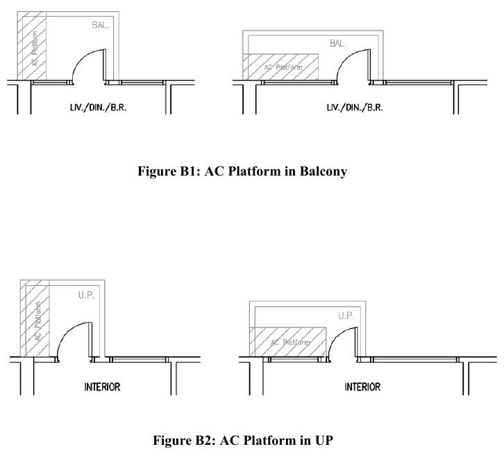
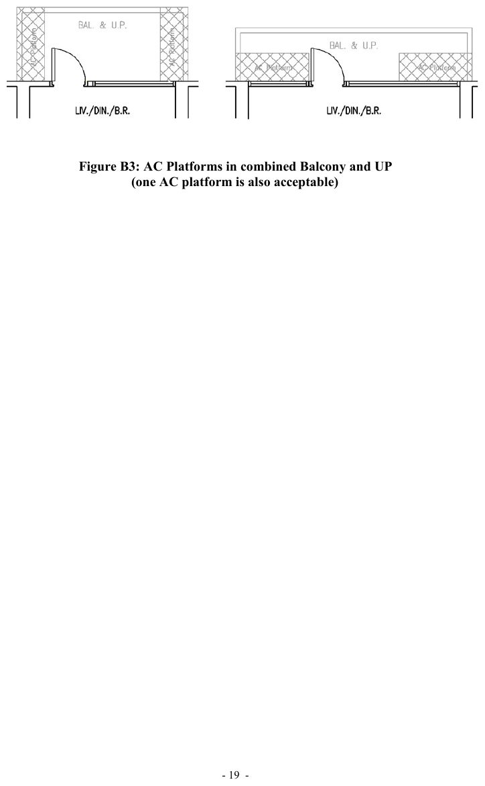
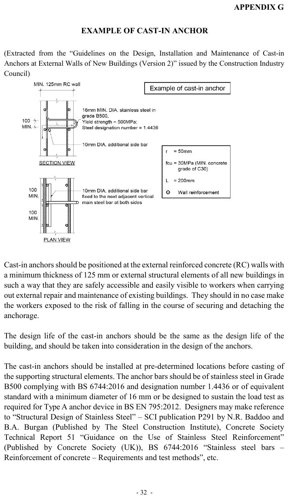

---
tags:
  - Code of Practice
  - Maintenance access 維修通道
  - Curtain wall & façade 幕牆及外牆
  - Balcony & utility platform 露台及工作平台
  - Protective barrier 防護欄障
  - Signboard 招牌
  - Site safety 地盤安全
  - Green & amenity features 環保及適意設施
  - Staircase 樓梯
summary: "Code of Practice on Access for External Maintenance 2021 (2024 Edition): M&R access for every external wall, projection and roof; design rules for gondolas, windows, doors, ladders and anchors; A/C platforms combined with balconies or UPs; M&R access plans and undertakings."
keywords: external maintenance, 外部維修, AfEM Code, M&R access, 維修通道, M&R access plan, 維修通道圖則, gondola, 吊船, maintenance access window, 維修窗, cast-in anchor, 預埋錨固點, AC platform, 冷氣機平台, balcony, utility platform, inaccessible roof, B(C)R 27 28 31 34
---

# Code of Practice on Access for External Maintenance 2021 <small>《2021 年外部維修通道作業守則》</small>

!!! info "Document info 文件資料"
    | | |
    |---|---|
    | **Edition 版本** | 2021 (**2024 Edition**, Sep 2024, amended through [APP-163](../pnap/app-163.md)); first issue Feb 2021; replaces the advisory *Code of Practice on Design for Safety – External Maintenance 2019* |
    | **Legal basis 法律依據** | Deemed to satisfy **B(C)R ss.27(2), 28(5), 31(3) and 34(3)** ([Cap. 123Q](../regulations/bcr-123q.md), in force **1 Feb 2021**): M&R access to external walls, claddings, curtain walls, roofs and their projections 符合即當作符合規例 |
    | **Structure 結構** | Part 1 General · Part 2 Access for each element · Part 3 Design and construction · Appendices A–G |
    | **Source 原文** | [English (PDF)](https://www.bd.gov.hk/doc/en/resources/codes-and-references/code-and-design-manuals/cop_on_access_for_external_maintenance_2021.pdf) |
    | **Last checked 最後核對** | 2026-11-22 against the 2024 Edition |

## At a glance 重點摘要 {#at-a-glance}

=== "English"

    - **Every external wall, curtain wall, cladding, roof and projection** must have safe **M&R access**, designed in from the start (Part 2, para. 1.1).
    - Access types: **maintenance access window**, **maintenance door**, **gondola** (suspended working platform), **power-operated elevating work platform**, fixed ladder or walkway, maintenance staircase, ladder and gantry system.
    - Workers must reach each element within **500 mm**. Fall risk of **2 m** or more needs guard-rails and toe-boards (or a B(C)R barrier). Cast-in **anchors** at **1.5–1.8 m** above floor level.
    - **Maintenance access window**: opening at least **460 × 1,100 mm**, sill **≥ 1.1 m**. **Maintenance door**: at least **600 × 2,000 mm**, locked, with a bilingual DANGER notice (letters ≥ 25 mm). **Maintenance staircase**: at least **900 mm** wide.
    - **Every balcony and utility platform** needs at least **one anchor**. **A/C platforms may be combined with a balcony or UP** (Appendix B), and each may be up to **0.8 m²** and be excluded from GFA. Signboards need an inspection panel at least **200 mm**.
    - If access is through private flats, the **DMC** (or sale and tenancy documents) must give a right of access. The **M&R access plan** is due **before superstructure consent**, with an owner's **undertaking** (Appendices E and F).

=== "中文"

    - **所有外牆、幕牆、外牆覆蓋層、天台及伸出物**均須提供安全的**維修通道**，並在設計階段納入（第 2 部第 1.1 段）。
    - 通道種類：**維修窗**、**維修門**、**吊船**（懸吊式工作台）、**動力升降工作台**、固定爬梯或走道、維修樓梯、爬梯及吊架系統。
    - 工人須能在 **500 毫米**範圍內觸及構件；有 **2 米**或以上墮下風險須設護欄及護趾板（或符合規例的欄障）；預埋**錨固點**設於樓面以上 **1.5–1.8 米**。
    - **維修窗**：開口最少 **460 × 1,100 毫米**，窗台 **≥ 1.1 米**；**維修門**：最少 **600 × 2,000 毫米**、上鎖並設中英文「危險」告示（字高 ≥ 25 毫米）；**維修樓梯**：闊最少 **900 毫米**。
    - **每個露台及工作平台**最少設**一個錨固點**；**冷氣機平台可與露台或工作平台合併**（附錄 B），每個不多於 **0.8 平方米**可不計入總樓面面積；招牌須設最少 **200 毫米**的檢查口。
    - 如通道須經私人單位，**公契**（或買賣及租約文件）須訂明進入權；**維修通道圖則**須於申請**上蓋工程同意前**呈交，並附業主**承諾書**（附錄 E 及 F）。

!!! tip "Does it apply? 是否適用"
    **Applies 適用**: **new buildings** (B(C)R in force 1 Feb 2021). **Not** to works in progress or with consent by **31 Jan 2021** ([APP-163](../pnap/app-163.md)). For **A&A works**, APs should explore providing M&R access; drill-in anchors need a structural viability assessment ([APP-117](../pnap/app-117.md)). The **undertaking** (App. F para. 5) is mandatory for new buildings only. Labour Department work-at-height law (OSHO, FIUO) applies **in addition** and is not replaced by the Code.

## Definitions 定義 (Part 1) {#definitions}

| Term 用詞 | Meaning 意思 |
|---|---|
| **External building element** 外部建築構件 | External wall, curtain wall, external cladding or roof, and any projection from them |
| **Maintenance** 維修 | M&R works: inspection, routine cleansing, repair and replacement of defective external elements and components |
| **Means of access for maintenance (M&R access)** 維修通道 | Any means giving safe access for M&R of external building elements (Part 3 lists the common types) |
| **Projection** 伸出物 | B(P)R Part II projections, [APP-19](../pnap/app-19.md) projections, signboards (BO s.2) and other features: eaves, cornices, fins, canopies, sun-shades, projecting windows, balconies, UPs, planters, drying racks, A/C platforms, drainage pipes, vertical greenery frames, retractable awnings |
| **Projection from a roof** 天台伸出物 | Anything on a roof: architectural features, water tanks, gantries, lightning rods, signboards, solar panel supports |
| **Roof** 天台 | Flat, main, upper, pitched or profiled roofs, skylights, membrane roofs, and roofs of covered walkways and footbridges |
| **Direct staircase** 直達樓梯 | A staircase to an accessible roof |
| **Suspended working platform (gondola)** 吊船 | As in Cap. 59AC: a working platform suspended by lifting gear and raised or lowered by lifting appliances, with its counterweights, outriggers and apparatus (not a boatswain's chair) |
| **Power-operated elevating work platform** 動力升降工作台 | Cherry pickers and aerial platforms: vehicle-mounted, self-propelled, towed or manually moved |
| **Maintenance access ladder and gantry system** 爬梯及吊架系統 | Gantries travelling on tracks fixed to the building, for inclined façades, domes or skylights |

## Access required for each element 各構件所需通道 (Part 2) {#access-required-for-each-element-part-2}

General (para. 1): access must be suitable, adequate and safe; the list is **not exhaustive** and one type or a combination may be needed; design projections, recesses and free-form façades so a **bamboo scaffold** can still be erected ([Bamboo Scaffold Guidelines](bd-guidelines.md#bamboo-scaffolds)).

| Element 構件 | Main M&R works 主要維修工作 | Acceptable M&R access 可接受的維修通道 |
|---|---|---|
| **External wall, curtain wall, cladding** (2) 外牆、幕牆 | Inspection, cleansing, repair, replacing finishes, windows, glass, panels | Maintenance access window, maintenance door, elevating platform or gondola |
| **A/C platform** (3.1) 冷氣機平台 | Inspect, clean, repair and replace A/C; maintain the platform | Maintenance access window, or a **balcony / UP combined** with the platform (App. B); **outer face** by elevating platform or gondola; may also serve other services if A/C working space is kept; safety provisions in **App. C** |
| **Balcony, UP** (3.2) 露台、工作平台 | Inspection, cleansing, repair | Maintenance door; outer face by elevating platform or gondola; **≥ 1 anchor** at **1.5–1.8 m** above the adjoining floor, readily reached from it (structural details for approval) |
| **Canopy** (3.3) 簷篷 | Inspection, cleansing, debris removal, repair, drainage outlet | Elevating platform, gondola or maintenance access window |
| **Drying rack** (3.4) 晾衣架 | Cleansing, repair, replacement | Window, door, elevating platform or gondola |
| **External drainage pipe** (3.5) 外牆排水管 | Inspection, repair, replacement | **Cat ladder with grating in a pipe well** ([APP-93](../pnap/app-93.md)), a projecting platform such as an A/C platform, window, elevating platform or gondola |
| **Vertical greenery** (3.6) 垂直綠化 | Inspection, gardening, drainage and irrigation, frame repair | Elevating platform, gondola, or fixed walkway reached through a window or door |
| **Planter box** (3.7) 花槽 | Cleansing, irrigation, replacing pots | Window, elevating platform or gondola |
| **Projecting window** (3.8) 窗台 | Glass cleansing, repair of panes, casements, sealant | Window, elevating platform or gondola |
| **Signboard** (3.9) 招牌 | Inspection, repair, replacement | Fixed ladder or walkway, maintenance stair, ladder and gantry reached through a window or door, elevating platform or gondola. **Inspection panel ≥ 200 mm** (side or diameter), openable without special tools, for concealed fixings, unless designated exempted works (B(MW)R Sch. 2 Part 2) or a removable banner exposes the fixings |
| **Sun-shades, fins, eaves, cornices, mouldings** (3.10) 遮陽及建築裝飾 | Inspection, repair, replacement | Window, elevating platform or gondola |
| **Accessible roof** (4.1) 可到達天台 | Finishes, features, solar and building services, signboards | **Direct staircase** or maintenance door; edge barriers to **B(C)R ss.37–38**; fixed ladder or walkway for roof signboards over **5 m** high |
| **Inaccessible roof** (4.2) 不可到達天台 | As above, plus water tanks | Fixed ladder or walkway, gantry, maintenance door, elevating platform or gondola. See below |
| **Projection from a roof** (5) 天台伸出物 | Inspection, cleansing, repair | Fixed ladder or walkway, gantry, maintenance stair, elevating platform or gondola |

### Inaccessible roofs (Part 2 para. 4.2) 不可到達天台 {#inaccessible-roof}

1. If workers must **step onto** the roof: **permanent guard-rails with toe-boards** at the edge (App. D para. 4).
2. If permanent guard-rails all round are **impracticable** (site constraints, design): use **(i)** a proprietary **collapsible guard-rail** system designed for the B(C)R, Loading Code and Wind Code loads, and / or **(ii)** **temporary edge protection** with a platform and access ladder, based on a prior **risk assessment** (LD *Five Steps to Risk Assessment*).
3. With either option, provide **anchorage points or a horizontal lifeline** for fall arrest or travel restraint, at the **roof access** or ≥ **2 m** from the edge or fragile areas, so the lanyard is clipped on **before** the worker is at risk.
4. If the roof access is **within 2 m** of the edge or a fragile area, or opens onto a **pitched roof**, provide **permanent guard-rails** at least round the access point or landing.
5. Add the **general notes** to the GBP: anchorage points / lifeline as shown on the building plan or M&R plan, structural details to be submitted separately; and the design basis of the collapsible guard-rail or the risk-assessment basis of the temporary edge protection.

## Design requirements 設計要求 (Part 3) {#design-requirements-part-3}

### General requirements 一般要求 (para. 1) {#general-requirements}

| Para. | Requirement 要求 |
|---|---|
| 1.1 | Design for the real operation, **including material delivery**. Access through private premises: **DMC** clause giving maintenance staff a reasonable right of access (or in the sale and purchase agreement, assignment or tenancy if no DMC) |
| 1.2 | Workers reach each element within **500 mm** in front of it; watch for recesses |
| 1.3 | Also comply with **FS Code Parts B and C**, barriers under **B(C)R ss.36–38**, **B(P)R 3A**, [APP-110](../pnap/app-110.md) and the Loading Code |
| 1.4 | Fall risk **≥ 2 m**: guard-rails and toe-boards (App. D para. 4) unless a B(C)R barrier is provided; guard-rails designed for the "**area where congregation of people is not expected**" load (Loading Code Table 3.13) or **wind**, whichever is more onerous |
| 1.5 | Fall-arrest anchorages to App. D para. 7; **cast-in anchors need structural approval** under the BO |

### Each type of access 各類通道 (para. 2) {#access-types}

| Type 類別 | Requirements 要求 |
|---|---|
| **Gondola** (2.1) 吊船 | Building designed for it; supporting frames, members, fixings and any screen designed for all loads incl. **wind**, approved under the BO, **corrosion resistant** or protected; must **not obstruct means of escape**; **tied** to the building when parked; **restraints** on exposed façades against tipping, swaying or movement; safe access, with **permanent roof anchors** if boarding at height (fall ≥ 2 m); for a **temporary** gondola, provide **mechanical booms or anchorages** on the roof |
| **Maintenance access window** (2.2) 維修窗 | Clear opening **≥ 460 mm wide × 1,100 mm high** (for M&R and material delivery); sill **≥ 1.1 m** above the internal floor; **cast-in anchor(s)** on the external wall, near the window, at **1.5–1.8 m** above floor, not blocked by the open sash |
| **Maintenance staircase** (2.3) 維修樓梯 | Width **≥ 900 mm**; guard-rails on **both sides** (App. D para. 4) |
| **Maintenance door** (2.4) 維修門 | **≥ 600 × 2,000 mm**; **locked**; notice ≥ **25 mm** high: "DANGER / UNAUTHORISED ACCESS PROHIBITED / CLOSE AND LOCK THIS DOOR 危險 不得擅進 請關閉並緊鎖此門" |
| **Fixed maintenance ladder** (2.5.1) 固定爬梯 | Width **400–600 mm**; safety hoops **650–800 mm** wide (App. D para. 8); slab access opening ≥ **500 mm** side or diameter |
| **Fixed external walkway** (2.5.2) 外部走道 | Guard-rails and toe-boards (App. D para. 4); must not block M&R of other elements; over a roof or projection, keep **≥ 1.2 m** clear working height underneath |
| **Ladder and gantry system** (2.6) 爬梯及吊架 | Fits the building profile and the M&R work; App. D para. 8 |
| **Elevating work platform** (2.7) 升降工作台 | Wall to be reached ≤ **1.5 m** above the platform at its **maximum** height; a **level, firm parking area** in the development |

## A/C platform combined with a balcony or UP 冷氣機平台與露台或工作平台合併 (Appendix B) {#ac-platform-balcony-up}

An A/C platform may be combined with a balcony and / or UP if **all** the following are met:

| Item 項目 | Requirement 要求 |
|---|---|
| (a) Layout | As **Figures B1, B2 or B3** (in a balcony, in a UP, or in a combined balcony and UP; one platform is also acceptable) |
| (b) Level | A/C platform at least **50 mm higher** than the balcony / UP finished floor |
| (c)–(d) Working space | In front of or behind the A/C, reached directly from the balcony / UP; length ≥ the A/C platform length, depth **≥ 400 mm** |
| (e) Edges | Protective barriers to **B(C)R ss.37–38** at the outer edges |
| (f) Screens between platform and balcony / UP | ≤ **1.6 m** high, permeability **≥ 70%** (visual and physical porosity) |
| (g) Screens at the platform edge | Not higher than the balcony / UP **parapet** (1.6 m for stacked A/C), permeability **≥ 70%** |
| (h) **GFA exclusion** | The balcony / UP must qualify under [JPN 1](../pnap/jpn-1.md) / [JPN 2](../pnap/jpn-2.md), **and**: (i) each A/C platform **≤ 0.8 m²**, so its outer edges are **not** counted in the balcony / UP perimeter or in the covered area under the lowest balcony / UP; (ii) the JPN undertaking designates the platforms as "**areas for air-conditioning**" in the **DMC** and states that **individual A/C platforms must not be erected on the external walls** |

!!! note "Open-air test for the merged floor 合併樓面的開敞要求"
    For the JPN **40% facing the open air** test, use the **perimeter of the merged floor** (balcony / UP plus A/C platform). A screen at that perimeter higher than the balcony / UP parapet does **not** count as facing the open air (App. B footnote 2).

<figure markdown>
  { width="600" loading=lazy }
  <figcaption>Figures B1–B2 — A/C platform in a balcony (B1) and in a UP (B2) 冷氣機平台設於露台及工作平台 <small>Source: Code of Practice on Access for External Maintenance 2021 (2024 Edition), Buildings Department 資料來源：屋宇署</small></figcaption>
</figure>

<figure markdown>
  { width="600" loading=lazy }
  <figcaption>Figure B3 — A/C platforms in a combined balcony and UP (one platform also acceptable) 相連露台及工作平台內的冷氣機平台 <small>Source: Code of Practice on Access for External Maintenance 2021 (2024 Edition), Buildings Department 資料來源：屋宇署</small></figcaption>
</figure>

## A/C platform design and safety 冷氣機平台設計及安全 (Appendix C) {#ac-platform-design}

| Para. | Item 項目 | Requirement 要求 |
|---|---|---|
| 1 | Access opening | Normally ≥ **460 × 1,100 mm**, never smaller than the A/C unit; bottom of the opening ≤ **1,300 mm** above the platform floor |
| 2 | Show on GBP | Platform size **and** the A/C size, to prove the working space |
| 2(a) | Projection and width | Projection up to **900 mm** (excluding the barrier, guard-rail or screen and its supports); width only for the A/C and its working space, **not a catwalk** |
| 2(b) | Working space | In front of or behind the A/C: length ≥ A/C length, depth **≥ 400 mm**; at one side **≥ 400 mm**, up to **500 mm** if it is also the landing from the window; with screens or guard-rails and anchors it may be a passage to other A/C or services; minor encroachment (e.g. stacking frame) accepted |
| 2(c) | Ventilation gap | **≥ 100 mm** between the A/C and the platform edge (or screen) or the external wall |
| 2(d) | Heights | Units reached from inside the flat may **stack two A/C** with screens ≤ **1.6 m**; one layer: screen **0.9–1.1 m** high |
| 3 | Other services | May pass through if the working space is kept (e.g. a vertical stack outside the working space, or pipes above head height) |
| 4 | Screens | ≤ **50 mm** thick; **≥ 70%** permeable in elevation; panels a worker can handle; resist the worker **impact load** ("no congregation" category, Loading Code Table 3.13) |
| 5 | Screen as guard-rail | A screen meeting 2(d) and 4 may act as the guard-rail of para. 6, and is then excluded from the 900 mm projection |
| 6 | Anchors and guard-rails | Where access to the external wall is needed: **cast-in anchors and guard-rails** to the CIC *Guidelines on Cast-in Anchors* (Version 2), shown on GBP and structural plans, with the GBP note: "Cast-in anchors and guard-rails at air conditioner platforms will be provided in accordance with the Code of Practice on Access for External Maintenance. Their structural details will be submitted separately for approval." |

## Occupational safety requirements 職業安全規定 (Appendix D) {#occupational-safety}

| Para. | Rule 規定 |
|---|---|
| 1 | M&R works under OSHO (Cap. 509), FIUO (Cap. 59) and their regulations must meet those laws; LD codes and guidance notes (App. A) help |
| 2 | **Employer / proprietor duties** (OSHO s.6, FIUO s.6A): safe plant and systems of work; safe handling of plant and substances; information, instruction, training, supervision; safe workplace and access / egress; safe working environment |
| 3 | **Occupier** of premises not controlled by the employer (e.g. the owner) must keep the premises and access safe (OSHO s.7) |
| 4 | Fall risk ≥ **2 m** (CS(S)R Third Schedule): **top guard-rail 900–1,150 mm**, **intermediate rail 450–600 mm**, **toe-board ≥ 200 mm**; gangways and runs ≥ **400 mm** wide, ≥ **650 mm** for moving materials |
| 5 | Dangerous platforms fenced to **900 mm** (Cap. 509A s.6); otherwise personal fall protection |
| 6 | **Working platforms first**: personal fall protection and anchors are only a **supplementary measure or last resort** |
| 7 | Anchorages to the LD *Guidance Notes on Safety Belts and Anchorage Systems* and the CIC cast-in anchor guidelines (example in App. G) |
| 8 | Ladders more than **3 m** high: **anti-climbing device** at the bottom and **safety hoops**; **rest landings at ≤ 9 m** intervals with guard-rails and toe-boards |

## Submitting M&R access plans 呈交維修通道圖則 (Appendices E and F) {#submission}

| Step 步驟 | When 時間 | What 內容 |
|---|---|---|
| 1. First GBP | First GBP submission | M&R access plans **not needed yet**; add the note: "Before applying for the consent to commence the superstructure works, the provisions for M&R access required under the Code of Practice on Access for External Maintenance will be submitted to and approved by BD." (App. F para. 2) |
| 2. Undertaking | With the GBP showing the M&R provisions (mandatory for **new buildings**) | Developer / owner **letter of undertaking**: designate the M&R access as **common areas** in the DMC with use and location; **right of access** through private premises; if no DMC, in the sale and purchase agreement, assignment or tenancy (App. F para. 5) |
| 3. M&R access plans | **Before superstructure consent** | (a) plans, elevations, sections ≥ **1:300** for each floor / zone per building; (b) technical specifications (e.g. cradle length, tie-back restraints); (c) summary against the **Appendix E checklist** (App. F para. 1) |
| 4. Structural plans | Separately | Cast-in anchors, restraint sockets, booms and anchorages: framing and sections; design loads; anchor and support details; codes; materials (steel, aluminium, anchors, screws, proprietary items); workmanship (welding, galvanising, bi-metallic and corrosion); **calculations** incl. the **parent structure**, stability, member design and deflection. Cast-in anchors in RC walls **≥ 125 mm** thick or structural members; **drill-in anchors** for A&A need a structural viability assessment ([APP-117](../pnap/app-117.md)) (App. F paras 3–4) |
| 5. Record plans | With the **OP application** (or BA14 for A&A) | An **extra set of record plans** for the M&R access, referred to the **Labour Department** (App. F para. 7; [APP-13](../pnap/app-13.md)) |

The **Appendix E checklist** lists, for each access type (gondola, maintenance access window, maintenance staircase, maintenance door, fixed ladder or walkway, ladder and gantry, elevating platform), the elements it serves; tick and give locations.

## Cast-in anchor example 預埋錨固點例子 (Appendix G) {#cast-in-anchor}

- In external **RC walls ≥ 125 mm** thick or structural elements; safely reachable and visible; the worker must never be exposed to a fall while clipping on or off.
- **Design life = building design life**; cast in at pre-set positions before concreting.
- Bar: **stainless steel Grade B500**, BS 6744:2016, designation **1.4436** (or equivalent), **≥ 16 mm** diameter, or designed to pass the **Type A** test of BS EN 795:2012. Example details: bend radius r = 50 mm, leg L = 200 mm, concrete **C30** minimum, 100 mm minimum edge distances, 10 mm additional side bars tied to the adjacent vertical bars.

<figure markdown>
  { width="560" loading=lazy }
  <figcaption>Appendix G — Example of cast-in anchor (from the CIC Guidelines, Version 2) 預埋錨固點例子 <small>Source: Code of Practice on Access for External Maintenance 2021 (2024 Edition), Buildings Department 資料來源：屋宇署</small></figcaption>
</figure>

## Step-by-step check 逐步核對 {#step-by-step}

| Step 步驟 | Check 核對 | Where 出處 |
|---|---|---|
| 1 | New building with consent after 31 Jan 2021? (A&A: explore) | [APP-163](../pnap/app-163.md) |
| 2 | List every external element: each façade, curtain wall, cladding, every projection type, each roof (accessible / inaccessible) and roof projection | Part 1 definitions |
| 3 | Pick an access type for each element from the Part 2 table; mark it on the **Appendix E** checklist | Part 2, App. E |
| 4 | Check reach **≤ 500 mm**, fall risk **≥ 2 m** (guard-rails), anchors at **1.5–1.8 m** | Part 3 para. 1 |
| 5 | Size each access: window 460 × 1,100 mm and sill 1.1 m; door 600 × 2,000 mm; stair 900 mm; ladder 400–600 mm; platform reach 1.5 m and parking | Part 3 para. 2 |
| 6 | A/C platforms: Appendix C sizes; if combined with a balcony / UP, Appendix B (a)–(h) | App. B, C |
| 7 | Inaccessible roofs: permanent guard-rails, or collapsible / temporary with anchors ≥ 2 m from the edge; GBP notes | Part 2 para. 4.2 |
| 8 | Check MOE (FS Code Part B), fire separation (Part C), barriers (B(C)R, APP-110) | Part 3 para. 1.3 |
| 9 | GBP note; undertaking; M&R plans before superstructure consent; structural plans; record plans with the OP | App. F |

## Worked example: A/C platform in a balcony 計算例子：露台內的冷氣機平台 {#worked-example}

!!! example "Illustrative only 只作說明"
    The flat and dimensions below are **made up** to show the method; check every real case against the Code and JPNs. 以下數字為虛構，只用作說明。

**Scheme 方案**: a 2.0 m × 1.5 m balcony (3.0 m²) with one split-type outdoor unit **850 mm** long, **300 mm** deep, **650 mm** high. The A/C platform sits at one end of the balcony (Figure B1, left) and is reached from the balcony.

| Check 核對 | Design 設計 | Requirement 要求 | Result |
|---|---|---|---|
| Level (B(b)) | Platform 60 mm above balcony floor | ≥ 50 mm | ✅ |
| Platform size | 1,000 mm (along the façade) × 800 mm (projection) = **0.80 m²** | ≤ 0.8 m² for GFA exclusion (B(h)(i)); projection ≤ 900 mm (C2(a)) | ✅ (at the limit) |
| Working space (B(d), C2(b)) | Behind the unit, on the balcony side: 1,000 mm long × **400 mm** deep | Length ≥ platform length; depth ≥ 400 mm | ✅ |
| Ventilation gap (C2(c)) | 800 − 300 − 400 = **100 mm** between the unit and the edge screen | ≥ 100 mm | ✅ |
| Side space (C2(b)) | 1,000 − 850 = **150 mm** | ≥ 400 mm at one side *(only if a side working space is relied on)* | Working space is behind the unit, so OK; if the side were the working space it would **fail** |
| Edge screen (B(g), C2(d), C4) | 1.0 m high aluminium louvre, 40 mm thick, 75% open | One layer of A/C: 0.9–1.1 m; ≤ 50 mm thick; ≥ 70% permeable; not above the balcony parapet | ✅ |
| Screen to balcony (B(f)) | None | ≤ 1.6 m, ≥ 70% if provided | ✅ |
| Barrier (B(e)) | Screen designed as a B(C)R ss.37–38 barrier, 1.1 m | B(C)R barrier at outer edges | ✅ (screen also acts as guard-rail, C5) |
| Anchor (Part 2 3.2.4) | One cast-in anchor in the balcony wall at **1.6 m** | ≥ 1 per balcony at 1.5–1.8 m | ✅ |
| Open-air test (B note) | Merged perimeter 2.0 + 1.5 × 2 + platform edges; screen not above the parapet | JPN ≥ 40% of the merged perimeter facing the open air | Check with the [JPN 1](../pnap/jpn-1.md) method |
| DMC | Undertaking designates the platform as an "area for air-conditioning"; **no individual A/C platforms on external walls** | B(h)(ii) | Include in the JPN undertaking |
| Outer face | Gondola from the roof reaches the platform soffit and screen | Elevating platform or gondola (Part 2 3.1.3) | ✅ |

**Result**: compliant. A larger 1,000 × 850 mm platform (0.85 m²) would still be within the 900 mm projection, but would **lose the GFA exclusion** (> 0.8 m²).

## Whole picture 整體關係 {#whole-picture}

| Topic 主題 | Where 文件 |
|---|---|
| Implementation and transition 實施 | [APP-163](../pnap/app-163.md) · [B(C)R](../regulations/bcr-123q.md) |
| Balconies, UPs and GFA 露台及工作平台 | [JPN 1](../pnap/jpn-1.md) · [JPN 2](../pnap/jpn-2.md) · [APP-19](../pnap/app-19.md) · [APP-42](../pnap/app-42.md) |
| Gondolas and work at height 吊船 | [ADV-11](../pnap/adv-11.md) · [ADV-14](../pnap/adv-14.md) |
| Pipe ducts and drainage 管道 | [APP-93](../pnap/app-93.md) |
| Barriers 欄障 | [APP-110](../pnap/app-110.md) · [B(P)R 3A](../regulations/bpr-parts-1-2.md) |
| Signboards 招牌 | [APP-126](../pnap/app-126.md) · [B(MW)R](../regulations/bmwr-123n.md) |
| A&A in existing buildings 加建改建 | [APP-117](../pnap/app-117.md) · [APP-169](../pnap/app-169.md) |
| Loads 荷載 | [Dead & Imposed Loads](dil-2011.md) · [Wind Code](wind-2019.md) |
| Fire safety 消防 | [FS Code Part B](fsc-part-b-means-of-escape.md) · [Part C](fsc-part-c-fire-resisting-construction.md) |

## Related 相關文件 {#related}

[B(C)R](../regulations/bcr-123q.md) · [APP-163](../pnap/app-163.md) · [APP-93 pipe ducts](../pnap/app-93.md) · [APP-42 utility platforms](../pnap/app-42.md) · [APP-110 barriers](../pnap/app-110.md) · [Glass Code](glass-2018.md) · [Dead & Imposed Loads](dil-2011.md)

---
<small>Summary of the Code for reference. Wording and figures: see the official Code. 本頁為守則摘要，以官方守則為準。</small>
