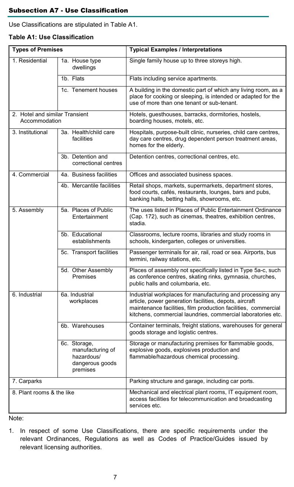
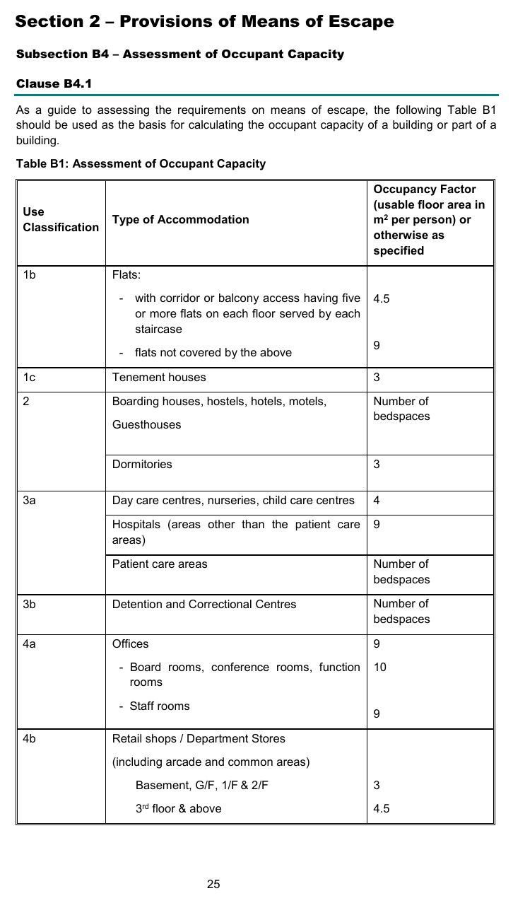
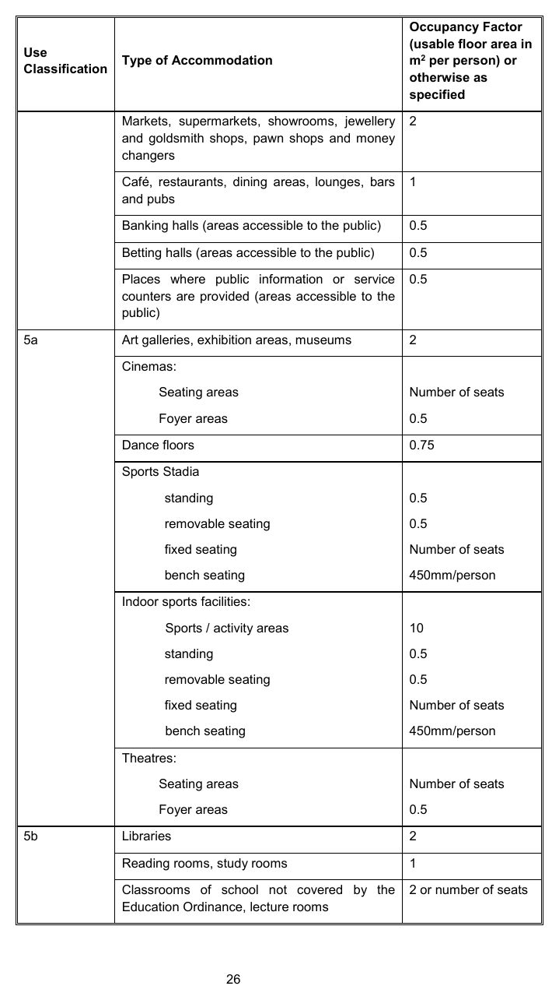
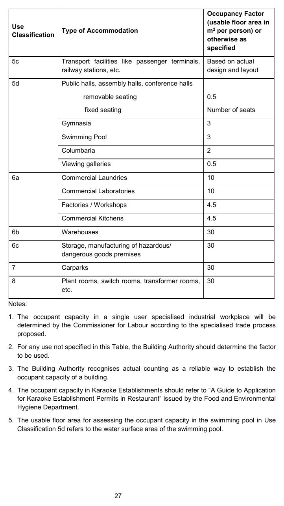
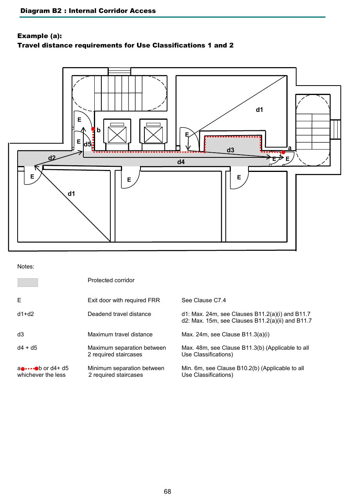
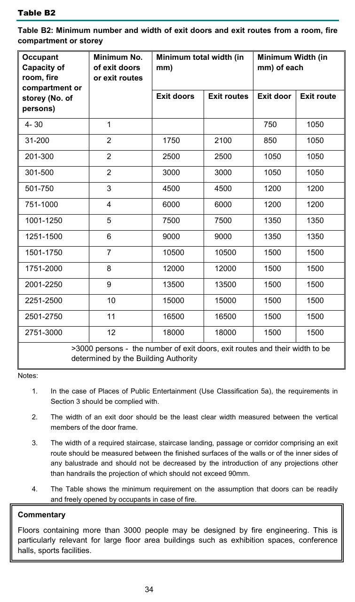
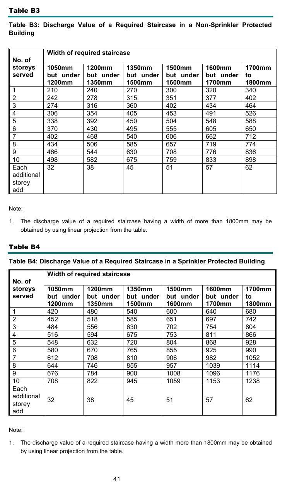
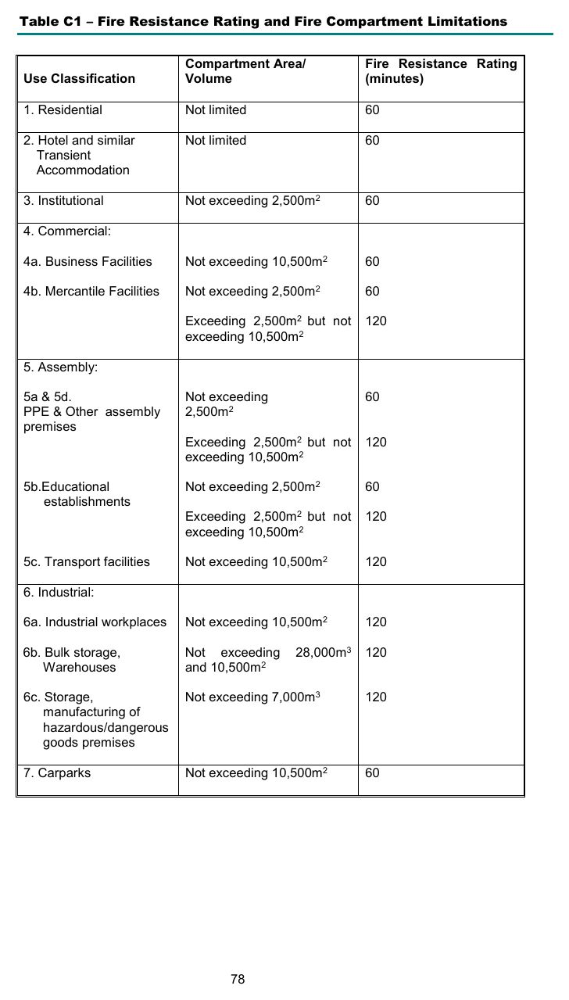
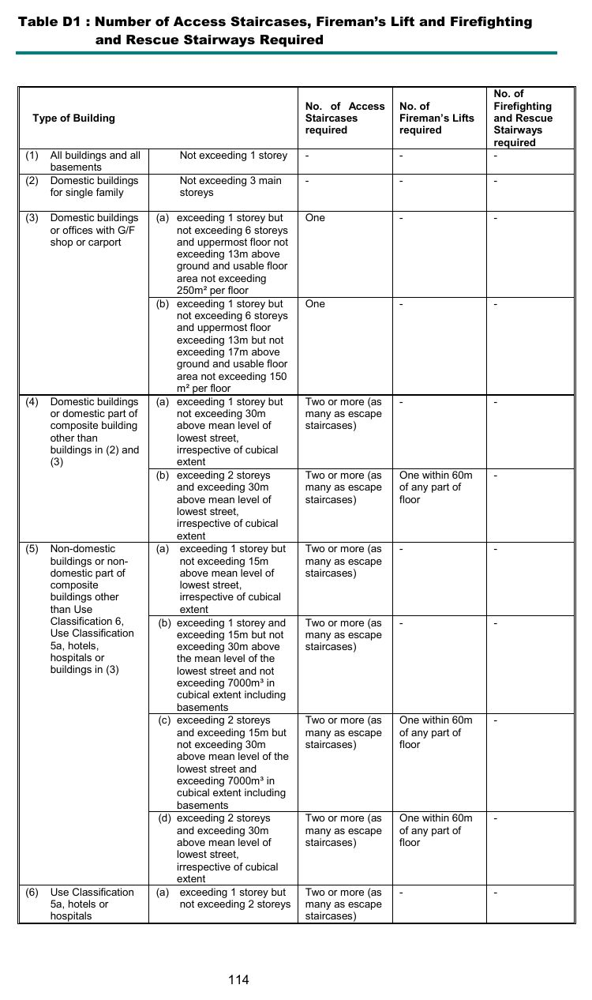
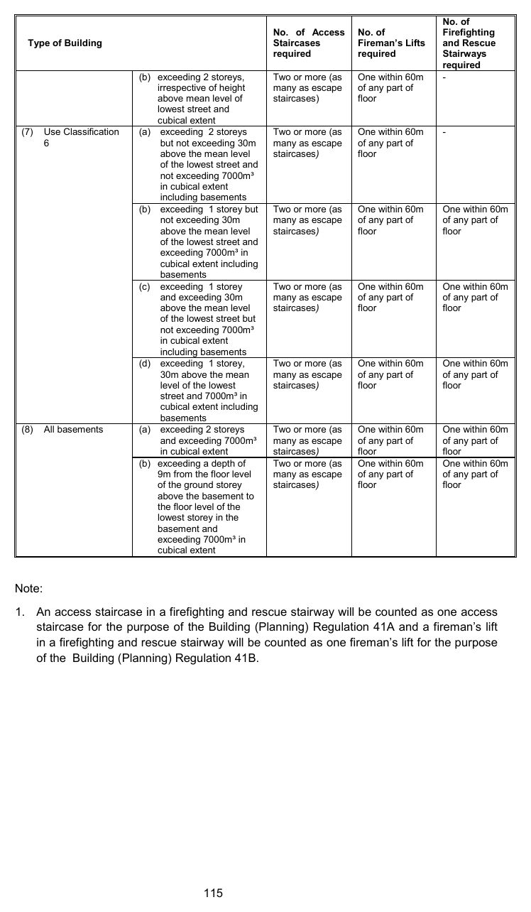

---
tags:
  - Code of Practice
  - Fire safety 消防安全
  - Means of escape 逃生途徑
  - Fire resisting construction 耐火結構
  - Means of access 消防及救援進出途徑
---

# Code of Practice for Fire Safety in Buildings 2011 (FS Code) <small>《2011 年建築物消防安全守則》</small>

!!! info "Document info 文件資料"
    | | |
    |---|---|
    | **Type 類別** | Code of Practice 作業守則 |
    | **Issued by 發出機構** | Buildings Department 屋宇署 |
    | **First issue 首次發出** | September 2011 |
    | **Version summarised 本摘要版本** | 2024 Edition (revision September 2024) 2024 年修訂版 |
    | **Official language 官方語言** | English and Chinese 中英文版 |
    | **Source 原文** | [English (PDF)](https://www.bd.gov.hk/doc/en/resources/codes-and-references/code-and-design-manuals/fs_code2011.pdf) · [中文 (PDF)](https://www.bd.gov.hk/doc/tc/resources/codes-and-references/code-and-design-manuals/fs_code2011_c.pdf) |
    | **Legal basis 法律依據** | [B(C)R](../regulations/bcr-123q.md) 35; B(P)R 41, 41A, 41B, 41C, 41D |
    | **Last checked 最後核對** | 2026-11-20 against the 2024 Edition |

!!! note "Scope of this entry 本條目範圍"
    This is an **overview entry** with the most-used tables. **[Part B Means of Escape](fsc-part-b-means-of-escape.md)** , **[Part C Fire Resisting Construction](fsc-part-c-fire-resisting-construction.md)** and **[Part D Means of Access](fsc-part-d-means-of-access.md)** and **[Parts E–G](fsc-parts-e-f-g.md)** now have their own full entries. The whole Code is covered.
    本條目為**概覽**，附最常用的表格。**[B 部逃生途徑](fsc-part-b-means-of-escape.md)** 、**[C 部耐火結構](fsc-part-c-fire-resisting-construction.md)** 及 **[D 部消防進出途徑](fsc-part-d-means-of-access.md)** 及 **[E–G 部](fsc-parts-e-f-g.md)** 已有詳細條目，整份守則已涵蓋。

## At a glance 重點摘要

=== "English"

    - **Replaced three older codes**: Means of Escape 1996, Fire Resisting Construction 1996 and Means of Access 2004.
    - **Seven Parts**: A Introduction & use classification · B **Means of Escape** · C **Fire Resisting Construction** · D **Means of Access** for firefighting and rescue · E Fire properties of elements · F Fire safety management · G **Fire engineering approach**.
    - Everything starts with the **Use Classification** (Table A1, classes 1–8). It drives occupant capacity, exits, travel distance, FRR and compartment size.
    - **Occupant capacity** = usable floor area ÷ **occupancy factor** (Table B1), e.g. offices **9 m²/person**, restaurants **1 m²/person**.
    - Key limits: **dead-end travel 18 m** (general), **max. travel 36 m** (general), **48 m** max. between required staircases. **FRR 60 / 120 min** with compartment limits in **Table C1**.
    - You can comply either through the **deemed-to-comply** provisions or through a **fire engineering approach** (Part G).

=== "中文"

    - **取代三份舊守則**：1996 年《提供火警逃生途徑守則》、1996 年《耐火結構守則》及 2004 年《提供消防和救援進出途徑守則》。
    - **共七部分**：A 引言及用途類別 · B **逃生途徑** · C **耐火結構** · D 消防及救援**進出途徑** · E 建築構件的耐火性能 · F 消防安全管理 · G **消防工程方法**。
    - 一切由**用途類別**開始（表 A1，第 1–8 類），它決定佔用人數、出口、行走距離、耐火效能及防火隔室大小。
    - **佔用人數** = 可用樓面面積 ÷ **佔用率**（表 B1），例如辦公室 **每人 9 平方米**、食肆 **每人 1 平方米**。
    - 主要限制：一般**盡頭路行走距離 18 米**、一般**最長行走距離 36 米**、規定樓梯之間最長 **48 米**；**耐火效能 60／120 分鐘**及防火隔室限制見**表 C1**。
    - 可按**「當作符合」**條文遵從，或採用**消防工程方法**（G 部）。

## Diagram 圖解

<figure markdown>
  { width="760" loading=lazy }
  <figcaption>How the fire safety codes evolved. 消防安全守則演變。 Diagram prepared for this site; check the source text for exact wording.</figcaption>
</figure>

## Key table 1: Use Classification (Table A1) 用途類別（表 A1）

| Class 類別 | Type 處所類型 | Typical examples 典型示例 |
|---|---|---|
| **1a** | House type dwellings 獨立屋居所 | Single family house up to 3 storeys 不超過 3 層高的單一家庭屋宇 |
| **1b** | Flats 住宅單位 | Flats incl. service apartments 包括服務式住宅 |
| **1c** | Tenement houses 唐樓 | Living rooms used by more than one tenant 多於一名租客使用 |
| **2** | Hotel and similar transient accommodation 旅館及同類短期住所 | Hotels, guesthouses, hostels, dormitories 旅館、賓館、宿舍 |
| **3a** | Health / child care facilities 衞生／幼兒服務設施 | Hospitals, clinics, nurseries, elderly homes 醫院、診所、幼兒中心、安老院 |
| **3b** | Detention and correctional centres 羈留及懲教中心 | |
| **4a** | Business facilities 業務設施 | Offices 辦公室 |
| **4b** | Mercantile facilities 商務設施 | Shops, markets, restaurants, bars, banking halls 零售店、街市、食肆、銀行大堂 |
| **5a** | Places of public entertainment 公眾娛樂場所 | Cinemas, theatres, exhibition centres, stadia 電影院、劇院、展覽中心 |
| **5b** | Educational establishments 教育設施 | Classrooms, libraries 課室、圖書館 |
| **5c** | Transport facilities 運輸設施 | Airports, bus termini, railway stations 機場、巴士總站、鐵路站 |
| **5d** | Other assembly premises 其他集會場所 | Conference centres, gyms, churches, columbaria 會議中心、健身室、教堂、骨灰安置所 |
| **6a** | Industrial workplaces 工業場所 | Factories, commercial kitchens, laundries, labs 工廠、商用廚房、洗衣房、實驗室 |
| **6b** | Warehouses 倉庫 | Container terminals, logistic centres 貨櫃碼頭、物流中心 |
| **6c** | Hazardous / dangerous goods premises 有害／危險物品處所 | Flammable or explosive storage / manufacture 易燃、爆炸品貯存或製造 |
| **7** | Carparks 停車場 | Parking structures and garages 停車場構築物及車房 |
| **8** | Plant rooms & the like 機房及同類場所 | M&E plant rooms, IT rooms, telecom rooms 機電設備房、資訊科技室 |

<figure markdown>
  { loading=lazy }
  <figcaption>Table A1 — Use Classification (original) 用途類別（原文） <small>Source: FS Code 2011 (2024 Edition), Buildings Department 資料來源：屋宇署</small></figcaption>
</figure>

## Key table 2: Occupant capacity (Table B1) 佔用人數（表 B1）

Common occupancy factors (usable floor area in m² per person) 常用佔用率（每人可用樓面面積，平方米）：

| Use 用途 | Factor 佔用率 | Use 用途 | Factor 佔用率 |
|---|--:|---|--:|
| Flats, corridor/balcony access with ≥ 5 flats per floor per staircase 每層每道樓梯服務 ≥ 5 個單位的走廊／露台式住宅 | 4.5 | Other flats 其他住宅單位 | 9 |
| Offices 辦公室 | 9 | Board / conference / function rooms 會議室、多用途室 | 10 (as printed 原文所載) |
| Retail: basement, G/F, 1/F & 2/F 零售：地庫至 2 樓 | 3 | Retail: 3/F & above 零售：3 樓或以上 | 4.5 |
| Markets, supermarkets, showrooms 街市、超級市場、陳列室 | 2 | Restaurants, cafés, bars 食肆、咖啡室、酒吧 | 1 |
| Banking / betting halls, service counters (public areas) 銀行大堂、投注站、服務櫃枱 | 0.5 | Dance floors 舞池 | 0.75 |
| Libraries 圖書館 | 2 | Reading / study rooms 閱讀室、自修室 | 1 |
| Gymnasia, swimming pools 健身室、泳池 | 3 | Columbaria 骨灰安置所 | 2 |
| Factories, workshops, commercial kitchens 工廠、工場、商用廚房 | 4.5 | Commercial laundries / laboratories 商用洗衣房、實驗室 | 10 |
| Warehouses, carparks, plant rooms 倉庫、停車場、機房 | 30 | Hotels, hospitals (patient care) 旅館、病房 | No. of bedspaces 床位數目 |

<small>Always check the full Table B1 and its notes (images below). 請以完整的表 B1 及附註為準（見下圖）。</small>

??? abstract "Full Table B1 (3 pages, original) 完整表 B1（原文，3 頁）"
    { loading=lazy }
    { loading=lazy }
    { loading=lazy }

## Key rule: travel distance (Subsection B11) 行走距離（B11 分節）

| | UC 1 & 2 用途類別 1 及 2 | UC 3 用途類別 3 | All other UCs 其他用途類別 |
|---|---|---|---|
| **Dead-end travel** 盡頭路行走距離 (B11.2) | **24 m** within flat/guestroom to its exit door; **15 m** from that door to staircase or point of choice 單位內 24 米；出口門至樓梯或選點 15 米 | **12 m** (24 m with balcony approach 露台通道) | **18 m** (24 m with balcony approach 露台通道) |
| **Max. travel** 最長行走距離 (B11.3(a)) | **24 m** from flat/guestroom door to nearest staircase (45 m along balcony approach) | **30 m** (45 m along balcony approach) | **36 m** (45 m along balcony approach) |
| **Between required staircases** 規定樓梯之間 (B11.3(b)) | **≤ 48 m**, measured on plan along the exit route centreline 沿出口路線中線量度 | | |
| **Alternative exits** 不同方向出口 (B11.7) | Two directions only count if the lines to the exits form an angle of **≥ 30°** 兩出口方向夾角須 ≥ 30° | | |

!!! quote "Clause B11.3(a) — Maximum travel distance 最長行走距離"
    In a storey which is served by two or more protected exits or points of discharge to an ultimate place of safety, the maximum travel distance including any deadend travel distance, is limited to: (i) for Use Classifications 1 and 2: 24m from the flat/guestroom exit door to the nearest required staircase; 45m if along balcony approach. (ii) for Use Classification 3: 30m to the nearest protected exit; 45m if along balcony approach. (iii) for all other Use Classifications not provided with balcony approach: 36m to the nearest protected exit; 45m if along balcony approach.

    **官方中文本：** 樓層如設有兩個或多於兩個防護出口或通往最終的安全地方的出口處，最長行走距離（包括盡頭路行走距離）限為︰(i) 用途類別 1 及 2︰由住宅單位／旅館客房的出口門至最近的規定的樓梯的距離不超逾 24 米；如經露台通道，則不超逾 45 米；(ii) 用途類別 3︰由任何一點至最近的防護出口的距離不超逾 30 米；如經露台通道，則不超逾 45 米；(iii) 其他所有沒有提供露台通道的用途類別︰由任何一點至最近的防護出口的距離不超逾 36 米；如經露台通道，則不超逾 45 米。

<figure markdown>
  { loading=lazy }
  <figcaption>Diagram B2 — Internal corridor access: travel distances for UC 1 & 2 內走廊：用途類別 1 及 2 的行走距離 <small>Source: FS Code 2011 (2024 Edition), Buildings Department 資料來源：屋宇署</small></figcaption>
</figure>

## Key tables: exits and staircases (Tables B2–B4) 出口及樓梯（表 B2–B4）

- **Table B2**: minimum number and width of exit doors and exit routes, by occupant capacity of the room, compartment or storey. 按佔用人數訂明出口門及出口路線的最少數目及闊度。
- **Tables B3 / B4**: **discharge value** of a required staircase (non-sprinklered / sprinklered), by staircase width and number of storeys served. The total discharge value must be at least the total occupant capacity (B12.1). 規定樓梯的**疏散量**（無／有花灑系統）；總疏散量不得少於總佔用人數。

<figure markdown>
  { loading=lazy }
  <figcaption>Table B2 — Minimum number and width of exit doors and exit routes 出口門及出口路線的最少數目及闊度</figcaption>
</figure>

<figure markdown>
  { loading=lazy }
  <figcaption>Tables B3 & B4 — Discharge value of a required staircase (non-sprinklered / sprinklered) 規定樓梯的疏散量 <small>Source: FS Code 2011 (2024 Edition), Buildings Department 資料來源：屋宇署</small></figcaption>
</figure>

## Key table: fire resistance and compartments (Table C1) 耐火效能及防火隔室（表 C1）

| Use Classification 用途類別 | Compartment area / volume 防火隔室面積／體積 | FRR 耐火效能 (min 分鐘) |
|---|---|--:|
| 1 Residential 住宅 | Not limited 不限 | 60 |
| 2 Hotel & transient accommodation 旅館 | Not limited 不限 | 60 |
| 3 Institutional 機構 | ≤ 2,500 m² | 60 |
| 4a Business 業務 | ≤ 10,500 m² | 60 |
| 4b Mercantile 商務 | ≤ 2,500 m² | 60 |
| | > 2,500 m², ≤ 10,500 m² | 120 |
| 5a & 5d PPE & other assembly 公眾娛樂及其他集會 | ≤ 2,500 m² | 60 |
| | > 2,500 m², ≤ 10,500 m² | 120 |
| 5b Educational 教育 | ≤ 2,500 m² | 60 |
| | > 2,500 m², ≤ 10,500 m² | 120 |
| 5c Transport 運輸 | ≤ 10,500 m² | 120 |
| 6a Industrial workplaces 工業場所 | ≤ 10,500 m² | 120 |
| 6b Bulk storage, warehouses 倉庫 | ≤ 28,000 m³ and 10,500 m² | 120 |
| 6c Hazardous / dangerous goods 危險物品 | ≤ 7,000 m³ | 120 |
| 7 Carparks 停車場 | ≤ 10,500 m² | 60 |

<small>Compartments larger than these are dealt with on individual merits (Table C1 note 1). 超出上述限制的防火隔室按個別情況考慮。</small>

<figure markdown>
  { loading=lazy }
  <figcaption>Table C1 — Fire resistance rating and fire compartment limitations (original) 耐火效能及防火隔室的規限（原文） <small>Source: FS Code 2011 (2024 Edition), Buildings Department 資料來源：屋宇署</small></figcaption>
</figure>

## Key table: means of access (Table D1) 消防進出途徑（表 D1）

Table D1 sets the number of **access staircases**, **fireman's lifts** and **firefighting and rescue stairways** by building type and height. 表 D1 按建築物類型及高度訂明**消防通道樓梯**、**消防員升降機**及**消防救援樓梯**的數目。

??? abstract "Table D1 (2 pages, original) 表 D1（原文，2 頁）"
    { loading=lazy }
    { loading=lazy }

## Explanation 淺白解釋

=== "English"

    The FS Code is a **"deemed-to-comply"** guide to the fire safety requirements in the Building (Construction) and Building (Planning) Regulations. If you follow it, you are taken to comply. You may instead justify a different design using **fire engineering** (Part G).

    **Typical workflow for a new design:**

    1. Assign a **Use Classification** to every area (Table A1).
    2. Work out the **occupant capacity** of each room and floor (Table B1).
    3. From occupant capacity, find the **number and width of exits** (Table B2) and check the **staircase discharge values** (Tables B3/B4).
    4. Check **travel distances** (B11) on plan, using Diagrams B2–B4.
    5. Set **compartments and FRR** (Table C1), and protect staircases, lifts, shafts and openings (Part C).
    6. Check **means of access**: access staircases, fireman's lifts, firefighting and rescue stairways (Table D1) and **EVA** (Part D).

=== "中文"

    《消防安全守則》是《建築物（建造）規例》及《建築物（規劃）規例》消防安全規定的**「當作符合」**指引。依從守則即被視為符合規定；亦可改用**消防工程方法**（G 部）論證其他設計。

    **新設計的一般步驟：**

    1. 為每個地方訂定**用途類別**（表 A1）。
    2. 計算各房間及樓層的**佔用人數**（表 B1）。
    3. 按佔用人數訂定**出口數目及闊度**（表 B2），並核對**樓梯疏散量**（表 B3／B4）。
    4. 在圖則上核對**行走距離**（B11），參考圖 B2–B4。
    5. 訂定**防火隔室及耐火效能**（表 C1），並保護樓梯、升降機、管槽及開口（C 部）。
    6. 核對**進出途徑**：消防通道樓梯、消防員升降機、消防救援樓梯（表 D1）及**緊急車輛通道**（D 部）。

## Practical notes 實務提示

=== "English"

    !!! example "Worked example: office floor"
        Office floor with **1,350 m²** usable floor area.

        - Occupant capacity = 1,350 ÷ 9 = **150 persons**
        - Use Table B2 for the number and width of exits for 150 persons.
        - Max. travel distance to the nearest protected exit: **36 m**. Dead end: **18 m**.
        - Compartment limit for UC 4a: **10,500 m²**, FRR **60 min**.

    !!! tip "Common pitfalls"
        - Using **gross** instead of **usable** floor area for occupant capacity.
        - Retail on **3/F and above** uses **4.5 m²/person**. Basement to 2/F uses **3**.
        - A second exit only counts as a "different direction" if the angle is **≥ 30°** (B11.7).
        - **Inner rooms** are only acceptable if the conditions in B11.5 are met (≤ 30 persons, through only one other room…).
        - Check the **PNAP APP-153** amendments. The Code has been amended several times (latest September 2024).

=== "中文"

    !!! example "計算例子：辦公室樓層"
        辦公室樓層可用樓面面積 **1,350 平方米**。

        - 佔用人數 = 1,350 ÷ 9 = **150 人**
        - 按表 B2 找出 150 人所需的出口數目及闊度。
        - 至最近防護出口的最長行走距離：**36 米**；盡頭路：**18 米**。
        - 用途類別 4a 防火隔室上限：**10,500 平方米**，耐火效能 **60 分鐘**。

    !!! tip "常見錯誤"
        - 以**總**樓面面積而非**可用**樓面面積計算佔用人數。
        - **3 樓或以上**的零售用 **每人 4.5 平方米**；地庫至 2 樓用 **3**。
        - 第二個出口須與第一個出口方向夾角 **≥ 30°** 才算「不同方向」（B11.7）。
        - **內房**只在符合 B11.5 條件時才可接受（≤ 30 人、只經過一個房間等）。
        - 留意 **PNAP APP-153** 的修訂。守則曾多次修訂（最新為 2024 年 9 月）。

<!-- APSEC START -->
## APSEC clarifications 認可人士及註冊結構工程師委員會討論 {#apsec-clarifications}

BD's responses at the APSEC Discussion Forum that clarify this document, **newest first**. Where the same question came up more than once, only the **latest position** is listed. See [all APSEC items](../apsec/index.md). 屋宇署在討論會上就本文件作出的澄清，新者在前；同一問題只列最新立場。

- **[Firefighting and Rescue Stairway (FRS)](../apsec/2026.md#i202605086)** <small>ADF 2/2026, 8 May 2026</small> BD advised that the issue was being reviewed and the relevant proposal would be submitted to BSC & APSEC for comments shortly. In the for meantime, proposal involving non-provision of FRS in data centres would the be considered on a case by case basis. BD centre
- **[Requirement on Fire Resistancne Rating (FRR) for Supporting Frame](../apsec/2025.md#i2025050918)** <small>ADF 2/2025, 9 May 2025</small> BD advised that pursuant to “Section 3 – Definitions” in Part A of the FS Code, any raised flooring system at a height of more than 600 mm from the original floor would be considered as an element of construction. …
- **[Stakeholders’ Consultation Forum for Building Information Modelling](../apsec/2024.md#i2024112222)** <small>ADF 4/2024, 22 Nov 2024</small> Members noted.
- **[Fire Resistance Rating for Lift Doors of Alteration and Addition (A&A) Projects](../apsec/2024.md#i202408095)** <small>ADF 3/2024, 9 Aug 2024</small> BD advised that according to paragraph 3(a) of PNAP APP-153, generally only the areas affected by the proposed A&A works would be required to comply with the requirements of the FS Code. Nevertheless, HKIA could provide the details of the subject case for further consideration.
- **[Bondek Slab Design](../apsec/2023.md#i2023080413)** <small>ADF 3/2023, 4 Aug 2023</small> BD advised that for the profiled steel sheets which acted as permanent formwork only, the reinforced slab thickness, i.e. Ds- Dp, should comply with the requirements of the Code of Practice for Structural Use of Concrete 2013 (2020 Edition) and the FS Code against the specified fire resistance rating. …
- **[Liquefied Petroleum Gas (LPG) Room / Cabinet](../apsec/2022.md#i202208122)** <small>ADF 4/2022, 12 Aug 2022</small> In the FS Code, ““Special hazard” means a hazard that requires special consideration given the occupant awareness, knowledge of building, fire services systems installed, physical construction and location and width of exits, relative to the ignition risk, spread of fire, generation of smoke, heat or toxic gases that may …
- **[AC Platform for Non-Domestic Portion](../apsec/2021.md#i202105211)** <small>ADF 3/2021, 21 May 2021</small> BD advised that HKIA’s understanding was correct.
- **[Safety Measures for Inaccessible Roof](../apsec/2021.md#i202101224)** <small>ADF 1/2021, 22 Jan 2021</small> BD advised that the M&R access for external building elements including inaccessible roof should comply the requirements set out under DfS Code. Personal fall protection system should only be treated as a supplementary safety measure or the last resort for protection of workers from falling from height where the compliance with …

??? note "13 more APSEC items 更多項目"

    - **[AC Platform for Non-Domestic Portion](../apsec/2021.md#i202101223)** <small>ADF 1/2021, 22 Jan 2021</small> BD advised that the concerned requirement under item (h)(ii) of Appendix B to the DfS Code is applicable to the entire development (i.e. including the non-domestic portion of a composite development). …
    - **[Disposition of AC Platform Combined with Balcony and/or UP](../apsec/2021.md#i202101221)** <small>ADF 1/2021, 22 Jan 2021</small> BD advised that the 400mm working spaces should be provided in front of the whole area of the A/C platform to facilitate maintenance of the AC unit.
    - **[Perforated Construction for the Portion of AC Platform Projecting](../apsec/2020.md#i2020112618)** <small>ADF 4/2020, 26 Nov 2020</small> Members noted TC's recommendation and welcomed the proposed revision.
    - **[Code of Practice on Design for Safety - External Maintenance 2019](../apsec/2020.md#i202011263)** <small>ADF 4/2020, 26 Nov 2020</small> BD advised that the matter was discussed at the meeting of TC on the DfS Code held on 8 October 2020. Noting that different designs in intake and exhaust system of AC were available in the market, the screens and protective barriers as appropriate should satisfy the permeability requirements set out in paragraph (g) of Appendix …
    - **[Irrigation water tank and plant room for greeneries.](../apsec/2020.md#i202011262)** <small>ADF 4/2020, 26 Nov 2020</small> BD had no objection in principle provided that the screen of the AC platforms could meet the requirements under Appendix B of the DfS Code and no part of any wall finishes/cladding should project beyond the site boundaries. by 3
    - **[Disposition of Refuge Floor](../apsec/2020.md#i2020092920)** <small>ADF 3/2020, 29 Sep 2020</small> BD had no in-principle objection to the proposal. 23 24
    - **[Horizontal Area of Staircases, Lift Shafts and Vertical Ducts](../apsec/2020.md#i202001104)** <small>ADF 1/2020, 10 Jan 2020</small> The associated staircase lobbies and/or lift lobbies at the M/E floor, other than those required under FS Code, may be disregarded from GFA calculation provided that these features solely serve the M/E floor which is accepted as not being accountable for GFA.
    - **[Footbath to Swimming Pool as MOE](../apsec/2020.md#i202001101)** <small>ADF 1/2020, 10 Jan 2020</small> According to item (j) of the guidance on factors to be considered for complying with the Performance Requirements B1 to B7 of Subsection A8 - MOE under Section 2 of the FS Code (p. 12), the MOE should be of suitable construction to prevent slipping and falling. …
    - **[FRR Screen Wall and Unprotected Opening](../apsec/2019.md#i201911222)** <small>ADF 5/2019, 22 Nov 2019</small> BD advised that where AB was the external wall of any other building on the same site with d6m, the window opening of the required staircase should be protected by fixed light with an FRR≥FRRe. …
    - **[EVA to Virgin and Redevelopment Sites](../apsec/2019.md#i201908238)** <small>ADF 4/2019, 23 Aug 2019</small> Pursuant to Section 3 of Part A of FS Code 2011, “virgin site” means a site where there is no temporary or permanent building, including a building exempted from the Buildings Ordinance under the Buildings Ordinance (Application to the New Territories) Ordinance, in existence before. …
    - **[FRR Screen Wall](../apsec/2019.md#i201908234)** <small>ADF 4/2019, 23 Aug 2019</small> (Item withdrawn by HKIA during meeting.)
    - **[Food Serving Opening on Kitchen Wall of Licensed Food Premises](../apsec/2018.md#i201808173)** <small>ADF 4/2018, 17 Aug 2018</small> BD advised that despite the use of fire damper with fusible link for protecting food serving opening with size not exceeding 0.2m 2 was acceptable to FSD during the course of licence application, such arrangement was not in full compliance with the FS Code and hence would not be acceptable in new building projects or A&A works. …
    - **[Proposed Measures to Streamline Processing of Fire Engineering Report (FER) by Fire Services Department (FSD)](../apsec/2017.md#i2017111712)** <small>ADF 5/2017, 17 Nov 2017</small> BD noted the same and would assist in streamlining the processing procedures of FER concerning deviation from the Fire Safety Code.

<!-- APSEC END -->

## Related 相關文件

| Document 文件 | Relationship 關係 |
|---|---|
| PNAP APP-153 | Amendments to the FS Code 守則修訂 |
| B(C)R 35; B(P)R 41–41D | Legal requirements the Code supports 守則所依據的法例 |
| [Design Manual: Barrier Free Access 2008](bfa-2008.md) | Accessibility design; escape for persons with a disability is in FS Code Part B Section 4 (temporary refuge spaces) 無障礙設計；殘疾人士逃生見本守則 B 部第 4 節 |
| [B(P)R 23 & 23A](../regulations/bpr-23-23a.md) | Refuge floors and GFA 庇護層與總樓面面積 |

---
<small>Prepared by: _[name]_ · Checked by: _[name]_ · Quotes from the official English and Chinese versions; refer to the Code for the definitive text.</small>
