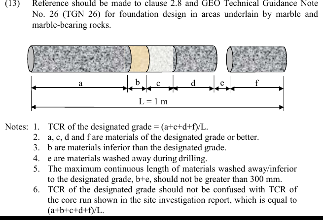
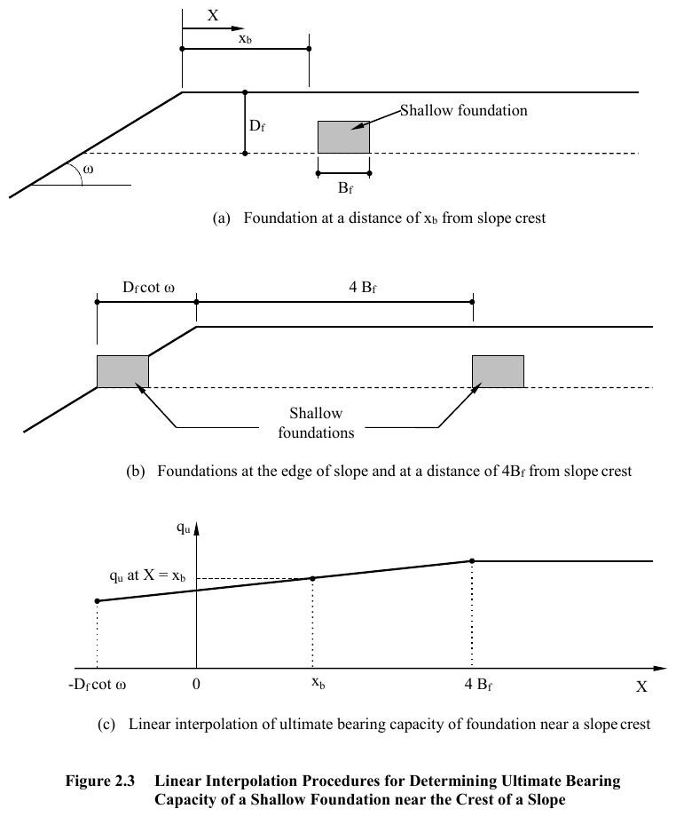
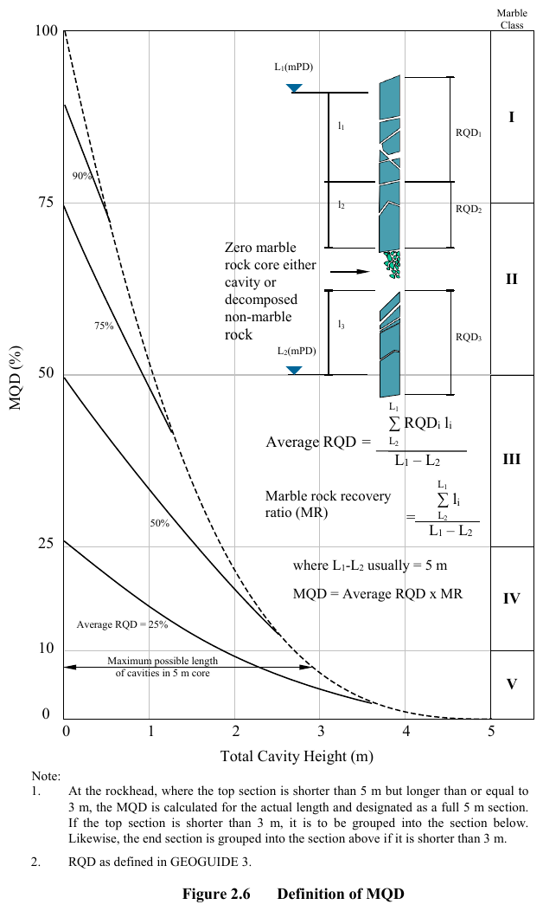
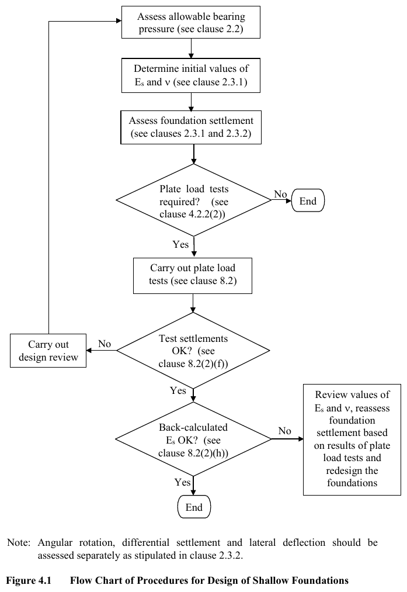
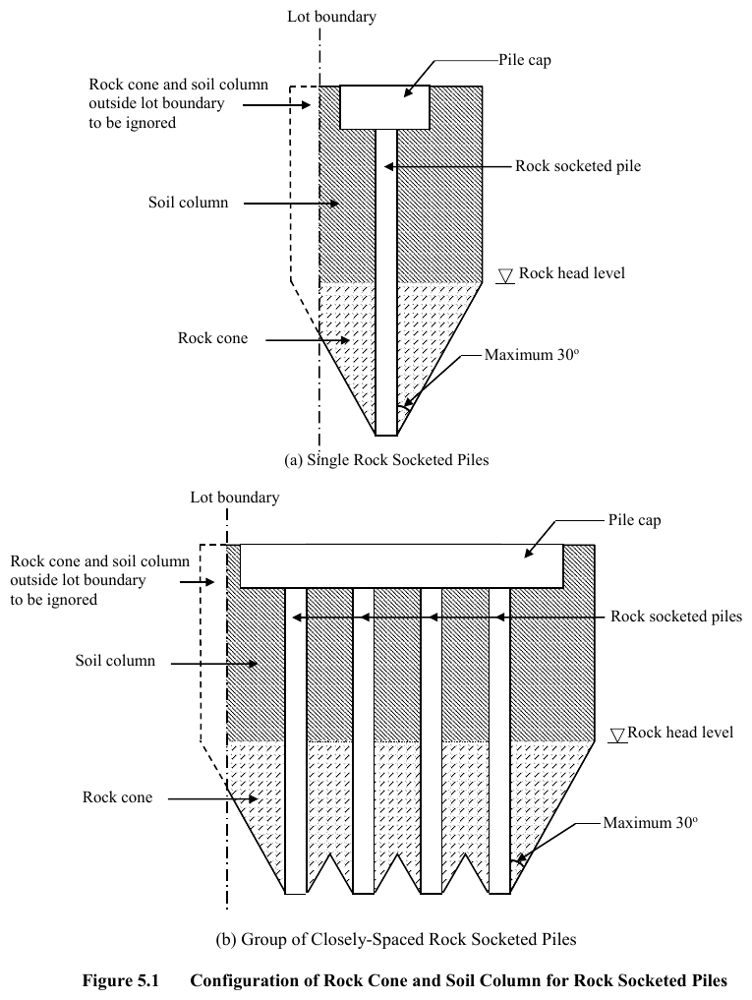

---
tags:
  - Code of Practice
  - Structural 結構
  - Foundation 地基
  - Geotechnical 岩土
  - Excavation & ELS 挖掘
  - Site supervision 地盤監督
  - Site safety 地盤安全
  - Demolition 拆卸
  - Concrete & materials 混凝土及物料
  - Plan submission & approval 呈交及審批
  - Wind 風力
  - Drainage 排水
  - Occupation permit 佔用許可證
  - Minor works 小型工程
summary: "Presumed bearing values, rock sockets, stability factors, pile spacing and settlement monitoring."
keywords: foundation code, 地基, piles, 樁, bearing pressure, 承載壓力, rock socket, settlement, 沉降, Alert Alarm Action
---

# Code of Practice for Foundations 2017 <small>《2017 年地基作業守則》</small>

!!! info "Document info 文件資料"
    | | |
    |---|---|
    | **Edition 版本** | 2017 (2024 Edition, Oct 2024), consolidating the 2021–2024 amendments; amendment **Sep 2025** (6 items) 2025 年 9 月修訂（6 項） |
    | **Legal basis 法律依據** | Deemed-to-satisfy the BO and [B(C)R](../regulations/bcr-123q.md) foundation provisions 符合即當作符合 |
    | **Structure 結構** | 8 chapters: 1 General · 2 Design · 3 Site investigation · 4 Shallow · 5 Piles · 6 Other types · 7 Construction and site safety · 8 Testing |
    | **Source 原文** | [English (PDF)](https://www.bd.gov.hk/doc/en/resources/codes-and-references/code-and-design-manuals/FoundationCode2017.pdf) · [Sep 2025 amendment (PDF)](https://www.bd.gov.hk/doc/en/resources/codes-and-references/code-and-design-manuals/FoundationCode2017_amendment202509.pdf) |
    | **Last checked 最後核對** | 2026-11-22, clause by clause against the 2024 Edition and the Sep 2025 amendment 逐條核對 |

## At a glance 重點摘要 {#at-a-glance}

=== "English"

    - Covers design and construction of **shallow foundations, piles, basements, diaphragm walls, retaining walls, ground anchors** and the **re-use of existing foundations**, plus site investigation, monitoring and testing.
    - **Allowable capacity** = the lesser of ultimate capacity ÷ factor of safety and the value giving tolerable movement; **+25 %** if due solely to wind (cl. 2.1.1).
    - Presumed values range from **10,000 kPa** for Category 1(a) rock to **80 kPa** for firm clay. Rock bond for piles: **700 kPa** (1(c) or better) or **300 kPa** (1(d) and 2).
    - **Settlement reference**: total **30 mm**, differential **1:500**, rotation **1:500** (cl. 2.3.2).
    - **Stability**: resistance at least **1.5 ×** sliding and uplift; overturning **1.5 ×** wind / **2 ×** other loads; groundwater **1.1 ×** at the highest *possible* level.
    - **Friction and driven piles**: spacing at least the **pile perimeter or 1 m**, and at least **half the perimeter or 500 mm** from the site boundary.
    - **Pile load test** to **2 ×** working load held **72 h**; settlement limit **2WL/AE + D/120 + 4 mm**.
    - **Monitoring of nearby ground**: Alert / Alarm / Action at **12 / 18 / 25 mm**; building tilt **1:1,000 / 1:750 / 1:500**; vibration ppv **15 / 7.5 mm/s**.
    - **Sep 2025**: granular-soil qu cap **4,500 kPa** for buildings with basements; Es up to **1.5 N** for saprolite rafts.

=== "中文"

    - 涵蓋**淺地基、樁、地庫、連續牆、擋土牆、地錨**及**重用現有地基**的設計及施工，另含土地勘測、監測及測試。
    - **容許承載力** = 極限承載力除以安全系數，與可容忍變形所對應數值，兩者取較小；純因風荷載可提高 **25%**。
    - 推定值由第 1(a) 類岩石 **10,000 千帕**至硬塑黏土 **80 千帕**；樁與岩石黏結力 **700 千帕**（1(c) 或更佳）或 **300 千帕**（1(d) 及 2）。
    - **沉降參考準則**：總沉降 **30 毫米**、差異沉降 **1:500**、轉角 **1:500**。
    - **穩定性**：滑動、上浮抵抗力 **1.5 倍**；傾覆：風 **1.5 倍**、其他荷載 **2 倍**；以最高*可能*地下水位設計時地下水 **1.1 倍**。
    - **摩擦樁及打入樁**：間距不少於**樁周長或 1 米**，距地盤界線不少於**半周長或 500 毫米**。
    - **樁荷載測試**加至 **2 倍**工作荷載，維持 **72 小時**；沉降上限 **2WL/AE + D/120 + 4 毫米**。
    - **鄰近地面監測**：警戒／警報／行動 **12／18／25 毫米**；建築物傾斜 **1:1,000／1:750／1:500**；振動 ppv **15／7.5 毫米／秒**。
    - **2025 年 9 月修訂**：有地庫建築物粒狀土極限承載力上限提高至 **4,500 千帕**；殘積土筏式地基 Es 可取 **1.5 N**。

!!! tip "Does it apply? 是否適用？"
    Every foundation submission under the BO, including piling, shallow footings, basements, retaining walls and the re-use of old foundations. Foundation works deeper than **3 m** are **specialised works** for a **RSC (Foundation Works)** (cl. 7.1.1). Ground investigation field works are done by a **RSC (GI Field Works)** with supervision under the [Site Supervision Code](site-supervision-2009.md). See also [APP-18](../pnap/app-18.md) for submission requirements. 所有地基呈交均適用；深度超過 3 米的地基工程屬專門工程，須由註冊專門承建商（地基工程）進行。

## Contents 內容 {#contents}

| Section 章節 | Topic 主題 | Jump 跳至 |
|---|---|---|
| 1 | General, glossary, symbols 總則 | — |
| 2 | Design requirements: bearing, settlement, **reclaimed land**, structural, corrosion, foundation plans, **Scheduled Areas**, **Designated Area**, sloping ground 設計要求 | [§2](#ch2) |
| 3 | **Site investigation** 土地勘測 | [§3](#ch3) |
| 4 | Shallow foundations 淺地基 | [§4](#ch4) |
| 5 | **Piles**: group effect, spacing, uplift, NSF, capacities, 12 pile types, pile caps 樁 | [§5](#ch5) |
| 6 | Basements, diaphragm walls, retaining walls, **ground anchors**, **re-use** 其他地基 | [§6](#ch6) |
| 7 | Construction and site safety 施工及地盤安全 | [§7](#ch7) |
| 8 | Testing 測試 | [§8](#ch8) |

## 2 General design requirements 一般設計要求 {#ch2}

| Clause 條文 | Requirement 要求 |
|---|---|
| 2.1.1 | Foundations safely carry dead, imposed and wind loads without impairing stability or causing excessive movement to the building or any other building, street, land, slope or services. Allowable capacity = **lesser of** (a) ultimate ÷ adequate FoS, (b) the value giving tolerable deformation. **+25 % for wind only**. FoS considers form, depth, loading, geology, **dissolution features** and rock jointing. 基本要求。 |
| 2.1.2 | Site investigation, testing, parameters, calculations, construction method and acceptance standards must be **compatible** with the chosen method. 方法須前後一致。 |
| 2.1.3 | Soil and rock classification per Table 2.1 and **GEOGUIDE 3**. |
| 2.2.1 | **Rational design method**: interpret SI, assess tests, analysis on physics or proven empirical methods; normally **FoS 3** on ultimate. 理性設計方法。 |
| 2.2.2 | **Presumed values** (Table 2.1) if (a) SI follows Ch. 3 and (b) structure not unduly sensitive to settlement. Rock values assume no slip: check **unfavourable joints** on inclined rock. 推定值的使用條件。 |
| 2.2.2(3) | Allowable **lateral** bearing on rock = **⅓** of vertical, if no adverse joints. 岩石側向承載力。 |
| 2.2.2(5) | **Minor or temporary structures** on flat granular ground: **100 kPa dry / 50 kPa submerged**. 小型或臨時構築物。 |
| 2.2.3 | **In-situ load testing**: consider variation between test and actual locations, load duration and scale effect. 現場測試。 |
| 2.2.4 | **Bearing capacity equation** (below). |
| 2.2.5 | Other methods if suitability demonstrated. |

### Presumed allowable bearing pressure 推定容許承載壓力 (Table 2.1) {#presumed-allowable-bearing-pressure-table-21}

| Cat. 類別 | Ground 地層 | kPa |
|---|---|---|
| **1(a)** | Fresh to slightly decomposed strong to very strong granite/volcanic, grade II or better, **100 % TCR**, UCS ≥ **75 MPa** (PLI50 ≥ 3 MPa) | **10,000** |
| **1(b)** | Fresh to slightly decomposed strong, grade II or better, ≥ **95 %** TCR, UCS ≥ 50 MPa (PLI50 ≥ 2) | 7,500 |
| **1(c)** | Slightly to moderately decomposed moderately strong, grade III or better, ≥ **85 %** TCR, UCS ≥ 25 MPa (PLI50 ≥ 1) | 5,000 |
| **1(d)** | Moderately decomposed, moderately strong to weak, grade III or better, ≥ **50 %** TCR | 3,000 |
| **2** | Meta-sedimentary rock, grade III or better, ≥ 85 % TCR (**excludes marble**) | 3,000 |
| **3** | Intermediate soil: decomposed granite/volcanic, grade V or better, **SPT N ≥ 200** | 1,000 |
| 4(a) | Very dense sand/gravel, N > 50 (dry / submerged) | 500 / 250 |
| 4(b) | Dense, N 30–50 | 300 / 150 |
| 4(c) | Medium dense, N 10–30 | 100 / 50 |
| 4(d) | Loose, N 4–10 | < 100 / < 50 |
| 5(a) | Very stiff or hard clay, cu > 150 kPa | 300 |
| 5(b) | Stiff clay, cu 75–150 kPa | 150 |
| 5(c) | Firm clay, cu 40–75 kPa | 80 |

**Notes to Table 2.1** 附註:

1. Values are for **negligible lateral load** at bearing level. 底部側向荷載可忽略。
2. Self-weight of the embedded pile length need not be included. 埋入部分樁身自重毋須計入。
3. Minimum **socket** along the perimeter: **500 mm** (1(a), 1(b)); **300 mm** (1(c), 1(d), 2). 最少嵌岩深度。
4. **TCR of the designated grade** must be proved **≥ 5 m** into the rock below the minimum socket, in consecutive **1 m segments**, each meeting the required TCR (Fig. 2.1). 須證明 5 米。
5. No core within **600 mm** below the pile base logged as "non-intact" (GEOGUIDE 3). 樁底下 600 毫米內不得有「非完整」岩芯。
6. Dry/submerged intermediate: interpolate. Presumed values **do not remove the need to check settlement**. 仍須檢查沉降。
7. Marble areas: cl. 2.8 and GEO **TGN 26**. 大理石地區另見第 2.8 條。

{ loading=lazy }
<small>Figure 2.1 (BD): TCR of the designated grade = (a+c+d+f)/L; continuous inferior or washed-away length b+e **≤ 300 mm**. Do not confuse with core-run TCR (a+b+c+d+f)/L. 指定級別岩芯總回收率定義。</small>

### Rock bond for piles 樁與岩石黏結力 (Table 2.2)

| Rock category 岩石類別 | Compression or transient tension 受壓或短暫受拉 | Permanent tension 永久受拉 |
|---|---|---|
| 1(c) or better | **700 kPa** | 350 kPa |
| 1(d) or 2 | **300 kPa** | 150 kPa |

<small>Concrete or grout **≥ 30 MPa**. Transient tension = e.g. wind. 混凝土或灌漿最少 30 兆帕。</small>

### Bearing capacity equation 承載力公式 (cl. 2.2.4)

**qa = (qu − qo) / F + qo**, with **F ≥ 3**; qo = γs′Df (effective overburden at the base).

- **qu cap for granular soil: 3,000 kPa**; **4,500 kPa** for foundations supporting buildings **with basements** on granular soil **(9/2025)**. 粒狀土極限承載力上限。
- qu = c′Nc ζcs ζci ζct ζcg + 0.5 Bf′ γs′ Nγ ζγs ζγi ζγt ζγg + q Nq ζqs ζqi ζqt ζqg, using effective dimensions Bf′ = Bf − 2eB, Lf′ = Lf − 2eL; factors in Table 2.3 (c′-φ′ and undrained φ = 0 cases: shape, inclination, tilt and ground slope).
- **Note 1 (q)**: ignore overburden that may be removed; effective depth ≤ **3 m or Bf**, whichever smaller; for buildings **with basements** on granular soil, the effective depth (minimum overburden around the basement perimeter) ≤ **10 m or Bf** **(9/2025)**; discount voids for utilities. 有效覆土深度。
- Weak geological features may invalidate the equation. 不良地質特徵。
- **Near a slope crest**: interpolate qu between the edge-of-slope value and the flat-ground value at **4 Bf** from the crest (Fig. 2.3); also check overall slope stability. 近斜坡頂。
- Irregular footings: use the **largest inscribed rectangle** (Fig. 2.4). 不規則形狀取最大內接矩形。
- γs′: dry = γ; submerged static = γ′; upward flow = γ − γw(1 + i); interpolate between. 有效容重。

{ loading=lazy }
<small>Figure 2.3 (BD). 斜坡頂附近承載力線性內插。</small>

### Settlement and rotation 沉降及轉角 (cl. 2.3)

| Item 項目 | Requirement 要求 |
|---|---|
| 2.3.1(1) | Predict immediate, primary and secondary consolidation settlement from proper SI, mechanics or proven methods, applicable to HK soils. |
| 2.3.1(2) Granular | Se = qnet Bf′ Fo / Es (Fo per GEO Publication 1/2006). 粒狀土即時沉降。 |
| 2.3.1(3) Fine-grained | Immediate + consolidation: Sp = Hs[CR log(…) / RR log(…)] by σv0′, σp′ and Δσv; secondary Sc = Hs Cα/(1+e0) log(ts/tp), starting at **95 %** primary consolidation. 黏土固結沉降。 |
| 2.3.1(4) Young's modulus | Determine by tests; plate load tests may be required. Without better data, granular Es (MPa) = **1 × N** for shallow foundations; **1.5 × N** for **rafts on saprolites and residual soils with N > 30** **(9/2025)**. (Before 9/2025 the 1 × N rule was limited to qa ≤ 250 kPa.) 楊氏模量。 |
| 2.3.1(5) Poisson's ratio (Table 2.4) | N 4–10: 0.30–0.40; N 11–30: 0.20–0.35; N > 30: 0.15–0.30; cohesive 0.1–0.3. |
| **2.3.2 Reference criteria** | For structures not sensitive to movement, at the base of a shallow foundation / pile cap / equivalent raft: (a) total **≤ 30 mm**; (b) differential **≤ 1:500**; (c) angular rotation **≤ 1:500** under wind or transient loads. Working loads; dead load may be taken at **50 %** for (a) and (b), and imposed load reduced per the [Loads Code](dil-2011.md). (a) is deemed met on Cat. 1–2 rock or piles driven to **N ≥ 200**. 沉降參考準則。 |
| 2.3.2(3) | Beyond the criteria: show no overstress in the building or neighbours and no problems with services, pavements or roads. |

### Reclaimed land 填海土地 (cl. 2.4)

| Clause 條文 | Rule 規則 |
|---|---|
| 2.4.1(a) | Lowest floor slabs **not on-grade** unless recommended otherwise. 最低層樓板不應為地面承托板。 |
| (b) | Slabs directly on a raft-type pile cap may be on-grade. |
| (c) | On-grade allowed if readily repairable: fence walls, landscaping, light covered walkways; car parks, loading bays, ramps, pavements. |
| (d) | Transformer rooms, pump houses: foundations through the fill to a firm stratum, suspended lowest slab. 變壓房、泵房。 |
| (e) | Utilities under the building supported by suspended slabs or pile caps; flexible connections at the interface. 管道須懸吊及設可伸縮接駁。 |
| (f)–(g) | Prevent soil migration into voids under pile caps; assess **negative skin friction**. |
| 2.4.2 | Alternative approach: time-settlement assessment from site-specific GI and **continuous monitoring** during construction; CEDD records only as reference. |
| 2.4.3 | Long-term monitoring/maintenance: the AP alerts the developer to tell **prospective buyers** of the cost. 須告知準買家。 |
| 2.4.4 | Rules may be relaxed after **95 %** primary consolidation; default years since reclamation for clay thickness H: **≤ 5 m → 10 yrs; 5–10 m → 20 yrs; 10–15 m → 30 yrs** (not where further site formation or heavy shallow loads). 固結年期。 |

### Structural requirements 結構要求 (cl. 2.5) {#stability-and-pile-layout}

| Clause 條文 | Requirement 要求 |
|---|---|
| 2.5.2 | Loads per the [Loads Code](dil-2011.md) and [Wind Code](wind-2019.md); imposed load includes **buoyancy** and **earth pressure**. Foundations on **assumed loads**: schedule them and prove before superstructure works that actual loads do not exceed them. 假設荷載須於上蓋施工前證實。 |
| 2.5.3 | **Highest anticipated GWL**: from reliable data covering **at least a wet season** (tides, storm surge, rainfall, sea level rise, permeability, dewatering). **Highest possible GWL**: normally **ground surface**, can be higher in low-lying reclamation. 地下水位。 |
| 2.5.4(2) Anticipated GWL | Sliding resistance ≥ **1.5 ×**; uplift ≥ **1.5 ×**; overturning ≥ **1.5 × wind + 1.5 × groundwater + 2 × other loads**. |
| 2.5.4(3) Possible GWL | Sliding ≥ **1.1 × groundwater + 1.5 × other**; uplift ≥ **1.1 × groundwater + 1.5 × other**; overturning ≥ **1.5 × wind + 1.1 × groundwater + 2 × other**. |
| 2.5.4(4) | Resistance from **minimum dead load** (structure, permanent finishes, backfill; removable items ignored) plus permitted anchorage. Landslide debris impact: GEO TGN 42. Marine: Port Works Design Manual. |
| 2.5.5(1) | Permissible stress +**25 %** for wind only. |
| 2.5.5(2) Concrete | Cast-in-place: reduce strength by **20 %** where groundwater is met or concrete placed under water. Driven precast pile working stress ≤ **0.2 fcu**. Marine ≥ **C45**; underwater concrete taken as **C25**. |
| 2.5.5(4) Steel | Driven steel piles (FoS 2 on driving): ≤ **30 % fy**; pre-bored or jacked: ≤ **50 % fy**. Steel–grout bond **400 kPa** (320 underwater); with shear studs ≤ **600 kPa** (480). Use the full external surface; clean surface. |

<small>Pile spacing and pile load tests are under [§5](#ch5) and [§8](#ch8). 樁距及測試見第 5、8 章。</small>

### Corrosion, foundation plans, special areas 防腐蝕、地基圖則、特別地區 (cl. 2.6–2.10)

| Clause 條文 | Requirement 要求 |
|---|---|
| 2.6.2 | Show concrete protection on plans where sulphate/chloride/aggressive agents, alkalis with high moisture, **landfill** or abrasion. Reactive alkali ≤ **3.0 kg Na2O eq./m³**. 鹼骨料反應。 |
| 2.6.3 | Steel piles: aggressive ground, **splash and tidal zones**, contact with other metals, stray current, abrasion. |
| 2.6.4 Marine | Concrete ≥ **C45**, w/c ≤ **0.38**, cementitious 380–450 kg/m³ with **5–10 % silica fume**, cover **75 mm**, crack width ≤ **0.1 mm** in tidal/splash zones; steel below seabed corrosion allowance **0.05 mm/yr**; chloride-free stainless; isolate embedded and immersed steel. 海事地基。 |
| 2.7 | **Foundation plan** items (a)–(l): block plan; site features and boreholes, neighbours, services, slopes, nullahs; layout, depths, details; pile details (shoe, head, splice, cap connection); bearing capacity and verification; materials; characteristic loads per pile or group; installation and founding criteria; verticality control, **max number of rigs** for percussive piling; dynamic formula parameters; precautionary measures, monitoring and contingency plans. **Supporting documents**: SI report with photos of all samples and cores; calculations; assessment on neighbours; **PR Plan**. 地基圖則內容。 |
| 2.8.1 | **Scheduled Areas** (BO Fifth Schedule): No. 1 **Mid-levels**, No. 2 **North-west NT**, No. 3 **Railway Protection Areas**, No. 4 **Ma On Shan**, No. 5 **Sewage Tunnel Protection Areas** – see the relevant PNAPs. 附表地區。 |
| 2.9 | **Designated Area** (complex geology, e.g. Northshore Lantau): very comprehensive GI; layout changes or site abandonment may be warranted. 指定地區。 |
| 2.10 | Sloping ground: check slope and retaining wall stability for added loads or groundwater changes. 斜坡地。 |

### Marble – Scheduled Areas 2 and 4 大理石地區 (cl. 2.8.2)

**Table 2.5 Marble rock mass classes (MQD = average RQD × marble recovery ratio, per 5 m section)** 大理石岩體分類

| Class | MQD % | Quality 質素 | Use 用途 |
|---|---|---|---|
| I | 75–100 | Very good | Good bearing 良好持力層 |
| II | 50–75 | Good | Good bearing |
| III | 25–50 | Fair | Marginal – judge in 3-D model 邊緣 |
| IV | 10–25 | Poor | Generally unsuitable 一般不適合 |
| V | ≤ 10 | Very poor, large continuous cavities | Unsuitable |

{ loading=lazy }
<small>Figure 2.6 (BD). Top or end sections 3–5 m count as a full 5 m section; < 3 m join the adjacent section. MQD 定義。</small>

**Foundations on soil (empirical approach)** 建於泥土上:

| Drill hole rating (Table 2.6) | Rating | Site class (Table 2.7): % area with rating ≥ 5 | Max increase of vertical effective stress at marble surface (Table 2.8) |
|---|---|---|---|
| (i) Surface karst (Class III–V at rockhead) | 0 | **A** easy: 0–10 % | Controlled by soil settlement |
| (ii) Overhang (5–10 m of Class I/II over karst) | 5 | **B** fair: 10–25 % | **5–10 %** |
| (iii) Class III ≥ 5 m below I/II | 10 | **C** very difficult: 25–50 % | **3–5 %** |
| (iv) Class IV/V ≥ 5 m below I/II | 20 | **D** extremely difficult: 50–100 % | **< 3 %** |

**Piles on marble** 建於大理石上的樁: suspended ground slab between piles; bored piles on **Class I or II** in the zone of influence; driven piles to Class I/II with final set usually **≤ 10 mm / 10 blows**, pre-boring through overhangs; **redundancy factor** (Table 2.9) **A 10–20 %, B 20–30 %**, C/D specialist advice.

| Table 2.10 marble bedrock | Bearing | Bond (compression / transient tension) | Bond (permanent tension) |
|---|---|---|---|
| Class I/II, ≥ 95 % TCR, UCS ≥ 50 MPa | **7,500 kPa** | 700 kPa | 350 kPa |
| Class I/II, ≥ 85 % TCR, UCS ≥ 25 MPa | **5,000 kPa** | 700 kPa | 350 kPa |

<small>TCR to be proved within the zone of influence, at least **3 × pile base diameter**. 影響範圍最少為樁底直徑 3 倍。</small>

## 3 Site investigation 土地勘測 {#ch3}

| Clause 條文 | Requirement 要求 |
|---|---|
| 3.1 | SI report with documentary studies, site survey, GI and appraisal; follow **GEOGUIDE 2 and 3**. |
| 3.2 | Documentary studies first (CEDD **Geotechnical Information Unit**); verify old GI data; discard doubtful data. |
| 3.3(1) | Topographical survey: identify land with average gradient **> 15°** (boundary to boundary or any 50 m strip) and slopes **> 15°** within or **50 m** from the site. 斜坡地識別。 |
| 3.3(2) | Geological and ground models: early recognition of complexity, variations, external factors, uncertainties, update during construction. |
| 3.3(3) | Survey of structures – nearby buildings (especially **pre-war**, appendages, party walls), retaining walls; photo records of defects; find foundations by trial pit or drilling if unknown. 鄰近建築物狀況。 |
| 3.3(4) | Disused tunnels, culverts, nullahs, stream courses, anchors, soil nails; **no building over a main arterial storm water nullah**. |
| 3.3(5) | Underground services and their tolerable movement; verify on site; ETWB Code on water-carrying services. |
| 3.4.1 | GI field works by **RSC (GI Field Works)** under the Site Supervision Code; lab tests and field density tests by **HOKLAS** labs with endorsed certificates. 土地勘測由註冊專門承建商進行。 |
| 3.4.2–3.4.4 | Supervision per PNAP; GI report per GEOGUIDE 2; good-quality samples and continuous cores. |
| 3.4.5 | Enough boreholes to show variation and the **rockhead** for rock foundations. |
| 3.4.6 | Depth: watch for **boulders** mistaken for bedrock – prove rock by coring **≥ 5 m**; to where strain is insignificant; spread footings **5 m into rock** or negligible strain depth. 岩石須鑽探證明 5 米。 |
| 3.4.7 | Groundwater: standpipes/piezometers over an extended period; chemical tests if aggressive. |
| 3.5–3.6 | Scheduled Areas: **GI plan approval and consent** under B(A)R reg. 8(1)(l); Designated Area: staged GI before general building plans finalised. 附表地區土地勘測須批准及同意。 |

## 4 Shallow foundations 淺地基 {#ch4}

- **4.1** Usually reinforced concrete on rock or soil at shallow depth; must not overload neighbours, destabilise slopes or interfere with drains, nullahs, sewers or services.
- **4.2.1** On Cat. 1–2 rock: per cl. 2.2. **4.2.2** On soil: bearing per 2.2, settlement per 2.3 (flow chart Fig. 4.1).
- **4.2.2(2) Plate load tests required** if: (a) presumed qa **> 300 kPa** (unless qa − qo < 50 kPa), except Cat. 3; (b) qa from the bearing capacity equation or other methods (except minor or temporary structures); (c) Es used **> 1 × N**, or **> 1.5 × N** for saprolites/residual soils with N > 30 **(9/2025)**. 須做平板荷載測試的情況。
- **Number of tests**: ≥ **1 per soil type for each of the first two 500 m²**, then **1 per additional 1,000 m²** of site coverage; fractions round up. 測試數目。
- **4.3–4.4** Structural design per the [Concrete Code](concrete-2013.md); stability per 2.5.4. Pads: check total and differential settlement, enlarge footings if needed; strips: consistent founding; rafts: design for differential settlement in both directions.

{ loading=lazy }
<small>Figure 4.1 (BD). 淺地基設計流程。</small>

## 5 Pile foundations 樁基 {#ch5}

### General 一般 (cl. 5.1)

| Clause 條文 | Requirement 要求 |
|---|---|
| 5.1.2 Group effect 羣樁效應 | Friction piles in soil: apply a group reduction factor; **0.85** generally acceptable for **≥ 5** vertically loaded piles. **Not needed** where (a) spacing > **3 × perimeter**; (b) end-bearing; (c) rock-socketed; (d) driven to refusal on bedrock; (e) driven to **N ≥ 200**. |
| **5.1.3 Spacing 樁距** | Driven and friction piles: ≥ **perimeter or 1 m**; ≥ **½ perimeter or 500 mm** from the site boundary; H-pile perimeter = **2(b+d)**. Socketed (mini-piles, socketed H): ≥ **750 mm or 2 × casing OD**. End-bearing bored piles: nominal clear **500 mm** between shafts or bell-outs. |
| 5.1.4 | Driven and small-diameter piles: horizontal restraint in **two directions**. |
| 5.1.5–5.1.6 Uplift 抗拔 | Each pile: **(a) Dmin + 0.9Ru − 2.0Ia − 1.5Ua (or 1.1Up) − 1.5Wk ≥ 0**; **(b) Dmin + Ra − Ia − Ua − Wk ≥ 0**. Or a justified global stability analysis with real stiffnesses. |
| 5.1.7 Group settlement | Equivalent raft at **⅔ pile depth below soft soil** (friction piles) or at the **toe** (end-bearing/socketed). |

### Negative skin friction 負摩擦力 (cl. 5.2)

- Strata that will consolidate: ignore their friction; design for NSF. Bitumen coating or double-skin liners may reduce NSF (prove by trials).
- **Conventional approach**: Pns ≥ Gk + Qk + NSF; Pnw ≥ Gk + Qk + Wk + NSF; **NSF = ∫ β σ′ p dl**, default **β = 0.25**; group factor may also apply to NSF.
- **Alternative approach**: ground capacity Pc ≥ Gk + Qk (no NSF); structural Ps ≥ Gk + Qk + NSF; settlement under NSF acceptable; test load **≥ 2Pc + NSF**.

### Load capacity 承載力 (cl. 5.3)

| Item 項目 | Requirement 要求 |
|---|---|
| 5.3.1 | Structural strength per 2.5.5; check **buckling** in soft strata. |
| 5.3.2(1) Driven piles | Dynamic formula, static formula or load test; FoS **≥ 3** (static formula), **never < 2**. **Final set**: 25–50 mm / 10 blows; drop hammer efficiency ≤ **0.7**; to bedrock **10 mm / 10 blows**. **Steel H-piles**: 25–100 mm / 10 blows, take **50** if calculated 50–100; discard if (cp+cq)/L > **1.15**. **Hiley formula**; cushion compression cc ≥ **5 mm** for plastic cushion ≤ 200 mm. 最後貫入度。 |
| 5.3.2(2) Non-driven | From founding condition and cl. 2.2 values; **ignore the minimum socket** and **bell-out faces** in bond; no shaft + end bearing combination unless settlement compatibility proved. |
| 5.3.3 Uplift | Ra/Ru = shaft resistance + effective pile weight; FoS 3 (≥ 2 if tested). Tension proof test not needed if tension ≤ ½ compressive shaft capacity and the pile is in the compression test pool. **Ru − Wp′ ≤ W1′ + W2′** (cone + soil column). Rock socket ultimate bond = **2 × allowable**; rock cone half-angle **≤ 30°**; ignore parts **outside the lot boundary**; overlapping cones shared pro rata. |
| 5.3.3(3) Driven H in granular soil | (i) uniform **10 kPa** allowable (N ≥ 10), ultimate 2×; (ii) β-method τs = βσv′ ≤ **120 kPa**, β 0.1–0.4, trial piles unless N ≥ 20, γ ≤ 20, γ′ ≤ 10 kN/m³, β ≤ 0.2; (iii) τs = **1.5N** ≤ 120 kPa with trials, or **0.75N ≤ 60 kPa** without; permanent tension = **50 %** of transient; FoS 3 (≥ 2). Soil cone dilation **1 in 4 (≈ 15°)** if N ≥ 30, else 0; no cone check for single piles. |
| 5.3.4 Lateral | Soil/rock resistance with group effect, structural capacity, **P-Δ if deflection > 25 mm**. nh (Table 5.1, dry / submerged kN/m²/m): N 4–10: 2,200 / 1,300; 11–30: 6,600 / 4,400; 31–50: 17,600 / 10,700. Group reduction (Table 5.2) spacing/diameter 3: **0.25**, 4: 0.40, 6: 0.70, 8: **1.00**; < 3 use continuum methods. Pile + cap together only with SSI analysis; ignore side/base friction of caps and basements unless compatible. Rock socket lateral = **⅓ vertical**. |

{ loading=lazy }
<small>Figure 5.1 (BD): rock cone (max 30°) and soil column; parts outside the lot boundary ignored. 岩錐及土柱。</small>

### Common pile types 常用樁類 (cl. 5.4)

| Type 類型 | Key rules 主要規定 |
|---|---|
| 5.4.1 Steel H / tubular 鋼工字樁 | Plans show properties, splice and head, tip protection, orientation for lateral load. **Welded splices**: qualified welders and WPS; **≥ 10 % NDT** before driving; reports in piling records. |
| 5.4.2 Socketed H 嵌岩工字樁 | Socket in Table 2.1 rock; non-shrink grout **≥ 30 MPa**; grout cover **≥ 40 mm**; full-depth temporary casing in soil; **test boring**; clean holes. |
| 5.4.3 Precast RC 預製鋼筋混凝土樁 | Low/medium rise, ground without many boulders; check lifting and driving stresses; avoid hard driving. |
| 5.4.4 Prestressed spun 預應力管樁 | Drive to stiff stratum with embedment in residual soil; assess soil movement; **conical shoes with cross stiffeners** in stiff soil. |
| 5.4.5 Driven cast-in-place 打入式現場灌注樁 | Max **750 mm** diameter; no driving or vibration within **5 diameters** of an unfilled hole or pile concreted **< 24 h**. |
| 5.4.6 Small-diameter bored 小直徑鑽孔樁 | ≤ **750 mm**; ignore fill/marine deposit friction; **CFA**: Rbc = μ Nav p L + 5 Nb Ab (Nav ≤ 40, Nb ≤ 200; μ 1.0, up to **1.6** with trials); grout factor ≥ trial and **≥ 1.15** per 1.5 m, total **≥ 1.4**; refusal (< 300 mm/min): relocate if within **6 diameters** of a completed pile. |
| 5.4.7 Large-diameter bored 大直徑鑽孔樁 | > **750 mm**; bore under water or bentonite, **no dewatering**; full-depth casing in soil. Bell-out + socket bond: socket ≤ **1 × diameter or 3 m**, ignore the **750 mm** above the bell-out; end bearing + socket: ≤ **2 × diameter or 6 m**. Bell-out ≤ **1.65 × shaft**, ≤ **30°**. Steep rock: founding levels of adjacent piles differ ≤ clear distance between bases. |
| 5.4.8 Mini-piles 微型樁 | ≤ **5 bars ≤ 50 mm**, casing OD ≤ **450 mm**, working load ≤ **2,350 kN**. Capacity from bars only at **47.5 % fy**; grout cover ≥ **30 mm**; bar–grout bond **0.8 MPa**; clear bar spacing ≥ **20 mm**; no bending resistance; check buckling; weak strata = no 5 m layer with average N ≥ 10 and no N < 5; no raking piles in consolidating ground. Permanent casing ≥ **5 mm** + cover ≥ 20 mm or bar diameter; couplers per the Concrete Code. |
| 5.4.9 Barrettes 矩形樁 | Bentonite trench, tremie; RC guide walls; usually end bearing on rock. |
| 5.4.10 Hand-dug caissons 人手挖掘沉箱 | **Banned** for general use; allowed only if depth ≤ **3 m** and inscribed circle ≥ **1.5 m**, or it is the only practical / no safe alternative. 一般禁止。 |
| 5.4.11 H-piles driven to bedrock 打至基岩的工字樁 | Bedrock ≤ **25°**; rock grade III, ≥ 50 % TCR; **refusal = ≤ 10 mm / 10 blows**; strengthened toes, rock points, fixed head; reduce drop height near rockhead. **≥ 2 trial piles** if rock > 15°, piles < **10 m**, or weak strata; test drive ≥ 2 piles; **dynamic load tests ≥ 10 %** (peak stress ≥ **75 % fy**) plus **≥ 20 %** for integrity (≥ 30 % fy); weak soil = no 5 m layer with average N ≥ 20 and no N < 10. |
| 5.4.12 Shear piles 抗剪樁 | Lateral load only; embed in the cap; compatibility with other piles. |

**5.5 Pile caps** 樁帽: flexible cap analysis unless statically determinate; design connections for tension and moment; mini-piles pinned at both ends. Caps **≥ 800 mm** with H-piles: bar pairs at up to **400 mm** if each bar is within **250 mm** of the next and a trimmer bar (≥ 50 % area, 90° hooks into the web or welded) reduces spacing to ≤ **200 mm**.

## 6 Other foundation types 其他地基 {#ch6}

| Clause 條文 | Requirement 要求 |
|---|---|
| 6.1 Basements and hollow boxes 地庫 | Vertical resistance from wall bases, base slab, wall friction; horizontal from passive, wall friction, base friction – all mobilised simultaneously. Concrete **≥ C35**, watertight. Check **buoyancy before completion of the superstructure** and during construction stages; flooding. 上蓋完成前亦須驗算浮力。 |
| 6.2 Diaphragm walls 連續牆 | ≥ **600 mm** thick; panels **3–7 m**; analyse seepage, toe stability, moments by stage, bearing, trench stability, settlement of neighbours; shear pins, grouting below toe. |
| 6.3 Retaining walls 擋土牆 | B(C)R; **GEOGUIDE 1** (and GEOGUIDE 6 for reinforced fill); Ch. 2 if used as foundation or resisting surcharges. |
| 6.4 Ground anchors 地錨 | **Permanent anchors needing long-term monitoring are treated as short-lived temporary works and should not be used in permanent buildings**; exceptional use per **GEOSPEC 1** with maintenance parties' agreement and as-built details. 永久地錨一般不應使用。 |
| 6.5 Re-use of existing foundations 重用現有地基 | Needs reliable records (certified foundation record plans from BD) and a testing scheme: extra GI (chloride, sulphate), visual inspection, load / proof core tests, pile head inspection. **Large concrete piles**: measure and core **each pile**, ≥ **3 cube samples**. **Small concrete and steel piles**: inspect each head, re-drive driven piles, **dynamic tests ≥ 20 %**, **load tests ≥ 5 %**. **Footings**: measure and core each. Consider old/new differential settlement and protect old piles during demolition. 重用地基測試計劃。 |

## 7 Construction practice and site safety 施工及地盤安全 {#ch7}

| Clause 條文 | Requirement 要求 |
|---|---|
| 7.1.1 | Foundation works **> 3 m** penetration = specialised work by **RSC (Foundation Works)**; comply with the [Site Supervision Code](site-supervision-2009.md) / TM and quality supervision PNAP. |
| 7.1.3 | Concrete cubes per **CS1**, reinforcement per **CS2**, HOKLAS certificates; cast-in-situ piles concreted continuously; steel pile mill certificates with RSE statement. |
| 7.2.1 | Assess effects within **≥ 50 m** of the site boundary: condition report, predicted effects (vibration, dewatering, ELS), response, mitigation, monitoring and contingency. 50 米範圍評估。 |
| 7.2.2–7.2.3 | Shoring and underpinning details; **monitoring plan** with stations, piezometers, frequency and **three trigger levels** (Table 7.1): **Alert** – increase monitoring; **Alarm** – review the installation method; **Action** – **suspend works** until remedial measures done. |
| 7.2.5 | Dewatering: assess effects, consider recharge; stop if GWL below permitted limits and inform the designer. 抽水。 |
| 7.2.8 | **Blasting**: B(C)R reg. 23, Dangerous Goods (General) Regs reg. 46, [APP-24](../pnap/app-24.md) railway protection, [APP-72](../pnap/app-72.md) control of blasting. 爆破。 |

### Monitoring of nearby structures 鄰近結構監測 (Table 7.2) {#monitoring-of-nearby-structures-table-72}

| Check point 監測點 | Alert 警戒 | Alarm 警報 | Action 行動 |
|---|---|---|---|
| Ground settlement 地面沉降 | 12 mm | 18 mm | 25 mm |
| Services settlement / angular rotation 管線 | 12 mm or 1:600 | 18 mm or 1:450 | 25 mm or 1:300 |
| Building tilt 建築物傾斜 | 1:1,000 | 1:750 | 1:500 |

<small>Typical values for buildings, structures, **land** or services not sensitive to settlement (title amended 9/2025); also watch for rapid increases and signs of distress. 一般數值，須按個別情況訂定。</small>

### Vibration 振動 (cl. 7.2.6, Table 7.3)

| Building condition 建築物狀況 | Transient / intermittent 瞬態／間歇 | Continuous 連續 |
|---|---|---|
| Robust and stable 堅固穩定 | **15 mm/s** | **7.5 mm/s** |
| Vibration-sensitive or dilapidated 敏感或殘舊 | **7.5 mm/s** | **3 mm/s** |

- Prediction (BS 5228-2): **vres = kp (√We / r^1.3)**, r = √(x² + y²); kp ≈ **1.5** (or **3.0** driven to bedrock), verified by test driving. Historic buildings (AMO) and railways have stricter limits; test driving near hospitals, old masonry or sensitive utilities; mitigation by pre-boring, fewer rigs, lower hammer weight or drop. 振動預測公式。

### PR plan, records, construction 公共關係計劃、紀錄及施工

- **7.2.7 PR Plan** (Chinese and English): (a) background and vibration activities; (b) contacts of AP, RSE, RGE, RSC; (c) organisation chart with a **PR officer**; (d) objectives; (e) concerned groups (OC, MAC, District Council); (f) sensitive buildings; (g) briefings, notices, reminders of hard driving; (h) **hotlines**; (i) complaint handling and **response pledges**; (j) monitoring details; (k) action flow chart; (l) complaint proforma; (m) complaint register. 公關計劃 13 項內容。
- **7.3 Records**: record plans; foundation report with dates, materials, bearing tests, driving performance vs vibration prediction, cubes, proof drilling, and a **review** of condition survey scope, monitoring and PR plan effectiveness.
- **7.4.1** Test driving before other driven piles; trial piles for special ground or new pile types.
- **7.4.2 Test boring** where the bit advances ahead of the casing and hole **> 450 mm** (overbreak, drawdown): proposal with machine details, max air volume and pressure, minimum advance rate, monitoring and acceptance criteria.
- **7.4.3 Pre-drilling**: ≥ **5 m** into the founding rock or socket length, deeper governs; **each** large bored pile / barrette; small-diameter rock piles: every pile tip **within 5 m** of a pre-drill hole.
- **7.4.4 Post-construction proof drilling**: large piles – interface coring **1 m above and below** for **each** pile; socketed H, H to bedrock, mini-piles – extra holes **≥ 5 m** below socket top: **2** for ≤ 100 piles, **1 %** for > 100 (round up); rockhead contour plan with the record plans.
- **7.4.5–7.4.6** Proof tests per B(C)R and Ch. 8; alternatives with justification; further tests when in doubt.
- **7.6–7.7** Ground treatment proven and tested; nuisance: Noise Control Ordinance (Cap. 400, **EPD permit for percussive piling**), Air Pollution Control Ordinance (Cap. 311), Cap. 132 (no muddy water to drains). 環境滋擾。
- **7.8** Scheduled Areas 2 and 4: **performance review**; buildings on marble: settlement monitoring by a land surveyor at least **monthly** until the **OP**. 大理石地區每月沉降監測至佔用許可證。

**Construction tolerances 施工容差 (Table 7.4)**

| Foundation 地基 | Position 平面位置 | Verticality 垂直度 | Dimensions 尺寸 |
|---|---|---|---|
| Mini-piles 微型樁 | ± 15 mm (≤ ± 75 mm if justified) | 1 in 100 | ± 3 % |
| Marine piles 海事樁 | ± 150 mm | 1 in 25 | ± 3 % |
| Other piles 其他樁 | ± 75 mm | 1 in 75 | ± 3 % |
| Rafts, ground beams, pile caps, footings | ± 50 mm | — | ± 3 % |

<small>No deviation may push any part outside the site boundary. 不得超出地盤界線。</small>

## 8 Testing 測試 {#ch8}

All tests by **HOKLAS** labs except SPT and proof core drilling (cl. 8.1).

| Test 測試 | Procedure and acceptance 程序及接受準則 |
|---|---|
| **8.2 Plate load test** 平板荷載 | Plate ≥ **300 mm**; Wt = (qu)plate × A / 3 (cohesionless: 0.1γB³Nγ square, 0.025πγB³Nγ circular); seating load ≤ 25 % overburden; cycles 0.5Wt steps to Wt, 2Wt, **3Wt held 72 h**; each step until < 0.05 mm / 10 min; **pass if Smax ≤ 0.15B**; back-calculate Es = Wt(1−ν²)/(1.13SB) square or /(SB) circular and compare with design. |
| 8.3 SPT | Uncorrected N before works; treat cohesive soil results with caution; GEOGUIDE 2. |
| **8.4 Compression loading test** 壓力荷載測試 | At cut-off, no group allowance; **2 steps to W, release, 4 steps to 2W, hold 72 h**; < 0.05 mm / 10 min; calibrated load cell and gauge. Piles ≤ 750 mm fail if max settlement > **2WL/(AE) + D/120 + 4 mm** (L to socket centre for socketed piles), or residual > greater of **D/120 + 4 mm** and **25 %** of max (recovery < 0.1 mm/h over 15 min). Large bored piles, barrettes, caissons: other justified criteria. |
| **8.5 Proof core drilling** 鑽芯驗證 | Full pile depth plus ≥ **½ base diameter or 600 mm** into the founding stratum; no honeycombing or segregation; check rock and interface; piles on soil: SPT every **1.5 m** to **3 × base diameter or 5 m**. |
| 8.6 Sonic logging 聲波檢測 | Cast-in tubes; finds honeycombing, necking, inclusions; cannot identify defect nature. |
| 8.7 Sonic echo 聲波回音 | ≥ **7 days** after casting; L/D ≤ **30**; not for jointed piles. |
| 8.8 Vibration test 振動測試 | 0–5,000 Hz; damped at L/D ~20 (stiff) / 30 (loose); no vertical cracks detected. |
| 8.9 Dynamic load test 動力荷載測試 | Penetration about **2–3 mm/blow**; **not generally accepted as a proof test**; used for defects, weaker piles, driving stress, hammer efficiency. |
| **8.10 Tension test** 拉力測試 | Reaction piles ≥ **3 diameters or 2 m** away; same load cycles as 8.4; fail if extension > elastic + **4 mm**, residual > greater of 4 mm and 25 %, or structural failure; ignore grout, include casing. Test load **1.5 × design tension capacity** where bond/friction ≤ **50 %** of compression bond **(9/2025 wording)**; never beyond yield. |
| 8.11 Lateral load test 側向荷載測試 | Jack between two piles or against a deadman; Table 8.1 steps 0.25H … **2.0H held 60 min**, unload 1.5H, 1.0H, 0.5H, 0; fail if head displacement > theoretical deflection. |
| 8.12 Ultrasonic echo sounder 超聲波回音 | Shaft and bell-out profile, verticality; calibrate in the fluid; let bubbles and sediment settle. |

## September 2025 amendment 2025 年 9 月修訂 {#september-2025-amendment-2025-9}

| Item | Clause 條文 | Change 修訂 |
|---|---|---|
| 1 | 2.2.4 | qu cap for granular soil raised from 3,000 to **4,500 kPa** for foundations supporting buildings **with basements**. 有地庫建築物上限 4,500 千帕。 |
| 2 | 2.2.4 Note 1 | Effective overburden depth for q: ≤ 3 m or Bf; for buildings with basements on granular soil ≤ **10 m or Bf** (minimum overburden around the basement perimeter). 有效覆土深度。 |
| 3 | 2.3.1(4) | Es = 1 × N for shallow foundations (the 250 kPa limit removed); **1.5 × N** for rafts on saprolites and residual soils with N > 30. 楊氏模量。 |
| 4 | 4.2.2(2)(c) | Plate load test trigger updated to match item 3. 平板荷載測試觸發條件。 |
| 5 | Table 7.2 | Title now includes **land**. 標題加入「土地」。 |
| 6 | 8.10 | Tension test load wording refined: 1.5 × design tension capacity where bond/friction ≤ 50 % of the allowable compression bond. 拉力測試措辭。 |

## Step-by-step check 逐步核對 {#step-by-step}

1. **Site** – Scheduled or Designated Area? reclaimed land? slopes > 15° within 50 m? railway, sewage tunnel, nullah, disused tunnel? 地盤特性。
2. **SI** – RSC (GI) and supervision; boreholes prove rock **5 m**; groundwater monitored over a wet season; HOKLAS lab results. 土地勘測。
3. **Loads** – characteristic loads per the Loads and Wind Codes, buoyancy, earth pressure; assumed loads to be verified later. 荷載。
4. **Bearing** – choose the method; check Table 2.1 conditions (TCR, socket, 600 mm non-intact rule); equation with FoS 3 and the qu cap (3,000 / 4,500 kPa). 承載力。
5. **Settlement** – 30 mm / 1:500 / 1:500, or case-specific; Es choice (1 N / 1.5 N); plate load tests if triggered. 沉降。
6. **Stability** – sliding, uplift, overturning at both GWLs with minimum dead load; uplift equations (a) and (b) per pile. 穩定性。
7. **Piles** – type limits (Table of 5.4), spacing, group factor, NSF, final set, socket bond, rock cone, lateral nh and P-Δ. 樁設計。
8. **Neighbours** – 50 m condition survey, monitoring plan with Alert/Alarm/Action, vibration ppv limits, dewatering, PR plan. 鄰近影響。
9. **Plans** – foundation plan items (a)–(l) and supporting documents; corrosion provisions. 圖則。
10. **Construction and testing** – pre-drilling, test boring, proof drilling numbers, load tests to 2W 72 h, tolerances, record plans and report. 施工及測試。

## Worked example 計算例子 {#worked-example}

!!! example "Illustrative only 只作說明"
    **A. Pad footing on dense sand** 密實砂上的獨立基礎: SPT N = 40, dry → Table 2.1 Cat. 4(b) presumed **300 kPa**. qa > 300 kPa is not claimed, so plate load tests are not triggered by (a); but if the bearing capacity equation were used instead, tests **would** be required (4.2.2(2)(b)). Settlement: Es = 1 × 40 = 40 MPa; qnet = 250 kPa, Bf′ = 3 m, Fo = 0.8 → Se = 250 × 3 × 0.8 / 40,000 = **15 mm < 30 mm** ✓.

    **B. Pile spacing** 樁距: 305 × 305 mm H-pile, perimeter 2(0.305 + 0.305) = **1.22 m** → spacing ≥ **1.22 m** (> 1 m), boundary distance ≥ **0.61 m** (> 0.5 m).

    **C. Mini-pile capacity** 微型樁: 4 × T50 bars, fy 500 MPa → 4 × 1,963 mm² × 0.475 × 500 = **1,865 kN** (≤ 2,350 kN limit ✓). Socket in Cat. 1(c) rock, bond 700 kPa, socket diameter 0.3 m → length = 1,865 / (700 × π × 0.3) = **2.83 m**, **plus** the 300 mm minimum socket not counted → **≥ 3.13 m** of socket.

    **D. Load test check** 荷載測試: W = 1,865 kN, L = 30,000 mm, A·E of steel ≈ 7,852 × 200 = 1.57 × 10⁶ kN → 2WL/AE = 2 × 1,865 × 30,000 / 1.57 × 10⁶ ≈ **71 mm**; D = 250 mm → D/120 = 2.1 mm → limit ≈ **77 mm** (in practice include grout and casing per 8.4(f)).

## Whole picture 全貌 {#whole-picture}

| Topic 主題 | Where 位置 | Related 相關 |
|---|---|---|
| Bearing and settlement 承載力及沉降 | Ch. 2, Tables 2.1–2.4 | [Loads Code](dil-2011.md) |
| Stability, buoyancy 穩定性 | cl. 2.5.4, 5.1.6 | [Wind Code](wind-2019.md) |
| Concrete and steel stresses 物料應力 | cl. 2.5.5 | [Concrete Code](concrete-2013.md), [Steel Code](steel-2011.md) |
| Marble, Scheduled Areas 大理石 | cl. 2.8, 3.5, 7.8 | [APP-18](../pnap/app-18.md) |
| Supervision 監督 | cl. 3.4, 7.1 | [Site Supervision Code](site-supervision-2009.md) |
| Neighbours, blasting 鄰近影響、爆破 | cl. 7.2 | [APP-24](../pnap/app-24.md), [APP-72](../pnap/app-72.md), [Demolition Code](demolition-2004.md) |

<!-- CL START -->
## Related circular letters 相關通告函件 {#circular-letters}

- 🟢 [Use of Tied-Back Wall Support System for Excavation Works](../circulars/2026.md#cl-utbwssew2026) <small>7 Jul 2026 · 挖掘工程使用後拉式圍牆支撐系統</small>
- 🟢 [Further Streamlining Measures for Foundation Works](../circulars/2025.md#cl-fsmfw2025) <small>31 Mar 2025 · 基礎工程的進一步簡化措施</small>
- 🔵 [Amendments to Code of Practice for Foundations 2017](../circulars/2022.md#cl-acopf2017-2022) <small>26 Jul 2022 · 《基礎作業守則2017年》修訂事宜</small>
- 🔵 [Amendments to the "Technical Guidelines on Minor Works Control System" (Technical Guidelines)](../circulars/2021.md#cl-atgmwcstg-2021) <small>29 Oct 2021 · 《小型工程監管制度之技術指引》（《技術指引》）修訂事宜</small>
- ⚫ [Repeal of PNAP APP-103 Structures On Grade on Newly Reclaimed Land](../circulars/2021.md#cl-rpnapsognrl2021) <small>12 May 2021 · </small>
- 🔵 [Amendments to Code of Practice for Foundations 2017](../circulars/2021.md#cl-acpf2017-2021) <small>17 Feb 2021 · 《基礎作業守則2017年》修訂事宜</small>
<!-- CL END -->

## Related 相關文件 {#related}

[B(C)R](../regulations/bcr-123q.md) · [APP-18 foundations](../pnap/app-18.md) · [Loads Code](dil-2011.md) · [Concrete Code](concrete-2013.md) · [Steel Code](steel-2011.md) · [Site Supervision Code](site-supervision-2009.md) · [Demolition Code](demolition-2004.md)
