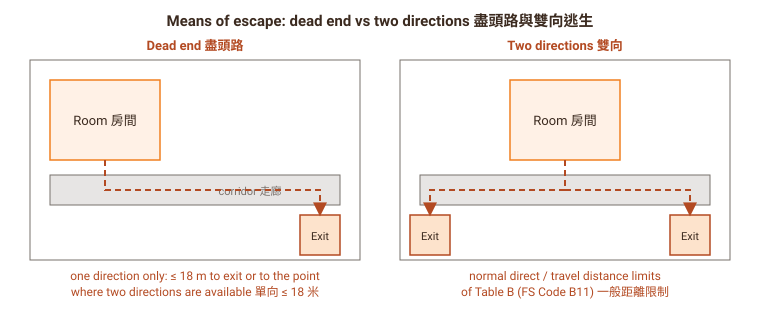
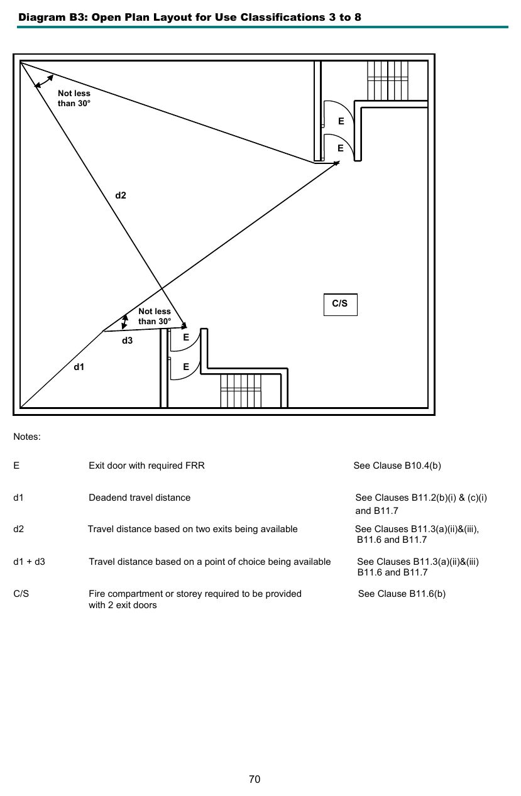
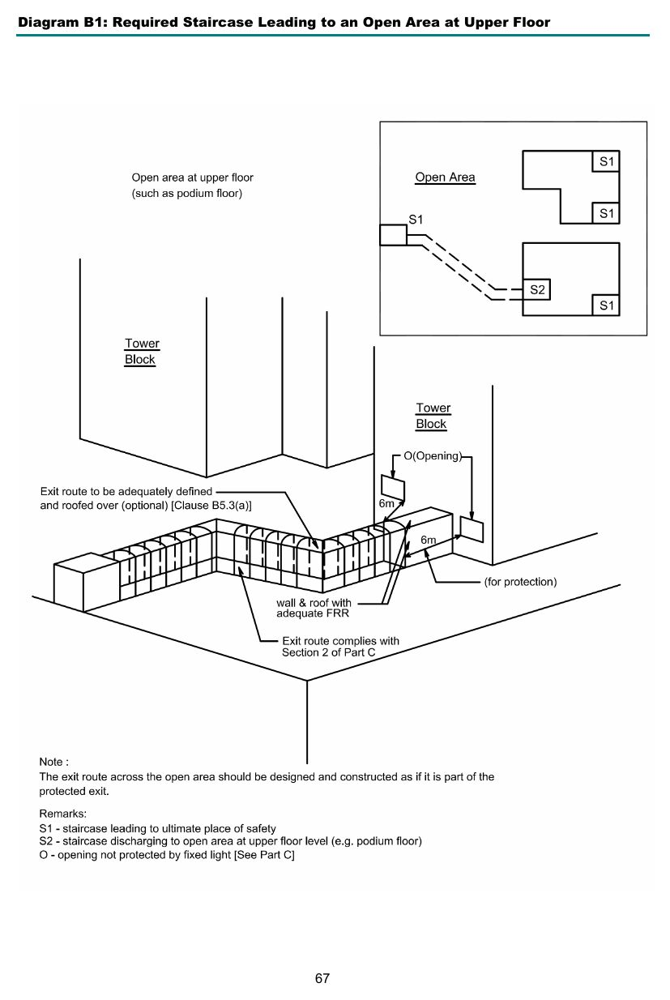
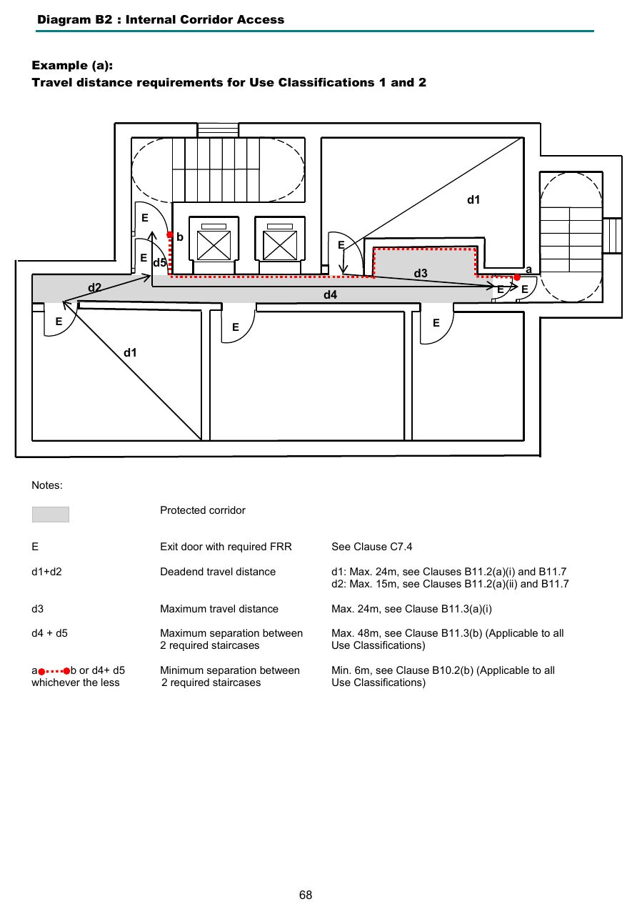
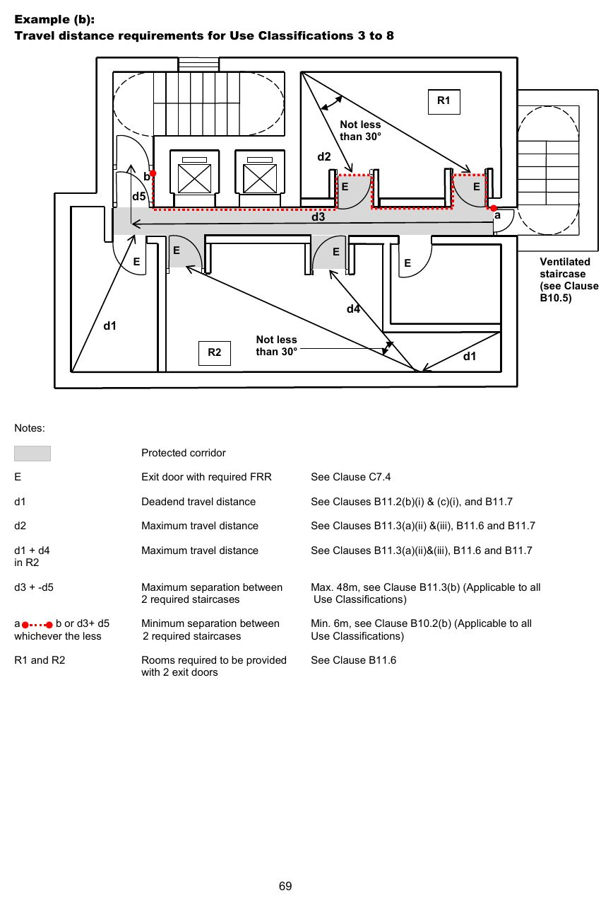
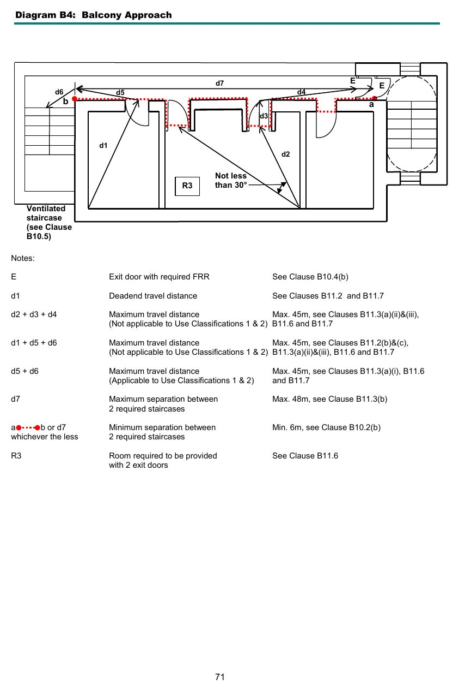
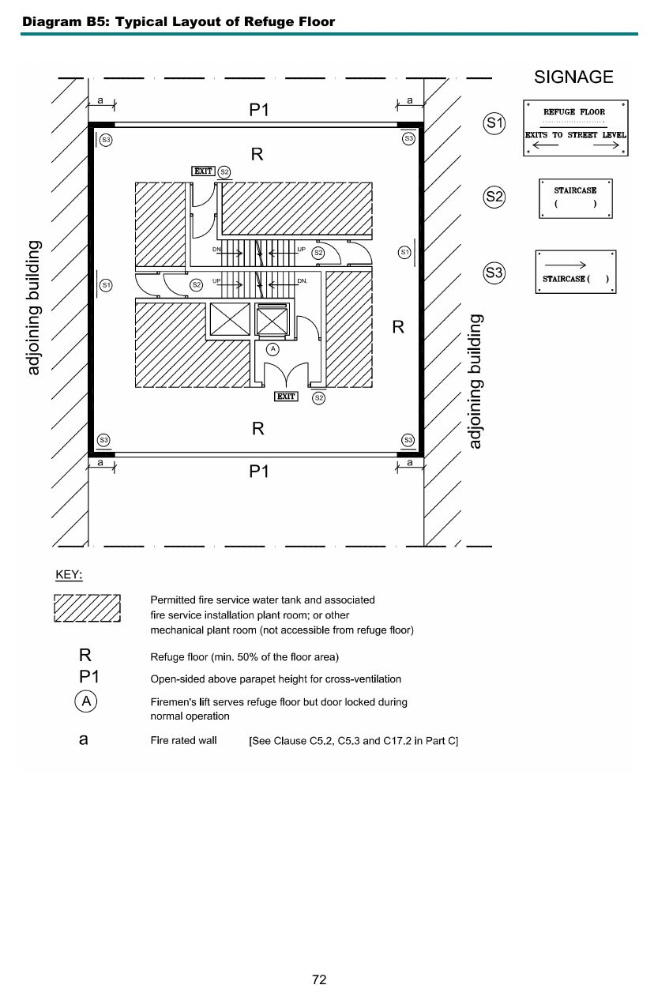
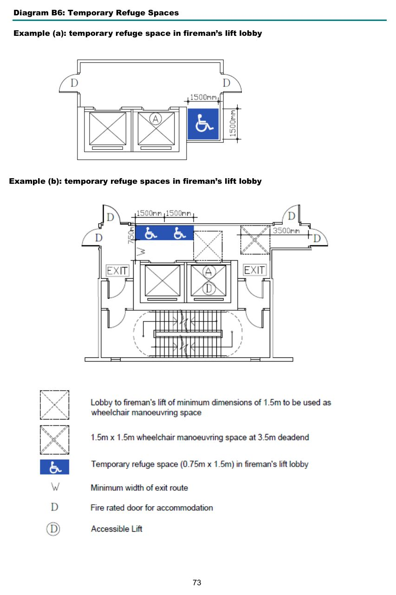

---
tags:
  - Code of Practice
  - Fire safety 消防安全
  - Means of escape 逃生途徑
  - Refuge floor 庇護層
  - Staircase 樓梯
  - Domestic 住用
  - Lift 升降機
  - Means of access 救援通道
  - Balcony & utility platform 露台及工作平台
  - GFA 總樓面面積
  - Barrier free access 無障礙
  - Lighting & ventilation 照明及通風
  - Plant rooms 機房
  - Fire resisting construction 耐火結構
  - Site supervision 地盤監督
  - Hotel 酒店
  - Green & amenity features 環保及適意設施
keywords: MOE, means of escape, 走火通道, 逃生途徑, exit, travel distance, 行走距離, required staircase, 規定樓梯
summary: "FS Code Part B: occupant capacity, exits, travel distance, staircase discharge, refuge floors, places of public entertainment and refuge spaces for persons with a disability."
---

# FS Code 2011 Part B: Means of Escape <small>《2011 年建築物消防安全守則》B 部：逃生途徑</small>

!!! info "Document info 文件資料"
    | | |
    |---|---|
    | **Part of 所屬** | [Code of Practice for Fire Safety in Buildings 2011](fire-safety-code-2011.md) (2024 Edition) |
    | **Clauses 條文** | B1–B30 (Sections 1–4) 第 1–4 節 |
    | **Official language 官方語言** | English and Chinese 中英文版 |
    | **Source 原文** | [English (PDF)](https://www.bd.gov.hk/doc/en/resources/codes-and-references/code-and-design-manuals/fs_code2011.pdf) pp. 23–75 · [中文 (PDF)](https://www.bd.gov.hk/doc/tc/resources/codes-and-references/code-and-design-manuals/fs_code2011_c.pdf) |
    | **Last checked 最後核對** | 2026-11-20 against the 2024 Edition |

!!! tip "Does it apply? 是否適用"
    **Applies 適用**: all buildings (B3.1), new and A&A, as the deemed-to-comply way of meeting [B(P)R 41(1)](../regulations/bpr-39-49e.md) and Part A **A8**. Section 3 adds rules for **places of public entertainment (UC 5a)**; Section 4 for **persons with a disability**. 所有建築物；第 3 節娛樂場所；第 4 節殘疾人士。

    **Does not apply 不適用**: single-family domestic buildings with ≤ **3 main storeys** and top floor ≤ **13 m** (B3.1). Other law prevails where it sets MoE rules (B3.2: child care, schools, hotels, karaoke, elderly homes, factories). A **fire engineering** approach (Part G) may replace these provisions with BA agreement. 三層或以下單一家庭住宅除外；其他法例優先；可用消防工程方法。

## At a glance 重點摘要 {#at-a-glance}

=== "English"

    - Part B gives the **deemed-to-comply** provisions for **means of escape (MoE)**. It applies to **all buildings** except a single-family house of ≤ **3 domestic storeys** with its top floor ≤ **13 m** (B3.1).
    - **Design sequence**: occupant capacity (**Table B1**) → number and width of exits (**Table B2**) → travel distance (**B11**) → staircase discharge value (**Tables B3/B4**) → staircase construction (**B14**).
    - **Two exit routes per storey** as a rule. A **single staircase** is only allowed for buildings ≤ **6 storeys / 17 m**, used as domestic or offices, with small floor plates (≤ 250 m² or ≤ 150 m²) (B6).
    - **Staircases**: risers ≤ **175 mm**, treads ≥ **225 mm**, **2–16 risers** per flight, width ≤ **1,800 mm**, handrails **850–1,100 mm** on both sides (B14).
    - **Refuge floors**: buildings over **25 storeys** need one at least every **25 storeys** (**20** for UC 6). Net refuge area ≥ **50%** of the floor's GFA. Domestic and composite buildings of 26–40 storeys may use the **main roof** instead (B18).
    - **Persons with a disability**: a **1.5 m × 1.5 m temporary refuge space** in the protected exit or fireman's lift lobby of every compartment on every floor, within **60 m**, with CCTV and intercom (B30).

=== "中文"

    - B 部提供**逃生途徑**的**「當作符合」**條文，適用於**所有建築物**，只有主體住宅樓層 ≤ **3 層**、最高樓層 ≤ **13 米**的單一家庭住宅除外（B3.1）。
    - **設計次序**：佔用人數（**表 B1**）→ 出口數目及闊度（**表 B2**）→ 行走距離（**B11**）→ 樓梯疏散量（**表 B3／B4**）→ 樓梯建造（**B14**）。
    - 一般**每層須有兩條出口路線**；**單一樓梯**只限 ≤ **6 層／17 米**、作住宅或辦公室用途、樓面細小（≤ 250 或 ≤ 150 平方米）的建築物（B6）。
    - **樓梯**：豎板 ≤ **175 毫米**、級面 ≥ **225 毫米**、每段 **2–16 級**、闊度 ≤ **1,800 毫米**、兩邊扶手高 **850–1,100 毫米**（B14）。
    - **庇護層**：超過 **25 層**的建築物，每隔不多於 **25 層**（用途類別 6 為 **20 層**）須設一層；淨庇護面積 ≥ 該層總樓面面積 **50%**；26–40 層的住用及綜合用途建築物可以**主天台**代替（B18）。
    - **殘疾人士**：每層每個防火隔室的防護出口或消防員升降機門廊須設 **1.5 米 × 1.5 米臨時庇護處**，相距 ≤ **60 米**，並設閉路電視及對講機（B30）。

## Diagram 圖解 {#diagram}

<figure markdown>
  { width="760" loading=lazy }
  <figcaption>Dead-end travel (18 m) compared with two-direction escape. 盡頭路與雙向逃生。 Diagram prepared for this site; check the source text for exact wording.</figcaption>
</figure>

## Structure of Part B 第 B 部結構 {#structure-of-part-b-b}

| Section 節 | Subsections 分節 | Topic 主題 |
|---|---|---|
| 1 General 一般規定 | B1–B3 | Use, performance requirements, application 用途、性能要求、適用範圍 |
| 2 Provisions of MoE 逃生途徑的提供 | B4–B18 | Occupant capacity, exits, staircases, travel distance, doors, basements, refuge floors 佔用人數、出口、樓梯、行走距離、門、地庫、庇護層 |
| 3 Special provisions for UC 5a 用途類別 5a 特別規定 | B19–B28 | Places of public entertainment, cinemas, temporary buildings 公眾娛樂場所、電影院、臨時建築物 |
| 4 Persons with a disability 殘疾人士 | B29–B30 | Temporary refuge spaces 臨時庇護處 |

---

## Section 1 — General 一般規定 (B1–B3) {#section-1-general-b1b3}

!!! quote "Clause B3.1 — Application 適用範圍"
    The provisions in this Part apply to all buildings with the exception of domestic buildings: (a) having not more than three main domestic storeys; (b) the level of the highest floor of which is not more than 13m above the ground level; and (c) used or intended to be used for occupation by a single family.

    **官方中文本：** 本部的條文適用於所有建築物，但下列住用建築物除外：(a) 主體住宅樓層數目不超逾 3 層；(b) 最高樓層的水平不超逾地面水平以上 13 米；以及 (c) 供或擬供一個家庭佔用。

- **B3.2**: other ordinances (Education, Child Care Services, Hotel and Guesthouse, Karaoke, Residential Care Homes, Factories, Fire Services, Bedspace Apartments) are **not overruled** by Part B. 其他條例的逃生規定不受本部凌駕。
- **B3.3**: situations not covered are decided by the **Building Authority** case by case. 未涵蓋的情況由建築事務監督按個別情況決定。

---

## Section 2 — Provisions of means of escape 逃生途徑的提供 (B4–B18) {#section-2-provisions-of-means-of-escape-b4b18}

### B4 Occupant capacity 佔用人數

Occupant capacity = **usable floor area ÷ occupancy factor** in **Table B1** (e.g. offices 9, retail G–2/F 3, restaurants 1 m²/person). See the [FS Code overview](fire-safety-code-2011.md#key-table-2-occupant-capacity-table-b1-b1) for the full table.
佔用人數 = **可用樓面面積 ÷ 表 B1 的佔用率**。

[Calculate occupant capacity in the GBP workbook](gbp:moe)

### B5 General requirements of exit routes 出口路線的一般規定

| Clause 條文 | Requirement 規定 |
|---|---|
| B5.2 | Every exit route leads **directly to an ultimate place of safety**. Doors/gates must open readily from inside, in the direction of exit, **without keys** 直達最終安全地方；門閘須可從內無匙開啟 |
| B5.3 | Exit route via an **open podium** must be defined by permanent features (railings), lead to an ultimate place of safety and be built as part of the protected exit (Diagram B1) 經平台的出口路線須以永久設施界定 |
| B5.4 | **Areas of special hazard**: openings into exit routes need a **protected lobby**. Normal-hazard routes must not pass through them 特別危險地方須設防護門廊 |
| B5.5 | Lighting **≥ 30 lux** at floor level at all times, with **emergency lighting** 照明 ≥ 30 勒克斯並設緊急照明 |
| B5.6 | No discharge into a **private lane** unless paved, unobstructed and accepted by the BA 不得排往私家巷（除非獲接納） |
| B5.7 | Enclosing walls at the final discharge returned or projected **≥ 450 mm** 最後出口處的牆身回轉或伸出 ≥ 450 毫米 |
| B5.8 | Door at a drop in level set back **≥ the width of the exit route** 有高低差的出口門須後移 ≥ 出口路線闊度 |
| B5.9 | Clear headroom **≥ 2,000 mm**. Side-wall sprinklers may project ≤ **90 mm** and reduce headroom by ≤ **105 mm** 淨高 ≥ 2,000 毫米 |
| B5.11 | Notice **"This staircase has no access to the roof 此樓梯不能通往天台"** (characters ≥ 50 mm) where the roof is not accessible 不能通往天台的告示 |

### B6 Buildings with only one required staircase 只設一道規定樓梯的建築物

!!! quote "Clause B6.1 — Conditions 條件"
    …no building will be permitted to have only one required staircase unless such building complies with the following requirements: (a) The building does not exceed 6 storeys in height and the level of the floor of the uppermost storey is not more than 17m above the level of the ground at the discharge point of the required staircase; (b) No room or storey of the building may be used for any occupancy other than domestic or offices, except the ground storey may be used for the purposes of a shop or carparking space…; (c) …highest floor… not more than 13m above ground level the usable floor area of any storey above the ground storey should not exceed 250m²; and (d) …more than 13 m above ground level: (i) …should not exceed 150m²; (ii) access to the required staircase at each storey should be through a protected lobby…; (iii) the required staircase should be continued to the roof; (iv) …flat surface for refuge of not less than 0.5 m² per person…; and (v) the roof should comply with… Subsection C12…

    **官方中文本：** 除非符合下列條件，任何建築物均不會獲准只設一道規定的樓梯：(a) 建築物高度不超逾 6 層，以及最高樓層的樓面水平由規定的樓梯出口處的地面水平起計不超逾 17 米；(b) 建築物內的所有房間及樓層只可用作住宅或辦公室，但如已符合 C 部中有關規定的樓梯圍建物的要求，則地面樓層可用作店舖或停車位；(c) 如建築物的最高層樓面是在地面水平以上不超逾 13 米的水平，在地面樓層以上任何樓層的實用樓面面積不應超逾 250 平方米；以及 (d) 如建築物的最高層樓面是在地面水平以上超逾 13 米的水平︰(i) 在地面樓層以上任何樓層的實用樓面面積不應超逾 150 平方米；(ii) 在每一樓層進入規定的樓梯前應先穿越防護門廊……

| Highest floor 最高樓層 | Max. UFA per storey above G/F 地面以上每層最大實用面積 | Extra conditions 其他條件 |
|---|---|---|
| ≤ 13 m | **250 m²** | — |
| > 13 m (and ≤ 17 m, ≤ 6 storeys) | **150 m²** | Protected lobby at each storey; staircase continued to roof; flat roof refuge **≥ 0.5 m²/person** 每層防護門廊；樓梯通往天台；天台庇護面積每人 ≥ 0.5 平方米 |

### B7–B8 Exits from rooms, compartments and storeys 房間、防火隔室及樓層的出口

!!! quote "Clause B8.1 — Two exit routes per storey 每層兩條出口路線"
    Every building, except those buildings permitted under Clause B6.1 to have only one required staircase, should be so constructed that there are available from each storey not less than 2 exit routes or such greater number as may be required by Table B2. The width of each exit route and the total width of all the exit routes should be not less than the width shown in Table B2…

    **官方中文本：** 每幢建築物均應在每一樓層設有不少於兩條或更多的出口路線（視乎表 B2 所要求而定），惟獲 B6.1 條准許只設一道規定的樓梯的建築物除外。此外，每條出口路線的闊度及所有出口路線闊度的總和不應少於表 B2 所示的闊度……

**Table B2 — Minimum number and width of exit doors and exit routes 出口門及出口路線的最少數目及闊度**

| Occupant capacity 佔用人數 | Min. no. of exit doors / routes 最少數目 | Min. total width: doors (mm) 門總闊 | Min. total width: routes (mm) 路線總闊 | Min. width each door (mm) 每道門 | Min. width each route (mm) 每條路線 |
|---|--:|--:|--:|--:|--:|
| 4 – 30 | 1 | — | — | 750 | 1,050 |
| 31 – 200 | 2 | 1,750 | 2,100 | 850 | 1,050 |
| 201 – 300 | 2 | 2,500 | 2,500 | 1,050 | 1,050 |
| 301 – 500 | 2 | 3,000 | 3,000 | 1,050 | 1,050 |
| 501 – 750 | 3 | 4,500 | 4,500 | 1,200 | 1,200 |
| 751 – 1,000 | 4 | 6,000 | 6,000 | 1,200 | 1,200 |
| 1,001 – 1,250 | 5 | 7,500 | 7,500 | 1,350 | 1,350 |
| 1,251 – 1,500 | 6 | 9,000 | 9,000 | 1,350 | 1,350 |
| 1,501 – 1,750 | 7 | 10,500 | 10,500 | 1,500 | 1,500 |
| 1,751 – 2,000 | 8 | 12,000 | 12,000 | 1,500 | 1,500 |
| 2,001 – 2,250 | 9 | 13,500 | 13,500 | 1,500 | 1,500 |
| 2,251 – 2,500 | 10 | 15,000 | 15,000 | 1,500 | 1,500 |
| 2,501 – 2,750 | 11 | 16,500 | 16,500 | 1,500 | 1,500 |
| 2,751 – 3,000 | 12 | 18,000 | 18,000 | 1,500 | 1,500 |
| > 3,000 | Determined by the BA (fire engineering may be used) 由建築事務監督決定 | | | | |

<small>Door width = least clear width between frame members. Route width measured between finished wall surfaces; only handrails may project (≤ 90 mm). 門闊以門框之間最窄淨闊計；路線闊度以完成牆面計，只有扶手可伸出（≤ 90 毫米）。</small>

| Clause 條文 | Requirement 規定 |
|---|---|
| B7.1 | Rooms / compartments with **> 3 persons** need exit doors per Table B2 超過 3 人的房間須按表 B2 設出口門 |
| B7.2 | Each exit door leads to an **independent** exit route. For ≤ **200 persons**, doors may open to a single corridor with escape in two directions 每道門通往獨立出口路線；≤ 200 人可共用雙向走廊 |
| B7.3 / B8.1(b) | **50% rule**: any width above **1.5 × the narrowest** door/route in the group is not counted 超過最窄者 50% 的闊度不計算 |
| B8.2 | Cross-access between required staircases at least **every 5 storeys** and at the roof/topmost floor (or at refuge floors and roof), not through private premises. Security locks release on fire alarm or power failure 每 5 層最少一次可轉往另一道樓梯 |
| B8.3 | Notice **"ACCESSIBLE TO ANOTHER EXIT STAIRCASE 可通往其他逃生樓梯"**, 50 mm characters, at 1,500 mm, illuminated 告示 |

[Check exits in the GBP workbook](gbp:moe)

### B9–B10 Exits at ground storey; access to staircases 地面層出口及通往樓梯

| Clause 條文 | Requirement 規定 |
|---|---|
| B9.1 | Staircase enclosure continued at G/F to separate the passage to the discharge point. Other openings need a **protected lobby** (exceptions: lavatory, caretaker office, fire control room where ≥ 2 staircases; 1 in 3 staircases may discharge via the entrance hall where ≥ 3 staircases) 地面層樓梯圍牆須延續；其他開口須設防護門廊 |
| B9.2 | Shared G/F exit width ≥ **½ G/F requirement + upper-storey staircase + basement staircase** 共用出口闊度 = ½ 地面層 + 上層樓梯 + 地庫樓梯 |
| B10.2 | Staircases approached from **different directions**; staircase doors **≥ 6 m apart** 樓梯須從不同方向進入；樓梯門相距 ≥ 6 米 |
| B10.3 | Do not pass through one staircase enclosure / lobby to reach another 不得經一道樓梯到達另一道 |
| B10.4 | **Protected lobby** to every required staircase, **except**: single-staircase building ≤ 13 m; ≥ 2 staircases with top floor ≤ **20 m**; **pressurised** staircase; **ventilated** staircase 每道樓梯須設防護門廊（例外情況見左） |
| B10.5 | **Ventilated staircase**: ≥ **50%** of perimeter open, of which ≥ 50% on the long face and ≥ 25% on other faces; evenly distributed 通風樓梯：周邊 ≥ 50% 開敞 |
| B10.6 | **Balcony approach**: protected per Part C; staircase landing not part of it; door and window swings must not reduce its width 露台通道的規定 |

### B11 Travel distance 行走距離

| | UC 1 & 2 用途類別 1 及 2 | UC 3 用途類別 3 | Other UCs 其他 |
|---|---|---|---|
| **Dead-end** 盡頭路 (B11.2) | **24 m** inside flat/guestroom to its door + **15 m** door to staircase / point of choice | **12 m** (24 m balcony approach) | **18 m** (24 m balcony approach) |
| **Maximum** 最長 (B11.3(a)) | **24 m** door to nearest staircase (45 m balcony approach) | **30 m** (45 m) | **36 m** (45 m) |
| **Between staircases** 樓梯之間 (B11.3(b)) | **≤ 48 m** along exit route centreline | | |

- **B11.4**: flats on **3 or more levels** need access to a protected exit from at least **2 levels**. 三層或以上的單位須最少兩層可通往防護出口。
- **B11.5 Inner rooms** are only acceptable if: ≤ **30 persons**; through only **one** other room; within the dead-end distance; the outer room is not a special hazard and is under the same occupant; and there is a **vision panel** (or alarm). 內房條件。
- **B11.6–B11.7 30° rule**: two exits only count as "different directions" if the lines to them form an angle **≥ 30°**. 兩出口方向夾角須 ≥ 30°。

<figure markdown>
  { loading=lazy }
  <figcaption>Diagram B3 — Open plan layout: travel distance and 30° rule 開放式平面：行走距離及 30° 規則</figcaption>
</figure>

??? abstract "Diagrams B1, B2 and B4 原文圖 B1、B2、B4"
    { loading=lazy }
    *Diagram B1 — Required staircase leading to an open podium 規定的樓梯通往露天平台*

    { loading=lazy }
    { loading=lazy }
    *Diagram B2 — Internal corridor access 內走廊通道*

    { loading=lazy }
    *Diagram B4 — Balcony approach 露台通道*

### B12 Discharge value and width of required staircases 規定樓梯的疏散量及闊度

- **B12.1–12.2**: the total discharge value of staircases serving the upper storeys must be **≥ the total occupant capacity** of those storeys. Basements are assessed separately. 上層樓梯總疏散量 ≥ 上層總佔用人數；地庫分開計算。
- **B12.3–12.5**: use **Table B3** (non-sprinklered) or **Table B4** (whole building sprinklered). If only part of the building is sprinklered and the staircases are shared, use Table B3. 部分設花灑而共用樓梯須用表 B3。
- **B12.6**: **upward** exit (e.g. from a basement) → **× 0.8**. **B12.7**: **scissors staircase** without intermediate landing → **× 0.7**. 向上疏散乘 0.8；剪式樓梯乘 0.7。

**Table B3 — Non-sprinklered building 無花灑系統 (persons 人)**

| Storeys served 服務樓層 | 1,050–<1,200 mm | 1,200–<1,350 | 1,350–<1,500 | 1,500–<1,600 | 1,600–<1,700 | 1,700–1,800 |
|--:|--:|--:|--:|--:|--:|--:|
| 1 | 210 | 240 | 270 | 300 | 320 | 340 |
| 2 | 242 | 278 | 315 | 351 | 377 | 402 |
| 3 | 274 | 316 | 360 | 402 | 434 | 464 |
| 4 | 306 | 354 | 405 | 453 | 491 | 526 |
| 5 | 338 | 392 | 450 | 504 | 548 | 588 |
| 6 | 370 | 430 | 495 | 555 | 605 | 650 |
| 7 | 402 | 468 | 540 | 606 | 662 | 712 |
| 8 | 434 | 506 | 585 | 657 | 719 | 774 |
| 9 | 466 | 544 | 630 | 708 | 776 | 836 |
| 10 | 498 | 582 | 675 | 759 | 833 | 898 |
| Each additional storey 每增一層 | +32 | +38 | +45 | +51 | +57 | +62 |

**Table B4 — Sprinklered building 設花灑系統 (persons 人)**

| Storeys served 服務樓層 | 1,050–<1,200 mm | 1,200–<1,350 | 1,350–<1,500 | 1,500–<1,600 | 1,600–<1,700 | 1,700–1,800 |
|--:|--:|--:|--:|--:|--:|--:|
| 1 | 420 | 480 | 540 | 600 | 640 | 680 |
| 2 | 452 | 518 | 585 | 651 | 697 | 742 |
| 3 | 484 | 556 | 630 | 702 | 754 | 804 |
| 4 | 516 | 594 | 675 | 753 | 811 | 866 |
| 5 | 548 | 632 | 720 | 804 | 868 | 928 |
| 6 | 580 | 670 | 765 | 855 | 925 | 990 |
| 7 | 612 | 708 | 810 | 906 | 982 | 1,052 |
| 8 | 644 | 746 | 855 | 957 | 1,039 | 1,114 |
| 9 | 676 | 784 | 900 | 1,008 | 1,096 | 1,176 |
| 10 | 708 | 822 | 945 | 1,059 | 1,153 | 1,238 |
| Each additional storey 每增一層 | +32 | +38 | +45 | +51 | +57 | +62 |

<small>Staircases wider than 1,800 mm: linear projection (but see B14.5). 闊於 1,800 毫米：以直線推算（另見 B14.5）。</small>

[Check staircase discharge in the GBP workbook](gbp:stairs)

### B13 Doors in relation to exits 出口門

| Clause 條文 | Requirement 規定 |
|---|---|
| B13.1 | Doors on exit routes from rooms/storeys with **> 30 persons** open **in the direction of exit** (or two-way with a vision panel) 超過 30 人須向出口方向開 |
| B13.2 | Locks openable from inside **without key**; electric locks **release on fire alarm and power failure**, with local manual override 無匙開啟；電子鎖於火警及停電時釋放 |
| B13.3 | Door swing must not reduce the landing radius below the staircase width 門擺動不得減少平台有效半徑 |
| B13.4 | Exit door (> 3 persons) **≥ 750 mm**; double-leaf: each leaf **≥ 600 mm**, with a closing-order device for rebated stiles 出口門 ≥ 750 毫米；雙扇門每扇 ≥ 600 毫米 |
| B13.5 | Doors to protected lobbies have a **fire-rated vision panel** 防護門廊門須設防火視窗 |
| B13.6 | **Notifiable workplaces**: exit doors (and rooms with ≥ 10 employees) open **outward**, self-closing 須呈報工作地點：門向外開 |
| B13.7 | Staircase and lobby doors: self-closing, **no hold-open check action**, "keep closed" notices 樓梯門不得設停門裝置 |
| B13.8 | Other self-closing exit doors may have **hold-open devices** that release on alarm, smoke detection or power failure 其他門可設火警時釋放的停門裝置 |

### B14–B16 Staircases, ramps and lift lobbies 樓梯、斜道及升降機大堂

!!! quote "Clause B14.2 — Risers and treads 豎板及級面"
    Required staircases should be arranged in straight flights without winders, each flight should consist of not more than 16 risers nor less than 2 risers. Treads should be not less than 225mm wide, measured clear of nosings and risers should be not more than 175mm high. Provided that:- (a) the treads in Use Classification 5a should be not less than 280mm wide and the risers should be not more than 150mm high; and (b) the treads in Use Classification 5b should be not less than 250mm wide and the risers should be not more than 150mm nor less than 75mm high.

    **官方中文本：** 規定的樓梯應設計為沒有轉角梯級的直階梯，而每段階梯的豎板不應超逾 16 塊及不應少於 2 塊，級面不少於 225 毫米闊（不計級面突緣），豎板不超逾 175 毫米高，不過：(a) 在用途類別 5a 的建築物內，級面不應少於 280 毫米闊，而豎板則不應超逾 150 毫米高；以及 (b) 在用途類別 5b 的建築物內，級面不應少於 250 毫米闊，而豎板的高度則不應超逾 150 毫米及不少於 75 毫米。

| Item 項目 | General 一般 | UC 5a (PPE) 公眾娛樂 | UC 5b (education) 教育 |
|---|---|---|---|
| Riser 豎板 | ≤ **175 mm** | ≤ **150 mm** | **75–150 mm** |
| Tread 級面 | ≥ **225 mm** | ≥ **280 mm** | ≥ **250 mm** |
| Risers per flight 每段級數 | **2–16**, straight, no winders 直梯，無轉角級 | | |
| Landing 平台 | ≥ staircase width (length and width) 不少於樓梯闊度 | | |
| Headroom 淨高 | ≥ **2,000 mm** | | |
| Max. width 最大闊度 | **1,800 mm**. Wider stairs divided by a central handrail into sections of **1,050–1,800 mm** (B14.5) 超闊須以中間扶手分隔 | | |
| Handrails 扶手 | Both sides, **850–1,100 mm** high, projection ≤ **90 mm**, continuous along each flight (around landings too for UC 5a) 兩邊，高 850–1,100 毫米 | | |

- **B15.1 Ramps** on exit routes: **≤ 1:12**. 出口路線斜道 ≤ 1:12。
- **B16.1 Lift lobbies**: unobstructed access to an exit route at all times, with no lockable door, **or** a direct intercom to the management office with **2-hour** emergency power. 升降機大堂須可通往出口路線，或設 2 小時後備電源對講機。

### B17 Basements 地庫

!!! quote "Clause B17.1 — Two exits from every basement 地庫兩個出口"
    Every basement should have not less than two exits, except a basement: (a) the floor of which is not more than 3000mm below the level of the ground to which the exit serving such basement gives access; (b) the area of which does not exceed 150m²; and (c) which is used solely for a lavatory or plant room.

    **官方中文本：** 每一層地庫最少應設有兩個出口，除非：(a) 地庫的樓面是在地面水平以下不超逾 3000 毫米，並且該地庫的出口可通往該地面；(b) 地庫的面積不超逾 150 平方米；以及 (c) 地庫僅用作盥洗室或機房。

- **B17.3**: staircases from upper storeys **must not continue directly** to the basement. 上層樓梯不得直接延續至地庫。
- **B17.4**: where all basement exits discharge upward, at least **one exit per basement floor** serves that floor only and discharges independently. 每層地庫最少一個獨立出口。
- **B17.5**: **protected lobby** to every basement staircase, unless pressurised or independent per B17.4. 地庫樓梯須設防護門廊。

### B18 Refuge floors 庇護層

!!! quote "Clause B18.1 — When required 何時需要"
    Save as provided in Clause B18.5, refuge floors should be provided for all buildings exceeding 25 storeys in height above the lowest ground storey, at not more than 20 storeys and 25 storeys respectively for the buildings in Use Classification 6 and in other Use Classifications from any other refuge floor; or above the street or the ultimate place of safety. For the purpose of this clause, the number of storeys may exclude storeys which contain solely mechanical plants.

    **官方中文本：** 所有超逾最低地面樓層以上 25 層的建築物均應設有庇護層，符合 B18.5 條規定者除外。庇護層應設於與任何其他庇護層、街道水平或最終的安全地方相距不多於 20 層（如屬用途類別 6 的建築物）或 25 層（如屬其他用途類別的建築物）的樓層內。為施行本條的規定，樓層數目可不計算僅用作存放機械設備的樓層。

**Refuge floor requirements (B18.2) 庇護層要求**

| Item 項目 | Requirement 規定 |
|---|---|
| (a) | **No occupied accommodation** or accessible plant room on that level (FS tanks and FS plant rooms allowed) 同層不得有佔用地方或可進入的機房（消防水缸除外） |
| (b) | Net refuge area **≥ 50%** of the floor's GFA; headroom **≥ 2,300 mm** 淨面積 ≥ 50%；淨高 ≥ 2,300 毫米 |
| (c) | Min. dimension **≥ 1.5 ×** the widest staircase passing through 最小尺寸 ≥ 最闊樓梯的 1.5 倍 |
| (d), (e) | Separated per Part C; **open on 2 opposite sides** above safe parapet height for cross-ventilation 以 C 部分隔；兩對邊開敞 |
| (f) | Staircases **discontinued** at refuge floor: escape route passes over the refuge area before continuing down 樓梯在庇護層中斷，須經庇護處再往下 |
| (g) | Lighting **≥ 30 lux** with emergency backup 照明 ≥ 30 勒克斯 |
| (h) | Fire service installations as required by the Director of Fire Services 消防裝置 |
| (i) | Served by **fireman's lift only**, which normally does not stop there (door locked until the fireman's switch is used) 只由消防員升降機服務 |

- **B18.3 Main roof as refuge floor**: flat; net area **≥ 50%** of the typical floor GFA below; staircases continue to the roof unobstructed; min. dimension ≥ 1.5 × widest staircase; ≥ 30 lux. A private roof part must be separated by a **1.5 m** solid fence wall (commentary). 主天台作庇護層的條件。
- **B18.4 Signs**: "REFUGE FLOOR 庇護層 / For Temporary Rest During Emergency Escape 緊急逃生時供暫時歇息用", staircase numbers, 50 mm characters at 1,500 mm, illuminated; refuge floor locations shown at the main entrance (25 mm). 庇護層標誌。
- **B18.5**: **domestic or composite** buildings of **> 25 but ≤ 40 storeys** may use the **main roof** (to B18.3–B18.4) instead of intermediate refuge floors. 25 至 40 層的住用／綜合用途建築物可以主天台代替。

<figure markdown>
  { loading=lazy }
  <figcaption>Diagram B5 — Typical layout of refuge floor 庇護層典型佈局</figcaption>
</figure>

---

## Section 3 — Places of public entertainment (UC 5a) 公眾娛樂場所 (B19–B28) {#section-3-places-of-public-entertainment-uc-5a-b19b28}

| Subsection 分節 | Key requirements 主要規定 |
|---|---|
| **B19** Application 適用 | All UC 5a premises. Small premises **≤ 50 persons** (total ≤ 150 in the building, not in basement) may share exits with other non-domestic uses 小型（≤ 50 人）可與其他非住用共用出口 |
| **B20** Site 地盤 | Frontage to **≥ 2 thoroughfares**, forming **≥ ½** of the perimeter. Width of one thoroughfare: ≤ 500 persons **7.3 m**; 501–2,000 **12 m**; 2,001–3,000 **12 m + 9 m** (carriageway) / 6 m (footway); 3,001–5,000 **15 m + 9 m**; > 5,000 as the BA requires. ≤ 500 persons in a non-domestic building may abut **one** thoroughfare that is an acceptable **EVA** 須臨 ≥ 2 條通道 |
| **B21** Exits 出口 | Below **12 m**: Table B2. At **≥ 12 m** above ground: **Table B5** (below). 2 exits to different thoroughfares; tiers ≤ **35°**; headroom ≥ **3 m**; exits remote from stage 12 米以上用表 B5 |
| **B22** Exits, notices 出口、告示 | Exit signs; staircase treads ≥ **280 mm**, risers ≤ **150 mm** 樓梯級面 ≥ 280 毫米、豎板 ≤ 150 毫米 |
| **B25** Exit route details 出口路線細節 | Slip-resistant; guard rail **≥ 1,100 mm** where a fall is > **1,000 mm**; lighting **≥ 30 lux** 防滑；護欄 |
| **B26** Stages 舞台 | Exit from **each side** of the stage (one directly to a thoroughfare); exit from stage basement 舞台兩邊設出口 |
| **B27** Cinemas in multi-storey buildings 多層建築物內的電影院 | Rows ≤ **12 m** (gangway one side) / **24 m** (two sides); seats per row per **Table B6**; gangways per **Table B7**; foyer **0.5 m²/person** 座位行長度、通道闊度、大堂面積 |
| **B28** Temporary buildings 臨時建築物 | Special requirements for licensed temporary PPE structures 臨時娛樂建築物 |

**Table B5 — UC 5a at 12 m or more above ground 位於地面 12 米或以上的公眾娛樂場所**

| Occupant capacity 佔用人數 | Min. no. of exits 最少出口數目 | Min. total exit route width (mm) 出口路線總闊 |
|---|--:|--:|
| 31 – 200 | 2 | 2,400 |
| 201 – 300 | 2 | 2,600 |
| 301 – 500 | 2 | 4,300 |
| 501 – 750 | 3 | 6,400 |
| 751 – 1,000 | 4 | 8,500 |
| 1,001 – 1,250 | 5 | 10,400 |
| 1,251 – 1,500 | 6 | 12,500 |
| 1,501 – 1,750 | 7 | 14,600 |
| 1,751 – 2,000 | 8 | 16,700 |
| 2,001 – 2,500 | 10 | 20,800 |
| 2,501 – 3,000 | 12 | 24,900 |

<small>> 3,000 persons: determined by the BA. Min. door width 1,050 mm. 超過 3,000 人由建築事務監督決定；門最少闊 1,050 毫米。</small>

??? abstract "Tables B6 & B7 — cinema seating and gangways 電影院座位及通道"
    **Table B6 — Maximum number of seats in a row 每行最多座位**

    | Seatway width (mm) 座位通道闊度 | Gangway one side 單邊通道 | Gangway two sides 雙邊通道 |
    |---|--:|--:|
    | 300 – 324 | 7 | 14 |
    | 325 – 349 | 8 | 15 |
    | 350 – 374 | 9 | 18 |
    | 375 – 399 | 10 | 20 |
    | 400 – 424 | 11 | 22 |
    | 425 – 449 | 12 | 24 |
    | 450 – 474 | 12 | 26 |
    | 475 – 499 | 12 | 28 |
    | ≥ 500 | Limited by 12 m row length 受 12 米限制 | Limited by 24 m row length 受 24 米限制 |

    **Table B7 — Minimum width of gangways 通道最少闊度**

    | Persons served 服務人數 | Min. width each 每條最少闊度 |
    |---|--:|
    | < 500 | 1,100 mm |
    | 501 – 1,000 | 1,200 mm |
    | 1,001 – 1,500 | 1,350 mm |
    | > 1,500 | 1,500 mm |

---

## Section 4 — Persons with a disability 殘疾人士 (B29–B30) {#section-4-persons-with-a-disability-b29b30}

!!! quote "Clause B30.1 — Temporary refuge spaces 臨時庇護處"
    At least one temporary refuge space with an area of not less than 1.5m x 1.5m should be provided within the protected exit or fireman's lift lobby of every fire compartment at every floor of a building to which this Section applies. Temporary refuge spaces with barrier free access can be shared by compartments but no part of the floor served by a temporary refuge space should be more than 60m from that space. Such space should not reduce the minimum width of an exit route, the effective width/radius of the landing of a required staircase nor the minimum area of a fireman's lift lobby… two number of 0.75m x 1.5m temporary refuge spaces (instead of one 1.5m x 1.5m), in visible location to each other, can be provided…

    **官方中文本：** 就本章適用的建築物而言，每一樓層每個防火隔室的防護出口或消防員升降機門廊應設有至少一個面積不少於 1.5 米乘 1.5 米的臨時庇護處。防火隔室可共用設有暢通無阻通道的臨時庇護處，但使用該臨時庇護處的樓層，其任何部分不得與該庇護處相距多於 60 米。上述的庇護處不應令出口路線的最小闊度和規定的樓梯的平台的有效闊度／半徑減少，亦不應令消防員升降機門廊的最小面積減少……在同一防護出口或消防員升降機門廊可設置兩個彼此在視線範圍內、面積為 0.75 米乘 1.5 米（而非一個 1.5 米乘 1.5 米）的臨時庇護處。

| Clause 條文 | Requirement 規定 |
|---|---|
| B29.1 | **Not required** for: BFA-exempted parts; floors ≤ **200 m²** or with ≤ **2 units** on sites ≤ **500 m²**; buildings with ventilated staircases and balcony approach that need no fireman's lift; refuge floors; G/F leading directly to safety 豁免情況 |
| B30.1 | **1.5 × 1.5 m** (or 2 × 0.75 × 1.5 m) in the protected exit or fireman's lift lobby; within **60 m** of every part of the floor; must not reduce exit width or landing 1.5 × 1.5 米；60 米內 |
| B30.2 | Accessible and **free from obstruction** at all times 須暢通無阻 |
| B30.3 | Door **≥ 850 mm** clear (or Table B2 if greater); handle **950–1,050 mm** 門 ≥ 850 毫米 |
| B30.4 | **CCTV + direct intercom** to the management office, **1-hour** emergency power; intercom at **900–1,200 mm** 閉路電視及對講機，1 小時後備電源 |
| B30.5 | Notice **"Temporary Refuge Space 臨時庇護處"** with the accessibility symbol, on wall and floor 告示 |

<figure markdown>
  { loading=lazy }
  <figcaption>Diagram B6 — Temporary refuge spaces: examples 臨時庇護處例子 <small>All diagrams: FS Code 2011 (2024 Edition), Buildings Department 資料來源：屋宇署</small></figcaption>
</figure>

---

## Clause by clause 逐條條文 {#clause-by-clause}

<small>Tables B1–B7 are on this page above; this table lists every clause. 表 B1–B7 見上文；本表逐條列出。</small>

| Clause 條文 | What it requires 規定 | 中文要點 |
|---|---|---|
| **B1.1–B1.3** | Deemed-to-comply provisions for means of escape; read with all Parts; guidance on meeting the Performance Requirements | 逃生途徑當作符合規定 |
| **B2.1** | Performance Requirements in Part A **A8** | 性能要求見 A8 |
| **B3.1** | Applies to all buildings **except** single-family domestic buildings ≤ **3 main storeys** and highest floor ≤ **13 m** | 三層或以下、≤ 13 米單一家庭住宅除外 |
| **B3.2** | Does not override MoE rules in other law: Caps. 447, 243, 279, 59, 95, 349, 573, 459 | 不凌駕其他法例 |
| **B3.3** | Cases not covered: BA decides | 未涵蓋情況由監督決定 |
| **B4.1** | Occupant capacity from **Table B1** (m² per person or seats / bedspaces). Notes: Labour Dept for specialised workplaces; BA for unlisted uses; **actual counting** accepted; karaoke per FEHD; pools by water area; columbaria include circulation; UC 8 rooms ≤ **100 m²** net = zero | 佔用人數按表 B1；機房 ≤ 100 平方米當作零人 |
| **B5.1–B5.2** | Exits from every storey / compartment; every route leads directly to an **ultimate place of safety**; doors openable from inside **without a key** | 通往最終安全地方；毋須鑰匙 |
| **B5.3** | Route ending on an open **podium**: defined by permanent features, leads on to safety, built as a protected exit (C12.4, Diagram B1) | 平台出口路線要求 |
| **B5.4** | **Special hazard** area: protected lobby onto exit routes; normal-hazard routes not through special-hazard areas (restaurant kitchens are notifiable workplaces, see B13.6) | 特殊危險區須設防護門廊 |
| **B5.5** | Lighting **≥ 30 lux** at floor, backed by emergency lighting | 照明 ≥ 30 勒克斯 |
| **B5.6** | Discharge to a **private lane** only if paved, unobstructed and accepted by the BA | 私家巷須經接納 |
| **B5.7** | Discharge next to another route / accommodation: enclosing walls return or project **≥ 450 mm** | 出口牆回轉 ≥ 450 毫米 |
| **B5.8** | Door at a level drop set back ≥ the **route width**; single step clearly marked | 門須後移；單級須標示 |
| **B5.9** | Headroom **≥ 2,000 mm**; side-wall sprinklers ≤ **90 mm** projection and ≤ **105 mm** headroom loss | 淨高 ≥ 2 米 |
| **B5.10** | Directional and exit signs per the FSI Code | 方向及出口指示牌 |
| **B5.11** | No roof access: notice "This staircase has no access to the roof 此樓梯不能通往天台", **≥ 50 mm** | 不通天台告示 |
| **B6.1** | **One staircase** only if: ≤ **6 storeys** and top floor ≤ **17 m**; only domestic / office (G/F shop or carport allowed); ≤ 13 m: floors ≤ **250 m²**; > 13 m: floors ≤ **150 m²**, **protected lobby**, staircase to **roof**, roof refuge ≥ **0.5 m² / person**, roof to C12 | 單樓梯條件 |
| **B7.1** | Rooms / compartments > **3 persons**: exit doors per **Table B2** | 房間出口門按表 B2 |
| **B7.2** | Each door to an independent route; ≤ **200** persons may share one corridor / balcony with escape in two directions | ≤ 200 人可共用走廊 |
| **B7.3** | Width over **150%** of the narrowest door not counted | 超過最窄門 1.5 倍不計 |
| **B8.1** | ≥ **2 exit routes** per storey (or Table B2); one storey of a maisonette; 150% rule | 每層 ≥ 2 條出口路線 |
| **B8.2** | Access between staircases **at least every 5 storeys** and at the roof / top floor (or at evenly spaced refuge floors), not through private premises; security released on alarm or power failure | 每 5 層可轉往另一樓梯 |
| **B8.3** | Notice "ACCESSIBLE TO ANOTHER EXIT STAIRCASE 可通往其他逃生樓梯", **50 mm**, at **1,500 mm**, lit on two systems, white on green / green on white or black | 轉梯告示 |
| **Table B2 notes** | > 3,000 persons: BA decides; door width = least clear frame width; staircase / corridor width between finishes, only handrails ≤ **90 mm** may project. Commentary: fire engineering for > 3,000 | 表 B2 附註 |
| **B9.1** | Staircase walls continue at G/F to the discharge; openings via protected lobby; with ≥ 2 staircases WC / caretaker / fire control room may open off it; with ≥ 3, **one in three** may discharge through an entrance hall | 地面層出口分隔 |
| **B9.2** | Shared G/F route width ≥ **½ G/F requirement + upper staircase + basement staircase** | 共用出口闊度相加 |
| **B10.1–B10.2** | Two or more staircases: approached from **different directions** (dead ends per B11.2); doors **≥ 6 m** apart (Diagrams B2, B4) | 樓梯門相距 ≥ 6 米 |
| **B10.3** | Must not pass through one staircase enclosure, lobby or landing to reach another | 不得穿過另一樓梯 |
| **B10.4** | Doors not to reduce corridor width; **protected lobby** to every staircase unless: single-stair ≤ 13 m; ≥ 2 stairs and top floor ≤ **20 m**; **pressurised**; or **ventilated staircase**; lobby is common area | 防護門廊及豁免 |
| **B10.5** | Ventilated staircase: **≥ 50%** of perimeter open (≥ 50% of that on the long face, ≥ 25% on others), balustrade to soffit, evenly spread, Part C | 通風樓梯 50% 周邊開敞 |
| **B10.6** | Balcony approach: protected (Part C); staircase landing not part of it; doors and windows not reduce width (windows 180° or fanlights ≥ **2,000 mm**) | 露天走廊要求 |
| **B11.1** | Travel distance as defined in Part A | 行走距離定義 |
| **B11.2** | **Dead end**: UC 1–2: **24 m** in flat / room + **15 m** to staircase or choice point; UC 3: **12 m** (24 m balcony); others **18 m** (24 m balcony) | 盡頭路距離 |
| **B11.3(a)** | **Max. travel**: UC 1–2 **24 m** from flat door (45 m balcony); UC 3 **30 m**; others **36 m** (45 m balcony) | 最大行走距離 |
| **B11.3(b)** | Staircases / discharge points ≤ **48 m** apart along the route centreline | 樓梯相距 ≤ 48 米 |
| **B11.4** | Flats on **3+ levels**: two levels with access to a protected exit | 三層複式兩層有出口 |
| **B11.5** | **Inner room**: ≤ **30** persons; through one room only; dead-end limits; access room not special hazard and same occupier; **vision panel** or alarm (not for flats via living / kitchen) | 內房條件 |
| **B11.6–B11.7** | Two exits / alternative directions only if lines to them diverge **≥ 30°** | 兩出口夾角 ≥ 30° |
| **B12.1–B12.2** | Staircase **discharge value** ≥ occupant capacity of storeys above G/F, and separately of basements | 疏散量 ≥ 佔用人數 |
| **B12.3–B12.5** | **Table B3** non-sprinklered, **Table B4** sprinklered (whole building; mixed and unseparated uses Table B3) | 表 B3／B4 |
| **B12.6–B12.7** | Upward exit **× 0.8**; scissors staircase without intermediate landing **× 0.7** | 向上 0.8；剪刀梯 0.7 |
| **B13.1** | Doors from rooms / storeys > **30** persons open **in the direction of exit**, or two-way with vision panel | 門向外開 |
| **B13.2** | Locks openable from inside without a key, push devices not encased; **electric locks release** on fire alarm and power failure, with local manual override; not defeating B8.2 | 電子鎖自動釋放 |
| **B13.3** | Doors on landings not reduce the landing radius below staircase width | 門不得減少平台 |
| **B13.4** | Exit door ≥ **750 mm**; double leaf ≥ **600 mm** each; rebated stiles need a closing-order device | 出口門 ≥ 750 毫米 |
| **B13.5** | Protected lobby doors: FRR **vision panel** | 門廊門視窗 |
| **B13.6** | **Notifiable workplaces**: exit doors and rooms with ≥ **10** workers open **outward**; exit doors self-closing | 應呈報工場門向外開 |
| **B13.7** | Staircase / lobby doors: no hold-open check action; "keep closed" notices both sides | 樓梯門不得常開 |
| **B13.8** | Other self-closing exit doors may be **held open** by devices releasing on alarm, smoke detection (both sides) and power failure | 其他門可用磁扣 |
| **B14.1–B14.2** | Staircases to Part C; straight flights, **2–16 risers**, tread ≥ **225 mm**, riser ≤ **175 mm**; UC 5a **280 / 150**; UC 5b **250 / 75–150** | 梯級尺寸 |
| **B14.3–B14.4** | Landings ≥ staircase width; width per B8.1; headroom **≥ 2,000 mm** | 平台及淨高 |
| **B14.5** | Max. width **1,800 mm**; wider ones split by a central handrail into **1,050–1,800 mm** sections | 闊度上限 1,800 毫米 |
| **B14.6** | Handrails **both sides**, **850–1,100 mm**, ≤ **90 mm** projection, continuous per flight (round landings in UC 5a) | 兩邊扶手 |
| **B15.1** | Ramps ≤ **1:12** | 斜道 ≤ 1:12 |
| **B16.1** | Lift lobbies: unobstructed, unlocked access to an exit route, or an **intercom** to management with **2 h** backup | 升降機大堂須通出口或設對講機 |
| **B17.1** | Basements ≥ **2 exits**, except ≤ **3,000 mm** deep, ≤ **150 m²**, WC / plant only | 地庫 ≥ 2 出口 |
| **B17.2–B17.3** | Exit signs in basement staircases; upper-floor staircases **not continued** into basements | 上層樓梯不得直通地庫 |
| **B17.4** | Upward-discharging basements: at least one exit per floor serving **that floor only**, discharging independently | 每層地庫一個獨立出口 |
| **B17.5** | Protected lobby to basement staircases unless pressurised or independent (B17.4) | 地庫樓梯防護門廊 |
| **B18.1** | **Refuge floors** for buildings > **25 storeys**: every **20** storeys (UC 6) or **25** (others); plant-only storeys may be excluded | 庇護層：25 層／工業 20 層 |
| **B18.2** | No occupied or accessible plant (FS tanks and pumps OK); net refuge ≥ **50%** of floor GFA, headroom ≥ **2,300 mm**; min. dimension ≥ **1.5 × widest staircase**; separated (Part C); **open on two opposite sides**; staircases **discontinued** across the refuge area; **30 lux**; FSI as FSD requires; served only by **fireman's lift**, landing door locked until fireman's switch (Diagram B5) | 庇護層要求 |
| **B18.3** | **Main roof** as refuge: flat; net area ≥ **50%** of a typical floor; staircases continue unobstructed; dimension rule; 30 lux. Commentary: no private stair onto refuge area; private roof fenced **1.5 m**; stairhood within 1.8 m FRR **-/60/60**; plant rooms **-/120/120** | 主天台作庇護層 |
| **B18.4** | Signs: staircase no. and entrance sign at **1,500 mm**; "REFUGE FLOOR 庇護層" notice; directional signs; bilingual, lit, **50 mm**, green / white; entrance notice **25 mm** | 庇護層標誌 |
| **B18.5** | Domestic / composite **25–40 storeys**: roof refuge (B18.3–B18.4) instead. Commentary: Part A aims (escape, rest, smoke-free stairs, staging) | 25–40 層住宅以天台代替 |
| **B19.1–B19.2** | UC 5a extra rules B19–B27; temporary buildings B28. UC 5a ≤ **50** persons (total ≤ **150**, not basement) may share routes | 娛樂場所特別規定 |
| **B20.1–B20.3** | Site with frontages to **two or more thoroughfares**, ≥ **½ of perimeter**, wide enough to disperse | 兩條或以上通道 |
| **B20.4–B20.8** | One thoroughfare ≥ **7.3 m** (≤ 500); **12 m** (501–2,000); 12 m + **9 m** carriageway / 6 m footway (2,001–3,000); **15 m** + 9 m (3,001–5,000); > 5,000 BA decides | 通道闊度按人數 |
| **B20.9** | ≤ 500 in a non-domestic (not polluting UC 6) building: **one** thoroughfare if an acceptable EVA and FSD agrees (commentary: reg. 49A modification) | ≤ 500 人可一條通道 |
| **B21.1** | Below **12 m**: Table B2; at **12 m or above**: **Table B5** (wider routes) | 12 米以上用表 B5 |
| **B21.2–B21.8** | Routes from every tier; two into **different thoroughfares**; tiers ≤ **35°**, headroom **3 m**; count standing and waiting space (cafés, foyers); direct to thoroughfares; **remote from the stage**; all doors available while public inside | 出口安排 |
| **B22.1–B22.7** | Exit signs from auditorium, stage, dressing rooms; label non-exit doors; handpointers; **no "NO EXIT"** notices; exit notices lit on two systems, never dimmed | 出口指示 |
| **B23.1–B23.3** | Staircases: no winders; **3–16 steps**; ≤ **2 flights** without a turn; turn if a flight > **12** steps; tread ≥ **280**, riser ≤ **150 mm**; chased newel walls; recesses guarded | 樓梯要求 |
| **B24.1–B24.2** | Admission barriers open under exit pressure, not narrowing routes, strength per B(C)R 9; rope barriers with auto catches | 欄栅 |
| **B25.1–B25.6** | No chains or padlocks; gangways per B27.6; **slip-resistant**; conspicuous nosings; guard rail **1,100 mm** where fall > **1,000 mm**; **30 lux** | 出口細節 |
| **B26.1–B26.2** | Exit from **each side of the stage**, one to a thoroughfare; exit from the stage basement | 舞台出口 |
| **B27.1** | Cinemas ≤ **2,000** aggregate in any storey of a non-domestic building / part | 電影院 ≤ 2,000 人 |
| **B27.2** | Sharing exits: dedicated **smoke extraction**; FRR separation and doors; foyer separation (or smoke extraction); shared exits from common areas; tread change landing ≥ **2 × width** with "Beware of steps change" notice; widths per B21; separate from domestic routes; discharge to streets ≥ **4.5 m**, two different streets; **not in basement** | 共用出口條件 |
| **B27.3** | Only **first basement**: short direct routes; independent discharge; other basement stairs sealed; one **FRS**; Table B5; **G/F foyer** 0.5 m² × ⅓ seats; protected lobby to lifts | 只可在地庫一層 |
| **B27.4** | Shared exits sized on combined occupancy (commentary: wider upper floor carries down) | 共用出口合併計算 |
| **B27.5** | Up to **half** the cinema exit width through adjoining areas, which need **0.5 m² / person** (pro-rata cinema share + foyer + Table B1) | 一半出口可經商場 |
| **B27.6** | Rows ≤ **12 m** (one gangway) / **24 m** (two); seats per **Table B6**; ≥ **300 mm** clear; fixed seats; gangways per **Table B7** (1,100–1,500 mm); handgrips at steps; no projections | 座位及通道 |
| **B27.7** | Projection room: exits per this Section (one if elevated serving one auditorium); independent ventilation | 放映室 |
| **B27.8–B27.9** | Waiting space (reg. 49E): **0.5 m² × ⅙** of seats; rules may apply to other UC 5a | 等候地方 |
| **B28.1–B28.7** | Temporary buildings: **300 mm** seat clearance, fixed or battened in 4s; gangways **1.2 m**, seat ≤ **3 m** from one; blocks ≤ **9 m** deep; exits **2.4 m** at gangway ends; extra stage exits; kept clear; doors open outward | 臨時建築物 |
| **B29.1** | Persons with a disability as in the BFA manual. Not for: BFA-exempt buildings; sites ≤ **500 m²** with floors ≤ **200 m²** or ≤ **2 units**; ventilated stairs + balcony approach without fireman's lift; refuge floors; G/F | 殘疾人士條文豁免 |
| **B30.1** | **Temporary refuge space** ≥ **1.5 × 1.5 m** (or 2 × 0.75 × 1.5 m) in the protected exit or fireman's lift lobby of every compartment, ≤ **60 m** away, not reducing widths (Diagram B6) | 臨時庇護處 1.5 × 1.5 米 |
| **B30.2** | Accessible and unobstructed | 無障礙、無阻擋 |
| **B30.3** | Door ≥ **850 mm** (or Table B2), handle **950–1,050 mm** (commentary: 950 mm good practice) | 門 ≥ 850 毫米 |
| **B30.4** | **CCTV and intercom** to management, **1 h** backup, intercom **900–1,200 mm** | 閉路電視及對講機 |
| **B30.5–B30.7** | Notice with accessibility symbol, **50 mm** text and **110 mm** symbol, on wall and floor; floor **demarcated** in contrasting colour; directional signs | 標誌及地面標示 |

## Whole picture 整體關係 {#whole-picture}

| Topic 主題 | Where 文件 |
|---|---|
| Legal duty: staircases, second staircase, 24 m rule 法定要求 | [B(P)R 39–44](../regulations/bpr-39-49e.md#clause-by-clause) |
| Use classifications (Table A1), definitions 用途分類 | [FS Code overview](fire-safety-code-2011.md) |
| Enclosure of staircases, lobbies, refuge floors 樓梯及庇護層耐火 | [Part C](fsc-part-c-fire-resisting-construction.md#clause-by-clause) C9, C16, C17 |
| Fireman's lifts, FRS, EVA 消防進出途徑 | [Part D](fsc-part-d-means-of-access.md#clause-by-clause) |
| Fire engineering alternative 消防工程 | [Parts E–G](fsc-parts-e-f-g.md) |
| Practice notes on the FS Code 作業備考 | [APP-153](../pnap/app-153.md) · [APP-122](../pnap/app-122.md) (refuge sky garden) · [APP-119](../pnap/app-119.md) (school stair-wells) |
| Refuge floors and GFA 庇護層與總樓面面積 | [APP-2](../pnap/app-2.md) · [GFA guide](../guides/gfa.md) |
| Cinemas and PPE (B(P)R 49A–49E) 娛樂場所 | [B(P)R 49A–49E](../regulations/bpr-39-49e.md#clause-by-clause) · [APP-81](../pnap/app-81.md) |
| Accessible escape 無障礙逃生 | [B(P)R 72](../regulations/bpr-71-73.md) · [DMUA 2026](dmua-2026.md) |
| Calculations 計算 | GBP workbook: occupancy, exits, discharge (links above in B4, B7–B8, B12) |

## Explanation 淺白解釋 {#explanation}

=== "English"

    Part B makes sure that **everyone can get out**, quickly enough, by a protected route to a safe place in the open. The logic is:

    1. **How many people?** (B4, Table B1)
    2. **How many ways out, and how wide?** (B7–B8, Table B2). Normally **two** independent routes, so that one fire cannot block both.
    3. **How far must they walk?** (B11). Short dead ends, a limited distance to a protected exit, and real alternatives (the 30° rule).
    4. **Can the stairs carry them?** (B12, Tables B3/B4). Sprinklers **double** the single-storey discharge value, because they slow the fire and give more time.
    5. **Are the stairs and doors safe to use in a crowd?** (B13–B14). Doors open outward and need no key, risers are low, there are handrails on both sides, and no winders.
    6. **Tall buildings**: refuge floors give a rest point and a firefighting staging area (B18).
    7. **Persons with a disability** wait in a protected temporary refuge space with CCTV and intercom until rescued (B30).

=== "中文"

    B 部確保**所有人都能及時**經受保護的路線逃到露天的安全地方，邏輯如下：

    1. **有多少人？**（B4，表 B1）
    2. **要多少個出口、多闊？**（B7–B8，表 B2）一般須有**兩條**獨立路線，以免一場火同時堵塞兩者。
    3. **要走多遠？**（B11）盡頭路要短，到防護出口的距離有限，並須有真正的另一方向（30° 規則）。
    4. **樓梯容納得了嗎？**（B12，表 B3／B4）設花灑系統可令單層疏散量**加倍**，因花灑可減慢火勢，爭取更多時間。
    5. **人多時樓梯及門是否安全？**（B13–B14）門向出口方向開、無需鑰匙；豎板低；兩邊扶手；沒有轉角級。
    6. **高樓**：庇護層提供休息點及消防人員集結地方（B18）。
    7. **殘疾人士**：在設有閉路電視及對講機的受保護臨時庇護處等候救援（B30）。

## Practical notes 實務提示 {#practical-notes}

=== "English"

    !!! example "Worked example 1: staircase discharge (office tower, sprinklered)"
        **20 storeys** above G/F, each with **150 persons** → total **3,000 persons**. Two required staircases.

        - Try **1,200–1,350 mm** stairs (Table B4): 10 storeys = 822, +38 × 10 = **1,202** each → 2,404 < 3,000 ❌
        - Try **1,500–1,600 mm** stairs: 1,059 + 51 × 10 = **1,569** each → 3,138 ≥ 3,000 ✅
        - Also check Table B2 for each storey: 150 persons → **2 routes**, total ≥ **2,100 mm**, each ≥ **1,050 mm** ✅

    !!! example "Worked example 2: refuge floors (residential, 60 storeys)"
        Domestic building of **60 storeys** above the lowest ground storey (UC 1).

        - More than 40 storeys, so B18.5 (roof only) does **not** apply.
        - Refuge floors at not more than **25 storeys** apart, measured from the street or the ultimate place of safety, e.g. at 25/F and 50/F.
        - Each: net refuge area ≥ **50%** of that floor's GFA, open on two opposite sides, served by the fireman's lift only.

    !!! tip "Common pitfalls"
        - Forgetting the **50% rule** (B7.3 / B8.1(b)): an extra-wide door doesn't make up for a narrow one.
        - Using **Table B4** when only **part** of the building is sprinklered with shared staircases. Use **Table B3** (B12.5).
        - **Scissors staircases** (× 0.7) and **upward** exits from basements (× 0.8) reduce the discharge value.
        - Upper-floor staircases **continuing straight into the basement** (B17.3).
        - **Temporary refuge spaces** must not eat into the staircase landing or the fireman's lift lobby area (B30.1).
        - Electric locks on exit doors must **fail-safe** on fire alarm and power failure (B13.2).

=== "中文"

    !!! example "計算例子 1：樓梯疏散量（設花灑的辦公大樓）"
        地面以上 **20 層**，每層 **150 人** → 總數 **3,000 人**，設兩道規定的樓梯。

        - 試 **1,200–1,350 毫米**樓梯（表 B4）：10 層 = 822，+38 × 10 = 每道 **1,202** → 2,404 < 3,000 ❌
        - 試 **1,500–1,600 毫米**樓梯：1,059 + 51 × 10 = 每道 **1,569** → 3,138 ≥ 3,000 ✅
        - 另按表 B2 核對每層：150 人 → **2 條路線**，總闊 ≥ **2,100 毫米**，每條 ≥ **1,050 毫米** ✅

    !!! example "計算例子 2：庇護層（60 層住宅）"
        住用建築物，最低地面樓層以上 **60 層**（用途類別 1）。

        - 超過 40 層，**不適用** B18.5（只以天台作庇護層）。
        - 庇護層相距不多於 **25 層**，由街道或最終安全地方起計，例如設於 25 樓及 50 樓。
        - 每層淨庇護面積 ≥ 該層總樓面面積 **50%**，兩對邊開敞，只由消防員升降機服務。

    !!! tip "常見錯誤"
        - 忘記 **50% 規則**（B7.3／B8.1(b)）：特別闊的門不能彌補窄門。
        - 建築物只有**部分**設花灑而共用樓梯時錯用**表 B4**，應用**表 B3**（B12.5）。
        - **剪式樓梯**（× 0.7）及地庫**向上**疏散（× 0.8）須折減疏散量。
        - 上層樓梯**直接延續至地庫**（B17.3）。
        - **臨時庇護處**不得佔用樓梯平台或消防員升降機門廊面積（B30.1）。
        - 出口門電子鎖須在火警及停電時**自動釋放**（B13.2）。

<!-- APSEC START -->
## APSEC clarifications 認可人士及註冊結構工程師委員會討論 {#apsec-clarifications}

BD's responses at the APSEC Discussion Forum that clarify this document, **newest first**. Where the same question came up more than once, only the **latest position** is listed. See [all APSEC items](../apsec/index.md). 屋宇署在討論會上就本文件作出的澄清，新者在前；同一問題只列最新立場。

- **[The Code of Practice for Fire Safety in Buildings 2011 (2024 Edition) (FS Code) - Access to Maintenance Roof by Required Staircase](../apsec/2026.md#i202608146)** <small>ADF 3/2026, 14 Aug 2026</small> BD advised that AAP’s understanding was correct.
- **[Discharge Value of Scissors Staircase](../apsec/2026.md#i2026050818)** <small>ADF 2/2026, 8 May 2026</small> BD advised that AAP’s understanding was correct.
- **[Clauses B9.1 and D7.3 of the FS Code](../apsec/2026.md#i2026050816)** <small>ADF 2/2026, 8 May 2026</small> BD advised that under Clause D7.3(b) of the FS Code, the passage from the fire service access point to the fireman’s lift should be separated from the remainder of the ground storey by walls having the requisite FRR. …
- **[Projection of Handrail at Corner](../apsec/2026.md#i202605083)** <small>ADF 2/2026, 8 May 2026</small> BD advised that according to Note 3 of Table B2 of the FS Code, the width of a required staircase and staircase landing should be measured between the finished surfaces of walls or of the inner sides of any balustrade …
- **[Temporary Refuge Space (TRS) at Lift lobby](../apsec/2026.md#i202602064)** <small>ADF 1/2026, 6 Feb 2026</small> BD advised that according to Clause B16.1 of the FS Code, every lift lobby should have access, without any obstruction and lockable door, to an exit route. Such access should be available at all times to any person who …
- **[Assessment of Occupant Capacity](../apsec/2026.md#i202602063)** <small>ADF 1/2026, 6 Feb 2026</small> BD advised that Note 3 to Table B1 of the FS Code remained valid and in effect. The actual counting might be considered with sufficient justifications provided by AP.
- **[FS Code – Handrail on each side of the required staircase](../apsec/2025.md#i202511215)** <small>ADF 4/2025, 21 Nov 2025</small> BD advised that the understanding of HKIA was correct. Nevertheless, BD reminded that the provision of staircase handrails should comply with all relevant requirements as stipulated in the Design Manual: Barrier Free …
- **[FS Code - Exit at Ground Storey](../apsec/2025.md#i202511213)** <small>ADF 4/2025, 21 Nov 2025</small> BD advised that the understanding of HKIA was correct. It was clarified that the occupant capacity of the car park as shown in the diagram did not exceed 30 persons. However, the minimum width of combined exit route in …

??? note "41 more APSEC items 更多項目"

    - **[FS Code - Exit from Rooms and/or Fire Compartment](../apsec/2025.md#i202511212)** <small>ADF 4/2025, 21 Nov 2025</small> BD advised that the number of exits for large scale toilets/ lavatories should be assessed on case basis to ensure adequate means of escape in case of fire. Nevertheless, apart from Subsection B7 of the FS Code, the …
    - **[Internal Staircase with Winders serving as Exit Route within Duplex Unit](../apsec/2025.md#i202508085)** <small>ADF 3/2025, 8 Aug 2025</small> BD advised that item 13 of ADF 1/2016 on 15.1.2016 was still pertinent. Internal staircase within the duplex unit was required to comply with regulation 39 of the Building (Planning) Regulations (B(P)R) if there was no …
    - **[Electrical Sliding Door as One of the Exit Doors in a Room](../apsec/2025.md#i202508083)** <small>ADF 3/2025, 8 Aug 2025</small> BD advised that automatic sliding doors were considered acceptable under Clause B13.1 of the FS Code if they could open automatically in case of fire or power failure and could be kept open thereafter. However …
    - **[Common Secondary Exit Door for Two Adjoining Rooms](../apsec/2025.md#i2025050917)** <small>ADF 2/2025, 9 May 2025</small> BD advised that additional information including the travel distance between the furthest point on a storey or within a fire compartment to the centre of the fire rated door to a protected exit or a required staircase …
    - **[Exit Door and Landing in Required Staircase on Topmost Floor](../apsec/2025.md#i2025050911)** <small>ADF 2/2025, 9 May 2025</small> BD advised that HKIS’s understanding was correct.
    - **[Curb / Skirting within Required Staircase](../apsec/2025.md#i2025021429)** <small>ADF 1/2025, 14 Feb 2025</small> BD advised that item 22 of ADF 2/2016 held on 18 March 2016 was still pertinent. However, the advice was made in the consideration that the provision of curb was required as part of the protective barrier under the …
    - **[Temporary Refuge Space (TRS) in Landing of Required Staircase](../apsec/2025.md#i2025021421)** <small>ADF 1/2025, 14 Feb 2025</small> BD advised that according to paragraph 37 of the DMBFA, doors should be designed to enable all people especially wheelchair user to enter and leave any room unaided or without undue difficulties. In the regard, BD …
    - **[Required Staircase and/or Firefighting and Rescue Stairway (FRS) for Basement](../apsec/2025.md#i202502149)** <small>ADF 1/2025, 14 Feb 2025</small> With reference to item 2 above, BD would favourably consider to accept a required staircase opening off the passage from the fire service access point (FSAP) to the fireman’s lift required under Clause D7.3(b) of the FS …
    - **[Covered FSAP](../apsec/2025.md#i202502148)** <small>ADF 1/2025, 14 Feb 2025</small> Regarding Clause B9.1 of the FS Code, BD confirmed that item 9 of ADF 2/2012 held on 16 March 2012 was still pertinent. However, the design of the FSAP should comply with the requirements under subsection D7 of the FS …
    - **[Diagram D4 of the FS Code – Access to a Fireman’s Lift at Ground Storey](../apsec/2025.md#i202502142)** <small>ADF 1/2025, 14 Feb 2025</small> BD advised that according to item 20 of ADF 3/2024 on 9 August 2024, BD would favourably consider Scenario 1 and 2 in which a required staircase opened off the passage from the FSAP to the fireman’s lift required under …
    - **[Caretaker Counter at the Access to Fireman’s Lift at Ground Floor](../apsec/2024.md#i2024080920)** <small>ADF 3/2024, 9 Aug 2024</small> BD advised that the arrangement depicted in the diagram generally complied with Clause B9.1 of the FS Code. As regards Clause D7.3(b), the case would be favourably considered subject to no objection from FSD.
    - **[Automatic Door for Protected Lobby](../apsec/2024.md#i202408094)** <small>ADF 3/2024, 9 Aug 2024</small> BD advised that according to Clause B13.7(a) of the FS Code, the self-closing mechanism of every door to a required staircase or a protected lobby of a required staircase should not be capable of allowing a check action …
    - **[Refuge Floor cum Communal Podium Garden](../apsec/2024.md#i202408093)** <small>ADF 3/2024, 9 Aug 2024</small> BD advised that podium gardens were usually located on the lower portion of a development and close to the final discharge at ground storey. As such, the arrangement of refuge floor cum podium garden was considered not …
    - **[Exit a t Ground Storey](../apsec/2024.md#i202405039)** <small>ADF 2/2024, 3 May 2024</small> BD advised that HKIA’s understanding was incorrect. Clause B9.2(a) to (c) of FS Code refers to the width required for exit route from ground storey and the widths required for required staircases from upper storeys or …
    - **[Assessment of Occupant Capacity](../apsec/2023.md#i2023111722)** <small>ADF 4/2023, 17 Nov 2023</small> BD advised that separate assessments of occupant capacity within a room, a fire compartment and a storey were all required for demonstrating the compliance with different requirements under the FS Code, including the …
    - **[Access to a Fireman’s Lift at Ground Storey – Clause D7.3 of the FS Code](../apsec/2023.md#i2023111717)** <small>ADF 4/2023, 17 Nov 2023</small> BD advised that the arrangement depicted in the diagram generally fulfilled the separation requirement within the enclosing walls of the required staircases at ground storey in Clause B9.1 of the FS Code, but did not …
    - **[Measurement of the Width of Exit Door](../apsec/2023.md#i2023111712)** <small>ADF 4/2023, 17 Nov 2023</small> BD advised that HKIA’s understanding was correct.
    - **[Required Clear Width of Doors under Design Manual: Barrier Free Access 2008 (2021 Edition) (DMBFA)](../apsec/2023.md#i2023111711)** <small>ADF 4/2023, 17 Nov 2023</small> BD advised that as long as the door at the protected lobby only led to the required staircase, HKIA’s understanding was correct. In case the protected lobby including its doors not only led to the required staircase …
    - **[Temporary Refuge Space (TRS) for Alteration and Addition (A&A) Works](../apsec/2023.md#i202311176)** <small>ADF 4/2023, 17 Nov 2023</small> BD advised that the requirements of TRS were applicable to wholesale conversion or change of use of an entire existing building, while A&A works and change of use of parts or certain floors of an existing building were …
    - **[Discharge Value Calculation](../apsec/2023.md#i202311175)** <small>ADF 4/2023, 17 Nov 2023</small> BD advised that under normal circumstances, it might not be necessary to demonstrate the sufficiency of the discharge value of each required staircase by dividing the total occupant capacity of the storeys by the number …
    - **[Access between Required Staircases – Clause B8.2 of the Code of Practice for Fire Safety in Buildings 2011 (June 2023 Edition) (FS Code)](../apsec/2023.md#i202311174)** <small>ADF 4/2023, 17 Nov 2023</small> (a) BD advised that the horizontal area of a corridor which served as an access between the required staircases required under Clause B8.2 of the FS Code should be included in GFA calculation. (b) BD advised that the …
    - **[Discharge Value and Width of Required Staircase](../apsec/2023.md#i202308047)** <small>ADF 3/2023, 4 Aug 2023</small> (a) BD advised that the DV of the required staircase in the scenario described by HKIA should be calculated as follows: DV of required staircase (with increased width) serving lower storeys (above G/F) + DV of required …
    - **[Refuge Floor – Clause B18.2(e) of FS Code](../apsec/2023.md#i202308046)** <small>ADF 3/2023, 4 Aug 2023</small> BD advised that the views and considerations mentioned in item 15 of the ADF 2/2022 held on 18 March 2022 remained unchanged.
    - **[Protection of Passage for Staircase Interchange](../apsec/2023.md#i202305059)** <small>ADF 2/2023, 5 May 2023</small> BD advised that HKIA’s understanding was correct. However, it should be clarified in the sketch that access to two required staircases should be available for the subject unit for compliance with Clauses B8.1 and 10.3 …
    - **[Fire Resistance Rating (FRR) for an Enclosed Footbridge over a Public Street between Two Buildings – Clause C15.1 of the FS Code](../apsec/2022.md#i202208127)** <small>ADF 4/2022, 12 Aug 2022</small> BD advised that with regard to the situation illustrated in the sketch that the buildings are situated on two different sites separated by a public street and an enclosed footbridge is proposed to be constructed as part …
    - **[Staircase Interchange](../apsec/2022.md#i2022051314)** <small>ADF 3/2022, 13 May 2022</small> BD advised that the requirement under Clause B8.2 of the FS Code on access between required staircases would be applicable to all types of buildings and except for shopping arcade situations, passages physically …
    - **[Definition of Floor Area in Section 4 of the FS Code](../apsec/2022.md#i2022031820)** <small>ADF 2/2022, 18 Mar 2022</small> BD clarified that the floor area of 200 m2 mentioned in Clause B29.1(b) of the FS Code referred to the covered area instead of usable floor area.
    - **[Clause B20.9 of Code of Practice for Fire Safety in Buildings 2011 (FS Code) – Provision of Thoroughfare for Cinemas or Theatres of Capacity not more than 500 Persons](../apsec/2022.md#i202201143)** <small>ADF 1/2022, 14 Jan 2022</small> BD advised that the revision of Clause B20.9 of FS Code was in progress. Before the upcoming amendment of the FS Code, item 14 of the Summary of Items Discussed in ADF 4/2018 held on 17 August 2018 was still valid.
    - **[Exits at Ground Storey - Opening to the Passage Leading from the Required Staircase to Its Ground Storey Discharge Point](../apsec/2021.md#i2021111220)** <small>ADF 5/2021, 12 Nov 2021</small> Members noted and would observe the requirement accordingly.
    - **[Escape through Kitchen](../apsec/2021.md#i2021111213)** <small>ADF 5/2021, 12 Nov 2021</small> BD advised that AAP’s understanding was correct.
    - **[Double leaf Exit Door](../apsec/2021.md#i2021111212)** <small>ADF 5/2021, 12 Nov 2021</small> BD advised that similar discussion on the acceptance of double leaf door at residential flats with the smaller leaf less than 600mm wide was made in item 15 of ADF 3/2015 held on 29 May 2015. Following the same …
    - **[Location of Temporary Refuge Spaces](../apsec/2020.md#i2020052914)** <small>ADF 2/2020, 29 May 2020</small> BD advised that exits of lavatories should not be opened off to the temporary refuge space.
    - **[Disposition of Refuge Floor](../apsec/2020.md#i2020052913)** <small>ADF 2/2020, 29 May 2020</small> Under Clause B18.2 (e) of FS Code 2011, the area for refuge should be open-sided on at least two opposite sides. Under Clause C17.2 of FS Code 2011, where the side of a refuge floor is required to be open, the open side …
    - **[Determination on Number of Storeys for Provision of Refuge Floor](../apsec/2020.md#i2020052910)** <small>ADF 2/2020, 29 May 2020</small> BD confirmed that AAP’s interpretation was correct.
    - **[Fire Discharge via Public Footbridge/Elevated Walkway](../apsec/2020.md#i202005299)** <small>ADF 2/2020, 29 May 2020</small> BD advised that pursuant to Clause B5.2 of FS Code 2011, every exit route should lead directly to an ultimate place of safety fulfilling the relevant definition in FS Code 2011. In this regard, the proposed exit route …
    - **[Requirement of Thoroughfares](../apsec/2019.md#i201911223)** <small>ADF 5/2019, 22 Nov 2019</small> (i) BD advised that whether any amenity features/street furniture located within the thoroughfare could be fully accountable for the required width would be considered on case basis. In general, the required width of …
    - **[Provision of Temporary Refuge Space (TRS)](../apsec/2019.md#i201901181)** <small>ADF 1/2019, 18 Jan 2019</small> BD advised that HKIA’s interpretation regarding TRS provision in common areas at typical floors above ground storey of a domestic building not exceeding four storeys was correct.
    - **[Clause B20.9 of FS Code – Provision of Thoroughfare for Cinema or Theatre of Capacity not more than 500 Persons](../apsec/2018.md#i2018081714)** <small>ADF 4/2018, 17 Aug 2018</small> BD would on case basis, favourably consider extending the relaxation under Clause B20.9 of FS Code to cover cinemas and theatres in a non-domestic building not having polluting industrial undertakings or the …
    - **[Door Locks to Fireman’s Lift Lobby](../apsec/2018.md#i2018011913)** <small>ADF 1/2018, 19 Jan 2018</small> BD would follow up on the issue with FSD accordingly. [Post-meeting notes: As subsequently clarified with Kelvin IP of HKIA, this item was withdrawn.]
    - **[Fire Safety Code 2011 - Clause B9.1(a)](../apsec/2017.md#i201711176)** <small>ADF 5/2017, 17 Nov 2017</small> (Item withdrawn by AAP during meeting.)
    - **[Fire Safety Code 2011 - Clause B8.2](../apsec/2017.md#i201711173)** <small>ADF 5/2017, 17 Nov 2017</small> (i) BD advised that where a required staircase for discharge of domestic portion passing through but without access to the non-domestic podium, whether access to another required staircase should be provided at least …

<!-- APSEC END -->

## Related 相關文件 {#related}

| Document 文件 | Relationship 關係 |
|---|---|
| [FS Code 2011 overview](fire-safety-code-2011.md) | Tables A1, B1, C1, D1 表 A1、B1、C1、D1 |
| [BFA 2008](bfa-2008.md) | Definition of persons with a disability 殘疾人士定義 |
| [APP-2](../pnap/app-2.md) para. 5 | Refuge floors exempted from GFA 庇護層豁免總樓面面積 |
| [APP-42](../pnap/app-42.md) | No trellis or shelters on refuge roofs 庇護天台不得設花棚架 |
| [APP-122](../pnap/app-122.md) | Refuge floor cum sky garden 庇護層兼空中花園 |
| Code of Practice for Minimum FSI and Equipment | Emergency lighting, exit signs, pressurisation 緊急照明、出口標誌、加壓系統 |

---
<small>Prepared by: _[name]_ · Checked by: _[name]_ · Quotes from the official English and Chinese versions; refer to the Code for the definitive text.</small>
