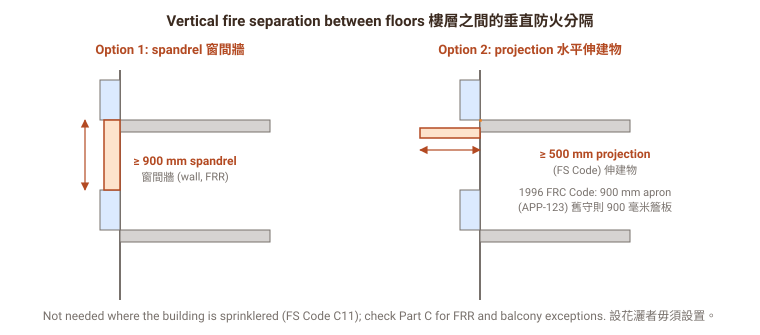
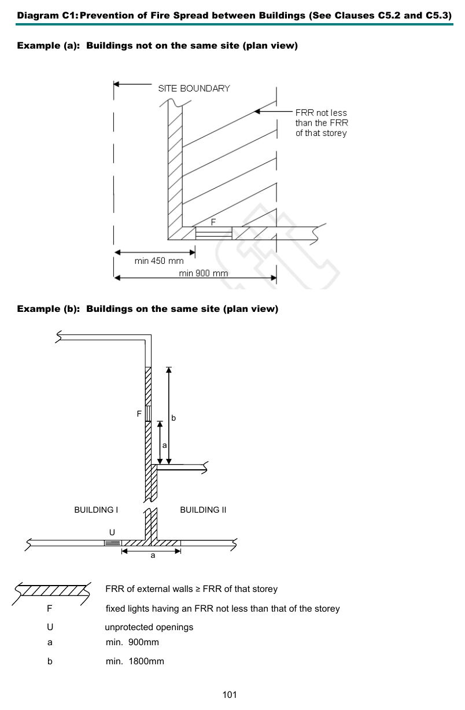
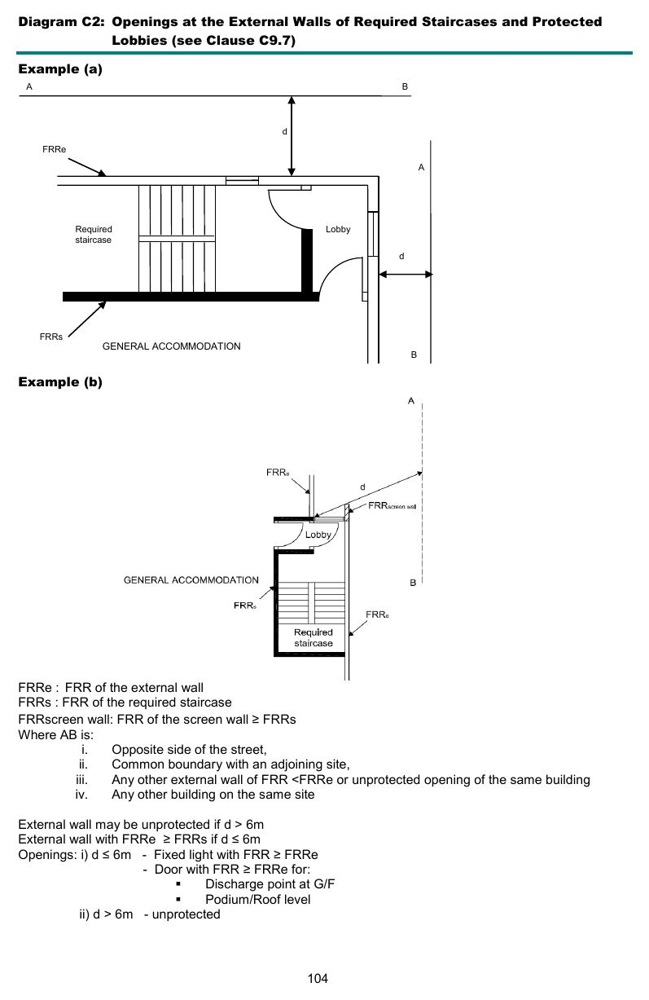
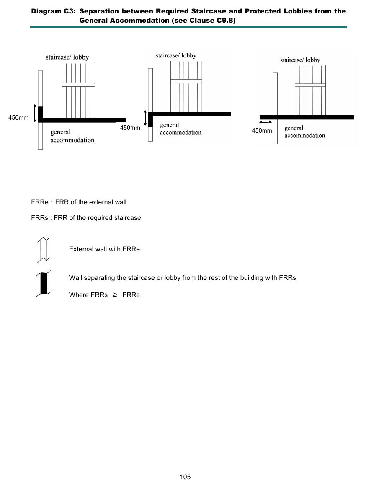
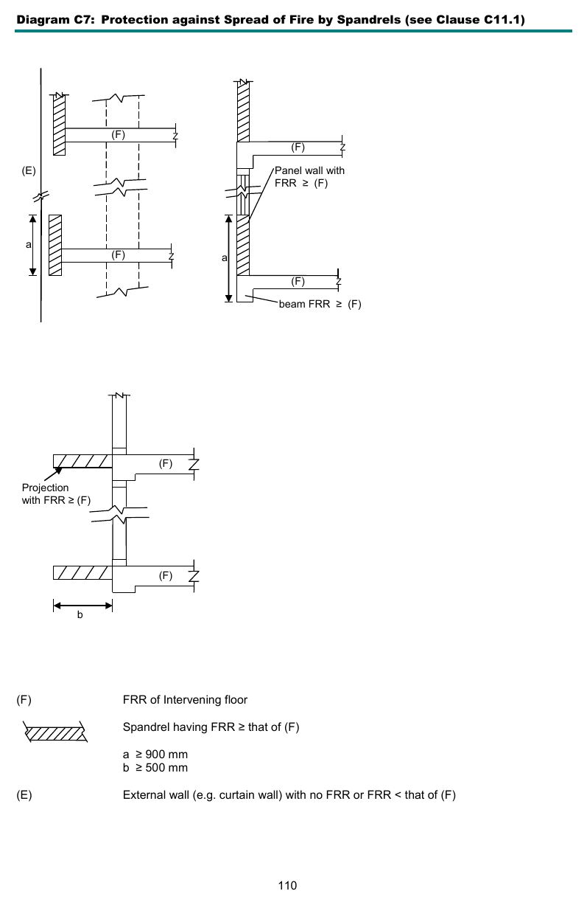
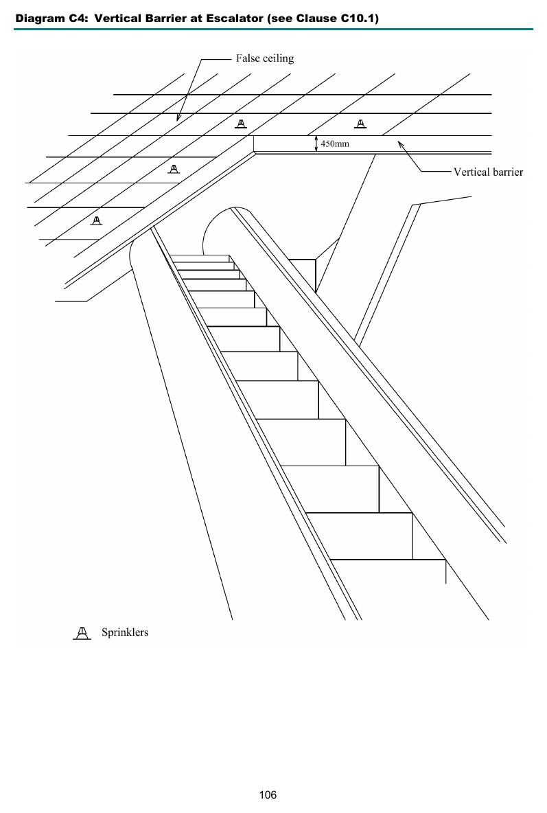
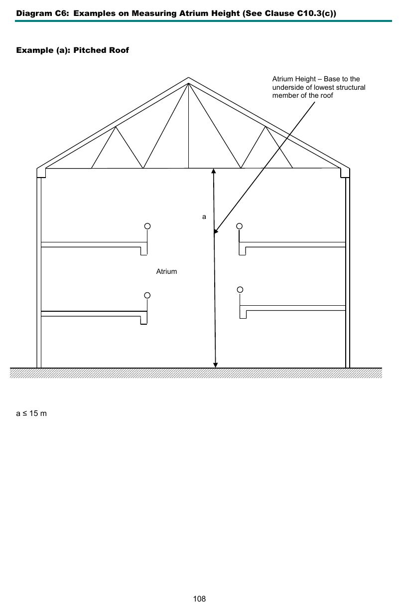

---
tags:
  - Code of Practice
  - Fire safety 消防安全
  - Fire resisting construction 耐火結構
  - Fire compartment 防火隔室
  - FRR 耐火效能
  - Structural 結構
  - Staircase 樓梯
  - Lift 升降機
  - Curtain wall & façade 幕牆及外牆
  - Refuge floor 庇護層
  - Means of escape 逃生途徑
  - Domestic 住用
  - Car park 停車場
  - Green & amenity features 環保及適意設施
  - Balcony & utility platform 露台及工作平台
keywords: FRC, FRR, fire resisting construction, 耐火結構, compartment, 防火分隔, fire door, 防火門
---

# FS Code 2011 Part C: Fire Resisting Construction <small>《2011 年建築物消防安全守則》C 部：耐火結構</small>

!!! info "Document info 文件資料"
    | | |
    |---|---|
    | **Part of 所屬** | [Code of Practice for Fire Safety in Buildings 2011](fire-safety-code-2011.md) (2024 Edition) |
    | **Clauses 條文** | C1–C18 (Sections 1–3) 第 1–3 節 |
    | **Official language 官方語言** | English and Chinese 中英文版 |
    | **Source 原文** | [English (PDF)](https://www.bd.gov.hk/doc/en/resources/codes-and-references/code-and-design-manuals/fs_code2011.pdf) pp. 76–110 · [中文 (PDF)](https://www.bd.gov.hk/doc/tc/resources/codes-and-references/code-and-design-manuals/fs_code2011_c.pdf) |
    | **Last checked 最後核對** | 2026-11-20 against the 2024 Edition |

!!! tip "Reading FRR notation 耐火效能的寫法"
    FRR is written **stability / integrity / insulation** in minutes, e.g. **120/120/120**. A dash means that criterion is not required, e.g. **-/120/120** for a non-loadbearing fire barrier.
    耐火效能以**穩定性／完整性／隔熱性**（分鐘）表示，例如 **120/120/120**；「-」表示該項不適用，例如非承重防火屏障為 **-/120/120**。

## At a glance 重點摘要 {#at-a-glance}

=== "English"

    - Part C gives the **deemed-to-comply** provisions to stop fire and smoke spreading **within** a building and **to other buildings**.
    - **Compartmentation** (C3–C4): divide every building into **fire compartments** within the area/volume limits of **Table C1** (e.g. offices ≤ **10,500 m²**, retail ≤ 2,500 m² at 60 min or ≤ 10,500 m² at 120 min). Elements must meet the FRR in Table C1, using the criteria in **Table C2**.
    - **Between buildings** (C5): buildings < **1.8 m** apart on the same site are "adjoining", and walls within **900 mm / 1.8 m** must be imperforate and fire-rated. Walls within **900 mm** of another site's boundary must be fire-rated, with openings only ≥ **450 mm** from the boundary and protected by fire-rated fixed lights.
    - **Staircases and lifts** (C9): liftwells **120/120/120**. Staircase external walls within **6 m** of a street, boundary or other building need FRR, with fire-rated fixed lights ≤ **25%** of the wall.
    - **Floors and façades** (C10–C11): **450 mm downstand** around floor openings (sprinklered). Atria ≤ **28,000 m³**, ≤ **15 m** high, ≤ **3 floors**. Between floors, a **900 mm spandrel** or **500 mm projection** (not needed where sprinklered).
    - **Special cases**: special hazards **-/120/120** (**-/240/240** next to a protected exit); basements **240/240/240** with smoke outlets **≥ 0.5%** of floor area; fire doors **self-closing**, bottom gap **≤ 10 mm**; refuge floors **-/120/120** walls, **120/120/120** floors.

=== "中文"

    - C 部提供**「當作符合」**條文，以阻止火勢及煙霧在建築物**內部**蔓延及**蔓延至其他建築物**。
    - **防火分隔**（C3–C4）：每幢建築物須按**表 C1** 的面積／體積限制分為**防火隔室**（例如辦公室 ≤ **10,500 平方米**；零售 ≤ 2,500 平方米為 60 分鐘，≤ 10,500 平方米為 120 分鐘）；構件須按**表 C2** 的準則達到表 C1 的耐火效能。
    - **建築物之間**（C5）：同一地盤上相距 < **1.8 米**的建築物屬「毗鄰」，**900 毫米／1.8 米**範圍內的牆須無開口並具耐火效能；距另一地盤界線 **900 毫米**內的牆須具耐火效能，開口須距界線 ≥ **450 毫米**並以耐火固定窗保護。
    - **樓梯及升降機**（C9）：升降機槽 **120/120/120**；樓梯外牆如在街道、地界或其他建築物 **6 米**範圍內須具耐火效能，耐火固定窗 ≤ 外牆 **25%**。
    - **樓板及外牆**（C10–C11）：樓板開口四周設 **450 毫米下垂板**（設花灑）；中庭 ≤ **28,000 立方米**、≤ **15 米**高、≤ **3 層**；樓層之間設 **900 毫米窗間牆**或 **500 毫米伸建物**（設花灑者毋須）。
    - **特殊情況**：特殊危險地方 **-/120/120**（毗連防護出口 **-/240/240**）；地庫 **240/240/240**，排煙口 ≥ 樓面面積 **0.5%**；防火門**自動關閉**，底部縫隙 **≤ 10 毫米**；庇護層牆 **-/120/120**、樓板 **120/120/120**。

## Diagram 圖解 {#diagram}

<figure markdown>
  { width="760" loading=lazy }
  <figcaption>Vertical fire separation: 900 mm spandrel or 500 mm projection (FS Code); 900 mm apron under the 1996 code. 樓層間垂直防火分隔。 Diagram prepared for this site; check the source text for exact wording.</figcaption>
</figure>

## Structure of Part C 第 C 部結構 {#structure-of-part-c-c}

| Section 節 | Subsections 分節 | Topic 主題 |
|---|---|---|
| 1 General 一般規定 | C1–C2 | Use; performance requirements (Part A, A9) 用途；性能要求 |
| 2 Provisions 耐火結構條文 | C3–C17 | Compartments, FRR, fire spread between buildings, flats, separation of uses, openings and shafts, staircases and lifts, floor openings and atria, façades, roofs, special hazards, basements, linked buildings, fire doors, refuge floors 防火隔室、耐火效能、建築物之間、住宅單位、用途分隔、開口及管槽、樓梯及升降機、樓板開口及中庭、外牆、屋頂、特殊危險、地庫、連接建築物、防火門、庇護層 |
| 3 Cinemas and theatres 電影院及劇院 | C18 | Fire safety for cinemas and theatres 電影院及劇院的消防安全 |

---

## C3–C4 Fire compartments and FRR 防火隔室及耐火效能 {#c3c4-fire-compartments-and-frr}

!!! quote "Clause C3.1 — Fire compartmentation 防火分隔"
    Every building should be divided into fire compartments by fire barriers without exceeding the fire compartment area/volume specified in Table C1 in order to inhibit the spread of fire.

    **官方中文本：** 每幢建築物內的防火隔室應以防火屏障分隔，而每個防火隔室不得超過表 C1 所訂明的面積／體積，以阻止火勢蔓延。

**Table C1** (compartment limits and FRR by use) is set out in the [FS Code overview](fire-safety-code-2011.md#key-table-fire-resistance-and-compartments-table-c1-c1). Its notes say:
**表 C1**（按用途的防火隔室限制及耐火效能）見[守則概覽](fire-safety-code-2011.md#key-table-fire-resistance-and-compartments-table-c1-c1)，附註要點：

- Larger compartments are considered **on individual merits** with enhanced MoE, access, FSI and construction for equivalent safety. 超出限制按個別情況考慮。
- Different Use Classifications are separated per **C7**; special hazards per **C13**. 不同用途按 C7 分隔；特殊危險按 C13。
- **UC 1**: each **flat** separated from adjoining flats by fire barriers. **UC 2**: each **guestroom** separated from other guestrooms and uses. 住宅單位之間、旅館客房之間須以防火屏障分隔。
- **C4.3**: a single-storey building ≤ **7,000 m³** and ≤ **7.5 m** high may have **unprotected steelwork** if ≥ **6 m** clear from other buildings and the boundary. 單層小型建築物的鋼結構可不設防火保護。

**Table C2 — FRR criteria for elements 構件耐火效能準則**

| # | Element 構件 | Stability 穩定性 | Integrity 完整性 | Insulation 隔熱性 | Exposure 受火方式 |
|--:|---|:-:|:-:|:-:|---|
| 1 | Structural frame, beam, column 結構框架、樑、柱 | Y | N | N | Exposed faces only |
| 2 | Floor incl. compartment floor 樓板 | Y | Y | Y | Each side separately |
| 3 | Roof forming part of exit route / acting as floor 作出口路線或樓板的屋頂 | Y | Y | Y | From underside |
| 4 | Loadbearing wall, not a fire barrier 非防火屏障的承重牆 | Y | N | N | Each side |
| 5 | External wall 外牆 | Y* | Y | Y | Each side |
| 6 | Loadbearing wall being a fire barrier 承重防火屏障 | Y | Y | Y | Each side |
| 7 | Non-loadbearing fire barrier 非承重防火屏障 | N | Y | Y | Each side |
| 8 | Protected shaft, lobby, corridor 防護管槽、門廊、走廊 | Y* | Y | Y | Each side |
| 9 | Fire shutter, fire stop, damper, sealing system 防火捲閘、防火封堵、防火閘 | N | Y | N (unless specified) | Each side |
| 10 | Smoke outlet shaft 排煙管槽 | Y | Y | Y | From outside |
| 11 | Enclosure around services (other than #14) 設施圍封 | N | Y | Y | From outside |
| 12 | Door incl. frame 門（連門框） | N | Y | N (unless specified) | Each side (lift doors: landing side only) |
| 13 | Fixed light 固定窗 | N | Y | Y | Each side |
| 14 | Enclosure around services in staircase / protected lobby 樓梯／防護門廊內的設施圍封 | N | Y | Y | Each side |

<small>Y* = required for loadbearing elements only. Curtain wall glazing needs no FRR, subject to C5 and C9.7. A smoke outlet shaft whose area is reduced to ≤ 75% counts as failing stability. Y* 只適用於承重構件；幕牆玻璃毋須耐火效能（受 C5 及 C9.7 規限）。</small>

## C5 Fire spread between buildings 建築物之間的火勢蔓延 {#c5-fire-spread-between-buildings}

| Situation 情況 | Requirement 規定 |
|---|---|
| **Same site** 同一地盤: buildings < **1.8 m** apart are "adjoining" 相距 < 1.8 米屬毗鄰 | |
| Façade angle **> 135°** 外牆夾角 > 135° | Within **900 mm**: imperforate wall with FRR ≥ internal elements. Unprotected openings ≥ **900 mm** from those of the other building 900 毫米內須無開口並具耐火效能 |
| Façade angle **≤ 135°** 外牆夾角 ≤ 135° | Within **1.8 m**: imperforate wall with FRR. Openings ≥ **900 mm** away with fire-rated fixed lights. Unprotected openings ≥ **1.8 m** apart 1.8 米內須無開口；耐火固定窗距 ≥ 900 毫米 |
| Roof 屋頂 | Within **1.8 m**: imperforate with FRR of the storey below; fire-rated fixed lights ≥ **900 mm** away 1.8 米內須無開口 |
| **Different site** 不同地盤: within **900 mm** of the site boundary 距地界 900 毫米內 | External walls and roof with FRR ≥ internal elements, **imperforate**. Openings only ≥ **450 mm** from the boundary with fire-rated fixed lights 須具耐火效能並無開口；開口距地界 ≥ 450 毫米 |

<figure markdown>
  { loading=lazy }
  <figcaption>Diagram C1 — Prevention of fire spread between buildings 防止火勢在建築物之間蔓延</figcaption>
</figure>

## C6–C8 Flats, separation of uses, openings and shafts 住宅單位、用途分隔、開口及管槽 {#c6c8-flats-separation-of-uses-openings-and-shafts}

| Clause 條文 | Requirement 規定 |
|---|---|
| **C6.1** Flats / guestrooms on an internal corridor 內走廊住宅單位／客房 | Corridor fire barriers to Table C1; flat/guestroom doors with the same FRR; **smoke seals** on every such door (top and sides) 走廊防火屏障；單位門同等耐火效能並設**防煙封條** |
| **C7.1** Different uses / occupancies 不同用途／佔用 | Separated by fire barriers with the **longer FRR** of the two 以較長耐火效能分隔 |
| C7.2 | No separation needed for ancillary small offices, caretakers' quarters, small stores in industrial buildings, office pantries, snack bars in UC 5a 小型附屬用途毋須分隔 |
| C7.3 | No separation between occupancies in **UC 4a** (offices) or **retail shops (UC 4b)**, if Table C1 compartment limits are met 辦公室或零售之間毋須分隔 |
| C7.4 | Common corridors serving different occupancies separated at the floor's FRR (higher governs), except shopping arcades 共用走廊須分隔（商場除外） |
| C7.5 | Dead-end balcony approach separated from occupancies; UC 1 windows on it **fixed, -/30/30** 盡頭露台通道須分隔 |
| **C8.1** Openings in compartment walls 防火隔室牆開口 | Fire doors / shutters with the wall's FRR. If openings are **> 25%** of the wall length, **insulation** is also required (reducible to **30 min** with sprinklers both sides) 開口 > 25% 須具隔熱性 |
| C8.2–C8.6 | Ducts, trunking, pipes through barriers: **fire dampers / fire stops**; shafts **fire sealed**, shaft doors self-closing with the shaft FRR; sealing systems durable and moisture-proof 穿越屏障的管道須設防火閘／封堵 |

## C9 Required staircases and lifts 規定的樓梯及升降機 {#c9-required-staircases-and-lifts}

!!! quote "Clause C9.1(a) — Liftwells 升降機槽"
    All liftwells, except for openings for doors and ventilation or openings between the liftwell and the machine or pulley room, should be separated from the rest of the building by fire barriers having an FRR of not less than 120/120/120…

    **官方中文本：** 除了為門和通風而設的升降機槽開口或升降機槽與機房或滑輪室之間的開口，所有升降機槽與建築物的其餘部分均應以耐火效能不低於 120/120/120 的防火屏障分隔……

| Clause 條文 | Requirement 規定 |
|---|---|
| C9.1 | Liftwells **120/120/120**; landing doors with integrity of the wall or **-/120/-**; basement lift doors via a **smoke seal lobby** 升降機槽 120/120/120；地庫升降機門設防煙門廊 |
| C9.2 | Bullet / panorama lifts in a single compartment need no fire-resisting liftwell if the machine room is separated 觀光升降機的例外 |
| C9.3 | Protected exits and lobbies: fire barriers to Table C1; doors with integrity **and** insulation; **only emergency services** inside (hydrants, sprinklers, emergency lights, exit signs, CCTV, intercom). Other services enclosed in fire-rated enclosures 防護出口內只可設緊急設施 |
| C9.4 | Stair flights and landings within the enclosure need **no FRR** but must be **non-combustible** 樓梯本身須不可燃 |
| C9.5 | Single-staircase building with non-domestic/office G/F: staircase G–1/F separated at the longer FRR; enclosure returned **450 mm** at the entrance 單一樓梯建築物的地面層 |
| **C9.7** | Staircase / lobby external wall within **6 m** of the opposite side of a street, a site boundary, a lower-FRR wall or opening, or another building on the site: must be **fire-rated and imperforate**, except fire-rated **fixed lights ≤ 25%** of that storey's wall area (or a fire door at G/F or roof discharge) 6 米範圍內須耐火並無開口，耐火固定窗 ≤ 25% |
| C9.8 | Where the staircase wall is in the same plane as other lower-FRR walls, extend the staircase walls **450 mm** at the junction 樓梯牆延伸 450 毫米 |

<figure markdown>
  { loading=lazy }
  <figcaption>Diagram C2 — Openings at the external walls of required staircases and protected lobbies (6 m rule) 規定樓梯及防護門廊外牆的開口（6 米規則）</figcaption>
</figure>

??? abstract "Diagram C3 — wall extension at junctions 圖 C3：交接處的牆身延伸"
    { loading=lazy }

## C10–C11 Floor openings, atria, curtain walls and façades 樓板開口、中庭、幕牆及外牆 {#c10c11-floor-openings-atria-curtain-walls-and-facades}

| Clause 條文 | Requirement 規定 |
|---|---|
| **C10.1** Floor openings (sprinklered) 樓板開口（設花灑） | Escalators, circulation stairs, voids: **450 mm** downstand barrier (**-/30/-**, non-combustible), below any false ceiling, **or** a smoke curtain on smoke detection 450 毫米下垂板或防煙幕 |
| **C10.2** Curtain walls 幕牆 | Over one storey: **non-combustible** (except sealants/gaskets). Seal the perimeter void with a smoke and fire barrier: FRR ≥ the floor; leakage ≤ **25 m³/h/m² at 25 Pa** (BS EN 12101-1) 幕牆須不可燃；樓層周邊空隙須封堵 |
| **C10.3** Atrium (sprinklered) 中庭（設花灑） | Separated by fire barriers / shutters / curtains / fire-rated glazing; volume ≤ **28,000 m³**; height ≤ **15 m**; ≤ **3 floors** linked; sprinklers to the base 體積 ≤ 28,000 立方米、高 ≤ 15 米、≤ 3 層 |
| **C11.1** External fire spread 外牆火勢蔓延 | Between floors: **900 mm spandrel** or **500 mm horizontal projection**, with the FRR of the intervening storey. **Not required** for single family houses or **sprinklered** buildings 900 毫米窗間牆或 500 毫米伸建物；設花灑者毋須 |
| C11.2 | UC 1: pipe openings **≤ 110 mm** diameter allowed in kitchen / bathroom spandrels 廚房／浴室窗間牆可開 ≤ 110 毫米管孔 |

!!! quote "Clause C11.1 — Spandrels 窗間牆"
    Subject to Subsection C5, the external wall of a building at any floor should be separated from the external wall at the floor next below by: (a) a spandrel that is a vertical element of 900mm, with an FRR of not less than that of the intervening storey; or (b) a horizontal projection of 500mm, with an FRR of not less than that of the intervening storey. This clause does not apply to a single family house or a sprinkler protected building.

    **官方中文本：** 在符合 C5 節的要求下，建築物各樓層的外牆均應與下一樓層的外牆分隔，方法是：(a) 採用 900 毫米的垂直窗間牆，該窗間牆應具有不低於所分隔的樓層的耐火效能；或 (b) 採用 500 毫米的橫向伸建物，該伸建物應具有不低於所分隔的樓層的耐火效能。本條不適用於單一家庭式獨立屋或設有花灑系統的建築物。

<figure markdown>
  { loading=lazy }
  <figcaption>Diagram C7 — Protection against spread of fire by spandrels 以窗間牆防止火勢蔓延</figcaption>
</figure>

??? abstract "Diagrams C4 and C6 — escalator barrier, atrium height 圖 C4 及 C6"
    { loading=lazy }
    *Diagram C4 — Vertical barrier at escalator 扶手電梯的垂直屏障*

    { loading=lazy }
    *Diagram C6 — Examples of measuring atrium height 中庭高度量度例子*

## C12–C14 Roofs, special hazards, basements 屋頂、特殊危險、地庫 {#c12c14-roofs-special-hazards-basements}

| Clause 條文 | Requirement 規定 |
|---|---|
| C12.1 | All roofs and roof structures **non-combustible** 屋頂須不可燃 |
| C12.2–C12.4 | FRR ≥ the storey below for: roofs of single-staircase buildings > 13 m; roofs used as **refuge floors**; floors of a **temporary place of safety** (e.g. a podium) 單一樓梯 > 13 米、庇護天台、臨時安全地方 |
| **C13.1** Special hazard 特殊危險 | Separated by **-/120/120**; **-/240/240** if it opens directly to a protected exit 與防護出口相連須 -/240/240 |
| C13.2 Restaurant kitchen 食肆廚房 | Enclosed **-/60/60** with -/60/60 doors; **protected lobby** to exit routes, and to the dining area where the kitchen is > **45 m²** and the lobby opens onto the dining area's exit route 廚房 -/60/60；> 45 平方米須設防護門廊 |
| C13.3 Flat with single exit door 單一出口門的住宅單位 | Kitchen next to the door enclosed **-/30/30** with a -/30/30 door 廚房 -/30/30 |
| **C13.4 Open kitchen** 開放式廚房 | Smoke detector in the flat (to local panel); smoke detector outside; **sprinkler** over the notional kitchen; **600 mm** wide full-height **-/30/30** wall beside the exit door; 450 mm barrier if internal stairs 煙霧感應器、花灑、門旁 600 毫米防火牆 |
| **C14.1** Basements 地庫 | G/F–basement barriers **-/240/240**; basement elements **240/240/240**; compartment walls in basement **-/120/120** 地庫構件 240/240/240 |
| **C14.2** Smoke outlets 排煙口 | Basements enclosed on 4 sides: outlets **≤ 30 m apart**, at high level, total **≥ 0.5%** of floor area (**2.5%** for bulk storage), each **≥ 1 m** min. dimension, away from staircase discharges, breakable covers 排煙口 ≥ 0.5%（倉庫 2.5%）；相距 ≤ 30 米 |
| C14.3 | With mechanical smoke extraction: **1 outlet per 3,500 m³** (min. 1 per floor) 機械排煙：每 3,500 立方米一個 |

!!! quote "Clause C14.1 — Basements 地庫"
    Every basement should be provided with the following: (a) fire barriers forming the fire compartment between the ground storey and a basement should have an FRR of not less than -/240/240. This includes all protected exits serving the basement; (b) all elements of construction of the basement should have an FRR of not less than 240/240/240; (c) fire barriers forming fire compartment walls within basements should have an FRR of not less than -/120/120…

    **官方中文本：** 每個地庫均應符合以下條件︰(a) 在地面樓層與地庫之間構成防火隔室的防火屏障（包括所有通往地庫的防護出口），其耐火效能不應低於-/240/240；(b) 地庫的所有建築構件，其耐火效能不應低於 240/240/240；(c) 於地庫內構成防火隔室牆壁的防火屏障，其耐火效能不應低於-/120/120……

## C15–C17 Linked buildings, fire doors, refuge floors 連接建築物、防火門、庇護層 {#c15c17-linked-buildings-fire-doors-refuge-floors}

| Clause 條文 | Requirement 規定 |
|---|---|
| C15.1 Bridges 天橋 | With fire barriers at the ends: the longest FRR of the linked storeys (fire shutters need **by-pass lobbies** with exit signs). Unenclosed (parapets ≤ **1.2 m**): non-combustible, longest FRR. Enclosed without barriers: part of the compartment 天橋規定 |
| C15.2 Tunnels 隧道 | Fire barriers at each end (longest FRR); non-combustible 兩端設防火屏障 |
| **C16.1–C16.2** | All fire doors **self-closing**. Staircase / lobby doors **kept closed**; others may have hold-open devices per B13.8 防火門自動關閉 |
| C16.3 | Notice **"FIRE DOOR TO BE KEPT CLOSED 防火門應常關"** (≥ **10 mm** characters) on both sides 告示 |
| **C16.4** | Closely fitted; bottom gap **≤ 10 mm** (or as tested) 底部縫隙 ≤ 10 毫米 |
| **C16.5** Protected lobby 防護門廊 | Barriers floor to soffit / false ceiling at the floor FRR. **Either** the door on the occupied side has the full FRR and the second door none, **or** both doors have **half** the FRR. **Smoke seals** on both 一道門全耐火效能，或兩道門各一半；均設防煙封條 |
| **C17.1** Refuge floor 庇護層 | Refuge area separated by walls **-/120/120** and floors **120/120/120**; shafts must not open directly onto it 牆 -/120/120、樓板 120/120/120 |
| C17.2 | Open sides ≥ **6 m** from the opposite side of a street, a site boundary, walls < 120/120/120, or other buildings 開敞面距離 ≥ 6 米 |
| C17 commentary | Sky garden in refuge floor: as [APP-122](../pnap/app-122.md), but lift lobby **doors and walls -/120/120** 空中花園：升降機門廊門及牆 -/120/120 |

!!! quote "Clause C16.4 — Fire door gaps 防火門縫隙"
    All fire rated doors should be closely fitted around their edges to impede the passage of smoke or flame. The bottom gap between such doors and the floor should not exceed 10mm.

    **官方中文本：** 所有防火門周邊應緊貼門框，以阻止煙霧與火焰通過。防火門的底部與樓板的縫隙不應超逾 10 毫米。

## C18 Cinemas and theatres 電影院及劇院 {#c18-cinemas-and-theatres}

- **Cinemas sharing exits** with other non-domestic uses: each auditorium is **its own compartment**; **dedicated smoke extraction** on smoke detection; seating and furnishings meet ignition-retarding standards (Part E); projection rooms **-/60/60** with smoke-sealed doors (unless no hazardous projection equipment). 電影院院廳自成防火隔室；設專用排煙；放映室 -/60/60。
- **Theatres**: **fully sprinklered**; proscenium wall **-/60/60**; **fire or water curtain** at the opening (fire curtain ≥ **-/30/-**, smoke-restricting). 劇院全面設花灑；台口牆 -/60/60；防火幕或水幕。

---

## Explanation 淺白解釋 {#explanation}

=== "English"

    Part C works like a set of **fire-resisting boxes**:

    1. **Compartments** (Table C1) limit how big a fire can grow. Every wall, floor and door forming the box must hold out for the **FRR** in minutes, judged by the right criteria (Table C2).
    2. **Escape routes** (staircases, lobbies, lift shafts) are **stronger boxes**, so people can get out and firefighters can get in.
    3. **Holes in the boxes** (doors, ducts, pipes, floor voids, façade gaps, curtain wall edges) must be **sealed or protected** to the same standard.
    4. **Distance** protects neighbours: near boundaries and other buildings, walls must be blank and fire-rated.
    5. **High-risk places** (special hazards, basements, kitchens, cinemas) get **higher FRR** or extra measures.

    **Sprinklers** relax several rules: no spandrel (C11.1), reduced insulation for wide openings (C8.1), and atria and floor voids allowed (C10).

=== "中文"

    C 部可理解為一組**耐火「箱子」**：

    1. **防火隔室**（表 C1）限制火勢可擴展的範圍；構成箱子的每道牆、每塊樓板及每道門，均須按合適準則（表 C2）達到以分鐘計的**耐火效能**。
    2. **逃生路線**（樓梯、門廊、升降機槽）是**更堅固的箱子**，讓人逃生及消防人員進入。
    3. **箱子上的開口**（門、風管、喉管、樓板中空、外牆空隙、幕牆邊緣）須以同等標準**封堵或保護**。
    4. **距離**保護鄰近建築物：近地界或其他建築物的牆須無開口並具耐火效能。
    5. **高風險地方**（特殊危險、地庫、廚房、電影院）須有**更高耐火效能**或額外措施。

    **花灑系統**可放寬多項規定：毋須窗間牆（C11.1）、闊開口的隔熱要求降低（C8.1）、可設中庭及樓板中空（C10）。

## Practical notes 實務提示 {#practical-notes}

=== "English"

    !!! example "Worked example: smoke outlets for a basement car park"
        Basement car park enclosed on four sides, **4,000 m²**, natural smoke venting (no mechanical extraction).

        - Total smoke outlet area ≥ 0.5% × 4,000 = **20 m²**
        - Each outlet ≥ **1 m** least dimension, ≤ **30 m** apart, at high level along the frontage
        - e.g. 6 outlets of 1.5 m × 2.3 m ≈ 20.7 m² ✅. Keep them away from staircase discharge points.

    !!! example "Worked example: protected lobby doors (C16.5)"
        Floor FRR **120 min**. Options:

        - (b) Door to the occupied side **-/120/120**, second door no FRR, both with smoke seals; **or**
        - (c) Both doors **-/60/60** (half), both with smoke seals.

    !!! tip "Common pitfalls"
        - **Non-sprinklered** buildings without a **900 mm spandrel / 500 mm projection** between floors.
        - **Staircase windows** within 6 m of a boundary, street or other building that are not fire-rated, or over 25% of the wall.
        - Running **ordinary services** (e.g. drainage, cables) through required staircases without a fire-rated enclosure (C9.3(d)).
        - **Open kitchens** without the sprinkler, smoke detectors and 600 mm fire wall package (C13.4).
        - Treating a **curtain wall** edge as sealed by the façade alone. The floor-edge void needs a tested **smoke and fire barrier** (C10.2).

=== "中文"

    !!! example "計算例子：地庫停車場排煙口"
        四面圍封的地庫停車場，**4,000 平方米**，自然排煙（沒有機械排煙）。

        - 排煙口總面積 ≥ 0.5% × 4,000 = **20 平方米**
        - 每個最小尺寸 ≥ **1 米**，相距 ≤ **30 米**，沿臨街面設於高位
        - 例如 6 個 1.5 米 × 2.3 米 ≈ 20.7 平方米 ✅；須遠離樓梯出口。

    !!! example "計算例子：防護門廊門（C16.5）"
        樓層耐火效能 **120 分鐘**，可選：

        - (b) 向佔用部分的門 **-/120/120**，第二道門毋須耐火效能，兩門均設防煙封條；**或**
        - (c) 兩道門均為 **-/60/60**（一半），兩門均設防煙封條。

    !!! tip "常見錯誤"
        - **沒有花灑系統**的建築物在樓層之間沒有 **900 毫米窗間牆／500 毫米伸建物**。
        - 位於地界、街道或其他建築物 6 米範圍內的**樓梯窗**沒有耐火效能，或超過外牆 25%。
        - **一般設施**（例如排水管、電纜）穿過規定的樓梯而沒有耐火圍封（C9.3(d)）。
        - **開放式廚房**沒有花灑、煙霧感應器及 600 毫米防火牆（C13.4）。
        - 以為**幕牆**本身已封堵樓層邊緣：樓板邊空隙須設經測試的**防煙防火屏障**（C10.2）。

<!-- APSEC START -->
## APSEC clarifications 認可人士及註冊結構工程師委員會討論 {#apsec-clarifications}

BD's responses at the APSEC Discussion Forum that clarify this document, **newest first**. Where the same question came up more than once, only the **latest position** is listed. See [all APSEC items](../apsec/index.md). 屋宇署在討論會上就本文件作出的澄清，新者在前；同一問題只列最新立場。

- **[Clauses B9.1 and D7.3 of the FS Code](../apsec/2026.md#i2026050816)** <small>ADF 2/2026, 8 May 2026</small> BD advised that under Clause D7.3(b) of the FS Code, the passage from the the fire service access point to the fireman’s lift should be separated from the remainder of the ground storey by walls having the requisite FRR. …
- **[Height of Atrium According to Clause C10.3(c) of the FS Code, “the maximum height](../apsec/2026.md#i2026050811)** <small>ADF 2/2026, 8 May 2026</small> of the 8 15m. BD
- **[Full Height Fire Rated Wall of Open Kitchen Clause C13.4(d) of the Code of Practice for Fire Safety in Buildings](../apsec/2026.md#i202605082)** <small>ADF 2/2026, 8 May 2026</small> February 2024 and advised that the purpose of the full height fire rated the flat wall required for open kitchen under Clause C13.4(d) of the FS Code was to shield the occupants from radiant heat of stove fires and allow the necessary pause of occupants to open the exit door (and gate, if any). …
- **[Code of Practice for Fire Safety in Buildings 2011 (2024 Edition) (FS Code)- Services within Protected Exit](../apsec/2025.md#i202511211)** <small>ADF 4/2025, 21 Nov 2025</small> BD advised that according to Clause C9.3(d) of the FS Code, all non-emergency services within required staircases and their protected lobbies should be enclosed by fire barriers. …
- **[Internal Lining for Smoke Outlets](../apsec/2025.md#i2025021412)** <small>ADF 1/2025, 14 Feb 2025</small> BD advised that where a smoke outlet serving a basement extended into or through another storey, it should be fire rated or be protected with a fire rated enclosure according to Clause C14.4 of the FS Code. Such material should be tested in accordance Part E of the FS Code including Clause E6.1. …
- **[Door Closer for Door Panel adjacent to the Required Exit Door for Residential Unit](../apsec/2025.md#i202502141)** <small>ADF 1/2025, 14 Feb 2025</small> BD advised that according to item 15 of ADF 3/2015 on 29 May 2015, double-leaf door at residential flat with the smaller leaf less 600 mm wide was acceptable as long as it would not be subject to daily use but only be opened in rare occasions such as the moving of large furniture. …
- **[Fire Stop for Opening on Ground Floor Slab for Passage of Underground Drainage Pipes](../apsec/2024.md#i2024112220)** <small>ADF 4/2024, 22 Nov 2024</small> BD advised that where water-borne metallic pipes including drain pipes pass through fire barriers, gaps between the pipes and the fire barriers should be properly filled by fire rated material having an FRR of not less than that of the fire barrier that it penetrates according to Clause C8.6 of the FS Code. …
- **[Construction of Shroff within Carpark](../apsec/2024.md#i2024112213)** <small>ADF 4/2024, 22 Nov 2024</small> BD advised that shroff in a carpark might be considered as an ancillary small office to the carpark in accordance with Clause C7.2 of the FS Code subject to the detailed design and layout on a case-by-case basis. In such cases, separation by fire barriers would not be required.

??? note "31 more APSEC items 更多項目"

    - **[Fire Resistance Rating (FRR) of Mechanical Bearing of Link Bridges](../apsec/2024.md#i2024112211)** <small>ADF 4/2024, 22 Nov 2024</small> BD advised that as shown in the diagram, since no fire barrier was provided at each end of the link bridge connecting two underground structures and the link bridge was unlikely unenclosed, according to Clause C15.1(c) of the FS Code, the link bridge should be considered as an integral part of the fire compartment it linked. …
    - **[Insulation for Fire Dampers](../apsec/2024.md#i2024080929)** <small>ADF 3/2024, 9 Aug 2024</small> BD advised that under Clause C4.2 and item 9 in Table C2 of the FS Code, the criterion of insulation was not applicable to fire dampers unless specified otherwise. Accordingly, the criterion of insulation was not applicable to the fire dampers specified in Clause C8.2.
    - **[Provision of Smoke Outlets in Fire Compartment in Basement](../apsec/2024.md#i202405032)** <small>ADF 2/2024, 3 May 2024</small> BD advised that the non-provision of smoke outlets at the basement area being served by gas flooding system would be favourably considered subject to the agreement by FSD.
    - **[Open Kitchen](../apsec/2024.md#i2024022318)** <small>ADF 1/2024, 23 Feb 2024</small> Members noted and would observe the requirements accordingly. rated wall” required was to shield the necessary pause of Such wall must be shielding function. a minimum clear route adjacent to the than 750 mm in kitchen area. A provided below. 17 open and 18
    - **[“Atrium” in Clause C10.3(a) of FS Code](../apsec/2024.md#i202402237)** <small>ADF 1/2024, 23 Feb 2024</small> BD advised that according to Clause C10.3(a) of the FS Code, an atrium should be separated from all other spaces by fire barriers having an FRR of not less than that of those spaces. … <small>Latest position; replaces earlier discussion on [5 May 2023](../apsec/2023.md#i202305052) 以此為最新立場</small>
    - **[Separation between Buildings not on the Same Site – Clause C5.3 of](../apsec/2024.md#i202402232)** <small>ADF 1/2024, 23 Feb 2024</small> BD advised that HKIA’s understanding was correct.
    - **[Separation between Common Internal Corridor and Rooms or Flats – Clause C7.4 of the FS Code](../apsec/2023.md#i2023111710)** <small>ADF 4/2023, 17 Nov 2023</small> BD advised that the issue would be separately discussed.
    - **[FRR wall at open Kitchen](../apsec/2023.md#i202308048)** <small>ADF 3/2023, 4 Aug 2023</small> BD advised that HKIA’s understanding was correct.
    - **[Openings through Vertical Shaft – Clause C8.3 of the Code of Practice](../apsec/2023.md#i202308045)** <small>ADF 3/2023, 4 Aug 2023</small> BD advised that HKIA’s understanding was correct. with shaft the that 4 5
    - **[Protection of Passage for Staircase Interchange](../apsec/2023.md#i202305059)** <small>ADF 2/2023, 5 May 2023</small> BD advised that HKIA’s understanding was correct. However, it should be clarified in the sketch that access to two required staircases should be available for the subject unit for compliance with Clauses B8.1 and 10.3 of the FS Code.
    - **[Kitchen with Natural Lighting and Ventilation Not Relying on Window of Living / Dining Area and Complying with FS Code Clause](../apsec/2023.md#i202305056)** <small>ADF 2/2023, 5 May 2023</small> BD advised that as long as the open kitchen was provided with fire safety provisions in accordance with Clause C13.4 of the FS Code, the provision of fire barrier under Clause C13.3 of the FS Code would not be required.
    - **[Basement Smoke Vent](../apsec/2023.md#i202305055)** <small>ADF 2/2023, 5 May 2023</small> BD advised that provided that the external discharge points of the smoke outlets were not more than 30 m apart, the proposal illustrated in the diagram could fulfil the requirements under Clause C14.2(a) and (b) of the FS code. Item 10 of ADF 2/2015 held on 20 March 2015 was relevant.
    - **[Provision for Fire Resisting Construction for Landscape Features](../apsec/2023.md#i2023021015)** <small>ADF 1/2023, 10 Feb 2023</small> BD advised that subject to the design in each individual case, the commentary to Clause C4.3 of the FS Code might be applicable to amenity features similar in nature and construction to a single-storey covered walkway on podium or ground floor.
    - **[Fire Resisting Enclosures to Services](../apsec/2023.md#i2023021014)** <small>ADF 1/2023, 10 Feb 2023</small> BD advised that the fire resisting enclosures to services within the mechanical floor as mentioned in the scenario are not required in accordance with Clauses C8.2 and C8.4 of the FS Code. …
    - **[Provision of Smoke Outlets in Basement](../apsec/2022.md#i2022081214)** <small>ADF 4/2022, 12 Aug 2022</small> BD advised that AAP’s understanding was correct.
    - **[Fire Resistance Rating (FRR) for an Enclosed Footbridge over a Public Street between Two Buildings – Clause C15.1 of the FS Code](../apsec/2022.md#i202208127)** <small>ADF 4/2022, 12 Aug 2022</small> BD advised that with regard to the situation illustrated in the sketch that the buildings are situated on two different sites separated by a public street and an enclosed footbridge is proposed to be constructed as part of Building I and to connect to Building II, the requirements under Clause C5.3 of the FS Code should be …
    - **[Staircase Interchange](../apsec/2022.md#i2022051314)** <small>ADF 3/2022, 13 May 2022</small> BD advised that the requirement under Clause B8.2 of the FS Code on access between required staircases would be applicable to all types of buildings and except for shopping arcade situations, passages physically separated from the remainder of the building should be provided as access between the required staircases, and …
    - **[Smoke Outlets](../apsec/2021.md#i2021111215)** <small>ADF 5/2021, 12 Nov 2021</small> BD confirmed that AAP’s interpretation was correct. For (1), the AP should ensure smoke outlets covered by such materials could be easily broken by firefighters.
    - **[Discharge on Ground Level](../apsec/2020.md#i2020112616)** <small>ADF 4/2020, 26 Nov 2020</small> BD advised that the requirements under Clause C9.7 of FS Code 2011 were not applicable to “Lot A” under the specified situation but applicable to “Lot B” according to AAP’s sketch. if a portion for of and except 13
    - **[Separation between Use Classifications Clause C7.3 of FS Code 2011 states that:](../apsec/2020.md#i2020092916)** <small>ADF 3/2020, 29 Sep 2020</small> 
    - **[Smoke Seal Lobby for Lift Doors at Basement](../apsec/2020.md#i202009294)** <small>ADF 3/2020, 29 Sep 2020</small> BD advised that HKIA’s understanding was correct. <small>Latest position; replaces earlier discussion on [10 Jan 2020](../apsec/2020.md#i2020011012), [23 Aug 2019](../apsec/2019.md#i201908235) 以此為最新立場</small>
    - **[FRR Requirement for Main Staircase in Single-Family House/Unit](../apsec/2020.md#i202009292)** <small>ADF 3/2020, 29 Sep 2020</small> Noting that the main staircase connecting the different floors within a single-family house/unit served as means of escape and element of construction akin to a floor, BD advised that it should comply with stability, integrity and insulation of FRR requirements under Table C2 of the FS Code 2011.
    - **[Open Kitchen in Premises with Internal Staircase](../apsec/2020.md#i202009291)** <small>ADF 3/2020, 29 Sep 2020</small> BD advised that Clause C10.1 of the FS Code 2011 was only applicable to internal unprotected openings in floors within a fire compartment for sprinkler protected building. …
    - **[Disposition of Refuge Floor](../apsec/2020.md#i2020052913)** <small>ADF 2/2020, 29 May 2020</small> Under Clause B18.2 (e) of FS Code 2011, the area for refuge should be open-sided on at least two opposite sides. Under Clause C17.2 of FS Code 2011, where the side of a refuge floor is required to be open, the open side should not be directly be within a distance of less than 6m from a boundary of another site. …
    - **[Enclosure Wall of Vertical Lifting Platform](../apsec/2019.md#i2019112215)** <small>ADF 5/2019, 22 Nov 2019</small> Pursuant to Clause C9.2 of FS Code 2011, provided that the lift machine room or pulley room would be completely separated by fire barriers from the rest of the building, fire resisting construction would not be required for the lift car including landing doors and the liftwell of a bullet lift, panorama lift and the like …
    - **[Display Kitchen](../apsec/2019.md#i201908237)** <small>ADF 4/2019, 23 Aug 2019</small> BD advised that different licensing authorities had to exercise the control under the purview of their concerned Ordinance and the respective requirements.
    - **[Protection against External Fire Spread](../apsec/2019.md#i201905243)** <small>ADF 3/2019, 24 May 2019</small> BD advised that HKIA’s understanding was correct.
    - **[FS Code 2011 - Clause C8.1 (2015 rev.)](../apsec/2019.md#i2019032211)** <small>ADF 2/2019, 22 Mar 2019</small> BD advised that, in accordance with Item 7(d) of ADF 1/2012 held on 6.1.2012, in the context of Clause C8.1 of FS Code 2011, the plan lengths of all perimeter fire barriers forming a fire compartment would be taken as the denominator for assessing whether the width of the openings to be installed with fire shutters would exceed …
    - **[Clause C9.7 of the FS Code 2011](../apsec/2018.md#i201805253)** <small>ADF 3/2018, 25 May 2018</small> BD advised that the concerned MOE route discharged from another required staircase across the same covered recessed area should be located at least 6m away from the said main entrance lobby with non-FRR glass wall enclosure pursuant to Clause C9.7 of the FS Code 2011. …
    - **[Open Kitchen](../apsec/2018.md#i201803234)** <small>ADF 2/2018, 23 Mar 2018</small> BD confirmed that there was no change regarding the requirements of open kitchen further to previous discussions. For instance, all the smoke detector(s), sprinkler head(s) and FRR screen wall should be provided for open kitchen in accordance with Clause C13.4 of FS Code 2011. …
    - **[Fire Separation between Mail Room and Club House](../apsec/2018.md#i201801195)** <small>ADF 1/2018, 19 Jan 2018</small> BD advised that mail room and club house would be considered as different use and should be separated by fire barrier in accordance with Clause C7.1 and Table C1 of the FS Code.

<!-- APSEC END -->

## Related 相關文件 {#related}

| Document 文件 | Relationship 關係 |
|---|---|
| [FS Code 2011 overview](fire-safety-code-2011.md) | Tables A1, C1, D1 表 A1、C1、D1 |
| [FS Code Part B](fsc-part-b-means-of-escape.md) | Means of escape; refuge floors B18 逃生途徑；庇護層 |
| [APP-122](../pnap/app-122.md) | Sky garden in refuge floor 庇護層空中花園 |
| [APP-2](../pnap/app-2.md) | Curtain wall measurement for GFA 幕牆的總樓面面積量度 |
| Code of Practice for Minimum FSI and Equipment | Sprinklers, smoke extraction, dampers 花灑、排煙、防火閘 |
| FS Code Part E | Fire tests and non-combustibility 耐火測試及不可燃性 |

---
<small>Prepared by: _[name]_ · Checked by: _[name]_ · Quotes from the official English and Chinese versions; refer to the Code for the definitive text.</small>
