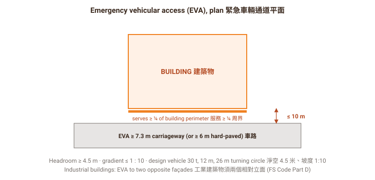
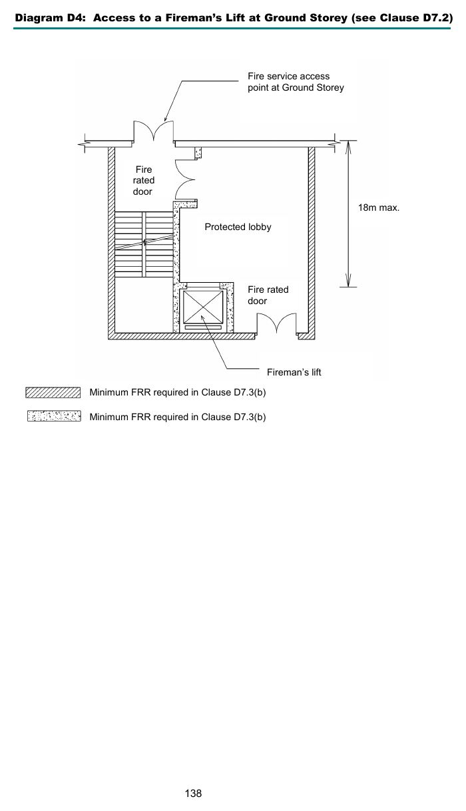
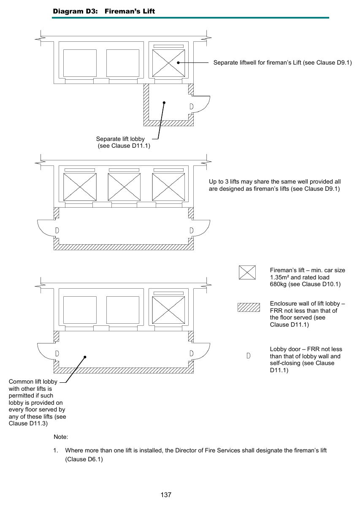
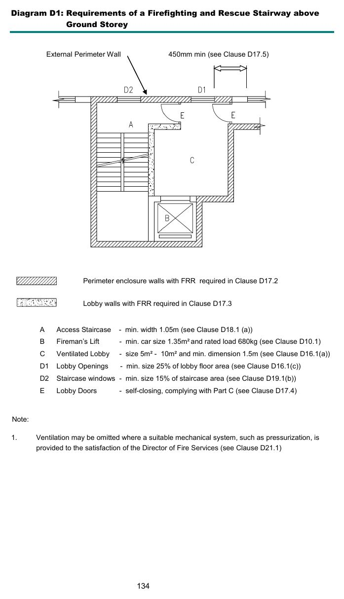
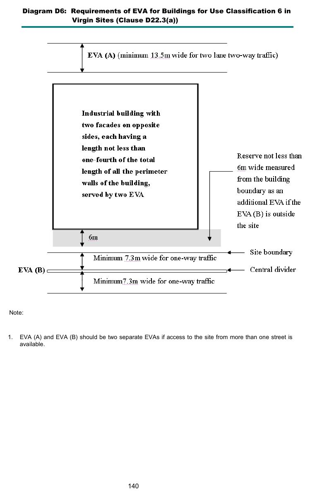
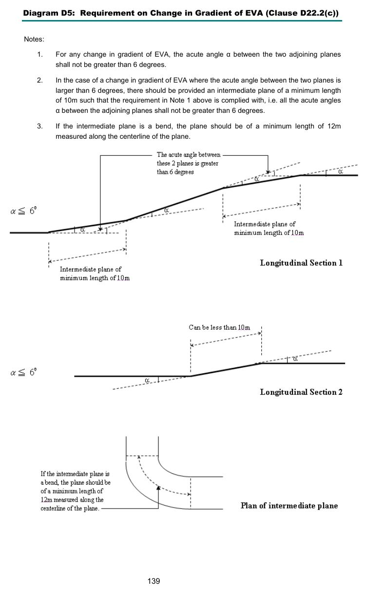

---
tags:
  - Code of Practice
  - Fire safety 消防安全
  - Means of access 救援通道
  - Fireman's lift 消防員升降機
  - EVA 緊急車輛通道
  - Lift 升降機
  - Staircase 樓梯
  - Curtain wall & façade 幕牆及外牆
  - Domestic 住用
  - Refuge floor 庇護層
  - Lighting & ventilation 照明及通風
  - Industrial building 工業大廈
  - Hotel 酒店
  - Car park 停車場
  - Fire resisting construction 耐火結構
  - Means of escape 逃生途徑
keywords: MOA, means of access, 消防進出途徑, fireman's lift, 消防員升降機, EVA, 緊急車輛通道, FRS
summary: "FS Code Part D: number of access staircases, fireman's lifts and FRS (Table D1), lift and FRS design, and EVA width, gradient, façade coverage, signs and exemptions."
---

# FS Code 2011 Part D: Means of Access <small>《2011 年建築物消防安全守則》D 部：消防及救援進出途徑</small>

!!! info "Document info 文件資料"
    | | |
    |---|---|
    | **Part of 所屬** | [Code of Practice for Fire Safety in Buildings 2011](fire-safety-code-2011.md) (2024 Edition) |
    | **Clauses 條文** | D1–D26 (Sections 1–6) 第 1–6 節 |
    | **Legal basis 法律依據** | B(P)R 41A (access staircases), 41B (fireman's lifts), 41C (firefighting and rescue stairways), 41D (EVA) |
    | **Official language 官方語言** | English and Chinese 中英文版 |
    | **Source 原文** | [English (PDF)](https://www.bd.gov.hk/doc/en/resources/codes-and-references/code-and-design-manuals/fs_code2011.pdf) pp. 112–146 · [中文 (PDF)](https://www.bd.gov.hk/doc/tc/resources/codes-and-references/code-and-design-manuals/fs_code2011_c.pdf) |
    | **Last checked 最後核對** | 2026-11-20 against the 2024 Edition |

!!! tip "Does it apply? 是否適用"
    **Applies 適用**: all buildings, new and A&A, as the deemed-to-comply way of meeting [B(P)R 41A–41D](../regulations/bpr-39-49e.md#clause-by-clause) and Part A **A10**. Section 6 EVA: **virgin sites** (D22, and later redevelopments of them) and **redevelopment sites** (D23). 所有建築物；新發展及重建地盤的緊急車輛通道要求不同。

    **Exemptions 豁免**: Table D1 rows needing nothing (≤ 1 storey; single-family ≤ 3 storeys); B(P)R 41B exemptions for low buildings; **EVA exemption** for low fire risk or topography with an **FSAR** and enhanced measures (D25–D26). High-risk uses (UC 5a, 5d, 6) may need more lifts / FRS (D3.2). 低矮建築物及特殊地形可豁免。

## At a glance 重點摘要 {#at-a-glance}

=== "English"

    - Part D ensures **firefighters can reach every floor** and **fire engines can reach the building**. It covers **access staircases**, **fireman's lifts (FL)**, **firefighting and rescue stairways (FRS)** and **emergency vehicular access (EVA)**.
    - **How many?** See **Table D1**. Fireman's lifts are generally needed for domestic buildings **> 30 m** and non-domestic buildings **> 30 m** (or > 15 m and > 7,000 m³). **FRS** are needed for **industrial (UC 6)** buildings over 7,000 m³ or 30 m, and for large or deep **basements**.
    - **Fireman's lift**: reach any fire floor **without climbing more than 2 floors**; every part of a floor within **60 m** of the lift lobby door (**45 m** straight line at design stage); car ≥ **1.35 m²**, ≥ **680 kg**, min. dimension **1.1 m**; lobby ≥ **2.25 m²**, min. **1.5 m**; door opening ≥ **800 × 2,000 mm**; ≤ **18 m** from the fire service access point.
    - **FRS**: access staircase + fireman's lift + **ventilated lobby 5–10 m²** at **every floor** (including refuge floors and car parks). Lobby openings ≥ **25%** of lobby area; staircase openings ≥ **15%** (or pressurisation).
    - **EVA** (virgin sites): **7.3 m** carriageway (or **6 m** hard-paved); headroom **4.5 m**; gradient ≤ **1:10** (1:6 where not serving a major façade); for a **30 t, 12 m** appliance with **26 m** turning circle; must serve **≥ ¼ of the building perimeter**, within **10 m** of the façade. Industrial buildings need EVA on **two opposite façades**.
    - **Exemption** from EVA for low fire risk or topography, with a **fire safety assessment report** and **enhanced fire safety provisions** (D25–D26).

=== "中文"

    - D 部確保**消防員能到達每一層**及**消防車能到達建築物**，涵蓋**消防通道樓梯**、**消防員升降機**、**消防和救援樓梯間**及**緊急車輛通道**。
    - **數目**見**表 D1**：一般而言，**超過 30 米**的住用建築物及**超過 30 米**（或超過 15 米且超過 7,000 立方米）的非住用建築物須設消防員升降機；**工業（用途類別 6）**建築物超過 7,000 立方米或 30 米，以及大型或深層**地庫**，須設消防和救援樓梯間。
    - **消防員升降機**：消防員到達任何火警樓層**最多經過 2 層**；樓層各部分距升降機門廊門 **60 米**內（設計階段可用 **45 米**直線）；機廂 ≥ **1.35 平方米**、≥ **680 公斤**、最小尺寸 **1.1 米**；門廊 ≥ **2.25 平方米**、最小 **1.5 米**；門口 ≥ **800 × 2,000 毫米**；距消防出入通道處 ≤ **18 米**。
    - **消防和救援樓梯間**：在**每一層**（包括庇護層及停車場）設消防通道樓梯 + 消防員升降機 + **5–10 平方米的通風門廊**；門廊開口 ≥ 門廊面積 **25%**；樓梯開口 ≥ **15%**（或加壓系統）。
    - **緊急車輛通道**（未開發地盤）：車路闊 **7.3 米**（或 **6 米**硬鋪面）；淨空 **4.5 米**；斜度 ≤ **1:10**（不服務主要立面的部分 1:6）；供 **30 噸、12 米長**、迴轉圈 **26 米**的消防車使用；須服務 **≥ ¼ 建築物周邊**，距立面 **10 米**內；工業建築物須在**兩個相對立面**設緊急車輛通道。
    - 低火警風險或地形限制可申請**豁免**緊急車輛通道，須提交**消防安全評估報告**並提供**加強消防安全措施**（D25–D26）。

## Diagram 圖解 {#diagram}

<figure markdown>
  { width="760" loading=lazy }
  <figcaption>EVA plan: width, distance from façade and perimeter served (FS Code Part D). 緊急車輛通道平面。 Diagram prepared for this site; check the source text for exact wording.</figcaption>
</figure>

## Structure of Part D 第 D 部結構 {#structure-of-part-d-d}

| Section 節 | Subsections 分節 | Topic 主題 |
|---|---|---|
| 1 General 一般規定 | D1–D2 | Use; performance requirements (Part A, A10) 用途；性能要求 |
| 2 Numbers required 所需數目 | D3 | **Table D1** 表 D1 |
| 3 Access staircase 消防通道樓梯 | D4–D5 | Required staircases as access staircases, and vice versa 規定樓梯與消防通道樓梯 |
| 4 Fireman's lift 消防員升降機 | D6–D13 | Designation, ground access, floors served, liftwell, car, lobby, doors, controls 指定、地面通道、到達樓層、升降機槽、機廂、門廊、門、控制 |
| 5 Firefighting and rescue stairway 消防和救援樓梯間 | D14–D21 | Ground access, floors served, lobby, protection, staircase, ventilation, lifts 地面通道、到達樓層、門廊、保護、樓梯、通風、升降機 |
| 6 EVA 緊急車輛通道 | D22–D26 | Virgin and redevelopment sites, signs, exemption, enhanced provisions 未開發及重建地盤、標誌、豁免、加強措施 |

---

## Table D1 — Number of access staircases, fireman's lifts and FRS 消防通道樓梯、消防員升降機及消防和救援樓梯間數目 {#table-d1-number-of-access-staircases-firemans-lifts-and-frs}

| # | Type of building 建築物類型 | Size / height 規模／高度 | Access staircases 消防通道樓梯 | Fireman's lifts 消防員升降機 | FRS 消防和救援樓梯間 |
|---|---|---|---|---|---|
| 1 | All buildings and basements 所有建築物及地庫 | ≤ 1 storey | — | — | — |
| 2 | Single-family domestic 單一家庭住宅 | ≤ 3 main storeys | — | — | — |
| 3(a) | Domestic / offices with G/F shop or carport 住宅／辦公室（地面層店舖或車位） | > 1 and ≤ 6 storeys, top floor ≤ **13 m**, UFA ≤ **250 m²**/floor | One 一道 | — | — |
| 3(b) | | > 1 and ≤ 6 storeys, top floor > 13 m and ≤ **17 m**, UFA ≤ **150 m²**/floor | One 一道 | — | — |
| 4(a) | Domestic (or domestic part), other than 2 & 3 住用（或住用部分） | > 1 storey, ≤ **30 m** | ≥ 2 (= escape staircases) | — | — |
| 4(b) | | > 2 storeys, > **30 m** | ≥ 2 | **One within 60 m** 60 米內一部 | — |
| 5(a) | Non-domestic (not UC 6, 5a, hotels, hospitals, or 3) 非住用 | > 1 storey, ≤ **15 m** | ≥ 2 | — | — |
| 5(b) | | > 15 m, ≤ 30 m, ≤ **7,000 m³** | ≥ 2 | — | — |
| 5(c) | | > 2 storeys, > 15 m, ≤ 30 m, > **7,000 m³** | ≥ 2 | **One within 60 m** | — |
| 5(d) | | > 2 storeys, > **30 m** | ≥ 2 | **One within 60 m** | — |
| 6(a) | UC 5a, hotels, hospitals 公眾娛樂、酒店、醫院 | > 1 and ≤ 2 storeys | ≥ 2 | — | — |
| 6(b) | | > **2 storeys** (any height or volume) | ≥ 2 | **One within 60 m** | — |
| 7(a) | **UC 6 industrial** 工業 | > 2 storeys, ≤ 30 m, ≤ 7,000 m³ | ≥ 2 | **One within 60 m** | — |
| 7(b) | | > 1 storey, ≤ 30 m, > **7,000 m³** | ≥ 2 | **One within 60 m** | **One within 60 m** |
| 7(c) | | > 1 storey, > **30 m**, ≤ 7,000 m³ | ≥ 2 | **One within 60 m** | **One within 60 m** |
| 7(d) | | > 1 storey, > 30 m, > 7,000 m³ | ≥ 2 | **One within 60 m** | **One within 60 m** |
| 8(a) | **All basements** 所有地庫 | > 2 storeys and > **7,000 m³** | ≥ 2 | **One within 60 m** | **One within 60 m** |
| 8(b) | | depth > **9 m** below G/F and > **7,000 m³** | ≥ 2 | **One within 60 m** | **One within 60 m** |

<small>Heights are above the mean level of the lowest street; volume (cubical extent) includes basements. An access staircase / fireman's lift in an FRS counts towards B(P)R 41A / 41B. The BA may require more for high-risk uses (UC 5a, 5d, 6) (D3.2). 高度由最低街道平均水平起計；體積包括地庫。消防和救援樓梯間內的消防通道樓梯／消防員升降機可計入第 41A／41B 條的數目；高風險用途或須額外提供（D3.2）。</small>

---

## Sections 3–4 — Access staircases and fireman's lifts 消防通道樓梯及消防員升降機 (D4–D13) {#sections-34-access-staircases-and-firemans-lifts-d4d13}

- **D4–D5**: required (escape) staircases count as **access staircases**. An FRS staircase can also serve as an escape staircase if it meets Part B. 規定的逃生樓梯可作消防通道樓梯，反之亦然（須符合相關要求）。

!!! quote "Clause D8.1 — Floors served 到達的樓層"
    Fireman's lifts should be provided to enable firefighters to reach any floor that may be on fire in the building without having to traverse more than two floors and should be arranged in such a way that: (a) in the case of a single fireman's lift, it serves at least the alternate floors; (b) in the case of multiple fireman's lifts within a common liftwell, the lifts may serve different zones of the building provided that the zones to be served are clearly indicated; (c) in all cases… the pattern of service should be uniform and regular, i.e. a lift serves either the odd floors, even floors or all floors; and (d) Where refuge floors are provided, every such refuge floor should be served by at least one fireman's lift…

    **官方中文本：** 須設置消防員升降機，以便消防員無須經過超過兩個樓層便可到達建築物內可能發生火警的樓層，並須根據下列方式安排：(a) 若只設有一部消防員升降機，則最低限度應每隔一層便是該升降機可到達的樓層；(b) 若在共用升降機槽內設有多部消防員升降機，則該等升降機可用於前往建築物的不同區域，但應清楚列明所能前往的區域；(c) ……在任何情況下，消防員升降機的可達層數編排應統一及有規律，即某部升降機只到達單數樓層、雙數樓層或所有樓層；以及 (d) 如設有庇護層，則每一庇護層應至少有一部消防員升降機能到達……

!!! quote "Clause D10.1 — Lift car 機廂"
    The car of a fireman's lift should have a minimum internal dimension of 1.1m, a net internal floor area of not less than 1.35m² and a rated load of not less than 680 kg.

    **官方中文本：** 消防員升降機機廂的內部尺寸至少應為 1.1 米，而機廂內部淨樓面面積不應少於 1.35 平方米，額定負載不應少於 680 公斤。

| Clause 條文 | Requirement 規定 |
|---|---|
| D6 | Designated by the **Director of Fire Services** where several lifts exist; a **goods lift** in UC 6 cannot be the FL 由消防處處長指定；工業貨用升降機不得作消防員升降機 |
| **D7.1** | **Fire service access point** at G/F perimeter, direct from a street accessible to fire appliances, or via open area ≥ **1.5 m**; no locked doors/gates 消防出入通道處 |
| D7.2–D7.3 | FL up to **18 m** from the access point; passage ≥ **1,500 mm** wide, ≥ **2,000 mm** headroom, fire-separated (openings via protected lobby) 距離 ≤ 18 米；通道闊 ≥ 1,500 毫米 |
| D7.4 | Notice **"Fireman's Lift 消防員升降機"** (≥ 20 mm), illuminated on 2 systems or self-luminous 告示 |
| D8.2–D8.3 | Serve the **top floor** (unless machine room there); lowest landing at access point level (± 1 floor if justified) 到達頂層；最低停站在消防出入通道處水平 |
| **D8.4** | Every part of the floor ≤ **60 m** from the lift lobby door along actual passages (**45 m** direct line at design stage) 60 米（設計時 45 米直線） |
| D9 | Separate liftwell; up to **3 FLs** may share one; notice "FIREMAN'S LIFT 消防員升降機" (≥ 15 mm) 最多 3 部共用升降機槽 |
| **D10.1** | Car min. dimension **1.1 m**, area ≥ **1.35 m²**, rated load ≥ **680 kg** 機廂規格 |
| **D11.1** | **Lobby** at every floor (except access point): ≥ **2.25 m²**, min. dimension **1.5 m**, walls and doors with the floor's FRR (max. **120 min**) 門廊 ≥ 2.25 平方米 |
| D11.3–D11.4 | FLs in a bank may share a common lobby on every floor served; direct access to a **protected exit**; lobby is common area 共用門廊；直達防護出口 |
| D12 | Door opening ≥ **800 mm × 2,000 mm**, power-operated, self-closing 門口 ≥ 800 × 2,000 毫米 |
| D13 | Controls per **EMSD Code of Practice on Lifts and Escalators** 按機電工程署守則 |

<figure markdown>
  { loading=lazy }
  <figcaption>Diagram D4 — Access to a fireman's lift at ground storey (≤ 18 m) 地面層通往消防員升降機的通道</figcaption>
</figure>

??? abstract "Diagram D3 — Fireman's lift liftwells and lobbies 圖 D3：消防員升降機槽及門廊"
    { loading=lazy }

---

## Section 5 — Firefighting and rescue stairway (FRS) 消防和救援樓梯間 (D14–D21) {#section-5-firefighting-and-rescue-stairway-frs-d14d21}

An **FRS** is a protected shaft containing an **access staircase**, a **fireman's lift** and a **ventilated lobby** at every floor. 消防和救援樓梯間是包含**消防通道樓梯**、**消防員升降機**及每層**通風門廊**的受保護豎井。

!!! quote "Clause D16.1(a)–(c)(i) — FRS lobby 消防和救援樓梯間門廊"
    In every floor, except the ground storey, served by a firefighting and rescue stairway, access from the stairway to that floor should be through a lobby which should – (a) have a floor area of not less than 5m² and not more than 10m² with a minimum dimension of 1.5m; (b) in storeys above ground storey, have an external wall as one of its enclosing walls; (c) in storeys above ground storey, be provided with natural ventilation by means of openings on the external wall… Such openings - (i) should have a total area of not less than 25% of the floor area of the lobby…

    **官方中文本：** 就消防和救援樓梯間可到達的每一個樓層（地面樓層除外）而言，從樓梯間通往該樓層的通道須途經符合以下要求的門廊：(a) 門廊的樓面面積不應少於 5 平方米及不超逾 10 平方米，而最小尺寸為 1.5 米；(b) 如門廊位於地面樓層以上的樓層，門廊的其中一幅圍牆應為該建築物的外牆；(c) 如門廊位於地面樓層以上的樓層，應在 D16.1(b)條所述的外牆上設置開口，為門廊提供天然通風。該等開口應符合以下要求：(i) 開口的總面積不少於門廊樓面面積的 25%……

| Clause 條文 | Requirement 規定 |
|---|---|
| D14 | Access point as D7; FL or first step ≤ **18 m** from it; both reachable from the **same street**; passage ≥ **1,500 mm** wide, **2,000 mm** headroom; notice **"Firefighting and Rescue Stairway 消防和救援樓梯間"** 地面通道規定 |
| **D15** | Staircase **and** FL serve **every floor** (incl. refuge floors, car parks, loading areas); staircase also serves the roof; upper staircase does **not continue into the basement**; diverted across refuge floors; every part within **60 m** (45 m direct) 服務每一層；不得直接延續至地庫 |
| **D16.1** | Lobby **5–10 m²**, min. **1.5 m**. Above G/F: one wall external, openings ≥ **25%** of lobby area, top ≥ **1.9 m** above floor, facing open air ≥ **21 m²**; side-hung windows opening ≥ 30°. Below G/F: smoke outlet ≥ **1 m²** per lobby, ≥ **5 m** (or 2.5 m) from exits and access points 門廊通風要求 |
| D16.2–D16.3 | FL opens into the lobby; staircase and FL communicate at every floor 升降機開向門廊；樓梯與升降機每層相通 |
| D17 | **Wholly non-combustible** (incl. linings and finishes); perimeter and internal walls at the floor's FRR; lobby doors with no locks (except floor-side openable without key); external openings ≥ **450 mm** from other openings 完全不可燃；開口距其他開口 ≥ 450 毫米 |
| D18 | Staircase ≥ **1,050 mm** wide, risers ≤ **175 mm**, treads ≥ **225 mm**, 2–16 risers, handrails both sides **850–1,100 mm** 樓梯規格 |
| D19 / D21 | Staircase ventilated by openings ≥ **15%** of its plan area at each storey, **or pressurisation**. Mechanical smoke control may replace natural ventilation 樓梯開口 ≥ 15% 或加壓 |
| D20 | Up to **3 FLs** (and **no other lifts**) in the FRS 最多 3 部消防員升降機，不得設其他升降機 |

<figure markdown>
  { loading=lazy }
  <figcaption>Diagram D1 — Requirements of a firefighting and rescue stairway above ground storey 地面樓層以上的消防和救援樓梯間要求</figcaption>
</figure>

---

## Section 6 — Emergency vehicular access (EVA) 緊急車輛通道 (D22–D26) {#section-6-emergency-vehicular-access-eva-d22d26}

!!! quote "Clause D22.2(a)–(d) — EVA design (virgin sites) 緊急車輛通道設計（未開發地盤）"
    (a) the width of an EVA in the form of a carriageway should not be less than 7.3m. An EVA that is not in the form of a carriageway should be hard-paved, not less than 6m wide and well demarcated on site; (b) if there is any overhead structure over any part of the EVA, a clear headroom of not less than 4.5m should be maintained; (c) the gradient of the EVA should not be steeper than 1:10. For such portion of the EVA that is not serving any major façade of any building, the gradient may be increased to not steeper than 1:6…; (d) the EVA should allow safe and unobstructed access and safe operation of a vehicle of the Fire Services Department having the following specifications: (i) Gross weight 30,000 kg (ii) Turning circle 26m (iii) Length 12m…

    **官方中文本：** (a) 屬於車路形式的緊急車輛通道不應少於 7.3 米闊。至於不屬車路形式的緊急車輛通道，則應以堅固物料鋪設，闊度不應少於 6 米，並應在地盤以界線清楚標示；(b) 緊急車輛通道任何部分的上方如設有任何架空搭建物，應保持不少於 4.5 米的淨空高度；(c) 緊急車輛通道的斜度不應大於 1：10。如某部分的緊急車輛通道沒有供任何建築物的任何主要立面使用，則該部分的斜度可提高至不大於 1：6……；(d) 緊急車輛通道應安全無阻，並讓下列規格的消防處車輛安全操作：(i) 總重量 30000 公斤 (ii) 迴轉圈直徑 26 米 (iii) 長度 12 米……

| Item 項目 | Virgin sites 未開發地盤 (D22) | Redevelopment sites 重建地盤 (D23) |
|---|---|---|
| Width 闊度 | Carriageway **7.3 m**; or hard-paved **6 m** 車路 7.3 米；硬鋪面 6 米 | UC 6: **7.3 m**; others: **6 m** 工業 7.3 米；其他 6 米 |
| Headroom 淨空 | **4.5 m** | **4.5 m** |
| Gradient 斜度 | ≤ **1:10** (≤ **1:6** where not serving a major façade); changes in gradient ≤ **6°** between planes, intermediate plane ≥ **10 m** (12 m on bends) (Diagram D5) 斜度變化 ≤ 6° | Same 相同 |
| Design vehicle 設計車輛 | **30,000 kg**, **12 m** long, **26 m** turning circle; turning space at dead ends 30 噸、12 米、迴轉圈 26 米 | Same 相同 |
| Façades served 服務立面 | ≥ **¼ of total perimeter** (major façade); façade within **10 m** of the EVA (not applied above **60 m**); EVA alongside the façade **uncovered** 服務 ≥ ¼ 周邊；距立面 10 米內 | Major façade per D22.2(e) 主要立面 |
| UC 6 industrial 工業 | **Two opposite façades**, each ≥ ¼ of the perimeter; from different streets if possible; two-way **13.5 m** (or 2 × 7.3 m with divider); **6 m** reserve area if the EVA is outside the site 兩個相對立面；13.5 米雙程 | One major façade, **7.3 m** 一個主要立面 |
| UC 5a 公眾娛樂 | As thoroughfares in **B20** 按 B20 | As B20 |
| Crash gate 緊急閘 | Highways Department standard, with clear space in front (Diagrams D7–D8) 路政署標準 | Same 相同 |
| Signs (D24) 標誌 | Layout sign at entrance; EVA signs every **≤ 100 m**; "No Parking" every **≤ 50 m** (carriageway) 入口佈局圖；每 100 米標誌；每 50 米不准泊車 | Same 相同 |

- **D25 Exemption** (B(P)R 41D(3)): **low fire risk** uses (e.g. unmanned transmitter stations, beach houses) or **topographical constraints** (e.g. a site on a stepped street). Apply with a **fire safety assessment report** (Part G). 低火警風險或地形限制可申請豁免，須提交消防安全評估報告。
- **D26 Enhanced provisions** (B(P)R 41D(4)): typically **sprinklers** to common areas (fast-response), staircase **pressurisation or venting**, a **direct line** to the Fire Services Communication Centre, and **larger water tanks**. 典型加強措施：公用地方花灑、樓梯加壓、直線連接消防通訊中心、加大水缸。

<figure markdown>
  { loading=lazy }
  <figcaption>Diagram D6 — EVA for UC 6 industrial buildings on virgin sites 未開發地盤工業建築物的緊急車輛通道</figcaption>
</figure>

??? abstract "Diagram D5 — Change in gradient of EVA 圖 D5：緊急車輛通道的斜度變化"
    { loading=lazy }

<small>All diagrams: FS Code 2011 (2024 Edition), Buildings Department 資料來源：屋宇署</small>

---

## Clause by clause 逐條條文 {#clause-by-clause}

| Clause 條文 | What it requires 規定 | 中文要點 |
|---|---|---|
| **D1.1–D1.3** | Deemed-to-comply provisions for means of access and EVA, read with all other Parts; guidance on meeting the Performance Requirements. Commentary: implements [B(P)R 41A–41D](../regulations/bpr-39-49e.md) | 消防進出途徑及緊急車輛通道的當作符合規定 |
| **D2.1** | Performance Requirements in Part A **A10** | 性能要求見 A10 |
| **D3.1** | Numbers of access staircases, fireman's lifts and FRS per B(P)R 41A–41C, summarised in **Table D1** | 數目見表 D1 |
| **D3.2** | **High-risk** uses (e.g. UC 5a, 5d, 6): extra fireman's lifts / FRS may be required | 高風險用途可要求增加 |
| **Table D1 note** | An access staircase / fireman's lift inside an FRS **counts** as one for 41A / 41B | FRS 內的樓梯及升降機計入 |
| **D4.1** | **Required (escape) staircases** count as access staircases; inside an FRS only if 41C and Part D are met | 規定樓梯可作通道樓梯 |
| **D5.1** | An FRS access staircase can count as an **escape staircase** if Part B is met | FRS 樓梯符合 B 部可作逃生樓梯 |
| **D6.1–D6.2** | Where several lifts exist, **FSD designates** the fireman's lift; not a **goods lift** in UC 6 | 由消防處指定；工業貨梯不可 |
| **D7.1** | **Fire service access point** at a ground storey on the building perimeter, from a street accessible to FSD vehicles or via an open area ≥ **1.5 m** wide; doors / gates openable **without a key** | 消防進出點：街道或 ≥ 1.5 米空地；門閘毋須鑰匙 |
| **D7.2** | Lift may be set back up to **18 m** from the access point (longer if BA allows) | 升降機距進出點 ≤ 18 米 |
| **D7.3** | Passage clear **1,500 mm** wide, **2,000 mm** headroom; FRR walls as G/F elements; openings via a protected lobby (C9.3, C16.5) | 通道闊 1.5 米、高 2 米，防火分隔 |
| **D7.4** | Sign "Fireman's Lift 消防員升降機", characters ≥ **20 mm**, lit by two systems or self-luminous | 標誌字高 ≥ 20 毫米 |
| **D8.1** | Reach any floor on fire **without traversing more than two floors**: single lift serves at least **alternate floors**; zoning allowed in a common liftwell if indicated; **uniform** pattern (odd, even or all); **every refuge floor** served (doors per B18.2(i)) | 最多行兩層；隔層停；庇護層必停 |
| **D8.2** | Top floor served if in the pattern, unless the machine room must be there | 頂層須停（機房除外） |
| **D8.3** | Lowest (or topmost basement) landing **at the access point level**, or within **one floor** if constrained | 最低停靠層在進出點水平（最多差一層） |
| **D8.4** | Every part of a served floor ≤ **60 m** from the **lift lobby door** along actual routes; **45 m direct** at design stage if layout unknown | 60 米（實際路線）／45 米（直線） |
| **D9.1–D9.2** | Separate liftwell, **≤ 3** fireman's lifts may share; sign "FIREMAN'S LIFT 消防員升降機" ≥ **15 mm** with floors served | 獨立升降機槽，最多 3 部共用 |
| **D10.1** | Car: min. internal dimension **1.1 m**, floor area ≥ **1.35 m²**, rated load ≥ **680 kg** | 機廂 1.35 平方米、680 公斤 |
| **D11.1** | Each landing (except the access point) via a **lobby ≥ 2.25 m²**, min. **1.5 m**; walls and doors FRR as the floor (max. **120 min**), Table C2 | 升降機大堂 ≥ 2.25 平方米，耐火 ≤ 120 分鐘 |
| **D11.2** | External wall openings in the lobby to C9.6–C9.8 | 外牆開口按 C9.6–C9.8 |
| **D11.3** | May share a lobby with other lifts if that lobby exists on **every floor** served | 可與其他升降機共用大堂 |
| **D11.4** | Direct, unobstructed, unlocked access to a **protected exit**; lobby is a **common area**, not absorbable into units | 直達受保護出口；屬公用地方 |
| **D12.1** | Door opening ≥ **800 × 2,000 mm**, power-operated self-closing | 門 ≥ 800 × 2,000 毫米 |
| **D13.1** | Controls and operation per the EMSD **Lifts and Escalators Code** | 按機電署升降機守則 |
| **D14.1–D14.2** | FRS access point as D7.1; set-back ≤ **18 m** to the lift door or first step; lift and staircase reached from the **same street** | FRS 進出點；≤ 18 米；同一街道 |
| **D14.3–D14.4** | FRS and passage separated from G/F (incl. cargo lift lobbies) with D17.2 FRR; passage **1,500 mm** wide, **2,000 mm** high | 分隔及通道尺寸 |
| **D14.5** | Sign "Firefighting and Rescue Stairway 消防和救援樓梯間", ≥ **20 mm** | 標誌 |
| **D15.1** | Staircase and lift serve **every floor incl. refuge floors**; staircase serves the **roof** if other staircases do; lift need not serve the roof but serves the top floor (machine room exception) | 每層包括庇護層；樓梯通天台 |
| **D15.2** | Ancillary **car park / loading** floors also served | 停車及上落貨層亦須服務 |
| **D15.3** | Lowest landing at the access point level (or ± one floor) | 同 D8.3 |
| **D15.4** | Upper-floor FRS staircase must **not continue directly** into the basement | 上層樓梯不得直通地庫 |
| **D15.5** | Staircase passing a refuge floor is **discontinued** so the route crosses the refuge area | 經庇護層須轉經庇護區 |
| **D15.6** | Every part ≤ **60 m** from the FRS lobby door (45 m direct at design) | 60 米 |
| **D16.1(a)–(b)** | Floor access via a **lobby 5–10 m²**, min. **1.5 m**; above G/F it has an **external wall** | 前室 5–10 平方米，有外牆 |
| **D16.1(c)** | Above G/F natural ventilation: openings ≥ **25%** of lobby area, top ≥ **1.9 m**, to external air over ≥ **21 m²** (enclosed well ≥ **1 m² per 1 m** height, min. 1.5 m); side-hung windows opening ≥ **30°**, keyless | 開口 ≥ 25%；開向 ≥ 21 平方米露天地方 |
| **D16.1(d)** | Below G/F: **smoke outlets ≥ 1 m²** per lobby to open air, individually, ≥ **5 m** (or 2.5 m if directed away) from exits and access points, shaft FRR as stairway walls; or openings into an open well. Not needed if the staircase is **open on 3 sides** (≥ 900 mm) to a void ≥ **10 m²** (Diagram D2) | 地庫前室：排煙口 ≥ 1 平方米，距出口 ≥ 5 米 |
| **D16.2–D16.3** | Lift opens into that lobby; staircase and lift **communicate at every floor** | 升降機開向前室；每層相通 |
| **D17.1** | Walls, landings, flights, linings and finishes **wholly non-combustible** (Part E) | 全部不燃物料 |
| **D17.2–D17.3** | Perimeter walls, supports and slabs, and internal walls between staircase and lobby: FRR **as the floor's elements** | 圍牆及內部分隔耐火 |
| **D17.4** | Lobby doors FRR as the walls (Table C2, C16.5); no bolts or locks, except a lock on the floor-side door **openable from the floor side** without a key (electric locks to B13.2) | 不得上鎖（樓層一面可無匙開啟除外） |
| **D17.5** | External wall openings to C9.6–C9.8 and ≥ **450 mm** from other openings of the building | 外牆開口距其他開口 ≥ 450 毫米 |
| **D18.1** | Staircase: clear width ≥ **1,050 mm**, headroom ≥ **2,000 mm**; straight flights, **2–16 risers**, tread ≥ **225 mm** (clear of nosings), riser ≤ **175 mm**; landings ≥ flight width, not reduced by door swing; handrails **both sides** at **850–1,100 mm**, ≤ **90 mm** projection | 闊 ≥ 1,050 毫米；兩邊扶手 850–1,100 毫米 |
| **D19.1** | Staircase **pressurised** (D21.1) **or** naturally ventilated: openings ≥ **15%** of staircase plan area at each storey above G/F, plus a top vent ≥ **5%** with a remote switch at the G/F access point | 加壓或天然通風 15%＋頂部 5% |
| **D20.1–D20.2** | Up to **3** fireman's lifts and **no other lifts**; no goods lift; comply with D9.2, D10, D12, D13 | 最多 3 部，不得有其他升降機 |
| **D21.1** | Natural ventilation may be omitted with **pressurisation** or similar to FSD's satisfaction | 可以加壓系統代替 |
| **D22.1** | **Virgin sites** (and later redevelopments of them) | 新發展地盤 |
| **D22.2(a)–(c)** | Width **7.3 m** (carriageway) or **6 m** hard-paved and demarcated; headroom ≥ **4.5 m**; gradient ≤ **1:10** (≤ **1:6** where not serving a major façade), transitions per Diagram D5 | 闊 7.3／6 米；淨高 4.5 米；斜度 1:10（1:6） |
| **D22.2(d)** | Design vehicle **30,000 kg**, turning circle **26 m**, length **12 m**; turning space at dead ends | 30 噸、轉彎 26 米、長 12 米 |
| **D22.2(e)** | Serve ≥ one **major façade** (≥ **¼** of total perimeter, aggregate to ¼ if shorter); façade within **10 m** of the EVA; not applicable above **60 m**; the serving part **uncovered** | 服務 ≥ ¼ 周長立面，距 10 米內 |
| **D22.3(a)** | **UC 6**: two **opposite** remote façades each ≥ ¼, from different streets if possible; **two-way 13.5 m** (or 2 × 7.3 m with divider); a **6 m reserve** if EVA is outside the site (Diagram D6) | 工業：兩面相對立面、雙程 13.5 米 |
| **D22.3(b)–(c)** | **UC 5a**: thoroughfares per **B20**; mixed uses: the most stringent | 娛樂場所按 B20；混合用途取最嚴 |
| **D22.4** | EVA not normally used by other vehicles: HyD-standard **crash gate** perpendicular to the EVA, with clear space (Diagrams D7–D8) | 緊急閘門 |
| **D23.1–D23.4** | **Redevelopment sites**: D22.2(b)–(d) apply; UC 6 one major façade **7.3 m**; UC 5a per B20; others one major façade **6 m**; mixed: more stringent; crash gates | 重建地盤：工業 7.3 米、其他 6 米 |
| **D24.1–D24.3** | Signs: layout sign at the entrance (D9); indication signs ≤ **100 m** apart (D10); **No Parking** ≤ **50 m** apart on carriageways (D11); non-carriageway EVA may use durable route markers on kerbs ≤ 100 m (D12) | 標誌：100 米、禁止泊車 50 米 |
| **D25.1–D25.2** | **Exemption** for **low fire risk** or **topography** (B(P)R 41D(3)); apply with a **fire safety assessment report** (Part G). Commentary: e.g. transmitter stations, beach houses; stepped streets; remote islands case by case | 低風險或地形可豁免，須消防安全評估報告 |
| **D26.1** | **Enhanced fire safety** to compensate (41D(4)): MoE, MoA, FRC, FSI. Commentary: fast-response sprinklers in common areas (whole commercial part of composite buildings), staircase pressurisation / venting, direct line to FSCC, larger tanks | 補償措施：花灑、加壓、直線通報、加大水缸 |

## Whole picture 整體關係 {#whole-picture}

| Topic 主題 | Where 文件 |
|---|---|
| Legal duty (41A–41D) and exemptions 法定要求 | [B(P)R 39–49E](../regulations/bpr-39-49e.md#clause-by-clause) |
| Height and cubical extent 高度及體積 | [B(P)R 23(1)](../regulations/bpr-23-23a.md) |
| Escape staircases counted as access staircases 逃生樓梯 | [Part B](fsc-part-b-means-of-escape.md#clause-by-clause) B8, B14, B18 |
| Liftwell and lobby fire resistance 升降機槽耐火 | [Part C](fsc-part-c-fire-resisting-construction.md#clause-by-clause) C9, C16.5 |
| EVA practice notes 緊急車輛通道 | [APP-136](../pnap/app-136.md) · [APP-75](../pnap/app-75.md) |
| Lifts 升降機 | [APP-89](../pnap/app-89.md) · [Lifts & Escalators Code](lifts-escalators-2011.md) |
| Fire safety assessment report 消防安全評估 | [Parts E–G](fsc-parts-e-f-g.md) (Part G) |
| Access roads, run-ins 通路 | [APP-111](../pnap/app-111.md) · [APP-144](../pnap/app-144.md) |
| Practice notes 作業備考 | [APP-153](../pnap/app-153.md) |

## Explanation 淺白解釋 {#explanation}

=== "English"

    Part B gets people **out**; Part D gets firefighters **in**.

    1. **Fire engines** need a road (EVA) that is wide, strong, not too steep, high enough, and close to the building (within 10 m of at least a quarter of its perimeter).
    2. From the street, firefighters enter at the **fire service access point** and walk at most **18 m** along a protected passage to the **fireman's lift**.
    3. The **fireman's lift** takes them up quickly. They should never have to climb more than **2 floors**, and no part of a floor should be more than **60 m** from the lift lobby, so hoses can reach.
    4. In high-risk buildings (large industrial buildings, deep basements), an **FRS** gives a fully protected, ventilated **staging point** on every floor: staircase + lift + lobby.

    For tight urban or hillside sites, an EVA may be **impossible**. The BA can exempt it, but only with a **fire safety assessment** and **extra fire protection** inside the building.

=== "中文"

    B 部讓人**逃出**，D 部讓消防員**進入**。

    1. **消防車**需要一條夠闊、夠堅固、不太陡、淨空足夠並接近建築物（距最少 ¼ 周邊 10 米內）的道路（緊急車輛通道）。
    2. 消防員由街道經**消防出入通道處**進入，沿受保護的通道步行最多 **18 米**到達**消防員升降機**。
    3. **消防員升降機**讓他們迅速上樓：任何情況下最多只需**步行 2 層**，樓層各部分距升降機門廊不超過 **60 米**，以便消防喉到達。
    4. 在高風險建築物（大型工業大廈、深層地庫），**消防和救援樓梯間**在每層提供受全面保護及通風的**集結點**：樓梯 + 升降機 + 門廊。

    市區或山坡的狹窄地盤可能**無法**提供緊急車輛通道；建築事務監督可予豁免，但必須有**消防安全評估**及建築物內的**額外消防保護**。

## Practical notes 實務提示 {#practical-notes}

=== "English"

    !!! example "Worked example: fireman's lift and EVA for an office tower"
        Office building, **40 storeys**, **150 m** high, typical floor **45 m × 35 m**, on a virgin site.

        - Table D1 row **5(d)** (> 30 m): ≥ 2 access staircases + **one fireman's lift within 60 m** of any part of each floor.
        - The FL must serve at least **alternate floors** with a regular pattern (odd, even or all), and the **top floor**.
        - The floor plate is 45 × 35 m. With a central core, the far corners are well within the **45 m** direct-line design check.
        - Perimeter = 2 × (45 + 35) = 160 m → the EVA must serve façades totalling ≥ **40 m**, within **10 m** of the building. A 7.3 m carriageway along the 45 m façade works.

    !!! tip "Common pitfalls"
        - Fireman's lift lobby **< 2.25 m²** or narrower than **1.5 m**.
        - The FL serving only some floors irregularly (e.g. skipping two floors). Firefighters must not climb **more than 2 floors**.
        - Using a **goods lift** as the fireman's lift in an industrial building (D6.2).
        - EVA **under a podium** where it serves the façade. That part must be **uncovered** (D22.2(e)).
        - FRS lobbies **without an external wall** above G/F, or with openings < **25%** of the lobby area.
        - FRS staircase **continuing into the basement** (D15.4).

=== "中文"

    !!! example "計算例子：辦公大樓的消防員升降機及緊急車輛通道"
        辦公大樓 **40 層**，高 **150 米**，標準樓面 **45 米 × 35 米**，位於未開發地盤。

        - 表 D1 第 **5(d)** 行（> 30 米）：≥ 2 道消防通道樓梯 + 每層任何部分 **60 米內一部消防員升降機**。
        - 消防員升降機須最少**每隔一層**停站，並有規律（單數、雙數或所有樓層），且須到達**頂層**。
        - 樓面 45 × 35 米，中央核心筒設計，最遠角落遠在 **45 米**直線設計距離內。
        - 周邊 = 2 × (45 + 35) = 160 米 → 緊急車輛通道須服務總長 ≥ **40 米**的立面，距建築物 **10 米**內；沿 45 米立面設 7.3 米車路即可。

    !!! tip "常見錯誤"
        - 消防員升降機門廊 **< 2.25 平方米**或闊度不足 **1.5 米**。
        - 消防員升降機停站不規律（例如連續跳兩層）：消防員**不應步行超過 2 層**。
        - 工業大廈以**貨用升降機**作消防員升降機（D6.2）。
        - 服務立面的緊急車輛通道位於**平台下**：該部分須**無上蓋**（D22.2(e)）。
        - 地面以上的消防和救援樓梯間門廊**沒有外牆**，或開口 < 門廊面積 **25%**。
        - 消防和救援樓梯間的樓梯**延續至地庫**（D15.4）。

<!-- APSEC START -->
## APSEC clarifications 認可人士及註冊結構工程師委員會討論 {#apsec-clarifications}

BD's responses at the APSEC Discussion Forum that clarify this document, **newest first**. Where the same question came up more than once, only the **latest position** is listed. See [all APSEC items](../apsec/index.md). 屋宇署在討論會上就本文件作出的澄清，新者在前；同一問題只列最新立場。

- **[Clauses B9.1 and D7.3 of the FS Code](../apsec/2026.md#i2026050816)** <small>ADF 2/2026, 8 May 2026</small> BD advised that under Clause D7.3(b) of the FS Code, the passage from the fire service access point to the fireman’s lift should be separated from the remainder of the ground storey by walls having the requisite FRR. …
- **[FS Code - Exit from Rooms and/or Fire Compartment](../apsec/2025.md#i202511212)** <small>ADF 4/2025, 21 Nov 2025</small> BD advised that the number of exits for large scale toilets/ lavatories should be assessed on case basis to ensure adequate means of escape in case of fire. Nevertheless, apart from Subsection B7 of the FS Code, the …
- **[Means of Access for Roof/Flat Roof](../apsec/2025.md#i2025080812)** <small>ADF 3/2025, 8 Aug 2025</small> BD advised that the requirement under Clause D8.4 of the FS Code was applicable to any part of a floor served by a fireman’s lift, including flat roofs with designated uses. In this regard, the concerned licensed areas …
- **[Fireman’s Lift and Fireman’s Lift Lobby](../apsec/2025.md#i2025080811)** <small>ADF 3/2025, 8 Aug 2025</small> BD advised that according to Clause D11.1 of FS Code, every point of discharge from a fireman’s lift to the floor served should be through a lobby. Taking into account FSD’s advice, BD advised that the proposed …
- **[Clause D7.3(b) of FS Code – FSAP](../apsec/2025.md#i2025021410)** <small>ADF 1/2025, 14 Feb 2025</small> Similar to item 8 above, BD advised that the design of the FSAP should comply with the requirements under subsection D7 of the FS Code. Any application for deviation of relevant requirements would be considered on case …
- **[Required Staircase and/or Firefighting and Rescue Stairway (FRS) for Basement](../apsec/2025.md#i202502149)** <small>ADF 1/2025, 14 Feb 2025</small> With reference to item 2 above, BD would favourably consider to accept a required staircase opening off the passage from the fire service access point (FSAP) to the fireman’s lift required under Clause D7.3(b) of the FS …
- **[Distance from Fireman’s Lift with FSAP on the same storey aboveground](../apsec/2025.md#i202502144)** <small>ADF 1/2025, 14 Feb 2025</small> BD advised that according to Clause D7.1 of the FS Code, FSAP should be provided at a ground storey. Any application for deviation of relevant requirements would be considered on case basis and subject to the comments …
- **[Diagram D4 of the FS Code – Access to a Fireman’s Lift at Ground Storey](../apsec/2025.md#i202502142)** <small>ADF 1/2025, 14 Feb 2025</small> BD advised that according to item 20 of ADF 3/2024 on 9 August 2024, BD would favourably consider Scenario 1 and 2 in which a required staircase opened off the passage from the FSAP to the fireman’s lift required under …

??? note "14 more APSEC items 更多項目"

    - **[Fireman’s Lift Lobby Clear Dimensions](../apsec/2024.md#i202411224)** <small>ADF 4/2024, 22 Nov 2024</small> BD advised that the proposed layout was not acceptable as the lobby door in its fully open/end position(s) would obstruct/jeopardize the provision of minimum dimension of 1.5 m in the said lobby.
    - **[Caretaker Counter at the Access to Fireman’s Lift at Ground Floor](../apsec/2024.md#i2024080920)** <small>ADF 3/2024, 9 Aug 2024</small> BD advised that the arrangement depicted in the diagram generally complied with Clause B9.1 of the FS Code. As regards Clause D7.3(b), the case would be favourably considered subject to no objection from FSD.
    - **[“Means of Escape and Access ” in PNAP APP-73](../apsec/2024.md#i2024022311)** <small>ADF 1/2024, 23 Feb 2024</small> BD advised that a service lane, public or private, would not be acceptable as a means of escape and access if it was obstructed, incapable of improvement or obviously in a decaying state as stated in paragraph 5 of PNAP …
    - **[Access to a Fireman’s Lift at Ground Storey – Clause D7.3 of the FS Code](../apsec/2023.md#i2023111717)** <small>ADF 4/2023, 17 Nov 2023</small> BD advised that the arrangement depicted in the diagram generally fulfilled the separation requirement within the enclosing walls of the required staircases at ground storey in Clause B9.1 of the FS Code, but did not …
    - **[Access to a Fireman’s Lift at Ground Storey – Clause D7.3 of the FS Code](../apsec/2023.md#i2023111716)** <small>ADF 4/2023, 17 Nov 2023</small> BD advised that according to item 8 of ADF 2/2023 held on 5 May 2023, the arrangement shown in the diagram was not acceptable as the opening serving as the exit of the function room which possessed occupant capacity …
    - **[Access to a Fireman’s Lift at Ground Storey – Clause D7.3 of the FS Code](../apsec/2023.md#i202305058)** <small>ADF 2/2023, 5 May 2023</small> BD advised that under Clause D7.3(b) of the FS Code, the passage from the fire service access point to the fireman’s lift should be separated from the remainder of the ground storey by walls having the requisite FRR. …
    - **[Provision of Firefighting and Rescue Stairway (FRS) Lobby](../apsec/2022.md#i2022051326)** <small>ADF 3/2022, 13 May 2022</small> BD advised that under Section 3, Part A of the FS Code, FRS meant a stairway accommodating an access staircase and a fireman’s lift. Clause D16.1(a) of the FS code stipulated that access from the stairway to that floor …
    - **[Exits at Ground Storey - Opening to the Passage Leading from the Required Staircase to Its Ground Storey Discharge Point](../apsec/2021.md#i2021111220)** <small>ADF 5/2021, 12 Nov 2021</small> Members noted and would observe the requirement accordingly.
    - **[Fireman’s Lift Provision](../apsec/2021.md#i202111126)** <small>ADF 5/2021, 12 Nov 2021</small> BD advised that the number of access staircases, fireman’s lift and firefighting and rescue stairways in a building should be provided in accordance with Table D1 of FS Code in respect of the requirements stipulated …
    - **[Number of Firefighting and Rescue Stairways Required](../apsec/2021.md#i202108132)** <small>ADF 4/2021, 13 Aug 2021</small> BD advised that according to B(P)R 41C (1)(a) and 41C (2), Clauses D15.1, D15.2 and item (7) in Table D1 of FS Code 2011, FRS should be provided to industrial building including any basement in the building. FRS should …
    - **[Passage from Fireman’s Lift Lobby to a Protected Exit](../apsec/2021.md#i2021012212)** <small>ADF 1/2021, 22 Jan 2021</small> BD advised that the lobby to a fireman’s lift should be directly connected to a protected exit by a protected passage.
    - **[Lobby to a Fireman’s Lift](../apsec/2020.md#i2020112613)** <small>ADF 4/2020, 26 Nov 2020</small> As regards the sketch plan provided, BD advised that AAP’s interpretation was correct provided that other requirements including the provision of MoE and access for persons with a disability were complied with.
    - **[Temporary Transformer Room in Construction Site](../apsec/2019.md#i201911224)** <small>ADF 5/2019, 22 Nov 2019</small> Pursuant to regulation 41D(3) and Clause D25.1 of FS Code 2011, the BA might exempt a building from any or all design and construction requirements of EVA if the BA was satisfied that compliance with such requirements …
    - **[Door Locks to Fireman’s Lift Lobby](../apsec/2018.md#i2018011913)** <small>ADF 1/2018, 19 Jan 2018</small> BD would follow up on the issue with FSD accordingly. [Post-meeting notes: As subsequently clarified with Kelvin IP of HKIA, this item was withdrawn.]

<!-- APSEC END -->

## Related 相關文件 {#related}

| Document 文件 | Relationship 關係 |
|---|---|
| [FS Code 2011 overview](fire-safety-code-2011.md) | Table D1 original pages 表 D1 原文 |
| [FS Code Part B](fsc-part-b-means-of-escape.md) | B18 refuge floors served by fireman's lift; B20 thoroughfares for UC 5a 庇護層；公眾娛樂場所通道 |
| [FS Code Part C](fsc-part-c-fire-resisting-construction.md) | C9 protection of staircases and lifts; C16.5 protected lobbies 樓梯及升降機保護 |
| [APP-111](../pnap/app-111.md) | Access roads and driveways 通路及車道 |
| [APP-89](../pnap/app-89.md) | Lift provision 升降機服務 |
| EMSD Code of Practice on Lifts and Escalators | Fireman's lift controls 消防員升降機控制 |

---
<small>Prepared by: _[name]_ · Checked by: _[name]_ · Quotes from the official English and Chinese versions; refer to the Code for the definitive text.</small>
