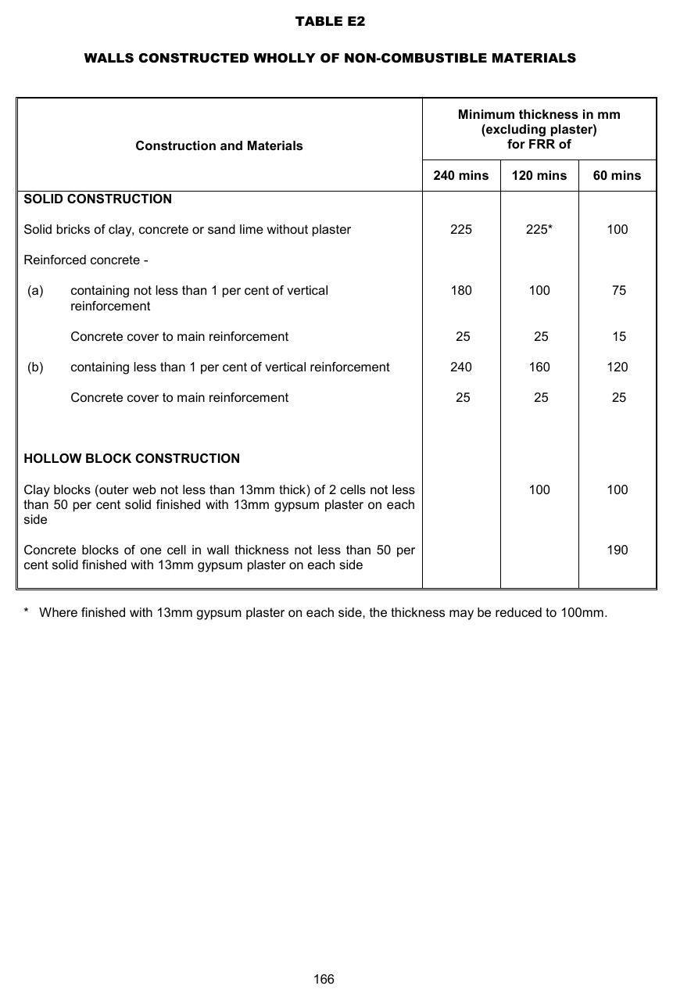
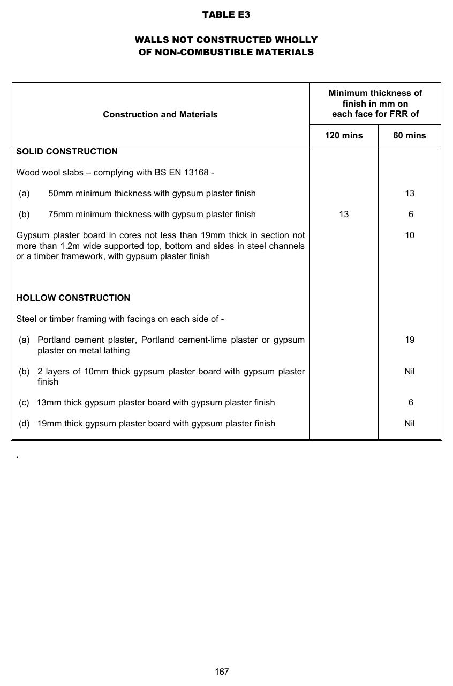
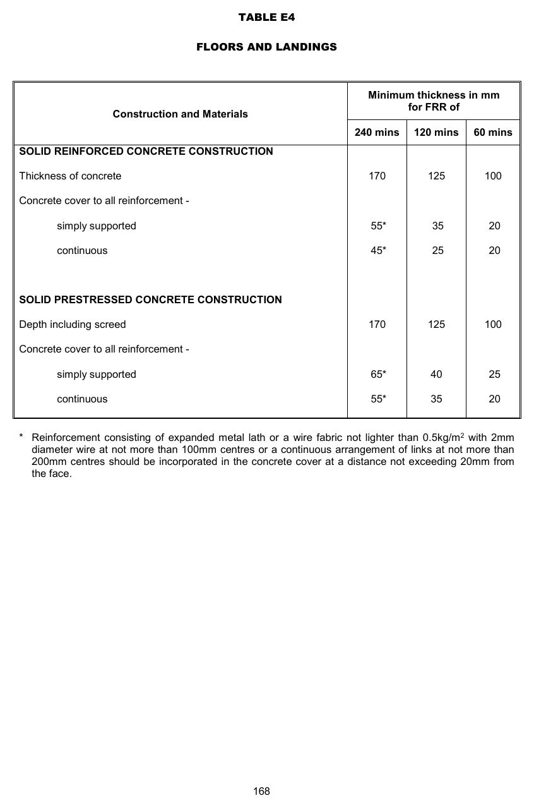
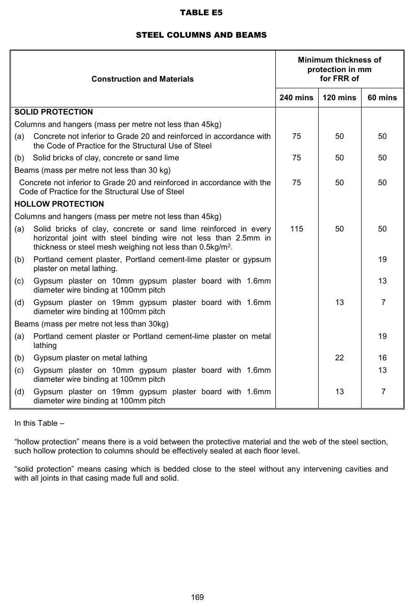
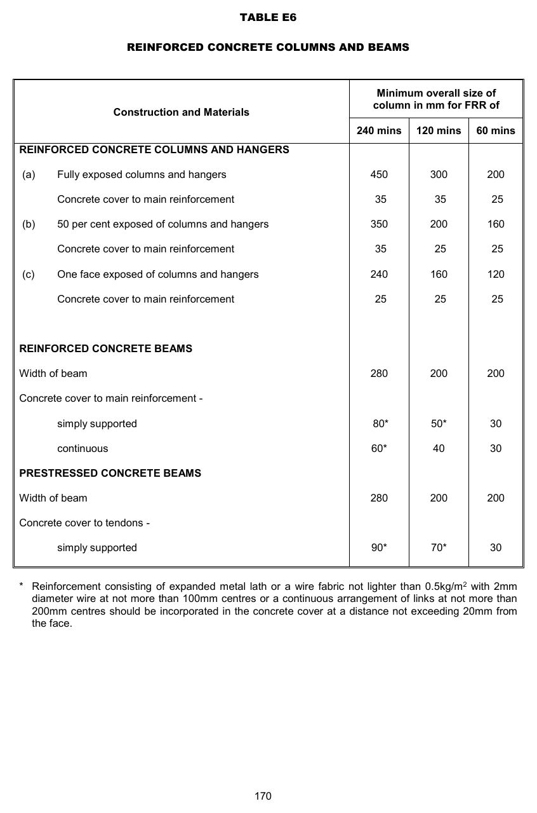
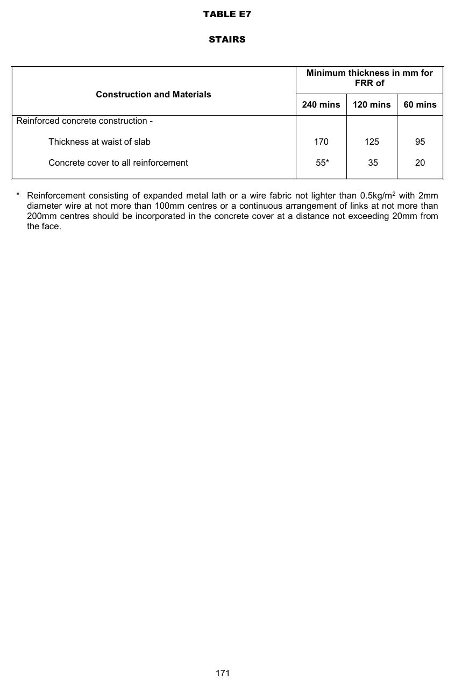

---
tags:
  - Code of Practice
  - Fire safety 消防安全
  - Fire tests 耐火測試
  - Fire safety management 消防安全管理
  - Fire engineering 消防工程
  - Fire resisting construction 耐火結構
  - Concrete & materials 混凝土及物料
  - Lift 升降機
  - Means of escape 逃生途徑
  - Site safety 地盤安全
  - Curtain wall & façade 幕牆及外牆
  - A&A works 改動及加建工程
summary: "FS Code Parts E–G: fire test standards and combustibility classes, fire safety management plans, and the fire engineering approach for alternative solutions."
keywords: FS Code Part E F G, fire properties, non-combustible, fire safety management, 消防安全管理, fire engineering, 消防工程, alternative solution
---

# FS Code 2011 Parts E, F & G: Fire Properties, Fire Safety Management, Fire Engineering <small>《2011 年建築物消防安全守則》E、F、G 部：建築構件的耐火性能、消防安全管理、消防工程</small>

!!! info "Document info 文件資料"
    | | |
    |---|---|
    | **Part of 所屬** | [Code of Practice for Fire Safety in Buildings 2011](fire-safety-code-2011.md) (2024 Edition) |
    | **Clauses 條文** | Part E: E1–E17 · Part F: F1–F7 · Part G: Sections 1–10 |
    | **Official language 官方語言** | English and Chinese 中英文版 |
    | **Source 原文** | [English (PDF)](https://www.bd.gov.hk/doc/en/resources/codes-and-references/code-and-design-manuals/fs_code2011.pdf) pp. 148–246 · [中文 (PDF)](https://www.bd.gov.hk/doc/tc/resources/codes-and-references/code-and-design-manuals/fs_code2011_c.pdf) |
    | **Last checked 最後核對** | 2026-11-20 against the 2024 Edition |

## At a glance 重點摘要 {#at-a-glance}

=== "English"

    - **Part E — Fire properties**: which **test standards** prove FRR (BS EN 1363/1364/1365/1366/1634; BS 476 still accepted until obsolete), what counts as **non-combustible** (Class **A1**) and **limited combustibility** (Class **A2-s3, d2**), the **lining classes** for protected exits (Class **C**) and institutional uses (Class **B**), accredited **testing laboratories** (HOKLAS), and **reference tables E2–E7** of standard constructions (e.g. RC wall **100 mm** for 120 min).
    - **Part F — Fire safety management**: owners engage a **competent person**; a **fire safety management plan** with a **maintenance plan**, **training plan** and **fire action plan**; housekeeping checklist **Table F1**; controls during **A&A works** and **lift replacement** (max. **3** landing doors open; hoarding **-/120/-**). The plan is **mandatory** where fire engineering is used.
    - **Part G — Fire engineering**: a framework to develop an **Alternative Solution** that meets the Part A performance requirements at a level **not inferior to the deemed-to-comply** benchmark. Covers qualitative / quantitative (deterministic / probabilistic) methods, **design fires** (e.g. sprinklered office **1.5 MW**), **tenability** (smoke layer **2 m**, visibility **10 m**, CO **1,000 ppm**, **60 °C**, radiation **2.5 kW/m²**), safety factors **1.5–2.0**, the **FSAR** contents and **Bounding Conditions** recorded on GBP, in the fire safety management plan and the DMC.

=== "中文"

    - **E 部——耐火性能**：以哪些**測試標準**證明耐火效能（BS EN 1363／1364／1365／1366／1634；BS 476 在被取代前仍可接受）；何謂**不可燃**（**A1** 級）及**有限度可燃**（**A2-s3, d2** 級）；防護出口（**C** 級）及機構用途（**B** 級）的**內襯級別**；認可**測試化驗所**（HOKLAS）；以及標準構造的**參考表 E2–E7**（例如鋼筋混凝土牆 **100 毫米**達 120 分鐘）。
    - **F 部——消防安全管理**：業主委聘**合資格人士**；**消防安全管理計劃**包括**保養計劃**、**訓練計劃**及**消防行動計劃**；**表 F1** 日常整理清單；**改動加建工程**及**更換升降機**期間的管制（最多 **3** 道升降機外門同時打開；臨時圍板 **-/120/-**）。採用消防工程方法時此計劃屬**必須**。
    - **G 部——消防工程**：制訂**另類方案**的框架，須以**不遜於「當作符合」**基準的水平符合 A 部的性能要求；涵蓋定性／定量（確定性／概率性）方法、**設計火災**（例如設花灑辦公室 **1.5 兆瓦**）、**可承受條件**（煙層 **2 米**、能見度 **10 米**、一氧化碳 **1,000 ppm**、**60 °C**、輻射 **2.5 千瓦／平方米**）、安全系數 **1.5–2.0**、**消防安全評估報告**內容，以及記錄於圖則、消防安全管理計劃及公契的**約束條件**。

---

## Part E — Fire properties of building elements and components 建築構件的耐火性能 {#part-e-fire-properties-of-building-elements-and-components}

### Test standards 測試標準

| Element 構件 | Standards (BS EN / ISO) 標準 | Legacy BS (until obsolete) 舊英國標準 | Clause 條文 |
|---|---|---|---|
| **Loadbearing** walls, floors, roofs, beams, columns, balconies, stairs 承重構件 | BS EN 1363-1; **BS EN 1365-1 to -6**; classified to BS EN 13501-2 | BS 476-20, -21 | E3 |
| **Non-loadbearing** walls, ceilings, false ceilings, raised floors 非承重構件 | **BS EN 1364-1, -2**; BS EN 1366-6 | BS 476-22 | E4 |
| **Doors, shutters, windows** in fire barriers 防火門、捲閘、窗 | **BS EN 1634-1, -2, -3**; BS EN 14600. Insulation class **I1** recommended. Doors must be **tagged/labelled** 須貼標籤 | BS 476-20, -22 | E5 |
| **Ventilation ducts** and smoke extraction ducts 風管及排煙管 | BS EN 1366-1, -8, -9 | BS 476-20, -24 | E6 |
| **Penetration and joint seals** (cables, pipes) 穿口及接縫封堵 | BS EN 1366-3, -4 (integrity only) | BS 476-20, -23 | E7 |
| **Fire and smoke dampers** 防火及防煙閘 | BS EN 1366-2; BS ISO 10294-1/2/3/5. **Certified** by a registered specialist contractor (ventilation works) 須由註冊專門承建商證明 | BS 476-20, -23, -24 | E8 |
| **Smoke-sealed doors** (leakage) 防煙門 | BS EN 1634-3; BS EN 14600; ISO 5925-1; UL 1784; AS 1530.7 | — | E9 |
| **External façades / curtain walls** 外牆／幕牆 | BS EN 1364-3, -4 (also NFPA 285, ULC-S134 as options) | — | E12 |
| **Fire-rated laminated glass** 耐火夾層玻璃 | BS EN ISO 12543 | — | E17 |

### Reaction to fire and combustibility 對火反應及可燃性

**Table E1 — European classes vs British Standard equivalents 歐洲級別與英國標準對照**

| European class 歐洲級別 | BS equivalent 英國標準對等 |
|---|---|
| **A1** | **Non-combustible** 不可燃 |
| **A2** | **Limited combustibility** 有限度可燃 |
| B | Class 0 |
| C | Class 1 |
| D | Class 3 |
| E | Class 4 |
| F | Unclassifiable / no performance determined 未能分類 |

| Requirement 規定 | Standard 標準 | Clause 條文 |
|---|---|---|
| **Non-combustible** 不可燃 | Class **A1** (BS EN 13501-1; tests BS EN ISO 1182 + ISO 1716) or BS 476-4 | E10.1 |
| **BIPV** façades / skylights 建築光伏一體化 | Min. Class **A2-s1, d0** | E10.2 |
| **Limited combustibility** 有限度可燃 | Min. Class **A2-s3, d2** | E11.1 |
| **Wall and ceiling linings, decorative finishes** 牆及天花內襯、裝修飾面 | **Protected exits** (all UCs): **Class C**. **UC 3** general areas: **Class B** or above. **UC 5a** cinemas, auditoria, theatres: **Class C** or above 防護出口 C 級；機構 B 級；電影院 C 級 | E13.1 |
| **Floor linings and coverings** 地台內襯及鋪面 | Same classes as E13.1; radiant panel test BS EN ISO 9239-1; small-scale hot-nut / pill tests 與 E13.1 相同 | E14 |
| **Acoustic / thermal insulation** in ducts and concealed spaces 風管及隱蔽地方的隔音／隔熱物料 | Reaction-to-fire tests, BS EN 13501-1 | E15 |
| **Testing authorities** 測試機構 | **HOKLAS**-accredited laboratories (or MRA partners); **HKCAS**-accredited certification bodies; test or assessment report within the accredited scope HOKLAS 認可化驗所 | E16 |

!!! quote "Clause E13.1 — Linings and decorative finishes 內襯及裝修飾面"
    Linings of internal wall and ceiling and decorative finishes in the following Use Classifications should comply with the following when tested in accordance with BS EN 13501-1:2007: (a) All Use Classifications – within protected exits, Classification C of Table E1; (b) Use Classification 3 – general accommodations (including corridors, circulation spaces and rooms) that are not forming the protected exit, Classification B or above of Table E1; (c) Use Classification 5a – within cinemas, auditoria and theatres, Classification C or above of Table E1…

    **官方中文本：** 以下用途類別的室內牆壁及天花板內襯以及裝修飾面應根據 BS EN 13501-1:2007 進行測試，並符合以下標準：(a) 所有用途類別 – 在防護出口內，表 E1 的 C 級別；(b) 用途類別 3 – 並非防護出口任何部分的其他地方（包括走廊、通道和房間），表 E1 的 B 或以上級別；(c) 用途類別 5a – 電影院、會堂和劇院內，表 E1 的 C 或以上級別。如根據英國標準進行測試，其效能應符合表 E1 的對等歐洲級別。

### Reference tables E2–E7: standard constructions 參考表 E2–E7：標準構造

**Table E2 — Walls wholly of non-combustible materials (min. thickness excl. plaster, mm) 全不可燃物料牆身（最少厚度，不計批盪）**

| Construction 構造 | 240 min | 120 min | 60 min |
|---|--:|--:|--:|
| Solid bricks (clay, concrete, sand lime), no plaster 實心磚 | 225 | 225* | 100 |
| RC, ≥ 1% vertical reinforcement 鋼筋混凝土（≥ 1% 豎向鋼筋） | **180** (cover 25) | **100** (cover 25) | **75** (cover 15) |
| RC, < 1% vertical reinforcement 鋼筋混凝土（< 1%） | 240 (cover 25) | 160 (cover 25) | 120 (cover 25) |
| Clay hollow blocks, 13 mm gypsum plaster each side 黏土空心磚 | — | 100 | 100 |
| Concrete blocks (one cell, ≥ 50% solid), plastered 混凝土空心磚 | — | — | 190 |

<small>\* 100 mm if finished with 13 mm gypsum plaster on each side. 兩面各批 13 毫米石膏可減至 100 毫米。</small>

**Table E6 — Reinforced concrete columns and beams (min. size / cover, mm) 鋼筋混凝土柱及樑（最小尺寸／保護層）**

| Element 構件 | 240 min | 120 min | 60 min |
|---|--:|--:|--:|
| Column, **fully exposed** 柱（全外露） | 450 / 35 | **300 / 35** | 200 / 25 |
| Column, **50% exposed** 柱（50% 外露） | 350 / 35 | 200 / 25 | 160 / 25 |
| Column, **one face exposed** 柱（一面外露） | 240 / 25 | 160 / 25 | 120 / 25 |
| RC beam width 鋼筋混凝土樑闊度 | 280 | 200 | 200 |
| RC beam cover: simply supported / continuous 保護層：簡支／連續 | 80* / 60* | 50* / 40 | 30 / 30 |
| Prestressed beam width / cover (simply supported) 預應力樑 | 280 / 90* | 200 / 70* | 200 / 30 |

<small>\* Supplementary reinforcement (expanded metal lath / wire fabric ≥ 0.5 kg/m², or links ≤ 200 mm c/c) within 20 mm of the face. 須於表面 20 毫米內加設補充鋼筋網。</small>

??? abstract "Tables E2–E7 original pages (walls, floors, steel, RC, stairs) 表 E2–E7 原文"
    { loading=lazy }
    { loading=lazy }
    { loading=lazy }
    { loading=lazy }
    { loading=lazy }
    { loading=lazy }

    <small>Source: FS Code 2011 (2024 Edition), Buildings Department 資料來源：屋宇署</small>

---

## Part F — Fire safety management 消防安全管理 {#part-f-fire-safety-management}

| Item 項目 | Requirement 規定 | Clause 條文 |
|---|---|---|
| Who maintains what 責任 | **Passive** provisions in common parts: under the BO. **Active** FSI: registered **FSI contractors** (Cap. 95B). **Ventilating systems**: registered specialist contractor (Cap. 123J). Owners / OC engage a **competent person** (e.g. AP) to coordinate, document and check 被動設施按《建築物條例》；主動設施由註冊消防裝置承辦商；業主委聘合資格人士 | F3.1 |
| Status 地位 | Advisory, but a fire safety management plan is **required** where a fire engineering FSAR is used, and as a **condition of s.42 modification** of B(P)R 41–41D / B(C)R 35 一般屬建議；採用消防工程或獲變通時屬必須 | F4.1 |
| **Fire safety management plan** 消防安全管理計劃 | (a) **Maintenance plan**, (b) **training plan**, (c) **fire action plan**. Kept in the management office; AP helps compile it (GBP with exit routes, FSI plans). **Bounding Conditions** and the final FSAR included; Bounding Conditions also in the **DMC** 保養、訓練、消防行動計劃；約束條件納入公契 | F4.2–F4.5 |
| Maintenance plan 保養計劃 | GBP with exit routes highlighted; specifications; maintenance periods; method statements; repair methods; records; housekeeping; final FSAR 圖則、規格、保養周期、紀錄等 | F5.1 |
| UBW and enforcement 僭建及執法 | Regular inspection for UBW, change of use, blocked exits. Blocking or locking MoE is an offence under Cap. 95F; schools must hold **fire drills every 6 months** (Cap. 279A) 阻塞逃生途徑屬違法；學校每 6 個月演習 | F5.4 |
| Housekeeping 日常整理 | Keep exits and temporary refuge spaces clear, control combustibles; sample checklist **Table F1** (MoE, fire-resisting construction, FSI…) 保持出口暢通；表 F1 清單 | F5.5 |
| During A&A / renovation 改動加建期間 | Maintain MoE, fire doors closed, fire barriers intact; alternative measures if removed temporarily; **flame-retardant scaffold sheeting**; safe storage of combustibles; notify FSD of FSI shut-down 保持逃生途徑；棚架用阻燃保護網 | F5.6 |
| **Lift maintenance / replacement** 升降機保養／更換 | Landing doors normally closed. Normally ≤ **1** open per liftwell (attended); max. **3** at once with no hot works. More than one door removed → temporary hoarding **-/120/-**, vents ≤ **5,500 mm²** each (≤ 2 per liftway, ≤ 4 in total), self-closing access door; non-combustible temporary works 升降機外門最多 3 道同時打開；圍板 -/120/- | F5.7 |
| Open kitchens 開放式廚房 | C13.4 conditions written into the fire safety management plan and DMC 條件納入管理計劃及公契 | F5.8 |
| Training and fire action plans 訓練及消防行動計劃 | Staff training on FSI use; evacuation procedures, drills, roles 員工訓練；疏散程序 | F6–F7 |

!!! quote "Clause F4.5 — Contents of the plan 計劃內容"
    The fire safety management plan should include the following: (a) maintenance plan, (b) training plan, and (c) fire action plan as detailed in Sections 3, 4 and 5 respectively.

    **官方中文本：** 消防安全管理計劃應包括以下內容：(a) 保養計劃；(b) 訓練計劃；及 (c) 消防行動計劃。詳情分別載於第 3、4 及 5 章。

---

## Part G — Guidelines on fire engineering 消防工程指引 {#part-g-guidelines-on-fire-engineering}

### Framework 框架

1. **Fire safety objectives** 消防安全目標: protect occupants' lives; minimise fire spread between compartments; prevent collapse; facilitate firefighting and rescue.
2. **Functional statements** 功能說明 (e.g. B(P)R 41(1)) → **performance requirements** 性能要求 (Part A, e.g. B1–B7) → **guidance** (G2.3 checklists) → **demonstrate compliance**: deemed-to-comply, an **Alternative Solution**, or a combination (G2.2).
3. **Level of safety**: the BA normally accepts performance **not inferior to the deemed-to-comply provisions**, which are the benchmark. "Zero risk" is not the aim (G2.1). 安全水平不遜於「當作符合」條文。

| Topic 主題 | Key points 要點 | Clause 條文 |
|---|---|---|
| Methods 方法 | **Qualitative** (engineering judgement vs DTC) or **quantitative**: **deterministic** (fire scenarios, timeline, fire/smoke and evacuation models) or **probabilistic** (risk = likelihood × consequence) 定性或定量（確定性／概率性） | G4.3 |
| Safety factors 安全系數 | Typically **1.5–2.0** for normal scenarios; may be reduced if verified by **single system failure** analysis; AP must justify 一般 1.5–2.0 | G3.4 |
| Process 程序 | Early **pre-submission enquiry** recommended; assessment approaches; FSAR with GBP 建議呈交前查詢 | G6.1–G6.4 |
| **Design fires** 設計火災 (Table G1) | Sprinklered (standard response): hotel room / hospital (3 m headroom) **1.7 MW**; office / retail / assembly (2.5 m) **1.5 MW**; detention (2.5 m) 1.5 MW; industrial / warehouse (3.5 m) **2.0 MW**; plant room (3 m) 1.7 MW; train **5–22 MW**. Non-sprinklered retail: QU = fuel load ÷ 1,200 s 設花灑辦公室 1.5 兆瓦等 | G6.5 |
| Occupant movement 人員疏散 | Pre-movement times (Table G2, from PD 7974-6), travel and queuing times 疏散前時間 | G6.7 |
| **Tenability criteria** 可承受條件 | **Smoke layer height 2 m** (unless justified); **radiation 2.5 kW/m²**; **CO ≤ 1,000 ppm**; **visibility: optical density ≤ 0.1 m⁻¹ (10 m)**; **smoke temperature ≤ 60 °C** if the layer falls below the acceptable height 煙層 2 米、輻射 2.5、一氧化碳 1,000 ppm、能見度 10 米、60 °C | G6.8 |
| **FSAR** 消防安全評估報告 | Introduction; building and use classification; **code compliance** (DTC not met, Alternative Solutions, performance requirements); technical justification (acceptance criteria, methods, tools, fire scenarios, safety factor); trial design (active, passive, management, MoE, smoke control, structure, sprinklers, alarms, firefighting facilities); structural performance; commissioning; maintenance 報告內容 | G7 |
| **Bounding Conditions** 約束條件 | Fire safety provisions that **must be maintained**; if altered, the design is **invalidated**. AP drafts the list with the GBP; the final list goes on the **approved GBP, the fire safety management plan and the DMC**; checked **at least annually**. Examples: no. of floors, use, non-compliances, max. population, travel distance, staircase number/width, fire load density, compartment limits, FRR, finishes, installed FSI 必須維持的消防設施；記錄於圖則、管理計劃及公契；每年最少核對一次 | G8 |
| Computer models 電腦模型 | Zone / CFD fire models and evacuation models; validate and justify inputs 區域／計算流體力學模型 | G9 |

!!! quote "Clause G8.1 — Bounding Conditions 約束條件"
    "Bounding Conditions" is defined in Part A meaning a set of fire safety provisions that must be maintained as a result of a performance-based approach to the fire safety design and that if altered will invalidate the performance-based fire safety design.

    **中譯（非官方，術語依官方中文本）：** 「約束條件」在 A 部的定義，是指因採用性能為本方法進行消防安全設計而必須維持的一組消防安全設施；如有改動，該性能為本的消防安全設計即告失效。

!!! quote "Clause G6.8 — Smoke layer height 煙層高度"
    2m should be adopted as the acceptable smoke layer height unless otherwise justified by the authorized person.

    **官方中文本：** 除非認可人士有其理據，否則應採用 2 米作為可接受的煙霧層高度。

---

## Explanation 淺白解釋 {#explanation}

=== "English"

    These three Parts back up Parts B–D:

    - **Part E** answers **"how do I prove it?"**: which fire tests, which classes, which laboratories. The **tables E2–E7** are a quick way to pick a construction (e.g. a 100 mm RC wall with ≥ 1% steel gives 120 min). Linings in **escape routes** must be at least **Class C** so they do not feed a fire along the route.
    - **Part F** answers **"how do we keep it working?"**: fire safety provisions fail through neglect, UBW, wedged-open fire doors and blocked exits. A written plan, a competent person and housekeeping checks keep them working, especially during renovation and lift works.
    - **Part G** answers **"what if the prescriptive rules don't fit?"**: for large, unusual buildings (airports, malls, atria, stadia), use **fire engineering** to show an equivalent level of safety. The design is only valid while its **Bounding Conditions** stay unchanged, so they are written into the plans, the management plan and the DMC.

=== "中文"

    這三部分支援 B–D 部：

    - **E 部**回答**「如何證明？」**：用哪些耐火測試、哪個級別、哪些化驗所。**表 E2–E7** 可快速選擇構造（例如 ≥ 1% 鋼筋的 100 毫米鋼筋混凝土牆可達 120 分鐘）。**逃生路線**內的內襯最少須達 **C 級**，以免沿路線助長火勢。
    - **F 部**回答**「如何保持有效？」**：消防設施往往因疏於保養、僭建、防火門被頂開及出口被阻塞而失效；書面計劃、合資格人士及日常整理檢查可保持其有效，特別是裝修及升降機工程期間。
    - **G 部**回答**「如規範條文不適用怎麼辦？」**：大型或特殊建築物（機場、商場、中庭、體育館）可用**消防工程**證明同等安全水平；但設計只在**約束條件**不變時才有效，因此須記錄於圖則、管理計劃及公契。

## Practical notes 實務提示 {#practical-notes}

=== "English"

    !!! tip "Common pitfalls"
        - Fire test reports from **non-accredited** labs, or tests **outside the lab's accredited scope** (E16).
        - **Combustible decorative panels** in lift lobbies and staircases that form protected exits. These need **Class C** or better.
        - Fire doors **without tags or labels** (E5.3), or replaced with lower-FRR doors (Table F1 item 2.3).
        - Fire-engineered buildings where later **A&A works change the Bounding Conditions** (e.g. more occupants, extra fire load) without re-assessment.
        - Lift modernisation with **several landing doors removed** and no -/120/- hoarding (F5.7).

=== "中文"

    !!! tip "常見錯誤"
        - 耐火測試報告來自**非認可**化驗所，或測試**超出**化驗所的認可範圍（E16）。
        - 構成防護出口的升降機大堂及樓梯使用**可燃裝飾板**：須達 **C 級**或以上。
        - 防火門**沒有標籤**（E5.3），或被換成較低耐火效能的門（表 F1 第 2.3 項）。
        - 採用消防工程的建築物，其後**改動加建改變了約束條件**（例如增加人數或火警負荷）而沒有重新評估。
        - 升降機更新工程**拆除多道外門**而沒有 -/120/- 圍板（F5.7）。

<!-- APSEC START -->
## APSEC clarifications 認可人士及註冊結構工程師委員會討論 {#apsec-clarifications}

BD's responses at the APSEC Discussion Forum that clarify this document, **newest first**. Where the same question came up more than once, only the **latest position** is listed. See [all APSEC items](../apsec/index.md). 屋宇署在討論會上就本文件作出的澄清，新者在前；同一問題只列最新立場。

- **[Fire Rated Access Panel](../apsec/2025.md#i202505091)** <small>ADF 2/2025, 9 May 2025</small> BD advised that according to Clause 9.3(d) of the Code of Practice for Fire Safety in Buildings 2011 (2024 Edition) (FS Code), any access openings in pipe duct enclosures within protected exits should be provided with a fire rated door having the requisite fire resistance rating (FRR). …
- **[Internal Lining for Smoke Outlets](../apsec/2025.md#i2025021412)** <small>ADF 1/2025, 14 Feb 2025</small> BD advised that where a smoke outlet serving a basement extended into or through another storey, it should be fire rated or be protected with a fire rated enclosure according to Clause C14.4 of the FS Code. Such material should be tested in accordance Part E of the FS Code including Clause E6.1. …
- **[Fire Safety Management Plan for Open Kitchen of Single Family House](../apsec/2020.md#i202011266)** <small>ADF 4/2020, 26 Nov 2020</small> BD advised that the fire safety provisions for open kitchen should be incorporated into the fire safety management plan and DMC, where applicable, under Clause F5.8 of FS Code 2011.
- **[Adopting Performance-based Approach in FS Code 2011 for Innovative Building Design](../apsec/2018.md#i201805254)** <small>ADF 3/2018, 25 May 2018</small> BD advised that they would favourably consider accepting performance-based approach by fire engineering as an Alternative Solution to prescriptive approach on case merits. To streamline the approval process, pre-submission enquiry could be made to ascertain critical issues/comments from relevant government departments.

<!-- APSEC END -->

## Related 相關文件 {#related}

| Document 文件 | Relationship 關係 |
|---|---|
| [FS Code 2011 overview](fire-safety-code-2011.md) | Part A use classes and performance requirements 用途類別及性能要求 |
| [Part B](fsc-part-b-means-of-escape.md), [Part C](fsc-part-c-fire-resisting-construction.md), [Part D](fsc-part-d-means-of-access.md) | Deemed-to-comply provisions tested / maintained / engineered here 本部所測試、保養及以工程方法處理的條文 |
| [APP-2](../pnap/app-2.md) | Curtain walls and cladding (E12, C10.2) 幕牆及覆蓋層 |
| [ADM-2](../pnap/adm-2.md) | FSI proposals referral (Appendix B) 消防裝置建議轉交 |
| Code of Practice for Minimum FSI and Equipment / Inspection, Testing and Maintenance | Active fire safety provisions 主動消防設施 |

---
<small>Prepared by: _[name]_ · Checked by: _[name]_ · Quotes from the official English and Chinese versions; refer to the Code for the definitive text.</small>
