---
tags:
  - Code of Practice
  - MBIS 強制驗樓
  - MWIS 強制驗窗
  - Statutory period 法定期限
  - Registration 註冊
  - Fire safety 消防安全
  - Drainage 排水
  - Structural 結構
  - Curtain wall & façade 幕牆及外牆
  - Unauthorised building works 違例建築工程
  - Site supervision 地盤監督
summary: "MBIS and MWIS: what is inspected, the RI and QP duties and the form deadlines."
keywords: MBIS, MWIS, 強制驗樓, 強制驗窗, registered inspector, 註冊檢驗人員, qualified person, MBI 1, WI 1
---

# Code of Practice for the Mandatory Building Inspection Scheme and the Mandatory Window Inspection Scheme 2012 <small>《2012 年強制驗樓計劃及強制驗窗計劃作業守則》</small>

!!! info "Document info 文件資料"
    | | |
    |---|---|
    | **Edition 版本** | 2012 (2023 Edition), incorporating later amendments |
    | **Legal basis 法律依據** | Guidance for [BO Part 2A (s.30A–30F)](../regulations/bo-part-2a-inspection.md) and the [B(I&R)R Cap. 123P](../regulations/bir-123p.md) 配合條例第 2A 部及第 123P 章 |
    | **Source 原文** | [English (PDF)](https://www.bd.gov.hk/doc/en/resources/codes-and-references/code-and-design-manuals/CoP_MBIS_MWISe.pdf) |
    | **Last checked 最後核對** | 2026-11-21 |

## At a glance 重點摘要 {#at-a-glance}

=== "English"

    - **Part I MBIS**: what the **Registered Inspector (RI)** inspects (external and other physical elements, structure, **fire safety**, **drainage**, **UBW** in common parts and the exterior), when a **detailed investigation** is needed, repair methods, supervision, and the inspection and completion reports.
    - **Part II MWIS**: duties of the **Qualified Person (QP)** and the registered contractor for windows: inspection items, repair standards and certification.
    - Owners are served notices under the BO (buildings aged **30+** for MBIS, **10+** for MWIS; see [BO Part 2A](../regulations/bo-part-2a-inspection.md)). The Code says **how** the inspection and repair are done.
    - Most notices to the BA are due **within 7 days**; completion certificates **within 14 days**.

=== "中文"

    - **第 I 部 強制驗樓**：**註冊檢驗人員**須檢驗的項目（外部及其他實體構件、結構、**消防安全**、**排水**、公用部分及外部的**僭建物**）、何時須**詳細勘測**、修葺方法、監督，以及檢驗及完工報告。
    - **第 II 部 強制驗窗**：**合資格人士**及註冊承建商的窗戶檢驗及修葺職責與證明。
    - 業主按條例接獲通知（強制驗樓：樓齡 **30 年**或以上；強制驗窗：**10 年**或以上；見[條例第 2A 部](../regulations/bo-part-2a-inspection.md)），本守則說明**如何**進行檢驗及修葺。
    - 大部分通知須於 **7 天**內呈交建築事務監督；完工證明書須於 **14 天**內呈交。

## MBIS timeline 強制驗樓時序 {#mbis-timeline}

<figure markdown>
  { width="760" loading=lazy }
  <figcaption>RI appointment, inspection, repair and completion (Code s.2.1). 註冊檢驗人員委任、檢驗、修葺及完工。</figcaption>
</figure>

| Step 步驟 | Form 表格 | Time limit 時限 |
|---|---|---|
| Notify appointment as RI 通知委任 | **MBI 1** | Within **7 days** of appointment |
| Nominate a stand-in RI (and its end) 提名代任 | **MBI 2** | Within **7 days** |
| RI ceases to act 停止擔任 | Letter | Within **7 days** |
| Appoint a representative to supervise repair 委任代表 | Letter | At least **7 days before** |
| Detailed investigation 詳細勘測 | Proposal for endorsement | Before the investigation |
| **Inspection report** and certificate 檢驗報告 | **MBI 3 / 3a** | To the owner **within 7 days** of the inspection; to a different supervising RI within **2 months** or before repair starts |
| Revised repair proposal 修訂修葺建議 | Proposal | Within **7 days** of the new matter |
| **Completion report** and certificate 完工報告 | **MBI 4** | Within **14 days** of repair completion |

## MWIS time limits 強制驗窗時限 {#mwis-time-limits}

| Case 情況 | Form 表格 | Time limit 時限 |
|---|---|---|
| No repair needed 毋須修葺 | **WI 1** | Within **14 days** of inspection |
| Same QP inspects and supervises repair 同一人士檢驗及監督 | **WI 1** | Within **14 days** of repair |
| QP for inspection only 只負責檢驗 | **WI 2** + report | Within **7 days** of inspection; to the repair QP within **1 month** |
| QP for repair only 只負責修葺 | **WI 3** | Within **14 days** of repair; revised proposal within 7 days |

## What the RI inspects 檢驗範圍 (Code s.3) {#what-the-ri-inspects-code-s3}

| Element 項目 | Examples 例子 |
|---|---|
| External and other physical elements 外部及其他實體構件 | Rendering, tiles, cladding, curtain walls, windows, fins, **A/C supports**, signboards, canopies, **metal grilles** |
| Structure 結構 | Spalling, cracks, exposed or corroded reinforcement, deflection, settlement |
| **Fire safety** 消防安全 | Means of escape (exits, **fire doors**, obstructions), means of access, fire resisting construction |
| **Drainage** 排水 | Soil, waste and rainwater pipes, underground drains, manholes; leakage, blockage |
| **UBW** 違例建築工程 | In common parts, on the exterior (walls, roofs, podiums, yards, slopes) and on the street |

<small>The Code also gives repair methods (s.5), safety and security measures during works (s.6), and report contents (s.7). 另有修葺方法、施工安全及報告內容。</small>

## Related 相關文件 {#related}

[BO Part 2A](../regulations/bo-part-2a-inspection.md) · [B(I&R)R Cap. 123P](../regulations/bir-123p.md) · [APP-37 windows](../pnap/app-37.md) · [FS Code](fire-safety-code-2011.md) · [Minor works guide](../guides/minor-works.md)
