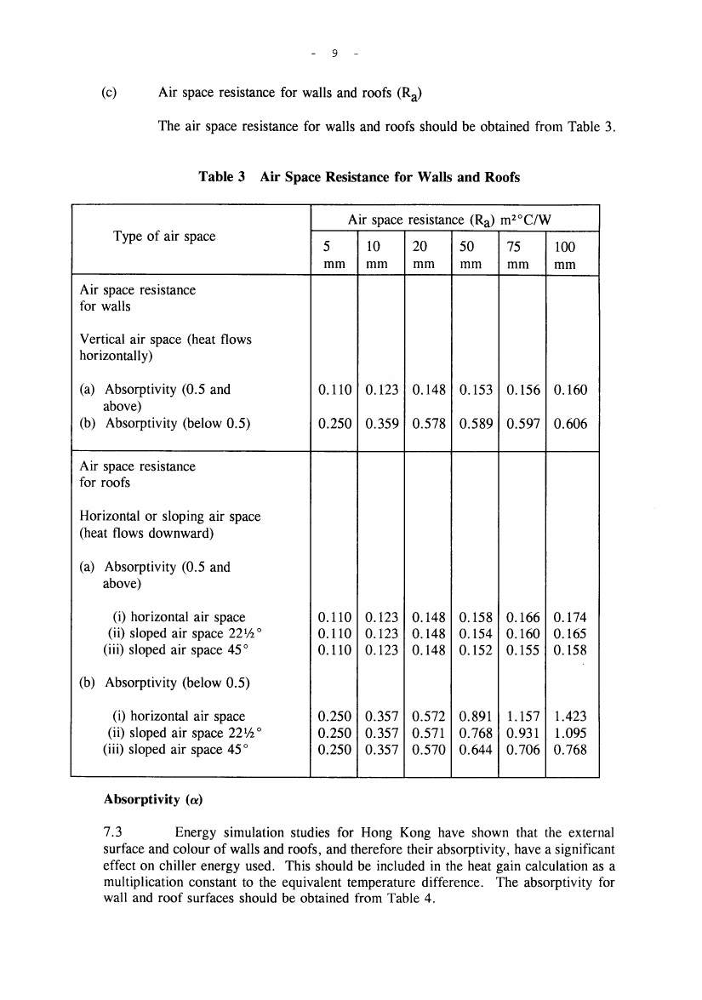
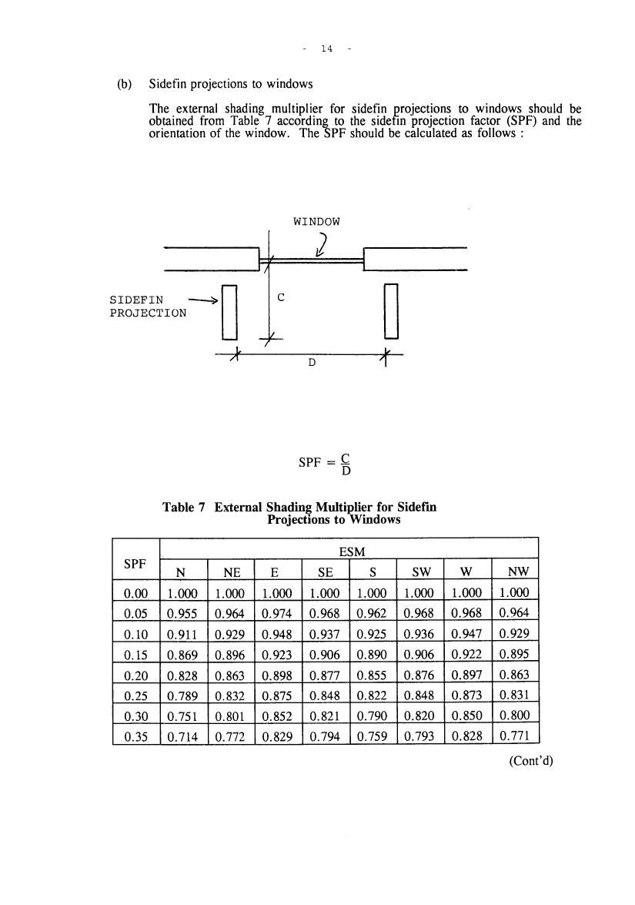
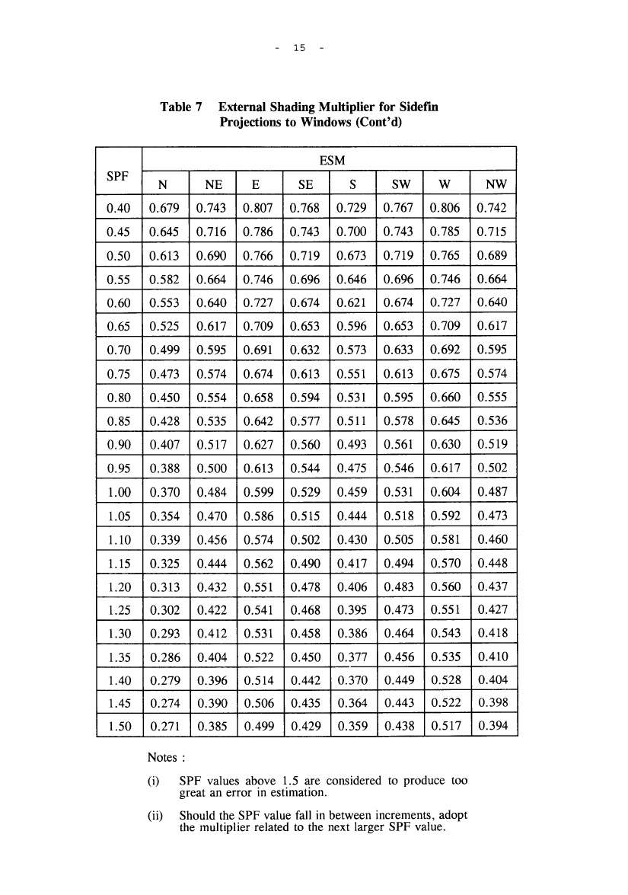

---
tags:
  - Code of practice 作業守則
  - Energy efficiency 能源效率
  - RTTV / OTTV 熱傳送值
  - Commercial 商業
  - Plan submission & approval 呈交及審批
  - Concrete & materials 混凝土及物料
  - Curtain wall & façade 幕牆及外牆
  - Refuge floor 庇護層
  - Hotel 酒店
summary: "OTTV Code 1995 in full for commercial buildings and hotels: wall and roof formulas, Tables 1–9 (k, film and air resistance, absorptivity, TDEQ, ESM, solar factor), exclusions, forms OTTV1–4, with current APP-67 limits (tower 20, podium 40 W/m²) and a calculator."
keywords: OTTV, 總熱傳送值, Code of Practice for OTTV 1995, TDEQ, ESM, solar factor, shading coefficient, B(EE)R, APP-67, tower 20 W/m2, podium 40 W/m2
---

# Code of Practice for Overall Thermal Transfer Value in Buildings 1995<br><small>《1995 年建築物的總熱傳送值守則》</small>

!!! info "Document info 文件資料"
    | | |
    |---|---|
    | **Issued 發出** | Building Authority, **April 1995** (84 pp., scanned) |
    | **Source 原文** | [PDF](https://www.bd.gov.hk/doc/en/resources/codes-and-references/code-and-design-manuals/OTTV1995_e.pdf) |
    | **Legal basis 法律依據** | [B(EE)R Cap. 123M](../regulations/beer-123m.md) s.4: compliance with this Code is **deemed** to give a suitable OTTV |
    | **Applies to 適用** | **Commercial buildings and hotels** (B(EE)R Schedule); residents' clubhouses via [APP-156](../pnap/app-156.md). Residential: [RTTV Guidelines](rttv-2014.md) |
    | **Current limits 現行限值** | [APP-67](../pnap/app-67.md) |
    | **Last checked 最後核對** | 2026-11-23 (text from OCR of the scanned code; check figures against the PDF) |

!!! danger "Limits in the 1995 Code are superseded 1995 年守則的限值已被取代"
    Code §3.1 says tower **35** and podium **80 W/m²**. These were tightened by PNAP to 21 / 50 and, for plans submitted **on or after 31 Dec 2025**, [APP-67](../pnap/app-67.md) para. 3 requires **tower ≤ 20 W/m²** and **podium ≤ 40 W/m²**. The calculation method below is unchanged. 計算方法不變，限值以 APP-67 為準：大廈 20、平台 40 瓦／平方米。

## Jump to 快速跳轉 {#jump}

| Topic 主題 | Section 章節 |
|---|---|
| Limits, tower vs podium 限值 | [Limits](#limits) |
| What to include / exclude 計算範圍 | [Inclusions](#inclusions) |
| **Wall formula** 外牆公式 | [OTTV<sub>w</sub>](#ottv-wall) |
| **Roof formula** 屋頂公式 | [OTTV<sub>r</sub>](#ottv-roof) |
| U-value, Tables 1–3 | [U-value](#u-value) |
| Absorptivity, Table 4 | [Absorptivity](#absorptivity) |
| **TD<sub>EQ</sub> walls, Table 5** | [TDEQ walls](#tdeq-wall) |
| Shading SC / ESM, Tables 6–7 | [Shading](#shading) |
| **Solar factor, Table 8** | [Solar factor](#solar-factor) |
| TD<sub>EQ</sub> roofs, Table 9 | [TDEQ roofs](#tdeq-roof) |
| Doors, submissions, forms | [Submissions](#submissions) |
| OTTV vs RTTV | [Comparison](#comparison) |
| **Calculator** | [OTTV wall calculator](#calculator) |

## Limits (§3, APP-67) 限值 {#limits}

| Part 部分 | Code 1995 | **Current (APP-67, plans from 31 Dec 2025)** |
|---|---|---|
| **Building tower** (above the podium) 大廈 | 35 W/m² | **≤ 20 W/m²** (previously 21) |
| **Podium** 平台 | 80 W/m² | **≤ 40 W/m²** (previously 50) |

- Limits apply to the **overall envelope average** (all walls and roofs of the tower, or of the podium), not to each wall (§3.2). 整體平均。
- **Podium** (§2) = part within **15 m** above ground (or the height permitted under B(P)R 20(3) / s.42 modification where SC exceeds the permitted %). For varying SC under [APP-132](../pnap/app-132.md), podium may be taken notionally as **20 m** above mean street level (APP-67 para. 4). 平台一般為地面以上 15 米內。
- Report to **two decimal places** (§9.2).

## What is included (§4) 計算範圍 {#inclusions}

| Include 計入 | Exclude 不計 |
|---|---|
| All external walls and roofs of the tower and podium 所有外牆及屋頂 | (a) External walls of a **refuge floor** 庇護層外牆 |
| **Party walls**, whether or not an adjoining building exists; shading from adjoining buildings ignored (§4.2) 共用牆照計 | (b) Walls and roofs of **car-parking floors** 停車場樓層 |
| | (c) Walls of a **lightwell ≤ 21 m²** on plan 不超過 21 平方米的天井 |
| | (d) Any wall **on a roof** (e.g. parapets, plant enclosures) 屋頂上的牆 |
| | G/F **open-front shops ≤ 50 m²** UFA with separate A/C (APP-67 para. 6) 地面開放式店舖 |

Also not addressed: internal blinds; reflection / shading from adjacent buildings (§1.8). Envelope assumed fully enclosed (§1.7).

## OTTV of external walls (§5) 外牆總熱傳送值 {#ottv-wall}

```text
OTTVw = [ (Aw × U × α × TDEQw) + (Afw × SC × ESM × SF) ] / Aow
```

| Symbol | Meaning 意思 | Table |
|---|---|---|
| A<sub>w</sub> | Area of opaque wall (m²) 實牆面積 | — |
| U | U-value of opaque wall (W/m²°C) | [§7.1](#u-value) |
| α | Absorptivity 吸收率 | [Table 4](#absorptivity) |
| TD<sub>EQw</sub> | Equivalent temperature difference for wall (°C) 等效溫差 | [Table 5](#tdeq-wall) |
| A<sub>fw</sub> | Area of fenestration (m²) 窗面積 | — |
| SC | Shading coefficient of glass 玻璃遮陽系數 | [§7.5](#shading) |
| ESM | External shading multiplier 外遮陽乘數 | [Tables 6–7](#shading) |
| SF | Solar factor, vertical (W/m²) 太陽系數 | [Table 8](#solar-factor) |
| A<sub>ow</sub> | Gross wall area = A<sub>w</sub> + A<sub>fw</sub> | — |

Sum the heat gains of every façade element (Form OTTV 3 per façade, Form OTTV 4 for the building) and divide by the total gross area. 各立面熱增益相加後除總面積。

## OTTV of roofs (§6) 屋頂總熱傳送值 {#ottv-roof}

```text
OTTVr = [ (Ar × U × α × TDEQr) + (Afr × SC × SF) ] / Aor
```

A<sub>r</sub> opaque roof, A<sub>fr</sub> rooflights, SF horizontal = **264 W/m²**, TD<sub>EQr</sub> from [Table 9](#tdeq-roof), A<sub>or</sub> = A<sub>r</sub> + A<sub>fr</sub>. No ESM for rooflights.

## U-value (§7.1–7.2, Tables 1–3) 熱傳送系數 {#u-value}

```text
U = 1 / ( Ri + x1/k1 + x2/k2 + … + xn/kn + Ra + Ro )
```

**Table 1 – Thermal conductivity** (k, W/m°C; density kg/m³ needed for TD<sub>EQ</sub>)

| Material 物料 | Density | k |
|---|---|---|
| Asphalt, mastic with 20 % grit | 2 350 | 1.15 |
| Cork board / hardboard HD / mineral fibre board / plasterboard | 145 / 1 010 / 265 / 950 | 0.042 / 0.144 / 0.053 / 0.16 |
| Brick (common) | 1 760 | 0.95 |
| Concrete, normal weight 混凝土 | **2 400** | **2.16** |
| Concrete, lightweight / flat roof tiles or slabs | 1 300 / 2 100 | 0.44 / 1.10 |
| Glass 玻璃 | 2 500 | 1.05 |
| Mosaic tile cladding | — | 1.5 |
| Glass fibre / mineral wool / EPS / PU foam | 32 / 50 / 25 / 30 | 0.035 / 0.039 / 0.034 / 0.026 |
| Aluminium / copper / carbon steel | 2 800 / 8 900 / 7 800 | 160 / 200 / 50 |
| Gypsum plaster / gypsum-sand / cement-sand render | 1 120 / 1 570 / 1 860 | 0.38 / 0.53 / 0.72 |
| Screed cement-sand / terrazzo | 1 860 / 2 435 | 0.72 / 1.59 |
| Granite / marble | 2 650 / 2 500 | 2.9 / 2.0 |

<small>Brick and mosaic densities: check the PDF (OCR uncertain). 磚及紙皮石密度請核對原文。</small>

**Table 2 – Surface film resistance (m²°C/W)** — unlike RTTV, the internal value depends on **absorptivity**:

| Surface | α ≥ 0.5 | α < 0.5 |
|---|---|---|
| Wall internal R<sub>i</sub> | 0.120 | **0.299** |
| Wall external R<sub>o</sub> | 0.044 | 0.044 |
| Roof internal R<sub>i</sub>, flat / 22½° / 45° | 0.162 / 0.148 / 0.133 | **0.801 / 0.595 / 0.391** |
| Roof external R<sub>o</sub> | 0.055 | 0.055 |

**Table 3 – Air space resistance**: see the original page below (same structure as the RTTV Table 3). 空氣層熱阻見下圖。

<figure markdown>
  { width="560" loading=lazy }
  <figcaption>Table 3 – Air space resistance. Source: BD, OTTV Code 1995.</figcaption>
</figure>

## Absorptivity (Table 4) 吸收率 {#absorptivity}

| Material 物料 | α | Paint 油漆 | α |
|---|---|---|---|
| Black glass | 1.0 | Optical flat black | 0.98 |
| Black concrete | 0.91 | Flat black | 0.95 |
| Stafford blue brick | 0.89 | Black lacquer | 0.92 |
| Red brick / bituminous felt | 0.88 | Dark grey; dark blue lacquer | 0.91 |
| Blue grey slate | 0.87 | Black oil paint | 0.90 |
| Roofing, green | 0.86 | Dark olive drab | 0.89 |
| Brown concrete | 0.85 | Azure blue / dark green lacquer; dark brown; dark blue-grey | 0.88 |
| Asphalt pavement, weathered | 0.82 | Medium brown | 0.84 |
| Wood, smooth | 0.78 | Medium light brown | 0.80 |
| **Uncoloured concrete** | **0.65** | Brown or green lacquer | 0.79 |
| White marble / white mosaic tiles | 0.58 | Medium rust | 0.78 |
| Light buff brick | 0.55 | Light grey oil | 0.75 |
| Built-up roof, white | 0.50 | Red oil | 0.74 |
| Bituminous felt, aluminised | 0.40 | Medium dull green | 0.59 |
| Gravel | 0.29 | Medium orange / yellow | 0.58 / 0.57 |
| White on galvanised iron | 0.26 | Medium blue; medium kelly green | 0.51 |
| White glazed brick | 0.25 | Light green | 0.47 |
| Polished aluminium reflector sheet | 0.12 | Aluminium paint | 0.40 |
| Aluminised mylar film | 0.10 | White semi-gloss | 0.30 |
| Tinned surface | 0.05 | White gloss; silver | 0.25 |
| | | White lacquer | 0.21 |
| | | Laboratory vapour deposited coatings | 0.02 |

## Equivalent temperature difference, walls (Table 5) 外牆等效溫差 {#tdeq-wall}

Heavier walls perform better (§7.4). Density = mass per m² of the composite wall. 牆越重表現越好。

| Orientation | < 22 kg/m² | 23–199 | 200–379 | 380–569 | ≥ 570 kg/m² |
|---|---|---|---|---|---|
| N | 3.70 | 3.38 | 2.72 | 2.05 | 1.70 |
| NNE | 4.65 | 4.21 | 3.30 | 2.36 | 1.88 |
| NE | 5.60 | 5.03 | 3.86 | 2.67 | 2.05 |
| ENE | 6.55 | 5.86 | 4.44 | 2.98 | 2.23 |
| **E** | **7.50** | 6.68 | 5.01 | 3.28 | 2.40 |
| ESE | 7.05 | 6.26 | 4.65 | 3.00 | 2.15 |
| SE | 6.60 | 5.85 | 4.30 | 2.71 | 1.90 |
| SSE | 6.15 | 5.43 | 3.95 | 2.43 | 1.65 |
| S | 5.70 | 5.01 | 3.60 | 2.15 | 1.40 |
| SSW | 6.15 | 5.42 | 3.92 | 2.37 | 1.58 |
| SW | 6.60 | 5.82 | 4.23 | 2.59 | 1.75 |
| WSW | 6.55 | 5.81 | 4.29 | 2.73 | 1.93 |
| W | 6.50 | 5.79 | 4.35 | 2.86 | 2.10 |
| WNW | 5.80 | 5.19 | 3.94 | 2.66 | 2.00 |
| NW | 5.10 | 4.59 | 3.54 | 2.45 | 1.90 |
| NNW | 4.40 | 3.98 | 3.13 | 2.25 | 1.80 |

<small>Example: 200 mm normal-weight concrete ≈ 0.2 × 2 400 = 480 kg/m² → 380–569 column. Illustrative only 只作說明。</small>

## Shading (§7.5–7.6, Tables 6–7) 遮陽 {#shading}

- **SC**: manufacturer's value at normal incidence, used without modification (§7.5).
- **Overhang**: OPF = A / B; **side-fin**: SPF = C / D. Between increments take the **next larger** factor; OPF max **1.0**, SPF max **1.5**.
- **Overhang + side-fin**: use the **smaller** of the two ESMs (§7.6(c)) — RTTV instead multiplies them. OTTV 取較小值；RTTV 取乘積。

**Table 6 – ESM for overhangs** (S, E and W combined)

| OPF | N | NE/NW | S/E/W | SE/SW |
|---|---|---|---|---|
| 0.00 | 1.000 | 1.000 | 1.000 | 1.000 |
| 0.05 | 0.975 | 0.969 | 0.962 | 0.962 |
| 0.10 | 0.951 | 0.939 | 0.926 | 0.926 |
| 0.15 | 0.928 | 0.909 | 0.890 | 0.890 |
| 0.20 | 0.905 | 0.880 | 0.856 | 0.856 |
| 0.25 | 0.883 | 0.853 | 0.823 | 0.823 |
| 0.30 | 0.861 | 0.826 | 0.790 | 0.790 |
| 0.35 | 0.840 | 0.800 | 0.759 | 0.759 |
| 0.40 | 0.820 | 0.774 | 0.729 | 0.729 |
| 0.45 | 0.800 | 0.750 | 0.700 | 0.700 |
| 0.50 | 0.781 | 0.726 | 0.672 | 0.672 |
| 0.55 | 0.762 | 0.704 | 0.645 | 0.645 |
| 0.60 | 0.744 | 0.682 | 0.620 | 0.620 |
| 0.65 | 0.726 | 0.661 | 0.595 | 0.595 |
| 0.70 | 0.710 | 0.641 | 0.572 | 0.572 |
| 0.75 | 0.693 | 0.621 | 0.549 | 0.549 |
| 0.80 | 0.678 | 0.603 | 0.528 | 0.528 |
| 0.85 | 0.663 | 0.585 | 0.507 | 0.507 |
| 0.90 | 0.648 | 0.568 | 0.488 | 0.488 |
| 0.95 | 0.634 | 0.552 | 0.470 | 0.470 |
| 1.00 | 0.621 | 0.537 | 0.453 | 0.453 |

**Table 7 – ESM for side-fins** (first rows; full table in the images)

| SPF | N | NE | E | SE | S | SW | W | NW |
|---|---|---|---|---|---|---|---|---|
| 0.05 | 0.955 | 0.964 | 0.974 | 0.968 | 0.962 | 0.968 | 0.968 | 0.964 |
| 0.10 | 0.911 | 0.929 | 0.948 | 0.937 | 0.925 | 0.936 | 0.947 | 0.929 |
| 0.15 | 0.869 | 0.896 | 0.923 | 0.906 | 0.890 | 0.906 | 0.922 | 0.895 |
| 0.20 | 0.828 | 0.863 | 0.898 | 0.877 | 0.855 | 0.876 | 0.897 | 0.863 |
| 0.25 | 0.789 | 0.832 | 0.875 | 0.848 | 0.822 | 0.848 | 0.873 | 0.831 |
| 0.30 | 0.751 | 0.801 | 0.852 | 0.821 | 0.790 | 0.820 | 0.850 | 0.800 |
| 0.35 | 0.714 | 0.772 | 0.829 | 0.794 | 0.759 | 0.793 | 0.828 | 0.771 |

=== "Table 7 (page 1)"
    { width="560" loading=lazy }

=== "Table 7 (continued)"
    { width="560" loading=lazy }

## Solar factor (Table 8) 太陽系數 {#solar-factor}

| | N | NNE | NE | ENE | E | ESE | SE | SSE | S | SSW | SW | WSW | W | WNW | NW | NNW |
|---|---|---|---|---|---|---|---|---|---|---|---|---|---|---|---|---|
| SF vertical (W/m²) | 104 | 121 | 138 | 153 | 168 | 183 | 197 | 194 | 191 | 197 | **202** | 189 | 175 | 157 | 138 | 121 |

**SF horizontal = 264 W/m².** Sloping surfaces: resolve into vertical and horizontal components (§7.7). 傾斜面分解為垂直及水平部分。

## Equivalent temperature difference, roofs (Table 9) 屋頂等效溫差 {#tdeq-roof}

| Roof density 屋頂密度 | < 22 kg/m² | 23–199 | 200–379 | 380–569 | ≥ 570 kg/m² |
|---|---|---|---|---|---|
| TD<sub>EQr</sub> (°C) | 18.60 | 16.88 | 13.37 | 9.75 | 7.90 |

## Doors, submissions and forms (§8–9) 門、呈交及表格 {#submissions}

- **Doors** (§8): no unenclosed doorways; heavy-traffic commercial entrances use **self-closing doors** (no restrainers), **revolving doors** or similar; seal windows against leakage. 不得有無門入口。
- **Forms** (Schedule): **OTTV 1** U-value of composite wall / roof and other values; **OTTV 2** window / rooflight schedule (with SC, OPF / SPF, ESM); **OTTV 3** OTTV of each façade; **OTTV 4** OTTV of the building. Appendix: sample calculation for a typical commercial building.
- **Timing** ([APP-67](../pnap/app-67.md) paras. 7–8): first plans — no calculations; **before consent** — OTTV Summary Sheet (B(A)R 10); at **OP / BA14** — OTTV Report (calculations, Forms OTTV 1–4, record plans, glass test certificates). APSEC 2024: buildings **without A/C** still need it (B(EE)R applies by use).
- **Plans** (B(EE)R s.5): show wall / roof materials, colours, window schedules by orientation, U-values and the OTTV statement. Sunshades **≤ 1.5 m** that reduce OTTV are excluded from SC / PR / open space (B(EE)R s.6; [APP-19](../pnap/app-19.md)).

## OTTV vs RTTV 比較 {#comparison}

| | **OTTV** (this Code) | **RTTV** ([Guidelines 2014](rttv-2014.md)) |
|---|---|---|
| Buildings | Commercial, hotels; residents' clubhouses | Residential (domestic) |
| Legal status | B(EE)R (statutory) | Pre-requisite for GFA concessions (APP-156) |
| A/C assumption | All year, mainly daytime | Apr–Oct only |
| Limits (2025+) | Tower 20, podium 40 W/m² | Wall 12.5, roof 3.5 W/m² |
| Wall formula | Aw·U·α·TDEQ + Af·SC·ESM·SF | Coefficients 3.57 / 0.64 / 41.75 × Gw |
| Thermal mass | Yes (TDEQ by density) | No |
| Glazing conduction | Not a separate term | Yes (0.64·WWR·Uf) |
| Overhang + fin | Smaller ESM | Product of ESCs |
| Film resistance | Depends on α | Fixed |
| Deemed-to-satisfy | No | Tables 15–20 |

## Calculator 計算器 {#calculator}

!!! warning "Illustrative only 只作說明"
    One opaque wall type and one glass type on one façade. Combine façades by summing heat gains. Check with Forms OTTV 1–4. 單一立面估算。

<div id="ottv-calc" markdown="0">
<table>
<tr><td>Orientation 方向</td><td><select id="ot-or"><option>N</option><option>NE</option><option>E</option><option>SE</option><option>S</option><option>SW</option><option selected>W</option><option>NW</option></select></td></tr>
<tr><td>Wall density 牆密度 (kg/m²)</td><td><input id="ot-den" type="number" value="480"></td></tr>
<tr><td>A<sub>w</sub> opaque wall (m²)</td><td><input id="ot-aw" type="number" value="600"></td></tr>
<tr><td>U wall (W/m²°C)</td><td><input id="ot-u" type="number" step="0.01" value="3.0"></td></tr>
<tr><td>α wall</td><td><input id="ot-a" type="number" step="0.01" value="0.58"></td></tr>
<tr><td>A<sub>f</sub> glazing (m²)</td><td><input id="ot-af" type="number" value="400"></td></tr>
<tr><td>SC glass</td><td><input id="ot-sc" type="number" step="0.01" value="0.3"></td></tr>
<tr><td>ESM</td><td><input id="ot-esm" type="number" step="0.01" value="1.0"></td></tr>
</table>
<div id="ot-out"></div>
</div>

## Related 相關文件 {#related}

- [APP-67](../pnap/app-67.md) current OTTV limits and submissions · [B(EE)R Cap. 123M](../regulations/beer-123m.md) · [APP-156](../pnap/app-156.md) (clubhouses) · [APP-19](../pnap/app-19.md) sunshades · [APP-132](../pnap/app-132.md)
- [RTTV Guidelines 2014](rttv-2014.md) · [BD guidelines index](bd-guidelines.md) · [Glass code](glass-2018.md)
