---
tags:
  - Guidelines 指引
  - Energy efficiency 能源效率
  - RTTV / OTTV 熱傳送值
  - Domestic 住用
  - GFA concession 樓面面積寬免
  - Lighting & ventilation 照明及通風
  - Plan submission & approval 呈交及審批
  - Curtain wall & façade 幕牆及外牆
  - Concrete & materials 混凝土及物料
  - Geotechnical 岩土
  - GFA 總樓面面積
  - Hotel 酒店
  - Occupation permit 佔用許可證
summary: "RTTV Guidelines 2014 in full: RTTV wall and roof formulas, Tables 1–9, shading rules, deemed-to-satisfy Tables 15–20, VLT and glare, natural ventilation (cross and single-sided), A/C heat rejection, with current APP-156 limits and a calculator."
keywords: RTTV, 住宅熱傳送值, RTTVwall, RTTVroof, WWR, shading coefficient, ESC, OPF, SPF, NVTC, cross ventilation, 12.5 W/m2, 3.5 W/m2, APP-156
---

# RTTV: Energy Efficiency of Residential Buildings (Guidelines 2014)<br><small>住宅建築物能源效率設計及建造規定指引 2014（住宅熱傳送值）</small>

!!! info "Document info 文件資料"
    | | |
    |---|---|
    | **Title 名稱** | Guidelines on Design and Construction Requirements for Energy Efficiency of Residential Buildings 2014 |
    | **Issued 發出** | Buildings Department, **Sep 2014** (62 pp.) |
    | **Source 原文** | [PDF](https://www.bd.gov.hk/doc/en/resources/codes-and-references/code-and-design-manuals/Guidelines_DCREERB2014e.pdf) · spreadsheets [App. IIIA](https://www.bd.gov.hk/doc/en/resources/codes-and-references/code-and-design-manuals/Guidelines_DCREERB2014e_AppIIIA.xlsx) · [IIIB](https://www.bd.gov.hk/doc/en/resources/codes-and-references/code-and-design-manuals/Guidelines_DCREERB2014e_AppIIIB.xlsx) · [IV](https://www.bd.gov.hk/doc/en/resources/codes-and-references/code-and-design-manuals/Guidelines_DCREERB2014e_AppIV.xlsx) · [V](https://www.bd.gov.hk/doc/en/resources/codes-and-references/code-and-design-manuals/Guidelines_DCREERB2014e_AppV.xlsx) · [VI (PDF)](https://www.bd.gov.hk/doc/en/resources/codes-and-references/code-and-design-manuals/Guidelines_DCREERB2014e_AppVI.pdf) |
    | **Status 地位** | Guideline, made a **pre-requisite for GFA concessions** by [APP-156](../pnap/app-156.md) and [APP-151](../pnap/app-151.md) para. 6(b) 指引；為寬免總樓面面積的先決條件 |
    | **Commercial / hotel 商業／酒店** | Use [OTTV Code 1995](ottv-1995.md) instead 改用 OTTV 守則 |
    | **Last checked 最後核對** | 2026-11-23 |

!!! danger "Current limits are in APP-156, not in the 2014 text 現行限值以 APP-156 為準"
    The Guidelines (§2.1.2) say **14 / 4 W/m²**. For plans submitted **on or after 31 Dec 2025**, [APP-156](../pnap/app-156.md) para. 6 requires **RTTV<sub>wall</sub> ≤ 12.5 W/m²** and **RTTV<sub>roof</sub> ≤ 3.5 W/m²**, OTTV of residents' recreational facilities **≤ 20 (tower) / 40 (podium) W/m²**, **VLT ≥ 50 %** and **ER ≤ 20 %**. 2025 年 12 月 31 日或之後提交的圖則：牆 12.5、屋頂 3.5 瓦／平方米。

## Jump to 快速跳轉 {#jump}

| Topic 主題 | Section 章節 |
|---|---|
| Limits and timing 限值及呈交時序 | [Limits](#limits) · [Submissions](#submissions) |
| Scope and what to include 範圍 | [Scope](#scope) |
| **RTTV<sub>wall</sub> formula** 牆身公式 | [Wall](#rttv-wall) |
| **RTTV<sub>roof</sub> formula** 屋頂公式 | [Roof](#rttv-roof) |
| U-value, Tables 1–4 熱傳送系數 | [U-value](#u-value) |
| Absorptivity, Table 5 吸收率 | [Absorptivity](#absorptivity) |
| Shading: SC, ESC, OPF / SPF, Tables 6–8 遮陽 | [Shading](#shading) |
| Orientation factors, Table 9 方向系數 | [Orientation](#orientation) |
| Effective shading rules 有效遮陽 | [Effective shading](#effective-shading) |
| **Deemed-to-satisfy Tables 15–20** 當作符合表 | [Deemed to satisfy](#deemed-to-satisfy) |
| Glare and VLT 眩光及透光 | [Glazing](#glazing) |
| **Natural ventilation (NVTC)** 自然通風 | [Cross](#cross-ventilation) · [Single-sided](#single-sided) · [A/C heat](#ac-heat) · [Simulation](#simulation) |
| **Calculator** 計算器 | [RTTV<sub>wall</sub> calculator](#calculator) |

## Limits 限值 {#limits}

| Item 項目 | Guidelines 2014 | **Current (APP-156, plans from 31 Dec 2025)** 現行 |
|---|---|---|
| RTTV<sub>wall</sub> (overall average of all external walls) | ≤ 14 W/m² | **≤ 12.5 W/m²** |
| RTTV<sub>roof</sub> | ≤ 4 W/m² | **≤ 3.5 W/m²** |
| OTTV of residents' recreational facilities | — | **≤ 20 (tower) / ≤ 40 (podium) W/m²** |
| Visible light transmittance (prescribed windows) 可見光透射率 | ≥ 50 % (§2.9) | **≥ 50 %** |
| External reflectance (all glass) 外反光率 | ≤ 20 % (§2.8) | **≤ 20 %** |
| NVTC 自然通風 | Prescriptive or performance check (§3) | Report the % of habitable space complying 提交符合百分比 |

Limits apply to the **overall average** of all external walls (or roofs), not to each wall (§2.1.1). Wall and roof are reported **separately**, never combined (§2.6). 限值為整體平均值，牆與屋頂分開計算。

## Scope 範圍 {#scope}

| Point 要點 | Content 內容 | § |
|---|---|---|
| Buildings 建築物 | "Residential building": domestic premises in domestic or composite buildings, incl. school hostels / dormitories; **excludes** hospitals, care homes for the elderly or disabled, hotels and guesthouses (Cap. 349). Caretaker's quarters ≤ **50 m²** exempt. 住宅建築物；不包括醫院、院舍、酒店及賓館。 | 1.3.1, 1.4 |
| RTTV areas RTTV 範圍 | All **enclosed spaces of residential units**, **except bathrooms and enclosed kitchens**. 所有單位內封閉空間，浴室及封閉式廚房除外。 | 1.3.2, 2.1.6 |
| A/C openings 冷氣機位 | Openings for A/C units **not counted** if A/C installed, or opaque infill panels fitted. 冷氣機位如已裝機或以實心板封閉則不計。 | 2.2 |
| NVTC areas 自然通風範圍 | **Habitable spaces** (living / dining, bedrooms) incl. open kitchens in the same space; small corridors may be excluded. 可居住空間。 | 1.3.3, 3.1.2 |
| Assumptions 假設 | Units fully enclosed with A/C **Apr–Oct only** (no cooling Nov–Mar), BEAM Plus occupancy profiles — the key difference from OTTV (all-year daytime A/C). 只計四至十月空調。 | 2.1.3–2.1.4 |
| Not counted 不計 | Internal blinds; shading or reflection from **adjacent buildings**; efficient equipment. 室內窗簾及鄰近建築物遮蔭不計。 | 2.1.7 |
| Good practice 有效措施 | Avoid extensive **west-facing** glazing; external shades; right-sized windows; low-U glazing. 避免大面積西向玻璃。 | 2.1.5 |

## RTTV<sub>wall</sub> 牆身住宅熱傳送值 {#rttv-wall}

Three heat paths: conduction through opaque wall, conduction through glazing / frames, solar radiation through glazing (§2.2).

```text
RTTVwall = 3.57 (1 − WWR) Uw α Gw  +  0.64 (WWR) Uf Gw  +  41.75 (WWR) (SC) (ESC) Gw
```

| Symbol 符號 | Meaning 意思 | Source 來源 |
|---|---|---|
| WWR | Window-to-wall ratio = glazed area ÷ gross wall area (enclosed spaces, excl. bathrooms / enclosed kitchens) 窗牆比 | §1.4 |
| U<sub>w</sub> | U-value of opaque wall (W/m²K) 牆身熱傳送系數 | [§2.4.1](#u-value) |
| α | Absorptivity of wall 吸收率 | [Table 5](#absorptivity) |
| U<sub>f</sub> | U-value of glazing (W/m²K) 玻璃熱傳送系數 | Manufacturer 廠商 |
| G<sub>w</sub> | Wall orientation factor 牆方向系數 | [Table 9](#orientation) |
| SC | Shading coefficient of glass 玻璃遮陽系數 | Manufacturer, normal incidence |
| ESC | External shading coefficient 外遮陽系數 | [Tables 6–8](#shading) or §2.5.3 |

**Several materials / windows on one façade** 多種物料：

```text
RTTVwall = [ 3.57 Σ(Awi·Uwi·αwi) / A0  +  0.64 Σ(Afi·Ufi) / A0  +  41.75 Σ(Afi·SCfi·ESCfi) / A0 ] × Gw
```

where A<sub>0</sub> = total gross wall area, A<sub>wi</sub> opaque wall areas, A<sub>fi</sub> fenestration areas. The building figure is the area-weighted result over all orientations (see sample App. IV). 各方向按面積加權。

<figure markdown>
  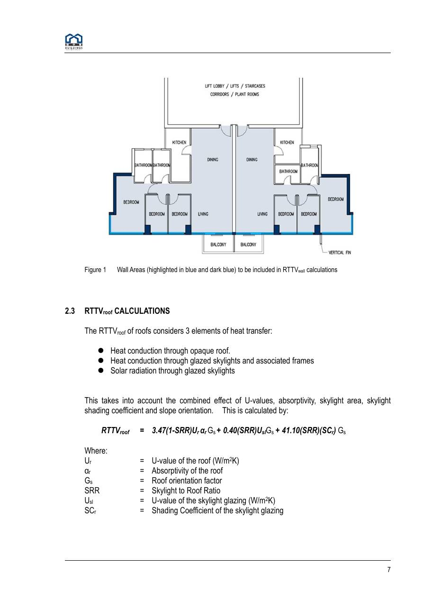{ width="620" loading=lazy }
  <figcaption>Figure 1 – Wall areas (blue) included in RTTV<sub>wall</sub>. 計入 RTTV 的牆身面積。Source: BD Guidelines 2014.</figcaption>
</figure>

## RTTV<sub>roof</sub> 屋頂住宅熱傳送值 {#rttv-roof}

```text
RTTVroof = 3.47 (1 − SRR) Ur αr Gs  +  0.40 (SRR) Usl Gs  +  41.10 (SRR) (SCr) Gs
```

| Symbol | Meaning 意思 |
|---|---|
| SRR | Skylight-to-roof ratio 天窗屋頂比 |
| U<sub>r</sub>, α<sub>r</sub> | U-value and absorptivity of roof 屋頂 U 值及吸收率 |
| U<sub>sl</sub>, SC<sub>r</sub> | U-value and SC of skylight glazing 天窗 U 值及遮陽系數 |
| G<sub>s</sub> | Roof orientation factor = **2.16** 屋頂方向系數 |

**Shaded roofs** (performance method, §2.3): (1) baseline: barely compliant unshaded roof; (2) design model with real shading; (3) total heat transfer **Apr–Oct, 24 h**; (4) rooms below held at **22 °C**; (5) design must beat baseline; (6) only **permanent architectural** shading; (7) software per App. II. 有遮蔭屋頂可用性能方法。

## U-value of opaque construction (§2.4.1) 熱傳送系數 {#u-value}

```text
U = 1 / ( Ri + x1/k1 + x2/k2 + … + xn/kn + Ra + Ro )
```

x = thickness (m); k = conductivity (W/mK). Same composition on one elevation: average thickness may be used. 同一立面同一組合可用平均厚度。

**Table 1 – Thermal conductivity k (W/mK)** 導熱系數

| Material 物料 | k | Material 物料 | k |
|---|---|---|---|
| Asphalt, mastic with 20 % grit | 1.15 | Glass 玻璃 | 1.05 |
| Cork board | 0.042 | Mosaic tile 紙皮石 | 1.5 |
| Hardboard, high density | 0.144 | Glass fibre mat / quilt | 0.035 |
| Mineral fibre board | 0.053 | Mineral wool felt | 0.039 |
| Plasterboard 石膏板 | 0.16 | Expanded polystyrene | 0.034 |
| Brick (common) 磚 | 0.95 | Polyurethane foam | 0.026 |
| Concrete, normal weight 混凝土 | **2.16** | Aluminium alloy 鋁 | 160 |
| Concrete, lightweight | 0.44 | Copper | 200 |
| Concrete flat roof tiles / slabs | 1.10 | Carbon steel 鋼 | 50 |
| Gypsum plaster | 0.38 | Cement / sand render or screed 批盪 | **0.72** |
| Gypsum, sand aggregate | 0.53 | Terrazzo | 1.59 |
| Granite 花崗岩 | 2.9 | Marble 雲石 | 2.0 |

<small>Other materials: values need BA's acceptance with source. 其他物料須獲接納。</small>

**Table 2 – Surface film resistance (m²K/W)** 表面熱阻

| Surface 表面 | R |
|---|---|
| Wall, internal R<sub>i</sub> | **0.120** |
| Wall, external R<sub>o</sub> | **0.044** |
| Roof, internal R<sub>i</sub>: flat / sloped 22.5° / sloped 45° | **0.162** / 0.148 / 0.133 |
| Roof, external R<sub>o</sub> | **0.055** |

**Table 3 – Air space resistance R<sub>a</sub> (m²K/W)** 空氣層熱阻

| Air space 空氣層 | 5 mm | 10 mm | 20 mm | 50 mm | 75 mm | ≥ 100 mm |
|---|---|---|---|---|---|---|
| Wall, emissivity ≥ 0.5 | 0.110 | 0.123 | 0.148 | 0.153 | 0.156 | 0.160 |
| Wall, emissivity < 0.5 | 0.250 | 0.359 | 0.578 | 0.589 | 0.597 | 0.606 |
| Roof horizontal, ε ≥ 0.5 | 0.110 | 0.123 | 0.148 | 0.158 | 0.166 | 0.174 |
| Roof sloped 22.5°, ε ≥ 0.5 | 0.110 | 0.123 | 0.148 | 0.154 | 0.160 | 0.165 |
| Roof sloped 45°, ε ≥ 0.5 | 0.110 | 0.123 | 0.148 | 0.152 | 0.155 | 0.158 |
| Roof horizontal, ε < 0.5 | 0.250 | 0.357 | 0.572 | 0.891 | 1.157 | 1.423 |
| Roof sloped 22.5°, ε < 0.5 | 0.250 | 0.357 | 0.571 | 0.768 | 0.931 | 1.095 |
| Roof sloped 45°, ε < 0.5 | 0.250 | 0.357 | 0.570 | 0.644 | 0.706 | 0.768 |

**Table 4 – Emissivity** 發射率: **≥ 0.5**: anodised aluminium / copper, glass, zinc paint, PVC, tile, varnish, cement mortar, screed, concrete. **< 0.5**: polished / dull aluminium, polished copper, zinc, aluminium paint, un-oxidised / polished / stainless steel.

## Absorptivity α (Table 5) 吸收率 {#absorptivity}

| Material 物料 | α | Paint / tile, **gloss** 光面 | α | Paint / tile, **matt** 啞面 | α |
|---|---|---|---|---|---|
| Black spandrel glass | 1.0 | Black, dark green, dark grey, dark blue | 0.9 | Black | 1.0 |
| Red brick, bituminous felt, blue-grey slate, brown concrete | 0.9 | Brown, green, light brown | 0.8 | Dark grey, dark brown | 0.9 |
| Tarnished copper, wood, asphalt | 0.8 | Red | 0.7 | Brown, red | 0.8 |
| Uncoloured concrete 清水混凝土 | 0.7 | Orange, yellow | 0.5 | Green, orange, yellow | 0.6 |
| Light buff brick, white marble | 0.6 | Light green, blue | 0.4 | Light green, blue | 0.5 |
| Granite, stainless steel, aluminium | 0.5 | Silver, white 白色 | **0.3** | White | 0.3 |
| Aluminium paint, aluminised bituminous felt | 0.4 | | | | |
| Polished copper, gravel | 0.3 | | | | |
| Polished aluminium, bare wet soil | 0.2 | | | | |
| Turf, tinned surface | 0.1 | | | | |
| Tree / shrub (green roof) 樹木灌木 | **0.0** | | | | |

<small>Other surfaces need BA acceptance **before consent for superstructure**. 其他物料須在申請上蓋工程同意前獲接納。</small>

## Shading: SC and ESC (§2.4.3–2.4.6) 遮陽系數 {#shading}

- **SC** of glass: manufacturer's value at normal incidence, no adjustment needed (§2.4.3). 玻璃遮陽系數採用廠商數值。
- **ESC<sub>1</sub>** from tables: overhang **OPF = A / B** (projection ÷ height from window sill to projection), side-fin **SPF = C / D** (§2.4.4). Between increments take the **next larger** factor; OPF capped at **1.0**, SPF at **1.5**; between orientations take the **closest**.
- **Two side-fins of different length**: ESC<sub>total</sub> = 1 − [(1 − ESC<sub>left</sub>) + (1 − ESC<sub>right</sub>)].
- **Overhang + side-fin**: ESC<sub>total</sub> = ESC<sub>overhang</sub> × ESC<sub>side-fin</sub> (§2.4.5). (Note: OTTV takes the **smaller**, not the product.) 與 OTTV 不同：RTTV 取乘積。
- **Complex shading / self-shading (ESC<sub>2</sub>)** (§2.5.3): ESC = (Σ E<sub>r</sub>·I<sub>D</sub> + I<sub>d</sub>) ÷ (Σ I<sub>D</sub> + I<sub>d</sub>), E<sub>r</sub> = exposed fraction, using hourly solar data of **4 typical days** (17 Apr, 22 Jun, 11 Sep, 28 Oct; Tables 10–14).

**Table 6 – ESC for overhangs** 頂遮陽

| OPF | N | NE/NW | E/W | SE/SW | S |
|---|---|---|---|---|---|
| 0 | 1.000 | 1.000 | 1.000 | 1.000 | 1.000 |
| 0.05 | 0.983 | 0.951 | 0.965 | 0.958 | 0.949 |
| 0.10 | 0.975 | 0.913 | 0.931 | 0.918 | 0.898 |
| 0.15 | 0.970 | 0.884 | 0.896 | 0.879 | 0.849 |
| 0.20 | 0.967 | 0.862 | 0.864 | 0.843 | 0.802 |
| 0.25 | 0.965 | 0.844 | 0.834 | 0.807 | 0.766 |
| 0.30 | 0.964 | 0.830 | 0.806 | 0.776 | 0.733 |
| 0.35 | 0.963 | 0.818 | 0.780 | 0.747 | 0.711 |
| 0.40 | 0.962 | 0.809 | 0.755 | 0.722 | 0.691 |
| 0.45 | 0.961 | 0.800 | 0.732 | 0.698 | 0.671 |
| 0.50 | 0.960 | 0.795 | 0.714 | 0.679 | 0.651 |
| 0.55 | 0.960 | 0.789 | 0.698 | 0.661 | 0.632 |
| 0.60 | 0.960 | 0.784 | 0.682 | 0.646 | 0.612 |
| 0.65 | 0.960 | 0.780 | 0.666 | 0.633 | 0.592 |
| 0.70 | 0.960 | 0.776 | 0.652 | 0.621 | 0.572 |
| 0.75 | 0.959 | 0.772 | 0.642 | 0.612 | 0.560 |
| 0.80 | 0.959 | 0.769 | 0.631 | 0.603 | 0.555 |
| 0.85 | 0.959 | 0.766 | 0.622 | 0.596 | 0.551 |
| 0.90 | 0.959 | 0.765 | 0.615 | 0.589 | 0.549 |
| 0.95 | 0.959 | 0.764 | 0.608 | 0.583 | 0.548 |
| 1.00 | 0.958 | 0.764 | 0.602 | 0.577 | 0.546 |

**Tables 7 and 8 – ESC for side-fins** 側遮陽 (looking out from the building; Table 8 = left fin is Table 7 mirrored)

| SPF | N | NE | E | SE | S | SW | W | NW |
|---|---|---|---|---|---|---|---|---|
| **Fin on the right (Table 7)** | | | | | | | | |
| 0.10 | 0.989 | 0.946 | 0.979 | 0.990 | 0.968 | 0.978 | 0.997 | 0.991 |
| 0.20 | 0.980 | 0.903 | 0.958 | 0.979 | 0.942 | 0.956 | 0.994 | 0.988 |
| 0.30 | 0.978 | 0.873 | 0.938 | 0.969 | 0.920 | 0.933 | 0.991 | 0.988 |
| 0.40 | 0.977 | 0.849 | 0.917 | 0.961 | 0.901 | 0.911 | 0.988 | 0.988 |
| 0.50 | 0.977 | 0.832 | 0.901 | 0.954 | 0.885 | 0.889 | 0.985 | 0.988 |
| 0.60 | 0.977 | 0.817 | 0.885 | 0.947 | 0.872 | 0.869 | 0.982 | 0.988 |
| 0.70 | 0.977 | 0.804 | 0.872 | 0.941 | 0.860 | 0.852 | 0.979 | 0.988 |
| 0.80 | 0.977 | 0.795 | 0.859 | 0.935 | 0.852 | 0.840 | 0.976 | 0.988 |
| 0.90 | 0.977 | 0.786 | 0.847 | 0.929 | 0.844 | 0.830 | 0.973 | 0.988 |
| 1.00 | 0.977 | 0.780 | 0.838 | 0.926 | 0.837 | 0.821 | 0.970 | 0.988 |
| 1.25 | 0.977 | 0.765 | 0.815 | 0.920 | 0.825 | 0.800 | 0.962 | 0.988 |
| 1.50 | 0.977 | 0.758 | 0.795 | 0.913 | 0.816 | 0.782 | 0.955 | 0.988 |
| **Fin on the left (Table 8)** | | | | | | | | |
| 0.10 | 0.989 | 0.991 | 0.997 | 0.978 | 0.968 | 0.990 | 0.979 | 0.946 |
| 0.20 | 0.980 | 0.988 | 0.994 | 0.956 | 0.942 | 0.979 | 0.958 | 0.903 |
| 0.30 | 0.978 | 0.988 | 0.991 | 0.933 | 0.920 | 0.969 | 0.938 | 0.873 |
| 0.40 | 0.977 | 0.988 | 0.988 | 0.911 | 0.901 | 0.961 | 0.917 | 0.849 |
| 0.50 | 0.977 | 0.988 | 0.985 | 0.889 | 0.885 | 0.954 | 0.901 | 0.832 |
| 0.60 | 0.977 | 0.988 | 0.982 | 0.869 | 0.872 | 0.947 | 0.885 | 0.817 |
| 0.70 | 0.977 | 0.988 | 0.979 | 0.852 | 0.860 | 0.941 | 0.872 | 0.804 |
| 0.80 | 0.977 | 0.988 | 0.976 | 0.840 | 0.852 | 0.935 | 0.859 | 0.795 |
| 0.90 | 0.977 | 0.988 | 0.973 | 0.830 | 0.844 | 0.929 | 0.847 | 0.786 |
| 1.00 | 0.977 | 0.988 | 0.970 | 0.821 | 0.837 | 0.926 | 0.838 | 0.780 |
| 1.25 | 0.977 | 0.988 | 0.962 | 0.800 | 0.825 | 0.920 | 0.815 | 0.765 |
| 1.50 | 0.977 | 0.988 | 0.955 | 0.782 | 0.816 | 0.913 | 0.795 | 0.758 |

<small>Selected rows; the original gives every 0.05 step (use the next larger SPF). 只列部分行，原文每 0.05 一級。</small>

<figure markdown>
  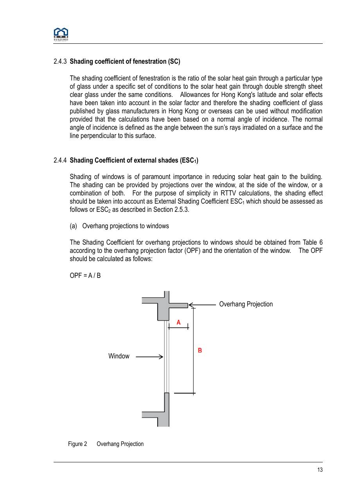{ width="620" loading=lazy }
  <figcaption>Figures 2–5 – OPF = A/B and SPF = C/D. 遮陽伸出系數。Source: BD Guidelines 2014.</figcaption>
</figure>

## Orientation factors (Table 9) 方向系數 {#orientation}

| | N | NE | E | SE | S | SW | W | NW | Roof 屋頂 |
|---|---|---|---|---|---|---|---|---|---|
| G<sub>w</sub> / G<sub>s</sub> | 0.790 | 0.924 | 1.072 | 1.051 | 0.975 | 1.092 | **1.131** | 0.965 | **2.16** |

West (1.131) and SW (1.092) are worst; North (0.790) best. Sloped surfaces: interpolate between G<sub>s</sub> and G<sub>w</sub>. Curved façades: split into the 8 orientation sectors (Figure 6). 西向最差、北向最佳。

## Effective shading rules (§2.5) 有效遮陽 {#effective-shading}

| Rule 規則 | Overhang 頂遮陽 (§2.5.1) | Side-fin 側遮陽 (§2.5.2) |
|---|---|---|
| Max. projection 最大伸出 | A **≤ 1.5 m** | C **≤ 1.5 m** |
| Long projections 長遮陽 | If > **500 mm** (north, NNW–NNE) or > **750 mm** (other): **OPF ≥ 0.2** (north) / **≥ 0.5** (other) | Same, with **SPF** |
| In a re-entrant < 4.5 m wide 凹位內 | A **≤ 500 mm** | C **≤ 500 mm** |
| Multiple fins 多片 | Smallest OPF must comply; free area **≥ 2/3** | Smallest SPF must comply; free area **≥ 2/3** |
| "Effectively opaque" 有效不透光 | Edges vertically aligned and θ < 90° (only Type 1 in Fig. 10); otherwise quantitative assessment | Edges aligned and angle < 90°; otherwise assessment |
| Other 其他 | Top projection drops **≥ 150 mm** from adjacent internal space | — |

GFA / SC: genuine sunshades **≤ 1.5 m** not counted; > **750 mm** needs quantitative assessment; ≤ 750 mm not an obstruction to prescribed windows ([APP-156](../pnap/app-156.md) paras. 12–14; [APP-19](../pnap/app-19.md)).

## Deemed-to-satisfy RTTV<sub>wall</sub> (§2.7, Tables 15–20) 當作符合準則 {#deemed-to-satisfy}

If, for every orientation, the façade's **WWR** and **SC<sub>facade</sub> = SC<sub>glass</sub> × ESC<sub>shading</sub>** do not exceed the table values for the façade's average **absorptivity**, the building is deemed to comply and **no RTTV<sub>wall</sub> calculation** is needed (sample: App. V). Method 1 = 8 orientations; Method 2 = two categories (**A**: NNE to NNW exclusive, i.e. non-north; **B**: NNW to NNE inclusive, north). A finish covering **> 60 %** of a façade may be taken as its absorptivity. 窗牆比及外牆遮陽系數不超過表列數值即當作符合。

!!! warning "Check against the current limit 留意現行限值"
    Tables 15–20 were calibrated to the **14 W/m²** limit of 2014. With the APP-156 limit now **12.5 W/m²**, confirm with BD whether the deemed-to-satisfy route is still accepted for your submission. 表 15–20 按 14 瓦／平方米編製，現行限值 12.5，使用前請向屋宇署確認。

=== "α ≤ 0.4 (Table 15)"
    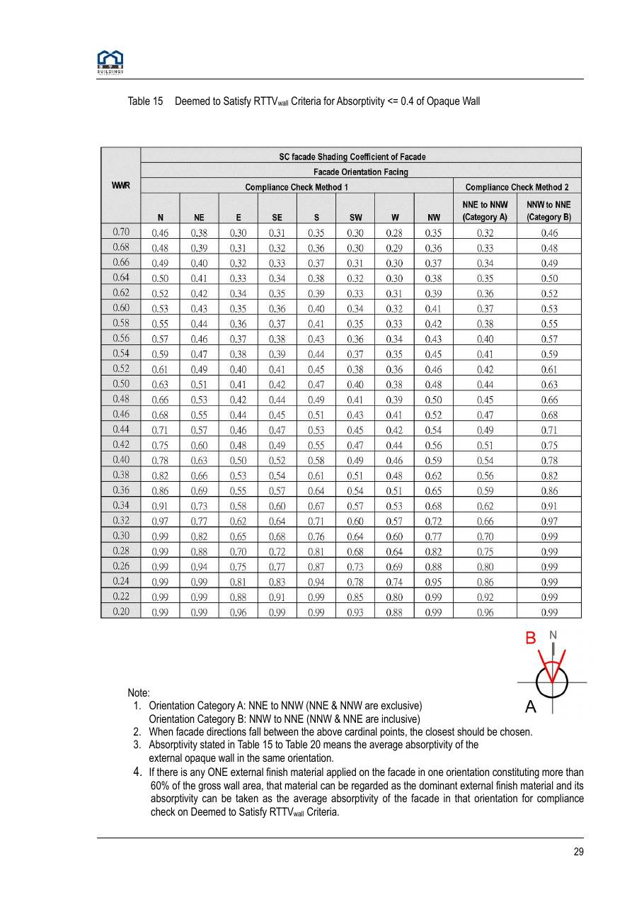{ width="680" loading=lazy }

=== "α ≤ 0.5 (Table 16)"
    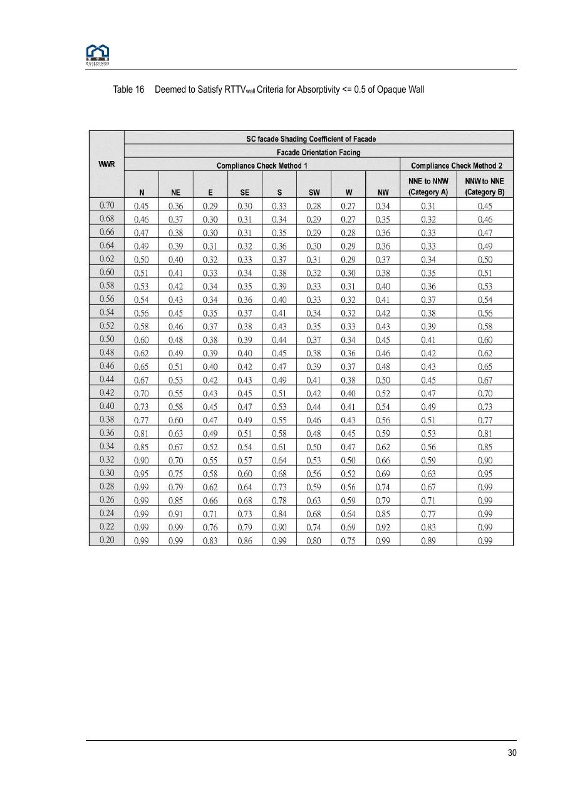{ width="680" loading=lazy }

=== "α ≤ 0.6 (Table 17)"
    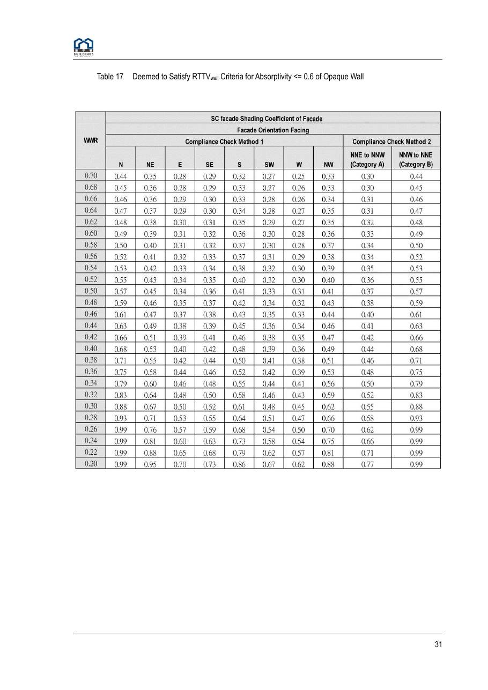{ width="680" loading=lazy }

=== "α ≤ 0.7 (Table 18)"
    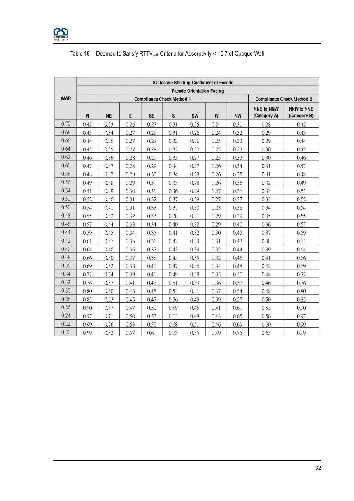{ width="680" loading=lazy }

=== "α ≤ 0.8 (Table 19)"
    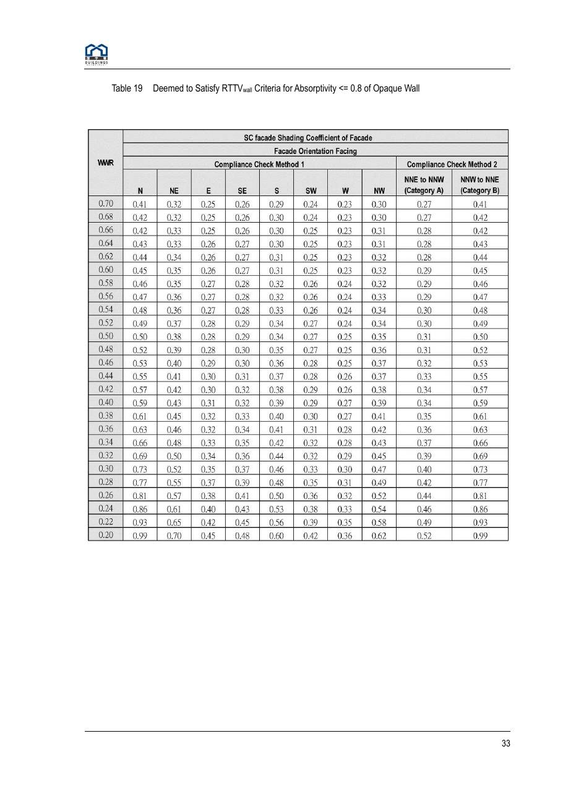{ width="680" loading=lazy }

=== "α ≤ 0.9 (Table 20)"
    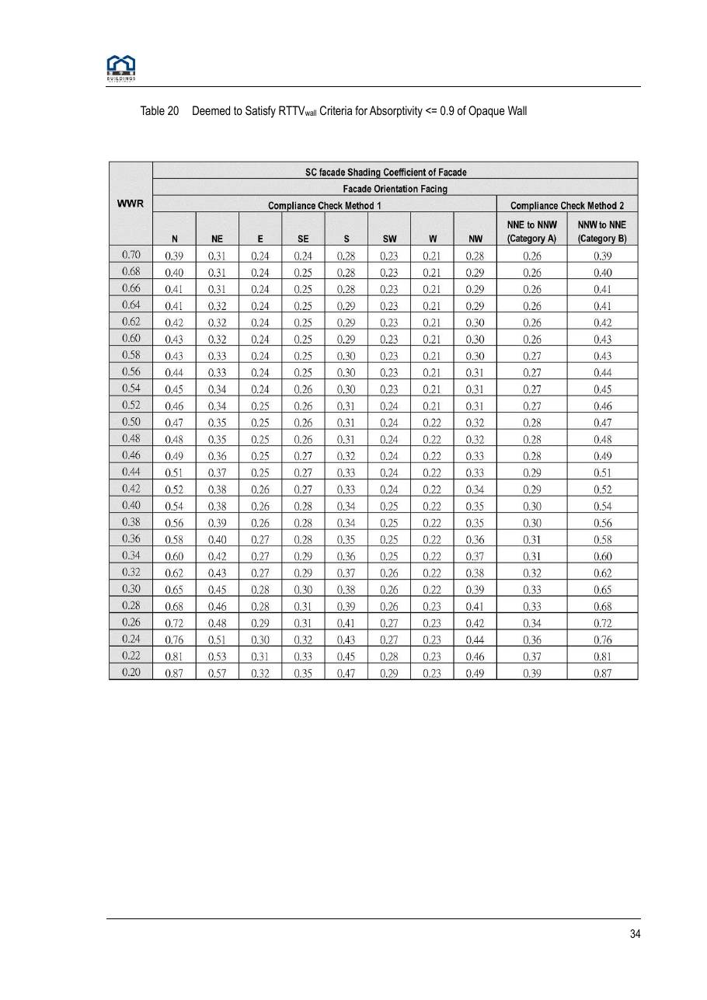{ width="680" loading=lazy }

<small>Example from Table 15 (α ≤ 0.4): WWR 0.40 → max SC<sub>facade</sub> N 0.78, E 0.50, S 0.58, W 0.46, Category A 0.54, Category B 0.78. 例子。Source: BD Guidelines 2014.</small>

## Glare and visible light (§2.8–2.9) 眩光及可見光 {#glazing}

| Item 項目 | Requirement 要求 |
|---|---|
| External reflectance ER 外反光率 | Glass with **ER > 20 %** on any external surface (windows, doors, walls, roofs) **not accepted**. 外反光率不得超過 20%。 |
| Visible light transmittance VLT 可見光透射率 | Glazing of **prescribed windows** must have **VLT ≥ 50 %**; not applicable to other glass. 訂明窗玻璃可見光透射率不少於 50%。 |

## Natural ventilation for thermal comfort (§3) 自然通風達致熱舒適 {#nvtc}

General (§3.1): applies to **habitable spaces**; above the B(P)R 30 prescribed-window minimum. Internal doors open; **kitchen and main entrance doors closed**; bathroom doors closed unless (i) all fitments and floor drains have effective traps ([ADV-24](../pnap/adv-24.md)), (ii) bathroom window meets cross-ventilation rules, (iii) secondary opening ≥ **1/20** of habitable + bathroom area. Comfort assumed up to **28 °C** with windows open. Traffic noise and air quality are not considered. 浴室門一般當作關閉。

### Cross ventilation (§3.2) 對流通風 {#cross-ventilation}

| Rule 規則 | Requirement 要求 | § |
|---|---|---|
| Path 路徑 | Primary to secondary opening, window middle to window middle, **≤ 2 straight lines (1 turn)**, turn angle **≤ 90°** | 3.2.1 |
| Length 長度 | Path **< 12 m** per habitable space; across a corridor add a **750 mm** notional strip to the area | 3.2.1 |
| Window location 窗位置 | Openings in **different halves** of the smallest bounding rectangle (split along the long side); complex rooms split into notional rooms | 3.2.1 |
| Re-entrant 凹位 | Starts where a **4.5 m** External Plane (EXP) can no longer pass; Secondary Window Plane (SWP) **2.3 m × 4.5 m** from EXP; re-entrant ≤ **4 storeys** counts as SWP; Notional Plane (NP) ≥ **1 m** or window width | 3.2.2 |
| Room depth to SWP | Primary to secondary opening (plus NP length) **≤ 12 m** | 3.2.3 |
| **Openable area** 可開啟面積 | Total **≥ 1/8** of UFA of the room(s) (+ NP, corridor strip, bathroom if used); secondary openings **≥ 1/20** (preferably 1/16) | 3.2.4 |

### Single-sided ventilation (§3.3) 單面通風 {#single-sided}

| Rule 規則 | Requirement 要求 |
|---|---|
| Windows 窗 | Preferably **two or more** separated windows |
| Room depth 房深 | **≤ 4.5 m** from the centre of the openable window (only such windows count); window faces EXP or via NP; path ≤ 1 turn ≤ 90° |
| **Openable area** 可開啟面積 | **≥ 1/5** of the room's UFA (+ NP) |

### A/C heat rejection (§3.4) 冷氣機散熱 {#ac-heat}

Heat from a unit's A/C must be **≥ 1.5 m below or horizontally apart** from: ventilation openings of adjacent units; openings and NPs in a re-entrant < 4.5 m; the **common boundary** of an adjoining site. Measured to the A/C unit edge (or A/C window opening if not installed) or the platform edge, whichever is closer. 冷氣機散熱須離鄰近單位通風口 1.5 米。

<figure markdown>
  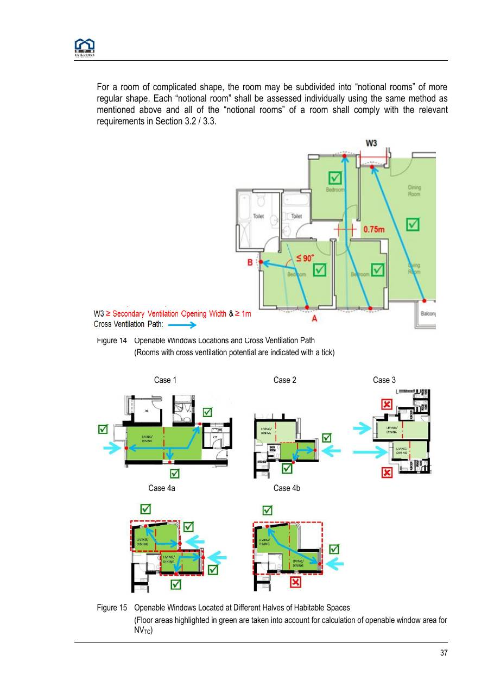{ width="620" loading=lazy }
  <figcaption>Figures 14–15 – Cross ventilation paths and window halves. 對流通風路徑。</figcaption>
</figure>

<figure markdown>
  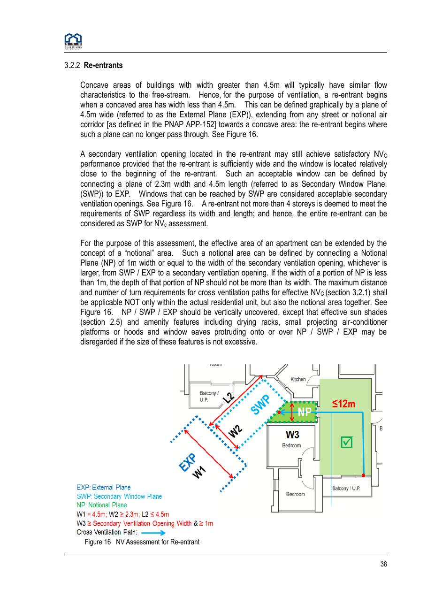{ width="620" loading=lazy }
  <figcaption>Figure 16 – EXP, SWP and NP in a re-entrant. 凹位評估。</figcaption>
</figure>

<figure markdown>
  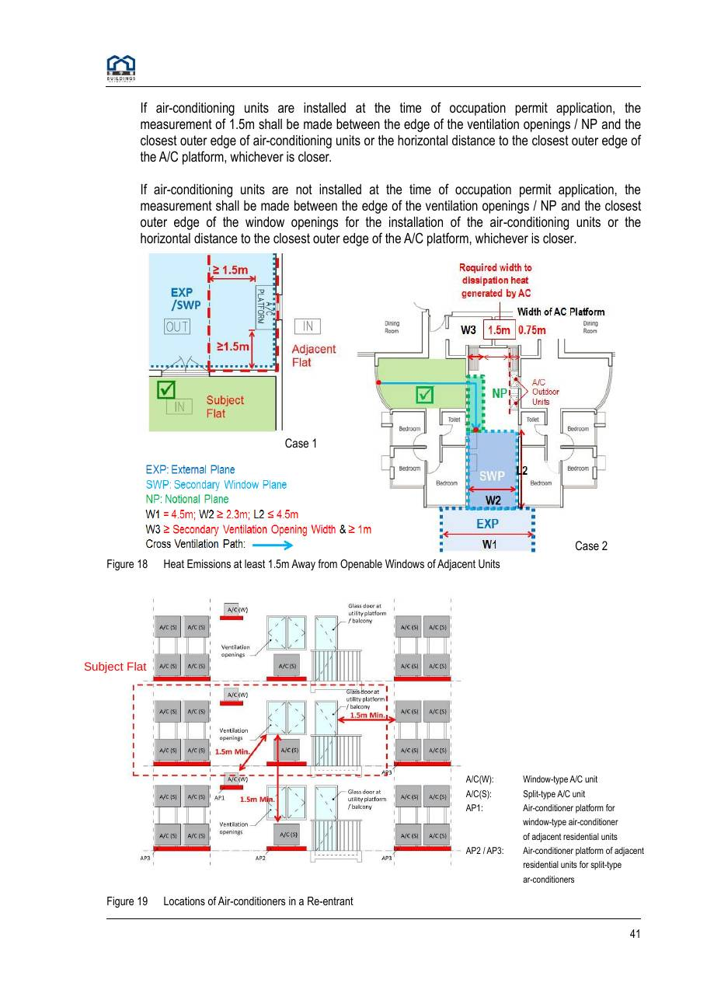{ width="620" loading=lazy }
  <figcaption>Figures 18–19 – A/C heat 1.5 m from openings of adjacent units. 冷氣機散熱距離。Source: BD Guidelines 2014.</figcaption>
</figure>

### Performance-based alternative (§3.5) 性能為本方法 {#simulation}

| Method 方法 | Key settings 主要設定 | Pass 合格 |
|---|---|---|
| **Simplified simulation** 簡化模擬 | Wind **3.0 m/s**, any direction(s); all habitable spaces, partitions, wing walls; openings per CIBSE AM10; plane **1.2 m** above floor | Area-weighted average wind velocity **AAWV ≥ 0.4 m/s** per space; report % area complying |
| **Site-specific simulation** 地盤模擬 | Urban model per AVA (HPLB-ETWB TC 1/06): massing 2 × tallest height, topography 5 ×; MM5 / CALMET wind; k-ε / k-ω / DES / LES; mesh 0.5–1 m (urban), 0.1–0.2 m (internal); directions covering **> 75 %** of winds | As above |

## Submissions 呈交 {#submissions}

| Stage 階段 | Submit 呈交 ([APP-156](../pnap/app-156.md)) |
|---|---|
| First GBP 首次圖則 | **Statement** of compliance (no calculations needed) |
| Before consent 同意前 | **Summary Sheets** (APP-156 Apps. A and B) |
| Before OP 佔用許可證前 | Final RTTV / OTTV values and glass SC on GBP; **Energy Efficiency Report** (calculations on App. III forms, record plans, glass test certificates, final Summary Sheets, NVTC extent). APSEC 2024: report may be submitted **any time before the OP application**. |

## Calculator 計算器 {#calculator}

!!! warning "Illustrative only 只作說明"
    Single-element RTTV<sub>wall</sub> for one façade. For a building, combine façades by area. Check the result with BD's App. III spreadsheets. 單一立面估算，整幢須按面積加權。

<div id="rttv-calc" markdown="0">
<table>
<tr><td>Orientation 方向</td><td><select id="rt-or"><option value="0.790">N 0.790</option><option value="0.924">NE 0.924</option><option value="1.072">E 1.072</option><option value="1.051">SE 1.051</option><option value="0.975">S 0.975</option><option value="1.092">SW 1.092</option><option value="1.131">W 1.131</option><option value="0.965">NW 0.965</option></select></td></tr>
<tr><td>WWR 窗牆比</td><td><input id="rt-wwr" type="number" step="0.01" value="0.35"></td></tr>
<tr><td>U<sub>w</sub> wall (W/m²K)</td><td><input id="rt-uw" type="number" step="0.01" value="3.0"></td></tr>
<tr><td>α wall 吸收率</td><td><input id="rt-a" type="number" step="0.05" value="0.6"></td></tr>
<tr><td>U<sub>f</sub> glazing (W/m²K)</td><td><input id="rt-uf" type="number" step="0.1" value="5.6"></td></tr>
<tr><td>SC glass</td><td><input id="rt-sc" type="number" step="0.01" value="0.5"></td></tr>
<tr><td>ESC external shading</td><td><input id="rt-esc" type="number" step="0.01" value="1.0"></td></tr>
</table>
<div id="rt-out"></div>
</div>

## Related 相關文件 {#related}

- [APP-156](../pnap/app-156.md) residential energy efficiency (current limits) · [APP-151](../pnap/app-151.md) GFA concessions · [APP-19](../pnap/app-19.md) sunshades · [APP-130](../pnap/app-130.md) prescribed windows
- [OTTV Code 1995](ottv-1995.md) (commercial and hotel) · [B(EE)R Cap. 123M](../regulations/beer-123m.md) · [APP-67](../pnap/app-67.md)
- [Lighting & ventilation guide](../guides/lighting-ventilation.md) · [GFA guide](../guides/gfa.md) · [BD guidelines index](bd-guidelines.md)
