---
tags:
  - Code of Practice
  - Site supervision 地盤監督
  - Site safety 地盤安全
  - Statutory period 法定期限
  - Registration 註冊
  - Minor works 小型工程
  - Demolition 拆卸
  - Excavation & ELS 挖掘
  - Plan submission & approval 呈交及審批
  - Geotechnical 岩土
  - Structural 結構
  - Drainage 排水
  - Concrete & materials 混凝土及物料
  - Occupation permit 佔用許可證
summary: "Code of Practice for Site Supervision 2009 (2024 Edition) and the Technical Memorandum: supervision plan parts and timing, four streams and duties, TCP grades and qualifications, TM Table 1 minimum frequencies, scale factors and Form C, critical stages, temporary works Cases 1–3 and tower cranes, quality supervision, non-conformity and incident reporting."
keywords: site supervision, 地盤監督, supervision plan, 監督計劃書, SSP, TCP, 技術稱職人員, T1 T2 T3 T4 T5, technical memorandum, 技術備忘錄, Table 1, frequency level, 巡查頻率, scale factor, 規模系數, Form C, critical stages, temporary works Case 1 2 3, 臨時工程, tower crane, TW1 TW2 TW3, non-conformity, Form B, 48 hours, site incident
---

# Code of Practice for Site Supervision 2009 and Technical Memorandum for Supervision Plans 2009 <small>《2009 年地盤監督作業守則》及《2009 年監督計劃書技術備忘錄》</small>

!!! info "Document info 文件資料"
    | | |
    |---|---|
    | **Edition 版本** | Code: 2009 (**2024 Edition**, with the Dec 2023 and Aug 2024 amendments, [APP-157](../pnap/app-157.md)); first issue Dec 2010. TM: 2009, in operation **31 Dec 2010** 守則 2024 年版；技術備忘錄 2009 年 |
    | **Legal basis 法律依據** | The **TM** is issued under **BO s.39A** and is binding; the **Code** gives the detailed guidance. [BO s.17](../regulations/bo-part-2-building-works.md), [B(A)R 37, 41](../regulations/bar-123a.md) 技術備忘錄具約束力 |
    | **Structure 結構** | TM: Parts I–III, Tables 1–2. Code: sections 1–12, Appendices I–XI (forms, samples, TCP criteria, TW forms) |
    | **Source 原文** | [Code (PDF)](https://www.bd.gov.hk/doc/en/resources/codes-and-references/code-and-design-manuals/SS2009_e.pdf) · [TM (PDF)](https://www.bd.gov.hk/doc/en/resources/codes-and-references/code-and-design-manuals/TMSS2009_e.pdf) |
    | **Last checked 最後核對** | 2026-11-22 against the Code (2024 Edition) and TM 2009 |

## At a glance 重點摘要 {#at-a-glance}

=== "English"

    - The **AP, RSE, RGE** and the contractor's **AS** jointly submit a **supervision plan** naming their **TCPs** (technically competent persons) and inspection frequencies, **before or with the first consent application** (minor works: **7 days** before starting). No prior approval of TCPs is needed.
    - Each stream has a **head** (AP / RSE / RGE / AS), a **Representative**, routine safety TCPs **T1–T3** and engineering TCPs **T4–T5**.
    - **Minimum frequencies** for each type of works are in **TM Table 1**; multiply by the **scale factor** (capped at 2) and combine on **Form C**; more frequent at **critical stages** (Code Table 9.1).
    - **Temporary works**: Case 1 (on approved plans), Case 2 (RC designs, no effect on permanent works), Case 3 (may affect them: T5 Person certifies, RSE / RGE permission, **21 days** ahead). Tower crane supports need a **DE and ICE** (Forms **TW1–TW3**).
    - **Imminent danger** or a major safety incident: other streams tell the AP within **12 hours**; the AP reports to the BA within **48 hours** (quality incidents: 5 days and **14 days**), to **siteincident@bd.gov.hk**.
    - **No supervision plan** for small works meeting TM s.11, e.g. superstructure ≤ **10 m** high, spans ≤ **6 m**, RC and < **500 m²**; excavation < **2.5 m** with nothing in the 45° zone; drainage; Class II and III minor works.

=== "中文"

    - **認可人士、註冊結構工程師、註冊岩土工程師**及承建商的**獲授權簽署人**須聯合呈交**監督計劃書**，列明**技術稱職人員**及巡查頻率，須**在首次申請同意時或之前**呈交（小型工程：開工前 **7 日**）；技術稱職人員毋須事先批准。
    - 每個監督系統由**負責人**、**代表**、例行安全監督的 **T1–T3** 及工程安全監督的 **T4–T5** 組成。
    - 各類工程的**最低巡查頻率**見**技術備忘錄表 1**，再乘以**規模系數**（上限 2），以 **Form C** 合併；**關鍵階段**須更頻密（守則表 9.1）。
    - **臨時工程**：Case 1（已在核准圖則）、Case 2（承建商設計，不影響永久結構）、Case 3（或影響永久結構：T5 人員核證、結構／岩土工程師書面准許，開工前 **21 日**）；塔式起重機支撐須**設計工程師及獨立審核工程師**（表格 **TW1–TW3**）。
    - **迫切危險**或重大安全事故：其他系統 **12 小時**內通知認可人士，認可人士 **48 小時**內向建築事務監督報告（品質事故：5 日及 **14 日**），電郵 **siteincident@bd.gov.hk**。
    - 符合技術備忘錄第 11 段的小型工程**毋須監督計劃書**：例如上蓋高度 ≤ **10 米**、跨度 ≤ **6 米**、鋼筋混凝土及 < **500 平方米**；挖掘 < **2.5 米**且 45° 範圍內無構築物；排水工程；第 II、III 級小型工程。

## Scope and principles 範圍及原則 (Code ss.1–3) {#scope}

| Para. | Rule 規定 |
|---|---|
| 1.1 | Safety management covers **quality supervision** (works follow the BO, approved or submitted plans, orders and conditions) and **site safety supervision** (control hazards to workers, the public and adjoining buildings, structures and land) |
| 1.2–1.3 | The **TM** sets the principles; the **Code** guides how to apply them; also see PNAPs and PNRCs |
| 3.1 | The Code covers: setting requirements; deploying and combining TCPs; stream structures and duties; TCP tasks; temporary works; TCP qualifications; non-conformities and incidents; the TCP List |
| 3.2–3.5 | Requirements depend on the **type and scale** of works; **extra** at critical stages; the BA may review frequencies and qualifications |

## Who supervises 監督架構 {#who-supervises}

<figure markdown>
  { width="720" loading=lazy }
  <figcaption>Four supervision streams and their TCPs (Code Fig. 4.1). 四個監督系統及其技術稱職人員。</figcaption>
</figure>

| Rule 規定 | Detail 內容 | Para. |
|---|---|---|
| Heads 負責人 | AP, RSE, RGE and the **AS** of the RC head their own streams and are **accountable** for them | 4.2–4.3 |
| Representative 代表 | The **highest-grade TCP** in the stream; the head may act as Representative if inspecting at least as often as that TCP | 4.2 |
| Routine vs engineering 例行及工程 | **T1–T3** routine safety supervision; **T4–T5** engineering safety supervision | 4.2 |
| AP / RSE / RGE as TCPs | Deemed to meet all TCP grades in their own stream; may do TCP duties at no less than the Table 1 frequency | 4.6 |
| Higher grade covers lower | A higher-grade TCP may take a lower grade's duties; combine per paras 8.12–8.17 | 4.7, 8.12 |
| Across streams | AP / RSE / RGE may appoint the **same TCP** in two or three of their streams if the TCP meets all grades and frequencies (TM 6.6) | TM 6.5–6.6 |
| **Not allowed** 不可 | AP / RSE / RGE or their TCPs **cannot combine** with the **RC's** stream, and the AS and RC's TCPs **cannot act** in the AP / RSE / RGE streams | TM 6.7 |

### Duties of each stream 各系統職責 (Code Tables 4.1–4.4) {#stream-duties}

| Stream | Head 負責人 | Representative 代表 | TCPs |
|---|---|---|---|
| **AP** | Appoints the team; implements own stream and **oversees the RC's**; NC system; **assesses scale**; compiles and **submits** the plan; devises **checklists**; notifies the BA of imminent danger and major incidents | Formal contact; checks safety measures are in place; checks the RC's structure complies; compiles reports; deals with NCs and incidents | **T4**: checks works against plans, design, method statements, precautions. **T3**: checks works and plans, monitors the RC's TCPs, keeps the **site registers** |
| **RSE** | As above for structural works; gives **permission for Case 3 temporary works**; notifies the AP | As above | **T5**: checks works, **validates design assumptions** for temporary and permanent works. **T3**: checks works, monitors RC's TCPs |
| **RGE** | As above for geotechnical works; Case 3 permission | As above | **T5**: as RSE's T5 for geotechnical. **T2 / T3**: checks works, monitors RC's TCPs |
| **RC (AS)** | Ensures NCs are rectified **immediately**; prepares Case 2 / 3 temporary works designs; prepares the **mobile plant / tower crane alert system** implementation plan | Directs staff and **sub-contractors**; coordinates TCPs; investigates NCs; runs the alert system | **T4 / T5**: validates temporary works assumptions on site. **T1–T3**: routine checks; temporary works to drawings; alert systems working; **T2 / T3** check lower TCPs' frequency and records |

## The supervision plan 監督計劃書 {#supervision-plan}

### Which works need a plan 須呈交計劃書的工程 (TM 6.4) {#types-of-works}

Demolition · ground investigation field works (GIFW) · foundation · site formation · excavation and lateral support (ELS) · cap / footing / basement · superstructure · curtain wall / cladding · A&A · slope / retaining wall / buried services repairs · tunnel works · **street works** · **Class I minor works** — unless exempt under [TM s.11](#when-no-supervision-plan-is-needed-tm-s11-selected).

### Parts and authors 各部分及撰寫人 (TM s.7; Code Appendix I) {#plan-parts}

| Part | Author 撰寫人 | Items 內容 |
|---|---|---|
| **Preamble** | AP | (1) site and works background; (2) undertaking by AP, RSE, RGE and AS to supervise per the plan, TM, Code and BO |
| **Part I** | **AP** | (3) types of works, dates of approval (or submission for minor works), **scale assessment**; (4) supervision input and **combination** (Form C); (5) TCP particulars and **frequency**; (6) frequency at **critical stages**; (7) declaration |
| **Part II** | **RSE** | (8)–(11): input and combination, TCPs and frequency, critical stages, declaration |
| **Part III** | **RGE** | (12)–(15): as Part II |
| **Part IV** | **AS** | (16)–(19): as Part II |
| **Annex** | All | **Confirmation of appointment** and **contact information** of TCPs; CVs for TCPs who are not AP / RSE / RGE and **not on the TCP List** (Code 8.30) |

### How to fill it in, step by step 填寫步驟 {#how-to-fill}

| Step 步驟 | What to do 做法 | Where |
|---|---|---|
| 1 | List every **type of works** in the project and check TM s.11 exemptions | TM 6.4, s.11 |
| 2 | For each type, read the **minimum grades and frequency levels** for each stream from **TM Table 1** | [Table 1](#tm-table-1) |
| 3 | Work out the **scale factor** = estimated measurable item ÷ basic value (**max. 2**) | [Table 8.1](#scale-factor) |
| 4 | Convert each level to **man-days per month** (Table 8.2) and multiply by the scale factor | [Tables 8.2–8.3](#inspection-frequency-levels-code-tables-8283) |
| 5 | Group works that run **at the same time** (only concurrent works may be combined) and decide which TCP posts to combine | Code 8.13–8.17 |
| 6 | Fill **Form C** columns 1–11; read the combined level from Tables 8.2–8.3 (never below Table 1) | [Form C](#form-c) |
| 7 | Add **critical-stage** frequencies from Table 9.1 (use whichever is higher) | [Table 9.1](#critical-stages) |
| 8 | Name the TCPs; check qualifications (TCP List or CVs) | Tables 8.4–8.8 |
| 9 | Each head compiles his part; the **AP submits** before or with the **first consent** application (minor works: **7 days** before) | TM 8.1; Code 4.4 |
| 10 | **Confirmation of appointment** as an annex, or within **7 days** of commencement (BA10 date) | Code 4.5 |
| 11 | Keep the plan **on site**; revise when stages change; report changes of TCP within **7 days** | TM 8.2–8.3 |

## TM Table 1: minimum grades and frequency levels 最低職級及巡查頻率 {#tm-table-1}

Numbers are **frequency levels** (5 = full time, 4 = weekly, 3 = fortnightly, 2 = monthly, 1 = as and when required); "–" = not required.

| Works 工程 | RC: T1 / T2 / T3 / T4 / AS | AP: T3 / T4 / AP | RSE: T3 / T5 / RSE | RGE: T2 / T3 / T5 / RGE |
|---|---|---|---|---|
| **GIFW** 土地勘測 | **5** / – / – / **4** / 1 | **3** / – / 1 | – | – / **5** / **4** / 1 |
| **Significant geotechnical content: foundation** | **5** / **5** / – / **4** / 1 | **4** / **2** / 1 | **5** / **4** / 1 | – / **5** / **4** / 1 |
| **Significant geotechnical content: others** | **5** / **4** / – / **4** / 1 | **4** / **2** / 1 | **4** / **3** / 1 | – / **5** / **4** / 1 |
| **Foundation** (other) 地基 | **5** / **5** / – / **4** / 1 | **4** / **2** / 1 | **5** / **4** / 1 | – |
| **All other building works or street works** 其他 | **5** / – / **4** / **4** / 1 | **4** / **2** / 1 | **4** / **3** / 1 | – |
| **Class I minor works**: AP only | **5** / – / **4** / – / 1 | **4** / – / 1 | – | – |
| Class I minor works: + RSE | – | – | **4** / – / 1 | – |
| Class I minor works: + RGE | – | – | – | **5** / – / – / 1 |

<small>No T5 is required in the RC's stream and no T1 / T2 / T5 in the AP's stream under Table 1. Higher grades or full time may be needed at critical stages (Note 2). Foundation works in Scheduled Areas 1, 2, 4 and the Designated Area of Northshore Lantau need extra RGE supervision (Code 8.3). For geotechnical works the RSE stream is needed only where there are structural works (Code 8.2). 表 1 摘錄自技術備忘錄。</small>

## Scale factor 規模系數 (Code 8.4–8.11, Table 8.1) {#scale-factor}

**Scale factor = estimated value of the measurable item ÷ basic value, capped at 2.** Below 1: same frequency but shorter visits (a full-day visit is assumed at 1; minimum frequency is never reduced). Above 1: raise the frequency of heads and T2–T5, and add **more T1** (and sometimes T2 / T3) full-timers.

| Works 工程 | Measurable item 量度項目 | Basic value 基數 |
|---|---|---|
| Demolition | Max. floor area demolished **per storey** | 750 m² |
| GIFW | Number of drilling rigs | 6 |
| GIFW (no drillholes) | Trial pits, coreholes, strippings at the same time | 20 |
| Site formation | Total cost | $40M |
| Slope / retaining wall / buried services repair | Total cost | $12M |
| ELS | **Average cost per month** | $8M |
| Pile wall | Average cost per month | $8M |
| Tunnel works | Total cost | $47M |
| Large-diameter bored piles, barrettes | Average cost per month | $19M |
| Other piles | Average cost per month | $9.5M |
| Cap / footing / basement | Total cost | $47M |
| **Superstructure** | **Total construction floor area** | **20,000 m²** |
| Curtain wall / cladding | Total aggregated surface area | 10,000 m² |
| A&A | Total cost | $17.5M |
| Minor works | Total cost | $11M |
| Street works | Total cost | $12M |

<small>Costs follow the **Estimated Total Value of Construction Operations** declared to the CIC for the levy (Cap. 587); contingency and price fluctuation, E&M works outside the BO, and exempted fitting-out may be deducted. 費用以向建造業議會申報的估計總值為準。</small>

## Inspection frequency levels 巡查頻率 (Code Tables 8.2–8.3) {#inspection-frequency-levels-code-tables-8283}

| Level 級別 | Visits 巡查 | Man-days / month 人日 |
|---|---|---|
| 5 | **Full time** 全職駐守 | 25 |
| 4.4 | Five visits a week | 20 |
| 4.3 | Four visits a week | 16 |
| 4.2 | Three visits a week | 12 |
| 4.1 | Two visits a week | 8 |
| 4 | Weekly 每周 | 4 |
| 3 | Fortnightly 每兩周 | 2 |
| 2 | Monthly 每月 | 1 |
| 1 | As and when required 按需要 | 0.5 (when the AP / RSE / RGE / AS also does TCP duties) |

Full-time TCPs give **continuous supervision**: safety measures carried out, works per plans and method statements, problems solved **before being covered up**, NCs handled (Code 8.8).

## Combining TCPs: Form C 合併人員：表格 C {#form-c}

| Column | Content 內容 |
|---|---|
| 1 | Types of works, grouped into **concurrent** and **non-concurrent** (only concurrent works may be combined) |
| 2 | Scale factor S |
| 3–4 | TCP grade and its frequency level from Table 1 |
| 5 | Notional input (Table 8.2) |
| 6 | **Adjusted input = (2) × (5)** |
| 7–8 | Grades to be combined; the post with combined duties |
| 9 | **Sum** of adjusted inputs for the combined post |
| 10–11 | Number of TCPs and the **required level**, read from Tables 8.2–8.3; **never below Table 1** |

If works are not combined, still use columns 1–6 and 11 for any scale factor above 1 (Code 8.17). The AP, RSE and RGE may then combine across their three streams (8.16). Form C is appended to the plan.

!!! example "BD's Sample 1 (Appendix V) 屋宇署示例"
    Concurrent **spread footings** (S = 0.5) and **ELS with significant geotechnical content** (S = 0.4), AP also acting as T4. T3: 4 × 0.5 + 4 × 0.4 = 2 + 1.6 = **3.6** man-days → **Level 4** (weekly, 4 ≥ 3.6), one T3. T4 + AP: (1 × 0.5 + 0.5 × 0.5) + (1 × 0.4 + 0.5 × 0.4) = 0.75 + 0.6 = **1.35** → **Level 3** (fortnightly, 2 ≥ 1.35).

## TCP qualifications 資歷 (TM Table 2; Code 8.18–8.31, Tables 8.4–8.8) {#tcp-qualifications}

| Grade | Typical minimum (varies by stream and works type) 一般最低要求 |
|---|---|
| **T1** | **RC stream only**: certificate or diploma in civil / structural / geotechnical engineering, building studies, building surveying or architecture + **2 years**; or specified T1 training or top-up courses (Appendix X); GIFW also Geotechnical Field Technician or geology degree + 1 year in GI |
| **T2** | **RC stream** (and RGE for Class I minor works): higher certificate / diploma + **3 years**; a relevant **degree + 2 years** may act as T2 in the RC stream |
| **T3** | Higher certificate / diploma + **5 years**, or relevant **degree + 2 years** (1 year with the geotechnical top-up course); GIFW: incl. 1 year in GI |
| **T4** | Relevant **degree + 4 years**, or a **registered** professional (RPE civil / structural / geotechnical / building, registered architect, RPS building surveying) |
| **T5** | **Registered professional engineer** (civil / structural / geotechnical; building for demolition) + **5 years** (RSE / RGE streams; RC stream for demolition and heritage A&A) |

- **Academic recognition** (8.19): VTC diplomas and certificates; UGC or HKIA / HKIE / HKIS-recognised degrees; other degrees count as higher diplomas; others by BA acceptance or HKCAAVQ accreditation.
- **Experience** (8.22–8.23): T1 / T2 within the last **5 years** with ≥ 1 year **local site** experience; T3–T5 within the last **8 years** with ≥ 1 year local experience; post-qualification years plus **half** of pre-qualification years (all years count for registered professionals).
- **TCP List** (8.25–8.29): run by the **CIC**; **33 categories** (e.g. RC-T1-BW(O), RSE-T5-DW, RGE-T3-GIFW); valid **5 years**; listed TCPs need **no CV** in the plan. Competent Person (Logging) for GI logs (Appendix VII).

## Temporary works 臨時工程 (Code 4.8–4.13) {#temporary-works}

| Case | When 情況 | Who designs and checks 設計及審核 | Submissions 呈交 |
|---|---|---|---|
| **Case 1** | Temporary works, sequence or method statements are **on the prescribed plans** | AP / RSE / RGE | Approved with the plans; AP / RSE / RGE and RC supervise |
| **Case 2** | Not required on plans and **no effect** on permanent structures (no overstressing or overloading) | **RC** prepares plans, construction drawings and design justifications; sole responsibility for integrity | Kept on site; tower crane: see below |
| **Case 3** | Not on plans but **may affect** permanent structures, adjoining buildings or land | RC prepares; a **T5 Person** (qualification ≥ T5) **certifies** | To the **RSE / RGE ≥ 21 days** before works; RSE / RGE gives **written permission**; T5 Person signs the **completion certificate**, to the RSE within **7 days** |

- **Case 2 examples needing drawings and justifications** (4.10): falsework for transfer plates and ramps, cantilevers > **1.5 m**, beams spanning > **12 m**, deep beams > **3 m**, elevated tanks, space frames, bridges, prestressed structures; formwork and shoring for columns and walls > **6 m** and retaining walls > **4 m**; temporary platforms for plant; lifting operations.
- In doubt, follow Case 3 (Fig. 4.2 note). Keep all plans, drawings, justifications and method statements in a **site register** (4.13).

### Tower crane supports 塔式起重機支撐 (Code 4.12; Forms TW1–TW3) {#tower-crane}

| Step | Requirement 要求 |
|---|---|
| (a) **DE** | Design engineer: **RPE (civil / structural)** with **5 years**, appointed by the RC; signs plans and **Form TW1** |
| (b) **ICE** | Independent checking engineer: RPE (civil / structural) with 5 years; **independent** of the DE (no company, subsidiary or employment link); signs **Form TW2** |
| (c) Case 2 | Certified plans + TW1 + TW2 to the **AP** (record) and **RSE** (acknowledgement) **before** works |
| (d) Case 3 | To the RSE (acknowledgement) and RSE / RGE (review) **≥ 21 days** before; written permission; then to the AP |
| (e) Supervision | RC continuous; AP / RSE / RGE periodic |
| (f) Welds | Qualified welders (Steel Code cl. 14.3); **HOKLAS** lab NDT on site and off-site welds; RC's **T4** reviews results |
| (g) Completion | RC's **T4** and the **T5 Person** (may be the DE or ICE) sign **Form TW3**; to AP and RSE within **7 days** |
| (h) Load test | Not before the RSE acknowledges TW3 |
| (i) Records | Plans, TW1–TW3, tests and records kept at the site office |
| (j) Free-standing crane | Documents to the RSE within 7 days; the **RSE sends them to BD within 14 days** with a signed statement |

### Mobile plant and tower crane alert systems 機械及塔式起重機警報系統 (Code 4.14) {#alert-systems}

For building works over **$30 million** (with s.17 conditions for superstructure works): mobile plants and tower cranes need **Smart Site Safety System (4S)** alerts. Mobile plant danger zone generally ≥ **2 m** from any part of the plant (360° sensors); tower crane danger zone generally ≥ **7 m** radius from the hook with ≥ **3 m** clearance trigger. The AS prepares an **implementation plan** (plants, systems, zones, operation, fallback); RC's **T1 and T3** check the systems work.

## Specific tasks of TCPs 技術稱職人員的工作 (Code s.5, Tables 5.1–5.4) {#specific-tasks}

Heads devise **checklists** from the typical items below plus project-specific ones; records kept **contemporaneously** on site (Form A, Appendix II; samples in Appendix VI).

| Stream | Typical items 典型項目 |
|---|---|
| **AP's TCPs** (A1–A10) | Report filing; **hoarding / covered walkway** per accepted hoarding plan; scaffolding, **catch fans**, mat screens and nylon mats; monitoring points; NC register and reports; lower TCPs' frequency; plans, method statements and **demolition video** on site; **tower crane** documents; lateral supports per sequence |
| **RSE's TCPs** (E1–E15) | Monitoring; NCs; documents; **no over-excavation**; top-down enclosing walls; lateral supports; formwork, shoring and platforms adequate; **artesian** risk; nearby buildings; groundwater vs design; top-down deck strength before excavation |
| **RGE's TCPs** (G1–G13) | As RSE plus: over-loading; hydraulic failure; margins of safety; ground and groundwater vs design; validating the **geotechnical assumptions** and updating method statements |
| **RC's TCPs** (C1–C36) | Hoarding, covered walkway, **catch platform**; vehicle access; scaffold ties, catch fans, screens; **guy ropes / nets before removing external walls**; no debris build-up; refuse chutes; monitoring; slope crests clear; **alert systems**; plant on adequate ground or platforms; plant and lifting per method statements; **tower crane supports**; permits for street occupation; ELS sequence; falsework; nullah diversion; slope drainage before storms; blasting; top-down deflection; cut slope angles; NC investigation |

## Quality supervision 品質監督 (Code s.6) {#quality-supervision}

| Topic | Requirement 要求 |
|---|---|
| Principle (6.3–6.6) | AP / RSE / RGE give **periodic** supervision (B(A)R 37) with TCPs inspecting at a frequency and percentage; the RC gives **continuous** supervision (B(A)R 41), including for sub-contractors |
| Superstructure, ELS, site formation | See [APP-158](../pnap/app-158.md) and PNRC 77 |
| **GIFW** (6.7–6.13, Table 6.1) | By an **RSC (GIFW)**; check drilling, sampling, instrumentation, field testing (I1–I4); Geoguide 2; logs by a **Competent Person (Logging)**; cores kept until completion acknowledged; GI report with RGE and AS certificates (Appendix VIII) |
| **Soil nails** (6.14–6.22, Table 6.2) | RGE's **T3** and RSC(SF)'s **T1 full time** at every stage of each nail (N1–N8: pull-out test, setting out, drilling, assembly, insertion, grout, grouting, heads); RGE's **T5** and RSC's **T4** personally witness ≥ 1 pull-out test, ≥ 2 insertions, ≥ 2 groutings, ≥ 1 nail head; key records (Appendix IX); BA may require **NDT of ≥ 1%** (min. 2 per slope) |
| **Foundations** (6.23–6.27, Table 6.3) | RSE's **T5 and T3**, RSC(F)'s **T4 and T2**; stages F1–F26 for driven piles, bored piles and barrettes, mini-piles and socketed H-piles, rafts and footings; pre-drilling and proof drilling by an **RSC (GIFW)** |

## Works with significant geotechnical content 重要岩土工程 (Code s.7) {#geotechnical}

Includes: blasting; prestressed ground anchors; soil nails; cut slopes > **3 m**; rock slope stabilisation; fill slopes > **5 m** (or lower with consequence-to-life Category 1 or 2, [APP-109](../pnap/app-109.md)); reinforced fill; natural terrain mitigation; **ELS > 4.5 m** deep (> 7.5 m in sensitive sites); diaphragm and bored-pile walls; retaining walls > 5 m and basement walls > 7.5 m; ground treatment and dewatering; demolition affecting slopes; foundations in Scheduled Area 1, deep foundations in Areas 2 and 4 and Northshore Lantau, or near tunnels; water wells; tunnel works. Normally **RGE's T3 and T5**; a **Directorate Site Supervisor (DSS)** (RPE geotechnical, partner or director, or the RGE) may be required for difficult or **sensitive sites** (near old shallow-footed buildings, tunnels, roads, railways, mains, slopes).

## Critical stages 關鍵階段 (Code s.9, Table 9.1) {#critical-stages}

The RC tells the AP, RSE and RGE **in advance** of each critical stage; any party may declare other risky sections critical. Use the Table 9.1 frequency or the scaled Form C frequency, **whichever is higher**.

| Works | Critical stage 關鍵階段 | RC | RSE / RGE |
|---|---|---|---|
| Demolition, A&A | **Complex structures**: flat slab, prestressed, transfer plate, hanger, beam > **10 m**, steel frame, cantilever over street > **1.2 m** | **T5 full time** | RSE T5 twice a week |
| Demolition | Building retaining ground > **1.5 m** | T5 full time | RSE T5 and **RGE T5** twice a week |
| A&A to heritage building | Alteration or temporary removal of load-bearing members (foundation, wall, column, hanger, beam > 6 m, cantilever, roof truss) | T5 full time | RSE T5 twice a week |
| Driven piles | First driving test; **5%** final sets; ≥ 1 proof load test | RC T4 | RSE T5 same |
| Bored piles, barrettes | Pre-drilling twice a week (RC); founding stratum **5%**; ≥ 1 interface proof drilling; ≥ 1 load test | RC T4 | RSE T5 |
| Mini-piles, socketed H-piles | Pre-drilling twice a week (RC); founding stratum RC **5%**, RSE **3%**; ≥ 1 load test | RC T4 | RSE T5 |
| Rafts, footings | Bearing stratum RC **20%**; RSE first batch for each bearing pressure; plate load test | RC T4 | RSE T5 |
| Piling | Near a retaining wall crest (45° zone), or within **5 m** of railway, highway structure or building over **40 years** old | Twice a week | Twice a week |
| ELS, site formation, repairs | Water main > **200 mm**, gas main, shallow-footed building or railway within the **60°** line; diaphragm / pile walls within 5 m of such structures; **strut preloading** (first batch, then every 2 days); movement over the allowable limit | Twice a week (preload as stated) | Twice a week |
| Geotechnical works | Pumping tests (daily for 7 days, then twice a week); removal of support without permanent support; founding level of retaining walls; **every blast** near sensitive land; foundations affecting slopes (RC full time, RGE weekly) | RC T4 | RGE T5 |
| Superstructure | **Cantilever over a street**; **elevated podium deck over a street** | **T4 full time** | RSE T5 twice a week |

## Records and non-conformities 紀錄及不符合事項 (Code ss.5, 10) {#non-conformity}

| NC type | Example | Record |
|---|---|---|
| **Type 1**: very minor, fixed at the same inspection | Misplaced spacer, debris in formwork | None |
| **Type 2**: no material safety concern, fixed and re-inspected before covering up | — | In the TCP's **site supervision report** |
| **Other NCs** | — | **Form B** (Appendix III) |

**Form B procedure** (10.5): TCP tells his Representative, completes Part 1 → if **imminent danger**, the AP reports to the BA within **48 hours** of discovery (others tell the AP within **12 hours**; or the AS reports direct and copies the AP) → AP / RSE / RGE instruct rectification → AS rectifies → Representative checks → if the RC fails to rectify a material concern, the AP reports within 48 hours → certify and complete Part 2 → for imminent danger, AS tells the AP within 12 hours and the AP tells the BA within **48 hours of completion**.

**Site supervision reports** (10.2–10.4): every TCP, every visit, kept at the site office: items inspected, results, NCs, and a **monthly NC summary** by each Representative.

## Major or serious site incidents 重大事故 (Code ss.11–12) {#incidents}

| Type | Examples | To the AP | AP to the BA |
|---|---|---|---|
| **Safety** (11.4–11.5): may cause death, serious injury, damage, imminent danger or material safety concern | Collapse of permanent or temporary structures (platforms, falsework, ELS), tower crane or hoist; slope distress or landslide; **monitoring at Action Level**; damage to neighbours; railway works suspended | **12 hours** | **48 hours** of discovery, and 48 hours after rectification |
| **Quality** (11.6–11.7) | Material deviation from approved plans; substandard works needing demolition or new approval; extensive honeycombing or exposed bars not rectified | **5 days** | **14 days** |

Report by email to **siteincident@bd.gov.hk** with: address; location, date and time; contacts; type of works; injuries or damage; remedial action; plans, photos, tests (12.1). Urgent works also need **Form BA7** (BO s.19) before or within 48 hours of starting.

## Time limits 時限 {#time-limits}

| Event 事項 | Limit 時限 | Source |
|---|---|---|
| Supervision plan 監督計劃書 | Before or with the **first consent** application; minor works **7 days** before starting | TM 8.1 |
| Confirmation of TCP appointment 委任確認 | Annex, or within **7 days** of commencement | Code 4.5 |
| Change of TCP 更換人員 | Revised part within **7 days** | TM 8.3 |
| TCP absent (accident, illness) 人員缺席 | Replacement within **48 hours**; notify BA within **7 days** | TM 9.1 |
| Emergency deviation from the plan 緊急偏離 | Max. **48 hours**; notify BA within 48 hours; revise the plan | TM 10.1 |
| Case 3 temporary works | Documents **21 days** before; completion certificate within **7 days** | Code 4.11 |
| Tower crane, free-standing | RSE to BD within **14 days** of completion | Code 4.12(j) |
| Imminent danger / safety incident | Others → AP **12 hours**; AP → BA **48 hours** | Code 10.5, 11.2 |
| Quality incident | Others → AP **5 days**; AP → BA **14 days** | Code 11.6 |
| Urgent works (Form BA7) 緊急工程 | Before the works or **within 48 hours** of starting | BO s.19 |

## When no supervision plan is needed 毋須監督計劃書 (TM s.11, selected) {#when-no-supervision-plan-is-needed-tm-s11-selected}

| Works 工程 | Criteria (all must be met) 準則 |
|---|---|
| **Demolition** 拆卸 | Not in Scheduled Area No. 1; height ≤ **10 m**; storey ≤ **5 m**; spans ≤ **6 m**; cantilevers ≤ **1 m**; no prestressed concrete; retains ≤ **1.5 m**; no buildings or streets within **5 m** |
| **Site formation** 地盤平整 | Lot gradient ≤ **15°**; area 10 m outside the lot < 15°; no slope > **30°** or > **1.5 m**, nor wall > 1.5 m, within the lot or 10 m around; none to be built; combined wall + slope ≤ 1.5 m; wall height : breadth ≤ **2**; masonry or concrete walls |
| **Excavation** 挖掘 | Depth < **2.5 m**; no roads, buildings, structures, slopes > 30° or water mains ≥ **75 mm** inside the **45°** line from the base perimeter |
| **Superstructure** 上蓋 | Height ≤ **10 m**; spans ≤ **6 m**; RC; construction floor area < **500 m²** |
| **Drainage** 排水 | All drainage works (deep excavation covered by the ELS rule) |
| **A&A** 加建改建 | Works not requiring demolition or structural alteration |
| **Building repairs** 樓宇修葺 | All building repairs |
| **Minor works** 小型工程 | All **Class II and Class III** minor works |

## Worked example: superstructure with concurrent ELS 計算例子：上蓋及同步挖掘 {#worked-example}

!!! example "Illustrative only 只作說明"
    The project and numbers are **made up** to show the method; check every real case against the TM and Code. 以下數字為虛構，只用作說明。

**Project**: residential tower, superstructure **30,000 m²** construction floor area; at the same time, ELS for a 4 m deep basement (not significant geotechnical content), average **$6M per month**. Both are "all other building works".

**Step 1–2: Table 1 minimum** (all other building works): RC T1 L5, T3 L4, T4 L4; AP T3 L4, T4 L2; RSE T3 L4, T5 L3.

**Step 3: scale factors**: superstructure 30,000 ÷ 20,000 = **1.5**; ELS 6 ÷ 8 = **0.75** (below 1: minimum frequency kept, shorter visits).

**Step 4–6: Form C** (concurrent works; AP's stream shown):

| (1) Works | (2) S | (3) Grade | (4) Level | (5) Notional | (6) = (2) × (5) |
|---|---|---|---|---|---|
| Superstructure | 1.5 | T3 | 4 | 4 | 6.0 |
| | | T4 | 2 | 1 | 1.5 |
| ELS | 0.75 | T3 | 4 | 4 | 3.0 |
| | | T4 | 2 | 1 | 0.75 |

| (7)–(8) Combined post | (9) Sum | (10) No. | (11) Level |
|---|---|---|---|
| AP's T3 | 6.0 + 3.0 = **9.0** | 1 | **4.2** (three visits a week, 12 ≥ 9; 4.1 gives only 8) |
| AP's T4 | 1.5 + 0.75 = **2.25** | 1 | **4** (weekly, 4 ≥ 2.25; Level 3 gives only 2) |

**Other streams (same method)**: RSE's T3: 6 + 3 = 9 → **Level 4.2**; RSE's T5: 2 × 1.5 + 2 × 0.75 = 4.5 → **Level 4.1**. RC's T1 (full time): 25 × 1.5 = 37.5 for superstructure alone → **two full-time T1** (or one T1 full time with the extra 12.5 combined into a higher grade, Code 8.11); RC's T3 and T4: 6 + 3 = 9 → **Level 4.2** each.

**Step 7: critical stages**: a cantilevered canopy over the street → **RC's T4 full time** and **RSE's T5 twice a week** while it is built (Table 9.1); this overrides the lower Form C level for that period.

**Step 8–11**: name the TCPs (TCP List numbers or CVs), each head signs his part, the AP submits with the **first consent** application, confirmations within 7 days of commencement, and the plan is kept on site.

## Code contents 守則內容 {#code-contents}

| Section | Topic | Appendix | Content |
|---|---|---|---|
| 1–3 | Scope, interpretation, principles 範圍及原則 | I | Standard form of supervision plan + annex (TCP appointment and contacts) |
| 4 | Safety management, duties, **temporary works**, **tower cranes**, alert systems 安全管理 | II | Form A: record of specific tasks |
| 5 | Typical items for TCP tasks; recording NCs | III | Form B: NC and rectification report |
| 6 | **Quality supervision**: GIFW, soil nails, foundations 品質監督 | IV | Form C: combination of TCPs |
| 7 | Works with significant geotechnical content 重要岩土工程 | V | Six Form C samples |
| 8 | Supervision requirements, **scale factors**, combining, **TCP qualifications**, TCP List 監督要求 | VI | Sample checklists for TCPs |
| 9 | **Critical stages** 關鍵階段 | VII | Competent Person (Logging); geology-based TCPs |
| 10 | Communication, reports, NCs 通訊及紀錄 | VIII | Administrative procedures for GIFW |
| 11 | **Major or serious site incidents** 重大事故 | IX | Key records for soil nails |
| 12 | Report to the BA 向建築事務監督報告 | X | Other acceptable TCP qualifications (training, top-up courses) |
| | | XI | Forms **TW1, TW2, TW3** (tower crane supports) |

## Whole picture 整體關係 {#whole-picture}

| Topic 主題 | Where 文件 |
|---|---|
| Amendments 修訂 | [APP-157](../pnap/app-157.md) |
| Quality supervision 品質監督 | [APP-158](../pnap/app-158.md) · [APP-143](../pnap/app-143.md) (precast) · [APP-135](../pnap/app-135.md) (soil nails) |
| Statutory duties 法定責任 | [BO s.4, 9](../regulations/bo-part-1-registration.md) · [B(A)R 37, 41](../regulations/bar-123a.md) |
| Consent and BA10 同意及動工 | [BO s.14–21](../regulations/bo-part-2-building-works.md) · [ADM-17](../pnap/adm-17.md) (BA10 via ESH) |
| Foundations and ELS 地基及挖掘 | [APP-18](../pnap/app-18.md) · [APP-57](../pnap/app-57.md) · [APP-137](../pnap/app-137.md) · [Foundations Code](foundations-2017.md) |
| Hoardings and demolition 圍板及拆卸 | [APP-23](../pnap/app-23.md) · [Demolition Code](demolition-2004.md) |
| Site safety 地盤安全 | [ADM-13](../pnap/adm-13.md) · [ADM-18](../pnap/adm-18.md) · [ADV-29](../pnap/adv-29.md) |
| Minor works 小型工程 | [APP-147](../pnap/app-147.md) · [APP-149](../pnap/app-149.md) |

## Related 相關文件 {#related}

[BO s.14–21](../regulations/bo-part-2-building-works.md) · [B(A)R](../regulations/bar-123a.md) · [Submission to OP guide](../guides/submission-to-op.md) · [Foundations Code](foundations-2017.md) · [Demolition Code](demolition-2004.md)

---
<small>Summary of the Code and TM for reference. Wording, forms and full tables: see the official documents. 本頁為守則及技術備忘錄摘要，以官方文件為準。</small>
