---
tags:
  - Code of Practice
  - Structural 結構
  - Wind 風力
  - Loads 荷載
  - Curtain wall & façade 幕牆及外牆
  - Signboard 招牌
  - Temporary works 臨時工程
  - Site safety 地盤安全
  - Balcony & utility platform 露台及工作平台
---

# Code of Practice on Wind Effects in Hong Kong 2019 <small>《2019 年香港風力效應作業守則》</small>

!!! info "Document info 文件資料"
    | | |
    |---|---|
    | **Edition 版本** | 2019 (first issue Sep 2019); amendment **Dec 2023** 2023 年 12 月修訂 |
    | **Legal basis 法律依據** | Deemed-to-satisfy the BO and [B(C)R](../regulations/bcr-123q.md) wind load provisions 符合即當作符合 |
    | **Companion 配套** | [Explanatory Notes (PDF)](https://www.bd.gov.hk/doc/en/resources/codes-and-references/code-and-design-manuals/ExplanatoryNotesWindEffects2019e.pdf) |
    | **Source 原文** | [English (PDF)](https://www.bd.gov.hk/doc/en/resources/codes-and-references/code-and-design-manuals/WindEffects2019e.pdf) · [Amendment 2023 (PDF)](https://www.bd.gov.hk/doc/en/resources/codes-and-references/code-and-design-manuals/WindEffects2019e_Amend2023e.pdf) |
    | **Last checked 最後核對** | 2026-11-21 |

## At a glance 重點摘要

=== "English"

    - The **Standard Method** applies to typical buildings up to **200 m**. A **wind tunnel test** is needed above 200 m, for unusual shapes, complex topography, when across-wind effects dominate, or when **B/D > 6** (unless torsion can be ignored).
    - Design pressure **Qz = Qo,z × St × Sθ**: the reference pressure at the **effective height Ze** (reduced by **sheltering** from surrounding buildings), times the topography factor and the **directionality factor** (0.80–0.85).
    - New in 2019: **across-wind** and **torsional** loads, load combination factors, **occupant comfort** (1-year and 10-year peak accelerations), and sheltering by **displacement height**.
    - **Temporary structures** (≤ 1 year, not for living in): **70 %** of permanent loads. Site **hoardings, covered walkways, sheds, tents**: Qz = **37 %** of Qo,z.
    - Ultimate wind load factor **γw = 1.4**; air density 1.2 kg/m³.

=== "中文"

    - **標準方法**適用於高度不超過 **200 米**的一般建築物。超過 200 米、形狀特殊、地形複雜、橫風效應主導，或 **B/D > 6**（除非可忽略扭轉）時，須進行**風洞測試**。
    - 設計風壓 **Qz = Qo,z × St × Sθ**：以**有效高度 Ze**（考慮周邊建築物**遮擋**而降低）的參考風壓，乘地形系數及**風向系數**（0.80–0.85）。
    - 2019 年新增：**橫風**及**扭轉**荷載、荷載組合系數、**使用者舒適度**（1 年及 10 年峰值加速度）、以**位移高度**計算遮擋效應。
    - **臨時構築物**（不超過 1 年、非住用）：永久荷載的 **70%**；地盤**圍板、有蓋行人道、工棚、帳篷**：Qz = Qo,z 的 **37%**。
    - 極限風荷載系數 **γw = 1.4**；空氣密度 1.2 公斤／立方米。

## Reference pressure 參考風壓 (Table 3-1)

| Effective height Ze (m) 有效高度 | ≤ 2.5 | 5 | 10 | 20 | 30 | 50 | 75 | 100 | 150 | 200 | 250 | 300 | 400 | 500 |
|---|---|---|---|---|---|---|---|---|---|---|---|---|---|---|
| **Qo,z (kPa)** | 1.59 | 1.77 | 1.98 | 2.21 | 2.36 | 2.56 | 2.73 | 2.86 | 3.05 | **3.20** | 3.31 | 3.41 | 3.57 | 3.70 |

<small>Formula: Qo,z = 3.7 (Ze/500)^0.16; turbulence Io,z = 0.087 (Ze/500)^-0.11. Above 500 m seek specialist advice. 公式計算；500 米以上須專家意見。</small>

## Directionality factor 風向系數 Sθ (Table A1-1)

| N | NE | E | SE | S | SW | W | NW |
|---|---|---|---|---|---|---|---|
| 0.82 | 0.84 | 0.85 | 0.85 | 0.85 | 0.84 | 0.82 | 0.80 |

<small>Take the maximum within the 90° sector studied. Circular buildings: Sθ = 1. 取 90° 範圍內最大值；圓形建築物取 1。</small>

## Procedure 計算程序

<figure markdown>
  { width="720" loading=lazy }
  <figcaption>Standard Method or wind tunnel test (Code Figures 2-1, 2-2). 標準方法或風洞測試。</figcaption>
</figure>

| Section 章節 | What it does 內容 |
|---|---|
| **2.2 Buildings** 建築物 | Along-wind force Wz = Qz·Sq,z·Cf·B per unit height; **torsion** with eccentricity **±0.05B** (B/D ≤ 1) to **±0.20B** (B/D = 6); **across-wind** check unless H < 100 m, H/B < 5 and frequency > 0.5 Hz; combination factors (Table 2-1) |
| **2.3 Elements** 構件 | Cladding and windows: P = Qz·Cp·Ss, with internal pressure if there are dominant openings |
| **2.4 Acceleration** 加速度 | Peak acceleration at the top quarter; 1-year and 10-year limits (Fig. 2-6). Frequency N ≈ **46/H** for typical buildings < 100 m |
| **3.3 Sheltering** 遮擋 | Effective height reduced by the displacement height Hd of the two most obstructing upwind buildings (App. A2) |
| **3.4 Topography** 地形 | Multiplier St for hills, ridges, cliffs (App. A3) |
| **4 Coefficients** 系數 | Cf for rectangles (with corner and rounding reductions), U/X/Y/L/Z wings; Cp for walls and roofs; open frames |
| **5 Size factors** 尺寸系數 | Ss by the half-perimeter of the loaded area; Sq,z increases with height |
| **6 Wind tunnel** 風洞 | Model scale, reliability, cladding, **minimum loads in sheltered locations** (Fig. 6-1), verification |

## Cladding pressure coefficients 外牆壓力系數 (Table 4-1)

| Surface 表面 | Zone 區 | Cp |
|---|---|---|
| Walls: edge zone suction 牆邊緣負壓 | A | **−1.4** |
| Walls: elsewhere 牆其他負壓 | B | −1.0 |
| Walls: positive 牆正壓 | A & B | +1.1 |
| Flat roof / pitch < 30°: corner 平天台角位 | C | **−2.2** |
| Flat roof: edge 邊緣 | D | −1.6 |
| Flat roof: elsewhere 其他 | E | −1.0 |
| Flat roof: positive 正壓 | C, D, E | +0.3 |
| Pitch > 60°: corner / edge / elsewhere / positive | C / D / E | −1.4 / −1.4 / −1.0 / +1.1 |

Appendix B gives coefficients for **dominant openings**, **sunshades, fins and signboards**, **balconies and balustrades**, **canopies** and **free-standing walls**. 附錄 B：主要開口、遮陽板、招牌、露台、簷篷、獨立牆。

## December 2023 amendment 2023 年修訂

- Figures 2-1 and 2-2: revised conditions for a wind tunnel test. 修訂須進行風洞測試的條件。
- Table 4-1, Appendix A2, Figure B3-1: wording clarified (podium height rules; the two largest Hd). 文字修訂。
- Figure 5-2 and Appendix C1: more on the size factor. 補充尺寸系數計算。

## Related 相關文件

[Dead & Imposed Loads](dil-2011.md) · [Glass Code 2018](glass-2018.md) · [B(C)R](../regulations/bcr-123q.md) · [Steel Code 2011](steel-2011.md) · [Concrete Code 2013](concrete-2013.md)
