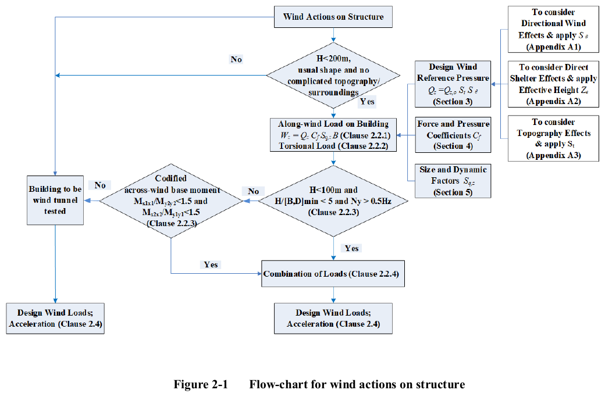
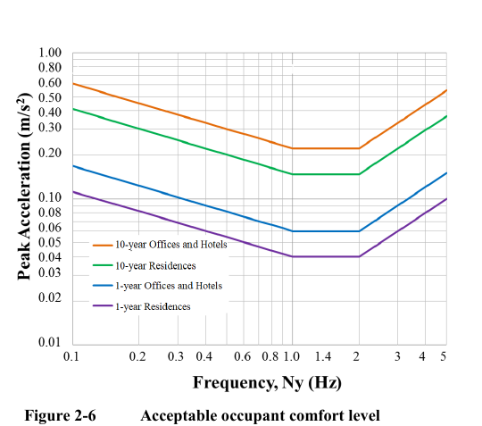
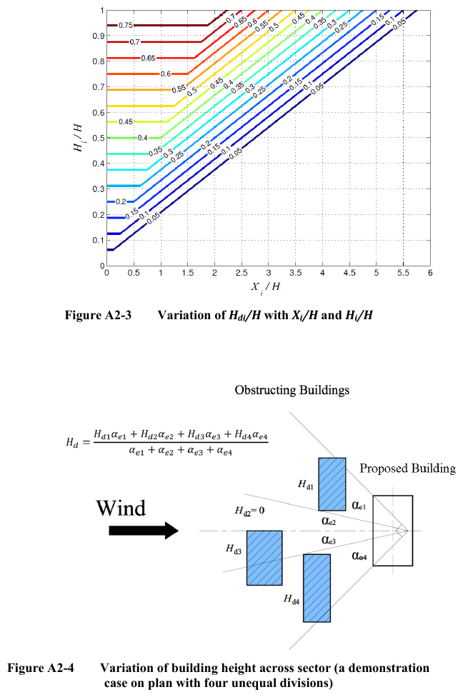
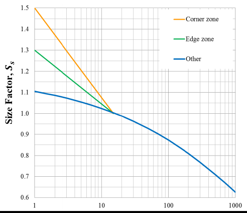

---
tags:
  - Code of Practice
  - Structural 結構
  - Wind 風力
  - Loads 荷載
  - Curtain wall & façade 幕牆及外牆
  - Signboard 招牌
  - Temporary works 臨時工程
  - Site safety 地盤安全
  - Balcony & utility platform 露台及工作平台
  - Foundation 地基
  - Concrete & materials 混凝土及物料
  - Site supervision 地盤監督
  - Demolition 拆卸
  - Protective barrier 防護欄障
summary: "Wind reference pressures, directionality, sheltering, across-wind and torsion, and when a wind tunnel test is needed."
keywords: wind code, wind load, 風力, 風荷載, wind tunnel, 風洞, Qz, reference pressure, 參考風壓
---

# Code of Practice on Wind Effects in Hong Kong 2019 <small>《2019 年香港風力效應作業守則》</small>

!!! info "Document info 文件資料"
    | | |
    |---|---|
    | **Edition 版本** | 2019 (first issue Sep 2019); amendment **Dec 2023** (7 items) 2023 年 12 月修訂 |
    | **Legal basis 法律依據** | Deemed-to-satisfy the BO and [B(C)R](../regulations/bcr-123q.md) wind load provisions 符合即當作符合 (cl. 1.1) |
    | **Structure 結構** | 1 General · 2 Wind actions · 3 Design wind pressures · 4 Force and pressure coefficients · 5 Size and dynamic factors · 6 Wind tunnel testing · Appendices A (climate, shelter, topography), B (openings, attachments, walls), C (size factor, damping) |
    | **Companion 配套** | [Explanatory Notes (PDF)](https://www.bd.gov.hk/doc/en/resources/codes-and-references/code-and-design-manuals/ExplanatoryNotesWindEffects2019e.pdf) |
    | **Source 原文** | [English (PDF)](https://www.bd.gov.hk/doc/en/resources/codes-and-references/code-and-design-manuals/WindEffects2019e.pdf) · [Amendment 2023 (PDF)](https://www.bd.gov.hk/doc/en/resources/codes-and-references/code-and-design-manuals/WindEffects2019e_Amend2023e.pdf) |
    | **Last checked 最後核對** | 2026-11-23, clause by clause against the 2019 Code and the Dec 2023 amendment 逐條核對 |

## At a glance 重點摘要 {#at-a-glance}

=== "English"

    - The **Standard Method** applies to typical buildings up to **200 m**. A **wind tunnel test** is needed above 200 m, for unusual shapes, complex topography or surroundings, when the codified **across-wind** moment governs by more than **1.5 ×**, or when **B/D > 6** (unless torsion can be ignored).
    - Design pressure **Qz = Qo,z × St × Sθ**: the reference pressure at the **effective height Ze** (reduced by **sheltering**), times the topography multiplier and the **directionality factor** (0.80–0.85).
    - Building force **Wz = Qz · Cf · Sq,z · B** per unit height, plus **torsion** (e = ±0.05B to ±0.20B) and combinations **1.00 / 0.55 / 0.55**.
    - Cladding **P = Qz · Cp · Ss**: walls −1.4 / −1.0 / +1.1; flat roof corners **−2.2**; 20 % reduction below 0.5(H − Hd).
    - **Occupant comfort**: 1-year and 10-year peak accelerations (Fig. 2-6); return period factors **0.25 / 0.55**.
    - **Temporary structures** (≤ 1 year, not for living in): **70 %** of permanent loads. Hoardings, covered walkways, sheds, tents: Qz = **37 %** of Qo,z.
    - Wind tunnel results: not less than **80 %** of the Standard Method (or **70 %** with removal testing).
    - Ultimate wind load factor **γw = 1.4**; air density 1.2 kg/m³.

=== "中文"

    - **標準方法**適用於高度不超過 **200 米**的一般建築物。超過 200 米、形狀特殊、地形或周邊複雜、橫風力矩超過順風力矩 **1.5 倍**，或 **B/D > 6**（除非可忽略扭轉）時，須進行**風洞測試**。
    - 設計風壓 **Qz = Qo,z × St × Sθ**：以**有效高度 Ze**（考慮**遮擋**）的參考風壓，乘地形系數及**風向系數**（0.80–0.85）。
    - 建築物每單位高度風力 **Wz = Qz · Cf · Sq,z · B**，另加**扭轉**（偏心 ±0.05B 至 ±0.20B），組合系數 **1.00／0.55／0.55**。
    - 外牆風壓 **P = Qz · Cp · Ss**：牆身 −1.4／−1.0／+1.1；平天台角位 **−2.2**；0.5(H − Hd) 以下可減 20%。
    - **使用者舒適度**：1 年及 10 年回歸期峰值加速度（圖 2-6）；回歸期系數 **0.25／0.55**。
    - **臨時構築物**（不超過 1 年、非住用）：永久荷載的 **70%**；地盤圍板、有蓋行人道、工棚、帳篷：Qz = Qo,z 的 **37%**。
    - 風洞測試結果不得低於標準方法的 **80%**（進行移除測試可放寬至 **70%**）。
    - 極限風荷載系數 **γw = 1.4**；空氣密度 1.2 公斤／立方米。

!!! tip "Does it apply? 是否適用？"
    All structural design of buildings and parts of buildings under the BO – the main structure, cladding, curtain walls, windows, canopies, signboards, parapets and temporary structures. Cladding and glass also follow the [Glass Code 2018](glass-2018.md); load factors and combinations come from the material codes ([concrete](concrete-2013.md), [steel](steel-2011.md)). Dead and imposed loads are in the [Loads Code](dil-2011.md). 所有建築物及其部分的結構設計均適用；玻璃另見玻璃守則。

## 1 General 總則

| Clause 條文 | Requirement 要求 |
|---|---|
| 1.1 | Standard Method for wind loads on buildings or parts; loads must suit the structure type, use, design working life and exposure. Users satisfy themselves the method is rationally applicable. |
| 1.1 | **Wind tunnel testing** required for: (a) **H > 200 m**; (b) unusual shapes not covered; (c) complicated topography or surroundings adversely affecting wind; (d) codified across-wind moment substantially larger than along-wind (cl. 2.2.3); (e) **B/D > 6**, unless torsion may be neglected (cl. 2.2.4). Guidance in Section 6. 須做風洞測試的情況。 |
| 1.2 | Key symbols: B breadth normal to wind; D depth along wind; b = smaller of B or 2H; H height to top roof (may differ by direction on sloping ground); Hb excluding irregular roof features; Ze effective height; Hd displacement height; N frequency (**N = 46/H** for typical buildings < 100 m); Mh mass above 2Hb/3 (may add **25 %** of imposed load); γw = **1.4**; ρa = **1.2 kg/m³**. 主要符號。 |

## Procedure 計算程序 {#procedure}

{ loading=lazy }
<small>Figure 2-1 (BD, 2019 version). The Dec 2023 amendment revised the first condition to **H ≤ 200 m**, usual shape and no complicated topography or surroundings (Figures 2-1 and 2-2). 2023 年修訂改為 H ≤ 200 米。</small>

| Step 步驟 | Clause 條文 | What to do 內容 |
|---|---|---|
| 1 | 2.2.1 | Along-wind force per unit height **Wz = Qz Cf Sq,z B** |
| 2 | 2.2.2 | Torsion ΔTz = e · Wz |
| 3 | 2.2.3 | Across-wind base moment if required |
| 4 | 2.2.4 | Apply both directions with torsion using Table 2-1 |
| 5 | 2.3 | Cladding and element pressures |
| 6 | 2.4 | Peak acceleration and comfort check |

## 2 Wind actions 風力作用 {#ch2}

### 2.2.2 Torsion 扭轉

Offset Wz from the centre of area by **e = ±0.05B for B/D ≤ 1** to **±0.20B for B/D = 6** (interpolate; outside this range use wind tunnel data). ΔTz = e1·Wz,x1 or e2·Wz,x2, whichever is greater. 偏心距。

### 2.2.3 Across-wind base moment 橫風基底力矩

- **Exempt** if H < **100 m**, H/B < **5** in all directions, and frequency > **0.5 Hz**. 豁免條件。
- Otherwise compute Mxy,base (Equation 2-2) using Gry = √(2 ln(1800 Ny)), damping ξy (App. C2), Qh at Hd, turbulence Iv,h, (BD)b averaged over the top third, Hb.
- If across-wind moment > along-wind, **factor the along-wind forces up** to match. If that factor **> 1.5**, **wind tunnel testing is required**. 超過 1.5 倍須做風洞測試。

### 2.2.4 Load combinations 荷載組合 (Table 2-1)

| Case | Wz,x1 | Wz,x2 | ΔTz |
|---|---|---|---|
| 1 | ±1.00 | ±0.55 | ±0.55 |
| 2 | ±0.55 | ±1.00 | ±0.55 |
| 3 | ±0.55 | ±0.55 | ±1.00 |

Resultants act through the centre of area at each level. **Torsion cases may be ignored** for: (a) single storey ≤ **10 m**; (b) ≤ **70 m** with peripheral lateral-load-resisting construction; (c) passing the **torsional regularity check** – torsional inter-storey drift < **25 %** of lateral drift in each direction; (d) if torsional drift ≤ **50 %**, Case 3 need not be calculated. 可忽略扭轉的情況。

### 2.3 Building elements 構件風壓

- No dominant openings: **P = Qz Cp Ss** (Eq. 2-3a) – also for open frames, attachments, free-standing walls. Reference height normally **H**.
- With dominant openings: **P = Pe − Pi**, Pe = Qz Cpe Ss, Pi = Qz Cpi Ss,i (Eq. 2-3b–d). 有主要開口時。

### 2.4 Acceleration 加速度 {#acceleration}

- Peak acceleration Az (Eq. 2-4) for each direction, using Sr for the return period, Mh, ηy (take **1.5** for the top quarter if no modal analysis), (BD)b ≤ **H²/9**.
- **Acceptable** if the **1-year and 10-year** peak accelerations are below Figure 2-6 (separate curves for offices/hotels and residences). 使用者舒適度。

{ loading=lazy }
<small>Figure 2-6 (BD). Peak acceleration (m/s²) vs frequency Ny (Hz). 可接受舒適度。</small>

### 2.5 Temporary structures 臨時構築物

- Not for residence, in place **≤ 1 year**: at least **70 %** of permanent loads.
- Construction-site **hoardings and covered walkways**, contractor sheds, **bamboo sheds**, tents, marquees (not residential): **Qz = 37 % of Qo,z**, no other adjustment factor. See [Demolition Code](demolition-2004.md) and [Site Supervision Code](site-supervision-2009.md). 地盤圍板等取 37%。

## 3 Design wind pressures 設計風壓 {#ch3}

**Qz = Qo,z · St · Sθ** (Eq. 3-1).

### Reference pressure 參考風壓 (Table 3-1) {#reference-pressure-table-3-1}

| Effective height Ze (m) 有效高度 | ≤ 2.5 | 5 | 10 | 20 | 30 | 50 | 75 | 100 | 150 | 200 | 250 | 300 | 400 | 500 |
|---|---|---|---|---|---|---|---|---|---|---|---|---|---|---|
| **Qo,z (kPa)** | 1.59 | 1.77 | 1.98 | 2.21 | 2.36 | 2.56 | 2.73 | 2.86 | 3.05 | **3.20** | 3.31 | 3.41 | 3.57 | 3.70 |

<small>Qo,z = **3.7 (Ze/500)^0.16** (Eq. 3-2); turbulence Io,z = **0.087 (Ze/500)^−0.11** (Eq. 3-3). For across-wind and acceleration, if 0.25 ≤ Hd/H ≤ 0.5: Io,z × [4 − 6Hd/H] (Eq. 3-4). Above 500 m seek specialist advice. 500 米以上須專家意見。</small>

### Directionality factor 風向系數 Sθ (Table A1-1) {#directionality-factor-s-table-a1-1}

| N | NE | E | SE | S | SW | W | NW |
|---|---|---|---|---|---|---|---|
| 0.82 | 0.84 | 0.85 | 0.85 | 0.85 | 0.84 | 0.82 | 0.80 |

<small>Interpolate between directions; take the **maximum within the 90° sector** studied. **Circular buildings: Sθ = 1**. **Return period factor Sr** (Table A1-2) for acceleration: **1-year 0.25**, **10-year 0.55**. 取 90° 範圍內最大值。</small>

### 3.3 Sheltering – effective height 遮擋效應 (Appendix A2)

- Ze may conservatively be the actual height Z.
- **Ze = max(Z − Hd, 0.25Z)**; Hd = 0 or the minimum of **0.8 Hi**, **1.2 Hi − 0.2 Xi (≥ 0)**, **0.75 H**.
- Hi = height of an obstructing building within **±45°** of the wind direction (Hi ≤ H); Xi = distance from the upwind edge; consider buildings within **6 H**.
- **Only one obstructing building → no sheltering.** With two or more, use the building giving the **second-most** sheltering (the second largest Hd; wording clarified **12/2023**).
- Ze = Z − Hd for Z ≥ 1.33 Hd; Ze = 0.25 Z for Z < 1.33 Hd.
- Varying heights across the sector: weighted average over **≥ 4 equal divisions** (Fig. A2-4). Obstructing height = actual height or height above the proposed building's base, whichever gives less shelter. 只有一幢遮擋建築物不得計遮擋；取第二大遮擋。

{ loading=lazy }
<small>Figures A2-3 and A2-4 (BD). 位移高度及扇形加權。</small>

### 3.4 Topography 地形 (Appendix A3)

- Significant when the upwind slope **ψu > 0.05** and the site is in the significant zone: Zt/Ht ≥ 0.5, or on the downwind slope with Xt < 1.5 Ht/ψe (ψe = min(ψu, 0.3)).
- Otherwise **St = 1.0**; else **St = [1 + 2ψe s / (1 + 3.7 Iv,z)]²** (Eq. A3-1), s and Iv,z at **Z = 2H/3**; s from Figs. A3-2(a)–(c) or Eqs. A3-2 to A3-11 (upwind; downwind hills; downwind cliffs – use the lower downwind value). 地形系數。

## 4 Force and pressure coefficients 力及壓力系數 {#ch4}

### 4.2 Buildings 建築物 Cf

- **Circular plan** with H/d ≤ 6: **Cf = 0.75**.
- Rectangular (Eq. 4-1, Fig. 4-2): Cf = 1.1 + 0.055 (He/D) / exp{|ln[(0.6B/D)(1 − 0.011 He/D)]|^[1.7 − 0.0013 He/B]}, valid for **He/D ≤ 12**. May use Qz varying with height or Qh conservatively.
- **4.2.2** Use local B and D; ignore plan steps affecting **< 10 % of H**.
- **4.2.3 Corners**: chamfers or cut-outs × [1 − 2(w/B)(1 − cos θ)], w/B ≤ **0.31** (else treat as X-shape); rounded × [1 − 2.5 r/B], r/B ≤ **0.1**; unsymmetrical: least reduction. 角位折減。
- **4.2.4 Wings** (U, X, Y, Z, L): equivalent rectangle per Figs. 4-4(a)–(f).

### Cladding pressure coefficients 外牆壓力系數 (Table 4-1) {#cladding-pressure-coefficients-table-4-1}

Enclosed buildings **without dominant openings** (net Cp, internal pressure included):

| Surface 表面 | Zone 區 | Cp |
|---|---|---|
| Walls: edge zone suction 牆邊緣負壓 | A | **−1.4** |
| Walls: elsewhere 牆其他負壓 | B | −1.0 |
| Walls: positive 牆正壓 | A & B | +1.1 |
| Flat roof / pitch < 30°: corner 平天台角位 | C | **−2.2** |
| Flat roof: edge 邊緣 | D | −1.6 |
| Flat roof: elsewhere 其他 | E | −1.0 |
| Flat roof: positive 正壓 | C, D, E | +0.3 |
| Pitch > 60°: corner / edge / elsewhere / positive | C / D / E | −1.4 / −1.4 / −1.0 / +1.1 |

**Notes** 附註: (a) use **Qh**; (b) Ss by tributary area, may exceed 1.0; (c) **cladding pressures may be reduced by 20 % below 0.5(H − Hd)**; (d) podiums: follow the tower and podium height rules in **Figures 4-5 and 4-6** (figure numbers corrected **12/2023**); (e) interpolate for 30°–60° roofs; (f) low-rise roofs from reliable sources. Zones per Figs. 4-6(a)/(b); for a tower at the podium edge use max(b1t, b1p) and max(b2t, b2p) for zone A. 塔樓及平台規則。

**Open frameworks 開放構架 (Table 4-2)** – solidity φ: 0.01 → **2.0**; 0.1 → 1.8; 0.2 → 1.7; 0.3 → 1.6; 0.5 → 1.5; 0.8 → 1.5; 0.9 → 1.6; 1.0 → **2.0** (pressure on the solid area only).

## 5 Size and dynamic factors 尺寸及動力系數 {#ch5}

- **Ss** depends on the half-perimeter **L0.5p** of the loaded (tributary) area; circle L0.5p = πd/2; complex shapes: half the taut-string length. Fig. 5-2 or App. C1:
    - Other zones and overall loads: **Ss = exp(0.17 − 0.07 L0.5p^0.32)**
    - Edge zones (L0.5p < 15 m): **Ss = 1.3 − ln(L0.5p)/9.0 ≥ 1.0**
    - Corner zones (L0.5p < 15 m): **Ss = 1.5 − ln(L0.5p)/5.4 ≥ 1.0**
- Internal pressure with dominant openings: Ss,i from the largest opening or the notional perimeter of several (Fig. 5-3), "Other" curve. Calculation elaborated **12/2023** (Fig. 5-2, App. C1).
- **Sq,h** = 0.5 + √[(Ss(L0.5p=B) − 0.5)² + 0.25/(B^0.5 H Nx² ξx)] (Eq. 5-1); reduce with height: Sq,z = Sq,h − 1.2[Sq,h − (10/H)^0.14](1 − Z/H) (Eq. 5-2).
- **H < 50 m**: Sq = **1.1 Ss(L0.5p = H/1.5 + 2B)** at all heights (Eq. 5-3).

{ loading=lazy }
<small>Figure 5-2 (BD): corner, edge and other zones. 尺寸系數。</small>

**Damping (Appendix C2)** 阻尼比 – fundamental mode, by aspect ratio in the direction of vibration:

| Aspect ratio 高寬比 | RC accelerations | RC loads | Steel accelerations | Steel loads |
|---|---|---|---|---|
| ≥ 8 | 0.010 | 0.015 | 0.005 | 0.008 |
| 7 | 0.011 | 0.017 | 0.006 | 0.009 |
| 6 | 0.013 | 0.020 | 0.007 | 0.010 |
| 5 | 0.016 | 0.024 | 0.008 | 0.012 |
| < 4 | 0.020 | 0.030 | 0.010 | 0.015 |

<small>Composite: intermediate values. Aspect ratio = tower height above foundation ÷ lateral system depth; also check above set-backs and above podiums. 組合結構取中間值。</small>

## 6 Wind tunnel testing 風洞測試 {#ch6}

| Clause 條文 | Requirement 要求 |
|---|---|
| 6.1.1 | Model mean speed, turbulence and length scales; instrumentation suited to the loads; peaks with code-compatible reliability. |
| 6.1.2 | Dynamic response: mass, stiffness and damping scaled; for near-prismatic buildings with H/B and H/D < **15**, the **3 lowest modes** suffice. |
| 6.1.3 | Topography model **≥ 1:5,000** (smaller: see EN); **≥ 18 directions at 20°**; St from measured profiles (Eq. 6-1). |
| 6.1.4 | Proximity model normally **≥ 400 m radius**; **≥ 36 directions at 10°**. |
| 6.1.5 | Building model normally **≥ 1:500**; Reynolds number ≥ **1 × 10⁴** for sharp corners (more evidence for rounded shapes); blockage ≤ **10 %**. |
| 6.1.6–6.1.7 | Profiles compatible with Harris–Deaves / **ESDU 01008**; match pressures Qz = ρ/2 [Vz(1 + 3.7Iv,z)]² at **150 m above the effective surroundings or 2H/3**, whichever greater (open terrain 2H/3). |
| 6.2 | Loads = expected peak in **one hour** at ultimate pressures × Sθ ÷ γw. |
| 6.3 | Cladding: typical panels L0.5p **2–5 m**, **80 %** non-exceedance in one hour; internal pressures from measured external. |
| **6.4** | **Minimum loads in sheltered locations**: new buildings resist at least **80 %** of the Standard Method; relaxed to **70 %** of along-wind if a **Removal Testing Configuration** (most-sheltering building removed per direction) is tested and adopted loads ≥ **80 %** of that. Buildings beyond the Code's scope: ≥ 80 % of removal testing and ≥ 70 % of the Standard Method (Fig. 6-1). 遮擋位置最低荷載。 |
| 6.5 | Ultimate loads from directional speeds × √γw, then ÷ γw; Sθ per App. A1 (Sector Method) or **1.0** for Storm Passage / Up-crossing; accelerations with Table A1-2 return periods or combined directional methods. |
| 6.6 | Enough detail for **independent verification**. 須可獨立核實。 |

## Appendix B – openings and attachments 主要開口及附加構件 {#appendix-b}

**B1.1 Dominant opening** 主要開口: **Ao > 1.5 Atot**, where Ao is the largest opening (or similar openings in the same zone on one face) and Atot is openings on other faces plus leakage (**0.1 %** of the other external surface area). Non-dominant openings: airflow balance (see EN).

| Table B1-1 external Cpe (with dominant openings) | Zone | Cpe |
|---|---|---|
| Walls: edge / elsewhere / positive | A / B / A&B | −1.2 / −0.8 / +0.8 |
| Flat roof < 30°: corner / edge / elsewhere / positive | C / D / E / all | −2.0 / −1.4 / −0.8 / 0.0 |
| Pitch > 60°: corner / edge / elsewhere / positive | C / D / E / all | −1.2 / −1.2 / −0.8 / +0.8 |

<small>Table 4-1 net values = these with internal **+0.2 and −0.3**. **Internal Cpi** (Table B1-2) for dominant openings per the formula in Table B1-2 (a function of Cpe at the opening and Atot/Ao); combine to give the worst net pressure (Figs. B1-1 to B1-4). 內壓系數。</small>

| Attachment 附加構件 | Cp | Notes 附註 |
|---|---|---|
| **Sunshades, fins, signboards** attached to façade 遮陽板、裝飾鰭片、招牌 | Edge **±1.8** / other ±0.9 | Qh, Ss = 1.0; edge zones per Fig. B2-1(c), b = smaller of B and 2H |
| Spaced away from façade 與牆身有間距 | Edge **±3.0** / other ±1.5 | Gap < ⅔ element width → treat as attached; use the smaller of Cp,case1 × A gross or Cp,case2 × A net |
| **Balcony walls and balustrades** 露台牆及欄杆 | **±1.8** | Qh at roof height, Ss = 1.0 |
| **Balcony slabs** 露台樓板 | **+0.9 / −1.8** | 〃 |
| **Canopies** (h/H < 0.5 and below 2 × projection) 簷篷 | **+0.9 / −1.3** | Qh; positive acts downward |

<small>Attachments and balconies: 20 % reduction below 0.5(H − Hd). See [APP-42](../pnap/app-42.md) balconies, [APP-37 curtain walls and windows](../pnap/app-37.md). 20% 折減同樣適用。</small>

**B3 Free-standing walls and parapets** 獨立牆及女兒牆 (Table B3-1, gross area, reference height = top of wall):

| Case | A | B | C | D |
|---|---|---|---|---|
| φ = 1, no return, l/h ≤ 3 | 2.3 | 1.4 | 1.2 | — |
| φ = 1, no return, l/h = 5 | 2.9 | 1.8 | 1.4 | 1.2 |
| φ = 1, no return, l/h ≥ 10 | 3.4 | 2.1 | 1.7 | 1.2 |
| φ = 1, return corners ≥ h | 2.1 | 1.8 | 1.4 | 1.2 |
| φ = 0.8, all cases | 1.2 | 1.2 | 1.2 | 1.2 |

<small>Interpolate return length 0–h and φ 0.8–1; φ < 0.8 use Table 4-2. Cantilever walls on a continuous base: **L0.5p = 2h**. 獨立牆。</small>

## December 2023 amendment 2023 年修訂 {#december-2023-amendment-2023}

| Item | Clause 條文 | Change 修訂 |
|---|---|---|
| 1–2 | Figures 2-1, 2-2 | First condition revised to **H ≤ 200 m**, usual shape and no complicated topography/surroundings (was H < 200 m). 修訂須做風洞測試的條件。 |
| 3 | Table 4-1 note (d) | Podium height rules refer to **Figures 4-5(a)/(b)** (was "Figure 4.6"). 圖號更正。 |
| 4 | Figure 5-2 | Size factor figure revised. 尺寸系數圖修訂。 |
| 5 | Appendix A2 | Clarified: the most and second most obstructing buildings are those with the **largest and second largest Hd**. 遮擋建築物釐清。 |
| 6 | Figure B3-1 | Free-standing wall zones: height **h** labelled. 文字修訂。 |
| 7 | Appendix C1 | More on calculating the size factor. 補充尺寸系數計算。 |

## Step-by-step check 逐步核對 {#step-by-step}

1. **Scope** – H ≤ 200 m, usual shape, no complex topography? B/D ≤ 6? If not → wind tunnel (Section 6). 適用範圍。
2. **Sheltering** – for each wind direction list buildings within ±45° and 6H; need **≥ 2**; compute Hd, Ze. 遮擋。
3. **Topography** – ψu > 0.05 and in the significant zone? compute St at 2H/3. 地形。
4. **Direction** – Sθ = max in each 90° sector (1.0 for circular). 風向。
5. **Pressure** – Qo,z at Ze (Table 3-1), Qz = Qo,z St Sθ. 風壓。
6. **Cf** – Eq. 4-1 with corner and wing adjustments. 力系數。
7. **Sq,z** – N (46/H or modal), damping (App. C2), Eqs. 5-1/5-2 or 5-3 for H < 50 m. 動力系數。
8. **Torsion and across-wind** – e, exemption tests, factor ≤ 1.5, combinations Table 2-1. 扭轉及橫風。
9. **Cladding and attachments** – zones, Cp or Cpe/Cpi, Ss by tributary area, 20 % reduction below 0.5(H − Hd). 外牆及附加構件。
10. **Comfort** – 1-year and 10-year accelerations vs Fig. 2-6. 舒適度。
11. **Temporary works** – 70 % or 37 % rules. 臨時構築物。
12. Multiply by γw and combinations in the material code. 乘荷載系數。

## Worked example 計算例子 {#worked-example}

!!! example "Illustrative only 只作說明 – 90 m residential tower"
    **Given 已知**: H = 90 m, B = 30 m, D = 20 m, flat site (St = 1.0), worst sector includes SE (Sθ = 0.85). Two upwind buildings: H1 = 60 m at X1 = 100 m, H2 = 40 m at X2 = 50 m.

    1. **Hd** for each: B1 min(0.8×60 = 48, 1.2×60 − 0.2×100 = 52, 0.75×90 = 67.5) = **48 m**; B2 min(32, 1.2×40 − 0.2×50 = 38, 67.5) = **32 m**. Use the **second largest → Hd = 32 m**. 取第二大遮擋。
    2. **At roof** Z = 90 ≥ 1.33 × 32 = 42.6 → Ze = 90 − 32 = **58 m** → Qo,z = 3.7 (58/500)^0.16 ≈ **2.62 kPa**. Qh = 2.62 × 1.0 × 0.85 ≈ **2.23 kPa**.
    3. **Exemptions**: H < 100 m ✓, H/B = 3 and H/D = 4.5 < 5 ✓, N = 46/90 = 0.51 Hz > 0.5 ✓ → **across-wind check not needed**. 毋須橫風驗算。
    4. **Torsion**: B/D = 1.5 → e = 0.05B + (1.5 − 1)/5 × 0.15B = **0.065B ≈ 1.95 m**. 扭轉偏心。
    5. **Cladding at roof edge** (zone A, panel 1.5 × 3 m → L0.5p = 4.5 m): edge Ss = 1.3 − ln 4.5 / 9 ≈ **1.13** → P = 2.23 × (−1.4) × 1.13 ≈ **−3.5 kPa** (before γw). Below 0.5(90 − 32) = 29 m, cladding may take 80 %. 外牆風壓。
    6. **Site hoarding** at 2.5 m: Qz = 0.37 × 1.59 ≈ **0.59 kPa**. 地盤圍板。

## Whole picture 全貌 {#whole-picture}

| Topic 主題 | Where 位置 | Related 相關 |
|---|---|---|
| Main structure 主結構 | Sections 2–5 | [Concrete Code](concrete-2013.md), [Steel Code](steel-2011.md) |
| Cladding, curtain walls, glass 外牆、幕牆、玻璃 | 2.3, Table 4-1, App. B1 | [Glass Code](glass-2018.md), [APP-37](../pnap/app-37.md) |
| Balconies, canopies, signboards 露台、簷篷、招牌 | App. B2 | [APP-42](../pnap/app-42.md) |
| Temporary works, hoardings 臨時工程、圍板 | 2.5 | [Demolition Code](demolition-2004.md), [Site Supervision Code](site-supervision-2009.md) |
| Foundations, overturning 地基、傾覆 | — | [Foundations Code](foundations-2017.md) |
| Barriers, loads 欄障、荷載 | — | [Loads Code](dil-2011.md) |

<!-- CL START -->
## Related circular letters 相關通告函件 {#circular-letters}

- ⚫ [Code of Practice on Wind Effects in Hong Kong 2019 Extension of Grace Period](../circulars/2020.md#cl-copwehk2019egp2020) <small>28 Aug 2020 · 《香港風力效應作業守則2019年》延長寬限期</small>
- 🔵 [Code of Practice on Wind Effects in Hong Kong 2019](../circulars/2019.md#cl-wc2019) <small>30 Sep 2019 · 《香港風力效應作業守則2019年》</small>
- 🟢 [Submission of Vertical Greening Plans](../circulars/2019.md#cl-svgp) <small>14 Feb 2019 · 呈交垂直綠化工程的圖則</small>
<!-- CL END -->

## Related 相關文件 {#related}

[Dead & Imposed Loads](dil-2011.md) · [Glass Code 2018](glass-2018.md) · [B(C)R](../regulations/bcr-123q.md) · [Steel Code 2011](steel-2011.md) · [Concrete Code 2013](concrete-2013.md) · [Foundations Code 2017](foundations-2017.md)
