---
tags:
  - Topic guide 專題指南
  - Barrier free access 無障礙
  - Universal accessibility 暢道通行
  - Elderly-friendly 長者友善
  - Lift 升降機
  - Domestic 住用
  - Staircase 樓梯
  - Minor works 小型工程
  - GFA 總樓面面積
  - A&A works 改動及加建工程
  - Plumbing & sanitary 衞生設備
  - GFA concession 樓面面積寬免
  - Fire safety 消防安全
  - Green & amenity features 環保及適意設施
  - Plan submission & approval 呈交及審批
  - Hotel 酒店
summary: "Barrier-free and universal accessibility: B(P)R 72–73, BFA 2008, DMUA 2026 and elderly-friendly design."
keywords: barrier free access, BFA, 無障礙, universal accessibility, 通用無障礙, DMUA, elderly-friendly, 長者友善, accessible toilet, accessible lift
---

# Barrier-free access and universal accessibility <small>無障礙通道及暢道通行（專題指南）</small>

!!! abstract "What this guide covers 本指南內容"
    The legal duties under **B(P)R 72** (barrier-free access) and **B(P)R 73** (elderly-friendly design, in force **1 Aug 2026**), the design manuals (**BFA 2008** and the new **DMUA 2026**), the key dimensions, exemptions for existing buildings, and related GFA incentives.
    **第 72 條**（無障礙通道）及**第 73 條**（長者友善設計，**2026 年 8 月 1 日**生效）的法定要求、設計手冊（**2008 年暢通無阻手冊**及新的**2026 年暢道通行手冊**）、主要尺寸、現有建築物的豁免，以及相關樓面面積寬免。

    Main sources 主要來源: [B(P)R 71–73](../regulations/bpr-71-73.md) · [APP-41](../pnap/app-41.md) · [APP-175](../pnap/app-175.md) · [APP-176](../pnap/app-176.md) · [BFA 2008](../codes/bfa-2008.md) · [BFA Div. 1–3](../codes/bfa-div-1-3.md) · [Div. 4–9](../codes/bfa-div-4-9.md) · [Div. 10–12](../codes/bfa-div-10-12.md) · [Div. 13–20](../codes/bfa-div-13-20.md) · [APP-42](../pnap/app-42.md) · [APP-104](../pnap/app-104.md)

## Jump to 快速跳轉 {#jump}

| Section 章節 | |
|---|---|
| Which rules apply? 哪些規定適用？ | [Go 前往](#how-the-rules-fit-together) |
| What is a continuous accessible route? 何謂連續無障礙通道？ | [Go 前往](#the-continuous-accessible-route) |
| What are the key dimensions? 主要尺寸是多少？ | [Go 前往](#key-dimensions) |
| How many accessible provisions are needed? 暢通易達設施數量一覽 | [Go 前往](#quantities) |
| Submission checklist 呈交清單 | [Go 前往](#bfa-checklist) |
| Which buildings and parts must comply? 哪些建築物及部分須符合？ | [Go 前往](#which-buildings-which-parts) |
| What about existing buildings and exemptions? 現有建築物及豁免 | [Go 前往](#existing-buildings-and-exemptions) |
| Are there incentives? 有何鼓勵措施？ | [Go 前往](#incentives) |
| Latest APSEC positions 最新 APSEC 立場 | [Go 前往](#apsec-positions) |

## At a glance 重點摘要 {#at-a-glance}

=== "English"

    - **Law**: [B(P)R 72](../regulations/bpr-71-73.md) and the **Third Schedule** (barrier free access) and **B(P)R 73** with the **Fourth Schedule** (**elderly-friendly**, from **1 Aug 2026**). DDO **s.84**: plans cannot be approved without reasonable access ([APP-41](../pnap/app-41.md)).
    - **Extent**: all of a **non-domestic** building; common areas of **domestic** buildings over **4 storeys**; entrance and G/F common areas of lower ones.
    - **Key sizes**: accessible route **1,200 mm**; doors **850 mm** clear; ramps no steeper than **1:12** with **1,500 × 1,500 mm** landings; thresholds ≤ **15 mm**; accessible lift car **1,400 × 1,200 mm**; accessible WC **1,500 × 1,750 mm** ([DMUA 2026](../codes/dmua-2026.md)).
    - **Elderly-friendly** (reg. 73): **13** requirements in common areas and **3** inside flats; not for works consented by **1 Aug 2026**.
    - **Manual**: the [Universal Accessibility Manual 2026](../codes/dmua-2026.md) replaces BFA 2008; parts not yet in the B(P)R are advisory.

=== "中文"

    - **法例**：[第 72 條](../regulations/bpr-71-73.md)及**附表三**（無障礙通道），以及**第 73 條**及**附表四**（**長者友善**，**2026 年 8 月 1 日**起）；《殘疾歧視條例》**第 84 條**：沒有合理通道不能批准圖則（[APP-41](../pnap/app-41.md)）。
    - **範圍**：**非住用**建築物全部；超過 **4 層**的**住用**建築物公用地方；較低者的入口及地面層公用地方。
    - **主要尺寸**：無障礙通道 **1,200 毫米**；門淨闊 **850 毫米**；斜道不陡於 **1:12**，平台 **1,500 × 1,500 毫米**；門檻 ≤ **15 毫米**；無障礙升降機 **1,400 × 1,200 毫米**；無障礙洗手間 **1,500 × 1,750 毫米**（[2026 年手冊](../codes/dmua-2026.md)）。
    - **長者友善**（第 73 條）：公用地方 **13** 項、單位內 **3** 項要求；**2026 年 8 月 1 日**或之前已獲同意的工程不適用。
    - **設計手冊**：[《2026 年通用無障礙設計手冊》](../codes/dmua-2026.md)取代 2008 年手冊；未納入規例的部分屬建議性質。

## Which rules apply? 哪些規定適用？ {#how-the-rules-fit-together}

<figure markdown>
  { width="760" loading=lazy }
  <figcaption>From the BFA Design Manual 2008 to the DMUA 2026. 由暢通無阻設計手冊到暢道通行設計手冊。</figcaption>
</figure>

=== "English"

    - **Reg. 72 (law)**: buildings that people with a disability may use must be designed for their access and use. Meeting **Part 2 of the Third Schedule** is deemed to comply. **Part 4** limits how far it applies to domestic and composite buildings; single-household buildings ≤ **13 m** and temporary buildings are excluded.
    - **Reg. 73 (law, from 1 Aug 2026)**: residential and commercial buildings (and buildings with such units) must be designed for **elderly persons**; the **Fourth Schedule** is deemed to comply. It reaches **inside flats** (entrance door, threshold, slip-resistant wet areas).
    - **Design manual**: **DMUA 2026** replaces BFA 2008. Only provisions already in the B(P)R are statutory; the rest is **advisory for now** ([APP-176](../pnap/app-176.md)).
    - **Plans** must show BFA and elderly-friendly provisions (B(A)R 8(1)(m)).

=== "中文"

    - **第 72 條（法例）**：殘疾人士可能使用的建築物須為其進出及使用而設計；符合**附表三第 2 部**即視為符合；**第 4 部**限制對住用及綜合用途建築物的適用範圍；≤ **13 米**的單一住戶建築物及臨時建築物除外。
    - **第 73 條（法例，2026 年 8 月 1 日起）**：住用及商業建築物（及設有此類單位的建築物）須為**長者**而設計；符合**附表四**即視為符合；要求延伸至**單位內**（大門、門檻、防滑濕區）。
    - **設計手冊**：**2026 年暢道通行手冊**取代 2008 年手冊；只有已納入規例的條文屬法定要求，其餘**暫屬建議**（[APP-176](../pnap/app-176.md)）。
    - **圖則**須顯示無障礙及長者友善設施（B(A)R 第 8(1)(m) 條）。

## What is a continuous accessible route? 何謂連續無障礙通道？ {#the-continuous-accessible-route}

<figure markdown>
  { width="760" loading=lazy }
  <figcaption>From the lot boundary to every accessible facility, without a step. 由地段界線到所有無障礙設施，沒有梯級。 Diagram prepared for this site.</figcaption>
</figure>

## What are the key dimensions? 主要尺寸是多少？ {#key-dimensions}

| Element 項目 | Reg. 72 / BFA 2008 | Reg. 73 / Fourth Schedule (elderly) 長者友善 | Source 來源 |
|---|---|---|---|
| Accessible route, corridor width 通道闊度 | ≥ **1,050 mm** | Indoor regulated routes ≥ **1,200 mm** | [BFA 2008](../codes/bfa-2008.md), [B(P)R 73](../regulations/bpr-71-73.md) |
| Ramp 斜道 | ≤ **1:12**; landings **1,500 × 1,500 mm** | — | [BFA 2008](../codes/bfa-2008.md) |
| Door clear width 門淨闊 | ≥ **800 mm** | ≥ **850 mm** (incl. flat main entrance) | [BFA 2008](../codes/bfa-2008.md), [APP-175](../pnap/app-175.md) |
| Threshold 門檻 | see BFA Division 4–9 | ≤ **15 mm** | [APP-175](../pnap/app-175.md) |
| Accessible lift car 無障礙升降機 | ≥ **1,200 × 1,100 mm**, door ≥ 850 mm | ≥ **1,200 × 1,400 mm**, mirror-like finish | [BFA 2008](../codes/bfa-2008.md), [APP-175](../pnap/app-175.md) |
| Main staircase 主要樓梯 | see BFA (Third Schedule) | Tread ≥ **300 mm**, riser ≤ **150 mm**, **dual-level** handrails | [B(P)R 73](../regulations/bpr-71-73.md) |
| Lighting on routes 通道照明 | — | ≥ **120 lux** | [APP-175](../pnap/app-175.md) |
| Floor finishes 地面 | Firm, slip-resistant | Indoor / wet areas **P3 / R10**; outdoor **P4 / R11** | [APP-175](../pnap/app-175.md) |
| Wall projections 牆身凸出物 | — | ≤ **90 mm** below 2 m | [B(P)R 73](../regulations/bpr-71-73.md) |
| Main entrance door (residential) 大門 | — | **Automatic** | [APP-175](../pnap/app-175.md) |
| Assistive provisions 輔助設施 | Tactile paths, Braille, visual alarms, assistive listening by building use (Table 2) | — | [BFA 2008](../codes/bfa-2008.md) |

<small>Summary only; DMUA 2026 has more detail and advisory items. 摘要；詳細內容見 2026 年手冊。</small>

## How many accessible provisions are needed? 暢通易達設施數量一覽 {#quantities}

| Provision 設施 | Number required 數量 | Source 來源 |
|---|---|---|
| **Accessible WC cubicle** (multi-cubicle toilets) 暢通易達水廁間 | **1** per floor where **≤ 20** WCs; **2** where **> 20** (for each sex) | [BFA Div. 11](../codes/bfa-div-10-12.md) (Third Schedule s.46) |
| **Accessible unisex toilet** 無分性別暢通易達洗手間 | **At least 1** on every floor with toilets, reached without passing a single-sex area | [BFA Div. 11](../codes/bfa-div-10-12.md) (s.47) |
| Accessible toilet size 洗手間尺寸 | Min. **1 500 × 1 750 mm**, turning **1 500 × 1 500 mm**; WC seat 380–450 mm | [BFA Fig. 24](../codes/bfa-div-10-12.md) |
| **Wheelchair spaces** in auditoria 觀眾席輪椅位 | **≥ 4** up to 800 fixed seats; above 800, **2 per 400** seats or part (900 seats → 6); each **800 × 1 300 mm**, in pairs | [BFA Div. 1](../codes/bfa-div-1-3.md) |
| **Accessible hotel rooms** 暢通易達客房 | **2 per 100** rooms or part (min. 2; 150 rooms → 4) | [BFA Div. 2](../codes/bfa-div-1-3.md) |
| **Accessible parking** 暢通易達泊車位 | Total 1–50: **1**; 51–150: **2**; 151–250: **3**; 251–350: **4**; 351–450: **5**; > 450: **6**; width **3 500 mm** (or 2 500 mm + shared 1 200 mm hatched zone) | [BFA Div. 3](../codes/bfa-div-1-3.md) |
| Assistive provisions 輔助設施 | Tactile guide paths, Braille maps, visual fire alarms, assistive listening by building use (BFA Table 2) | [BFA 2008](../codes/bfa-2008.md) |
| Elderly-friendly (reg. 73) 長者友善 | **13** items in common areas + **3** inside units, for works consented after **1 Aug 2026** | [APP-175](../pnap/app-175.md) · [DMUA 2026](../codes/dmua-2026.md) |

Sanitary fitment numbers for the ordinary toilets come from Cap. 123I Part II: use the [sanitary fitment calculator](../regulations/sanitary-fitments.md#calculator). 一般衞生設備數目見衞生設備計算器。

## Submission checklist 呈交清單 {#bfa-checklist}

- [ ] Accessible route drawn from the **site entrance / street** to every required part, with widths, ramps (≤ 1:12) and level changes. 由地盤入口起計的無障礙通道。
- [ ] Accessible lifts sized and located; lift lobby turning space. 無障礙升降機。
- [ ] Accessible WC cubicles and unisex toilet on **every floor with toilets**. 每層洗手間。
- [ ] Parking, auditoria seats, hotel rooms counted against the tables above. 數量核算。
- [ ] Table 2 assistive provisions for the building use. 輔助設施。
- [ ] For works consented on or after 1 Aug 2026: reg. 73 elderly-friendly items (door 850 mm, threshold ≤ 15 mm, 1 200 mm routes, P3 / R10 finishes, automatic main entrance door). 長者友善項目。
- [ ] Any s.42 modification (Form [BA16](../forms/nb-aa.md#ba16)) justified with alternatives. 變通申請。

## Which buildings and parts must comply? 哪些建築物及部分須符合？ {#which-buildings-which-parts}

=== "English"

    - **BFA (reg. 72)**: all parts of **non-domestic** buildings; common areas of **domestic** buildings over **4 storeys**; the G/F entrance and common areas of lower domestic buildings ([BFA 2008](../codes/bfa-2008.md) Table 1).
    - **Elderly-friendly (reg. 73)**: residential and commercial buildings, and buildings containing such units; **13 requirements** in common areas and **3** inside units. Not for single-household buildings ≤ 13 m, transitional or light public housing, or temporary buildings ([APP-175](../pnap/app-175.md)).
    - **Transitional**: reg. 73 does not apply to works under way or **consented by 1 Aug 2026** (usually the foundation consent); for minor works, by the commencement date on the form.

=== "中文"

    - **無障礙（第 72 條）**：**非住用**建築物所有部分；**4 層以上住用**建築物的公用地方；較低住用建築物的地下入口及公用地方（[2008 年手冊](../codes/bfa-2008.md) 表 1）。
    - **長者友善（第 73 條）**：住用及商業建築物，以及設有此類單位的建築物；公用地方 **13 項**、單位內 **3 項**要求；≤ 13 米單一住戶建築物、過渡性房屋、簡約公屋及臨時建築物除外（[APP-175](../pnap/app-175.md)）。
    - **過渡安排**：**2026 年 8 月 1 日**或之前已展開或已獲同意的工程（一般為地基工程同意）不適用；小型工程以表格上的動工日期為準。

## What about existing buildings and exemptions? 現有建築物及豁免 {#existing-buildings-and-exemptions}

- **s.42 modification / exemption** in special circumstances: site constraints, no control over common parts, unjustifiable hardship ([APP-41](../pnap/app-41.md), [APP-176](../pnap/app-176.md)). Applications are advised by the **Advisory Committee on Barrier Free Access** (reg. 72) and the **Building Committee** (reg. 73). 特殊情況可按第 42 條申請變通或豁免。
- **A&A works** to buildings without initial access: take all practical measures; **DMUA para. 11.6** gives practical alternatives. 改動加建須採取一切切實可行措施。
- **Minor works** done after 1 Aug 2026 must meet reg. 73 where applicable; the [MW Technical Guidelines](../regulations/mw-technical-guidelines.md) were amended in Aug 2026 to add these requirements. 小型工程技術指引已於 2026 年 8 月修訂。

## Are there incentives? 有何鼓勵措施？ {#incentives}

| Feature 設施 | Concession 寬免 | Source 來源 |
|---|---|---|
| Horizontal / vertical extension for an accessible lift at an existing building 現有建築物無障礙升降機擴建 | GFA concession (not for lifting platforms); no pre-requisites or cap | [APP-42](../pnap/app-42.md), [APP-151](../pnap/app-151.md) item 17A |
| Elderly-friendly amenity features: covered walkways, seat shelters, covered pick-up areas 長者友善適意設施 | GFA / SC exemption; institutional buildings case by case (APSEC 2026) | [APP-42](../pnap/app-42.md) |
| Clubhouse: elderly-friendly toilet and fitness equipment required from 31 Aug 2025 會所長者設施 | Within the clubhouse allowance | [APP-104](../pnap/app-104.md) |

<!-- GUIDE APSEC START -->
## Latest APSEC positions 最新 APSEC 立場 {#apsec-positions}

BD's most recent clarifications on this topic from the [APSEC Discussion Forum](../apsec/index.md), newest first. Items later revisited are left out; only the **current position** is shown (17 relevant items in total). 屋宇署最新澄清，只列現行立場。

- **[Braille and Tactile Floor Plan](../apsec/2026.md#i202605084)** <small>8 May 2026</small> BD advised that according to paragraph 69(2) of DMBFA, Braille and tactile floor plan was not required if a floor plan for the use of the public was not provided.
- **[Horizontal/Vertical Extension for Accessible Lifts at Existing Buildings](../apsec/2025.md#i2025112116)** <small>21 Nov 2025</small> BD advised that the GFA concession was applicable to the horizontal or vertical extension for additional accessible lifts to enhance communal barrier free access to existing buildings, and was not applicable to vertical …
- **[FS Code – Handrail on each side of the required staircase](../apsec/2025.md#i202511215)** <small>21 Nov 2025</small> BD advised that the understanding of HKIA was correct. Nevertheless, BD reminded that the provision of staircase handrails should comply with all relevant requirements as stipulated in the Design Manual: Barrier Free …
- **[Requirement on Fire Resistancne Rating (FRR) for Supporting Frame for Raised Reinforced Concrete (RC) Floor Platform](../apsec/2025.md#i2025050918)** <small>9 May 2025</small> BD advised that pursuant to “Section 3 – Definitions” in Part A of the FS Code, any raised flooring system at a height of more than 600 mm from the original floor would be considered as an element of construction. As …
- **[Landing for Accessible Lift in Alterations and Additions](../apsec/2025.md#i202505097)** <small>9 May 2025</small> According to paragraph 7 of PNAP APP-41, where alteration and addition works were proposed to an existing building without initial access for persons with a disability, all practical measures should be taken to provide …
- **[Barrier Free Access (BFA) Facilities for University Student Dormitories](../apsec/2024.md#i202405038)** <small>3 May 2024</small> BD advised that pursuant to section 7 in Division 2 of the Third Schedule of the B(P)R and paragraph 7 in Division 2 of the DMBFA, accessible guest rooms should be provided in every hotel, hostel or guesthouse. Hence …
- **[Required Clear Width of Doors under Design Manual: Barrier Free Access 2008 (2021 Edition) (DMBFA)](../apsec/2023.md#i2023111711)** <small>17 Nov 2023</small> BD advised that as long as the door at the protected lobby only led to the required staircase, HKIA’s understanding was correct. In case the protected lobby including its doors not only led to the required staircase …
- **[Location of Accessible Parking Spaces](../apsec/2023.md#i202305053)** <small>5 May 2023</small> BD advised that HKIA’s understanding was correct.
- **[Folding Grab Rail in Accessible Lavatories](../apsec/2022.md#i2022051313)** <small>13 May 2022</small> BD advised that the height should be measured from the finished floor level to the centre of the folding grab rail when lowered from the wall, as shown on Figure 24 of the DM:BFA. If U-shaped folding grab bar was …
- **[Requirements for Accessible Lifts](../apsec/2022.md#i202201149)** <small>14 Jan 2022</small> BD advised that according to Division 19 of the Design Manual: Barrier Free Access 2008, paragraph 78(2), “more than three lifts in a building” should mean more than three (i.e. four or more) lifts in the whole building …
- **[Addition of Slab over Void for Escalator in Shopping Arcades](../apsec/2021.md#i2021111218)** <small>12 Nov 2021</small> BD advised that the UFA of the existing building should be updated according to the proposed A&A works and the corresponding provision of sanitary fitments should comply with regulation 7A(1) of the Building (Standards …
- **[Design Manual: Barrier Free Access 2008 (DM: BFA 2008), Division 10 – Doors](../apsec/2021.md#i202105212)** <small>21 May 2021</small> BD advised that HKIA’s understanding was correct.
- **[Enclosure Wall of Vertical Lifting Platform](../apsec/2019.md#i2019112215)** <small>22 Nov 2019</small> Pursuant to Clause C9.2 of FS Code 2011, provided that the lift machine room or pulley room would be completely separated by fire barriers from the rest of the building, fire resisting construction would not be required …
- **[Clear Space at Foot of Accessible Ramp](../apsec/2019.md#i2019011811)** <small>18 Jan 2019</small> BD would review and further advise. [Post Meeting Notes: BD confirmed that, for G/F entrance ramp abutting a public pavement, the provision of the 1500mm x 1500mm clear space at the foot of the ramp wholly within the …

<!-- GUIDE APSEC END -->

## Related 相關文件 {#related}

| Document 文件 | What it covers 內容 |
|---|---|
| [B(P)R 71–73](../regulations/bpr-71-73.md) | Third and Fourth Schedules 附表三及附表四 |
| [APP-41](../pnap/app-41.md) | BFA policy, ACBFA 無障礙政策 |
| [APP-175](../pnap/app-175.md) | Elderly-friendly design 長者友善設計 |
| [APP-176](../pnap/app-176.md) | DMUA 2026 暢道通行手冊 |
| [BFA 2008](../codes/bfa-2008.md) and divisions | Detailed design requirements 詳細設計要求 |

---
<small>Topic guide prepared from the pages on this site and the cited documents; always check the current BD documents and DMUA 2026. 本指南根據本網站及所引文件整理，請以屋宇署最新文件及 2026 年手冊為準。</small>
