---
tags:
  - Topic guide 專題指南
  - Plan submission & approval 呈交及審批
  - A&A works 改動及加建工程
  - Specified forms 指明表格
  - Occupation permit 佔用許可證
  - Structural 結構
  - GFA 總樓面面積
  - Statutory period 法定期限
  - Plumbing & sanitary 衞生設備
  - Means of escape 逃生途徑
  - Minor works 小型工程
summary: "General building plan (GBP) submission for new buildings and A&A works: what, when, why, how, prescribed plans, staged approval, fast tracks, do's and don'ts, checklists and worked examples."
keywords: GBP, general building plans, 一般建築圖則, BA5, BA6, BA8A, BA16, staged approval, ADM-19, ADM-2, ADV-33, prescribed plans, B(A)R 8, A&A submission, 改動加建呈交
---

# GBP submission: new buildings and A&A works <small>一般建築圖則呈交：新建築物及改動加建工程（專題指南）</small>

!!! abstract "What this guide covers 本指南內容"
    The **what, why, when and how** of submitting general building plans (GBP) to the Building Authority, for **new buildings** and **alterations and additions (A&A)**: prescribed plans and documents, staged approval, processing periods, fast tracks, modifications, amendments, do's and don'ts, checklists and worked examples.
    呈交一般建築圖則的**內容、原因、時間及方法**（新建築物及改動加建）。

    Main sources 主要來源: [BO s.14–16](../regulations/bo-part-2-building-works.md) · [B(A)R](../regulations/bar-123a.md) · [ADM-19](../pnap/adm-19.md) · [ADM-2](../pnap/adm-2.md) · [ADV-33](../pnap/adv-33.md) · [ADM-9](../pnap/adm-9.md) · [ADM-14](../pnap/adm-14.md) · [ADM-17](../pnap/adm-17.md) · [APP-55](../pnap/app-55.md) · [Forms](../forms/nb-aa.md)

## Jump to 快速跳轉 {#jump}

| Question 問題 | Section 章節 |
|---|---|
| What is a GBP and why submit? 甚麼是 GBP、為何呈交 | [1. What and why](#what-why) |
| Do my works need GBP? 是否需要呈交 | [2. When is it needed](#when) |
| Who signs and submits? 誰簽署 | [3. Who](#who) |
| What must be included? 須包括甚麼 | [4. Prescribed plans and documents](#what-included) |
| How to submit (ESH / paper)? 如何呈交 | [5. How](#how) |
| Processing periods, day 45 / 60 審批期限 | [6. Timeline](#timeline) |
| New building: staged approval 新建築物分階段審批 | [7. New buildings](#new-buildings) |
| A&A: BA6, concurrent consent, 30-day fast track 改動加建 | [8. A&A works](#aa-works) |
| Modifications and exemptions (BA16) 變通及豁免 | [9. BA16](#ba16) |
| Amendments after approval 批准後修訂 | [10. Amendments](#amendments) |
| Do's and don'ts 應做及不應做 | [11. Do's and don'ts](#dos-donts) |
| Checklists 核對清單 | [12. New building checklist](#checklist-new) · [13. A&A checklist](#checklist-aa) |
| Worked examples 例子 | [14. Examples](#examples) |

## 1. What is a GBP and why is it submitted? 甚麼是一般建築圖則？為何要呈交？ {#what-why}

| Point 要點 | Explanation 說明 | Source 來源 |
|---|---|---|
| What 甚麼 | The **general building plans**: layout plans, sections, elevations, block / key plans and diagrammatic plans showing how the building meets the BO and the B(P)R (density, fire safety, lighting and ventilation, sanitation, access). Structural, drainage, site formation and foundation plans are separate submissions. 顯示建築物如何符合條例及規例的總體圖則。 | [B(A)R 8](../regulations/bar-123a.md#regulation-by-regulation) |
| Why 原因 | **No building works may start** without the BA's **approval of plans** and **consent** (BO s.14(1)); unapproved works are unauthorised building works (BO s.24, s.40). 未經批准及同意不得動工。 | BO s.14, s.40 |
| GBP prevails GBP 為準 | The GBP **prevails** over other plan types; approval of structural plans is not approval of the layout. All plans must **tally** before completion / OP. 一般建築圖則凌駕其他圖則。 | [ADM-19](../pnap/adm-19.md) paras. 2–3 |
| What BD checks 審核範圍 | **Fundamental issues only** (curtailed check): density, means of access / escape, fire resisting construction, windows and open space, allied legislation (BFA, OZP, airport height, railway, antiquities). Non-fundamental items remain the AP's responsibility. 只審核根本性事項。 | [ADM-19](../pnap/adm-19.md) App. A |
| No land title 不賦予業權 | Approval confers **no title** and does not waive the lease. 批准不賦予業權。 | BO s.14(2); [ADM-2](../pnap/adm-2.md) para. 15 |

## 2. When are GBP needed? 何時需要呈交？ {#when}

| Works 工程 | GBP needed? 是否需要 | Route 途徑 |
|---|---|---|
| **New building** 新建築物 | ✅ Yes | BA4 + BA5 → approval → BA8 consent (staged GBP from 31 Mar 2023) |
| **A&A** affecting structure, means of escape, fire safety, GFA / SC, lighting & ventilation, drainage 影響結構、走火、消防、面積、照明通風、排水的改動加建 | ✅ Yes (unless minor works) | BA5 (+ BA6) → approval → BA8, or **BA8A** concurrent consent |
| Works listed as **minor works** (Schedule 1 B(MW)R) 小型工程 | ❌ No GBP | Simplified requirements: MW01 / MW03 / MW05 — see [Minor works guide](minor-works.md) |
| **Designated exempted works** (Schedule 2) 指定豁免工程 | ❌ No submission | — |
| **Exempted works** under BO s.41(3) (e.g. internal non-structural partitions, finishes, painting) 獲豁免工程 | ❌ No submission | But must not breach the regulations (e.g. MoE, FRC, L&V) |
| **Change of use** without works 改變用途 | Notice **BA15** one month before (BO s.25); GBP if works needed | [BA15](../forms/nb-aa.md#ba15) |
| Hoardings, covered walkways, gantries 圍板 | Permit **BA19** | [APP-23](../pnap/app-23.md) |
| Demolition 拆卸 | Demolition plans and stability report (B(A)R 8(3)–(4)) | [Demolition code](../codes/demolition-2004.md) |

## 3. Who signs and submits? 由誰簽署及呈交？ {#who}

| Role 角色 | Duty 職責 | Source 來源 |
|---|---|---|
| **Owner** 業主 | Appoints the AP (and RSE / RGE) on **BA4**; signs proof of ownership / consent | BO s.4 |
| **AP** 認可人士 | Co-ordinates; **signs GBP** and certifies on **BA5** that plans were prepared under supervision and comply (B(A)R 18A); A&A stability certificate **BA6** (B(A)R 18) | B(A)R 12, 18, 18A |
| **RSE** 註冊結構工程師 | Signs structural and foundation plans (AP may sign simple structures: ≤ **10 m** high, spans ≤ **6 m**, spread footings ≤ **300 kPa** at ≤ **2 m**) | B(A)R 12(4) |
| **RGE** 註冊岩土工程師 | Signs site formation, ELS, geotechnical reports | B(A)R 12 |
| **RC** 註冊承建商 | Appointed before consent / start (**BA10**) | B(A)R 20 |

## 4. What must be included? 須包括甚麼？ {#what-included}

### 4.1 Prescribed plans (B(A)R 8) 訂明圖則

| Plan 圖則 | Content 內容 | Scale 比例 |
|---|---|---|
| **Block plan** 地盤平面圖 | Site boundary, streets, lane widths, adjoining buildings, north point, levels | ≥ **1:500** |
| **Key / location plan** 位置圖 | Site in its district | — |
| **Floor plans and roof plan** 各層及天台平面圖 | Every floor: uses, dimensions, exits, staircases, lifts, FRR, sanitary fitments, windows, areas | ≥ **1:100** (1:200 very extensive) |
| **Sections and elevations** 剖面圖及立面圖 | Storey heights, building height, mean street level, projections | ≥ 1:100 |
| **Diagrammatic plan** 圖解 | Height, **SC, PR, open space**, site classification | — |
| Projections over streets 伸出街道部分 | Clearances, projections (s.31(1)) | — |
| Sanitary fitments 衞生設備 | Schedule of fitments by sex | — |
| BFA provisions 無障礙設施 | Accessible route, toilets, lifts | — |
| Site formation / ELS / foundation / drainage / GI 地盤平整、挖掘、地基、排水、勘測 | Separate plans (RSE / RGE), geotechnical assessment where required ([APP-25](../pnap/app-25.md)) | — |

**Colouring and presentation** ([ADM-9](../pnap/adm-9.md), B(A)R 14): one set **coloured**; for A&A, **existing** in black / grey and **new works** coloured; plans clear and durable. 一套須着色；改動加建區分新舊。

### 4.2 Documents and schedules (ADV-33 App. A1) 文件及表格

| Item 項目 | Stage 階段 | Source 來源 |
|---|---|---|
| Forms **BA4, BA5** (+ BA6 for A&A, BA8A, BA16, BA17) | ○ | [Forms](../forms/nb-aa.md) |
| Plan sets: **2 coloured** for BA; **2** for FSD (3 if FS(CP)O / FS(B)O); DLO 1–2; extra for referrals (paper) | ○ | [ADM-2](../pnap/adm-2.md) App. A |
| **Fee** with Form BD24 (by GFA for new buildings, by A1 sheet for A&A; resubmissions free) | ○ | [APP-55](../pnap/app-55.md), B(A)R 42 |
| Proof of ownership; site area evidence (lease plan / Land Survey Plan) | ○ / I | [ADM-21](../pnap/adm-21.md) |
| **SC / PR / GFA calculations**, GFA concession schedule, UFS figures | I (diagrams II) | [GFA guide](gfa.md) · [SC/PR guide](site-coverage-plot-ratio.md) |
| **MoE table**, FRC table, discharge values, travel distances, refuge floors | I | [FS Code](../codes/fire-safety-code-2011.md) |
| Means of access: fireman's lift, FRS, EVA | I | [FS Code Part D](../codes/fsc-part-d-means-of-access.md) |
| **Lighting and ventilation** schedule (window areas, RHP) | I | [L&V guide](lighting-ventilation.md) |
| **Sanitary fitment schedule** | I | [Sanitary fitment calculator](../regulations/sanitary-fitments.md) |
| Refuse room, TBE room figures | I (diagrams II) | [APP-35](../pnap/app-35.md), [APP-84](../pnap/app-84.md) |
| Pre-requisites for concessions: SBD, RTTV / OTTV statement, BEAM Plus | I | [APP-151](../pnap/app-151.md), [APP-152](../pnap/app-152.md), [APP-156](../pnap/app-156.md) |
| BA16 table of modifications (granted / applied) | ○ | [ADV-33](../pnap/adv-33.md) App. A3 |
| Standard details (gas flue, balcony, A/C platform, curtain wall, sunken slab, barrier, accessible toilet) | II | [ADV-33](../pnap/adv-33.md) |
| External maintenance access | II | [CoP 2021](../codes/external-maintenance-2021.md) |
| Digital files for area calculation (AutoCAD / Revit / ArchiCAD / BIM) | with submission | [ADM-19](../pnap/adm-19.md) paras. 23–27, [BIM guidelines](../codes/bd-guidelines.md#bim) |

<small>Stage I = first GBP; II = before superstructure consent; III = before OP; ○ = document accompanying the submission. ADV-33 checklists are for your own use and are **not submitted**. 第 I／II／III 階段；清單自用，毋須呈交。</small>

## 5. How is it submitted? 如何呈交？ {#how}

| Step 步驟 | Action 行動 | Source 來源 |
|---|---|---|
| 1 | **Pre-submission enquiry** for unusual proposals or modifications → **letter of assurance** normally in **45 days** | [ADM-19](../pnap/adm-19.md) para. 4 |
| 2 | Prepare plans to B(A)R 8–14, using ADV-33 checklists and sample drawings | [ADV-33](../pnap/adv-33.md) |
| 3 | Submit via the **Electronic Submission Hub (ESH)** (instant referral to all departments) or on paper with the Appendix A number of sets | [ADM-17](../pnap/adm-17.md), [ADM-2](../pnap/adm-2.md) |
| 4 | BD refers to FSD, PlanD, LandsD, TD, WSD, EPD etc.; BD collates and decides | [ADM-2](../pnap/adm-2.md) |
| 5 | **Day 45**: ask whether the scheme is **fundamentally acceptable** | [ADM-2](../pnap/adm-2.md) para. 8 |
| 6 | **Day 60**: approval or disapproval (BO s.16 grounds); after disapproval no new items normally added | B(A)R 30; [ADM-2](../pnap/adm-2.md) |
| 7 | Resubmit (free); decided in **30 days** (or 60 if a major revision) | B(A)R 30(3) |
| 8 | Apply for consent (**BA8**, 28 days) — or BA8A concurrent | B(A)R 31–32 |

## 6. Timeline 時間表 {#timeline}

| Item 項目 | Period 期限 | Source |
|---|---|---|
| Letter of assurance 保證函 | ~**45 days** | ADM-19 |
| First submission / major revision 首次呈交 | **60 days** (deemed approved if no decision) | B(A)R 30(3)(a) |
| Other resubmissions 其他再呈交 | **30 days** | B(A)R 30(3)(c) |
| Consent 同意 | **28 days** | B(A)R 32(3) |
| Amendments after consent 同意後修訂 | **28 days** | B(A)R 33 |
| Simple A&A fast track 簡單改動加建快速處理 | **30 days** | ADM-19 para. 35 |
| General enquiry answer 一般查詢 | ~**4 weeks** | ADM-19 para. 21 |

<figure markdown>
  { width="520" loading=lazy }
  <figcaption>Building approval process (ADM-19). 建築圖則批准程序。</figcaption>
</figure>

## 7. New buildings: staged GBP approval 新建築物：分階段審批 {#new-buildings}

For first GBP or major revisions submitted **after 31 Mar 2023** ([ADM-19](../pnap/adm-19.md) paras. 14–20):

| Stage 階段 | When 何時 | What is checked 審核內容 |
|---|---|---|
| **Stage I** 第一階段 | First GBP | Density (site area, class, SC, PR, GFA), MoE, means of access, FRC, L&V, open space, allied legislation; statement that Stage II / III items will follow |
| **Stage II** 第二階段 | **Before superstructure consent**; mark "This set of plans is submitted for Stage II Curtailed Check" | GFA / UFS diagrams, refuse / TBE diagrams, standard details, external maintenance access |
| **Stage III** 第三階段 | **Before OP / TOP** | Final details, minor works location plan, record information |

BA may refuse consent (s.16(3)(a)) or the OP (s.21(6)(a)) if the required stage plans are not approved. 未獲批准可拒絕同意或佔用許可證。

## 8. A&A works 改動及加建工程 {#aa-works}

| Topic 主題 | Requirement 要求 | Source 來源 |
|---|---|---|
| **Stability certificate** 穩定性證明書 | **BA6** by AP (or RSE countersigned) that the existing building remains safe | B(A)R 18 |
| Existing vs new 新舊區分 | Show existing in black / grey, new coloured; demolished parts dotted | [ADM-9](../pnap/adm-9.md) |
| **Record plans** of existing building 現有紀錄圖則 | Obtain from **BRAVO** (BD records); verify on site; show UBW and their removal | BD BRAVO |
| Structural check 結構核算 | New loads (e.g. change of use, plant, green roof) vs original design loads | [Loading code](../codes/dil-2011.md) |
| **Concurrent approval and consent (BA8A)** 同時批准及同意 | A&A, drainage and secondary structural works with **no** significant foundation (spread footing ≤ **4.5 m** OK) or geotechnical works, full documents | [ADM-19](../pnap/adm-19.md) paras. 33–34, 39 |
| **30-day fast track** 30 天快速處理 | Simple A&A not affecting structure, AP / RSE certificate (App. H), only FSD referral | [ADM-19](../pnap/adm-19.md) para. 35 |
| Curtain wall / cladding repair 幕牆維修 | Minor works items or 30-day structural fast track (App. J) | [ADM-19](../pnap/adm-19.md) paras. 37–38 |
| Change of use 改變用途 | BA15 notice; recheck MoE, FRC, loading, sanitary fitments, L&V | [BA15](../forms/nb-aa.md#ba15) · [APP-159](../pnap/app-159.md) |
| Energy rules 能源 | B(EE)R applies to A&A only if a new building or whole new façade | [APP-67](../pnap/app-67.md) para. 5 |
| Completion 完工 | **BA14** (no OP for A&A) | [OP guide](op-application.md#aa) |

## 9. Modifications and exemptions (BA16) 變通及豁免 {#ba16}

- Apply on **Form [BA16](../forms/nb-aa.md#ba16)** under BO s.42, showing **special circumstances** and **justification / compensating measures**; [ADM-2](../pnap/adm-2.md) App. E lists the information for common cases (s.31(1) projections, B(P)R 20 / 21, 23(3), 25, 36 …). 須證明特殊情況。
- Use the **ADV-33 App. A2** checklist; table all modifications on the plans (App. A3). 列表顯示。
- Conditions are issued on **Form BD 106**; show them on the final amendment plans and submit a **checklist of valid BD 106s** at completion. BD 106 條件須在最終圖則顯示。

## 10. Amendments after approval 批准後的修訂 {#amendments}

| Situation 情況 | Route 途徑 | Source 來源 |
|---|---|---|
| Amendments before consent 同意前修訂 | Resubmit (30 days; 60 if major revision) | B(A)R 30 |
| After consent 同意後 | **B(A)R 33**: approval and consent together in **28 days** | B(A)R 33 |
| **Minor amendments** after first consent 輕微修訂 | No prior approval needed by **modification of B(A)R 33(1)**, except **ADM-19 App. G** items; keep records on site; approve **before OP / completion** | [ADM-19](../pnap/adm-19.md) paras. 28–32 |
| Minor amendments to forms / plans 表格輕微修訂 | Procedure in [ADM-14](../pnap/adm-14.md) | ADM-14 |
| Before OP 佔用許可證前 | All amendment plans **approved** (only minor positional deviations accepted) | [APP-13](../pnap/app-13.md) para. 3 |

## 11. Do's and don'ts 應做及不應做 {#dos-donts}

| ✅ Do 應做 | ❌ Don't 不應做 |
|---|---|
| Check **lease, OZP** and site area (lease plan / Land Survey Plan) before design 先核實地契及大綱圖 | Claim site area you cannot prove control of 申請無法證明控制權的地盤面積 |
| Use the **ADV-33** checklists so the first submission is complete 用清單確保完整 | Submit incomplete first GBP — the most common reason for **disapproval** 首次呈交不完整 |
| Make a **pre-submission enquiry** for unusual proposals or BA16 items 預先查詢 | Assume a modification will be granted 假設會獲批變通 |
| Ask at **day 45** whether the scheme is fundamentally acceptable 第 45 天查詢 | Wait passively to day 60 |
| Colour plans per ADM-9; show existing vs new clearly in A&A 着色清晰 | Leave existing UBW unaddressed on A&A plans 忽略僭建物 |
| Provide GFA / SC diagrams and **digital files** for area checks 提供數碼檔案 | Use GFA instead of UFA for occupancy / sanitary fitments 混淆 GFA 與 UFA |
| Keep a **BD 106** and modification register for completion 保留變通紀錄 | Start works before **consent** and the BA10 7-day notice 未獲同意開工 |
| Get **amendment plans approved before OP** 佔用許可證前批准修訂 | Rely on minor-amendment relief for App. G items 誤用輕微修訂 |

## 12. Checklist: new building 新建築物核對清單 {#checklist-new}

**Before submission 呈交前**

- [ ] Lease conditions, OZP (PR, height, SC, use), special control areas checked 已查地契及大綱圖
- [ ] Site area, site class, specified streets confirmed ([APP-124](../pnap/app-124.md)) 地盤面積及類別
- [ ] SC / PR / GFA and concessions calculated; 10 % cap and pre-requisites ([GFA guide](gfa.md)) 面積計算
- [ ] Fire strategy: MoE, FRC, means of access ([FS Code](../codes/fire-safety-code-2011.md)) 消防策略
- [ ] Geotechnical assessment need ([APP-25](../pnap/app-25.md)); railway, airport height, antiquities 岩土及其他法例
- [ ] Pre-submission enquiry / letter of assurance if needed 預先查詢

**Submission 呈交**

- [ ] BA4, BA5 signed; fee and BD24 表格及費用
- [ ] Prescribed plans (B(A)R 8) at correct scales; one coloured set 訂明圖則
- [ ] Diagrammatic plan: height, SC, PR, open space 圖解
- [ ] MoE / FRC tables, L&V schedule, sanitary fitment schedule, BFA route 各類表格
- [ ] SBD, RTTV / OTTV statement, BEAM Plus registration 先決條件
- [ ] BA16 for each modification with justification 變通申請
- [ ] Digital files / BIM 數碼檔案

**After approval 批准後**

- [ ] Stage II plans before superstructure consent 第二階段
- [ ] Consent BA8; hoarding permit BA19; BA10 + supervision plan ≥ 7 days before works 同意及開工
- [ ] Amendments under B(A)R 33 / minor amendment relief recorded 修訂紀錄

## 13. Checklist: A&A works 改動加建核對清單 {#checklist-aa}

- [ ] Confirm not **minor works** or exempted works (otherwise use MW forms) 確認非小型工程
- [ ] Obtain **record plans** (BRAVO) and survey existing conditions; identify UBW 紀錄圖則及現況
- [ ] Check lease user clause and OZP for any **change of use** (BA15) 用途
- [ ] Recalculate GFA / SC if floor area changes (mezzanine, infill, enclosure) 面積
- [ ] Recheck MoE (occupant capacity, exits, travel distance), FRC, means of access 消防
- [ ] Recheck **loading**, L&V, **sanitary fitments** for the new use 荷載、照明通風、衞生設備
- [ ] BFA: accessible route / toilet if required 無障礙
- [ ] **BA5 + BA6** stability certificate; RSE structural plans if structure affected 表格
- [ ] Consider **BA8A** concurrent consent or the **30-day fast track** 快速途徑
- [ ] Owners' / OC consent for common parts; DMC 業主同意
- [ ] Completion **BA14** within 14 days ([OP guide](op-application.md#aa)) 完工

## 14. Worked examples 例子 {#examples}

!!! warning "Illustrative only 只作說明"
    Simplified scenarios to show the route; real projects need full checks. 簡化例子。

=== "New residential tower 新住宅大廈"

    | Step 步驟 | Example 例子 |
    |---|---|
    | Site | 1 400 m², Class B, OZP PR 9, height limit 120 mPD |
    | Pre-submission | Enquiry on podium setback modification → letter of assurance (~45 days) |
    | Stage I GBP | BA4 + BA5, density (PR 9 → 12 600 m² domestic), MoE tables, L&V, sanitary schedule, SBD / RTTV statement, BEAM Plus registration; BA16 for B(P)R 25 open space |
    | Day 45 / 60 | Day 45 query: fundamentally acceptable; day 60 approval with BD 106 conditions |
    | Foundation | RSE foundation plans; consent (28 days); BA10 + SP 7 days before piling |
    | Stage II | Before superstructure consent: GFA / UFS diagrams, standard details, RTTV / OTTV summary sheets |
    | Stage III | Before OP: final amendments, minor works location plan → [OP guide](op-application.md) |

=== "Office to restaurant A&A 辦公室改食肆"

    | Step 步驟 | Example 例子 |
    |---|---|
    | Check | Not minor works (new kitchen exhaust, fire-rated kitchen, extra toilets, increased loading) |
    | Records | BRAVO record plans; site survey |
    | Use | Lease allows restaurant; BA15 notice of material change of use |
    | Design | MoE: occupant capacity rises (restaurant ~1 per 1 m² dining vs office 1 per 9 m²) → more exits / width; FRC for kitchen; sanitary fitments from **Tables 26–28** (e.g. 300 m² dining → 200 persons → M 1 WC / 2 urinals / 1 basin, F 2 WC / 1 basin); floor loading check against the [Loading code](../codes/dil-2011.md) |
    | Submission | BA5 + BA6 (AP / RSE), coloured existing vs new, FSD referral; consider **BA8A** concurrent consent |
    | Completion | BA14 within 14 days; FEHD licence separately |

=== "Simple internal A&A 簡單內部改動"

    | Step 步驟 | Example 例子 |
    |---|---|
    | Works | Re-planning office partitions affecting exit routes; no structural change |
    | Route | **30-day fast track** with AP / RSE certificate (ADM-19 App. H), FSD referral only |
    | Forms | BA5 (+ BA6), BA8A |
    | Completion | BA14 |

## Related 相關文件 {#related}

- [OP application guide](op-application.md) · [Submission to OP overview](submission-to-op.md) · [Specified forms](../forms/index.md)
- [ADM-19](../pnap/adm-19.md) · [ADM-2](../pnap/adm-2.md) · [ADV-33](../pnap/adv-33.md) · [ADM-9](../pnap/adm-9.md) · [ADM-14](../pnap/adm-14.md) · [ADM-17](../pnap/adm-17.md) · [APP-55](../pnap/app-55.md)
- [B(A)R](../regulations/bar-123a.md) · [BO Part 2](../regulations/bo-part-2-building-works.md) · [GFA guide](gfa.md) · [SC/PR guide](site-coverage-plot-ratio.md) · [L&V guide](lighting-ventilation.md) · [Minor works guide](minor-works.md)

---
<small>Topic guide prepared from the pages on this site and the cited documents; always check the current BD documents. 本指南根據本網站及所引文件整理，請以屋宇署最新文件為準。</small>
