---
tags:
  - Topic guide 專題指南
  - GFA 總樓面面積
  - GFA concession 樓面面積寬免
  - Plot ratio 地積比率
  - Green & amenity features 環保及適意設施
  - Car park 停車場
  - Plant rooms 機房
  - Domestic 住用
  - Balcony & utility platform 露台及工作平台
  - Lift 升降機
  - Sustainable building design 可持續建築設計
  - Hotel 酒店
  - Site coverage 上蓋面積
  - Refuse 垃圾
  - Registration 註冊
  - Refuge floor 庇護層
  - Curtain wall & façade 幕牆及外牆
  - Occupation permit 佔用許可證
  - Elderly-friendly 長者友善
  - Barrier free access 無障礙
  - Site area & classification 地盤面積及分類
  - Energy efficiency 能源效率
summary: "How GFA is measured, what B(P)R 23(3)(b) disregards, and the APP-151/152 concessions and 10% cap."
keywords: GFA, gross floor area, 總樓面面積, GFA concession, 樓面面積寬免, 10% cap, disregarded GFA, APP-151, APP-152
---

# GFA calculation and GFA concessions <small>總樓面面積計算及寬免（專題指南）</small>

!!! abstract "What this guide covers 本指南內容"
    The whole picture on **gross floor area (GFA)** in one place: how it is measured, what the law lets the BA disregard, which features get concessions, the APP-151 pre-requisites and **10% cap**, how lease and OZP fit in, and the **latest BD clarifications** from APSEC. Each section links to the detailed page.
    一次過看清**總樓面面積**：如何量度、法例容許不計算的部分、可獲寬免的設施、APP-151 先決條件及 **10% 上限**、地契及分區計劃大綱圖的配合，以及 APSEC 的**最新澄清**。

    Main sources 主要來源: [B(P)R 23 & 23A](../regulations/bpr-23-23a.md) · [APP-2](../pnap/app-2.md) · [APP-151](../pnap/app-151.md) · [APP-152](../pnap/app-152.md) · [JPN 1](../pnap/jpn-1.md) · [JPN 2](../pnap/jpn-2.md) · [JPN 4](../pnap/jpn-4.md) · [APP-42](../pnap/app-42.md) · [APP-19](../pnap/app-19.md) · [APP-89](../pnap/app-89.md) · [APP-104](../pnap/app-104.md) · [APP-40](../pnap/app-40.md) · [APP-93](../pnap/app-93.md) · [APP-35](../pnap/app-35.md)

## At a glance 重點摘要 {#at-a-glance}

=== "English"

    - **Accountable GFA** = floor area measured to the outer walls ([B(P)R 23(3)(a)](../regulations/bpr-23-23a.md)) **minus** areas the law disregards (B(P)R 23(3)(b): plant rooms, refuse rooms, car parks as allowed) **minus** concessions granted by modification ([APP-2](../pnap/app-2.md), [APP-151](../pnap/app-151.md)). It must not exceed **site area × permitted PR**.
    - **Car parks**: underground **100 %** disregarded; above ground **100 %** for the first **2 floors**, **50 %** beyond, unless special cases ([APP-2](../pnap/app-2.md)).
    - **Green and amenity features** (balconies **50 %**, max **3 m²** per flat; utility platforms **50 %**, max **0.75 m²**; sky gardens; clubhouses **5 %** down to **2.5 %**; plant rooms **1 %**) count towards the **10 % cap** ([APP-151](../pnap/app-151.md) para. 4), capped **separately** for domestic and non-domestic parts.
    - Concessions need the **pre-requisites**: SBD Guidelines ([APP-152](../pnap/app-152.md)) and residential energy efficiency ([APP-156](../pnap/app-156.md)).
    - Domestic **storey height** over **3.5 m** (typical flat) or **4 m** (top floor) may be treated as GFA abuse ([APP-5](../pnap/app-5.md)).
    - For OZPs gazetted from **18 Oct 2021**, the **OZP PR/GFA** is the sole reference ([JPN 4](../pnap/jpn-4.md)).

=== "中文"

    - **須計算的總樓面面積** = 量度至外牆的樓面面積（[第 23(3)(a) 條](../regulations/bpr-23-23a.md)）**減**法例不計算的面積（第 23(3)(b) 條：機房、垃圾房、許可的停車場）**減**以變通批出的寬免（[APP-2](../pnap/app-2.md)、[APP-151](../pnap/app-151.md)），不得超過**地盤面積 × 准許地積比率**。
    - **停車場**：地庫 **100%** 不計；地面以上首 **2 層** **100%**，其後 **50%**，特殊情況除外（[APP-2](../pnap/app-2.md)）。
    - **環保及適意設施**（露台 **50%**、每單位最多 **3 平方米**；工作平台 **50%**、最多 **0.75 平方米**；空中花園；會所 **5%** 遞減至 **2.5%**；機房 **1%**）計入 **10% 上限**（[APP-151](../pnap/app-151.md) 第 4 段），住用及非住用**分開計算**。
    - 寬免須符合**先決條件**：可持續建築設計指引（[APP-152](../pnap/app-152.md)）及住宅能源效益（[APP-156](../pnap/app-156.md)）。
    - 住宅**層高**超過 **3.5 米**（一般單位）或 **4 米**（頂層）可被視為濫用總樓面面積（[APP-5](../pnap/app-5.md)）。
    - **2021 年 10 月 18 日**起刊憲的分區計劃大綱圖，以其**地積比率／總樓面面積**為唯一參考（[JPN 4](../pnap/jpn-4.md)）。

## How is GFA worked out? 總樓面面積如何計算？ {#the-big-picture}

<figure markdown>
  { width="560" loading=lazy }
  <figcaption>How a GFA figure is built up, step by step. 總樓面面積的計算步驟。 Diagram prepared for this site.</figcaption>
</figure>

=== "English"

    Think of GFA in **three layers**:

    1. **Everything is GFA to start with.** [B(P)R 23(3)(a)](../regulations/bpr-23-23a.md) counts the floor area within the external walls at every level, **including basements, balconies and the wall thickness**. Voids count too, because they could be floored over later ([APP-2](../pnap/app-2.md)).
    2. **The law lets the BA disregard some uses.** [B(P)R 23(3)(b)](../regulations/bpr-23-23a.md) covers space used **solely** for car parking, loading and unloading, refuse, telecom access, and lift / A/C / heating machinery "or any similar service". Hotels get extra treatment under **reg. 23A** ([APP-40](../pnap/app-40.md)).
    3. **Everything else needs a modification** under BO s.42: green features (JPN 1 and 2), amenity features (APP-42), clubhouses (APP-104), larger lift shafts (APP-89) and so on. Since 2011 most of these depend on the **APP-151 pre-requisites**, and many are inside the **10% overall cap**.

    The figure that matters for plot ratio is the **accountable GFA**: layer 1 minus layers 2 and 3. It must not exceed **site area × permitted PR** (First Schedule, or the OZP under JPN 4).

=== "中文"

    可把總樓面面積分為**三層**理解：

    1. **起點：全部計算。** [B(P)R 第 23(3)(a) 條](../regulations/bpr-23-23a.md)計算每層外牆以內的樓面面積，**包括地庫、露台及外牆厚度**；中空位置亦計算，因為日後可能加建樓板（[APP-2](../pnap/app-2.md)）。
    2. **法例容許不計算的用途。** [第 23(3)(b) 條](../regulations/bpr-23-23a.md)涵蓋**只**作停車、上落貨、垃圾、電訊設施及升降機／空調／暖氣機器「或任何類似設施」的空間；酒店另按**第 23A 條**處理（[APP-40](../pnap/app-40.md)）。
    3. **其他一律須以條例第 42 條變通**：環保設施（JPN 1、2）、適意設施（APP-42）、會所（APP-104）、較大的升降機槽（APP-89）等；自 2011 年起大部分須符合 **APP-151 先決條件**，不少更受 **10% 整體上限**限制。

    計算地積比率時，看的是**須計算總樓面面積**，即第一層減去第二及第三層，不得超過**地盤面積 × 准許地積比率**（附表一，或按 JPN 4 以分區計劃大綱圖為準）。

## Step 1: how is GFA measured? 第一步：如何量度？ {#step-1-measuring-gfa}

| Rule 規則 | Requirement 要求 | Source 來源 |
|---|---|---|
| Where to measure 量度至 | **Outer surface of external walls**, every floor, including basements and balconies 外牆外面，每層包括地庫及露台 | [B(P)R 23(3)(a)](../regulations/bpr-23-23a.md) |
| Voids 中空位置 | Count, except listed cases: cinemas, banking halls, shopping arcades (≤ **10%** of arcade GFA), auditoria, non-domestic main entrance lobbies, duplex flats / houses meeting App. A 一般計算，列明情況除外 | [APP-2](../pnap/app-2.md) |
| Curtain walls 幕牆 | May measure to the structure if projection ≤ **200 mm** (domestic) / **250 mm** (non-domestic), ≥ **300 mm** RC dwarf wall, glass reflectance ≤ **20%** 可量度至結構 | [APP-2](../pnap/app-2.md) |
| Cladding 覆蓋層 | ≤ **90 mm** thick (75 mm on NSPEW) disregarded 可不計算 | [APP-2](../pnap/app-2.md) |
| NSPEW 非結構預製外牆 | Wall thickness up to **150 mm** exempted (capped item) 最多 150 毫米獲寬免 | [JPN 2](../pnap/jpn-2.md) |
| Storey height 樓層高度 | Domestic max: flats **3.5 m** typical, **4 m** topmost; houses **4.5 m**; higher may be treated as GFA abuse. Transfer plates not GFA within the APP-5 limits 住宅最大層高；轉換層限制 | [APP-5](../pnap/app-5.md) |
| Projections 伸出物 | Minor projections on the APP-19 list are not GFA or SC (A/C box ≤ 750 mm, cill ≤ 100 mm, flower box ≤ 500 mm, sunshade ≤ 1.5 m…) 小型伸出物不計 | [APP-19](../pnap/app-19.md) |
| Projecting window 窗台 | Not GFA / SC only if all 7 criteria met (≤ **100 mm** projection, base ≥ **500 mm**, ≤ **50%** of wall…) 須符合全部 7 項準則 | [APP-19](../pnap/app-19.md) |
| Staircases, lift shafts, ducts 樓梯、升降機槽、管道 | Count on every floor they pass through, unless they **solely** serve non-accountable floors 須逐層計算 | [APP-2](../pnap/app-2.md) |

[Calculate GFA in the GBP workbook](gbp:gfa)

## Step 2: what does B(P)R 23(3)(b) leave out? 第二步：法例不計算甚麼？ {#step-2-what-bpr-233b-disregards}

| Item 項目 | Treatment 處理 | Pre-req 先決條件 | 10% cap 上限 | Source 來源 |
|---|---|:-:|:-:|---|
| Car parks and loading / unloading 停車場及上落貨區 | Underground **100%**; above ground **100%** for up to **2 floors**, **50%** beyond unless special cases; spaces **EV charging-enabling** 地下全數；地面以上首兩層全數，其餘 50% | | | [APP-2](../pnap/app-2.md) para. 18 |
| Mandatory / essential plant rooms 強制性／必要機房 | Disregarded if justified in size (lift machine, transformer, FSI, meter, water tanks, refuse chambers…) 面積合理即不計 | | | [APP-2](../pnap/app-2.md), [APP-35](../pnap/app-35.md) |
| Non-mandatory / non-essential plant rooms 非強制性機房 | e.g. A/C plant, AHU, boiler, SMATV 例如冷氣機房 | ✅ | ✅ | [APP-151](../pnap/app-151.md) App. A 2.3, 20 |
| Pipe ducts and risers for essential plant 必要機房管道 | Disregarded 不計 | | | [APP-93](../pnap/app-93.md), [APP-2](../pnap/app-2.md) |
| Ducts for non-essential plant 非必要機房管道 | Disregarded subject to | ✅ | ✅ | [APP-151](../pnap/app-151.md) item 22 |
| Hotel pick-up / set-down and back-of-house 酒店上落客區及後勤 | Reg. 23A; BOH normally ≤ **5%** of hotel GFA 一般 ≤ 5% | | | [APP-40](../pnap/app-40.md) |

## Step 3: which features get a concession? 第三步：哪些設施獲寬免？ {#step-3-concessions-by-modification}

<small>✅ = subject to the APP-151 pre-requisites / counted in the 10% cap. Full list: [APP-151 Appendix A](../pnap/app-151.md). ✅ 表示須符合先決條件／計入 10% 上限。</small>

| Feature 設施 | Main limit 主要限制 | Pre-req | 10% cap | Source 來源 |
|---|---|:-:|:-:|---|
| Balcony (residential) 露台 | **50%** exempted; ≤ 1 m² or 2.5% of UFS (greater), max **3 m²** per flat; ≥ 2 m², ≥ 40% perimeter open | ✅ | ✅ | [JPN 1](../pnap/jpn-1.md) |
| Utility platform 工作平台 | **50%** exempted, max **0.75 m²** per flat; ≥ 1.5 m², ≥ **1.5 m** from balcony | ✅ | ✅ | [JPN 2](../pnap/jpn-2.md) |
| Wider common corridor / lift lobby 加闊走廊及升降機大堂 | Extra width beyond the norm | ✅ | | [JPN 1](../pnap/jpn-1.md) |
| Communal sky garden 空中花園 | 1 per **15** storeys (residential) / **20** (non-residential); ≥ 50% net area, ≥ 15% greenery, ≥ 4.5 m clear | ✅ | | [JPN 1](../pnap/jpn-1.md), [JPN 2](../pnap/jpn-2.md), [APP-122](../pnap/app-122.md) |
| Podium garden (non-residential) 平台花園 | Communal | ✅ | | [JPN 1](../pnap/jpn-1.md) |
| Acoustic fin, wing wall, wind catcher, noise barrier 隔音鰭、翼牆、捕風器、隔音屏障 | Genuine environmental function | ✅ | | [JPN 1](../pnap/jpn-1.md), [JPN 2](../pnap/jpn-2.md) |
| Management office, guard room, caretakers' quarters 管理處、看更室 | ≤ **0.2%** of GFA (or 5 m² per 50 flats / 120 m²) | ✅ | ✅ | [APP-42](../pnap/app-42.md) |
| A/C plant room, AHU room 冷氣機房 | ≤ **1%** of total GFA; AHU ≤ **4%** of each floor | ✅ | ✅ | [APP-42](../pnap/app-42.md) |
| Residents' clubhouse 住客會所 | Sliding scale **5%** (≤ 25,000 m² domestic GFA) down to **2.5%** (> 125,000 m²), with minimums | ✅ | ✅ | [APP-104](../pnap/app-104.md) |
| Covered landscaped / play area 有蓋園景及遊樂場地 | ≤ **5%** of domestic GFA | ✅ | | [APP-42](../pnap/app-42.md), [APP-104](../pnap/app-104.md) |
| Covered walkway, trellis, seat shelters, covered pick-up area 有蓋走道、棚架等 | Walkway ≤ 3.5 m × 4.5 m; trellis ≤ 5% of roof | ✅ | | [APP-42](../pnap/app-42.md) |
| Larger lift shafts 較大升降機槽 | Area above **2.5%** (domestic) up to a cap | ✅ | | [APP-89](../pnap/app-89.md) |
| Voids: prestige entrance, duplex 中空位置 | Listed cases only | ✅ | ✅ | [APP-2](../pnap/app-2.md) |
| Maintenance walkway 維修通道 | 400–600 mm wide | ✅ | ✅ | [APP-19](../pnap/app-19.md) |
| Projecting planter ≤ 600 mm, minor projections 伸出式花槽 | APP-19 list | | | [APP-19](../pnap/app-19.md) |
| Refuge floor, public transport terminus, public passage, covered setback 庇護層、公共交通交匯處、公眾通道、有蓋後移範圍 | Outside cap | | | [APP-151](../pnap/app-151.md), [APP-108](../pnap/app-108.md), [APP-152](../pnap/app-152.md) |
| MiC buildings 組裝合成建築 | **10% of the MiC floor area** disregarded (not in the 10% cap); 10% SC at each floor 組裝合成樓面面積的 10% | | | [JPN 8](../pnap/jpn-8.md) |

[Calculate GFA concessions in the GBP workbook](gbp:gfa)

## Step 4: what are the pre-requisites and the 10% cap? 第四步：先決條件及 10% 上限 {#step-4-pre-requisites-and-the-10-cap-10}

=== "English"

    - **Pre-requisites** ([APP-151](../pnap/app-151.md) para. 6): comply with the **SBD Guidelines** ([APP-152](../pnap/app-152.md): building separation, setback, site coverage of greenery); **energy efficiency** for residential buildings ([APP-156](../pnap/app-156.md)); **BEAM Plus New Buildings** registration with a target rating, and energy submissions. Failing SBD can cost **all** the green and amenity concessions, not just one.
    - **10% cap** ([APP-151](../pnap/app-151.md) para. 4): the capped items together must not exceed **10% of total GFA**. The **domestic and non-domestic parts are capped separately**.
    - **Outside the cap**: car parks, mandatory plant rooms, hotel items, sky and podium gardens, refuge floors and the other unticked items above.

=== "中文"

    - **先決條件**（[APP-151](../pnap/app-151.md) 第 6 段）：符合**可持續建築設計指引**（[APP-152](../pnap/app-152.md)：樓宇間距、後移、綠化上蓋面積）；住宅樓宇的**能源效益**（[APP-156](../pnap/app-156.md)）；登記**綠建環評新建建築**並訂立目標評級及提交能源資料。未符合可持續建築設計指引，可能令**所有**環保及適意寬免落空。
    - **10% 上限**（[APP-151](../pnap/app-151.md) 第 4 段）：受上限項目合計不得超過**總樓面面積的 10%**，**住用及非住用部分分開計算**。
    - **不受上限**：停車場、強制性機房、酒店項目、空中及平台花園、庇護層及上表未打勾的項目。

!!! example "Worked example (illustrative) 計算例子（示意）"
    Residential site **2,000 m²**, Class A, building over 61 m → domestic PR **8** → permitted (accountable) GFA **16,000 m²**. 住宅地盤 2,000 平方米，甲類，高於 61 米 → 地積比率 8 → 准許總樓面面積 16,000 平方米。

    | Item 項目 | Area 面積 (m²) | In 10% cap? 計入上限？ |
    |---|---:|:-:|
    | Balconies, exempted half 露台（寬免部分） | 420 | ✅ |
    | Utility platforms, exempted half 工作平台（寬免部分） | 150 | ✅ |
    | Clubhouse (APP-104 allowance 5% × 16,000 = 800) 會所 | 700 | ✅ |
    | Management office and guard room 管理處 | 30 | ✅ |
    | A/C plant rooms 冷氣機房 | 120 | ✅ |
    | **Capped total 受上限合計** | **1,420** | ≤ 10% × 16,000 = **1,600** ✔ |
    | Underground car park 地下停車場 | 3,000 | — |
    | Mandatory plant rooms, refuse chambers 強制性機房、垃圾房 | 450 | — |
    | Sky garden 空中花園 | 200 | — (pre-req only) |
    | Larger lift shafts (APP-89) 較大升降機槽 | 120 | — (pre-req only) |

    Total built floor area ≈ 16,000 + 1,420 + 3,000 + 450 + 200 + 120 = **21,190 m²**, while accountable GFA stays at **16,000 m²**. If the capped items reached 1,800 m², the extra **200 m²** would count as GFA and push the scheme over its PR. 實際建築樓面約 21,190 平方米，但須計算總樓面面積仍為 16,000 平方米；如受上限項目達 1,800 平方米，超出的 200 平方米須計入。

    <small>Illustrative numbers only; check the current PNAPs, including the definition of "total GFA" for the cap, for a real scheme. 數字只作說明。</small>

[Check the 10% cap in the GBP workbook](gbp:gfa)

## Step 5: how do the lease and OZP fit in? 第五步：地契及分區計劃大綱圖 {#step-5-lease-and-ozp}

=== "English"

    - **One GFA figure** ([JPN 4](../pnap/jpn-4.md)): BD verifies GFA under B(P)R 23(3)(a); PlanD and LandsD rely on it. For new or amended OZPs gazetted on or after **18 Oct 2021**, the **OZP PR/GFA is the sole reference**; the BA may modify a stricter First Schedule figure to match.
    - **Aligned exemptions** (JPN 4 Appendix): **Group I** exempt under all three regimes; **Group II** exempt if the lease has an exemption clause (some with **premium**); **Group III** case by case.
    - **Green features** ([JPN 1](../pnap/jpn-1.md)): BD's exemption comes **first**; then LandsD (balconies may need a **premium**) and PlanD (OZP height / SC; minor relaxation if exceeded).
    - **Undertakings**: register them in the Land Registry and designate common parts in the **DMC** before the **OP**; enclosing balconies or utility platforms later is enforced as unauthorised works.

=== "中文"

    - **單一總樓面面積**（[JPN 4](../pnap/jpn-4.md)）：屋宇署按第 23(3)(a) 條核實，規劃署及地政總署以此為準；**2021 年 10 月 18 日**或之後刊憲的新訂或經修訂圖則，**以分區計劃大綱圖的地積比率／總樓面面積為唯一參考**，如附表一較嚴，建築事務監督可作變通。
    - **一致的豁免**（JPN 4 附錄）：**第 I 組**三個制度均豁免；**第 II 組**地契有豁免條款才豁免（部分須**補地價**）；**第 III 組**個別考慮。
    - **環保設施**（[JPN 1](../pnap/jpn-1.md)）：須先取得屋宇署豁免，再處理地契（露台或須**補地價**）及分區計劃大綱圖（高度／上蓋面積；超出須申請略為放寬）。
    - **承諾書**：佔用許可證前須在土地註冊處登記並在**公契**指定為公用地方；日後圍封露台或工作平台會被視為僭建執法。

## Common mistakes 常見錯誤 {#common-mistakes}

=== "English"

    - Forgetting that **balconies, basements and wall thickness** are GFA by default.
    - Treating a large void as free: only the **listed voids** qualify, and some are capped.
    - Adding concessions without checking the **SBD pre-requisite** early, then losing them all at GBP stage.
    - Adding domestic and non-domestic capped items together: the **10% cap is per part**.
    - Exempting more than **two above-ground car park floors** at 100% (see the latest APSEC position below).
    - Getting BD's exemption but not the **lease** or **OZP** to match, so the scheme still breaches the lease.

=== "中文"

    - 忘記**露台、地庫及外牆厚度**預設計入總樓面面積。
    - 以為大型中空位置可以豁免：只有**列明的中空位置**符合，部分更受上限限制。
    - 未及早核實**可持續建築設計指引**便加入寬免，到一般建築圖則階段全數失去。
    - 把住用及非住用的受上限項目相加：**10% 上限分部分計算**。
    - 地面以上停車場超過**兩層**以 100% 豁免（見下文 APSEC 最新立場）。
    - 只取得屋宇署豁免，地契或分區計劃大綱圖未配合，項目仍違反地契。

<!-- GUIDE APSEC START -->
## Latest APSEC positions 最新 APSEC 立場 {#apsec-positions}

BD's most recent clarifications on this topic from the [APSEC Discussion Forum](../apsec/index.md), newest first. Items later revisited are left out; only the **current position** is shown (56 relevant items in total). 屋宇署最新澄清，只列現行立場。

- **[PNAP APP-2 – Aboveground Private/ Public Car Park](../apsec/2026.md#i202608147)** <small>14 Aug 2026</small> BD advised that AAP’s diagram indicating the percentage of GFA floors concessions for the aboveground car parks was incorrect. Paragraph 7 and its footnote 4 of Appendix C to PNAP APP-2 stated that under not paragraph 18(b)(i) of this PNAP, not more than two aboveground diagram carparking floors …
- **[Amenity Features under PNAP APP-42](../apsec/2026.md#i202608141)** <small>14 Aug 2026</small> elderly BD advised that the amenity features in paragraphs 20, 24, 30 and 42 under PNAP APP-42 which aim to promote elderly friendly built environment were applicable to residential and composite buildings, as well as commercial buildings often patronised by the elderly. …
- **[Expiry of Modification on 29 June 2026 Granted for GFA Concession](../apsec/2026.md#i2026050819)** <small>8 May 2026</small> in Members noted. GBP or BA for 2024. 16(3)(d) on GFA of may be 16 of the of GFA for 29 with which, on or deemed BD deviated based and its of the in and not to Letter 17
- **[Underground Car Parks](../apsec/2026.md#i2026050812)** <small>8 May 2026</small> BD advised that under paragraph 3(a) of Appendix C to PNAP APP-2, Case 3 could not be accepted as underground car park for the purpose of GFA concession as its mean street level was more than 5m above the lowest level of the street. …
- **[Registration of Letters of Undertaking in the Land Registry](../apsec/2026.md#i202605085)** <small>8 May 2026</small> BD advised that the understanding of the HKIA was correct. the Registration in the Land Registry for the following undertaking letters in was required before OP application and might be imposed in the condition of the modification/exemption granted, if applicable: (a) For surrender/dedication of …
- **[Aboveground Carpark](../apsec/2026.md#i202602067)** <small>6 Feb 2026</small> that for BD advised that: gross and (a) For item 1, HKIA’s understanding was correct. (b) For item 2, according to paragraph 12 of Appendix C to PNAP APP-2, in the case of the car ramp and run-in/out serving both car parking spaces at such floors entitling 100% GFA concessions and can be car …
- **[GFA Concession for Car Parks](../apsec/2025.md#i2025112117)** <small>21 Nov 2025</small> BD advised that the aboveground car parks that would not pose adverse environmental or visual impact to its surrounding areas might be 100% disregarded from GFA calculation under paragraph 18(c)(ii) of PNAP APP-2. …
- **[Horizontal/Vertical Extension for Accessible Lifts at Existing Buildings](../apsec/2025.md#i2025112116)** <small>21 Nov 2025</small> BD advised that the GFA concession was applicable to the horizontal or vertical extension for additional accessible lifts to enhance communal barrier free access to existing buildings, and was not applicable to vertical lifting platforms.
- **[Covered Picking Up and Setting Down Area for Passengers](../apsec/2025.md#i2025112115)** <small>21 Nov 2025</small> BD advised that the covered picking up and setting down area for passengers adjoining the communal main entrance of a building to be exempted from GFA and site coverage calculations under paragraph 42 of PNAP APP-42 should be open-sided as far as possible and the design would be considered on case …
- **[Horizontal Screens/Covered Walkways](../apsec/2025.md#i2025112112)** <small>21 Nov 2025</small> BD advised that the horizontal screens/covered walkways to be exempted from GFA and site coverage calculations under paragraph 20 of PNAP APP-42 should be open-sided as far as possible and the design would be considered on case basis. …
- **[GFA Exemption for better lift service](../apsec/2025.md#i202511218)** <small>21 Nov 2025</small> BD advised that newly built student hostels under the Scheme would be considered as hotels for the purposes of PNAP APP-89, provided that the criteria stipulated in PNAP APP-89 are met, which include the compliance with the pre-requisites under PNAP APP-151.
- **[PNAP APP-151 (August 2024 version)](../apsec/2025.md#i202511216)** <small>21 Nov 2025</small> BD advised that in accordance with Annex 1 of BD’s Circular Letter dated 31 December 2012, upon receiving an application for an extension of time (EOT) prior to the expiry of a Form BD106, BA would check whether there is any change in circumstances which may adversely affect the approved proposal. …
- **[Implementation of PNAP APP-151 and GFA concessions under](../apsec/2025.md#i202511214)** <small>21 Nov 2025</small> BD advised that the GFA concessions under the recently revised PNAPs APP-19, APP-42, APP-89 and JPN No.1 were applicable to all new buildings with works in progress, including those with GBP approved before 30 June 2024 and/or localised major revision, provided that the pre-requisites under the …
- **[TBE Room for Buildings other than the Specified Building in Regulation 28A of the B(P)R](../apsec/2025.md#i2025080813)** <small>8 Aug 2025</small> BD advised that TBE rooms proposed in other types of buildings covered by the said Code (e.g. hospital, universities, etc.) were not considered as essential plant rooms under the B(P)R and hence the concerned areas should be included in GFA calculations. …
- **[Exemption of Guard Houses/Kiosks in Existing Buildings from the Compliance with …](../apsec/2025.md#i2025050916)** <small>9 May 2025</small> Recognising the constraints in A&A works, BD would take a pragmatic approach in considering grating GFA concessions for guard houses/kiosks that were commensurate with the development under the said case.
- **[Gross Floor Area (GFA) Concessions for Air Conditioning (AC) Plant Rooms serving …](../apsec/2024.md#i202411225)** <small>22 Nov 2024</small> BD advised that according to PNAP APP-84, the maximum area of TBE room that could be disregarded from GFA calculation had already accommodated the area of plants supporting the operation of the access facilities for telecommunications and broadcasting. …

<!-- GUIDE APSEC END -->

## Related 相關文件 {#related}

| Document 文件 | What it covers 內容 |
|---|---|
| [B(P)R 23 & 23A](../regulations/bpr-23-23a.md) | Legal definition of GFA; statutory disregards; hotels 法定定義 |
| [APP-2](../pnap/app-2.md) | Day-to-day GFA rules, voids, curtain walls, car parks 計算細則 |
| [APP-151](../pnap/app-151.md) | Pre-requisites, 10% cap, Appendix A list 先決條件及上限 |
| [APP-152](../pnap/app-152.md) | SBD Guidelines 可持續建築設計指引 |
| [JPN 1](../pnap/jpn-1.md) · [JPN 2](../pnap/jpn-2.md) | Green features 環保設施 |
| [JPN 4](../pnap/jpn-4.md) | One GFA figure across BD, PlanD, LandsD 單一總樓面面積 |
| [APP-42](../pnap/app-42.md) · [APP-104](../pnap/app-104.md) · [APP-89](../pnap/app-89.md) · [APP-19](../pnap/app-19.md) · [APP-40](../pnap/app-40.md) | Individual concessions 個別寬免 |
| [Site coverage & plot ratio guide](site-coverage-plot-ratio.md) | Permitted PR and SC 准許地積比率及上蓋面積 |

---
<small>Topic guide prepared from the pages on this site and the cited PNAPs; always check the current BD documents. 本指南根據本網站及所引作業備考整理，請以屋宇署最新文件為準。</small>
