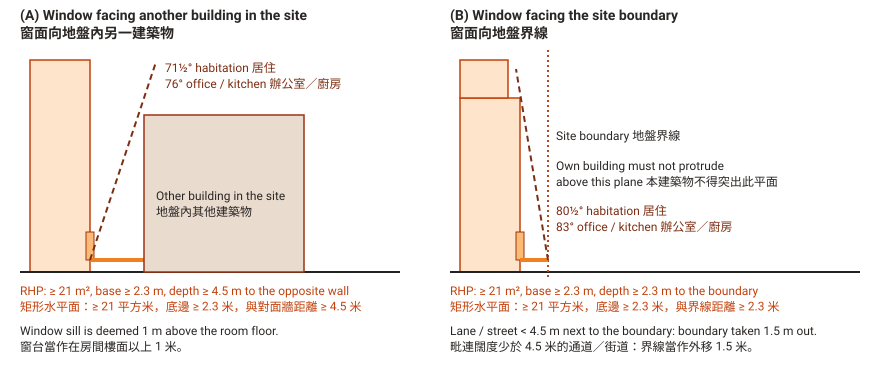

---
tags:
  - Topic guide 專題指南
  - Lighting & ventilation 照明及通風
  - Prescribed window 訂明的窗
  - Domestic 住用
  - Kitchen 廚房
  - Bathroom 浴室
  - Staircase 樓梯
  - Fire safety 消防安全
  - Balcony & utility platform 露台及工作平台
  - Fire resisting construction 耐火結構
  - Means of escape 逃生途徑
  - GFA concession 樓面面積寬免
  - Energy efficiency 能源效率
summary: "Natural lighting and ventilation: prescribed windows, B(P)R 30–36, and the APP-130 performance route."
keywords: lighting, ventilation, 照明, 通風, prescribed window, 訂明的窗, VDF, APP-130, natural ventilation, 自然通風
---

# Lighting and ventilation <small>照明及通風（專題指南）</small>

!!! abstract "What this guide covers 本指南內容"
    Natural lighting and ventilation for **habitable rooms, offices, kitchens, bathrooms and lavatories**: the prescriptive window rules, the **performance-based** alternative, mechanical ventilation, open kitchens and common areas, and the latest APSEC positions.
    **居住房間、辦公室、廚房、浴室及洗手間**的天然照明及通風：訂明窗規定、**性能為本**方法、機械通風、開放式廚房及公用地方，以及 APSEC 最新立場。

    Main sources 主要來源: [B(P)R 29–37](../regulations/bpr-24-37.md) · [B(P)R 71](../regulations/bpr-71-73.md) · [APP-130](../pnap/app-130.md) · [APP-98](../pnap/app-98.md) · [ADV-30](../pnap/adv-30.md) · [ADV-25](../pnap/adv-25.md) · [ADV-26](../pnap/adv-26.md) · [APP-150](../pnap/app-150.md) · [FS Code Part B](../codes/fsc-part-b-means-of-escape.md)

## Jump to 快速跳轉 {#jump}

| Question 問題 | Section 章節 |
|---|---|
| Which route? 用哪種方法 | [Decision route](#the-big-picture) |
| Prescribed window sizes 訂明窗面積 | [1. Prescriptive rules](#1-the-prescriptive-rules-bpr-2933) · [6. Geometry in detail](#6-geometry) |
| Performance route (VDF, UVA) 性能方法 | [2. APP-130](#2-the-performance-based-route-app-130) |
| Mechanical ventilation 機械通風 | [3. Mechanical](#3-mechanical-ventilation) |
| Bathrooms, lavatories 浴室 | [4. Bathrooms](#4-bathrooms-and-lavatories) · [Sanitary fitment calculator](../regulations/sanitary-fitments.md) |
| Open kitchens 開放式廚房 | [5. Open kitchens](#5-open-kitchens) |
| Energy / natural ventilation for comfort (RTTV, NVTC) 能源及自然通風 | [7. NVTC](#7-nvtc) |
| Worked example and checklist 例子及清單 | [8. Worked example](#8-worked-example) · [9. Submission checklist](#9-checklist) |
| Common mistakes, APSEC 常見錯誤 | [Mistakes](#common-mistakes) · [APSEC](#apsec-positions) |

## At a glance 重點摘要 {#at-a-glance}

=== "English"

    - **Prescriptive** ([B(P)R 30–32](../regulations/bpr-24-37.md)): habitable rooms, offices and kitchens need a **prescribed window** with glass ≥ **1/10** and openable area ≥ **1/16** of the floor area, facing a street or an open space; room depth up to **9 m** from the window.
    - **Performance route** ([APP-130](../pnap/app-130.md), Form **BA16**): **VDF ≥ 8 %** (habitable) or **≥ 4 %** (kitchen), **1.5 ACH** natural ventilation; with cross ventilation, room depth up to **12 m**.
    - **Offices** that cannot meet the window rules: **mechanical ventilation 5 ACH** plus artificial lighting ([B(P)R 34](../regulations/bpr-24-37.md), [ADV-30](../pnap/adv-30.md)).
    - **Bathrooms and lavatories**: window glass and opening each ≥ **1/10** of floor area, or mechanical ventilation **5 ACH** for internal bathrooms ([B(P)R 36](../regulations/bpr-24-37.md), [APP-98](../pnap/app-98.md)).
    - **Open kitchens** in flats need fire safety measures too ([FS Code Part B](../codes/fsc-part-b-means-of-escape.md)).

=== "中文"

    - **規定方法**（[第 30–32 條](../regulations/bpr-24-37.md)）：居住房間、辦公室及廚房須設**訂明窗**，玻璃 ≥ 樓面面積 **1/10**、可開啟部分 ≥ **1/16**，並面向街道或休憩用地；房間由窗起計深度最多 **9 米**。
    - **性能方法**（[APP-130](../pnap/app-130.md)，表格 **BA16**）：**垂直採光系數 ≥ 8%**（居住房間）或 **≥ 4%**（廚房）、天然通風**每小時 1.5 次換氣**；如有對流通風，房深可達 **12 米**。
    - **辦公室**未能符合窗戶規定：**機械通風每小時 5 次換氣**加人工照明（[第 34 條](../regulations/bpr-24-37.md)、[ADV-30](../pnap/adv-30.md)）。
    - **浴室及洗手間**：窗玻璃及開口各 ≥ 樓面面積 **1/10**，或內置浴室以機械通風**每小時 5 次換氣**（[第 36 條](../regulations/bpr-24-37.md)、[APP-98](../pnap/app-98.md)）。
    - 住宅**開放式廚房**另須消防措施（[消防守則 B 部](../codes/fsc-part-b-means-of-escape.md)）。

## Which route should I use? 應採用哪種方法？ {#the-big-picture}

<figure markdown>
  { width="600" loading=lazy }
  <figcaption>Choosing the prescriptive or performance-based route. 選擇規定或性能方法。 Diagram prepared for this site.</figcaption>
</figure>

## 1. What do the prescriptive window rules require? 訂明窗規定是甚麼？ {#1-the-prescriptive-rules-bpr-2933}

| Requirement 要求 | Standard 標準 | Reg. 條 |
|---|---|---|
| Which rooms 適用房間 | Rooms for **habitation**, **offices** and **kitchens** 居住房間、辦公室及廚房 | 29–31 |
| Window glass area 玻璃面積 | ≥ **1/10** of the floor area 樓面面積十分之一 | 30 |
| Openable area 可開啟面積 | ≥ **1/16** of the floor area; top of opening ≥ **2 m** above floor 十六分之一，開口頂部離地 ≥ 2 米 | 30 |
| What the window faces 窗面向 | A street ≥ **4.5 m** wide, or a clear **rectangular horizontal plane (RHP)** ≥ **21 m²**, with obstruction angles **71½° / 76°** and **80½° / 83°** 闊 4.5 米的街道或 ≥ 21 平方米的長方形水平面 | 31 |
| Room depth 房間深度 | No part more than **9 m** from the window 任何部分距窗 ≤ 9 米 | 32 |
| Windows to balconies 面向露台的窗 | May face an **unenclosed verandah or balcony** if L&V is not prejudiced 可面向開敞露台 | 71 |
| Neighbours 鄰近建築物 | Do not reduce other buildings' L&V below the B(P)R standard 不得令其他建築物低於標準 | 37 |

!!! example "Quick check 快速核算"
    Bedroom **12 m²** → glass ≥ 12 ÷ 10 = **1.2 m²**; openable ≥ 12 ÷ 16 = **0.75 m²**, with the top of the opening at least 2 m above floor. 睡房 12 平方米 → 玻璃 ≥ 1.2 平方米，可開啟 ≥ 0.75 平方米。

## 2. When can the performance-based route be used? 何時可用性能方法？ {#2-the-performance-based-route-app-130}

=== "English"

    Use it when the prescriptive window rules cannot be met, for **habitable rooms and domestic kitchens**:

    - **Daylight**: Vertical Daylight Factor (**VDF**) at the window centre ≥ **8%** (habitable room) or ≥ **4%** (kitchen).
    - **Ventilation**: **1.5 air changes per hour** by natural means; kitchens also **5 ACH mechanical**.
    - **Unobstructed Vision Area (UVA)**: the open area in a **100° cone** in front of the window, sized by façade height and glazing ratio (**10 / 15 / 20%** of floor area).
    - **Openings**: primary openings ≥ **1/16** of floor area; with **cross ventilation** (primary and secondary ≥ **2%** each), room depth may reach **12 m**.
    - Show compliance by the **simplified method** (App. A) or by **daylight simulation / CFD** (Apps B, C); apply on **Form BA16**. The design may be partly prescriptive and partly performance-based.

=== "中文"

    無法符合訂明窗規定時，可用於**居住房間及住宅廚房**：

    - **日光**：窗中心的**垂直日光系數** ≥ **8%**（居住房間）或 ≥ **4%**（廚房）。
    - **通風**：自然通風**每小時換氣 1.5 次**；廚房另須**機械通風每小時 5 次**。
    - **無遮擋視域範圍**：窗前 **100° 錐形**範圍內的空曠面積，按外牆高度及玻璃比率（樓面面積的 **10／15／20%**）決定。
    - **開口**：主要開口 ≥ 樓面面積 **1/16**；如有**對流通風**（主要及次要開口各 ≥ **2%**），房間深度可達 **12 米**。
    - 以**簡化方法**（附錄 A）或**日光模擬／計算流體力學**（附錄 B、C）證明，並以**表格 BA16** 申請；可部分採用規定方法、部分採用性能方法。

## 3. When is mechanical ventilation accepted? 何時接受機械通風？ {#3-mechanical-ventilation}

| Situation 情況 | Requirement 要求 | Source 來源 |
|---|---|---|
| Office that cannot meet reg. 31 不符合第 31 條的辦公室 | Mechanical ventilation **≥ 5 ACH** to all parts + approved artificial light; large ducted systems: engage an **RPE (Building Services)** | [B(P)R 34](../regulations/bpr-24-37.md), [ADV-30](../pnap/adv-30.md) |
| Internal bathroom / lavatory (domestic) 內置浴室 | Artificial light + **5 ACH** mechanical; permanent ventilation ≥ **1/20** of floor area; duct access panels every **4 m** | [APP-98](../pnap/app-98.md) |
| Bathroom extractor fan 浴室抽氣扇 | About **10.2 L/s per m²**; provide **air relief** (door undercut / louvre); keep traps sealed | [ADV-25](../pnap/adv-25.md) |
| Common corridors and lift lobbies 公用走廊及升降機大堂 | Promote natural ventilation; else mechanical with enough fresh air, no short-circuiting | [ADV-26](../pnap/adv-26.md) |
| Industrial-to-office conversion 工廈改裝為辦公室 | Modification of regs 30–31 with artificial light, mechanical ventilation and **BEAM Plus 40% EU and IEQ** | [APP-130](../pnap/app-130.md), [APP-150](../pnap/app-150.md) |
| Ductwork through compartments 穿過防火間隔的風管 | Fire dampers; inspection every **12 months** | [Cap. 123J](../regulations/bvsr-123j.md) |

## 4. What do bathrooms and lavatories need? 浴室及洗手間有何要求？ {#4-bathrooms-and-lavatories}

- A room with a WC or urinal needs a window with glass ≥ **1/10** and opening ≥ **1/10** of the floor area, and must **not open directly** into a room used for food ([B(P)R 36](../regulations/bpr-24-37.md)). 有水廁或尿兜的房間須有窗，玻璃及開口各 ≥ 1/10，且不得直接通往食物房間。
- Internal (windowless) bathrooms in flats are accepted by **modification** under the [APP-98](../pnap/app-98.md) conditions. 住宅內置浴室可按 APP-98 條件以變通方式批准。

## 5. Are open kitchens allowed? 可否設開放式廚房？ {#5-open-kitchens}

Open kitchens raise **fire safety** as well as ventilation questions (escape routes past the kitchen, fire-rated walls, smoke detectors, sprinklers). BD has answered these mainly at APSEC; the current positions are listed below. See also [FS Code Part B](../codes/fsc-part-b-means-of-escape.md). 開放式廚房同時涉及**消防安全**（逃生途徑、耐火牆、煙霧感應器、花灑）及通風，屋宇署主要在 APSEC 作出澄清，現行立場見下文。

## 6. How is the prescribed window geometry checked? 訂明窗幾何如何核算？ {#6-geometry}

| Check 檢查 | Habitable room 居住房間 | Office / kitchen 辦公室／廚房 | Reg. 條 |
|---|---|---|---|
| Faces a **street ≥ 4.5 m** wide 面向 ≥ 4.5 米街道 | Passes automatically 自動符合 | Passes | 31(1)(a) |
| **RHP** at sill level 矩形水平面 | Area **≥ 21 m²**, base **≥ 2.3 m**, depth **≥ 4.5 m** to a wall opposite in the site, or **≥ 2.3 m** to the site boundary | Same | 31(2) |
| Narrow lane alongside boundary 窄巷 | Depth measured to **1.5 m beyond** the boundary, or to the lane **centre line** if the lane < **3 m** wide | Same | 31(2)(e) |
| Inclined plane from the RHP base (other buildings in the site) 傾斜面 | **71½°** not breached | **76°** | 31(1)(b)–(c) |
| Inclined plane from the boundary (own building) 界線傾斜面 | **80½°** | **83°** | 31(1)(d) |
| Sill level 窗台 | **Deemed 1 m** above floor (glazing below 1 m does not lower it) | Same | 31(3) |
| Room depth 房深 | **≤ 9 m** from the window | Same | 32 |
| Enclosed verandah / balcony 圍封露台 | Outer window sized on **combined** floor area | Same | 33 |

<figure markdown>
  { loading=lazy }
  <figcaption>Reg. 31: RHP and inclined planes (simplified, prepared for this site). 第 31 條簡化剖面。</figcaption>
</figure>

**Projections that can block the planes 可能阻擋傾斜面的伸出物**: bay windows, balconies, utility platforms, A/C platforms and canopies **above** a prescribed window; sunshades **≤ 750 mm** are accepted as not obstructing ([APP-19](../pnap/app-19.md), [APP-156](../pnap/app-156.md) para. 13). UVA may encroach on balconies and utility platforms in the scenarios accepted at APSEC Aug 2024. 窗上方的伸出物可能阻擋；750 毫米以內遮陽篷不視為阻擋。

## 7. How does this link to energy efficiency and natural ventilation for comfort? 與能源效率及自然通風的關係 {#7-nvtc}

B(P)R 30 sets the **health minimum**. For GFA concessions, residential projects must also report **natural ventilation for thermal comfort (NVTC)** under the [RTTV Guidelines](../codes/rttv-2014.md#nvtc) ([APP-156](../pnap/app-156.md)):

| | B(P)R 30 minimum 最低要求 | NVTC (thermal comfort) 熱舒適 |
|---|---|---|
| Openable area 可開啟面積 | ≥ **1/16** of floor area | Cross ventilation **≥ 1/8**; single-sided **≥ 1/5** |
| Depth 深度 | ≤ **9 m** (12 m with cross ventilation under APP-130) | Cross path **< 12 m**, one turn ≤ 90°; single-sided ≤ **4.5 m** |
| Glazing 玻璃 | ≥ 1/10 | **VLT ≥ 50 %** on prescribed windows; external reflectance ≤ 20 % |
| A/C 冷氣 | — | Heat rejection **≥ 1.5 m** from neighbours' openings |

## 8. Worked example: a 2-bedroom flat 例子：兩房單位 {#8-worked-example}

!!! warning "Illustrative only 只作說明"
    Dimensions invented to show the checks. 尺寸為虛構。

| Room 房間 | Area 面積 | Glass ≥ 1/10 玻璃 | Openable ≥ 1/16 可開啟 | Depth 深度 | Other 其他 |
|---|---|---|---|---|---|
| Living / dining 客飯廳 | 22 m² | 2.2 m² | 1.375 m² | 8.5 m ≤ 9 m ✓ | Faces 6 m street → passes reg. 31 |
| Bedroom 1 睡房 | 9 m² | 0.9 m² | 0.5625 m² | 3.2 m ✓ | Faces RHP 2.5 × 8.4 m = 21 m², base 2.5 ≥ 2.3 ✓, 71½° clear |
| Bedroom 2 睡房 | 7 m² | 0.7 m² | 0.4375 m² | 3.0 m ✓ | Same RHP; bay window above? check 71½° |
| Kitchen 廚房 | 5 m² | 0.5 m² | 0.3125 m² | 2.5 m ✓ | **76°** plane; or mechanical 5 ACH + APP-130 VDF ≥ 4 % |
| Bathroom 浴室 | 3.5 m² | 0.35 m² | **0.35 m²** (1/10) | — | Or internal bathroom per [APP-98](../pnap/app-98.md): 5 ACH, permanent vent ≥ 1/20 |

## 9. Submission checklist 呈交清單 {#9-checklist}

- [ ] Schedule of rooms with floor area, window glass and openable areas (≥ 1/10, ≥ 1/16; bathrooms 1/10). 房間面積及窗面積表。
- [ ] RHP diagrams with dimensions, 71½° / 76° and 80½° / 83° sections; street widths. 矩形水平面及傾斜面圖。
- [ ] 9 m depth shown on plans. 9 米深度。
- [ ] APP-130 route: **Form BA16**, VDF / UVA calculation or simulation, ventilation openings. 性能方法須 BA16。
- [ ] Mechanical ventilation: ACH, duct routes, fire dampers ([Cap. 123J](../regulations/bvsr-123j.md)), RPE(BS) where needed. 機械通風。
- [ ] Residential GFA concession projects: RTTV / NVTC statement ([APP-156](../pnap/app-156.md)). 住宅寬免另交 RTTV／NVTC。

## Common mistakes 常見錯誤 {#common-mistakes}

=== "English"

    - Not checking how the **deemed sill level** (glazing below 1 m) applies to your window: see the APSEC items of Nov 2017 and May 2020 on B(P)R 30 and 31.
    - Forgetting the **9 m** room depth limit when the window is on one side only.
    - Using APP-130 without submitting **Form BA16** and the supporting calculation or simulation.
    - Internal bathroom fans without **air relief**, causing negative pressure and dry traps.

=== "中文"

    - 未核實**當作窗台水平**（離地 1 米以下的玻璃）如何應用：見 2017 年 11 月及 2020 年 5 月有關第 30 及 31 條的 APSEC 項目。
    - 單面開窗時忽略 **9 米**房間深度限制。
    - 採用 APP-130 但未提交**表格 BA16** 及計算或模擬。
    - 內置浴室抽氣扇未設**補氣口**，造成負壓及水封乾涸。

<!-- GUIDE APSEC START -->
## Latest APSEC positions 最新 APSEC 立場 {#apsec-positions}

BD's most recent clarifications on this topic from the [APSEC Discussion Forum](../apsec/index.md), newest first. Items later revisited are left out; only the **current position** is shown (25 relevant items in total). 屋宇署最新澄清，只列現行立場。

- **[FS Code – Handrail on each side of the required staircase](../apsec/2025.md#i202511215)** <small>21 Nov 2025</small> BD advised that the understanding of HKIA was correct. Nevertheless, BD reminded that the provision of staircase handrails should comply with all relevant requirements as stipulated in the Design Manual: Barrier Free …
- **[FS Code - Exit from Rooms and/or Fire Compartment](../apsec/2025.md#i202511212)** <small>21 Nov 2025</small> BD advised that the number of exits for large scale toilets/ lavatories should be assessed on case basis to ensure adequate means of escape in case of fire. Nevertheless, apart from Subsection B7 of the FS Code, the …
- **[Rooms Containing Soil Fitments – Regulation 36(2) of the B(P)R](../apsec/2025.md#i202508086)** <small>8 Aug 2025</small> BD advised that the concerned modification of regulation 36 of the B(P)R could be applied to either the lighting or ventilation requirement.
- **[Common Secondary Exit Door for Two Adjoining Rooms](../apsec/2025.md#i2025050917)** <small>9 May 2025</small> BD advised that additional information including the travel distance between the furthest point on a storey or within a fire compartment to the centre of the fire rated door to a protected exit or a required staircase …
- **[Mechanical Ventilation in Kiosks or Guard Rooms](../apsec/2025.md#i202505094)** <small>9 May 2025</small> BD advised that whenever AP submitted a Form BA16 treating kiosks or guard rooms as ancillary offices and applying for modification of regulation 30 of the Building (Planning) Regulations (B(P)R), BD would favourably …
- **[Prescribed Window facing Street with Overhanging Building Structure above](../apsec/2025.md#i202502147)** <small>14 Feb 2025</small> BD advised that according to regulation 30(2)(b) of the B(P)R, prescribed windows were required to face directly into external air. In this regard, BD would consider the scenario put forward by HKIA on case basis, in …
- **[Aperture protected with Ventilating Louvres for Internal Bathroom](../apsec/2024.md#i2024080928)** <small>9 Aug 2024</small> BD advised that AAP’s proposed provision of louvre for compliance with the requirements in paragraph 3(b) of PNAP APP-98 was acceptable.
- **[UVA encroaching on Balcony and Utility Platform (UP)](../apsec/2024.md#i202408096)** <small>9 Aug 2024</small> BD advised that HKIA’s understanding was correct and the scenarios depicted in the diagram were generally acceptable. In passing, BD advised that PNAP APP-130 was currently under review including the measurement of UVA …
- **[Assessment of Occupant Capacity](../apsec/2023.md#i2023111722)** <small>17 Nov 2023</small> BD advised that separate assessments of occupant capacity within a room, a fire compartment and a storey were all required for demonstrating the compliance with different requirements under the FS Code, including the …
- **[Lighting and Ventilation of Rooms used as Office – Regulation 30 of the B(P)R](../apsec/2023.md#i2023111718)** <small>17 Nov 2023</small> BD advised that the simplified assessment method on natural ventilation requirement stipulated in PNAP APP-130 was not applicable to office. Meanwhile, the applicability of the said PNAP was under review.
- **[Discharge Value Calculation](../apsec/2023.md#i202311175)** <small>17 Nov 2023</small> BD advised that under normal circumstances, it might not be necessary to demonstrate the sufficiency of the discharge value of each required staircase by dividing the total occupant capacity of the storeys by the number …
- **[Discharge Value and Width of Required Staircase](../apsec/2023.md#i202308047)** <small>4 Aug 2023</small> (a) BD advised that the DV of the required staircase in the scenario described by HKIA should be calculated as follows: DV of required staircase (with increased width) serving lower storeys (above G/F) + DV of required …
- **[Lighting and Ventilation – Regulation 30 & 31 of the Building (Planning) Regulations (B(P)R)](../apsec/2022.md#i2022112511)** <small>25 Nov 2022</small> BD advised that for prescribed window facing into a space uncovered and unobstructed above the area delineated by the rectangular horizontal plane, the sill of the window should be deemed to be at a level of 1 m …
- **[Fire Resistance Rating (FRR) for an Enclosed Footbridge over a Public Street between Two Buildings – Clause C15.1 of the FS Code](../apsec/2022.md#i202208127)** <small>12 Aug 2022</small> BD advised that with regard to the situation illustrated in the sketch that the buildings are situated on two different sites separated by a public street and an enclosed footbridge is proposed to be constructed as part …

<!-- GUIDE APSEC END -->

## Related 相關文件 {#related}

| Document 文件 | What it covers 內容 |
|---|---|
| [B(P)R 24–37](../regulations/bpr-24-37.md) | Prescribed windows, mechanical ventilation, lavatories 訂明窗、機械通風、洗手間 |
| [APP-130](../pnap/app-130.md) | Performance-based L&V 性能為本照明通風 |
| [APP-98](../pnap/app-98.md) · [ADV-25](../pnap/adv-25.md) | Bathrooms 浴室 |
| [ADV-30](../pnap/adv-30.md) · [ADV-26](../pnap/adv-26.md) | Offices and common areas 辦公室及公用地方 |

---
<small>Topic guide prepared from the pages on this site and the cited documents; always check the current BD documents. 本指南根據本網站及所引文件整理，請以屋宇署最新文件為準。</small>
