---
tags:
  - Topic guide 專題指南
  - Minor works 小型工程
  - Statutory period 法定期限
  - Registration 註冊
  - Signboard 招牌
  - A&A works 改動及加建工程
  - Plan submission & approval 呈交及審批
  - Structural 結構
  - Site supervision 地盤監督
  - Fire safety 消防安全
  - Wind 風力
  - Occupation permit 佔用許可證
  - Green & amenity features 環保及適意設施
  - Elderly-friendly 長者友善
  - Geotechnical 岩土
  - Demolition 拆卸
summary: "Minor works Classes I–III, designated exempted works, the 7-day and 14-day rules, contractors and validation schemes."
keywords: minor works, 小型工程, MWCS, DEW, designated exempted works, 指定豁免工程, Class I, Class II, Class III, signboard validation, 招牌檢核
---

# Minor works: code, guidelines and procedure <small>小型工程：法例、指引及程序（專題指南）</small>

!!! abstract "What this guide covers 本指南內容"
    How small building works are controlled: **designated exempted works**, **minor works Classes I–III** and when full approval is needed; who must be appointed, the **7-day / 14-day** rules, contractor registration and fees, validation schemes, and the **Technical Guidelines** with item-by-item thresholds.
    小規模建築工程的管制：**指定豁免工程**、**第 I 至 III 級別小型工程**及何時須事先批准；須委任的人士、**7 天／14 天**規定、承建商註冊及費用、檢核計劃，以及列出各項目門檻的**技術指引**。

    Main sources 主要來源: [B(MW)R Cap. 123N](../regulations/bmwr-123n.md) · [MW Technical Guidelines](../regulations/mw-technical-guidelines.md) · [APP-147](../pnap/app-147.md) · [APP-148](../pnap/app-148.md) · [APP-149](../pnap/app-149.md) · [Cap. 123O fees](../regulations/bmwfr-123o.md) · [APP-155](../pnap/app-155.md)

## At a glance 重點摘要 {#at-a-glance}

=== "English"

    - **Three routes**: **designated exempted works** (no submission), **minor works** (**187** items, Classes **I–III**, simplified requirements), or full **approval and consent** ([B(MW)R](../regulations/bmwr-123n.md)).
    - **Class I**: appoint a prescribed building professional (AP, plus RSE / RGE if needed) **and** a PRC; notice with plans **≥ 7 days** before starting; certificate **within 14 days** of completion.
    - **Class II**: PRC; notice **≥ 7 days** before; certificate **within 14 days**. **Class III**: PRC; **one submission within 14 days** after completion.
    - Contractors register as **RMWC (Individual)** for Class III items or **RMWC (Company)** for types and classes ([APP-148](../pnap/app-148.md)); one AS per submission ([APP-149](../pnap/app-149.md)).
    - **Signboards** erected before **2 Sep 2013** can be validated and re-validated every **5 years** ([APP-155](../pnap/app-155.md)).

=== "中文"

    - **三條途徑**：**指定豁免工程**（毋須呈交）、**小型工程**（**187** 項，第 **I–III** 級別，簡化規定），或須事先**批准及同意**（[第 123N 章](../regulations/bmwr-123n.md)）。
    - **第 I 級別**：委任訂明建築專業人士（認可人士，需要時加註冊結構／岩土工程師）**及**訂明註冊承建商；動工 **≥ 7 天前**連圖則通知；完工後 **14 天**內呈交證明書。
    - **第 II 級別**：訂明註冊承建商；動工 **≥ 7 天前**通知；**14 天**內呈交證明書。**第 III 級別**：訂明註冊承建商；完工後 **14 天**內**一次呈交**。
    - 承建商以**個人**（第 III 級別項目）或**公司**（類型及級別）註冊（[APP-148](../pnap/app-148.md)）；每份呈交一名獲授權簽署人（[APP-149](../pnap/app-149.md)）。
    - **2013 年 9 月 2 日**前豎設的**招牌**可申請檢核，每 **5 年**重新檢核（[APP-155](../pnap/app-155.md)）。

## Which route do the works take? 工程應走哪條途徑？ {#choosing-the-route}

<figure markdown>
  { width="560" loading=lazy }
  <figcaption>DEW, minor works Class I–III, or full approval. 指定豁免工程、第 I 至 III 級別小型工程，或事先批准。</figcaption>
</figure>

=== "English"

    - **Designated exempted works (DEW)** (B(MW)R Schedule 2): very small works with no submission, but they must follow the DEW conditions and the BO standards.
    - **Minor works** (Schedule 1): **187 items** in **3 classes** and **8 types**, carried out under the **simplified requirements** instead of prior approval and consent.
    - **Anything bigger** needs **approval and consent** under BO s.14 ([submission guide](submission-to-op.md)).
    - Check the item and its limits in the **TG Chapter 3** table ([summary](../regulations/mw-technical-guidelines.md)).

=== "中文"

    - **指定豁免工程**（附表 2）：極小規模工程，毋須呈交，但須符合豁免條件及條例標準。
    - **小型工程**（附表 1）：**3 個級別**、**8 種類型**共 **187 個項目**，按**簡化規定**進行，毋須事先批准及同意。
    - **超出範圍**的工程須按條例第 14 條取得**批准及同意**（[呈交指南](submission-to-op.md)）。
    - 項目及限制請查閱**技術指引第 3 章**（[摘要](../regulations/mw-technical-guidelines.md)）。

## Who does what, and by when? 誰負責甚麼、何時完成？ {#who-does-what-and-when}

<figure markdown>
  { width="760" loading=lazy }
  <figcaption>Minor works: who does what, and when. 小型工程：負責人及時限。</figcaption>
</figure>

| Class 級別 | Appoint 委任 | Before works 動工前 | After works 完工後 |
|---|---|---|---|
| **I** | Prescribed building professional (**AP**, plus **RSE / RGE** where needed) **and** a prescribed registered contractor (PRC) | Notice of commencement with **plans and details**, supervision plan, **≥ 7 days** before | Certificate of completion **within 14 days**, with photos and as-built plans |
| **II** | **PRC** (registered for the class / type) | Notice of commencement **≥ 7 days** before | Certificate of completion **within 14 days** |
| **III** | **PRC** (company or individual for the item) | — | **One submission within 14 days** after completion |

<small>Forms MW01–MW12 (see [APP-149](../pnap/app-149.md) and [APP-60](../pnap/app-60.md)). Starting Class I or II works less than 7 days after the notice, or missing the 14-day certificate, is an offence ([APP-147](../pnap/app-147.md)). 表格 MW01–MW12。</small>

## Which contractor, signatory and fees? 承建商、簽署人及費用 {#contractors-signatories-and-fees}

- **Registers**: RMWC (Company) for types and classes; RMWC (Individual) for Class III items ([APP-148](../pnap/app-148.md)). 公司按類型及級別註冊，個人按第 III 級別項目註冊。
- **Authorised signatory**: one AS per submission, named on every form ([APP-149](../pnap/app-149.md)). 每份呈交一名獲授權簽署人。
- **Fees**: e.g. company application **$2,920** (Class I), **$1,100** (Class II), **$730** (Class III only); individual **$290 / $155** ([Cap. 123O](../regulations/bmwfr-123o.md)). 費用見第 123O 章。

## Can existing works be validated? 現有工程可否檢核？ {#validation-schemes}

- **Household Minor Works Validation Scheme** and **Minor Amenity Features Validation Scheme**: existing unauthorised household items (A/C supports, drying racks, small canopies) can be inspected, strengthened and certified to stay (TG Ch. 7). 家居小型工程及小型適意設施檢核計劃。
- **Signboard Validation Scheme**: signboards erected before **2 Sep 2013** within minor works limits; re-validate every **5 years** ([APP-155](../pnap/app-155.md)). 招牌檢核計劃，每 5 年重新檢核。

<figure markdown>
  { width="700" loading=lazy }
  <figcaption>Signboard validation every 5 years (APP-155). 招牌每 5 年檢核。</figcaption>
</figure>

## Which technical requirements still apply? 仍須符合哪些技術要求？ {#technical-requirements-to-remember}

=== "English"

    - Every item still has to meet the **building regulations and codes** listed in the TG: B(C)R, FS Code, Glass Code, Wind Code, APP-110 (barriers), APP-37 (windows), APP-166 (grilles), APP-146 (gates).
    - Since **1 Aug 2026**, relevant items must also meet the **elderly-friendly requirements** of [B(P)R 73](../regulations/bpr-71-73.md) (TG amendment Aug 2026); see the [accessibility guide](barrier-free-access.md).
    - Since **Oct 2025**, scaffold nets, screens and sheets must be **fire retardant** (TG 11.2.10).
    - Works to **common parts** need the owners' corporation or manager's consent; post a notice for other occupiers.
    - **Cantilevered slabs** must not take extra load in most items; check the "simple comparison" limits in the TG.

=== "中文"

    - 每個項目仍須符合技術指引所列**規例及守則**：《建築物（建造）規例》、消防守則、玻璃守則、風力守則、APP-110（欄障）、APP-37（窗）、APP-166（柵檔）、APP-146（閘）。
    - 自 **2026 年 8 月 1 日**起，相關項目須符合[第 73 條](../regulations/bpr-71-73.md)**長者友善設計**要求（技術指引 2026 年 8 月修訂）；見[無障礙指南](barrier-free-access.md)。
    - 自 **2025 年 10 月**起，棚架保護網、保護幕及帆布須具**阻燃**特性（第 11.2.10 段）。
    - 涉及**公用部分**的工程須取得業主立案法團或管理處同意，並張貼通告。
    - 大部分項目不得對**懸臂式平板**造成額外荷載；請核對技術指引的「簡單比較」。

<!-- GUIDE APSEC START -->
## Latest APSEC positions 最新 APSEC 立場 {#apsec-positions}

BD's most recent clarifications on this topic from the [APSEC Discussion Forum](../apsec/index.md), newest first. Items later revisited are left out; only the **current position** is shown (10 relevant items in total). 屋宇署最新澄清，只列現行立場。

- **[Supporting frames for air-conditioning unit under Class II Minor Works](../apsec/2025.md#i2025112111)** <small>21 Nov 2025</small> BD advised that the recommended design and details for Class II and Class III minor works in the Technical Guidelines on Minor Works Control System (2024 edition) were provided for Prescribed Registered Contractors’ …
- **[Indication of Minor Works Items on Plans submitted for Alteration and Addition (A&A) Works](../apsec/2025.md#i202508082)** <small>8 Aug 2025</small> BD advised that indication of minor works items on plans would be considered appropriate if such information was an essential part of the proposed A&A works. If such minor works were essential to the proposed A&A works …
- **[Minor Works - Partition Walls inside Flats](../apsec/2025.md#i2025021420)** <small>14 Feb 2025</small> BD advised that the erection of dry wall partition of relatively low density in a flat did not fall into any minor works items. Provided that the works were not carried out in contravention of any regulations related to …
- **[Repair Works Under Minor Works Item 1.17](../apsec/2024.md#i2024112218)** <small>22 Nov 2024</small> BD advised that approval plans referred to all plans approved under the development. The approved method statement and details could be adopted for the said repair works under the MWCS, provided all specifications and …
- **[Signboard with Display System consisting of Light Emitting Diodes (LED) – Minor Works Item 1.22](../apsec/2024.md#i2024080927)** <small>9 Aug 2024</small> BD advised that PBSCA’s understanding was correct. BD also reminded that apart from the dimensional requirements, the signboard with vinyl display surface should comply the other requirements, including those related to …
- **[Circumstances in which a Supervision Plan is Not Required](../apsec/2023.md#i2023050519)** <small>5 May 2023</small> BD advised that building repairs works carried out under MWCS as Class I minor works would not require the submission of site supervision plan. However, Prescribed Building Professionals and Prescribed Registered …
- **[Implementation of Minor Works for Minor Structural Works in New Development](../apsec/2023.md#i2023050513)** <small>5 May 2023</small> BD advised that the legislative intent of the MWCS was to facilitate the carrying out of minor works in existing buildings. BD also advised that further streamlining measures for the approval of plans and the processing …
- **[Minor Works Items indicated on A&A Plans](../apsec/2022.md#i2022081226)** <small>12 Aug 2022</small> BD clarified that saved for special circumstances, there was no such requirement in general.
- **[Building (Minor Works) Regulation (B(MW)R) – Height of Construction](../apsec/2021.md#i2021111216)** <small>12 Nov 2021</small> BD advised that for the interpretation of section 37(4)(a) of the B(MW)R, BD took the height of the minor works concerned be the height of the construction, i.e. the height of the pole in this case. Regulation 12(4) of …
- **[PNAP ADM-8](../apsec/2018.md#i2018011914)** <small>19 Jan 2018</small> Members noted and would assist to facilitate BD’s review.

<!-- GUIDE APSEC END -->

<!-- CL START -->
## Related circular letters 相關通告函件 {#circular-letters}

- 🔵 [Amendments to the "Technical Guidelines on Minor Works Control System (2024 Edition)"](../circulars/2026.md#cl-atgmwcse2026) <small>13 Aug 2026 · 《小型工程監管制度之技術指引》（2024年修訂版）修訂事宜</small>
- 🟢 [Registration and Minor Works Management System](../circulars/2026.md#cl-rmwms2026) <small>29 May 2026 · 註冊及小型工程管理系統</small>
- 🟢 [Updating of Specified Forms under Minor Works Control System](../circulars/2026.md#cl-usfmwcs2026) <small>13 Feb 2026 · 更新小型工程監管制度的指定表格</small>
- 🟢 [Streamlined Procedures for Carrying out Minor Works before Demolition of Buildings](../circulars/2017.md#cl-spmwdb2017) <small>26 Jun 2017 · 拆卸建築物前進行小型工程的簡化程序</small>
- 🟢 [Matters requiring Attention under the Minor Works Control System (MWCS)](../circulars/2017.md#cl-mramwcs2017) <small>27 Apr 2017 · 小型工程監管制度注意事項</small>
<!-- CL END -->

## Related 相關文件 {#related}

| Document 文件 | What it covers 內容 |
|---|---|
| [B(MW)R Cap. 123N](../regulations/bmwr-123n.md) | Items, DEW, procedures 項目、豁免工程、程序 |
| [MW Technical Guidelines](../regulations/mw-technical-guidelines.md) | Item thresholds, recommended details 項目門檻、建議詳圖 |
| [APP-147](../pnap/app-147.md) | Simplified requirements 簡化規定 |
| [APP-148](../pnap/app-148.md) · [APP-149](../pnap/app-149.md) · [Cap. 123O](../regulations/bmwfr-123o.md) | Registration, signatories, fees 註冊、簽署人、費用 |
| [APP-155](../pnap/app-155.md) · [APP-126](../pnap/app-126.md) | Signboards 招牌 |

---
<small>Topic guide prepared from the pages on this site and the BD Technical Guidelines; always check the current BD documents. 本指南根據本網站及屋宇署技術指引整理，請以最新文件為準。</small>
