---
tags:
  - Topic guide 專題指南
  - Occupation permit 佔用許可證
  - A&A works 改動及加建工程
  - Specified forms 指明表格
  - Statutory period 法定期限
  - Plan submission & approval 呈交及審批
  - Structural 結構
  - Minor works 小型工程
  - Geotechnical 岩土
  - Energy efficiency 能源效率
  - Drainage 排水
summary: "Occupation permit (OP / TOP) application for new buildings, and completion of A&A works: forms, documents, timeline, inspections, refusals, do's and don'ts, checklists and examples."
keywords: occupation permit, 佔用許可證, OP, TOP, BA12, BA13, BA14, APP-78, APP-13, record plans, completion certificate, 完工證明書, joint inspection, A&A completion
---

# Occupation permit application and completion of A&A works <small>佔用許可證申請及改動加建工程完工（專題指南）</small>

!!! abstract "What this guide covers 本指南內容"
    How to complete a **new building** and obtain the **occupation permit (OP)** or temporary OP (TOP) under BO s.21, and how to **complete A&A works** (no OP): forms, documents, timeline, inspections, refusals, do's and don'ts, checklists and examples.
    新建築物取得佔用許可證，以及改動加建工程完工的程序。

    Main sources 主要來源: [BO s.21](../regulations/bo-part-2-building-works.md) · [B(A)R 25–26, 46](../regulations/bar-123a.md) · [APP-78](../pnap/app-78.md) · [APP-13](../pnap/app-13.md) · [ADM-2](../pnap/adm-2.md) · [ADM-19](../pnap/adm-19.md) · [APP-31](../pnap/app-31.md) · [APP-29](../pnap/app-29.md) · [APP-114](../pnap/app-114.md) · [Forms](../forms/nb-aa.md)

## Jump to 快速跳轉 {#jump}

| Question 問題 | Section 章節 |
|---|---|
| What is an OP and why is it needed? 甚麼是佔用許可證 | [1. What and why](#what-why) |
| New building or A&A — which route? 新建築物或改動加建 | [2. Which route](#route) |
| Forms and who signs 表格及簽署人 | [3. Forms](#forms) |
| Documents to submit 須呈交文件 | [4. Documents](#documents) |
| Timeline 時間表 | [5. Timeline](#timeline) |
| Inspections 巡查 | [6. Inspections](#inspections) |
| Refusal and re-inspection 拒絕及再巡查 | [7. Refusal](#refusal) |
| TOP and part OP 臨時／部分佔用許可證 | [8. TOP](#top) |
| A&A completion (BA14) 改動加建完工 | [9. A&A](#aa) |
| After OP 佔用許可證後 | [10. After OP](#after-op) |
| Do's and don'ts 應做及不應做 | [11. Do's and don'ts](#dos-donts) |
| Checklists 核對清單 | [12. OP checklist](#checklist-op) · [13. A&A completion checklist](#checklist-aa) |
| Examples 例子 | [14. Examples](#examples) |

## 1. What is an OP and why is it needed? 甚麼是佔用許可證？ {#what-why}

| Point 要點 | Explanation 說明 | Source 來源 |
|---|---|---|
| What 甚麼 | Permit from the BA that a **new building** may be **occupied**; issued after the completion certificate and inspection 准許佔用新建築物的許可證 | BO s.21 |
| Why 原因 | Occupying a new building **without an OP** is an offence; the OP also triggers lease compliance (LandsD certificate of compliance), DMC, utilities and sales completion 未有佔用許可證佔用屬違法 | BO s.21, s.40 |
| Grounds for refusal 拒發理由 | Works not complete per approved plans; contravention of the BO; required plans or documents (e.g. Stage III GBP) not approved; required plant not operational | BO s.21(6); [APP-78](../pnap/app-78.md) |
| Deadline for BA 處理期限 | BA must decide within **14 days** of receiving the application (BO s.21(7)) | BO s.21(7) |
| A&A works 改動加建 | **No OP**. Completion is certified on **BA14**; BD acknowledges (normally **28 days**) | [APP-13](../pnap/app-13.md) |

## 2. Which route? 走哪條途徑？ {#route}

| Works 工程 | Completion form 完工表格 | OP? | BD reply 回覆 |
|---|---|---|---|
| New building 新建築物 | **[BA13](../forms/nb-aa.md#ba13)** (certificate + OP application) | ✅ OP | **14 days** (BO s.21) |
| New temporary building, or **part** of a new building 臨時建築物或部分新建築物 | **[BA12](../forms/nb-aa.md#ba12)** (TOP application) | ✅ TOP | 14 days |
| A&A, site formation, foundation, street works 改動加建、地盤平整、地基、街道工程 | **[BA14](../forms/nb-aa.md#ba14)** | ❌ | ~**28 days** |
| A&A under streamlined procedure 精簡程序 | **[BA14C](../forms/nb-aa.md#ba14a)** | ❌ | **14 days** (non-audit) / 28 (audit) |
| Demolition 拆卸 | **[BA14A / 14B](../forms/nb-aa.md#ba14a)** | ❌ | 28 / 14 days |
| Minor works 小型工程 | **[MW02 / MW04 / MW05](../forms/mw.md)** | ❌ | — |

## 3. Forms and who signs 表格及簽署人 {#forms}

| Signatory 簽署人 | Certifies 證明 | Deadline 期限 | Source |
|---|---|---|---|
| **Registered contractor(s)** 註冊承建商 | Works carried out per approved plans and the BO | **Within 7 days** of completion | B(A)R 25(1), 26(1) |
| **AP** 認可人士 | Works complete per approved plans and BO; co-ordinates the application | **Within 14 days** | B(A)R 25(2), 26(2) |
| **RSE** 註冊結構工程師 | Structural works | Within 14 days | B(A)R 25(3) |
| **RGE** 註冊岩土工程師 | Geotechnical works | Within 14 days | B(A)R 25(4) |
| Same contractor for spread footings (≤ 4.5 m) and superstructure | One certificate may cover both | — | [APP-13](../pnap/app-13.md) para. 2 |

## 4. Documents to submit 須呈交文件 {#documents}

Submit **before or with** BA13 — missing documents can cause **refusal**. Upload early by **ESH batch submission** ([APP-78](../pnap/app-78.md) paras. 2–3).

| Document 文件 | Notes 說明 | Source 來源 |
|---|---|---|
| **Completion certificates** BA13 / BA12 / BA14 | Signed by contractor, AP, RSE, RGE | B(A)R 25 |
| **Approved amendment plans** 已批准修訂圖則 | All amendments approved **before** OP; only minor positional deviations accepted | [APP-13](../pnap/app-13.md) para. 3 |
| **Stage III GBP** approved 第三階段圖則 | For staged GBP projects | [ADM-19](../pnap/adm-19.md) |
| **Record plans** 紀錄圖則 | **Consolidated GBP** as completed, each bearing BD's approval chop or the **AP's certification**; "new plans" under B(A)R 46 | [APP-13](../pnap/app-13.md) paras. 4–5 |
| **Materials and products schedule** 物料及產品清單 | With certificates of accepted materials / products | [APP-13](../pnap/app-13.md), [APP-118](../pnap/app-118.md) |
| **Test reports** 測試報告 | Concrete cubes, reinforcement, anchors, stone cladding, drainage tests (electronic standard formats from 2026) | [APP-16](../pnap/app-16.md), [APP-45](../pnap/app-45.md), [APP-58](../pnap/app-58.md) |
| **Water certificates** (potable and flushing) 供水證明書 | WSD certificates (WSD issues within 10 days of application) | B(A)R 25A |
| **Fire Certificate (FS 172)** and **FS Water Completion Advice** 消防證書 | FSD certificate for FSI; FS water supply (A&A with FSI change: **FS 251**) | [APP-31](../pnap/app-31.md) |
| **Lifts and escalators** 升降機 | Builder's works complete for EMSD permit to use; certificates for fireman's / accessible lifts | [APP-29](../pnap/app-29.md) |
| **Run-in / run-out certificate** 車輛出入口證明書 | Certificate of Completion of Vehicular Run-in and Run-out (hard copy) | [APP-144](../pnap/app-144.md) |
| **Record plans for RVD** 差餉物業估價署圖則 | Hard and soft copies (CAD) | [APP-13](../pnap/app-13.md) para. 7 |
| **Plan index** 圖則索引 | For record imaging | [ADM-10](../pnap/adm-10.md) |
| **Maintenance access plans** 維修通道圖則 | For referral to Labour Department | [CoP 2021](../codes/external-maintenance-2021.md) |
| **EV charging-enabling certificate** 電動車充電證明 | By RPE for car parks | [APP-2](../pnap/app-2.md) |
| **BEAM Plus / energy / greenery** 綠建環評等 | Provisional assessment, annual energy use declaration, greenery plans | [APP-151](../pnap/app-151.md), [APP-152](../pnap/app-152.md) |
| **BD 106 checklist** 變通條件清單 | Valid modification conditions shown on final plans | [ADM-2](../pnap/adm-2.md) para. 14, App. F |
| **GFA concession summary** 寬免摘要 | ADM-2 App. H (published after OP) | [ADM-2](../pnap/adm-2.md) paras. 16–18 |
| **Energy Efficiency / OTTV Report** 能源效益報告 | RTTV / OTTV / NVTC calculations, record plans, glass test certificates, final summary sheets | [APP-156](../pnap/app-156.md), [APP-67](../pnap/app-67.md) |
| **Undertakings registered**; DMC designation 承諾書及公契 | Green / amenity features, clubhouse, hotel concessions | [JPN 1](../pnap/jpn-1.md), [APP-104](../pnap/app-104.md), [APP-40](../pnap/app-40.md) |
| **Landscape** self-certification 園景 | By RLA where required | [JPN 3](../pnap/jpn-3.md) |
| Minor works location plan 小型工程位置圖 | Fire dampers, A/C frames, ducts done as MW | [ADM-19](../pnap/adm-19.md) paras. 40–43 |

## 5. Timeline 時間表 {#timeline}

| Day 日 | Event 事項 | Source |
|---|---|---|
| Before completion 完工前 | **Joint comprehensive inspection** after superstructure completion (arranged by AP) | [APP-78](../pnap/app-78.md) paras. 10–12 |
| Day 0 | Works complete 工程完成 | — |
| ≤ 7 | Contractor's certificate 承建商證明書 | B(A)R 25(1) |
| ≤ 14 | AP / RSE / RGE certificates; **BA13** with OP application | B(A)R 25(2) |
| Application + 14 | BA decides; joint OP inspection within the period | BO s.21(7) |
| If refused | AP's written confirmation → re-inspection and decision **within 14 days** (no new BA13 unless premature) | [APP-78](../pnap/app-78.md) para. 9 |

<figure markdown>
  { width="560" loading=lazy }
  <figcaption>OP inspection workflow (APP-78). 佔用許可證巡查流程。</figcaption>
</figure>

<figure markdown>
  { width="560" loading=lazy }
  <figcaption>Completion submissions and BD reply periods (APP-13). 完工呈交及回覆期限。</figcaption>
</figure>

## 6. Inspections 巡查 {#inspections}

| Inspection 巡查 | Purpose 目的 | Source |
|---|---|---|
| **Comprehensive inspection (CI)** 全面巡查 | After superstructure completion: find major non-conformities early, audit measurements, check modification conditions; agree localised scaffolds that may stay | [APP-78](../pnap/app-78.md) paras. 10–13 |
| **Joint OP inspection** 聯合佔用許可證巡查 | With AP and contractor; all parts accessible; required plant operational | [APP-78](../pnap/app-78.md) paras. 4–6 |
| Rectification 修正 | Accepted by **written confirmation and photos** before the 14 days expire | [APP-78](../pnap/app-78.md) para. 7 |
| Scaffolds 棚架 | Localised scaffolds may remain at inspection if agreed at CI, but **removed before OP issue** | [APP-78](../pnap/app-78.md) paras. 13–14 |

## 7. Refusal and re-inspection 拒絕及再巡查 {#refusal}

- **Summary refusal** if works are **obviously incomplete** (e.g. missing sanitary fitments, fire doors); a **fresh BA13** is then needed and premature certification may lead to **disciplinary action** ([APP-78](../pnap/app-78.md) para. 5). 明顯未完成即拒絕。
- Other refusals are notified by ESH / email / fax / post; on AP's confirmation BD **re-inspects and decides within 14 days** — no new BA13 ([APP-78](../pnap/app-78.md) paras. 8–9).
- Scaffolds not removed by the end of the period → refusal under **s.21(6)(a)** (para. 14).

## 8. TOP and part OP 臨時及部分佔用許可證 {#top}

- **BA12** applies for a **TOP** for a temporary building or **part of a new building** (e.g. phased residential towers), with the same documents for that part. 分期入伙。
- The occupied part must be safely separated from works in progress (MoE, FRC, FSI operational for that part). 已入伙部分須與工地安全分隔。
- Further TOPs / the final OP follow for remaining parts. 其餘部分其後申請。

## 9. Completing A&A works (BA14) 改動加建完工 {#aa}

| Item 項目 | Requirement 要求 | Source |
|---|---|---|
| Form 表格 | **BA14** (or **BA14C** streamlined), contractor 7 days, AP / RSE 14 days | B(A)R 26; [APP-13](../pnap/app-13.md) |
| Amendments 修訂 | Approved before BA14 | [APP-13](../pnap/app-13.md) para. 3 |
| Records 紀錄 | Record / amendment plans, test reports (e.g. drainage, anchors), BD 106 conditions | [APP-13](../pnap/app-13.md) |
| FSD 消防處 | FSI certificate for altered installations (FSD acceptance) | — |
| Occupation 佔用 | No OP; the premises may be used after completion subject to lease, licences (FEHD, etc.) and BD acknowledgment | — |
| Minor works items done within A&A 小型工程 | MW02 / 04 / 05 separately where used | [MW forms](../forms/mw.md) |

## 10. After OP 佔用許可證後 {#after-op}

- **Rectification works** after OP: Appendices I–IV ([forms](../forms/nb-aa.md#appendices)). 修正工程表格。
- BD **publishes** GFA concessions and RTTV / OTTV data after OP ([ADM-2](../pnap/adm-2.md), [APP-156](../pnap/app-156.md)). 公布資料。
- Deferred sanitary fitments for restaurants / hotels / purchaser options installed before actual occupation ([APP-114](../pnap/app-114.md)). 延後安裝的衞生設備。
- Enclosing concession areas (balconies, utility platforms) later = **unauthorised works**. 圍封寬免面積屬僭建。
- Building management: MBIS / MWIS later in the building's life ([MBIS / MWIS](../codes/mbis-mwis-2012.md)). 強制驗樓。

## 11. Do's and don'ts 應做及不應做 {#dos-donts}

| ✅ Do 應做 | ❌ Don't 不應做 |
|---|---|
| Arrange the **comprehensive inspection** after superstructure 安排全面巡查 | Apply while works are **obviously incomplete** 明顯未完成即申請 |
| Get all **amendment plans approved** before BA13 先批准修訂圖則 | Submit BA13 with amendments still under approval |
| Upload test reports and certificates **early** via ESH 盡早上載 | Hand in all documents with BA13 at the last minute |
| Confirm WSD water supply and **FSD acceptance** in time 確認供水及消防 | Leave fire doors, sanitary fitments, lifts unfinished |
| Remove scaffolds before OP issue 拆除棚架 | Leave temporary structures beyond the 14 days |
| Register **undertakings** and DMC designations before OP 登記承諾書 | Forget the GFA concession summary and BD 106 checklist |
| Keep a document tracker (below) 使用文件追蹤表 | Certify prematurely (disciplinary risk) 過早核證 |

## 12. Checklist: OP application (new building) 佔用許可證核對清單 {#checklist-op}

**3–6 months before completion 完工前 3–6 個月**

- [ ] Stage III GBP and all amendment plans submitted / approved 第三階段及修訂圖則
- [ ] Comprehensive inspection arranged; non-conformities rectified 全面巡查
- [ ] Test reports uploaded progressively (concrete, rebar, anchors, cladding, drainage) 測試報告
- [ ] Materials / products schedule and certificates compiled 物料清單
- [ ] Undertakings registered; DMC common parts designated 承諾書及公契
- [ ] Energy Efficiency / OTTV Report prepared 能源報告

**At completion 完工時** — follow the official **[APP-13 Appendix F checklist](../pnap/app-13.md#appendix-f)** 按 APP-13 附錄 F 官方清單

- [ ] Site: run-in / out built, **public sewer connections**, hoardings and sheds removed, adjoining-building shoring / ties dealt with 地盤工程
- [ ] **Fire Certificate (FS 172)** and **Fire Services Water Completion Advice** 消防證書及消防供水完成通知
- [ ] **Water certificates** (potable and flushing) 食水及沖廁水證明書
- [ ] Certificates for **fireman's lifts, accessible lifts / VLPs** 消防員升降機等證明書
- [ ] **Certificate of Completion of Vehicular Run-in / Run-out** ([APP-144](../pnap/app-144.md)) 車輛出入口完工證明書
- [ ] Contractor certificate ≤ 7 days; AP / RSE / RGE ≤ 14 days on **BA13** 完工證明書
- [ ] **Certificate and Schedule of Accepted Building Materials and Products** (APP-13 App. A, incl. RSC(V) fire damper certificate) 物料證明書及明細表
- [ ] Record plans for **BD** and **RVD**; structural summary (App. D); **ADM-10 plan index** 紀錄圖則及索引
- [ ] Maintenance-access record plans for **Labour Department** (CoP 2021 App. F) 維修通道圖則
- [ ] **BD106 checklist**, conditions and fire engineering bounding conditions on GBP; **GFA concession summary** (ADM-2 App. H) 變通清單及寬免摘要
- [ ] OTTV / RTTV / NVTC final reports; **annual energy use declaration** (APP-151 App. B); **BEAM Plus provisional assessment**; **greenery plans** (APP-152 App. F) 能源及綠化文件
- [ ] **EV charging-enabling certificate** by RPE ([APP-2](../pnap/app-2.md)) 電動車充電設施證明
- [ ] **Undertakings**, Agreement to Surrender, Deed of Dedication **registered** in the Land Registry 承諾書等已登記
- [ ] **Drain test certificate** ([APP-58](../pnap/app-58.md)) and concealed drainage inspection certificate ([APP-93](../pnap/app-93.md)) 排水測試證明
- [ ] Signboard information (APP-126 App. N); MiC user manual and audit reports (ADV-36) 招牌及組裝合成文件
- [ ] BA14 acknowledged for substructure, site formation, street works; lot description / address confirmed 其他
- [ ] DVD-ROMs indexed per APP-13 App. H 光碟索引

**Inspection 巡查**

- [ ] All areas accessible, plant operational, scaffolds removed 可進入、機械運作
- [ ] Rectifications confirmed in writing with photos within 14 days 修正書面確認

## 13. Checklist: A&A completion 改動加建完工核對清單 {#checklist-aa}

Follow the official **[APP-13 Appendix G checklist](../pnap/app-13.md#appendix-g)** 按 APP-13 附錄 G 官方清單:

- [ ] All works complete; hoarding removed 工程完成，圍板已拆
- [ ] All amendment plans approved 修訂圖則已批准
- [ ] Contractor certificate ≤ 7 days; AP / RSE ≤ 14 days on **BA14 / BA14C** 完工證明書
- [ ] **Fire Certificate (FS 251)** if FSI changed 消防證書
- [ ] Lift / VLP certificates (if any) 升降機證明書
- [ ] Materials certificate and schedule (APP-13 App. A), test reports, record plans for BD and RVD, structural summary 物料及紀錄
- [ ] ADM-10 plan index; BD106 checklist and conditions; fire engineering bounding conditions 索引及變通條件
- [ ] OTTV documents (if B(EE)R applies), EV charging certificate (if car park works) 能源及充電設施
- [ ] Drain test certificate ([APP-58](../pnap/app-58.md)) and concealed drainage certificate 排水
- [ ] Signboard information (if any) 招牌資料
- [ ] **BA14C**: colour record photos with direction plan 快速接納須附照片
- [ ] Minor works forms for any MW items; licences (FEHD etc.) separately 小型工程及牌照

## 14. Examples 例子 {#examples}

!!! warning "Illustrative only 只作說明"
    Simplified scenarios. 簡化例子。

=== "Residential tower OP 住宅大廈"

    | Week 週 | Action 行動 |
    |---|---|
    | −20 | Superstructure topped out → AP arranges comprehensive inspection with BD; list of non-conformities |
    | −16 to −4 | Stage III GBP and amendment plans approved; test reports uploaded via ESH; undertakings registered |
    | −2 | WSD certificate, FSD acceptance, lift permits; record GBP consolidated |
    | 0 | Completion: contractor certificate (≤ 7 days); **BA13** by AP / RSE / RGE (≤ 14 days) with GFA concession summary, BD 106 checklist, Energy Efficiency Report |
    | +1 | Joint OP inspection: missing handrail at one staircase → AP confirms rectification with photos |
    | +2 | **OP issued** within 14 days |

=== "Phased TOP 分期臨時佔用許可證"

    | Step | Action |
    |---|---|
    | Tower 1 complete | **BA12** for Tower 1 and podium part; separation from Tower 2 works; FSI for Tower 1 operational |
    | TOP | Issued for Tower 1 |
    | Tower 2 complete | BA13 for the remainder → final OP |

=== "Shop A&A completion 商舖改動加建"

    | Step | Action |
    |---|---|
    | Works | New mezzanine (approved GFA) and staircase; drainage altered |
    | Completion | Drainage test; contractor certificate ≤ 7 days; **BA14** by AP / RSE ≤ 14 days with record plans and test reports |
    | BD | Acknowledgment (~28 days); no OP |
    | Use | Subject to lease and any licence |

## Related 相關文件 {#related}

- [GBP submission guide](gbp-submission.md) · [Submission to OP overview](submission-to-op.md) · [Specified forms](../forms/index.md)
- [APP-78](../pnap/app-78.md) · [APP-13](../pnap/app-13.md) · [ADM-2](../pnap/adm-2.md) · [ADM-19](../pnap/adm-19.md) · [APP-31](../pnap/app-31.md) · [APP-29](../pnap/app-29.md) · [APP-114](../pnap/app-114.md) · [APP-156](../pnap/app-156.md) · [APP-67](../pnap/app-67.md)
- [B(A)R](../regulations/bar-123a.md) · [BO Part 2](../regulations/bo-part-2-building-works.md)

---
<small>Topic guide prepared from the pages on this site and the cited documents; always check the current BD documents. 本指南根據本網站及所引文件整理，請以屋宇署最新文件為準。</small>
