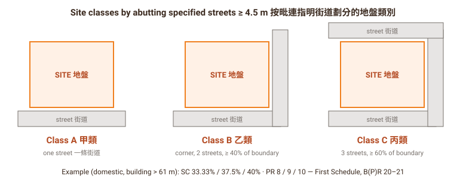

---
tags:
  - Topic guide 專題指南
  - Site coverage 上蓋面積
  - Plot ratio 地積比率
  - Site area & classification 地盤面積及分類
  - Building height 建築物高度
  - Open space 休憩用地
  - Domestic 住用
  - GFA 總樓面面積
  - Sustainable building design 可持續建築設計
  - Lighting & ventilation 照明及通風
  - Curtain wall & façade 幕牆及外牆
  - Occupation permit 佔用許可證
  - A&A works 改動及加建工程
---

# Site coverage, plot ratio and site area <small>上蓋面積、地積比率及地盤面積（專題指南）</small>

!!! abstract "What this guide covers 本指南內容"
    How to work out the **permitted site coverage (SC)** and **plot ratio (PR)** of a site: site area, site class, building height, the First Schedule, bonuses and flexibility, and the OZP and lease controls on top. For how the floor area itself is measured, see the [GFA guide](gfa.md).
    如何計算地盤的**准許上蓋面積**及**地積比率**：地盤面積、地盤類別、建築物高度、附表一、額外地積比率及彈性安排，以及分區計劃大綱圖和地契的管制。樓面面積的量度見[總樓面面積指南](gfa.md)。

    Main sources 主要來源: [B(P)R 18A–22](../regulations/bpr-18a-22.md) · [B(P)R 23](../regulations/bpr-23-23a.md) · [B(P)R 25](../regulations/bpr-24-37.md) · [APP-124](../pnap/app-124.md) · [APP-132](../pnap/app-132.md) · [APP-19](../pnap/app-19.md) · [APP-108](../pnap/app-108.md) · [APP-20](../pnap/app-20.md) · [APP-44](../pnap/app-44.md) · [ADM-21](../pnap/adm-21.md) · [JPN 4](../pnap/jpn-4.md) · [JPN 5](../pnap/jpn-5.md) · [JPN 7](../pnap/jpn-7.md)

## The big picture 整體概念

<figure markdown>
  { width="520" loading=lazy }
  <figcaption>Working out permitted site coverage and plot ratio. 計算准許上蓋面積及地積比率。 Diagram prepared for this site.</figcaption>
</figure>

## Step 1: site area 第一步：地盤面積

=== "English"

    - **Site area** excludes **streets and service lanes**, but includes areas **dedicated for public passage** ([B(P)R 23(2)](../regulations/bpr-23-23a.md)).
    - The site must be under the applicant's **title or realistic prospect of control**; prove it with a **lease plan or Land Survey Plan** ([ADM-21](../pnap/adm-21.md), ADV-33).
    - Private streets and lanes inside a lot may sometimes be counted; new streets that split a large site into separate sites, and PR transfer between sites, are dealt with in [APP-44](../pnap/app-44.md) and [APP-73](../pnap/app-73.md).

=== "中文"

    - **地盤面積**不包括**街道及後巷**，但包括**撥作公眾通道**的範圍（[第 23(2) 條](../regulations/bpr-23-23a.md)）。
    - 地盤須屬申請人**業權或有實際控制前景**；須以**地契圖則或土地測量圖**證明（[ADM-21](../pnap/adm-21.md)、ADV-33）。
    - 地段內的私家街道及後巷有時可計算；新街道把大型地盤分割、地盤之間轉移地積比率等，見 [APP-44](../pnap/app-44.md) 及 [APP-73](../pnap/app-73.md)。

## Step 2: site class 第二步：地盤類別

<figure markdown>
  { width="700" loading=lazy }
  <figcaption>Site classes depend on the number of specified streets ≥ 4.5 m wide that the site abuts (B(P)R 18A). 地盤類別。</figcaption>
</figure>

- **Class A 甲類**: one specified street. **Class B 乙類**: corner site on 2 streets, ≥ **40%** of the boundary. **Class C 丙類**: 3 streets, ≥ **60%** of the boundary.
- A **specified street** must be government-vested and HyD-maintained, on the same lease and surrenderable, required by the lease, subject to an **express right of way**, or a private street held by the owner and kept as a street ([APP-124](../pnap/app-124.md)). Car parks, open spaces and nullahs do not count.

## Step 3: building height 第三步：建築物高度

Measured from the **mean level of the street** (the lowest, if streets are at different levels) to the **mean height of the roof over the highest usable floor** ([B(P)R 23(1)](../regulations/bpr-23-23a.md)). Roof-top structures above that roof generally do not count. **OZP height limits** apply separately ([JPN 5](../pnap/jpn-5.md)); airport height restrictions too ([APP-32](../pnap/app-32.md)). 由街道平均水平量至最高可用樓層上的屋頂平均高度；分區計劃大綱圖及機場高度限制另計。

## Step 4: the First Schedule 第四步：附表一

| Height of building 建築物高度 | Domestic SC % A / B / C 住用上蓋面積 | Domestic PR A / B / C 住用地積比率 | Non-domestic SC % 非住用上蓋面積 | Non-domestic PR 非住用地積比率 |
|---|---|---|---|---|
| ≤ 15 m | 66.6 / 75 / 80 | 3.3 / 3.75 / 4.0 | 100 | 5 |
| > 15 m, ≤ 18 m | 60 / 67 / 72 | 3.6 / 4.0 / 4.3 | 97.5 | 5.8 |
| > 18 m, ≤ 21 m | 56 / 62 / 67 | 3.9 / 4.3 / 4.7 | 95 | 6.7 |
| > 21 m, ≤ 24 m | 52 / 58 / 63 | 4.2 / 4.6 / 5.0 | 92 | 7.4 |
| > 30 m, ≤ 36 m | 42 / 47.5 / 50 | 5.0 / 5.7 / 6.0 | see table | see table |
| > 61 m | 33.33 / 37.5 / 40 | 8 / 9 / 10 | see table | see table |

<small>Extract only; full tables (including non-domestic rows by site class) on [B(P)R 18A–22](../regulations/bpr-18a-22.md). Non-domestic buildings may have **100% SC up to 15 m** (podium) whatever their height (reg. 20(3)); composite buildings share PR by the reg. 21(2) formula. 摘錄；完整表格見規例頁。</small>

=== "English"

    - The **taller** the building, the **lower the SC** but the **higher the PR**.
    - **Permitted GFA = site area × PR.** **Permitted covered area = site area × SC %** at each height band.
    - **Composite buildings**: domestic PR used ÷ domestic PR permitted + non-domestic PR used ÷ non-domestic PR permitted ≤ **1** (reg. 21(2)).

=== "中文"

    - 建築物**越高**，**上蓋面積越低**但**地積比率越高**。
    - **准許總樓面面積 = 地盤面積 × 地積比率**；**准許上蓋範圍 = 地盤面積 × 上蓋面積百分比**（按高度級別）。
    - **綜合用途建築物**：已用住用地積比率 ÷ 准許住用地積比率 + 已用非住用 ÷ 准許非住用 ≤ **1**（第 21(2) 條）。

!!! example "Worked example (illustrative) 計算例子（示意）"
    Site area **1,200 m²**, Class B, domestic tower 80 m high. 地盤 1,200 平方米，乙類，住宅大廈高 80 米。
    → domestic SC **37.5%** → max covered area **450 m²** at tower levels; domestic PR **9** → permitted GFA **10,800 m²**.
    Composite with a 15 m commercial podium: podium SC may be 100% up to 15 m; if the podium uses **one tenth** of the permitted non-domestic PR, the domestic part may use up to 9 × (1 − 0.1) = **8.1**. 如平台用去准許非住用地積比率的十分之一，住用部分最多可用 9 × 0.9 = 8.1。

## Step 5: bonuses and flexibility 第五步：額外地積比率及彈性

| Mechanism 機制 | What you get 所得 | Limit 限制 | Source 來源 |
|---|---|---|---|
| Dedication for public passage at street level 臨街撥作公眾通道 | Bonus PR = lesser of **5 × dedicated area** and **20%** of PR; SC bonus 額外地積比率 | ≤ 20% of PR; OZP limits | [B(P)R 22](../regulations/bpr-18a-22.md), [APP-108](../pnap/app-108.md) |
| Passage within / through a building 建築物內公眾通道 | **5 ×** area at ground level, **2 ×** at other levels | Total ≤ 20% of PR; Deed of Dedication before OP | [APP-108](../pnap/app-108.md) |
| Surrender for street widening 交回土地擴闊街道 | Surrendered area counted as site area for the **first** building | Agreement to Surrender registered | [APP-20](../pnap/app-20.md) |
| SC flexibility: set back approach 後移方法 | SC varies with height (domestic 63% ≤ 24 m down to 40% > 61 m) | Setback ≥ 18% (domestic) / 8% (non-domestic) of site area; APP-151 pre-requisites | [APP-132](../pnap/app-132.md) |
| SC flexibility: open space approach 休憩空間方法 | Innovative layouts | Open space volume ≥ notional scheme; SC ≤ 63% (domestic) | [APP-132](../pnap/app-132.md) |
| Minor projections 小型伸出物 | Not counted for SC or PR | APP-19 list | [APP-19](../pnap/app-19.md) |
| MiC 組裝合成建築法 | 10% of MiC floor area not counted for SC at each floor | MiC floors | [JPN 8](../pnap/jpn-8.md) |

## Step 6: other controls on top 第六步：其他管制

=== "English"

    - **OZP**: for new or amended plans gazetted on or after **18 Oct 2021**, the **OZP PR/GFA is the sole reference**; a stricter First Schedule may be modified to match ([JPN 4](../pnap/jpn-4.md)). OZP **height** ([JPN 5](../pnap/jpn-5.md)) and **SC** limits ([JPN 7](../pnap/jpn-7.md)) still apply where stated.
    - **SC**: BD is the single agency deciding what counts for SC; PlanD and LandsD follow BD. SC restrictions are not normally put in new leases ([JPN 7](../pnap/jpn-7.md)).
    - **Open space** (domestic, [B(P)R 25](../regulations/bpr-24-37.md)): ½ of the roofed-over area on a Class A site, ⅓ on Class B, ¼ on Class C; no part of a domestic building within **1.5 m** of the rear boundary.
    - **Lease**: maximum GFA / PR in the lease may be lower; check before design. A lease modification and premium may be needed for bonuses or flexibility.

=== "中文"

    - **分區計劃大綱圖**：**2021 年 10 月 18 日**或之後刊憲的新訂或經修訂圖則，**以其地積比率／總樓面面積為唯一參考**；如附表一較嚴可作變通（[JPN 4](../pnap/jpn-4.md)）。高度（[JPN 5](../pnap/jpn-5.md)）及上蓋面積（[JPN 7](../pnap/jpn-7.md)）限制按圖則適用。
    - **上蓋面積**：由屋宇署單一決定哪些設施計算，規劃署及地政總署跟從；新地契一般不設上蓋面積限制（[JPN 7](../pnap/jpn-7.md)）。
    - **休憩用地**（住用，[第 25 條](../regulations/bpr-24-37.md)）：甲類地盤為上蓋範圍的 ½、乙類 ⅓、丙類 ¼；住用建築物任何部分不得距後地界 **1.5 米**以內。
    - **地契**：地契的最高總樓面面積／地積比率可能較低，設計前須核實；額外地積比率或彈性安排或須修訂地契及補地價。

<!-- GUIDE APSEC START -->
## Latest APSEC positions 最新 APSEC 立場 {#apsec-positions}

BD's most recent clarifications on this topic from the [APSEC Discussion Forum](../apsec/index.md), newest first. Items later revisited are left out; only the **current position** is shown (20 relevant items in total). 屋宇署最新澄清，只列現行立場。

- **[Registration of Letters of Undertaking in the Land Registry](../apsec/2026.md#i202605085)** <small>8 May 2026</small> BD advised that the understanding of the HKIA was correct. the Registration in the Land Registry for the following undertaking letters in was required before OP application and might be imposed in the condition of the modification/exemption granted, if applicable: (a) For surrender/dedication of …
- **[Vertical Greening](../apsec/2024.md#i202408098)** <small>9 Aug 2024</small> BD advised that according to paragraph 3(n) of PNAP APP-19, metal supporting frames for growing of plants (including vertical frame for climbing and/or weeping plants and panel/modular planters) projecting not more than 300 mm from the external walls within lot boundary could be excluded from site …
- **[Curtain Wall outside Floor / Room without Accountable Gross Floor Area (GFA)](../apsec/2024.md#i202402231)** <small>23 Feb 2024</small> BD advised that under section 26 of the Building (Construction) Regulation (B(C)R), curtain wall meant “a non load-bearing enclosure of a building fixed on to the load-bearing structure of the building”, and cladding meant “a facing or architectural decoration additional to the structural elements …
- **[Site Coverage Flexibility under PNAP APP-132 – Aggregated Site Coverage](../apsec/2023.md#i202311173)** <small>17 Nov 2023</small> BD advised that in accordance with regulation 2 of the B(P)R, site coverage referred to the area of the site that was covered by the building that was erected thereon. …
- **[Site Coverage Flexibility under PNAP APP-132 – Minor Projecting Features](../apsec/2023.md#i202311172)** <small>17 Nov 2023</small> BD advised that according to footnote 3 of PNAP APP-132, the projections under PNAP APP-19 was excluded from the calculation of the total covered area of the buildings on the site for the purpose of determining whether an unexcavated or backfilled area and open-sided covered areas of green features …
- **[Requirements of Building Setback – PNAP APP-132 and APP-152](../apsec/2023.md#i2023080414)** <small>4 Aug 2023</small> BD advised that there was no requirement on minimum setback distance under PNAP APP-132 or under the alternative approach for building setback stipulated in Appendix E to PNAP APP-152 except for those stipulated in paragraph 7 of PNAP APP-152. …
- **[Requirements on Sunshades – PNAP APP-19 and APP-67](../apsec/2023.md#i202308049)** <small>4 Aug 2023</small> BD advised that according to PNAP APP-19, genuine sunshades solely used for the purpose of energy conservation projecting not more than 1.5 m from the external wall complying with the criteria set out in PNAP APP-67 and APP-156 were not accountable for GFA and site coverage. …
- **[Projections from External Wall – PNAP APP-19](../apsec/2022.md#i202208126)** <small>12 Aug 2022</small> For the purpose of PNAP APP-19, BD accepted that part of the architectural feature wrapping around the corner of a building as shown in the sketch plan need not be counted for SC and PR. …
- **[Height of Storeys](../apsec/2022.md#i202208123)** <small>12 Aug 2022</small> BD advised that provided that the storey height of the flat at topmost floor did not exceed 4 m as well as the common area outside was of genuine design and its abuse was unlikely, the BA would favourably consider accepting the common corridor with high storey height on a case-by-case basis.
- **[PNAP APP-132 – Site Coverage and Open Space Provision](../apsec/2022.md#i2022051310)** <small>13 May 2022</small> BD advised that vertical green which would contribute to improving street environment was acceptable to be provided at the setback area under PNAP APP-132. …
- **[Future Road / Street in New Development Areas (NDA)](../apsec/2022.md#i2022031821)** <small>18 Mar 2022</small> Members welcomed the pragmatic approaches. As regards whether similar guidelines and approaches would be set out for open spaces and pedestrian walkways required under lease of NDAs and also served as EVA or for the provision of natural lighting and ventilation for a development, BD advised that in …
- **[Prescribed Window Under regulation 31 of B(P)R](../apsec/2022.md#i2022031817)** <small>18 Mar 2022</small> provided guidelines in determining what constitutes a street for the purpose of site classification under regulation 18A of B(P)R; whereas, regulation 31 of B(P)R prescribed the minimum requirements of window. …
- **[Architectural Features not Projecting over Street](../apsec/2022.md#i202203187)** <small>18 Mar 2022</small> BD advised that under paragraph 3(f) of PNAP APP-19, architectural features projecting from the face of a building, having no significant impact on building bulk, and complying with the limits on projection (i.e. 500mm) and clear height (i.e. …
- **[Flexibility in Site Coverage and Open Space Provision for A&A Works – PNAP APP-132](../apsec/2022.md#i2022011414)** <small>14 Jan 2022</small> BD advised that the flexible site coverage under PNAP APP-132 was only applicable to new developments, subject to the pre-requisites set out under PNAP APP-151 and PNAP APP-152. It is not applicable to A&A works.

<!-- GUIDE APSEC END -->

## Related 相關文件

| Document 文件 | What it covers 內容 |
|---|---|
| [B(P)R 18A–22](../regulations/bpr-18a-22.md) | Site class, First Schedule, bonuses 地盤類別、附表一 |
| [APP-124](../pnap/app-124.md) | Specified streets 指明街道 |
| [APP-132](../pnap/app-132.md) | SC flexibility 上蓋面積彈性 |
| [APP-108](../pnap/app-108.md) · [APP-20](../pnap/app-20.md) | Dedication and surrender bonuses 撥地及交回土地 |
| [JPN 4](../pnap/jpn-4.md) · [JPN 5](../pnap/jpn-5.md) · [JPN 7](../pnap/jpn-7.md) | PR, height and SC across BD, PlanD, LandsD 三個部門的管制 |
| [GFA guide](gfa.md) | Measuring GFA and concessions 總樓面面積及寬免 |

---
<small>Topic guide prepared from the pages on this site and the cited documents; always check the current BD documents. 本指南根據本網站及所引文件整理，請以屋宇署最新文件為準。</small>
