---
tags:
  - Topic guide 專題指南
  - Plan submission & approval 呈交及審批
  - Occupation permit 佔用許可證
  - Statutory period 法定期限
  - Site supervision 地盤監督
  - Checklist 核對清單
  - Structural 結構
  - Geotechnical 岩土
  - Drainage 排水
  - Excavation & ELS 挖掘
  - Site safety 地盤安全
  - GFA 總樓面面積
  - Concrete & materials 混凝土及物料
  - Curtain wall & façade 幕牆及外牆
  - Lift 升降機
  - Sustainable building design 可持續建築設計
  - Site coverage 上蓋面積
  - Plot ratio 地積比率
  - Foundation 地基
  - Site area & classification 地盤面積及分類
  - GFA concession 樓面面積寬免
  - Elderly-friendly 長者友善
  - Demolition 拆卸
  - A&A works 改動及加建工程
  - Registration 註冊
summary: "From plan submission to occupation permit: statutory periods, stages, forms and a checklist."
keywords: submission, approval, consent, 批准, 同意, occupation permit, 佔用許可證, OP, BA forms, statutory period, 法定期限, checklist
---

# From plan submission to occupation permit <small>由呈交圖則至佔用許可證（專題指南）</small>

!!! abstract "What this guide covers 本指南內容"
    The whole statutory journey of a new building under the Buildings Ordinance: who must be appointed, which **forms and documents** go in at each stage, the **statutory periods**, what can go wrong, and a **checklist** you can tick as you go (ticks are saved in your own browser).
    新建築物在《建築物條例》下的整個法定程序：須委任的人士、各階段須提交的**表格及文件**、**法定期限**、常見問題，以及可逐項剔選的**核對清單**（剔選紀錄只儲存在你的瀏覽器）。

    Main sources 主要來源: [BO s.14–21](../regulations/bo-part-2-building-works.md) · [B(A)R](../regulations/bar-123a.md) · [ADM-19](../pnap/adm-19.md) · [ADM-2](../pnap/adm-2.md) · [APP-60](../pnap/app-60.md) · [ADV-33](../pnap/adv-33.md) · [APP-97](../pnap/app-97.md) · [APP-13](../pnap/app-13.md) · [APP-78](../pnap/app-78.md) · [APP-162](../pnap/app-162.md) · [APP-157](../pnap/app-157.md)

## At a glance 重點摘要 {#at-a-glance}

=== "English"

    - **Approval**: BD decides within **60 days** for a first submission or major revision, **30 days** for other resubmissions ([B(A)R 30](../regulations/bar-123a.md)); pre-submission enquiry about **45 days** ([ADM-19](../pnap/adm-19.md)).
    - **Consent** (Form **BA8**): decided within **28 days**; apply within **2 years** of approval; start work within **3 months** of consent ([BO ss.14, 16, 20](../regulations/bo-part-2-building-works.md)).
    - Before works: **BA10** (contractor and AS) and the **supervision plan**; site permits for **hoardings (BA19)** and **contractor's sheds (BA18)**.
    - During works: notify changes of AP / RSE / RGE / contractor within **7 days**; drainage test certificates within **7 days** of the test.
    - **Occupation permit** (Form **BA14**): decision within **14 days** ([BO s.21](../regulations/bo-part-2-building-works.md)).
    - Use the [28-item checklist](#checklist) below before each stage.

=== "中文"

    - **批准**：首次呈交或重大修訂 **60 天**內決定，其他再呈交 **30 天**（[第 30 條](../regulations/bar-123a.md)）；呈交前查詢約 **45 天**（[ADM-19](../pnap/adm-19.md)）。
    - **同意**（表格 **BA8**）：**28 天**內決定；須在批准後 **2 年**內申請；同意後 **3 個月**內動工（[條例第 14、16、20 條](../regulations/bo-part-2-building-works.md)）。
    - 動工前：**BA10**（承建商及獲授權簽署人）及**監督計劃書**；**圍板（BA19）**及**工棚（BA18）**許可證。
    - 施工期間：更換認可人士、註冊結構工程師、註冊岩土工程師或承建商須於 **7 天**內通知；排水測試證明書於測試後 **7 天**內呈交。
    - **佔用許可證**（表格 **BA14**）：**14 天**內決定（[條例第 21 條](../regulations/bo-part-2-building-works.md)）。
    - 每個階段前可使用下方的 [28 項核對清單](#checklist)。

## How long does each step take? 每個步驟需時多久？ {#the-statutory-timeline}

<figure markdown>
  { width="366" loading=lazy }
  <figcaption>Statutory periods from plan submission to occupation (BO s.14–21, B(A)R 30–33). 由呈交圖則至佔用的法定期限。</figcaption>
</figure>

| Stage 階段 | Statutory / normal period 期限 | Source 來源 |
|---|---|---|
| Pre-submission enquiry 呈交前查詢 | Letter of assurance normally **≈ 45 days** 一般約 45 天 | [ADM-19](../pnap/adm-19.md) |
| First submission or major revision 首次呈交或重大修訂 | Decision within **60 days** 60 天 | [B(A)R 30](../regulations/bar-123a.md) |
| Other resubmissions 其他再呈交 | **30 days** 30 天 | [B(A)R 30](../regulations/bar-123a.md) |
| Centralised processing check-in 中央處理 | Ask at **day 45** whether basically acceptable 第 45 天查詢 | [ADM-2](../pnap/adm-2.md) |
| Consent to commence 動工同意 | **28 days**; apply within **2 years** of approval 28 天；批准後 2 年內申請 | [BO s.14, 16](../regulations/bo-part-2-building-works.md) |
| Start of works 動工 | Within **3 months** of consent, or consent lapses 3 個月內 | [BO s.20](../regulations/bo-part-2-building-works.md) |
| Change of AP / RSE / RGE / contractor 更換人員 | Notify within **7 days** 7 天內 | [B(A)R](../regulations/bar-123a.md) |
| Drainage test certificate 排水測試證明書 | Within **7 days** of the test 7 天內 | [APP-58](../pnap/app-58.md) |
| Occupation permit 佔用許可證 | Decision within **14 days**; re-inspection within 14 days after refusal 14 天 | [BO s.21](../regulations/bo-part-2-building-works.md), [APP-78](../pnap/app-78.md) |
| Withdraw and resubmit 撤回並重新提交 | Restarts the clock; normally **at most twice** 最多兩次 | [ADM-22](../pnap/adm-22.md) |

## Stage 1: what should be ready before submitting? 第一步：呈交前要準備甚麼？ {#stage-1-before-you-submit}

=== "English"

    - **Site**: prove site area and boundaries with a **lease plan or Land Survey Plan** ([ADM-21](../pnap/adm-21.md)); check the **lease** and **OZP** (PR, height, SC) ([JPN 4](../pnap/jpn-4.md), [JPN 5](../pnap/jpn-5.md)).
    - **Design controls**: First Schedule SC / PR ([guide](site-coverage-plot-ratio.md)), GFA concessions and pre-requisites ([guide](gfa.md)), SBD ([APP-152](../pnap/app-152.md)), fire safety ([FS Code](../codes/fire-safety-code-2011.md)), barrier-free and elderly-friendly design ([guide](barrier-free-access.md)).
    - **Geotechnical**: a geotechnical assessment where the APP-25 criteria apply ([APP-25](../pnap/app-25.md)); scheduled areas ([APP-30](../pnap/app-30.md), [APP-61](../pnap/app-61.md)).
    - **Pre-submission enquiry** for unusual designs or modifications ([ADM-19](../pnap/adm-19.md)).

=== "中文"

    - **地盤**：以**地契圖則或土地測量圖**證明地盤面積及界線（[ADM-21](../pnap/adm-21.md)）；核實**地契**及**分區計劃大綱圖**（地積比率、高度、上蓋面積）（[JPN 4](../pnap/jpn-4.md)、[JPN 5](../pnap/jpn-5.md)）。
    - **設計管制**：附表一上蓋面積及地積比率（[指南](site-coverage-plot-ratio.md)）、樓面面積寬免及先決條件（[指南](gfa.md)）、可持續建築設計（[APP-152](../pnap/app-152.md)）、消防（[消防守則](../codes/fire-safety-code-2011.md)）、無障礙及長者友善設計（[指南](barrier-free-access.md)）。
    - **岩土**：符合 APP-25 準則時須作岩土評估（[APP-25](../pnap/app-25.md)）；附表所列地區（[APP-30](../pnap/app-30.md)、[APP-61](../pnap/app-61.md)）。
    - 特殊設計或變通可先作**呈交前查詢**（[ADM-19](../pnap/adm-19.md)）。

## Stage 2: who is appointed and what is submitted? 第二步：委任誰、呈交甚麼？ {#stage-2-appointment-and-plan-submission}

| Document / form 文件／表格 | Purpose 用途 | Source 來源 |
|---|---|---|
| **BA4** | Notice of appointment of **AP / RSE / RGE** 委任認可人士／結構／岩土工程師 | [BO s.4](../regulations/bo-part-1-registration.md) |
| **BA5** | Application for **approval of plans** (with prescribed plans under B(A)R 8) 申請批准圖則 | [BO s.14(1)(a)](../regulations/bo-part-2-building-works.md) |
| **General building plans (GBP)** 一般建築圖則 | Site plan, floor plans, sections, elevations, SC / PR / GFA calculations, MOE, BFA, coloured per [ADM-9](../pnap/adm-9.md) | [B(A)R 8](../regulations/bar-123a.md), [ADV-33](../pnap/adv-33.md) |
| **Structural, site formation, drainage plans** 結構、地盤平整、排水圖則 | By RSE / RGE / AP; site formation in Parts A and B ([ADM-15](../pnap/adm-15.md)) | [ADM-8](../pnap/adm-8.md), [APP-93](../pnap/app-93.md) |
| **BA6** | Stability certificate for **A&A** works 改動加建穩定性證明書 | [B(A)R 18](../regulations/bar-123a.md) |
| **BA16** | Application for **modification / exemption** (BO s.42), with justification 申請變通／豁免 | [BO s.42](../regulations/bo-parts-4-9-schedules.md) |
| **Fees** 費用 | Form **BD24**; on GFA (new buildings) or per sheet (A&A); crossed cheque, non-refundable 按樓面面積或張數 | [APP-55](../pnap/app-55.md) |
| **Electronic submission** 電子呈交 | Through **ESH**, with digital signatures 電子呈交平台 | [ADM-17](../pnap/adm-17.md), [APP-60](../pnap/app-60.md) |

## Stage 3: how is consent to commence obtained? 第三步：如何取得動工同意？ {#stage-3-consent-to-commence}

=== "English"

    - **BA8** application for consent (or **BA8A** for concurrent consent where allowed, e.g. footings without major foundation works) ([BO s.14(1)(b)](../regulations/bo-part-2-building-works.md)).
    - **BA10** notice of appointment of the **registered contractor** and its Authorized Signatory ([APP-138](../pnap/app-138.md)).
    - **Supervision plan** under the Site Supervision Code ([APP-157](../pnap/app-157.md)); qualified supervision conditions under **BO s.17** ([APP-162](../pnap/app-162.md), [APP-28](../pnap/app-28.md), [APP-48](../pnap/app-48.md)).
    - Projects over **$30 million**: declare the cost for the **Smart Site Safety** conditions ([APP-162](../pnap/app-162.md)).
    - **Permits on site**: hoarding / covered walkway (**BA19**, [APP-23](../pnap/app-23.md)), contractor's shed (**BA18**, [APP-127](../pnap/app-127.md)), excavation permit on public roads ([ADV-13](../pnap/adv-13.md)).
    - Amendments after first consent may use the **Type II fast track** ([APP-97](../pnap/app-97.md)); GI in scheduled areas can be processed concurrently ([ADM-16](../pnap/adm-16.md)).

=== "中文"

    - **BA8** 申請動工同意（或在容許情況下以 **BA8A** 同時申請，例如不涉重大地基工程的基腳）（[第 14(1)(b) 條](../regulations/bo-part-2-building-works.md)）。
    - **BA10** 委任**註冊承建商**及其獲授權簽署人通知（[APP-138](../pnap/app-138.md)）。
    - 按地盤監督守則提交**監工計劃書**（[APP-157](../pnap/app-157.md)）；**第 17 條**合資格監督條件（[APP-162](../pnap/app-162.md)、[APP-28](../pnap/app-28.md)、[APP-48](../pnap/app-48.md)）。
    - 造價超過 **3,000 萬元**的項目：申報造價以施加**智慧工地安全**條件（[APP-162](../pnap/app-162.md)）。
    - **地盤准許證**：圍板／有蓋行人道（**BA19**，[APP-23](../pnap/app-23.md)）、承建商屋棚（**BA18**，[APP-127](../pnap/app-127.md)）、公共道路挖掘准許證（[ADV-13](../pnap/adv-13.md)）。
    - 首次同意後的修訂可用**第 II 類快速處理**（[APP-97](../pnap/app-97.md)）；附表地區的土地勘測可同時處理（[ADM-16](../pnap/adm-16.md)）。

<figure markdown>
  { width="520" loading=lazy }
  <figcaption>Normal or fast-track consent (APP-97). 一般程序還是快速處理。</figcaption>
</figure>

## Stage 4: what must happen during construction? 第四步：施工期間要做甚麼？ {#stage-4-construction}

- **Supervision**: AP / RSE / RGE give **periodic**, the contractor **continuous** supervision with TCPs; keep checklists and records ([APP-157](../pnap/app-157.md), [APP-158](../pnap/app-158.md)). 認可人士等定期監督，承建商持續監督。
- **Testing**: reinforcement ([APP-45](../pnap/app-45.md)), materials by HOKLAS labs ([APP-118](../pnap/app-118.md)), early-age concrete ([APP-167](../pnap/app-167.md)), fixings ([APP-169](../pnap/app-169.md)), drainage tests ([APP-58](../pnap/app-58.md)). 鋼筋、物料、混凝土、固定件及排水測試。
- **BD audits** may be unannounced ([ADM-18](../pnap/adm-18.md), [ADM-13](../pnap/adm-13.md)). 屋宇署可能突擊審查。
- **Amendments**: get amendment plans approved **before** the OP application ([APP-13](../pnap/app-13.md)); minor amendments per [ADM-14](../pnap/adm-14.md). 修訂圖則須在申請佔用許可證前獲批准。

## Stage 5: how is the occupation permit obtained? 第五步：如何取得佔用許可證？ {#stage-5-completion-and-occupation-permit}

<figure markdown>
  { width="560" loading=lazy }
  <figcaption>OP inspection workflow (APP-78). 佔用許可證巡查流程。</figcaption>
</figure>

| Document 文件 | Notes 說明 | Source 來源 |
|---|---|---|
| **BA12 / BA13** | Certificates on completion of a new building; **BA13** goes with the OP application 新建築物完工證明書，BA13 連同佔用許可證申請 | [APP-13](../pnap/app-13.md), [APP-78](../pnap/app-78.md) |
| **BA14 / 14A / 14B / 14C** | Completion of works not resulting in a new building 不形成新建築物的工程 | [APP-13](../pnap/app-13.md) |
| **Record plans** 紀錄圖則 | Consolidated GBP as built, with BD chop or AP certification (B(A)R 46) 綜合竣工圖則 | [APP-13](../pnap/app-13.md) |
| **Materials and products schedule** 物料及產品清單 | With certificates of accepted materials (and C.I. pipes, windows, etc.) 物料證明 | [APP-13](../pnap/app-13.md), [APP-118](../pnap/app-118.md) |
| **Test reports** 測試報告 | Concrete, rebar, anchors, stone cladding (before OP), drainage | [APP-16](../pnap/app-16.md), [APP-45](../pnap/app-45.md) |
| **FSI and water supply** 消防裝置及供水 | FSD acceptance; permanent water supply for FSI before OP | [APP-31](../pnap/app-31.md) |
| **Lifts and escalators** 升降機及自動梯 | Associated works complete before EMSD permission to use | [APP-29](../pnap/app-29.md) |
| **Undertakings and DMC** 承諾書及公契 | Registered before OP for green / amenity features, clubhouses, hotels 佔用許可證前登記 | [JPN 1](../pnap/jpn-1.md), [APP-104](../pnap/app-104.md), [APP-40](../pnap/app-40.md) |
| **Landscape** 園景 | Self-certification of compliance by RLA where required | [JPN 3](../pnap/jpn-3.md) |

## Checklist 核對清單 {#checklist}

<small>Tick as you go; ticks are kept in your browser only. 剔選紀錄只儲存在你的瀏覽器。</small>

**Before submission 呈交前**

- [ ] Lease plan / Land Survey Plan and site area confirmed 地契圖則及地盤面積已確認 ([ADM-21](../pnap/adm-21.md))
- [ ] Lease and OZP restrictions checked (PR, height, SC, use) 已核實地契及分區計劃大綱圖
- [ ] Site class, SC and PR calculated 已計算地盤類別、上蓋面積及地積比率
- [ ] SBD, energy and BEAM Plus pre-requisites planned 已規劃先決條件 ([APP-151](../pnap/app-151.md))
- [ ] Geotechnical assessment needed? 是否須作岩土評估 ([APP-25](../pnap/app-25.md))
- [ ] Pre-submission enquiry for any modification 已就變通作呈交前查詢 ([ADM-19](../pnap/adm-19.md))

**Plan submission 呈交圖則**

- [ ] BA4 appointment of AP / RSE / RGE 已提交 BA4
- [ ] BA5 with GBP, coloured, with essential information 已提交 BA5 及圖則 ([ADV-33](../pnap/adv-33.md))
- [ ] SC / PR / GFA calculations and concession schedule 已附計算及寬免表
- [ ] BA16 for every modification or exemption, with justification 已就每項變通提交 BA16
- [ ] Structural, site formation and drainage plans submitted 已呈交結構、地盤平整及排水圖則
- [ ] Fees paid with BD24 已繳費 ([APP-55](../pnap/app-55.md))

**Consent 動工同意**

- [ ] BA8 (or BA8A) consent application 已申請同意
- [ ] BA10 registered contractor and Authorized Signatory 已提交 BA10
- [ ] Supervision plan lodged 已提交監工計劃書
- [ ] Cost declaration for $30 million smart site safety threshold 已申報造價 ([APP-162](../pnap/app-162.md))
- [ ] Hoarding permit (BA19), contractor's shed (BA18), excavation permit 已取得地盤准許證
- [ ] Works start within 3 months of consent 3 個月內動工

**Construction 施工**

- [ ] Supervision records and TCP checklists kept 保存監督紀錄
- [ ] Material tests by HOKLAS laboratories 物料已由認可實驗所測試
- [ ] Drainage tests witnessed; certificate within 7 days 排水測試已見證
- [ ] Amendment plans approved before OP application 修訂圖則已獲批准

**Completion and OP 完工及佔用許可證**

- [ ] BA12 / BA13 (or BA14 series) signed by AP, RSE, RGE and contractor 已簽署完工證明書
- [ ] Record plans and materials schedule submitted 已提交紀錄圖則及物料清單
- [ ] FSI accepted; water supply connected 消防裝置已接受
- [ ] Lifts and escalators ready for EMSD 升降機已準備
- [ ] Undertakings registered; DMC common parts designated 承諾書已登記
- [ ] Scaffolds and hoardings removed; joint inspection booked 已拆棚架並預約聯合巡查

<!-- GUIDE APSEC START -->
## Latest APSEC positions 最新 APSEC 立場 {#apsec-positions}

BD's most recent clarifications on this topic from the [APSEC Discussion Forum](../apsec/index.md), newest first. Items later revisited are left out; only the **current position** is shown (61 relevant items in total). 屋宇署最新澄清，只列現行立場。

- **[Concurrent Processing of Approval and Consent for Amendment of Secondary Structural Element Without First Consent](../apsec/2026.md#i202608144)** <small>14 Aug 2026</small> BD advised that according to paragraphs 33 and 34 of PNAP ADM-19, concurrent application for approval of plans and consent to the commencement of secondary structural element works does not limit to the first plan …
- **[Supervision of Curtain Wall](../apsec/2026.md#i2026050815)** <small>8 May 2026</small> BD advised that according to Appendix B to PNAP ADV-36, TCP T1 of Quality Control Co-ordination Team (QCCT) under Registered Contractor’s stream should provide continuous qualified supervision to the modular unit …
- **[Demolition of Retaining Walls](../apsec/2026.md#i2026050814)** <small>8 May 2026</small> BD advised that if a retaining wall did not support a building to be demolished and was to be removed as part of site formation works or ELS works, the demolition of the retaining wall might be incorporated into the …
- **[PNAP ADM-19 – Building Approval Process](../apsec/2026.md#i2026050810)** <small>8 May 2026</small> BD advised that while the RSE had adopted the sample drawings as per Appendix B11 to PNAP ADV-33 in the structural plan submission of supporting frames for building services, the RSE would not be requested to submit the …
- **[Modification of Temporary Steel Platform for Foundation Works](../apsec/2025.md#i202511219)** <small>21 Nov 2025</small> BD advised that in general, a Case 1 temporary steel platform which is retained for subsequent stages of works would be regarded as Case 2 or Case 3 temporary works. If modification to the temporary steel platform was …
- **[Smart Site Safety System (4S)](../apsec/2025.md#i2025080829)** <small>8 Aug 2025</small> BD advised that the $30 million threshold referred to the total project cost of the development. If the first consent for superstructure works was already granted before 1 July 2025, unless there were major revision to …
- **[Requirement of Signed Statement by Authorised Signatory (AS) upon Submission to RSE](../apsec/2025.md#i2025080828)** <small>8 Aug 2025</small> BD advised that material tests conducted by independent laboratories aimed to assess the properties and behaviour of the materials in accordance with the design assumptions and standards. As the RSE was responsible for …
- **[Separate RSE for Cladding/Curtain Wall/Façade Works](../apsec/2025.md#i2025080824)** <small>8 Aug 2025</small> BD advised that the project AP/RSE/RC should sign the Form BA13 to certify the completion of building works resulting in a new building and to apply for the OP of such building. According to paragraph 6 of PNAP APP-16 …
- **[Minor Amendment Submission to be Approved Prior to Application for OP](../apsec/2025.md#i2025080818)** <small>8 Aug 2025</small> BD advised that according to paragraph 3 of PNAP APP-13, AP/RSE/RGE should submit and secure approval of amendment plans in advance of an application for OP, subject to the exception that minor positional deviations …
- **[Temporary Replacement of Technically Competent Person (TCP)](../apsec/2025.md#i2025080817)** <small>8 Aug 2025</small> BD advised that in accordance with sections 8 and 9 of the Technical Memorandum for Supervision Plans 2009, the AP, RSE, RGE and AS, as the case may be, should submit a revised supervision plan to the Building Authority …
- **[Minor Amendments – PNAP ADM-19](../apsec/2025.md#i2025080815)** <small>8 Aug 2025</small> BD advised that for (1), the modification would generally be granted concurrently with the first consent. BD advised that for (2), although there was no statutory period for the processing the application for …
- **[Submission of Forms TW1, TW2 and TW3 for Tower Crane](../apsec/2025.md#i2025050915)** <small>9 May 2025</small> BD advised that pursuant to paragraph 4.12(a) to (d) of Supervision Code, Forms TW1 and TW2 certified by the Design Engineer and Independent Checking Engineer appointed by RSC(F) respectively for the design for …
- **[Consent for Initial Stage ELS Works](../apsec/2025.md#i2025050910)** <small>9 May 2025</small> BD advised that the streamlining measure for carrying out the initial stage of excavation works not exceeding 1.5 m below ground level and erection of the first layer of lateral support was promulgated via BD’s Circular …
- **[General Building Plans (GBP) for Stage II Approval and Maintenance and Repair (M&R) Plan Submission](../apsec/2025.md#i202505096)** <small>9 May 2025</small> BD advised that according to PNAP ADV-33, it was essential that all information required under stage II approval be submitted for approval prior to applying for consent to commence superstructure works. However, this …
- **[Mechanical Ventilation in Kiosks or Guard Rooms](../apsec/2025.md#i202505094)** <small>9 May 2025</small> BD advised that whenever AP submitted a Form BA16 treating kiosks or guard rooms as ancillary offices and applying for modification of regulation 30 of the Building (Planning) Regulations (B(P)R), BD would favourably …
- **[Temporary Works involving Kingposts in Deep Basement Excavation](../apsec/2025.md#i2025021422)** <small>14 Feb 2025</small> BD advised that the installation of temporary kingposts which provided supports to the temporary working platforms and/or tower cranes, did not form part of the ELS works shown on the approved plans) and had no effect …

<!-- GUIDE APSEC END -->

<!-- CL START -->
## Related circular letters 相關通告函件 {#circular-letters}

- 🟢 [Submission of Electronic Test Reports in Standardised Test Report Formats](../circulars/2026.md#cl-setrstrf2026) <small>20 Oct 2026 · 提交標準化格式的電子測試報告</small>
<!-- CL END -->

## Related 相關文件 {#related}

| Document 文件 | What it covers 內容 |
|---|---|
| [BO s.14–21](../regulations/bo-part-2-building-works.md) | Approval, consent, OP 批准、同意、佔用許可證 |
| [B(A)R](../regulations/bar-123a.md) | Prescribed plans, periods, forms 訂明圖則、期限 |
| [ADM-19](../pnap/adm-19.md) · [ADM-2](../pnap/adm-2.md) | Approval process, centralised processing 審批程序 |
| [APP-60](../pnap/app-60.md) | List of specified forms 指明表格 |
| [APP-13](../pnap/app-13.md) · [APP-78](../pnap/app-78.md) | Completion and OP 完工及佔用許可證 |
| [Timelines & workflows](../workflows.md) | All procedure diagrams 所有流程圖 |

---
<small>Topic guide prepared from the pages on this site and the cited documents; forms are as listed in APP-60. Always check the current BD documents. 本指南根據本網站及所引文件整理，表格以 APP-60 為準。</small>
