---
tags:
  - PNAP
  - ADM series
  - PNAP index 作業備考索引
---

# ADM-1 Practice Notes in Force <small>有效的作業備考</small>

!!! info "Document info 文件資料"
    | | |
    |---|---|
    | **Type 類別** | PNAP (ADM series), previously PNAP 1 舊編號 PNAP 1 |
    | **Issued by 發出機構** | Buildings Department 屋宇署 |
    | **Version summarised 本摘要版本** | August 2009 |
    | **Official language 官方語言** | English and Chinese 中英文版 |
    | **Source 原文** | [English (PDF)](https://www.bd.gov.hk/doc/en/resources/codes-and-references/practice-notes-and-circular-letters/pnap/ADM/ADM001.pdf) · [中文 (PDF)](https://www.bd.gov.hk/doc/tc/resources/codes-and-references/practice-notes-and-circular-letters/pnap/ADM/ADM001.pdf) |
    | **Last checked 最後核對** | 2026-11-21 against the current BD version |

## At a glance 重點摘要

=== "English"

    - BA issues PNAPs to explain how the BO is applied and on administrative and advisory matters (para. 1).
    - Since **Aug 2009** PNAPs are in three parts with new numbers (para. 2): **ADM** (administration: BD procedures, approvals, consents, OPs); **APP** (application of the BO and regulations and related ordinances); **ADV** (advisory: good practice and other matters).
    - The appendix lists the PNAPs in force with their former PNAP numbers.

=== "中文"

    - 建築事務監督發出作業備考，說明如何應用條例及行政、諮詢事宜（第 1 段）。
    - 自 **2009 年 8 月**起，作業備考分為三部分並重新編號（第 2 段）：**ADM**（行政：屋宇署程序、批准、同意、佔用許可證）；**APP**（條例及規例和相關條例的應用）；**ADV**（諮詢：良好作業及其他事宜）。
    - 附錄列出有效的作業備考及其舊編號。

## Relationship diagram 關係圖

<figure markdown>
  { width="760" loading=lazy }
  <figcaption>How the practice note series fit together. 作業備考系列關係。 Summary diagram prepared for this site; check the source text for exact wording.</figcaption>
</figure>

## Related 相關文件

| Document 文件 | Relationship 關係 |
|---|---|
| [PNAP index](index.md) | This site's PNAP list 本網站作業備考列表 |

---
<small>Prepared by: _[name]_ · Checked by: _[name]_ · Quotes from the official English and Chinese versions; refer to the PNAP for the definitive text.</small>
