---
tags:
  - PNAP
  - ADM series
  - Ground investigation 土地勘測
  - Scheduled area 附表地區
  - Plan submission & approval 呈交及審批
  - Site supervision 地盤監督
summary: "Ground investigation in Scheduled Areas is building works needing approval and consent; both can be processed concurrently if a site supervision plan is submitted and consent applied for after day 32."
keywords: ADM-16, ground investigation, 土地勘測, Scheduled Areas, 附表地區, approval and consent, concurrent processing, 同時處理, site supervision plan, 32nd day
---

# ADM-16 Ground Investigation Works in Scheduled Areas - Approval and Consent <small>附表所列地區的土地勘測工程－批准及同意</small>

!!! info "Document info 文件資料"
    | | |
    |---|---|
    | **Type 類別** | PNAP (ADM series), previously PNAP 225 舊編號 PNAP 225 |
    | **Issued by 發出機構** | Buildings Department 屋宇署 |
    | **Version summarised 本摘要版本** | February 2006 |
    | **Official language 官方語言** | English and Chinese 中英文版 |
    | **Source 原文** | [English (PDF)](https://www.bd.gov.hk/doc/en/resources/codes-and-references/practice-notes-and-circular-letters/pnap/ADM/ADM016.pdf) · [中文 (PDF)](https://www.bd.gov.hk/doc/tc/resources/codes-and-references/practice-notes-and-circular-letters/pnap/ADM/ADM016.pdf) |
    | **Last checked 最後核對** | 2026-11-21 against the current BD version |

## At a glance 重點摘要 {#at-a-glance}

=== "English"

    - GI in **Scheduled Areas** is building works needing approval and consent (para. 1).
    - **Concurrent processing** is available: submit a **site supervision plan** with the GI plans, state the option in the covering letter, and apply for consent **after the 32nd day** from plan submission (paras. 2–3).

=== "中文"

    - **附表所列地區**的土地勘測屬建築工程，須取得批准及同意（第 1 段）。
    - 可選擇**同時處理**：連同土地勘測圖則呈交**地盤監工計劃書**，在附函註明，並在呈交圖則**第 32 天後**申請同意（第 2–3 段）。

!!! tip "Does it apply? 是否適用"
    **Applies 適用**: **new** ground investigation works in the **Scheduled Areas** (BO Schedule 5). Elsewhere GI may be exempt. 附表地區內的新土地勘測工程。

## Key clauses 條文一覽 {#key-clauses-table}

| Para. 段 | What it says 內容 | 中文要點 |
|---|---|---|
| 1 | GI in Scheduled Areas is **building works**: needs approval **and** consent | 須批准及同意 |
| 2 | **Concurrent processing** of approval and consent available | 同時處理 |
| 3(a) | Submit the **site supervision plan** with the GI plans | 監督計劃 |
| 3(b) | State the option in the covering letter; apply for consent **after the 32nd day** of the plan submission | 第 32 日後申請同意 |

## Whole picture 整體關係 {#whole-picture}

| Topic 主題 | Where 文件 |
|---|---|
| Scheduled Areas 附表地區 | [APP-61](app-61.md) |
| Site formation 地盤平整 | [ADM-15](adm-15.md) |
| Geotechnical data 岩土資料 | [ADM-7](adm-7.md) |
| Consent and processing 同意 | [ADM-2](adm-2.md) · [ADM-19](adm-19.md) |

## Workflow / timeline 流程及時間表 {#workflow-timeline}

<figure markdown>
  { width="760" loading=lazy }
  <figcaption>Concurrent approval and consent for GI in scheduled areas. 附表地區土地勘測同時處理。 Summary diagram prepared for this site; check the source text for exact wording.</figcaption>
</figure>

## Related 相關文件 {#related}

| Document 文件 | Relationship 關係 |
|---|---|
| [APP-30](app-30.md) | Scheduled Area 1 第 1 號地區 |
| [APP-61](app-61.md) | Scheduled Areas 2 & 4 |

---
<small>Prepared by: _[name]_ · Checked by: _[name]_ · Quotes from the official English and Chinese versions; refer to the PNAP for the definitive text.</small>
