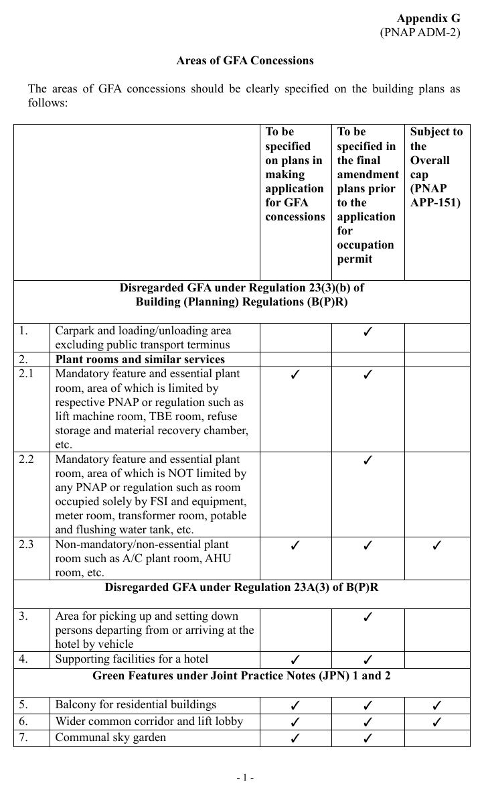
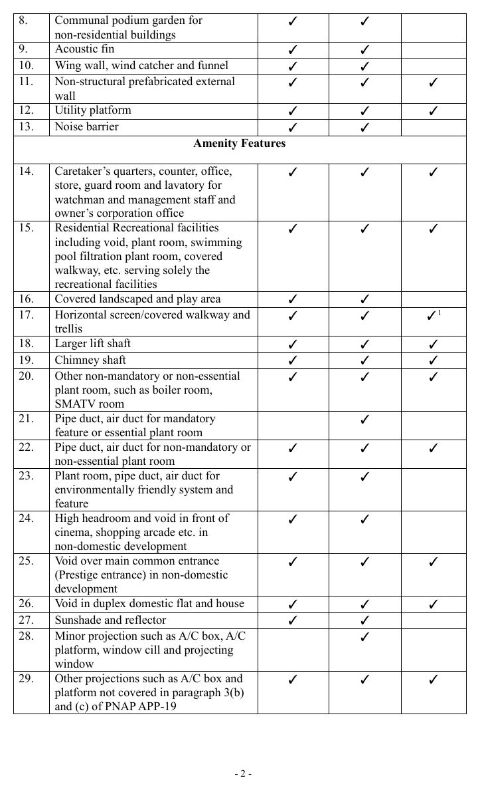
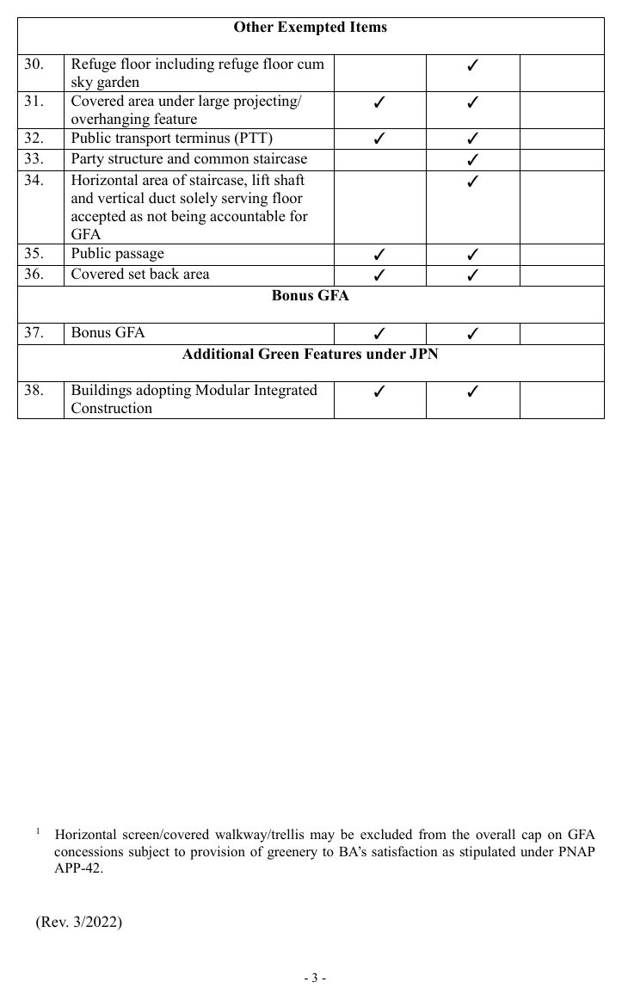
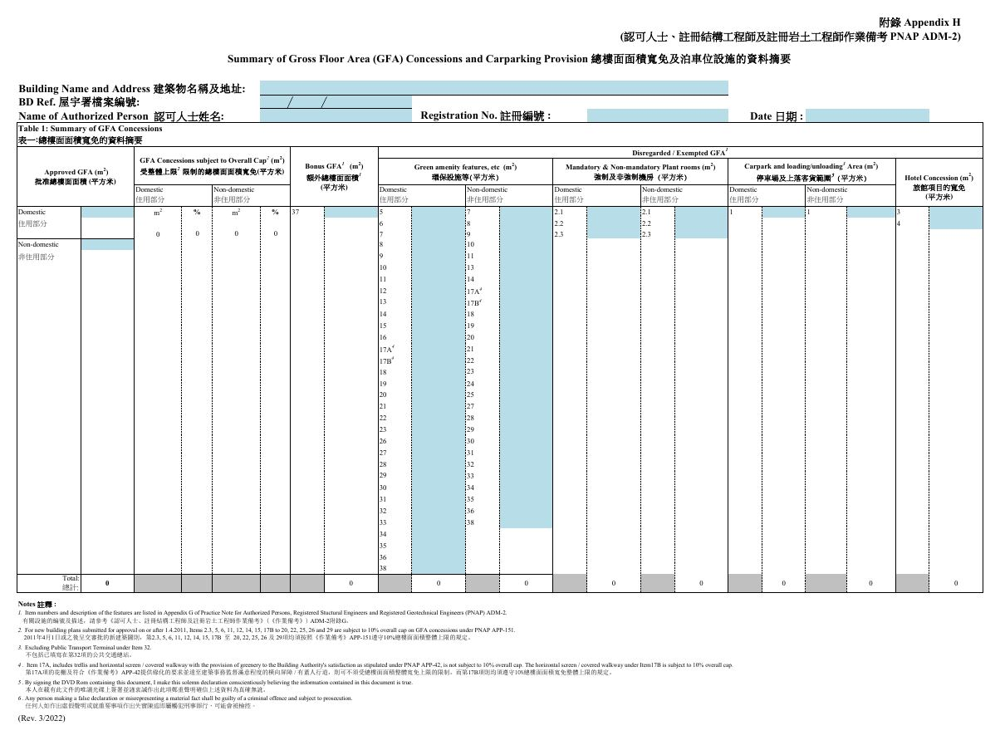
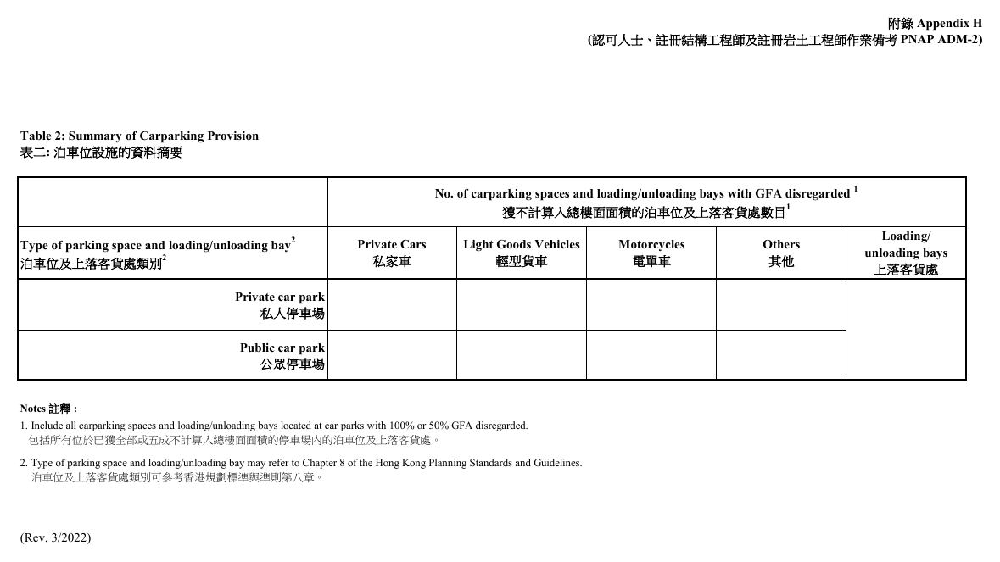

---
tags:
  - PNAP
  - ADM series
  - Plan submission & approval 呈交及審批
  - GFA concession 樓面面積寬免
  - GFA 總樓面面積
  - Occupation permit 佔用許可證
  - Structural 結構
  - Statutory period 法定期限
  - Site supervision 地盤監督
  - Geotechnical 岩土
  - Car park 停車場
  - Balcony & utility platform 露台及工作平台
  - Plant rooms 機房
  - Lift 升降機
  - Green & amenity features 環保及適意設施
  - A&A works 改動及加建工程
  - Minor works 小型工程
  - Hotel 酒店
  - Refuge floor 庇護層
summary: "How BD refers GBP to other departments, the day-45 check, BA16 modifications, BD 106 conditions and GFA concession publication."
keywords: ADM-2, centralised processing, 中央處理, ESH, BA16, BD 106, day 45, disapproval, 拒批, GFA concession, 總樓面面積寬免, FSI, DLO, lease
---

# ADM-2 Centralised Processing of Building Plans <small>中央處理建築圖則</small>

!!! info "Document info 文件資料"
    | | |
    |---|---|
    | **Type 類別** | PNAP (ADM series), previously PNAP 30 舊編號 PNAP 30 |
    | **Issued by 發出機構** | Buildings Department 屋宇署 |
    | **First issue 首次發出** | September 1976 |
    | **Version summarised 本摘要版本** | June 2024 (para. 19 and footnote 3 added; paras. 2, 4, 9 and Appendices B & C amended) |
    | **Official language 官方語言** | English only (Chinese version not available; some forms are bilingual) 只有英文版（部分表格為雙語） |
    | **Source 原文** | [ADM-2 (PDF)](https://www.bd.gov.hk/doc/en/resources/codes-and-references/practice-notes-and-circular-letters/pnap/ADM/ADM002.pdf) |
    | **Last checked 最後核對** | 2026-11-20 against the June 2024 version |

## At a glance 重點摘要 {#at-a-glance}

=== "English"

    - BD is the **focal point** for building plan submissions. Plans are **referred to all interested departments** (FSD, PlanD, LandsD, etc.) and their comments are collated by the BA **within the statutory time limits** (para. 1).
    - Submit through the **Electronic Submission Hub (ESH)** where possible. For paper submissions, use the **Appendix A checklist** for the number of plan sets and documents (para. 2).
    - **Disapproval items** are only BO matters that are **fundamental** (PNAP ADM-19). Other departments' comments are passed on for information (para. 4). The BA arbitrates on BO matters, and BD convenes meetings where departmental requirements conflict (para. 5).
    - **Greater certainty** (para. 8): on **day 45** you may ask whether a new submission is **fundamentally acceptable**. If disapproved within **60 days**, **no new disapproval items** are normally added on resubmission.
    - **Modifications / exemptions**: apply on **Form BA16** with justification (Appendix E lists the information needed for common ones). Conditions are imposed on **Form BD 106** and must be shown on the final amendment plans, with a **checklist of valid BD 106s** at completion (paras. 10–14).
    - **GFA concession transparency** (paras. 16–18): show the **breakdown of GFA concessions** on plans (Appendix G) and submit a **summary** (Appendix H) with the OP application. BD **publishes** it online after OP.

=== "中文"

    - 屋宇署是建築圖則呈交的**統籌中心**：圖則會**轉交所有相關部門**（消防處、規劃署、地政總署等），其意見由建築事務監督在**法定期限內**整合（第 1 段）。
    - 盡量經**電子呈交平台（ESH）**呈交；以紙本呈交時，須按**附錄 A 一覽表**核對圖則份數及文件（第 2 段）。
    - **拒批事項**只限屬《建築物條例》範圍而屬**根本性**的事項（PNAP ADM-19）；其他部門意見只供參考（第 4 段）。就《建築物條例》事宜由建築事務監督裁決；部門要求有分歧時由屋宇署召開會議（第 5 段）。
    - **更大確定性**（第 8 段）：新呈交圖則可在**第 45 天**查詢是否**基本上可接受**；如在 **60 天**內拒批，再次呈交時一般**不會加入新的拒批事項**。
    - **變通／豁免**：以 **BA16 表格**申請並附理據（附錄 E 列出常見申請所需資料）；條件載於 **BD 106 表格**，須在最終修訂圖則中顯示，竣工時提交**有效 BD 106 清單**（第 10–14 段）。
    - **總樓面面積寬免透明度**（第 16–18 段）：在圖則上列出**寬免面積明細**（附錄 G），並在申請佔用許可證時提交**摘要**（附錄 H）；屋宇署會在發出佔用許可證後**上載網站**。

!!! tip "Does it apply? 是否適用"
    **Applies 適用**: every submission of **general building plans, structural and geotechnical plans** to the BA (new buildings and A&A), paper or ESH. 所有呈交建築事務監督的圖則。

    **Not covered here 不在此列**: what counts as a disapproval item ([ADM-19](adm-19.md)); number of sets for structural plans ([ADM-8](adm-8.md)); e-submission details ([ADM-17](adm-17.md), [APP-60](app-60.md)); minor works ([Minor works guide](../guides/minor-works.md)). 拒批理由、結構圖份數、電子呈交另見。

## Workflow / timeline 流程及時間表 {#workflow-timeline}

<figure markdown>
  { width="394" loading=lazy }
  <figcaption>Centralised processing: what happens by day 45 and day 60. 中央處理：第 45 及 60 天。 Summary diagram prepared for this site; check the source text for exact wording.</figcaption>
</figure>

## Key table: processing timeline and tools 審批時序及工具 {#key-table-processing-timeline-and-tools}

| Step 步驟 | What happens 內容 | Para. 段 |
|---|---|---|
| Pre-submission 呈交前 | **Pre-submission enquiry** on specific issues with a specific proposition; for complex sites, a **presentation** (3-D model) after submission 呈交前查詢；複雜項目可作簡報 | 6–7 |
| Submission 呈交 | Via **ESH** (instant referral to all departments) or paper with the right number of sets (**Appendix A checklist**) 經 ESH 或紙本（附錄 A） | 2 |
| Referral 轉交 | FSI proposals (**Appendix B**), lease matters to DLO (**Appendix C**), Tung Chung cable car area (**Appendix I**) 消防裝置、地契、東涌纜車 | 3 |
| **Day 45** 第 45 天 | Ask whether the submission is **fundamentally acceptable**; discuss non-conformities before the disapproval letter 查詢是否基本上可接受 | 8(a) |
| **Day 60** 第 60 天 | Statutory decision. If disapproved, **no new disapproval items** normally on resubmission 法定期限；再呈交一般不加新拒批事項 | 8(b) |
| Decision letter 決定信件 | Fundamental BO items = disapproval items; other comments for information; late comments sent separately 根本性事項列為拒批理由 | 4 |
| Modification 變通 | **Form BA16** + justification (**Appendices D, E**); conditions on **Form BD 106** BA16 申請；BD 106 條件 | 10–13 |
| Completion 竣工 | Conditions shown on final amendment plans (ADV-33 Appendix A3 tables); **BD 106 checklist** (Appendix F) with the B(A)R 25 certificate 竣工時提交 BD 106 清單 | 14 |
| OP 佔用許可證 | **GFA concession summary** (Appendix H) with the OP application; published online after OP 寬免摘要隨申請提交並於網上公布 | 16–18 |
| Structural works 結構工程 | Result letters for structural approval/consent issued **electronically** from 2 July 2024 結構工程結果以電子方式發出 | 19 |

## Key table: appendices 附錄一覽 {#key-table-appendices}

| Appendix 附錄 | Content 內容 |
|---|---|
| A | Checklist of documents for new building / A&A submissions (bilingual) 送審文件一覽表（雙語） |
| B | Fire service installation proposals 消防裝置建議 |
| C | Lease matters: referral to DLO / BPU, CAD/BIM files, amendment submissions 地契事宜 |
| D | **Form BA16**: application for modification / exemption BA16 變通／豁免申請表 |
| E | Guidance notes on information required for common modifications (s.31(1) projections, B(P)R 20/21, 23(3)(a)/(b), 25, 36…) 常見變通申請所需資料 |
| F | Checklist on valid **Forms BD 106** BD 106 清單 |
| **G** | **Areas of GFA concessions**: how to specify them on plans 總樓面面積寬免面積 |
| **H** | **Summary of GFA concessions and car parks** for publication 寬免及停車位摘要 |
| I | Tung Chung Cable Car Route Protection Area 東涌纜車路線保護區 |

## Key clauses table 條文一覽 {#key-clauses-table}

| Para. | What it says 內容 |
|---|---|
| 1 | Purpose: all interested departments consulted; comments collated by the BA **within the statutory time limits**; BD the focal point |
| 2 | Submit via **ESH** (instant transmission to BD and departments). Paper: correct number of sets, **Appendix A** checklist; structural sets per [ADM-8](adm-8.md). Fn. 2: sites in the **Tung Chung Cable Car Route Protection Area** referred to Ngong Ping 360 (**Appendix I**) |
| 3 | FSI proposals → **Appendix B**; lease matters → **Appendix C** |
| 4 | Fundamental BO matters ([ADM-19](adm-19.md)) = **disapproval items**; other comments for information only; late comments by separate letter / ESH notice |
| 5 | BA arbitrates BO matters; non-BO matters taken up directly with the department; BD convenes meetings on **conflicting departmental requirements** |
| 6–7 | **Pre-submission enquiry** with a specific proposition; **presentation** (3-D model) for complicated sites after submission, at or with the CPO's agreement |
| 8–9 | **Day 45**: ask if fundamentally acceptable, discuss non-conformities; disapproved within **60 days** → normally **no new items** on resubmission. Ask the BS/SE direct or via ESH |
| 10–12 | Modification / exemption on **Form BA16** with special circumstances and justification (**Appendix D**); information for common cases (**Appendix E**) |
| 13–14 | Conditions under BO s.42 on **Form BD 106**; must appear on final amendment plans before the B(A)R 25 certificate ([ADV-33](adv-33.md) App. A3 tables); **checklist of valid BD 106s** (**Appendix F**) |
| 15 | Approval confers **no land title** nor lease waiver (BO s.14(2)); get adjoining owners' consent; comply with other authorities |
| 16–18 | **GFA concession transparency**: breakdown on plans (**Appendix G**); summary with car park numbers with the OP application (**Appendix H**); published after OP |
| 19 | Structural result letters (approval/consent) issued **electronically** even for paper submissions from **2 Jul 2024** (fn. 3: excludes A&A and railway consultation) |

## Appendix B: FSI proposals 消防裝置建議 {#appendix-b-fsi}

| Step 步驟 | Paper 紙本 | ESH 電子 |
|---|---|---|
| Referral 轉介 | Copy covering letter to FSD; **2 sets** (**3** if Cap. 502 / 572 / 636 applies) marked in bold at lower right | Upload to the FSD folder; no marking needed |
| Acceptable 可接受 | Collect endorsed plans; pay the **Cap. 95C** fee for the s.16(1)(b)(ii) certificate | Fee notice via ESH; endorsed plans via ESH; certificate sent after payment |
| Minor changes 小修改 | Amend at the FSD office | Via ESH "Discussion Forum" |
| Not acceptable 不接受 | FSD keeps one set and writes with comments (not repeated by BD) | Letter via ESH |
| Collection 領回 | Within **3 months** or the plans are disposed of | — |
| FSD comments grouped as 意見分類 | (a) reasons for refusing the s.16(1)(b) certificate; (b) **strongly recommended** (else possible abatement under Cap. 95); (c) purely optional | |

## Appendix C: lease matters 地契事宜 {#appendix-c-lease}

- Paper: one set of GBP with the **Development Schedule**, coloured plans and **CAD or BIM** files on DVD (LAO PN 3/2018) referred to the **DLO**; more sets if Government accommodation is involved. 紙本附 CAD／BIM 檔轉介地政處。
- ESH: upload with CAD / BIM files for direct referral to the DLO or **Building Plan Unit**. 電子呈交直接轉介。
- Amendments: complete LandsD's **streamlined arrangement reply slip**. 修訂圖則填回條。
- Enquiries go to the DLO / BPU / Railway Development Section directly; a **lease modification must precede** formal submission. 契約修訂須先於正式呈交。

## Appendix E: common modifications and what to submit 常見變通 {#appendix-e}

| Provision 條文 | Typical application 申請 | See 參閱 |
|---|---|---|
| BO s.31(1) | Projection over street; sheet piles under a street (only if departments do not object) | [BO Part 4](../regulations/bo-parts-4-9-schedules.md) |
| B(P)R 20 & 21 | Exclude A/C boxes and platforms from PR / SC | [APP-19](app-19.md) |
| B(P)R 20 | Excess SC for FS upgrading in existing buildings | [B(P)R 19–23](../regulations/bpr-18a-22.md) |
| B(P)R 22 | Bonus PR / SC for dedication or surrender of land | [APP-108](app-108.md) |
| B(P)R 23(3)(a) | Voids, covered landscape and recreation, screens, lift shafts, refuge floors, plant rooms, **green features (JPN 1, 2)**, **MiC (JPN 8)** | [APP-2](app-2.md) · [APP-42](app-42.md) · [JPN 2](jpn-2.md) · [JPN 8](jpn-8.md) |
| B(P)R 23(3)(b) | Disregard essential / non-essential plant rooms, car parks | [APP-84](app-84.md) · [APP-151](app-151.md) · [APP-111](app-111.md) |
| B(P)R 30, 36 | Reduced natural lighting and ventilation | [APP-130](app-130.md) |
| B(P)R 35A, 40 | Gas aperture omission; no natural light to podium staircases | [B(P)R 24–37](../regulations/bpr-24-37.md) · [B(P)R 39–49E](../regulations/bpr-39-49e.md) |
| B(SSFPDWL)R 48, 50(3) | Lesser drain falls; flexible joints | [Cap. 123I](../regulations/bsfpwr-123i.md) |
| B(C)R 9A | Deviation from the Code for Building Works | [B(C)R](../regulations/bcr-123q.md) |

## Appendix G: where each GFA concession appears 寬免須列明的位置 {#appendix-g-table}

| Item (Appendix G) | On plans when applying | On final amendment plans before OP | Subject to 10% cap ([APP-151](app-151.md)) |
|---|:-:|:-:|:-:|
| 1 Car parks / loading (not PTT) | | ✓ | |
| 2.1 Mandatory plant rooms with area limits (lift machine, TBE, refuse) | ✓ | ✓ | |
| 2.2 Mandatory plant rooms without limits (FSI, meter, transformer, tanks) | | ✓ | |
| 2.3 Non-mandatory plant (A/C plant, AHU) | ✓ | ✓ | ✓ |
| 3–4 Hotel drop-off; hotel supporting facilities | ✓ (4) | ✓ | |
| 5–6 Balcony; wider corridor / lift lobby | ✓ | ✓ | ✓ |
| 7–10 Sky garden, podium garden, acoustic fin, wing wall | ✓ | ✓ | |
| 11–12 Prefab external wall; utility platform | ✓ | ✓ | ✓ |
| 14–15, 17–20, 22, 25–26 Amenity features, recreation, larger lift shaft, voids in duplex | ✓ | ✓ | ✓ |
| 16, 23–24, 27 Covered landscape, eco plant, high headroom, sunshades | ✓ | ✓ | |
| 21, 28 Ducts for mandatory plant; minor projections | | ✓ | |

<small>Summarised from Appendix G; full scanned pages below. 摘自附錄 G。</small>

## Worked example 例子 {#worked-example}

!!! example "Illustrative only 只作說明"
    A residential GBP submitted via ESH on day 0 with 3 BA16s (APP-19 A/C platforms, JPN 1 balconies, APP-130 lighting).

    1. ESH refers it at once to FSD, PlanD, LandsD (with BIM file). 即時轉介。
    2. **Day 45**: the AP asks the BS; told the balcony calculation is a fundamental non-conformity and discusses it. 第 45 天查詢。
    3. **Day 58**: disapproval letter: balcony item as disapproval item ([ADM-19](adm-19.md)); FSD "strongly recommended" items and LandsD comments listed for information. 拒批。
    4. Resubmission: the BA will not normally add new disapproval items. Approved with **BD 106** conditions, later shown on the final amendment plans; at completion submit the **BD 106 checklist** and the **Appendix H** GFA concession summary with the OP application. 再呈交及竣工。

## Whole picture 整體關係 {#whole-picture}

| Stage 階段 | Documents 文件 |
|---|---|
| Statutory periods (60 / 30 / 28 days, B(A)R 30–33) 法定期限 | [BO s.14–21](../regulations/bo-part-2-building-works.md) · [B(A)R](../regulations/bar-123a.md#key-table-processing-periods) · [Plan submission guide](../guides/submission-to-op.md) |
| Disapproval grounds 拒批理由 | [ADM-19](adm-19.md) |
| Electronic submission 電子呈交 | [ADM-17](adm-17.md) · [APP-60](app-60.md) |
| Structural plan sets 結構圖 | [ADM-8](adm-8.md) |
| Modification checklists and tables 變通清單 | [ADV-33](adv-33.md) |
| GFA concessions and 10% cap 寬免上限 | [APP-151](app-151.md) · [JPN 1](jpn-1.md) · [JPN 2](jpn-2.md) |
| Fees 費用 | [APP-55](app-55.md) |
| Geotechnical reports 岩土報告 | [APP-25](app-25.md) |

## Key quotes 原文摘錄 {#key-clauses}

!!! quote "Para. 8 — Greater certainty 更大確定性"
    To assist AP, RSE and RGE in achieving greater certainty in planning building projects, BD operates a set of procedures containing the following features: (a) On the 45th day of a submission of new building plans, AP/RSE/RGE may enquire and expect to know whether the submission is fundamentally acceptable. He may also request to discuss non-conformities identified prior to the issue of disapproval letter; and (b) Where a submission of plans is considered fundamentally unacceptable and disapproval items notified in writing within the statutory period of 60 days, new disapproval items will not, in normal circumstances, be added to the said proposal for subsequent resubmission of plans.

    **中譯（非官方）：** 為協助認可人士、註冊結構工程師及註冊岩土工程師在規劃建築項目時有更大確定性，屋宇署採用以下程序：(a) 新建築圖則呈交後第 45 天，可查詢並預期得知呈交是否基本上可以接受，亦可要求在發出拒批信前討論已發現的不符合之處；及 (b) 如呈交的圖則被視為基本上不可接受，並已在 60 天法定期限內以書面通知拒批事項，則在一般情況下，其後再次呈交時不會加入新的拒批事項。

!!! quote "Paras. 17–18 — GFA concession information 總樓面面積寬免資料"
    In making application for approval of building development involving GFA concessions, detailed breakdown of the areas of such GFA concessions should be clearly specified on the building plans submitted to the BA for approval as set out in Appendix G. To facilitate publication and public search of information on GFA concessions granted and number of carparks provided for newly-completed buildings, a summary of such concessions and information (sample at Appendix H1) should be submitted together with the application for occupation permit. The relevant information will be uploaded on the BD's website after issuance of occupation permit.

    **中譯（非官方）：** 申請批准涉及總樓面面積寬免的建築發展時，須按附錄 G 在呈交建築事務監督審批的建築圖則上清楚列明寬免面積的詳細明細。為方便公布及讓公眾查閱新落成建築物獲批的寬免及停車位數目，須在申請佔用許可證時一併提交有關寬免及資料的摘要（樣本見附錄 H1），有關資料會在發出佔用許可證後上載屋宇署網站。

<figure markdown>
  { loading=lazy }
  <figcaption>Appendix G — Areas of GFA concessions to be specified on plans (page 1 of 3) 總樓面面積寬免面積（第 1 頁）</figcaption>
</figure>

??? abstract "Appendix G pages 2–3 and Appendix H summary sheets 附錄 G 第 2–3 頁及附錄 H 摘要表"
    { loading=lazy }
    { loading=lazy }
    { loading=lazy }
    { loading=lazy }

<small>Source: PNAP ADM-2 (June 2024), Buildings Department 資料來源：屋宇署</small>

## Explanation 淺白解釋 {#explanation}

=== "English"

    ADM-2 is the **"how the system works"** note for plan submissions. Key ideas:

    - **One window**: you submit to BD, and BD circulates to all departments and returns one consolidated reply within the statutory time.
    - **Only fundamental BO issues block approval**. Other departments' comments are passed on, but you settle them with those departments directly.
    - **Use day 45**: call the case officer to find out early whether the scheme is fundamentally acceptable.
    - **Paper trail for concessions**: every modification has BD 106 conditions, and every GFA concession must appear in a **standard breakdown** on plans and in a **public summary** after OP. This is how buyers and the public can see what was exempted.

=== "中文"

    ADM-2 是說明**圖則審批制度如何運作**的作業備考，重點如下：

    - **單一窗口**：向屋宇署呈交，屋宇署轉交所有部門，並在法定時間內給予一個綜合回覆。
    - **只有《建築物條例》的根本性事項才會導致拒批**：其他部門的意見會轉達，但須直接與該等部門解決。
    - **善用第 45 天**：致電負責人員，及早知道方案是否基本上可接受。
    - **寬免的紀錄**：每項變通均附 BD 106 條件；每項總樓面面積寬免都須以**標準明細**顯示在圖則上，並在佔用許可證發出後**公開摘要**，讓買家及公眾知道哪些面積獲豁免。

## Practical notes 實務提示 {#practical-notes}

=== "English"

    !!! tip "Common pitfalls"
        - Too **few plan sets** in paper submissions, which delays the referral. Use the Appendix A checklist.
        - Forms BA16 **without justification** of the special circumstances.
        - Forgetting to carry the **BD 106 conditions** into the final amendment plans before the completion certificate.
        - GFA concessions **not broken down** per Appendix G, or no Appendix H summary with the OP application.
        - Expecting lease issues to be resolved by BD. Lease enquiries go **directly to the DLO**, and any lease modification should **precede** formal plan submission (App. C para. 4).

=== "中文"

    !!! tip "常見錯誤"
        - 紙本呈交的**圖則份數不足**，延誤轉交；請按附錄 A 一覽表核對。
        - BA16 表格**沒有說明**特殊情況及理據。
        - 忘記在竣工證明書前把 **BD 106 條件**加入最終修訂圖則。
        - 總樓面面積寬免**沒有按附錄 G 列出明細**，或申請佔用許可證時沒有附上附錄 H 摘要。
        - 期望屋宇署處理地契問題：地契查詢須**直接向地政處**提出，修訂地契應**早於**正式呈交圖則（附錄 C 第 4 段）。

<!-- APSEC START -->
## APSEC clarifications 認可人士及註冊結構工程師委員會討論 {#apsec-clarifications}

BD's responses at the APSEC Discussion Forum that clarify this document, **newest first**. Where the same question came up more than once, only the **latest position** is listed. See [all APSEC items](../apsec/index.md). 屋宇署在討論會上就本文件作出的澄清，新者在前；同一問題只列最新立場。

- **[Mechanical Ventilation in Kiosks or Guard Rooms](../apsec/2025.md#i202505094)** <small>ADF 2/2025, 9 May 2025</small> BD advised that whenever AP submitted a Form BA16 treating kiosks or guard rooms as ancillary offices and applying for modification of regulation 30 of the Building (Planning) Regulations (B(P)R), BD would favourably …
- **[Mandatory Circulation of Final Amendment of General Building Plans (GBP) to the Fire Services Department (FSD) after Initial Inspection for Occupation Permit (OP) Application](../apsec/2024.md#i202411223)** <small>ADF 4/2024, 22 Nov 2024</small> BD advised that referral to FSD under centralized processing of building plans was clearly stated in PNAP ADM-2. In the Electronic Submission Hub (ESH), building plans would be sent to FSD automatically. BD would …
- **[General Comments and Suggestions on BD’s Plan Processing](../apsec/2024.md#i2024050313)** <small>ADF 2/2024, 3 May 2024</small> BD advised that practitioners might contact BD officers by email with copy to their respective senior and/or chief officers for effective communication as officers might not be able to answer telephone calls due to …
- **[Check List in Appendix A to PNAP ADM-2](../apsec/2022.md#i2022081225)** <small>ADF 4/2022, 12 Aug 2022</small> BD would review the issue.
- **[Incorporating Conditions of Modifications/Exemptions in final General Building Plan (GBP) Amendment Submission](../apsec/2022.md#i2022081220)** <small>ADF 4/2022, 12 Aug 2022</small> BD advised that according to paragraph 14 of PNAP ADM-2, in order to ensure that the imposed conditions were fulfilled and the parameters for granting modifications/exemptions could be made known to the public and any …
- **[Requirements on Fresh Air Intake of Mechanical Ventilation System](../apsec/2021.md#i2021081313)** <small>ADF 4/2021, 13 Aug 2021</small> BD advised that in granting of modification on B(P)R 30 in relation to kitchens in licensed premises, relevant conditions as specified in Annexes 1 and 2 of PNAP ADM-2 would be imposed including: (i) Provision of …
- **[Application for Consent to Commence Superstructure Works for GBP involving Bonus PR/SC for Dedication/Surrender of Land under Regulation 22 of B(P)R](../apsec/2019.md#i201908231)** <small>ADF 4/2019, 23 Aug 2019</small> BD noted that it took time for the preparation and execution of the Deed of Dedication or Agreement to Surrender. In this regard, BD had been adopting a pragmatic and flexible approach on a case merit basis to …
- **[Provision of Reduced Size Light Well to Enhance Natural Ventilation](../apsec/2018.md#i2018011912)** <small>ADF 1/2018, 19 Jan 2018</small> BD advised that CFD analysis indicated that ventilation performance of reduced size light well (1:18) with bottom opened would be generally better than the standard size light well (1:6). In order to allow more design …

??? note "2 more APSEC items 更多項目"

    - **[Centralized Processing of Plans](../apsec/2018.md#i201801198)** <small>ADF 1/2018, 19 Jan 2018</small> BD encouraged AP/RSE making use of the mechanism of pre-submission enquiry and conference at an early stage to identify complicated or controversial issues so as to facilitate plan processing. In addition, AP/RSE should …
    - **[Follow-up on Mechanical Ventilation of Room containing Waste Fitment](../apsec/2018.md#i201801191)** <small>ADF 1/2018, 19 Jan 2018</small> BD said that HKIA’s proposal on notional area for calculating the air change as discussed in ADF 2/2017 should generally be applicable to large hospital wards provided with 10 ACH requirements as required under PNAP …

<!-- APSEC END -->

## Related 相關文件 {#related}

| Document 文件 | Relationship 關係 |
|---|---|
| [APP-151](app-151.md) | GFA concessions and their disclosure 寬免及其公布 |
| [APP-104](app-104.md) para. 11 | OP held until concession information is shown per ADM-2 寬免資料 |
| [JPN 4](jpn-4.md) | BD as sole agent verifying GFA for all three regimes 屋宇署為三個制度核實總樓面面積 |
| PNAP ADM-19 | Fundamental issues for disapproval 拒批的根本性事項 |
| PNAP ADV-33 | Sample tables for conditions on plans 圖則條件表格樣本 |
| PNAP ADM-17, APP-60 | Electronic submissions 電子呈交 |

---
<small>Prepared by: _[name]_ · Checked by: _[name]_ · Unofficial summary; refer to the official PNAP for the definitive text.</small>
