---
tags:
  - PNAP
  - ADM series
  - Withdrawal and resubmission 撤回並重新提交
  - Statutory period 法定期限
  - Plan submission & approval 呈交及審批
  - Occupation permit 佔用許可證
summary: "Withdrawal and resubmission of plan and OP applications is allowed in writing with reasons, normally not more than twice for the same submission."
keywords: ADM-22, withdrawal and resubmission, 撤回並重新提交, W&R, statutory time limit, occupation permit, plan approval, two times
---

# ADM-22 Withdrawal and Resubmission <small>撤回並重新提交申請</small>

!!! info "Document info 文件資料"
    | | |
    |---|---|
    | **Type 類別** | PNAP (ADM series) |
    | **Issued by 發出機構** | Buildings Department 屋宇署 |
    | **Version summarised 本摘要版本** | September 2019 |
    | **Official language 官方語言** | English and Chinese 中英文版 |
    | **Source 原文** | [English (PDF)](https://www.bd.gov.hk/doc/en/resources/codes-and-references/practice-notes-and-circular-letters/pnap/ADM/ADM022.pdf) · [中文 (PDF)](https://www.bd.gov.hk/doc/tc/resources/codes-and-references/practice-notes-and-circular-letters/pnap/ADM/ADM022.pdf) |
    | **Last checked 最後核對** | 2026-11-21 against the current BD version |

## At a glance 重點摘要 {#at-a-glance}

=== "English"

    - **Withdrawal and resubmission (W&R)**: by letter, the AP / RSE / RGE simultaneously withdraws and resubmits an application (plans, OP or consent) without taking back documents, **restarting the statutory period** (para. 1).
    - Must be **in writing with reasons**; generally allowed **no more than twice** for the same submission (para. 2).

=== "中文"

    - **撤回並重新提交**：認可人士／註冊結構工程師／註冊岩土工程師以信件同時撤回及重新提交申請（圖則、佔用許可證或同意），毋須取回文件，**法定處理期重新開始**（第 1 段）。
    - 須**以書面並附理由**提出；同一申請一般**最多兩次**（第 2 段）。

---
<small>Prepared by: _[name]_ · Checked by: _[name]_ · Quotes from the official English and Chinese versions; refer to the PNAP for the definitive text.</small>

!!! tip "Does it apply? 是否適用"
    **Applies 適用**: applications for **plan approval** and **occupation permits** within statutory time limits. 圖則批准及佔用許可證申請。

## Key clauses 條文一覽 {#key-clauses-table}

| Para. 段 | What it says 內容 | 中文要點 |
|---|---|---|
| 1 | W&R is a long-established practice giving flexibility within **statutory time limits** | 便利做法 |
| 2(a) | Must be **in writing with reasons** | 書面並附理由 |
| 2(b) | Same submission: generally **not more than two times** | 一般不超過兩次 |

## Whole picture 整體關係 {#whole-picture}

| Topic 主題 | Where 文件 |
|---|---|
| Statutory processing 審批期限 | [ADM-2](adm-2.md) · [BO Part 2](../regulations/bo-part-2-building-works.md) |
| Minor amendments 輕微修訂 | [ADM-14](adm-14.md) |
| Occupation permit 佔用許可證 | [Submission to OP](../guides/submission-to-op.md) |

## Workflow / timeline 流程及時間表 {#workflow-timeline}

<figure markdown>
  { width="760" loading=lazy }
  <figcaption>Withdrawal and resubmission restarts the clock, at most twice. 撤回並重新提交最多兩次。 Summary diagram prepared for this site; check the source text for exact wording.</figcaption>
</figure>

