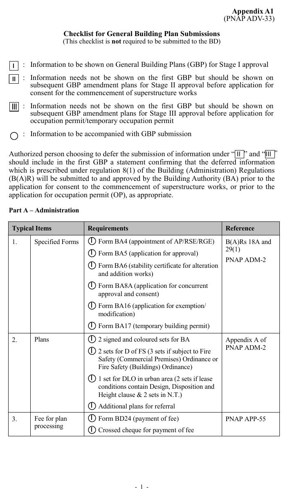

---
tags:
  - PNAP
  - ADV series
  - Plan submission & approval 呈交及審批
  - Checklist 核對清單
  - Curtain wall & façade 幕牆及外牆
  - Drainage 排水
  - Structural 結構
  - Geotechnical 岩土
  - GFA 總樓面面積
  - Balcony & utility platform 露台及工作平台
  - Excavation & ELS 挖掘
  - Minor works 小型工程
  - Registration 註冊
  - Protective barrier 防護欄障
  - Maintenance access 維修通道
  - GFA concession 樓面面積寬免
  - Foundation 地基
  - Plumbing & sanitary 衞生設備
  - Occupation permit 佔用許可證
  - Means of access 救援通道
  - Sustainable building design 可持續建築設計
  - Refuse 垃圾
summary: "Lists the essential information to show in GBP, structural and other plan submissions (Appendices A1–A2), and typical modifications and exemptions, so BD can process plans efficiently."
keywords: ADV-33, essential information, 重要資料, plan submissions, general building plans, GBP checklist, Appendix A1, modifications exemptions, site parameters
---

# ADV-33 Essential Information in Plan Submissions <small>呈交圖則包含的重要資料</small>

!!! info "Document info 文件資料"
    | | |
    |---|---|
    | **Type 類別** | PNAP (ADV series) |
    | **Issued by 發出機構** | Buildings Department 屋宇署 |
    | **First issue 首次發出** | February 2016 |
    | **Version summarised 本摘要版本** | May 2024 (para. 2(b) and Appendices B3 & B11 amended; Appendix B12 added) |
    | **Official language 官方語言** | English only (Chinese version not available) 只有英文版 |
    | **Length 篇幅** | 129 pages, mostly checklists and sample drawings 129 頁，主要為核對清單及樣本圖則 |
    | **Source 原文** | [ADV-33 (PDF)](https://www.bd.gov.hk/doc/en/resources/codes-and-references/practice-notes-and-circular-letters/pnap/ADV/ADV033.pdf) |
    | **Last checked 最後核對** | 2026-11-20 against the May 2024 version |

## At a glance 重點摘要 {#at-a-glance}

=== "English"

    - ADV-33 gives AP / RSE / RGE a set of **checklists** and **sample drawings** so that plan submissions contain the **essential information**, and fundamental issues can be considered at first submission (paras. 1–2).
    - It supports the efficiency measures in [ADM-19](adm-19.md) (curtailed checking, pre-submission enquiries, fast track). An incomplete first submission is a common reason for disapproval.
    - Three groups of appendices: **A** = general building plans (GBP), **B** = structural plans (foundation, ELS, superstructure, curtain wall, glass balustrade, cladding, ceilings, supporting frames), **C** = drainage plans.
    - The checklists are **for your own use**. They are **not submitted** to BD.
    - The GBP checklist (A1) marks each item by **stage**: **I** (first GBP for Stage I approval), **II** (before consent for superstructure), **III** (before OP / TOP), **○** (document to accompany the submission). If you defer Stage II / III items, the first GBP must carry a **statement** that the deferred B(A)R 8(1) information will be submitted and approved in time.

=== "中文"

    - ADV-33 為認可人士、註冊結構工程師及註冊岩土工程師提供一套**核對清單**及**樣本圖則**，確保呈交的圖則載有**重要資料**，讓根本性事項在首次呈交時已可考慮（第 1–2 段）。
    - 本備考配合 [ADM-19](adm-19.md) 的提升效率措施（精簡審核、呈交前查詢、快速處理）；首次呈交資料不全是常見的拒批原因。
    - 附錄分三組：**A** = 一般建築圖則；**B** = 結構圖則（地基、挖掘及側向支撐、上蓋、幕牆、玻璃欄杆、金屬覆層、天花、支架）；**C** = 排水圖則。
    - 核對清單**只供自用**，**毋須**呈交屋宇署。
    - 一般建築圖則清單（A1）按**階段**標示每個項目：**I**（首套圖則，第 I 階段批准）、**II**（申請上蓋工程同意書前）、**III**（申請佔用許可證／臨時佔用許可證前）、**○**（須隨圖則附上的文件）。如押後提交第 II／III 階段資料，首套圖則須載有**聲明**，確認押後的 B(A)R 8(1) 資料會適時提交並獲批准。

!!! tip "Does it apply? 是否適用"
    **Applies 適用**: preparing **GBP and other statutory plan submissions**; missing essential information can lead to disapproval under BO s.16. 準備呈交圖則。

## Key table: the appendices 附錄一覽 {#key-table-the-appendices}

| Appendix 附錄 | Content 內容 | Type 類型 |
|---|---|---|
| **A1** | Checklist for GBP submissions 一般建築圖則核對清單 | Checklist |
| **A2** | Checklist for applications for typical modifications / exemptions (BA16) 常見修改／豁免申請核對清單 | Checklist |
| **A3** | Sample tables for modifications / exemptions granted or applied for 修改／豁免表格樣本 | Sample |
| **A4** | Sample drawings showing acceptable standards for GBP 一般建築圖則樣本 | Sample drawings |
| **B1** | Foundation plans 地基圖則 | Checklist |
| **B2** | Excavation and lateral support (ELS) plans 挖掘及側向支撐圖則 | Checklist |
| **B3** | Superstructure plans 上蓋結構圖則 | Checklist |
| **B4** | Curtain wall details 幕牆細節 | Checklist |
| **B5** | Glass balustrade plans 玻璃欄杆圖則 | Checklist |
| **B6** | Metal cladding plans 金屬覆層圖則 | Checklist |
| **B7** | Metal ceiling / grille / louvre plans 金屬天花／格柵／百葉圖則 | Checklist |
| **B8–B10** | Sample drawings: glass balustrade; metal cladding; metal ceiling / grille / louvre 樣本圖則 | Sample drawings |
| **B11** | Sample drawings: supporting frames for suspended air ducts, axial fans, cabinet fans and AHUs inside a building 風管、風扇及空氣處理機支架樣本 | Sample drawings |
| **B12** | Sample drawings: curtain wall embeds (added May 2024) 幕牆預埋件樣本（2024 年新增） | Sample drawings |
| **C1** | Drainage plans 排水圖則 | Checklist |
| **C2** | Typical modifications / exemptions in drainage works 排水工程常見修改／豁免 | Checklist |
| **C3** | Sample drainage drawings 排水圖則樣本 | Sample drawings |

## Key figure: Appendix A1 legend and Part A 附錄 A1 圖例及 A 部 {#key-figure-appendix-a1-legend-and-part-a-a1-a}

<figure markdown>
  { width="560" loading=lazy }
  <figcaption>Appendix A1, page 1: the stage symbols (I, II, III, ○) and Part A (forms, number of plan sets, fee). 附錄 A1 第 1 頁：階段符號及行政部分。Source: BD, PNAP ADV-33.</figcaption>
</figure>

## Key table: Appendix A1 highlights 附錄 A1 重點 {#key-table-appendix-a1-highlights-a1}

| Item 項目 | What to provide 須提供 | Stage 階段 | Reference 參考 |
|---|---|---|---|
| Forms 表格 | BA4, BA5, BA6 (A&A stability), BA8A (concurrent approval & consent), BA16 (modification / exemption), BA17 (temporary building) | ○ | B(A)R 18A, 29(1); ADM-2 |
| Plan sets 圖則套數 | **2** coloured sets for BA; **2** for FSD (**3** if FS(CP)O / FS(B)O applies); DLO **1** set in urban areas (**2** if lease has a Design, Disposition and Height clause, and **2** in the NT); extra sets for referrals | ○ | ADM-2 App. A |
| Fee 費用 | Form BD24 and payment | ○ | APP-55 |
| Proof of ownership, BA16 tables, priority / fast track, geotechnical assessment 業權證明、修改表、快速處理、岩土評估 | As applicable (tables per App. A3; GA per [APP-25](app-25.md)) | ○ / I | ADM-4, ADM-19, APP-25 |
| Planning control 規劃管制 | OZP zoning and restrictions, special control areas, BO s.31(1) street projections | I | — |
| GFA concessions 總樓面面積寬免 | UFS figures (Stage I) and UFS diagrams (Stage II); plant room justifications; compliance with [APP-151](app-151.md) / [APP-152](app-152.md) / [APP-156](app-156.md) | I / II | APP-2, APP-151 |
| Refuse rooms, TBE rooms 垃圾房、電訊及廣播設備室 | Figures at Stage I, diagrams at Stage II | I / II | [APP-35](app-35.md), [APP-84](app-84.md) |
| Means of access for firefighting 消防救援進出途徑 | Fireman's lift / FRS shown; distances at critical locations (> **44 m** open plan, > **59 m** actual passage; > **17 m** from G/F access point) | I | B(P)R 41A–41C; [FS Code Part D](../codes/fsc-part-d-means-of-access.md) |
| Standard details 標準細節 | Gas flue, utility platform / balcony / A/C platform, curtain wall / NSPEW, sunken slab, acoustic window, protective barrier, top-hung window, accessible toilet | II | Various PNAPs |
| External maintenance access 外牆維修通道 | Access to roofs, external walls, claddings, curtain walls | II | CoP on Access for External Maintenance 2021 |
| Sanitary fitments 衞生設備 | Sanitary schedule | I | B(SFP&W)R |
| Minor works 小型工程 | Location plan of minor works (dampers, A/C frames, ducts) | III | [APP-147](app-147.md) |

<small>Selected items only. Use the full A1 checklist for a real submission. 只列部分項目；實際呈交請用完整清單。</small>

## Key table: Appendix A2, typical modifications / exemptions 附錄 A2 常見修改／豁免 {#key-table-appendix-a2-typical-modifications-exemptions-a2}

| # | Application 申請 | Key information 主要資料 |
|---|---|---|
| 1 | **BO s.31(1)**: projections over a street 伸出街道的伸出物 | Clearances, projection, pavement / carriageway widths; condensate disposal; drainage; maintenance access; ○ sunshade assessment. Not needed for projections complying with B(P)R Part II or signboards to APP-126 |
| 2 | B(A)R 13: plan scale ratio 圖則比例 | Prescribed information and dimensions clearly shown |
| 3 | B(A)R 29(1A): fee exemption for charitable works 慈善用途豁免費用 | ○ Supporting documents |
| 4 | B(A)R 33(1): amendments without prior approval and consent 修訂毋須事先批准及同意 | ○ Amendments meet the ADM-19 criteria |
| 5 | B(P)R 20: excess SC for upgrading FSI in existing buildings 改善消防裝置的超額上蓋面積 | Enclosure dimensions; ○ confirmation that enclosures only house upgraded FSI |
| 6 | B(P)R 20, 21: projections excluded from PR / SC 伸出物不計地積比率／上蓋面積 | Details per [APP-19](app-19.md); ○ undertaking per APP-151 |
| 7 | B(P)R 20, 21: existing party structures / common staircases 共用結構／樓梯 | Dimensions, GFA, physical separation |
| 8–10 | B(P)R 20, 23(3)(a): balconies, utility platforms, wider corridors / lobbies, acoustic fins, noise barriers, wing walls, wind catchers / funnels 露台、工作平台、加闊走廊、隔音鰭等 | Criteria of [JPN 1](jpn-1.md) / [JPN 2](jpn-2.md); ○ undertakings and DMC designation per APP-151 |

<small>The list continues in the PNAP. GFA / SC calculations for exempted areas must be shown on plans. 清單在原文續有其他項目；豁免面積的計算須在圖則上顯示。</small>

## Appendices B and C: structural and drainage checklists 結構及排水清單 {#appendices-b-c}

Each structural checklist has **Part A Administration**, **Part B Documents** (Design Document **Part I synopsis and essential information**, **Part II detailed analysis**), and **Part C Plans**. 各結構清單分行政、文件及圖則三部分。

| App. | Checklist 清單 | Key items 主要項目 |
|---|---|---|
| **B1** | Foundation plans 地基圖則 | Forms BA4, BA5, BA6, BA16; fee ([APP-55](app-55.md)); **2 signed sets of plans + 1 set of documents** ([ADM-8](adm-8.md), [APP-141](app-141.md)); **extra sets for referrals**: Scheduled Areas 1, 2, 4 (1 + 1), **railway protection** (2), Scheduled Area 5 (2 + 1), North Lantau (1 + 1), slopes / retaining walls / deep excavation / tunnels (1 + 1), culverts / nullahs (3), airport (1), structures over streets (2), highway structures (1 + 1), sea walls (1 + 1), reclamation / piers (2 + 2), public drains / water mains (1) ([APP-24](app-24.md), [APP-30](app-30.md), [APP-61](app-61.md), [APP-62](app-62.md), [APP-134](app-134.md)). Documents: foundation type, codes and editions, materials, geotechnical parameters, groundwater, design assumptions, **effects on adjoining buildings / slopes** with precautions and monitoring; loads (dead, imposed, wind, earth, water); computer program statements signed by RSE / RGE, assumptions, input graphics; combined stress checks, **final set table**, capacities, load combinations, margins of safety ([APP-18](app-18.md), B(C)R 15) |
| **B2** | Excavation and lateral support 挖掘及側向承托 | Same administration and referral pattern; ELS design, monitoring and precautionary measures ([APP-57](app-57.md)) |
| **B3** | Superstructure 上蓋結構 | Synopsis (structural system, loads, codes), detailed analysis, framing plans ([ADM-6](adm-6.md), [ADM-19](adm-19.md) App. B fundamentals) |
| **B4** | Curtain wall details 幕牆細節 | Administration, documents, detailed design; App. A / B to the checklist ([Glass Code](../codes/glass-2018.md)) |
| **B5** | Glass balustrades 玻璃欄杆 | Synopsis, detailed design, plans (sample drawings B8) |
| **B6** | Metal cladding 金屬覆層 | Sample drawings B9 |
| **B7** | Metal ceiling / grille / louvre 金屬天花／格柵／百葉 | Sample drawings B10 |
| **B11–B12** | Sample drawings: supports for ducts, fans, AHUs; curtain wall embeds 樣本圖則 | — |
| **C1** | **Drainage plans** 排水圖則 | Forms BA5, **BA8 / BA8A**, BA16, BD24; **2 signed coloured sets** with Annex C1 confirmation; documents for BA16, manhole structural details (separate submission except A&A), **soakaway percolation tests** (B(SSFP&D)R 90), septic tank / treatment plant calculations (EPD ProPECC PN 5/93), **DIA / SIA** for DSD, third-party consent for off-site private drains. On plans: public sewers / drains from DSD; **terminal manholes** near the boundary with disconnecting traps, ventilated (regs. 52(2), 57); trade effluent, grease traps, **petrol interceptors** ([APP-46](app-46.md)); pipe sizes, **falls (Table 29)**, flow directions; no acute angles in manholes (reg. 49(2)); **drop pipes** where inverts differ > **600 mm**; hatch boxes in water gathering grounds (reg. 47A); leakage collection near slopes ([APP-76](app-76.md)); **no manholes in refuse rooms**; cast-iron airtight covers, **double-sealed inside buildings** (reg. 56(7)); no cross-connection of foul and surface water; manholes / cleaning eyes **≤ 60 m** (reg. 55(2)); rainwater pipes **≥ 65 mm** (reg. 32(3)); cantilevers drained at **≥ 1:75** ([APP-68](app-68.md)); paving falls **≥ 1:80** (B(C)R 33(3), [APP-125](app-125.md)); **150 mm** step between internal floor and external ground / roof or extra channels ([Cap. 123I](../regulations/bsfpwr-123i.md)) |
| **C2** | Typical drainage modifications / exemptions 常見排水變通 | Information needed for BA16 applications on drainage |
| **C3** | Sample drainage drawings 排水樣本圖則 | — |

## Explanation 淺白解釋 {#explanation}

=== "English"

    ADV-33 is BD's **"what to put on the drawings"** guide. Most delays come from missing information, such as an undimensioned fireman's lift distance, no UFS figures for a green balcony, or a missing undertaking letter. Each missing item can mean a disapproval and another 60-day cycle.

    The **stage system** in A1 tells you what can wait. Stage I needs the fundamentals (layout, planning, GFA, means of escape and access). Standard details (Stage II) and minor works locations (Stage III) can follow later, **provided the first GBP says so**.

    The structural and drainage checklists (B, C) do the same for the RSE, RGE and drainage designers, and list the **extra plan sets** needed for referrals (e.g. MTRCL in railway protection areas, Scheduled Areas, slopes, culverts, the airport).

=== "中文"

    ADV-33 是屋宇署的**「圖則要畫甚麼」**指引。大部分延誤源於資料不全，例如消防員升降機的距離沒有標註尺寸、綠化露台沒有附 UFS 數字，或欠缺承諾書。每項遺漏都可能導致拒批及另一個 60 天審批周期。

    A1 的**階段制度**說明哪些資料可以稍後提交：第 I 階段須包括根本性事項（佈局、規劃、總樓面面積、走火通道及消防進出途徑）；標準細節（第 II 階段）及小型工程位置（第 III 階段）可稍後提交，**但首套圖則須作出聲明**。

    結構及排水清單（B、C）同樣適用於註冊結構工程師、註冊岩土工程師及排水設計者，並列出轉介所需的**額外圖則套數**（例如鐵路保護範圍的港鐵公司、附表區、斜坡、暗渠、機場）。

## Practical notes 實務提示 {#practical-notes}

=== "English"

    !!! tip "How to use it"
        - Run through **A1** (and **A2** for every BA16 item) before each GBP submission. Tick items in-house and keep the checklist on the job file.
        - Put the **deferral statement** on the first GBP if any Stage II / III item is left out.
        - Copy the **A3 sample tables** for the modifications / exemptions schedule on plans.
        - Check the **number of plan sets** against both A1 Part A and the B / C referral lists.
        - For curtain walls, use **B4** with [APP-37](app-37.md), and the new **B12** embed details.

=== "中文"

    !!! tip "使用方法"
        - 每次呈交一般建築圖則前逐項核對 **A1**（每項 BA16 申請亦核對 **A2**），在公司內部剔選並存檔。
        - 如押後提交第 II／III 階段項目，須在首套圖則加上**押後聲明**。
        - 圖則上的修改／豁免表格可參照 **A3 表格樣本**。
        - 按 A1 A 部及 B／C 的轉介清單核對**圖則套數**。
        - 幕牆方面，配合 [APP-37](app-37.md) 使用 **B4**，以及新增的 **B12** 預埋件細節。

<!-- APSEC START -->
## APSEC clarifications 認可人士及註冊結構工程師委員會討論 {#apsec-clarifications}

BD's responses at the APSEC Discussion Forum that clarify this document, **newest first**. Where the same question came up more than once, only the **latest position** is listed. See [all APSEC items](../apsec/index.md). 屋宇署在討論會上就本文件作出的澄清，新者在前；同一問題只列最新立場。

- **[PNAP ADM-19 – Building Approval Process](../apsec/2026.md#i2026050810)** <small>ADF 2/2026, 8 May 2026</small> BD advised that while the RSE had adopted the sample drawings as per Appendix B11 to PNAP ADV-33 in the structural plan submission of supporting frames for building services, the RSE would not be requested to submit the …
- **[PNAP APP-84 Telecommunications and Broadcasting Services](../apsec/2026.md#i2026020612)** <small>ADF 1/2026, 6 Feb 2026</small> [Please see BD’s responses in item 6 above].
- **[General Building Plans (GBP) for Stage II Approval and Maintenance and Repair (M&R) Plan Submission](../apsec/2025.md#i202505096)** <small>ADF 2/2025, 9 May 2025</small> BD advised that according to PNAP ADV-33, it was essential that all information required under stage II approval be submitted for approval prior to applying for consent to commence superstructure works. However, this …
- **[Assessment of Occupant Capacity](../apsec/2023.md#i2023111722)** <small>ADF 4/2023, 17 Nov 2023</small> BD advised that separate assessments of occupant capacity within a room, a fire compartment and a storey were all required for demonstrating the compliance with different requirements under the FS Code, including the …
- **[Submissions of Secondary Building Elements – Metal Ceiling](../apsec/2022.md#i202211251)** <small>ADF 5/2022, 25 Nov 2022</small> BD advised that HKIA’s understanding was correct, provided that the secondary building elements had been indicated in the general notes and/or with typical details in the GBP.
- **[Streamlining the Plan Approval Process](../apsec/2022.md#i2022011410)** <small>ADF 1/2022, 14 Jan 2022</small> BD reminded the statutory duties of AP in complying with the provisions under the BO and its subsidiary regulations and advised that good quality of the building plans prepared by AP would definitely relief the workload …
- **[Streamlining of Structural Submission of Secondary Building Elements](../apsec/2021.md#i2021111224)** <small>ADF 5/2021, 12 Nov 2021</small> Members of HKIE would liaise with the sub-consultants of curtain wall to work out some sample drawings for BD’s consideration. BD advised that the streamlining measures would be extended to cover 2 to 3 more types of …
- **[Supporting Frame for Suspended AC Plant / Mechanical Ventilation Plant](../apsec/2021.md#i202105217)** <small>ADF 3/2021, 21 May 2021</small> BD advised that a meeting with representatives of HKIA, HKIE and AAP would be arranged for discussion on the subject matter separately. [Post-meeting note issued on 25 June 2021: A meeting with representatives of HKIA …

??? note "2 more APSEC items 更多項目"

    - **[Structural Plan Submissions of Secondary Building Elements](../apsec/2021.md#i2021012214)** <small>ADF 1/2021, 22 Jan 2021</small> Members of HKIE welcomed BD’s facilitating measures and gave initial suggestions in respect of the details in the sample drawings. Further comments from HKIE members would be conveyed to BD for consideration. Upon …
    - **[Design for Safety](../apsec/2017.md#i201711177)** <small>ADF 5/2017, 17 Nov 2017</small> BD advised that focusing with AC platforms which were disregarded/exempted from SC/PR, if access for maintenance and repair (M&R) of AC units thereon including their replacement was through openings envisaged in the …

<!-- APSEC END -->

## Whole picture 整體關係 {#whole-picture}

| Topic 主題 | Where 文件 |
|---|---|
| Site parameters 地盤參數 | [ADM-21](adm-21.md) |
| Plan processing 審批 | [ADM-2](adm-2.md) · [ADM-19](adm-19.md) |
| Structural submissions 結構呈交 | [ADM-8](adm-8.md) |
| BIM submissions BIM 呈交 | [ADV-34](adv-34.md) |
| GFA 樓面面積 | [GFA guide](../guides/gfa.md) |

<!-- CL START -->
## Related circular letters 相關通告函件 {#circular-letters}

- 🟢 [Dedicated Processing Units for High-yield Residential Projects and Transitional Housing Projects](../circulars/2023.md#cl-dpuhrpthp2023) <small>15 Mar 2023 · 成立專責審批組 審批大型住宅項目和過渡性房屋項目</small>
- ⚪ [Guidelines for Designing Access and Safety Provisions for the Maintenance and Repair (M&R) of External Air Conditioners (ACs) at Height](../circulars/2016.md#cl-gdasp2016) <small>23 Dec 2016 · 建築物外部高處空調機保養及維修通道及安全設施設計指引</small>
<!-- CL END -->

## Related 相關文件 {#related}

| Document 文件 | Relationship 關係 |
|---|---|
| [ADM-19](adm-19.md) | Plan processing measures, stages, fast track 審批措施及快速處理 |
| [ADM-2](adm-2.md) | Centralised processing; forms and plan sets 中央處理；表格及圖則套數 |
| [APP-25](app-25.md) | Geotechnical assessment at GBP stage 岩土評估 |
| [APP-151](app-151.md), [APP-152](app-152.md) | GFA concessions; sustainable building design 總樓面面積寬免；可持續建築設計 |
| [APP-37](app-37.md) | Curtain walls (Appendix B4 / B12) 幕牆 |

---
<small>Prepared by: _[name]_ · Checked by: _[name]_ · Chinese text is an unofficial translation (中譯（非官方）). Refer to the PNAP for the definitive text.</small>
