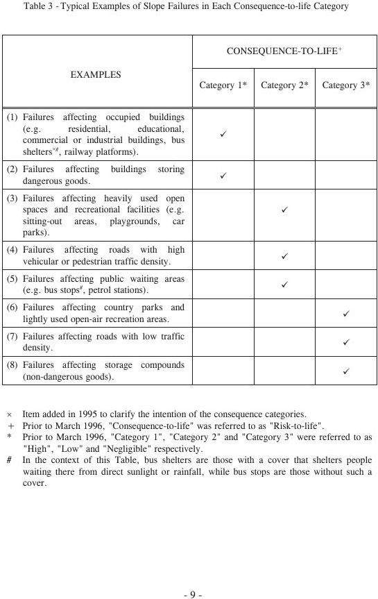
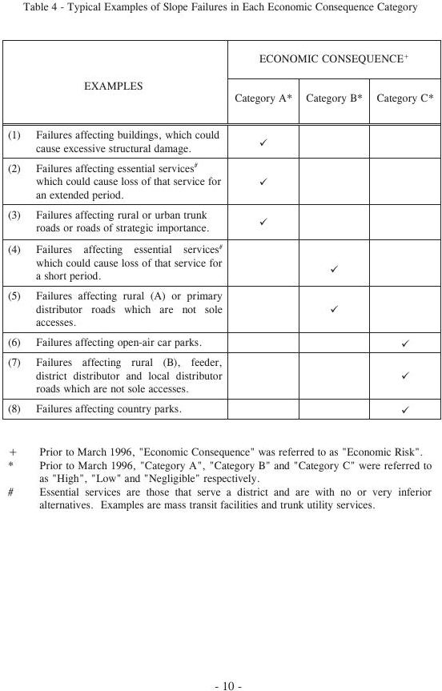

---
tags:
  - PNAP
  - APP series
  - Slope 斜坡
  - Geotechnical 岩土
  - Maintenance access 維修通道
  - Car park 停車場
summary: "Geotechnical Manual for Slopes interpreted: consequence categories 1-3 and A-C, minimum factors of safety (1.4 / 1.2 / 1.1), fill compaction and superseded chapters."
keywords: APP-109, Geotechnical Manual for Slopes, 斜坡岩土工程手冊, factor of safety, 安全系數, consequence-to-life, 生命後果, economic consequence, fill compaction, 填土
---

# APP-109 Geotechnical Manual for Slopes <small>《斜坡岩土工程手冊》－有關詮釋及更新手冊內容的指引</small>

!!! info "Document info 文件資料"
    | | |
    |---|---|
    | **Type 類別** | PNAP (APP series), previously PNAP 234 舊編號 PNAP 234 |
    | **Issued by 發出機構** | Buildings Department 屋宇署 |
    | **Version summarised 本摘要版本** | June 1999 |
    | **Official language 官方語言** | English and Chinese 中英文版 |
    | **Source 原文** | [English (PDF)](https://www.bd.gov.hk/doc/en/resources/codes-and-references/practice-notes-and-circular-letters/pnap/APP/APP109.pdf) · [中文 (PDF)](https://www.bd.gov.hk/doc/tc/resources/codes-and-references/practice-notes-and-circular-letters/pnap/APP/APP109.pdf) |
    | **Last checked 最後核對** | 2026-11-21 against the current BD version |

## At a glance 重點摘要 {#at-a-glance}

=== "English"

    - The **Geotechnical Manual for Slopes** (2nd Ed. 1984) is the consensus guide for slope investigation, design, construction and maintenance, but parts are now outdated (paras. 1–3).
    - **App. A** gives interpretation and updates, e.g. "risk" is replaced by **"consequence"**: Tables 5.2 and 5.3 become **consequence-to-life** and **economic consequence** classifications (App. A s.2). Further sections update terminology, safety factors and supplementary guidance.

=== "中文"

    - **《斜坡岩土工程手冊》**（1984 年第二版）是斜坡勘測、設計、施工及維修的公認指引，但部分內容已過時（第 1–3 段）。
    - **附錄 A** 提供詮釋及更新，例如以**「後果」**取代「風險」：表 5.2 及 5.3 改稱**危及生命後果**及**經濟後果**分類（附錄 A 第 2 節）；其後各節更新術語、安全系數及補充指引。

!!! tip "Does it apply? 是否適用"
    **Applies 適用**: investigation, design, construction and maintenance of **slopes and site formation** using the **Geotechnical Manual for Slopes (2nd Edition, 1984)**, as interpreted and updated by Appendix A. 斜坡設計使用《斜坡岩土工程手冊》並按附錄 A 詮釋。

## Key clauses 條文一覽 {#key-clauses-table}

| Ref. | Rule 規定 |
|---|---|
| Paras. 1–3 | The Manual (draft 1979, 2nd ed. 1984) is the consensus guide, but parts are obsolete; Appendix A gives interpretation. 背景。 |
| App. 2 | Terminology: **"risk" → "consequence"**; **consequence-to-life** Categories **1, 2, 3** (was high, low, negligible); **economic consequence** Categories **A, B, C**; combined notation, e.g. **"2A"**. 術語。 |
| App. 3 | Tables 5.1, 5.4, 5.2 replaced by **Tables 1, 2, 3**; judge category by building type, failure mechanism and scale, **debris travel distance**, occupancy, resistance; beyond expected debris travel may drop to **2**, beyond extreme limit to **3**; **bus shelters** count as occupied buildings. 生命後果類別。 |
| App. 4 | Table 5.3 replaced by **Table 4**; the economic FoS is the **owner's decision** on the designer's advice. 經濟後果。 |
| App. 5 | **Table 2** (lower FoS) for existing slopes only with rigorous investigation (maintenance history, groundwater, rainfall, monitoring); not a lower standard of safety (Annex 1, Malone 1985); otherwise use new-slope values. 現有斜坡。 |
| App. 6 | **Temporary works**: same FoS as permanent (Table 1), but the category may be lower during construction (e.g. 2 or 3 instead of 1). 臨時工程。 |
| App. 7 | **Reliability**: solutions with lower reliability (e.g. open cut vs supported) need a **higher** FoS for fair comparison. 可靠度。 |
| App. 8 | New fill: **95%** of max. dry density; large non-structural platforms may be **90%** inside if formation fill (**1.5 m**) and peripheral slopes (**3 m**) are 95%; provide subsurface drainage; reclamation and backfill not governed by slope compaction. 新填土壓實。 |
| App. 9 | Existing loose fill: standard **3 m recompaction** not needed if Category **3**, too small to matter, or mature vegetation with an alternative solution (background: **Sau Mau Ping 1976**). 現有鬆散填土。 |
| App. 10 | **Superseded** parts: Ch. 1, s.2.3.3 (geological maps, **Geoguide 3**); Ch. 2, s.3.5, 10.2 (**Geoguide 2**); s.4.6 (GEO Pub. 1/93 filters); Ch. 7 except 7.3.3 (**Geoguide 1**, GCO 1/90, GEO Circ. 6/96); Ch. 11 (**Geoguide 5**); BS 1377:1975 (GEO Report 36); bibliography (GEO Report 50). 已被取代章節。 |
| App. 11 | Related documents list. 參考文件。 |

## Key table: minimum factors of safety 最低安全系數 {#fos-tables}

| Table 1 – new slopes (10-year rainfall) 新斜坡 | Life Cat. 1 | Life Cat. 2 | Life Cat. 3 |
|---|:-:|:-:|:-:|
| **Economic A** | 1.4 | 1.4 | 1.4 |
| **Economic B** | 1.4 | 1.2 | 1.2 |
| **Economic C** | 1.4 | 1.2 | > 1.0 |

<small>Cat. 1 slopes also need FoS **≥ 1.1** for the predicted **worst groundwater**. Values are minima. 第 1 類另須在最壞地下水情況下 ≥ 1.1。</small>

| Table 2 – existing slopes, remedial / preventive works 現有斜坡 | Cat. 1 | Cat. 2 | Cat. 3 |
|---|:-:|:-:|:-:|
| Min. FoS against loss of life (10-year rainfall) | **1.2** | **1.1** | **> 1.0** |

<small>Only with rigorous studies, long-standing slope and unchanged loading, groundwater and form; back-analysis may assume FoS **1.0** for the worst known conditions; failed slopes: identify causes. 只限嚴格研究且條件不變。</small>

## Key table: consequence categories 後果類別 (Tables 3–4) {#consequence-tables}

| Consequence-to-life 生命後果 | Typical examples 例子 |
|---|---|
| **Category 1** | Occupied buildings (residential, educational, commercial, industrial, **bus shelters**, railway platforms); buildings storing dangerous goods |
| **Category 2** | Heavily used open spaces and recreation (sitting-out areas, playgrounds, car parks); **high-traffic roads**; public waiting areas (**bus stops**, petrol stations) |
| **Category 3** | Country parks and lightly used open-air recreation; low-traffic roads; storage compounds (non-dangerous goods) |

| Economic consequence 經濟後果 | Typical examples 例子 |
|---|---|
| **Category A** | Buildings with possible excessive structural damage; essential services lost for an **extended** period; trunk roads or strategic roads |
| **Category B** | Essential services lost for a **short** period; rural (A) or primary distributor roads that are not sole accesses |
| **Category C** | Open-air car parks; rural (B), feeder, district and local distributor roads not sole accesses; country parks |

??? abstract "Original Tables 3 and 4 原表"
    { loading=lazy }
    { loading=lazy }

    <small>Source: BD, PNAP APP-109 Appendix A. 資料來源：屋宇署。</small>

!!! example "Illustrative only 只作說明"
    A new cut slope behind a **school** (occupied building within debris travel) on a route that is also a **trunk road**: Category **1A**, so FoS **≥ 1.4** (10-year rainfall) and **≥ 1.1** for worst groundwater. If the same slope only threatened a **country park footpath**: **3C**, FoS **> 1.0**. 學校後斜坡 1A；郊野公園 3C。

## Whole picture 整體關係 {#whole-picture}

| Topic 主題 | Where 文件 |
|---|---|
| Retaining walls (Geoguide 1) 擋土牆 | [APP-63](app-63.md) |
| Maintenance (Geoguide 5) 保養 | [APP-79](app-79.md) |
| Site investigation (Geoguides 2, 3) 勘測 | [APP-49](app-49.md) · [APP-64](app-64.md) |
| Fill compaction 填土 | [APP-15](app-15.md) |
| Buried services, horizontal drains 埋地設施 | [APP-76](app-76.md) · [APP-51](app-51.md) |
| Rock faces 岩面 | [APP-17](app-17.md) |
| Geotechnical assessment with GBP 岩土評估 | [APP-25](app-25.md) |

## Related 相關文件 {#related}

| Document 文件 | Relationship 關係 |
|---|---|
| [APP-76](app-76.md) | Buried services 地下設施 |
| [APP-79](app-79.md) | Slope maintenance 斜坡維修 |

---
<small>Prepared by: _[name]_ · Checked by: _[name]_ · Quotes from the official English and Chinese versions; refer to the PNAP for the definitive text.</small>
