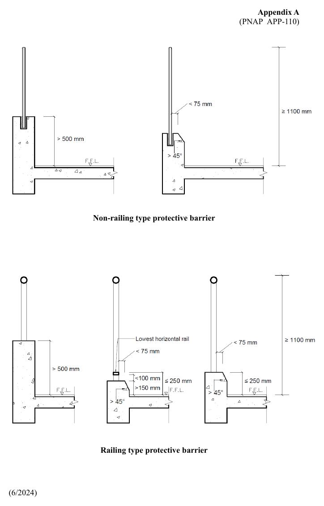

---
tags:
  - PNAP
  - APP series
  - Protective barrier 防護欄障
  - Safety 安全
  - Structural 結構
  - Staircase 樓梯
  - Maintenance access 維修通道
  - Minor works 小型工程
  - Balcony & utility platform 露台及工作平台
summary: "Protective barriers at least 1.1 m high with a 150 mm solid base and no 100 mm gaps, how height is measured, and loading and glass requirements."
keywords: APP-110, protective barrier, 防護欄障, 1.1 m, 100 mm sphere, climbing, curb, balustrade
---

# APP-110 Protective Barriers <small>防護欄障</small>

!!! info "Document info 文件資料"
    | | |
    |---|---|
    | **Type 類別** | PNAP (APP series), previously PNAP 235 舊編號 PNAP 235 |
    | **Issued by 發出機構** | Buildings Department 屋宇署 |
    | **First issue 首次發出** | September 2000 |
    | **Version summarised 本摘要版本** | January 2026 (paras. 3, 5, 6, 11 amended; 8, 9 added) |
    | **Official language 官方語言** | English only for now 暫只有英文版 |
    | **Source 原文** | [APP-110 (PDF)](https://www.bd.gov.hk/doc/en/resources/codes-and-references/practice-notes-and-circular-letters/pnap/APP/APP110.pdf) |
    | **Legal basis 法律依據** | [B(C)R 9, 36–38](../regulations/bcr-123q.md); [B(P)R 3A](../regulations/bpr-parts-1-2.md) |
    | **Last checked 最後核對** | 2026-11-21 against the January 2026 version |

## At a glance 重點摘要 {#at-a-glance}

=== "English"

    - Barriers stop people or objects **passing through or toppling over** to a lower level. Required at edges of balconies, verandahs, floors, roofs, stairs, landings, projections, and at openings above G/F (para. 1).
    - **Height ≥ 1.1 m**; bottom **150 mm solid** (except stairs enclosed by walls with no open well, see APP-119); gaps must not pass a **100 mm** sphere; must prevent climbing (para. 2).
    - **Height measured from the adjoining floor** where people can step. A **curb** next to the barrier is not a step if: > **500 mm** high; or protrudes < **75 mm** (solid barrier); or, for railings with a curb < 500 mm, the lowest rail is ≤ **250 mm** above the floor (or, with no bottom rail, the curb ≤ 250 mm and < 75 mm wide) (para. 3).
    - **PPE upper tiers**: barrier tops sloped **30°** towards the seats, concave, so objects cannot rest and fall (para. 4).
    - **Structure**: B(C)R s.9 loads (Table 3: 0.75 / 1.5 / 3 kN/m); **glass** barriers to the **Glass Code 2018** and APP-37 (para. 5–6). Inaccessible roofs: follow the **CoP on Access for External Maintenance** and OSH rules (para. 7).
    - **Submission** (new): structural plans with framing, anchors, loads, materials, workmanship and calcs incl. **parent structure** check; or, streamlined, **typical details in the superstructure plans** (layout on GBP; ADV-33 App. B5 / B8) (paras. 8–9). Minor works route available (para. 11).

=== "中文"

    - 欄障防止人或物件**穿過或翻越**跌往較低處；須設於露台、外廊、樓面、屋頂、樓梯、平台、伸出物邊緣，以及地面層以上的開口（第 1 段）。
    - **高度 ≥ 1.1 米**；最低 **150 毫米須實心**（以牆圍封且沒有開敞樓梯井的樓梯除外，見 APP-119）；縫隙不得容許 **100 毫米**物體通過；須防止攀爬（第 2 段）。
    - **由可站立的相鄰樓面量度高度**；欄障旁的**路緣**在以下情況不當作可站立：高 > **500 毫米**；或（非欄杆式）伸出 < **75 毫米**；或（路緣 < 500 毫米的欄杆式）最低橫杆距樓面 ≤ **250 毫米**（如無底橫杆，路緣 ≤ 250 毫米及闊 < 75 毫米）（第 3 段）。
    - **公眾娛樂場所上層座位**：欄障頂面向座位傾斜 **30°** 並成凹形，令物件不能放置而跌下（第 4 段）。
    - **結構**：按 B(C)R 第 9 條荷載（表 3：0.75／1.5／3 千牛／米）；**玻璃**欄障按《2018 年玻璃結構作業守則》及 APP-37（第 5–6 段）；非開放屋頂按《外部維修通道作業守則》及職安健規例（第 7 段）。
    - **呈交**（新增）：結構圖則須包括框架、錨固、荷載、物料、工藝及計算（包括**主體結構**核算）；或簡化方式：**在上蓋結構圖則中附典型細節**（一般建築圖則顯示位置；ADV-33 附錄 B5／B8）（第 8–9 段）；可循小型工程途徑（第 11 段）。

## Key table: barrier rules 欄障規則 {#key-table-barrier-rules}

| Item 項目 | Requirement 規定 | Para. 段 |
|---|---|---|
| Height 高度 | **≥ 1 100 mm** above the adjoining floor 由相鄰樓面計 | 2, 3 |
| Solid base 實心底部 | Lowest **150 mm** solid 最低 150 毫米實心 | 2 |
| Gaps 縫隙 | No passage for particles **> 100 mm** 不得容許 100 毫米物體通過 | 2 |
| Curb not a step 路緣不當作踏腳 | > 500 mm high; or < 75 mm protruding (solid barrier); or railing with bottom rail ≤ 250 mm 高 > 500 毫米等 | 3 |
| PPE tiers 娛樂場所 | Top sloped 30°, concave 傾斜 30° | 4 |
| Loads 荷載 | B(C)R s.9, Table 3 | 5 |
| Glass 玻璃 | Glass Code 2018; APP-37 for tempered glass, sealant, spider fixings | 6 |

<figure markdown>
  { width="480" loading=lazy }
  <figcaption>Appendix A – Non-railing and railing type barriers with curbs (1 100 mm, 500 mm, 75 mm, 250 mm). 可接受的欄障。Source: BD, PNAP APP-110.</figcaption>
</figure>

## Key clause 主要條文 {#key-clause}

!!! quote "Para. 2 — Design requirements 設計規定"
    A barrier must be designed and constructed so as to prevent a person or object from falling, rolling, sliding or slipping through the gap of the barrier, and to prevent a person from climbing over the barrier. In all circumstances, a barrier should have a height of not less than 1.1 m. The lowest 150 mm of the barrier should be built solid (except for staircases enclosed with walls and without open stair-well). Any gap or opening in the barrier should be so constructed as to inhibit the passage of particles more than 100 mm in their smallest dimension.

    **中譯（非官方）：** 欄障的設計及建造須防止人或物件從欄障縫隙墮下、滾下、滑下或跌出，並防止人攀越欄障。在任何情況下，欄障高度不應少於1.1米，最低150毫米應為實心（以牆圍封且沒有開敞樓梯井的樓梯除外）。欄障的縫隙或開口應能阻止最小尺寸大於100毫米的物體通過。

## Practical notes 實務提示 {#practical-notes}

=== "English"

    !!! tip "Common pitfalls"
        - A low planter or curb in front of the barrier that becomes a **step**, so the effective height falls below 1.1 m.
        - Horizontal rails that act as a **ladder** (climbable).
        - Glass barriers without Glass Code clamping details or heat soak records.
        - Barrier layouts on GBP that do not match the **structural details**.

=== "中文"

    !!! tip "常見錯誤"
        - 欄障前的矮花槽或路緣變成**踏腳**，令有效高度低於 1.1 米。
        - 橫杆形成**梯級**（可攀爬）。
        - 玻璃欄障沒有玻璃守則的夾持細節或熱浸紀錄。
        - 一般建築圖則上的欄障與**結構細節**不符。

<!-- APSEC START -->
## APSEC clarifications 認可人士及註冊結構工程師委員會討論 {#apsec-clarifications}

BD's responses at the APSEC Discussion Forum that clarify this document, **newest first**. Where the same question came up more than once, only the **latest position** is listed. See [all APSEC items](../apsec/index.md). 屋宇署在討論會上就本文件作出的澄清，新者在前；同一問題只列最新立場。

- **[Curb / Skirting within Required Staircase](../apsec/2025.md#i2025021429)** <small>ADF 1/2025, 14 Feb 2025</small> BD advised that item 22 of ADF 2/2016 held on 18 March 2016 was still pertinent. However, the advice was made in the consideration that the provision of curb was required as part of the protective barrier under the …
- **[Protective Barrier – PNAP APP-110](../apsec/2024.md#i202408099)** <small>ADF 3/2024, 9 Aug 2024</small> BD advised that the measurements should be taken in a vertical manner from the highest point of each tread to the top of the balustrade as illustrated in red in the diagrams below for fulfilling the requirements laid …
- **[Structural Submissions for M&R Access](../apsec/2023.md#i2023080410)** <small>ADF 3/2023, 4 Aug 2023</small> For Case 1, BD advised that the design requirements of protective barriers stipulated in paragraph 6 of PNAP APP-110 were not applicable to guard rails at inaccessible flat roof which was intended to be accessible to …
- **[Protective Barrier for Greening](../apsec/2018.md#i201808175)** <small>ADF 4/2018, 17 Aug 2018</small> BD advised that protective barrier would not be required for planter which was inaccessible. Reference should be made to the design and construction requirements of protective barriers as laid down in PNAP APP-110, in …

<!-- APSEC END -->

<!-- CL START -->
## Related circular letters 相關通告函件 {#circular-letters}

- 🔵 [Amendments to the "Technical Guidelines on Minor Works Control System (2024 Edition)"](../circulars/2026.md#cl-atgmwcse2026) <small>13 Aug 2026 · 《小型工程監管制度之技術指引》（2024年修訂版）修訂事宜</small>
<!-- CL END -->

## Related 相關文件 {#related}

| Document 文件 | Relationship 關係 |
|---|---|
| [B(C)R](../regulations/bcr-123q.md) | ss. 9, 36–38 and Table 3 loads 荷載 |
| [B(P)R 3A](../regulations/bpr-parts-1-2.md) | Openings above G/F 開口欄障 |
| [APP-37](app-37.md) | Glass, sealant, spider fixings 玻璃 |
| [ADV-33](adv-33.md) | Appendices B5 and B8 checklists and samples 清單及樣本 |
| [APP-163](app-163.md) | Access for external maintenance 外部維修通道 |

---
<small>Prepared by: _[name]_ · Checked by: _[name]_ · English only for now; Chinese text is an unofficial translation (中譯（非官方）).</small>
