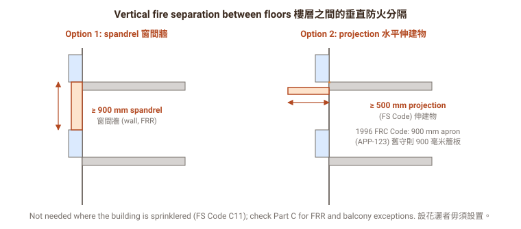

---
tags:
  - PNAP
  - APP series
  - Spandrel 窗下牆
  - Fire separation 防火分隔
  - Fire resisting construction 耐火結構
  - Structural 結構
  - Fire safety 消防安全
  - Balcony & utility platform 露台及工作平台
  - Curtain wall & façade 幕牆及外牆
summary: "FRC Code 1996 spandrels: 900 mm apron alternative and waiver for balconies open on two sides; now FS Code C11."
keywords: APP-123, spandrel, 窗間牆, apron, balcony, 露台, fire spread, FRC Code 1996, superseded
---

# APP-123 Alternative Designs - Paragraph 12.3 of the Code of Practice for Fire Resisting Construction 1996 <small>《1996年耐火結構守則》第12.3段－可供選擇的設計</small>

!!! info "Document info 文件資料"
    | | |
    |---|---|
    | **Type 類別** | PNAP (APP series), previously PNAP 260 舊編號 PNAP 260 |
    | **Issued by 發出機構** | Buildings Department 屋宇署 |
    | **Version summarised 本摘要版本** | October 2001 |
    | **Official language 官方語言** | English and Chinese 中英文版 |
    | **Source 原文** | [English (PDF)](https://www.bd.gov.hk/doc/en/resources/codes-and-references/practice-notes-and-circular-letters/pnap/APP/APP123.pdf) · [中文 (PDF)](https://www.bd.gov.hk/doc/tc/resources/codes-and-references/practice-notes-and-circular-letters/pnap/APP/APP123.pdf) |
    | **Last checked 最後核對** | 2026-11-21 against the current BD version |

!!! note "Note 注意"
    Historical note: the 1996 fire codes it refers to have been replaced by the [Code of Practice for Fire Safety in Buildings 2011](../codes/fire-safety-code-2011.md). It is kept for older buildings and approvals.

## At a glance 重點摘要 {#at-a-glance}

=== "English"

    - FRC Code para. 12.3 requires a **900 mm spandrel** between external walls of successive floors (para. 1).
    - Alternative: a **horizontal apron projecting 900 mm** (para. 2). Requirement waived for **balconies open on at least two sides**; the rest of the unit must still comply (para. 3).

=== "中文"

    - 耐火結構守則第 12.3 段規定上下樓層外牆之間須有 **900 毫米窗下牆**（第 1 段）。
    - 替代方案：**伸出 900 毫米的水平簷板**（第 2 段）；**最少兩邊開敞的露台**可獲豁免，單位其餘部分仍須符合規定（第 3 段）。

!!! warning "Superseded for new works 新工程已不適用"
    Listed in [APP-153 Appendix A](app-153.md#appendix-a): it does **not apply** to buildings designed to the **FS Code 2011**. Current rule: [FS Code C11.1](../codes/fsc-part-c-fire-resisting-construction.md#clause-by-clause): **900 mm spandrel or 500 mm projection**, not needed in sprinklered buildings. Still relevant to older buildings and Cap. 502 / 572 upgrading. 按 2011 年消防守則設計的建築物不適用。

## Key clauses 條文一覽 {#key-clauses-table}

| Para. 段 | Rule 規定 |
|---|---|
| 1 | FRC Code 1996 para. 12.3: external walls of floors separated by a **900 mm spandrel**. 900 毫米窗間牆。 |
| 2 | Alternative: a **900 mm horizontal apron**. 可用 900 毫米水平板。 |
| 3 | Waived for **balconies open on at least two sides** (low risk); the rest of the unit still complies. 兩邊開敞露台豁免。 |

<small>Note the change: the FS Code 2011 accepts a **500 mm** projection (not 900 mm) and exempts **sprinklered** buildings. 2011 年守則接受 500 毫米伸出，花灑保護建築物豁免。</small>

## Whole picture 整體關係 {#whole-picture}

| Topic 主題 | Where 文件 |
|---|---|
| Current spandrel rule 現行規定 | [FS Code C11](../codes/fsc-part-c-fire-resisting-construction.md#clause-by-clause) |
| Balconies 露台 | [JPN 1](jpn-1.md) |
| Curtain walls 幕牆 | [FS Code C10.2](../codes/fsc-part-c-fire-resisting-construction.md#clause-by-clause) · [APP-2](app-2.md) |

## Diagram 圖解 {#diagram}

<figure markdown>
  { width="760" loading=lazy }
  <figcaption>Vertical fire separation: 900 mm spandrel or 500 mm projection (FS Code); 900 mm apron under the 1996 code. 樓層間垂直防火分隔。 Diagram prepared for this site; check the source text for exact wording.</figcaption>
</figure>

## Related 相關文件 {#related}

| Document 文件 | Relationship 關係 |
|---|---|
| [FS Code Part C](../codes/fsc-part-c-fire-resisting-construction.md) | Current spandrel rules 現行規定 |

---
<small>Prepared by: _[name]_ · Checked by: _[name]_ · Quotes from the official English and Chinese versions; refer to the PNAP for the definitive text.</small>
