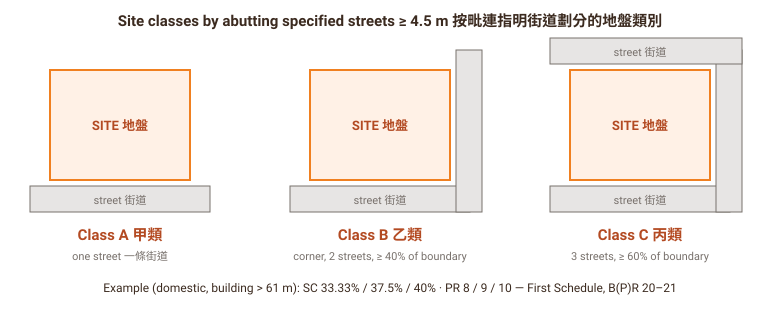

---
tags:
  - PNAP
  - APP series
  - Site area & classification 地盤面積及分類
  - Specified street 指明街道
  - Plot ratio 地積比率
  - Occupation permit 佔用許可證
  - Car park 停車場
---

# APP-124 Streets for Site Classification <small>作地盤分類之用的街道</small>

!!! info "Document info 文件資料"
    | | |
    |---|---|
    | **Type 類別** | PNAP (APP series), previously PNAP 263 舊編號 PNAP 263 |
    | **Issued by 發出機構** | Buildings Department 屋宇署 |
    | **Version summarised 本摘要版本** | November 2005 |
    | **Official language 官方語言** | English and Chinese 中英文版 |
    | **Source 原文** | [English (PDF)](https://www.bd.gov.hk/doc/en/resources/codes-and-references/practice-notes-and-circular-letters/pnap/APP/APP124.pdf) · [中文 (PDF)](https://www.bd.gov.hk/doc/tc/resources/codes-and-references/practice-notes-and-circular-letters/pnap/APP/APP124.pdf) |
    | **Legal basis 法律依據** | [B(P)R 18A](../regulations/bpr-18a-22.md) |
    | **Last checked 最後核對** | 2026-11-21 against the current BD version |

## At a glance 重點摘要 {#at-a-glance}

=== "English"

    - Site class (A / B / C) depends on the number of **specified streets ≥ 4.5 m wide** the site abuts, which sets SC and PR (para. 1).
    - A street must have street characteristics (passage, access, lighting, paving, drainage); **car parks, open spaces, nullahs and sea** do not count; intervening strips depend on their function, status and ownership (para. 2).
    - **Specified street** (B(P)R 18A(3)): (a) government-vested and **HyD-maintained**; (b) on the same lease and **surrenderable** under it; (c) required by the lease to be built on unleased government land; (d) with an **express right of way at all times** (submit the deed); (e) private street held by the owner under lease, kept as a street for the building's life (e.g. a registered undertaking as common area); (f) parts meeting different limbs together (para. 3).
    - A new specified street must be **complete before the OP** (otherwise refused under s.21(6)(a)) and kept as a street; building over it later would be disapproved under s.16(1)(d) (para. 4).

=== "中文"

    - 地盤類別（甲／乙／丙）取決於地盤毗連多少條**闊度 ≥ 4.5 米的指明街道**，從而決定上蓋面積及地積比率（第 1 段）。
    - 街道須具街道特徵（通道、出入、照明、鋪砌、排水）；**停車場、休憩用地、明渠及海**不算；地盤與街道之間的隔離地帶視乎其功能、地位及業權（第 2 段）。
    - **指明街道**（B(P)R 第 18A(3) 條）：(a) 歸屬政府並由**路政署維修**；(b) 位於同一地契並須按地契**交回**；(c) 地契規定在未批租政府土地上建造；(d) 業主獲**明訂隨時可行使的通行權**（須提交契據）；(e) 業主按地契持有的私家街，在建築物存續期間保持為街道（例如登記為公用地方的承諾）；(f) 由符合不同情況的部分合組而成（第 3 段）。
    - 新建的指明街道須在**佔用許可證前完成**（否則根據第 21(6)(a) 條拒發），並須保持為街道；日後在其上加建會根據第 16(1)(d) 條拒批（第 4 段）。

## Diagram 圖解 {#diagram}

<figure markdown>
  { width="760" loading=lazy }
  <figcaption>Site classes A, B and C (B(P)R 18A) with a First Schedule example. 地盤類別。 Diagram prepared for this site; check the source text for exact wording.</figcaption>
</figure>

<!-- APSEC START -->
## APSEC clarifications 認可人士及註冊結構工程師委員會討論 {#apsec-clarifications}

BD's responses at the APSEC Discussion Forum that clarify this document, **newest first**. Where the same question came up more than once, only the **latest position** is listed. See [all APSEC items](../apsec/index.md). 屋宇署在討論會上就本文件作出的澄清，新者在前；同一問題只列最新立場。

- **[Prescribed Window Under regulation 31 of B(P)R](../apsec/2022.md#i2022031817)** <small>ADF 2/2022, 18 Mar 2022</small> provided guidelines in determining what constitutes a street for the purpose of site classification under regulation 18A of B(P)R; whereas, regulation 31 of B(P)R prescribed the minimum requirements of window. …

<!-- APSEC END -->

## Related 相關文件 {#related}

| Document 文件 | Relationship 關係 |
|---|---|
| [B(P)R 18A–22](../regulations/bpr-18a-22.md) | Site classification 地盤分類 |
| [APP-44](app-44.md) | Streets and site area 街道與地盤面積 |
| [APP-20](app-20.md) | Street widening 擴闊街道 |

---
<small>Prepared by: _[name]_ · Checked by: _[name]_ · Quotes from the official English and Chinese versions; refer to the PNAP for the definitive text.</small>
