---
tags:
  - PNAP
  - APP series
  - Occupation permit 佔用許可證
  - Completion 完工
  - Record plans 紀錄圖則
  - Plan submission & approval 呈交及審批
  - Statutory period 法定期限
  - Excavation & ELS 挖掘
summary: "Completion certificates (BA12–14C), applications for occupation permit and record plans: what to submit, when to approve amendments, and processing times."
keywords: APP-13, certificate of completion, 完工證明書, occupation permit, 佔用許可證, Form BA12 BA14, record plans, amendment plans
---

# APP-13 Submission of Certificates of Completion, Applications for Occupation Permit, and Record Plans <small>呈交建築工程竣工證明書申請佔用許可證及呈交記錄圖則和資料</small>

!!! info "Document info 文件資料"
    | | |
    |---|---|
    | **Type 類別** | PNAP (APP series), previously PNAP 53 舊編號 PNAP 53 |
    | **Issued by 發出機構** | Buildings Department 屋宇署 |
    | **Version summarised 本摘要版本** | February 2023 |
    | **Official language 官方語言** | English and Chinese 中英文版 |
    | **Source 原文** | [English (PDF)](https://www.bd.gov.hk/doc/en/resources/codes-and-references/practice-notes-and-circular-letters/pnap/APP/APP013.pdf) · [中文 (PDF)](https://www.bd.gov.hk/doc/tc/resources/codes-and-references/practice-notes-and-circular-letters/pnap/APP/APP013.pdf) |
    | **Legal basis 法律依據** | [B(A)R 25, 46](../regulations/bar-123a.md); [BO s.21](../regulations/bo-part-2-building-works.md) |
    | **Last checked 最後核對** | 2026-11-21 against the current BD version |

## At a glance 重點摘要 {#at-a-glance}

=== "English"

    - On completion submit **Form BA14 / 14A / 14B / 14C** (and MW02 / 04) for works not resulting in a new building, or **BA12 / 13** for a new building (B(A)R 25). BD normally replies to BA14 / 14A within **28 days**, BA14B / 14C within **14 days** (non-audit) or 28 days (audit); BA12 / 13 with the **OP application in 14 days** (BO s.21) (para. 1).
    - Same contractor for **spread footings (≤ 4.5 m excavation)** and superstructure: one certificate may cover both (para. 2).
    - Get **amendment plans approved before** applying for the OP; only minor positional deviations that do not breach the BO are accepted (para. 3).
    - **Record plans**: BA may require "new plans" (B(A)R 46); for projects with amendments, submit a **consolidated set of GBP** representing the building as completed, each plan bearing BD's approval chop or the AP's certification (paras. 4–5). The PNAP also lists the record information and documents needed at OP.

=== "中文"

    - 完工時，不會形成新建築物的工程呈交**表格 BA14／14A／14B／14C**（及 MW02／04），新建築物呈交 **BA12／13**（B(A)R 第 25 條）。屋宇署一般在 **28 天**內回覆 BA14／14A，BA14B／14C 在 **14 天**（非抽查）或 28 天（抽查）內回覆；BA12／13 連同**佔用許可證申請在 14 天**內處理（第 21 條）（第 1 段）。
    - 同一承建商負責**擴展式基礎（挖掘 ≤ 4.5 米）**及上蓋工程：可用一份證明書（第 2 段）。
    - 申請佔用許可證**前須先取得修訂圖則批准**；只接受不違反條例的輕微位置偏差（第 3 段）。
    - **紀錄圖則**：建築事務監督可要求「新圖則」（B(A)R 第 46 條）；有修訂的項目須呈交一套**綜合一般建築圖則**顯示竣工情況，每張附屋宇署批准印或認可人士核證（第 4–5 段）；備考亦列出佔用許可證所需的紀錄資料及文件。

## Workflow / timeline 流程及時間表 {#workflow-timeline}

<figure markdown>
  { width="671" loading=lazy }
  <figcaption>Completion submissions and BD reply periods. 完工呈交及屋宇署回覆期限。 Summary diagram prepared for this site; check the source text for exact wording.</figcaption>
</figure>

## Practical notes 實務提示 {#practical-notes}

=== "English"

    !!! tip "Common pitfalls"
        - Submitting BA12 / 13 while **amendment plans** are still under approval.
        - Missing record plans and material / product schedules at OP stage.

=== "中文"

    !!! tip "常見錯誤"
        - **修訂圖則**仍在審批時便呈交 BA12／13。
        - 佔用許可證階段欠缺紀錄圖則及物料／產品清單。

## Paragraph by paragraph (full) 逐段詳解 {#paragraph-detail}

| Para. 段 | Subject 主題 | Requirement 規定 |
|---|---|---|
| 1 | Completion certificates 完工證明書 | Under B(A)R 25: **BA14 / 14A / 14B / 14C** (and **MW02 / 04**) for works not resulting in a new building; **BA12 / 13** for a new building. No statutory period for BA14, but BD **normally replies in 28 days** (BA14 / 14A) and **14 days** (BA14B / 14C non-audit) or **28 days** (audit). BA12 / 13 with the OP application processed in **14 days** (BO s.21). |
| 2 | One certificate 單一證明書 | Same contractor for **spread footings (excavation ≤ 4.5 m)** and superstructure (new building or A&A): one BA12 / 13 or one BA14 covers both. |
| 3 | Amendments before OP 修訂先於佔用許可證 | Get **amendment plans approved before** applying for the OP; only **minor positional deviations** not contravening the BO are accepted. |
| 4 | "New plans" 新圖則 | BA may require plans of the building as completed (B(A)R 46). |
| 5 | **Record plans** 紀錄圖則 | With the OP / BA14 / BA14C: a set of **GBP amalgamating all approved plans**, each with BD's signed and dated approval chop or the **AP's certification** that it is identical to the approved plan; hard copy reduced to **≥ 1:200** or **DVD-ROM** (non-rewritable ISO/IEC 13346, indexed per App. H, cover with BD ref., project, AP, declaration, disc no., signature). |
| 6 | No unapproved amendments 不得含未批准修訂 | Record plans must not contain amendments not approved. |
| 7 | **RVD** 差餉物業估價署 | One set of record plans for RVD (rating); AutoCAD / MicroStation DVD marked "DVD-ROM containing plans for RVD". |
| 8–9 | **Schedule of building materials and products** 建築物料及產品明細表 | Required under **B(A)R 44** with the OP (and on A&A / minor works completion where appropriate): AP certifies compliance of application and performance; RC confirms use. Covers materials not specified on approved plans affecting **structure and fire safety**, and **cast iron pipes** ([APP-133](app-133.md)). Samples: **App. A** (building works), **App. B** (minor works). |
| 10 | Certificates of conformity 產品合格證書 | Valid certificates for **fire-rated doorsets** and **non-loadbearing partitions** under the Product Conformity Certification Scheme ([APP-165](app-165.md)) accepted instead of test reports. |
| 11–12 | **Fire dampers** 防火擋板 | May be installed by the RGBC with an **RSC (Ventilation)**, or as minor works; dampers installed by RGBC / RMWC must be **inspected and certified by an RSC(V)** (FS Code E8.3); include the inspection certificate (App. A Part C). |
| 13–15 | **Structural documents** 結構文件 | RSE submits test reports, mill certificates, method statements, records, compliance certificates, foundation record plans and reports, monitoring and QA / QC documents on time; **summary tables** of approved plans and required documents (**App. C, D**) **half-yearly**, at foundation completion and at OP (A&A: half-yearly or at completion); foundation report with as-built summary (**App. E**). |
| 16 | Checklists 核對清單 | **App. F** (TOP / OP, BA12 / 13) and **App. G** (A&A, BA14 / 14C) — see below. |
| 17 | Website data DVD 網上公布資料 | DVD-ROM with documents under ADM-2, APP-126, APP-151, APP-152, APP-156 for upload to BD's website. |
| 18–20 | **Fast-track acceptance of A&A** A&A 快速接納 | For simple A&A (ADM-19 fast track), curtain wall / window wall / cladding repair or replacement, and signboards approved under APP-126: submit **BA14C** with record plans, documents and **colour photos** with a direction plan. Non-audit reply **14 days**; audit cases informed within 14 days and replied in **28 days**. |
| 21 | Paperless 無紙化 | Certificates and compliance statements (BA12–14C, materials schedule, run-in / run-out certificate) in **hard copy**; other documents may be on DVD-ROM. |

<small>APP-13 (Feb 2023) refers to ADM-19 paras. 29 and 32 for the fast tracks; in the current ADM-19 these are paras. 35 and 37–38. 段落編號因 ADM-19 修訂而不同。</small>

### Appendix F – TOP / OP checklist (BA12 / 13) 臨時／佔用許可證核對清單 {#appendix-f}

| Part 部分 | Items 項目 |
|---|---|
| **1 Site works** 地盤工程 | All works complete; **run-in / out** built; **public sewer connections** done; **hoarding / sheds removed**; shoring / wall ties / adjoining buildings dealt with; MiC units complete with finishes and fittings ([ADV-36](adv-36.md)) |
| **2 Documents** 文件 | BA12 / 13 in order (hard copy); all **amendment consents** issued; **Fire Certificate (FS 172)**; **Fire Services Water Completion Advice**; **water certificates (potable, flushing)**; certificates for **fireman's lifts, accessible lifts / VLPs**; **Certificate of Completion of Vehicular Run-in / Run-out** ([APP-144](app-144.md)); performance review under BO s.17(1)(g) ([APP-30](app-30.md), [APP-115](app-115.md)); APP-13 documents: materials certificate and schedule (App. A), test reports / certificates, record plans for BD and **RVD**, structural summary (App. D); **maintenance access record plans for Labour Department** ([CoP 2021](../codes/external-maintenance-2021.md) App. F); **plan index for record imaging** ([ADM-10](adm-10.md)); ADM-2: **BD106 checklist**, conditions and fire engineering bounding conditions on GBP, **GFA concession summary** (App. H); APP-67: OTTV summary, final OTTV report, final OTTVs on GBP; APP-151 / 152 / 156: **annual energy use declaration**, **BEAM Plus provisional assessment**, **greenery plans and calculations**, final energy efficiency report (RTTV / OTTVRRF / NVTC, VLT, ER); **EV charging-enabling certificate by RPE** ([APP-2](app-2.md)); **undertaking registered** in the Land Registry ([APP-104](app-104.md), APP-152, JPN 1 / 2, BD106); **Agreement to Surrender** ([APP-20](app-20.md)) / **Deed of Dedication** ([APP-108](app-108.md)) registered; **drain test certificate** ([APP-58](app-58.md) App. A) and concealed drainage inspection certificate ([APP-93](app-93.md)); signboard information ([APP-126](app-126.md) App. N); final fire engineering report; MiC user manual and audit reports (ADV-36) |
| **3 Other** 其他 | BA14 acknowledged for substructure, site formation, street works; **lot description / address** confirmed; BD106 conditions complied with |

### Appendix G – A&A completion checklist (BA14 / 14C) 改動加建完工核對清單 {#appendix-g}

| Part 部分 | Items 項目 |
|---|---|
| **1 Site works** | All works complete; hoarding removed |
| **2 Documents** | BA14 / 14C in order; amendment consents; **Fire Certificate (FS 251)** if FSI changed; lift / VLP certificates; materials certificate and schedule, test reports, record plans for BD and RVD, structural summary (if any); LD maintenance access plans (if any); ADM-10 plan index; BD106 checklist and conditions; fire engineering bounding conditions; OTTV documents (if applicable); EV charging certificate; drain test and concealed drainage certificates; signboard information; final fire engineering report; **colour photos with direction plan for BA14C** |
| **3 Other** | BD106 conditions complied with |

### Other appendices 其他附錄

| Appendix | Content 內容 |
|---|---|
| **A** | Certificate of Accepted Building Materials and Products: Part A AP, Part B RC, Part C RSC(V) for fire dampers; Annex A schedule |
| **B** | Sample schedule for minor works |
| **C** | Summary of approved foundation plans and required structural documents |
| **D** | Summary of approved structural plans and required structural documents |
| **E** | As-built summary of foundation works (founding levels, pile lengths vs tentative) |
| **H** | DVD-ROM indexing: Disc 1 GBP record plans for BD (PDF); Disc 2 for RVD (CAD); Disc 3 website / GeoInfo Map data (GFA summary, energy declaration, greenery, OTTV / RTTV / OTTVRRF sheets, signboard data); Disc 4 other certificates |

<!-- APSEC START -->
## APSEC clarifications 認可人士及註冊結構工程師委員會討論 {#apsec-clarifications}

BD's responses at the APSEC Discussion Forum that clarify this document, **newest first**. Where the same question came up more than once, only the **latest position** is listed. See [all APSEC items](../apsec/index.md). 屋宇署在討論會上就本文件作出的澄清，新者在前；同一問題只列最新立場。

- **[Minor Amendment Submission to be Approved Prior to Application for OP](../apsec/2025.md#i2025080818)** <small>ADF 3/2025, 8 Aug 2025</small> BD advised that according to paragraph 3 of PNAP APP-13, AP/RSE/RGE should submit and secure approval of amendment plans in advance of an application for OP, subject to the exception that minor positional deviations …
- **[Ack nowledgment of Form BA14](../apsec/2022.md#i2022112516)** <small>ADF 5/2022, 25 Nov 2022</small> BD advised that as discussed in item 19 of ADF 5/2021 held on 12 November 2021, BD had been monitoring regularly and reminding staff on processing submissions of Form BA14 in a timely manner. Designated teams had been …
- **[Record Plan submissions](../apsec/2022.md#i2022081212)** <small>ADF 4/2022, 12 Aug 2022</small> BD advised that according to paragraph 5 of PNAP APP-13, the record plans should bear either the signed and dated approval chop applied by the BA or a chop giving the AP’s personal certification of the plans being …
- **[Submission of Information and Documents upon Certification of Completion of Building Works and/or OP Application](../apsec/2022.md#i2022031822)** <small>ADF 2/2022, 18 Mar 2022</small> Members noted and would follow the arrangement accordingly.
- **[Streamlined Procedure to Facilitate the Processing of Form BA13/14 Submission](../apsec/2021.md#i202103199)** <small>ADF 2/2021, 19 Mar 2021</small> BD advised that the summary table only served the purpose as a sample for the RSE to follow. RSE should make appropriate modification to ensure all relevant conditions and requirements imposed in the approvals were …

<!-- APSEC END -->

<!-- CL START -->
## Related circular letters 相關通告函件 {#circular-letters}

- 🟢 [Submission of Electronic Test Reports in Standardised Test Report Formats](../circulars/2026.md#cl-setrstrf2026) <small>20 Oct 2026 · 提交標準化格式的電子測試報告</small>
<!-- CL END -->

## Related 相關文件 {#related}

| Document 文件 | Relationship 關係 |
|---|---|
| [APP-78](app-78.md) | Occupation of new buildings (OP process) 新建築物的佔用 |
| [B(A)R](../regulations/bar-123a.md) | Completion certificates 完工證明書 |
| [APP-31](app-31.md) | FSI water supply before OP 消防供水 |

---
<small>Prepared by: _[name]_ · Checked by: _[name]_ · Quotes from the official English and Chinese versions; refer to the PNAP for the definitive text.</small>
