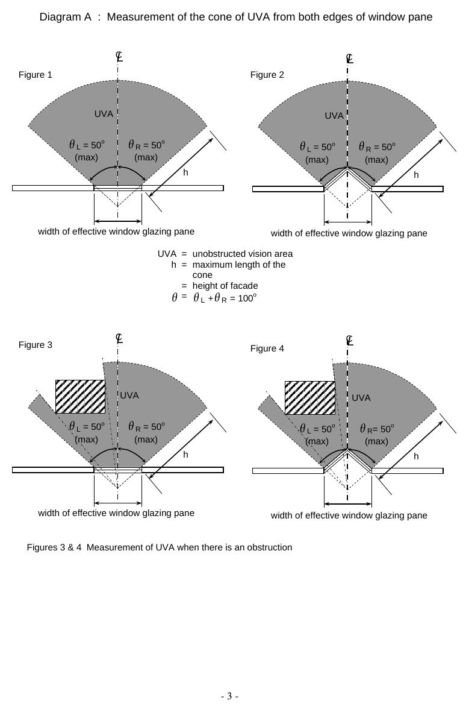
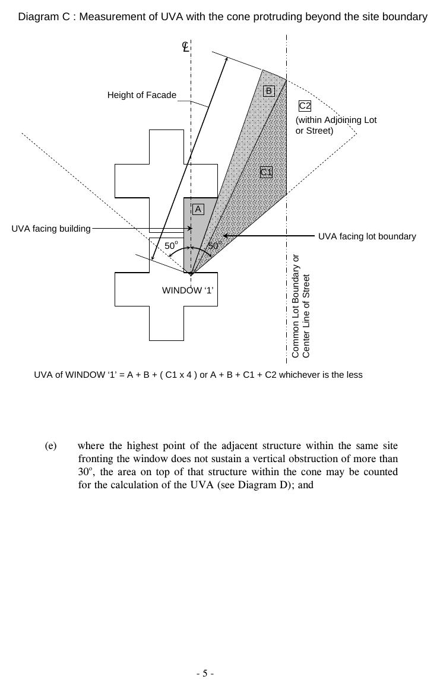
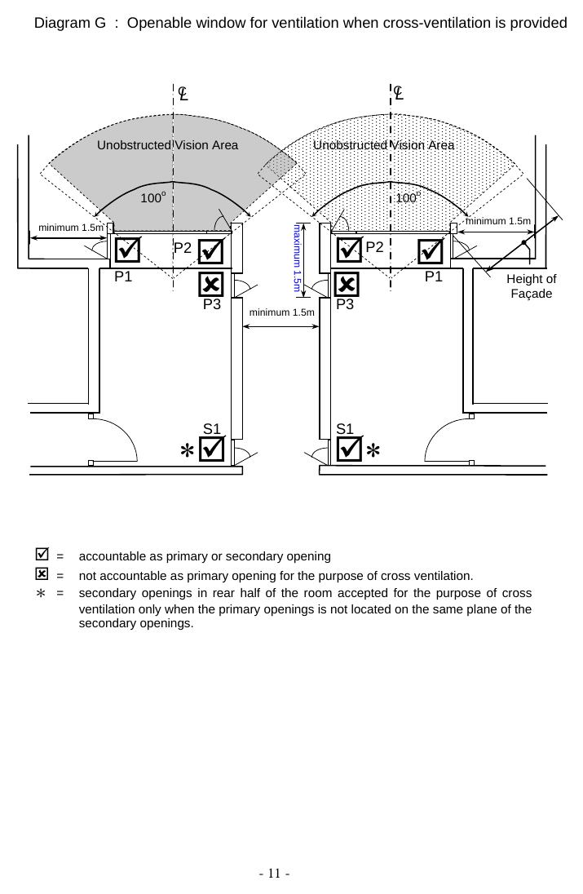

---
tags:
  - PNAP
  - APP series
  - Lighting & ventilation 照明及通風
  - Prescribed window 訂明的窗
  - Performance-based 性能為本
  - Domestic 住用
  - Curtain wall & façade 幕牆及外牆
  - Sustainable building design 可持續建築設計
  - Industrial building 工業大廈
---

# APP-130 Lighting and Ventilation Requirements – Performance-based Approach <small>照明及通風規定－以效能表現為本的方法</small>

!!! info "Document info 文件資料"
    | | |
    |---|---|
    | **Type 類別** | PNAP (APP series), previously PNAP 278 舊編號 PNAP 278 |
    | **Issued by 發出機構** | Buildings Department 屋宇署 |
    | **First issue 首次發出** | December 2003 (replaced APP-113) 取代 APP-113 |
    | **Version summarised 本摘要版本** | December 2016 |
    | **Official language 官方語言** | English and Chinese 中英文版 |
    | **Source 原文** | [English (PDF)](https://www.bd.gov.hk/doc/en/resources/codes-and-references/practice-notes-and-circular-letters/pnap/APP/APP130.pdf) · [中文 (PDF)](https://www.bd.gov.hk/doc/tc/resources/codes-and-references/practice-notes-and-circular-letters/pnap/APP/APP130.pdf) |
    | **Legal basis 法律依據** | Modification of [B(P)R 30, 31, 32](../regulations/bpr-24-37.md) under BO s.42 |
    | **Last checked 最後核對** | 2026-11-21 against the December 2016 version |

## At a glance 重點摘要 {#at-a-glance}

=== "English"

    - An **alternative to the prescriptive window rules** of B(P)R 30–32 for **habitable rooms and domestic kitchens**. BD accepts **performance standards** (para. 1):
        - **Daylight**: **Vertical Daylight Factor (VDF)** at the window centre ≥ **8%** (habitable room), ≥ **4%** (kitchen);
        - **Ventilation**: **1.5 air changes per hour** by natural means; kitchens also **5 ACH mechanical**.
    - Deemed met by the **simplified method** in Appendix A (para. 2), or by validated **daylight simulation / CFD** (Appendices B and C, para. 3). A design may be **partly prescriptive, partly performance-based**; for reg. 31(2) the base may be at up to **15°** from the wall (para. 4).
    - **Unobstructed Vision Area (UVA)**: the open area inside a **100° cone** (50° each side) in front of the window, up to a length equal to the **height of façade**, measured to the lot boundary (or across an adjoining street). The required UVA depends on façade height and glazing ratio (**10 / 15 / 20%** of floor area), Tables 1–2.
    - **Ventilation**: openable **primary openings ≥ 1/16** of floor area facing open air. With **cross ventilation** (primary and secondary openings each **≥ 2%**), room depth may extend to **12 m** (instead of B(P)R 32's 9 m). Acoustic windows with an inner sliding panel can count.
    - **Office conversions** of industrial (or other) buildings: modification of regs. 30–31 favourably considered with artificial lighting, mechanical ventilation and **BEAM Plus 40% in EU and IEQ** (para. 6).

=== "中文"

    - 為**可居住房間及住宅廚房**提供 B(P)R 第 30–32 條訂明窗戶規定以外的**替代方案**；屋宇署接受以下**效能標準**（第 1 段）：
        - **天然照明**：窗玻璃中心的**垂直採光系數**，可居住房間 ≥ **8%**、廚房 ≥ **4%**；
        - **自然通風**：自然方法每小時換氣 **1.5 次**；廚房另加機械方法 **5 次**。
    - 以附錄 A 的**簡化評估方法**（第 2 段），或經驗證的**採光模擬／計算流體力學**（附錄 B、C，第 3 段）證明。設計可**部分按訂明規定、部分按效能標準**；第 31(2) 條的底邊可與外牆成最多 **15°**（第 4 段）。
    - **無遮擋視野面積（UVA）**：窗前 **100° 錐形**（每邊 50°）範圍內的開放面積，長度等於**立面高度**，量至地段界線（或包括毗連街道）。所需 UVA 視乎立面高度及玻璃比例（樓面面積的 **10／15／20%**），見表 1–2。
    - **通風**：可開啟的**主要開口 ≥ 樓面面積 1/16**，面向露天地方；如有**對流通風**（主要及次要開口各 **≥ 2%**），房間深度可延至 **12 米**（B(P)R 第 32 條為 9 米）；設內趟玻璃的隔音窗可計算在內。
    - 把工業（或其他）大廈**改作辦公室**：如有人工照明、機械通風並在 **BEAM Plus「能源使用」及「室內環境質素」達 40%**，會正面考慮變通第 30–31 條（第 6 段）。

## Key table: performance standards (para. 1) 效能標準（第 1 段） {#key-table-performance-standards-para-1-1}

| Room (domestic building) 房間（住用建築物） | Daylight: VDF 垂直採光系數 | Ventilation: ACH 每小時換氣次數 |
|---|---|---|
| **Habitable room** 可居住的房間 | **8%** | **1.5** (natural) 自然 |
| **Kitchen** 廚房 | **4%** | **1.5** (natural) **+ 5** (mechanical) 自然加機械 |

## Key table: minimum UVA (Appendix A, Tables 1–2, selected) 最小無遮擋視野面積（節錄） {#key-table-minimum-uva-appendix-a-tables-12-selected}

| Height of façade 立面高度 (m) | Habitable 可居住房間 10% glazing | 15% | 20% | Kitchen 廚房 10% | 15% | 20% |
|--:|--:|--:|--:|--:|--:|--:|
| ≤ 10 | 50 | 30 | 20 | 20 | 15 | 10 |
| 20 | 100 | 80 | 60 | 60 | 40 | 30 |
| 30 | 250 | 200 | 150 | 150 | 100 | 70 |
| 40 | 400 | 300 | 200 | 200 | 150 | 100 |
| 50 | 600 | 500 | 400 | 400 | 300 | 200 |
| 60 | 900 | 700 | 500 | 500 | 400 | 300 |
| 80 | 1 600 | 1 200 | 900 | 900 | 700 | 500 |
| 100 | 2 400 | 1 800 | 1 300 | 1 300 | 1 000 | 800 |
| 120 | 3 500 | 2 600 | 1 900 | 1 900 | 1 500 | 1 200 |
| 150 | 5 400 | 4 100 | 3 000 | 3 000 | 2 300 | 1 800 |

<small>UVA in m². Glazing ratio = actual glass area (excluding frames) ÷ room floor area; interpolate for intermediate façade heights. **Height of façade** = from the window head of the lowest storey with that window to the top of the main roof parapet. 數值單位為平方米；中間高度可內插。</small>

## Key table: UVA measurement rules (Appendix A para. 3) 量度規則 {#key-table-uva-measurement-rules-appendix-a-para-3}

| Rule 規則 | Detail 細節 |
|---|---|
| Cone 錐形 | **100°** (50° each side), from both edges of the effective glazing, perpendicular to the window; length = **height of façade** |
| Window qualifies if 窗須符合 | Faces an uncovered space not obstructed by the same building opposite; window head **≥ 2 m** above floor; glass **≥ 10%** of floor area |
| Boundary 界線 | Measured to the **lot boundary**; if the boundary adjoins a **street**, the full street width counts |
| Beyond boundary / street centre line 超出界線 | Sector C1 beyond the boundary may count **× 4**, capped at the full cone (C1 + C2) |
| Low structures in front 前方低矮結構 | Area on top counts if they subtend **≤ 30°** vertically from the window |
| Small features 小型設施 | Drying racks, small A/C platforms or hoods, window eaves may be disregarded |
| Multiple windows 多個窗 | Room split into notional sub-rooms, each window meeting its own UVA |

<figure markdown>
  { width="520" loading=lazy }
  <figcaption>Diagram A – The 100° UVA cone from both edges of the window pane, with and without obstructions. UVA 錐形量度。Source: BD, PNAP APP-130.</figcaption>
</figure>

<figure markdown>
  { width="440" loading=lazy }
  <figcaption>Diagram C – UVA = A + B + (C1 × 4) or A + B + C1 + C2, whichever is less. 錐形超出地盤界線。Source: BD, PNAP APP-130.</figcaption>
</figure>

## Key table: ventilation (Appendix A Part III) 通風 {#key-table-ventilation-appendix-a-part-iii}

| Case 情況 | Requirement 規定 |
|---|---|
| Normal 一般 | Primary openings **≥ 1/16** of floor area, facing at least **open air**; effective openable area counts regardless of head / sill height; kitchens add **5 ACH mechanical** |
| Window position 窗位置 | Corner window ≥ **1.5 m** from the adjoining wall; ≥ 1.5 m from an opposite wall; any part within **1.5 m** of the wall end counts as primary |
| **Cross ventilation** 對流通風 | Primary **≥ 2%** + secondary (rear half, different plane, facing open air) **≥ 2%** of floor area; room depth up to **12 m** |
| Acoustic window 隔音窗 | Outer openable window + inner sliding panel: the air gap area counts as the openable area |

<figure markdown>
  { width="480" loading=lazy }
  <figcaption>Diagram G – Primary (P) and secondary (S) openings for cross ventilation. 對流通風的主要及次要開口。Source: BD, PNAP APP-130.</figcaption>
</figure>

## Key clause 主要條文 {#key-clause}

!!! quote "Para. 1 — Alternative performance standards 替代效能標準"
    Based on the findings of a consultancy study to review the standards of the lighting and ventilation requirements in buildings, the Building Authority (BA) is prepared to accept the following alternative performance standards on the provision of natural lighting and ventilation in habitable rooms and domestic kitchens for the purpose of regulations 30, 31 and 32 of the Building (Planning) Regulations (B(P)R): (a) Natural Lighting: Habitable Room 8%, Kitchen 4% (VDF); (b) Natural Ventilation: Habitable Room 1.5 ACH (natural means), Kitchen 1.5 (natural means) plus 5 (mechanical means).

    **官方中文本：** 根據檢討建築物照明及通風規定標準的顧問研究結果，對於可居住的房間和住宅廚房依照《建築物（規劃）規例》第30、31和32條所需配備的天然照明和通風，建築事務監督會接受下列的替代效能標準：（a）天然照明：可居住的房間8%，廚房4%（垂直採光系數）；（b）自然通風：可居住的房間1.5（自然方法），廚房1.5（自然方法）加上5（機械方法）。

## Explanation 淺白解釋 {#explanation}

=== "English"

    The old B(P)R 31 test (rectangular horizontal plane and 71½° planes) was written for low-rise streets. In dense high-rise sites it is often impossible to meet, even when rooms get decent light. APP-130 lets you prove **actual performance** instead.

    The **UVA method** is the practical tool: draw a 100° cone in front of each window, measure the open area to the boundary, and compare it with the table. **Bigger windows need less UVA**, and **taller façades need more**, because lower floors of tall blocks get mostly reflected light.

    In practice most new residential schemes in Hong Kong use APP-130, applying for **modification of regs. 30–32** with UVA calculations on the GBP.

=== "中文"

    舊有 B(P)R 第 31 條的測試（矩形水平面及 71½° 平面）是為低層街道而設，在密集的高層地盤往往無法符合，即使房間實際採光不差。APP-130 容許以**實際效能**證明。

    **UVA 方法**是實用工具：在每個窗前畫 100° 錐形，量度至界線的開放面積，再與表格比較。**窗越大所需 UVA 越少**，**立面越高所需越多**，因為高樓低層主要靠反射光。

    實務上，香港大部分新住宅項目都採用 APP-130，在一般建築圖則上附 UVA 計算並申請**變通第 30–32 條**。

## Practical notes 實務提示 {#practical-notes}

=== "English"

    !!! tip "Common pitfalls"
        - Using the **wrong façade height** (to the window head of the lowest storey with that window type, up to the main roof parapet, not to the floor).
        - Counting UVA over an **adjoining lot** without applying the C1 × 4 cap rule, or counting beyond the street centre line.
        - Glazing ratio measured on the **window opening** instead of the **actual glass** (frames excluded).
        - Forgetting the **5 ACH mechanical** ventilation in kitchens.
        - Rooms deeper than **9 m** without qualifying **cross ventilation** (12 m maximum).
        - Not applying for a **modification** (Form BA16): APP-130 is an acceptance basis, not an automatic exemption.

=== "中文"

    !!! tip "常見錯誤"
        - 使用**錯誤的立面高度**（應由該類窗最低樓層的窗頂量至主天台護牆頂，而非由樓面量起）。
        - 計算**毗連地段**上方的 UVA 而沒有應用 C1 × 4 上限規則，或計算超出街道中心線。
        - 以**窗洞**而非**實際玻璃**（不計窗框）計算玻璃比例。
        - 忘記廚房須設 **5 次機械換氣**。
        - 房間深於 **9 米**而沒有合資格的**對流通風**（最多 12 米）。
        - 沒有申請**變通**（表格 BA16）：APP-130 是接納基礎，並非自動豁免。

<!-- APSEC START -->
## APSEC clarifications 認可人士及註冊結構工程師委員會討論 {#apsec-clarifications}

BD's responses at the APSEC Discussion Forum that clarify this document, **newest first**. Where the same question came up more than once, only the **latest position** is listed. See [all APSEC items](../apsec/index.md). 屋宇署在討論會上就本文件作出的澄清，新者在前；同一問題只列最新立場。

- **[UVA encroaching on Balcony and Utility Platform (UP)](../apsec/2024.md#i202408096)** <small>ADF 3/2024, 9 Aug 2024</small> BD advised that HKIA’s understanding was correct and the scenarios depicted in the diagram were generally acceptable. In passing, BD advised that PNAP APP-130 was currently under review including the measurement of UVA in relation to projecting features such as balcony, UP and A/C platform.
- **[Lighting and Ventilation of Rooms used as Office – Regulation 30 of the B(P)R](../apsec/2023.md#i2023111718)** <small>ADF 4/2023, 17 Nov 2023</small> BD advised that the simplified assessment method on natural ventilation requirement stipulated in PNAP APP-130 was not applicable to office. Meanwhile, the applicability of the said PNAP was under review.
- **[Lighting and Ventilation – Regulation 30 & 31 of the Building (Planning) Regulations (B(P)R)](../apsec/2022.md#i2022112511)** <small>ADF 5/2022, 25 Nov 2022</small> BD advised that for prescribed window facing into a space uncovered and unobstructed above the area delineated by the rectangular horizontal plane, the sill of the window should be deemed to be at a level of 1 m A.F.F.L. Alternatively, the use of performance-based approach promulgated in PNAP APP-130 was also acceptable. …
- **[Natural Ventilation under Performance-based Approach (PNAP APP-130)](../apsec/2022.md#i202205135)** <small>ADF 3/2022, 13 May 2022</small> BD advised that subject to the requirements stipulated in paragraph 4.1 of Appendix A to PNAP APP-130, Scenario 1 was acceptable. BD also advised that Scenario 2 was acceptable if the proposed length of the projecting feature (i.e. the acoustic fin) was not more than 750 mm. …
- **[Performance-based Approach to Demonstrate Compliance with Natural Lighting and Ventilation Requirements](../apsec/2022.md#i2022011415)** <small>ADF 1/2022, 14 Jan 2022</small> BD would look into the issue.
- **[Application of UVA Method for Provision of Natural Lighting and](../apsec/2022.md#i202201141)** <small>ADF 1/2022, 14 Jan 2022</small> BD accepted the unobstructed vision area (UVA) method to demonstrate compliance with the performance requirements. The principles and requirements of the UVA method were described in paragraphs 3.3 and 3.4 of Appendix A to PNAP APP-130. …
- **[Ventilation Requirement for Open Kitchen under Performance-based Approach](../apsec/2021.md#i2021111214)** <small>ADF 5/2021, 12 Nov 2021</small> BD advised that paragraph 4.1 of Appendix A to PNAP APP-130 referred to a room used for habitation or as a kitchen on the performance standard of ventilation. It was not referring to open kitchen design. …
- **[PNAP APP-130](../apsec/2021.md#i202103195)** <small>ADF 2/2021, 19 Mar 2021</small> BD advised that HKIA’s understanding was correct.

??? note "2 more APSEC items 更多項目"

    - **[PNAP APP-130](../apsec/2019.md#i2019032210)** <small>ADF 2/2019, 22 Mar 2019</small> BD confirmed that the scenarios depicted in the sketch were acceptable provided that conditions in paragraph 4.1(a) to (c) of Appendix A to PNAP APP-130 would be complied with.
    - **[PNAP APP-130](../apsec/2018.md#i2018081711)** <small>ADF 4/2018, 17 Aug 2018</small> BD advised that the subject matter was being studied and would advise the result in due course.

<!-- APSEC END -->

## Related 相關文件 {#related}

| Document 文件 | Relationship 關係 |
|---|---|
| [B(P)R 24–37](../regulations/bpr-24-37.md) | Prescriptive window rules (regs. 30–32) 訂明的窗 |
| [APP-150](app-150.md) | Office conversion of industrial buildings 改裝工業大廈 |
| [ADV-33](adv-33.md) App. A2 | Modification checklist 變通清單 |
| [APP-152](app-152.md) | Sustainable building design 可持續建築設計 |

---
<small>Prepared by: _[name]_ · Checked by: _[name]_ · Quotes from the official English and Chinese versions; refer to the PNAP for the definitive text.</small>
