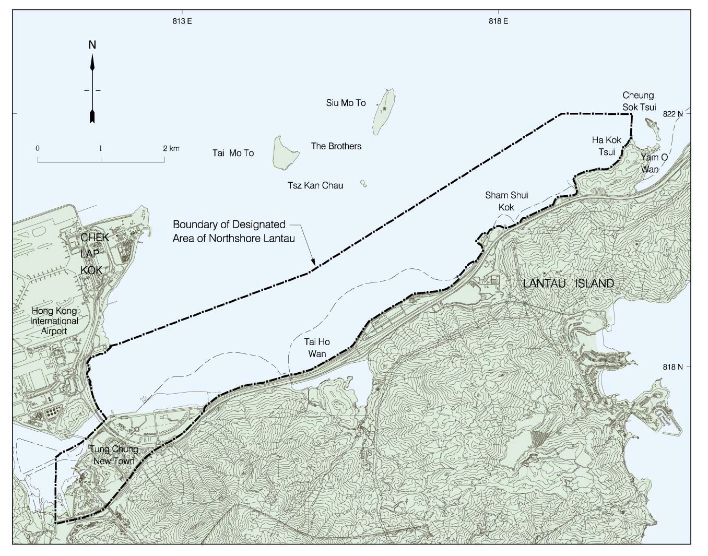

---
tags:
  - PNAP
  - APP series
  - Lantau 大嶼山
  - Complex geology 複雜地質
  - Foundation 地基
  - Site supervision 地盤監督
summary: "Northshore Lantau Designated Area: marble cavities and deep rockhead; staged GI, GEO consultation and foundation submission documents."
keywords: APP-134, Northshore Lantau, 北大嶼山, Tung Chung, 東涌, marble, 大理石, cavity, 溶洞, deep foundation, 深地基, Designated Area
---

# APP-134 Development in the Designated Area of Northshore Lantau <small>大嶼山北岸指定地區的發展</small>

!!! info "Document info 文件資料"
    | | |
    |---|---|
    | **Type 類別** | PNAP (APP series), previously PNAP 283 舊編號 PNAP 283 |
    | **Issued by 發出機構** | Buildings Department 屋宇署 |
    | **Version summarised 本摘要版本** | February 2006 |
    | **Official language 官方語言** | English and Chinese 中英文版 |
    | **Source 原文** | [English (PDF)](https://www.bd.gov.hk/doc/en/resources/codes-and-references/practice-notes-and-circular-letters/pnap/APP/APP134.pdf) · [中文 (PDF)](https://www.bd.gov.hk/doc/tc/resources/codes-and-references/practice-notes-and-circular-letters/pnap/APP/APP134.pdf) |
    | **Last checked 最後核對** | 2026-11-21 against the current BD version |

## At a glance 重點摘要 {#at-a-glance}

=== "English"

    - Geology of Tung Chung and **Northshore Lantau** is in HK Geological Survey Sheet Report No. 6 (para. 1).
    - Mainly granite, but with **marble metasediments with cavities**, soft or loose deposits in depressions, and **deep or steep rockhead** (para. 2).
    - These raise foundation cost and time; two planned towers at Tung Chung were abandoned. Optimise foundations using **early, comprehensive GI** and the GEO information unit (paras. 3–4 onward).

=== "中文"

    - 東涌及**大嶼山北岸**的地質資料見《香港地質調查報告》第 6 號（第 1 段）。
    - 主要為花崗岩，但有**含溶洞的大理石變質沉積岩**、凹陷處的軟弱或鬆散沉積物，以及**深或陡斜的岩面**（第 2 段）。
    - 此等情況增加基礎成本及工期，東涌曾有兩座住宅大廈因而放棄興建；應透過**及早及全面的土地勘測**及土力工程處資料優化基礎設計（第 3–4 段起）。

!!! tip "Does it apply? 是否適用"
    **Applies 適用**: GI and **deep foundations** in the **Designated Area of Northshore Lantau** (Tung Chung area; map below), where **marble cavities**, soft superficial deposits and **deep or steep rockhead** occur. 北大嶼山指定地區的勘測及深地基。

## Key clauses 條文一覽 {#key-clauses-table}

| Para. 段 | Rule 規定 |
|---|---|
| 1 | Geology in **HK Geological Survey Sheet Report No. 6** (2002) and GEO's records. 地質資料。 |
| 2 | Mainly granite with rhyolite dykes, but: (i) **metasedimentary rocks** (marble, metasandstone, metasiltstone) with **cavities** and fill; (ii) **soft / loose** superficial deposits in depressions; (iii) **anomalously deep or steep rockhead**. 複雜地質。 |
| 3 | Long piles are costly and slow; two planned towers at **Tung Chung** were **abandoned**. 有項目被迫放棄。 |
| 4 | Adequate GI allows optimisation; layout changes or abandonment may be warranted; special measures apply. 特別措施。 |
| 5 | Boundary plan at the Geotechnical Information Unit; location plan in **Appendix A**. 範圍。 |
| 6 | GI supervision per the **Site Supervision Code**; consult GEO's **Chief Geotechnical Engineer / Mainland West** before GI. 諮詢土力工程處。 |
| 7 | GI in **stages** with deep holes; start **before** finalising GBP. 分階段勘測。 |
| 8 | With foundation plans: (i) explanatory guide; (ii) **GI report** with equipment and procedures; (iii) **interpretation report**: design assumptions, anticipated problems, testing, inspection, maintenance; (iv) design calculations. 附交文件。 |
| 9–10 | Piling guidance (old PNAP 66, Foundations Code); supervision per the Site Supervision Code. 打樁指引及監督。 |
| 11 | **GEO TGN No. 12** for this area; Geoguide 2; GEO Publication 1/96. 技術指引。 |

<figure markdown>
  { width="620" loading=lazy }
  <figcaption>Appendix A – The Designated Area of Northshore Lantau (location plan). 北大嶼山指定地區位置圖。Source: BD, PNAP APP-134.</figcaption>
</figure>

## Whole picture 整體關係 {#whole-picture}

| Topic 主題 | Where 文件 |
|---|---|
| Similar marble control (Scheduled Areas 2, 4) 大理石地區 | [APP-61](app-61.md) |
| Foundations 地基 | [Foundations Code](../codes/foundations-2017.md) · [APP-18](app-18.md) |
| Site investigation 勘測 | [APP-49](app-49.md) |
| Cable car protection area (also Lantau) 纜車保護區 | [ADM-2](adm-2.md) App. I |
| Supervision 監督 | [Site Supervision Code](../codes/site-supervision-2009.md) |

## Related 相關文件 {#related}

| Document 文件 | Relationship 關係 |
|---|---|
| [APP-61](app-61.md) | Scheduled Areas 2 & 4 附表地區第2及4號 |

---
<small>Prepared by: _[name]_ · Checked by: _[name]_ · Quotes from the official English and Chinese versions; refer to the PNAP for the definitive text.</small>
